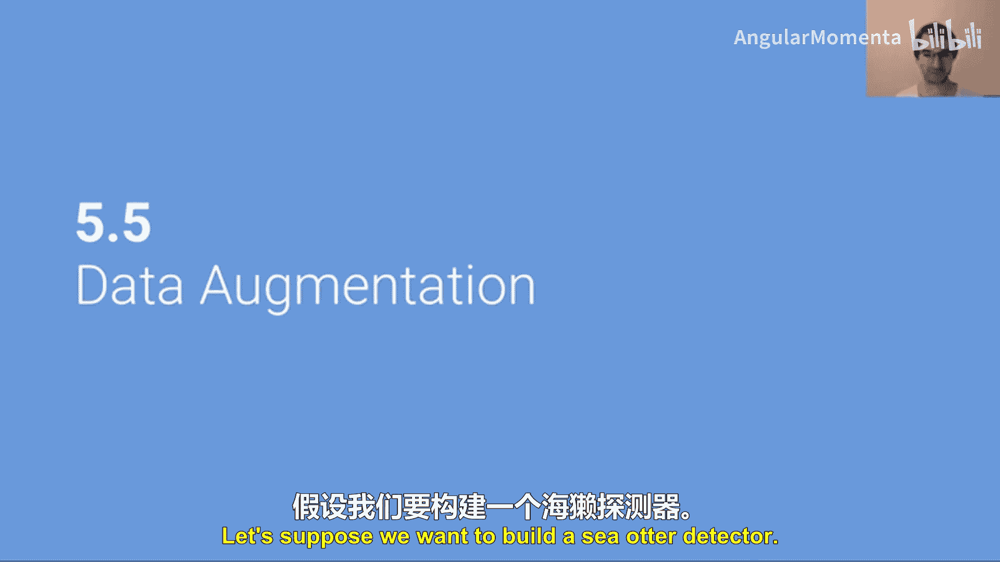
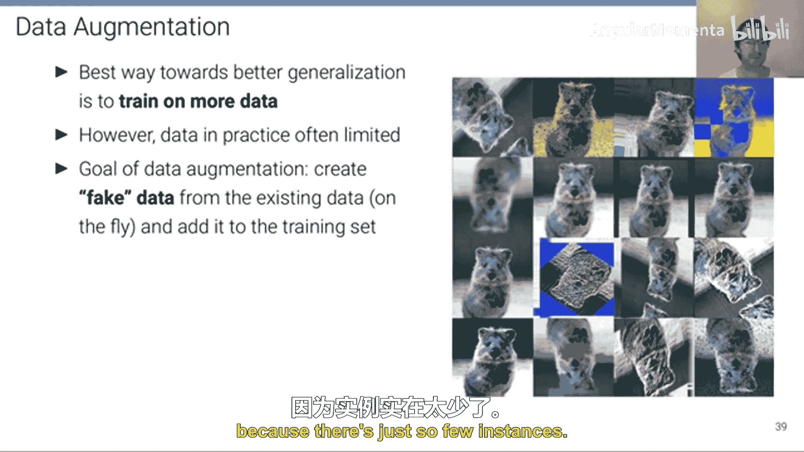
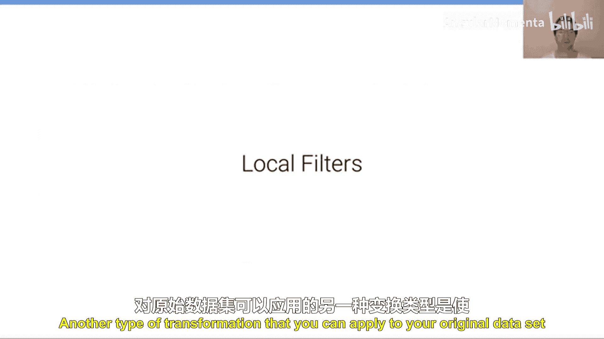
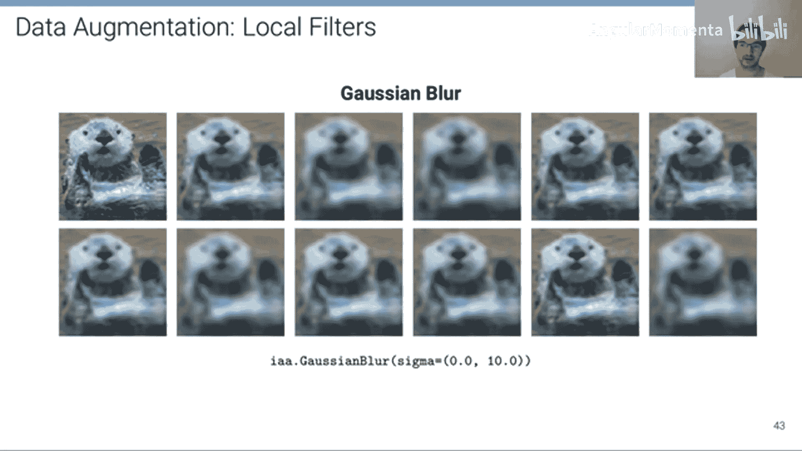
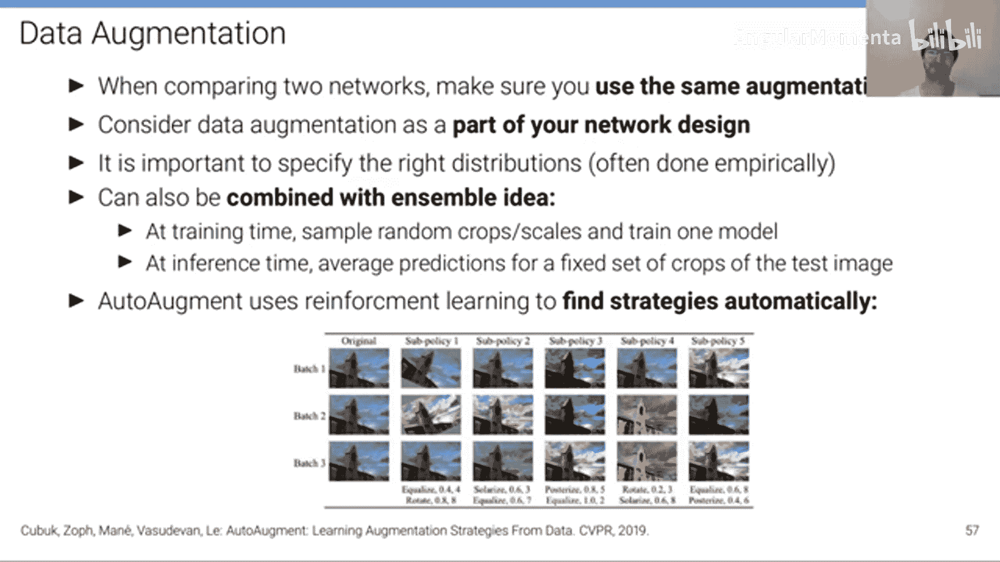

# 【精译】蒂宾根大学《深度学习》-p29-29--5.5-（正则化：数据增强）--BV1eDbrzhENK_p29-

In this last unit， we're gonna be talking about data augmentation。

。Let's suppose we want to build a C otter detector。

 Here is a random set of C otter images that I have retrieved from Google imagem search。

As you can clearly see from these set of images， the C otters appear in very different poses。

 for instance， we have this guy here， which is somehow enjoying relaxing on his back and then we have the one lying here and in all different kinds of poses like a standing one here。

In addition， these images appear in different color。

 and this is due to different lighting conditions or different cameras that have been used to take these photographs。

Furthermore， also the appearance of the uttertter changes because we are not always observing the same subject。

The post， the appearance the lighting， there's a lot of factors that contribute to the images looking very different。

 and that is what makes Imetric missions such a hard problem。Now， our object detector。

Our deep neural network that。Needs to recognize these images must be invariant to a wide variety of these input variations。

 right， We want this detector to be as invariant as possible to all of the intra class variations that we're seeing here。

 We want all of these images to be correctly classified as C o。Now。

 the best way towards such generalization is to train with more data。However。

 data is typically limited in practice。And the reason for this is that， first of all。

 it's expensive to capture data。 And then it's also expensive to annotate data。

 If we want to build a classifier， we need a。Data set that has images and label pairs。

And so it's both expensive to create and capture the data as well as to annotate the data and in some cases。

 if you think about the medical domain， for instance。

 it's even very difficult to capture the data at all because there's just so few instances。

Now the goal of data augmentation is to take the original data set。

 as is with its current size and from that data set to create new fake data。

On the fly on the fly means during training， these are very simple transformations that we're adding。

 we can apply them very efficiently during training， we don't even need to store them。

 we can just apply them on the fly during training randomly and then we are basically augmenting the data set with this so we are we can think about this as adding these additional new fake images to the training set and here on the right。

You can see some examples。We're going to look at these different transformations that have been used here in more detail。

Now， what is important， of course， is that this new data must preserve the original semantics。

If we transform the image。Such that the seeder looks like a cat。

 then of course we don't want to include that image into the training set。

 so we must operate on a reasonable image manifold that doesn't change the semantics of the category that we want to classify in the case of。

Image classification。And the amazing thing about data augmentation is that actually very simple operations such as just applying slight translations or adding a little bit of pixel noise。

Often already lead to greatly improved generalization。

 You might think the image looks almost the same， it's just slightly translated。

 there's a slight blur or noise added or the colors are slightly changed。

But because the model has never seen these changes before。

 it's incredibly useful to the model to exploit them during training。

And to build a more robust model that way。There's also great libraries available to generate such augmented data and I can recommend the library here behind that link。

 which is the library that I have used to generate the examples that you will see on the following slides。

So let's go through a couple of these transformations and I have categorized them into different kinds of transformations。

 we're going to start with geometric transformations。

So one very simple thing that you can do in order to create more data is to randomly crop your images in this case here that you can see here。

 the images have been randomly cropped and then rescaled to the original image size such that all of the images in the data that have the same size。

So this this operation has some parameters that you can set。

 such as like the region that you'd like to crop。It's not a good idea typically to crop very small regions because then the semantics is gone。

 you can't recognize the object anymore， but you can crop around a little bit around the object and you can still recognize the object。

 in this case， for instance， it's easy to recognize the object on all of the images。

 despite we have applied this cropping operation。In all slides that I show here at the bottom。

 I have。Illustrated the command that has been used。

 I'm using this library here that I have preferenced here。In order to generate these images。

 and I have generated just random transformations using random crops in this case from exactly the same input image。

Now， if you apply this to a whole data set， then of course you apply a random transformation with random parameters to each of the images so you get all of the images you get augmented。

 you randomly draw an image or you randomly draw your mini batchge。

 and then you augment this image badge， each element in this image bad， which is a different image。

 you augment differently using a random transformation。Here's another example。

 This is image cropping and padding is very simple very similar to the previous example。

 except that instead of the resizing now we have a padding operation where we well it's also resized here。

 but like if we crop it， then afterwards we pat the border with some able constant color or some color that expands the color that copies the color from the image borders or does something else to it like decays it。

What you can also do and what is often done is horizontal image flipping。If you look closely。

 there is some images here。 This is completely randomly generated。

 so some of the images have not been flipped。 some have been flipped。 In this case。

 there is only two options over the image is flipped or is not flipped。

 You can see that some of these images here are flipped versions of the original input image。

And in this case， we have chosen to flip the images with probability 0。5。As we will see later on。

 flipping is often a good idea， but sometimes is not a good idea， so it really depends on a task。

They you tackle them。For instance， if you want to do street scene。Semantic segmentation。

It might be a good idea from the perspective of generating more data to actually flip the images horizontally。

Because the images look very similar。However， if you're looking at scenes with right handed traffic。

 right sided traffic。Then of course， you obtain a different behavior if you flip the images。

 and that's a reason why you might not want to do that。

So it really depends on the application also what's less common is to flip the images upside down because often images are just captured。

In upright orientation， because this is how we as photographers typically hold a camera。

 and so this is not some invariance that we want to actually capture in our data set。

 This would actually make the recognition problem harder and we don't need to capture it because we rarely observe images that are completely flipped upside down。

This is another popular augment strategy。 It's a little bit more complex than just cropping。

 It applies an aine， a linear transformation。To the 2D image space。 And you can see that。

If in the case that there is some。Regions that are not part of the original input image you can ever。

Colorize them using a constant color， or you can。Copy the image into these regions as well or extend the boundaries。

 so there's different strategies on how to fill these regions that are not present in the original image after applying this geometric transformation。

You can also apply this piecewise， So in this case there is a little underlying grid and based on this。

 there is a piecewise Aline transformation applied you can see that different regions in these images are distorted differently。

 it's kind of a more local warping。And finally here we have a perspective transformation this is similar to an aine transformation just that it has a little bit more degrees of freedom it's basically doing a perspective transformation on the image plane。

 you can see that now。The image that we have this perspective effect appearing in these images where certain regions are squeezed and other regions are enlarged。

Another type of transformation that you can apply to your original data set is to use local filters。

So for instance， you can use Gausian blur。 Here is examples of different。

Strength of Go Bur in this case。For each image that I show here。

 the sigma value for the Gaussian blur kernel has been selected at random from the interval 0210。

You can see some of the images are more heavily blurred and some images are or remain sharper。

And this also makes your model more flexible because it tries to recognize objects at different resolutions effectively。

 and also when you're taking pictures with a camera。

 you typically have a little bit of blur applied through the process of actually taking of capturing the light in your lens and on your imager and。

Adding a little bit of gaut and blur is often something that is helpful。

You can also do the opposite。You can also try to sharpen new images and heres。

Examples of sharpened sea otters at different levels of sharpness， I can see。

This is another effect it's called MB effect， maybe you've seen that before in your image manipulation tool。

 it's another effect that can just apply to your images and you can see how this affects your generalization performance。

Here in this case， we have combined the original image with an edge detected version of it。

 so the image looks very different， and now we can see that maybe we have left a little bit the interval of reasonable values for this operation as in some of these cases。

 like in this one here on the top right， it's actually quite hard to recognize the see o。

Another important thing to consider is just per pixel noise or more structured noise to be added to the input images。

 And this is a very。Very general and popular data augmentation technique。

 It's maybe the the first thing that you would do in order to start with data augmentation is to add random noise to your images。

Why is this important？ Well， dim neural networks are actually quite sensitive to noise。

 If you add some noise to your images。The it's very likely。

 So if you add your noise to the test images only， it's very likely that the performance will drop dramatically。

So here's an example from Mattias Baker and Felix Swman's Co。

Where we compared the performance of deep neural networks recognizing images against humans。And。😊。

So they， they looked at simple examples。 In this case here， the Dnal network was trained on。

The original image and tested on the same distribution and the deep neural network was able to。

Show superhuman performance。In the second case there was noise added to both the training and the test images and it was the same level of noise。

 it was a kind of additive uniform noise that was added here。

 but the train and test distribution were the same and again the deep model showed superhuman performance。

Now， in this last experiment here， what they did is they added a salt and pepper noise to the training images。

 So with some probability， the training a pixel in the training image was set to either black or white。

Okay。And for the tests that， we also added noise。 but this time， they added。

The the uniform noise from before。The additive uniform noise。And in this case， despite the fact that。

As humans， both images look noisy and the noise distribution doesn't look that different。你。

Test performance dropped nearly to chance level， so the model didn't learn。

 or the model didn't perform well at all on this test set。And this shows how。嗯。Susceptible。

 these digital neural networks are to。Noise in the inputs。 And also， of course， if we take images。

 our cameras， they produce noise depending on the illumination conditions and on the sensor that we're using。

 So noise is really。Everywhere in images。 And so it's important to consider。

So if we want to add noise as a data augment strategy。

 the simplest thing that we can do is we can add Gaussian noise to each pixel separately。

 So this is a per pixel independent transformation that we're applying and for all of the images that I show here。

We have applied for each image。To all pixels the same noise。

 but we have varied the level of noise across the different images。

And this is an example with salt and pepper noise， where with some probability。

 each pixel has been turned。E black or white。And here's another example is called dropout noise in this case。

 the pixels have been with some probability dropped out to black this case。And here in this example。

 the dropout probability has been varied between 0。01 and 0。5。 You can see different。

Gates of dropout here。And we can also apply more structured noise we can cover entire regions within the input image also as a data augmentation strategy。

 and this is called cutout you can see some examples here。

You can not only apply noise to the inputs of the neural network。Which are here at the bottom。

 but you can also apply the noise throughout the neural network。

And a very prominent example is the one that we have just learned about， it's called dropout。

 where we have some probability drop out certain neurons in a neural network。But of course。

 instead of doing dropout， we could also imagine adding just noise to these individual units。

And the advantage of doing that is that now we apply this。

 we add this robustness not only to at the input feature level。

 but also at intermediate levels where higher level concepts。

 higher level representations inside the neural network are established。

 so it's something that often also work quite well。

The next transformations I want to talk about are color transformations。

 This is something that is also extremely useful。And it has been key to the success of many neural networks that work well on the Inet data set。

The reason why color transformations are important is that。

Cameras produce a different color spectrum depending on the type of sensors。

Depending on the type of or depending on the white balancing that has been performed。And also。

 the lighting condition can be very different， can be sunset with warmer colors。

 or it can be midnight or midday， and so the colors can change dramatically for the same scene。

That conveys the same semantics that shows the same object。So color transformations are really。

 really key for many data sets。So here is a very simple transformation you can do。

 you can simply change the contrast of the images。 you can see that some of these images now are more faint and some of them are more have a stronger contrast。

Again， the contrast。Manipulation or the contrast strength has been chosen randomly for HMHU。

This is just a distribution that you specify as a parameter to this library that then generates these augmented images。

You can do the same， of course， for the brightness。

 we have some darker images and some brighter images here。And you can do that per channel。

 So now the images look more funky。 So they have different colorized version versions of each other。

So I've always exaggerated the results here a little bit。

 maybe you don't want to apply these transformations as strongly as I show it here。

 but just to highlight the differences。You can also change the brightness locally In this case。

 again， we have done it per channel so that the colors look also different。 but you can see。

 for instance， if we look at this image here， that now these transformations have been applied locally based on some。

Frequency noise that we have added。 So we have。 we are have some regions here that。

Look different than other regions。This isn not a not a non。

It's not a per pixel transformation anymore more that we apply here。And we can of course。

 also change hue and satation of the images。Consider that some cases here。

 sateration has been decreased。And in some cases， we have more colorful images with a different he value。

We can also simply invert colors for this makes the images look very different from images that we would actually observe in the real world。

However， it can still be a very useful and impactful learning data set for your deep neural network。

 so it's really an empirical choice that you have to empirically investigate。

 which is the best data strategy for data augmentation strategy for your problem。Of course。

 you can also convert your color images into grayscale or。嗯。Look at a。

Images that are somewhere in between gray scale and full color images。

And you can also add more sophisticated effects。For instance。

 if you have a sophisticated graphic simulation engine， you can add these we effects In this case。

 these are very simple effects， so they don't require a sophisticated graphics engine。

 they can be generated very efficiently， so you don't need to precompute those。

 you can also calculate those on the fly。In this case， this is an effect called snow。

Not sure how much it looks like snow， but it's more white。No。

And then this is an effect that's called clouds， so it produces some cloud distortions on top of the original images。

And this is a effect called fog， also from this library that I showed in the beginning。Good。

 now what I've showed so far are transformations， in this case。

 12 different transformations of exactly the same input image。

 but of course you want to apply this to the entire data and ideally on the fly so that you don't even need to store these intermediate dataset sets。

 this augmented data， but you can generate it on the fly and so you end up with random transformations of all kinds of objects in the end of different objects。

And randomly combine these effects。 In this case， it's still an example for a single input image。

 but you apply these random combinations of effects on a random set of images。

 So you draw in your mini batch， you draw a random element。

And then you apply a random transformation from this generative process of transformations that you have defined。

系。And this is what is shown here， This is a random combination of effects applied to the same input image。

Yeah， in some cases， it's important to also transform the output， not only the input。嗯。

But you need to be careful for some tasks。 So， for instance。

In in the classification task where you don't need to transform the output typically。

 it can happen that you are changing the semantics。So consider， for instance。

 the handwritten letter recognition task， we want to recognize。

 you build a deep model that recognizes handwritten letters。嗯。

You need to be careful to not apply transformations that would change the output class。

So here's an example。If we， for instance， consider this。Lettter D， this hand drawn letter D。

 and we would apply horizontal flips， the letter D would be converted。

 The input would be converted such they would look like a different letter。

 a letter B right but if we don't also flip the label then and this is typically not what we do during classification And we just want to exclude this type of transformation from the augmentation strategy to not have this。

Semantic changes in our data set， right， Because if we would not change also the label。

 then we would now have a letter B that would have the letter D。

 and they would confuse the classifier。Here's another example。

 this is a digit 6 that is rotated by 180 degrees and turns into the diit 9。

 so having a 180 degree rotation on MNIST is not what you want to do for as a data augmentation strategy。

But as a remark for general object recognition， if you want to recognize， for instance， C os。

 then these flips and also some level of rotation can often be quite useful。

 so it really depends on the task that you are interested in what type of transformations you want to apply。

In some tasks， when we think about tasks that are not just recognition， not just classification。

Where the output space is more complex， we might also need to transform the targets， the outputs。

 the ground truth outputs。So here we have examples with。That prediction。

Semantic instance mask prediction。Key point prediction。And a binding box detection。

All of these are structured outputs。 And， of course， if we now translate the object or we。

App some other geometric transformation to the input。

 then we also need to transform the target correspondingly。

 we also need to translate the instant mask， for instance。

If we just apply a per pixel transformation like a color change or some noise。

 then the output or target stays valid so we don't need to transform。

In some cases like in the case of depth prediction or stereo prediction。

 it's even more difficult because we can't just translate one image without translating the other and changing the actual depth values。

So it really depends on the output that you're predicting。

Which input transformations you want to apply and if and how you need to also transform the targets in order to create a valid data set。

Some final remarks on data augmentation when comparing to networks。

 let's say you'll compare your model to the state of the art model that you have。

Reimplement it or you downloaded the code somewhere and you run it on your computer。

 you need to make sure that you use exactly the same augmentation strategy because augmentation is so powerful it can increase performance dramatically if you don't do that then you might be misled and it might appear to you that maybe your model innovations are actually giving you the benefit while actually it's just the data augmentation strategy that is different。

It's also good to consider data augmentation as part of your network design。 As I mentioned before。

 ideally， you do these simple transformations that are fast to compute on the fly so that you don't need to transfer a lot of memory。

 You can do this very efficiently on the GPU。It's also important to specify the right distributions。

 the right distributions over this transformation space， which unfortunately， there is no。

Golden rule for this is often done empirically by a trial and error。

 but it's important to think about these distributions and what transformations。

Are valid and what transformations are not valid。And then design these。

 specify these random ranges from where to crop， etc cetera， based on this intuition and some。

Tri and error experiments。The idea of data augment can also be combined with the ensemble idea。

 for instance， very well performingforming models on Iagenet often sample random crops and scales and training time and then train one model or even multiple models and then at inference time average the predictions for a fixed set of crops of the test image so even you have trained only a single model you can apply that single model to different crops of the test image as well。

 and then you can take this ensemble prediction as a more robust and more powerful predictor that gives you slightly better performance。

So the data augmentation strategy and the ensemble ideas can be combined。

And then finally there's also some work， and I've referenced a specific paper here at the bottom。

That tries to go towards finding these data augmentation strategies in a more principled manner automatically using reinforcement learning。

From data。You can see here at the bottom that there is a policy that has basically been split into sub policies and then when we apply data augmentation in this case。

 we can choose randomly from the sub policies which have been automatically determined by the algorithm to lead to a good generalization performance on the data set of interest。

That's all for today。

