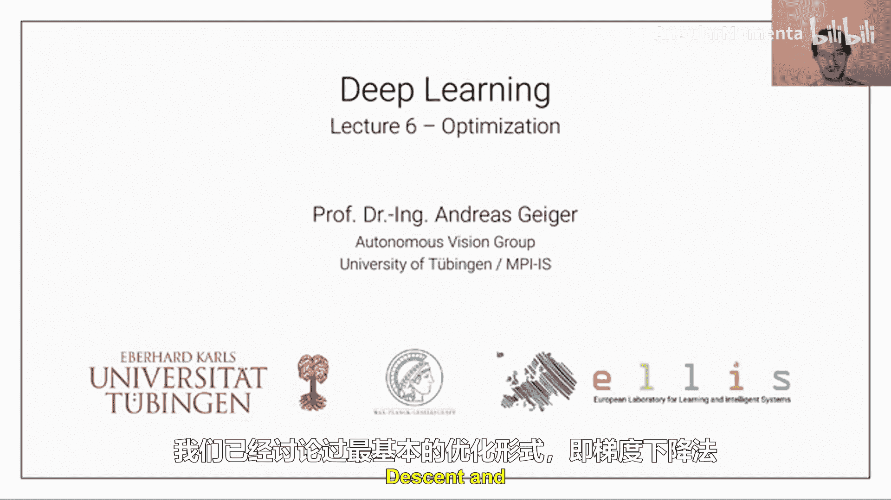
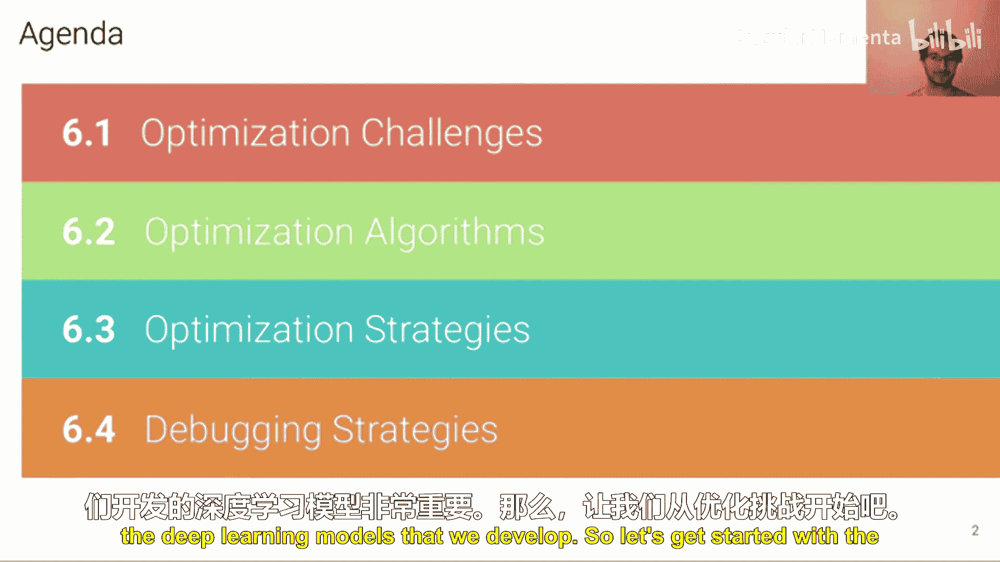
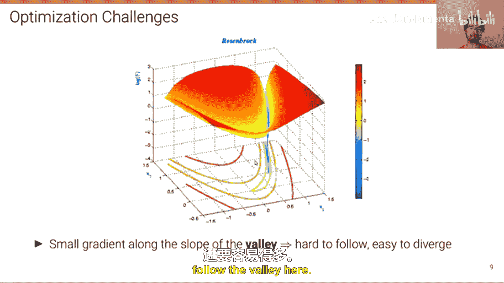
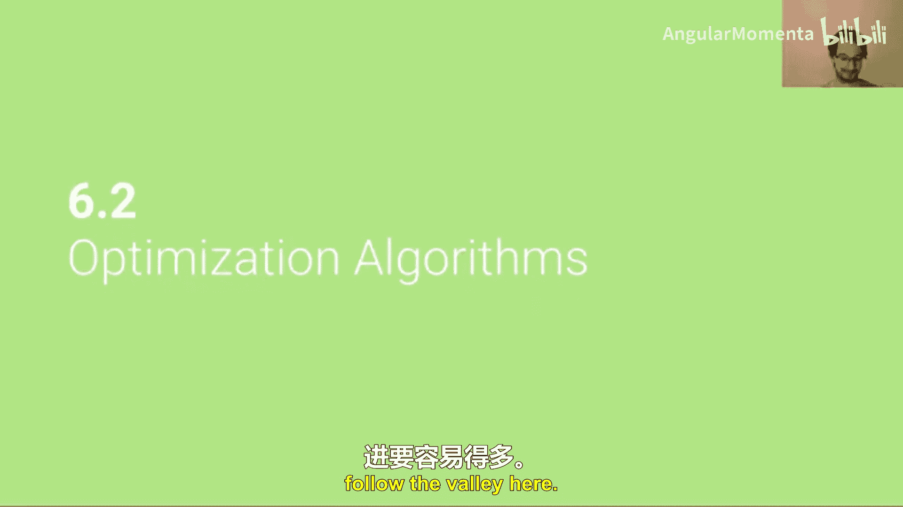

# 【精译】蒂宾根大学《深度学习》-p30-30--6.1-（优化：优化挑战）--BV1eDbrzhENK_p30-

Hello and welcome to the sixth lecture of this deep learning course。 Today。

 our topic is optimization。We've already discussed the most basic form of optimization。

 which is gradienting descent and stochastic gradient in descent。

And today， we're going to get to know some of the variants of these optimizers that are useful in the context of optimizing and training deep neural networks。

This lecture is structured into four units in the first unit we're going to be talking about challenges that are oftenrising during optimization。

In the second unit， which is the core unit of this lecture。

 we're going to discuss optimization algorithms that go beyond simple gradient descent or stochastic gradient descent。

In the third unit， we're going to discuss several common optimization strategies that are。

Techniques that are useful in the context of optimization in order to get better performing models。

And finally， what is also very important in deep learning。Is that many things can go wrong。

 and so it's important to have efficient strategies for debugging。

The deep learning models that we develop。

So let's get started with the optimization challenges。Here on the left， we can see the。

Standard formulation for gradienting descent， where we have some parameters that we want to optimize。

We have a loss function of which we are able to compute the gradients for。At a particular。

Pimeter point W。And I'm using this upper script T for time or iteration。

 which is the progress of optimization over time。 And as we start at a particular initial value for this parameters W。

Which I call W in it。Yeah。They can be initialized to 0， but that， as we have seen already。

 is not a very good initialization for deep learning。

So initialization based on a zero standard Gausian is a better choice， for instance。

But here in the context of optimization， for this optimization class， we were gonna。

Talk more frequently about or discuss the algorithms in the context of very simple low dimension optimization problems and for those the initialitization is。

Less critical doesn't need to be。Random。Okay， so we initialize at W in it。

 and then we update with this update equation which updates the weights。

 so with next weight we get by the old weight minus some step size times the gradient of the objective function or loss function。

Now why do we need to move into the negative direction of the gradient。

 this is easy to illustrate here on this example， this is a one dimensional example。

 so W is one dimensional in this case。And we have this blue objective function。

 we want to find this minimum， or because it's a non convex function。

 we might actually only find a local minimum if we follow the gradient。So， we started。W0。

And then we can already see that in order to go to move right and we have to move right to reach a smaller point。

 we have to follow the negative gradient。So the gradient in this case here is negative。

So in order to move into positive direction， we need to。Move into negative gradient direction。

 because then the gradient in this example is negative。Okay。

 so the step size is always a positive value。Okay。Right。As already mentioned in deep neural networks。

 the loss is almost always not convex。 That means it has multiple local minimumma。 There is not。

A line that connects any two points and the curve is always below that line。

 which is the definition of convexity。But this is not the case here。

 We have points where we slope upwards to the left and we slope upwards to the right。

 and we have multiple of these points。Right， so there exist multiple local minimumma。

 These are called local mini because some of them are not a global minima。 This is the global minima。

 Let's assume this objective function is only defined in that range。

 Then this would be the global minimum。ButThere is two other local minima here。

 And depending on where we start our gradient descent， we might end up in in those。 So starting。

 for instance， from this point here， following the gradient。As we come closer to the local minimum。

 we。Get slower and slower， and then we reach the local minimum and the grade is 0。

 and we should ideally stop there。咖啡。对。嗯。Now， is it a problem if we have multiple local minimum from an optimization perspective。

 that is not ideal， right， because we might end up here while actually。

 were looking for a point here， which。Drive steam， loss function， even。Smaller。

Now in neural networks。One fact about neural networks is that many local minima are actually equally good。

You can see this， for instance， by taking a multilayer perceptron。And within any hidden layer。

 you randomly permute the neurons and also the incoming and outgoing connections。

And then you will get exactly the same result， you will get exactly the same loss function value。

 despite having used effectively a different parameterization。

So many local minima in drugs are equally good and that's。The good news for deep learning。

 that's actually the reason why's such a simple technique， such as gradient in descent。😊。

Can actually give us models that while not reaching the global minimum of the lost function still are useful in practice and deliver useful predictions。

Now we've already seen that local minima， there can be challenges and there are challenges for deep learning even though we have a lot of good local minimum。

 Another challenge is that we have to set the learning rate， the learning rate Eta。Here。

And depending on how we choose the learning rate， the progress can be very slow。

 if we choose the learning rate too low， then we reach the local minimum very。

 very slowly because the closer we come to the local minimum the smaller thegrading the smaller the step sizes we are taking so it takes very。

 very long towards the end now choosing the learning rate too high might actually lead to divergence。

 we have an example here， this is actually a convex loss function。

 a very simple one parabola and what happens now if we choose the learning rate that is too high is that we are moving into the positive direction which is correct。

 but we are overshooting the minimum so we coming we're landing here at this point and then we evaluate the loss function at these parameters which is actually higher than the loss function at the initial parameters。

Now， if you compute the gradient here again， then were overshooting into the other direction。

 now the gradient is even the magnitude of the gradient is even larger than the magnitude here because we are slightly more to the right。

So we're landing here now the gradient， the magnitude of the gradient is even larger。

 and so we're overshooting again to the other direction and we're basically escaping that global optimum we are diverging。

This is the problem of choosing the linger to high。Steep cliffs。This is what we call a cliff in a。

Loss function or energy function landscape can also pose great challenges to optimization。

As these very high derivatives that we have here can， as in the divergence case before。

 can actually catapult。The parameters is W very far off。So in this particular case， we start here。

 and we。We come closer and closer to the minimum。 now we have。 We are increasing the the gradient。

 so we are moving even a little bit further。 But what happens now is if we， if we're landing here。

Then we have actually dramatically already increased the loss function， and because at this point。

Because we're in this cliff region， we have an extremely high gradient。

Were kind of pulling us off like further away from where we have started。

And so it's kind of the same issue with bit。We have seen before with divergence and one way to counteract this is a simple houristic that people often use in practice。

 which is great in clipping。In order to avoid very large gradients for particular parameters。

 particular elements of the perimeter vector， we're just clipping them to a。

A priori selected range such that is extremely large。

Gradients cannot adversely affect the optimization， but this is a houristic。

Another issue for optimization are saddle points。 Here we see a saddle point。

 A saddle point is a point in optimization in the loss landscape。Where the gradient is 0 here。

 the gradient at this red point is 0， but we are not at a。Not even a local minimum， because there is。

Like the slope of this function is sloping upwards in one direction and sloping downwards in another direction。

Now， in deep learning， there is compared to local minima。

 there' is an exponentially large amount of saddle points。 And the reason for this is。

Because it's much easy like it's just probabilically。

 much more likely to have a subtle point at a minimum， all if you think about an insanely large。

 a very large dimensional space， which is the parameter space with millions of dimensions。

 it's very unlikely that we have a point where we are reaching a point where the slope in any of these million dimensions is in the same directions sloping upwards。

 it's much more likely that some of the direction slope downwards and some of the direction slope upwards if you think about。

Each of this direction generating the slope from a random bernoli draw。Okay， so saddle points。

Occur a lot in deep learning， but they are really just problematic if we exactly hit the saddle point。

 And that's very unlikely if we're exactly hitting this point， if we are slightly off that point。

 then as soon as we accumulate some more gradients， we'll start moving downwards again。

Another challenge are plateaus。And plateaus are also quite common in training deep models。

Alateau is a region here on the top where the gradient is almost serum。

 and that means we have very slow progress for our optimizer， or maybe even no progress at all。

Examples of this include saturated sigmoid activation functions or dead relus where the gradient is effectively zero or even close to zero。

 even equal to0。So plateaus are a problem， the optimization becomes very slow。

 and they occur also frequently in deep learning。And here's another case that's difficult to optimize。

 This is from the Rosenbrook function。Clasical function for benchmarking optimizers。

And this function here in this particular area has a。A little valley。 It's a very steep valley。

So we have a small gradient along the slope of this valley。

 You can see this here in these iso contours on the bottom behind the。Very。

 very small slope in this direction。 But this is the direction that we need to follow in order to optimize。

Now， when we have reached that valley， following that。

Valt is very difficult for the optimizer because it's very easy to overshoot into any of the riches or walls of this valley and therefore catapult the periyramid vector away from the valley。

 so it's much more easy to diverge than it is to follow the valley here。

