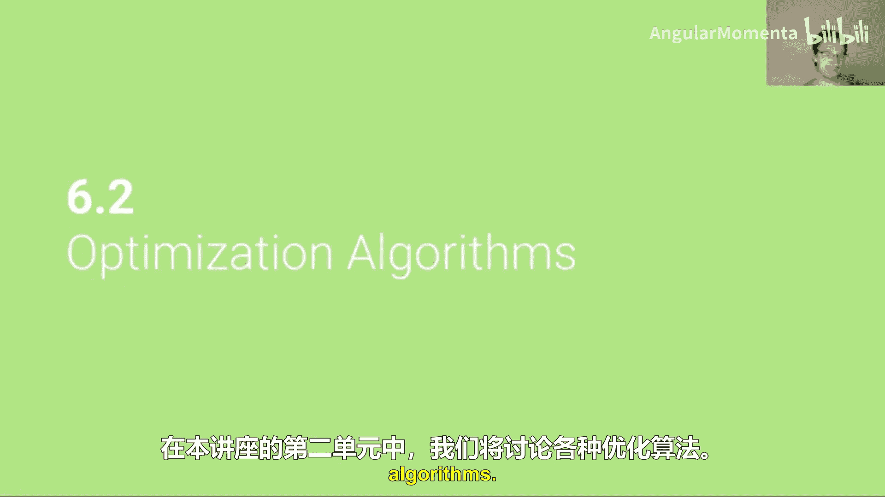
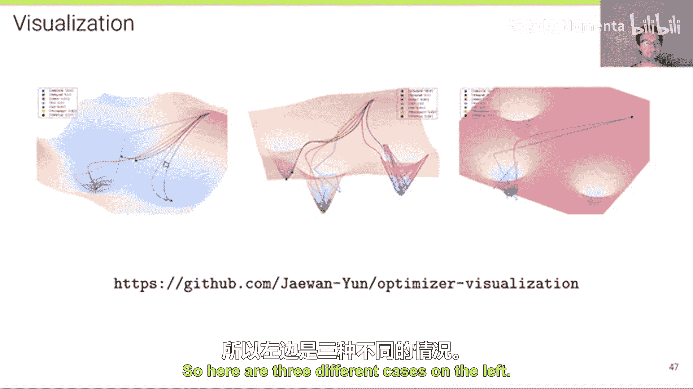
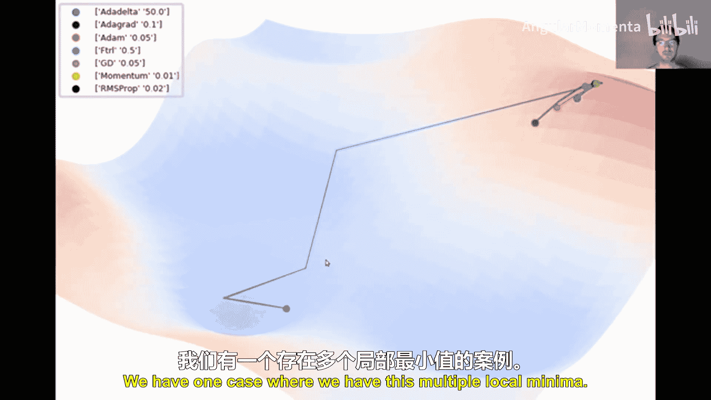
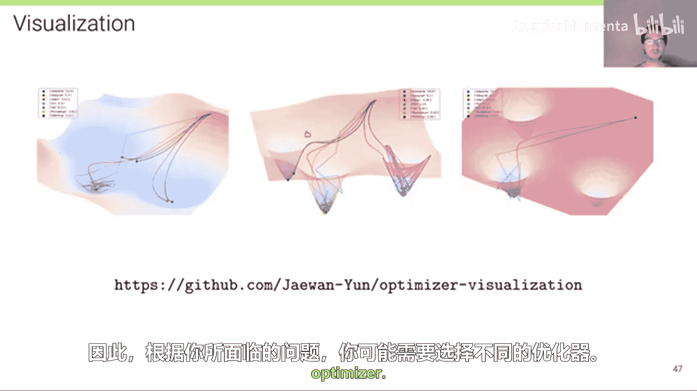
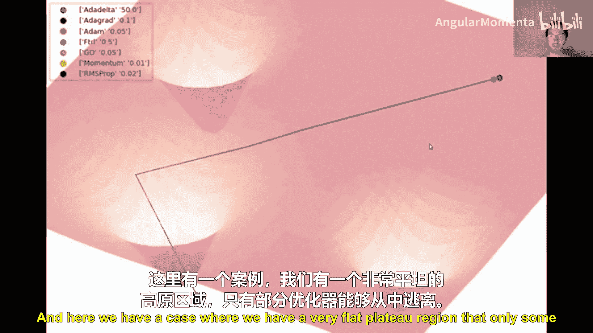
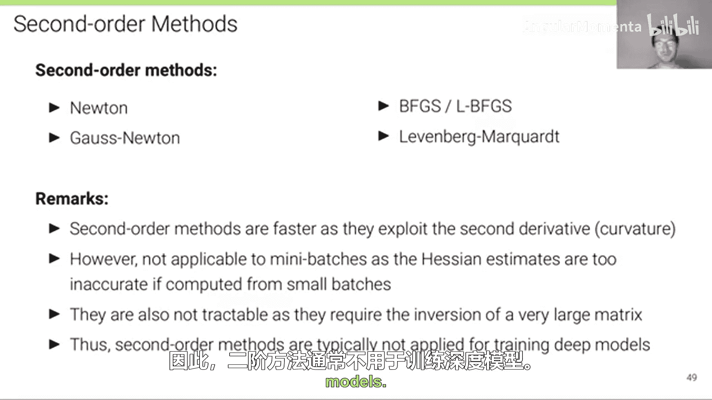

# 【精译】蒂宾根大学《深度学习》-p31-31--6.2-（优化：优化算法）--BV1eDbrzhENK_p31-

In the second unit of this lecture， we're going to discuss various optimization algorithms。

Let's start by reviewing again the standard vanilla grade and decentcent algorithm。

 we start by initializing the weights W here0 is the time index 0 or iteration number 0。

And by picking a learning rate， which is a scalar factor。And then for all data pointss。

We do the following。Note that this is a loop over all data points of the data。

Contrast to stochastic grain descent， where we loop over a mini batch。So for all data points。

 we forward propagate the input。To calculate a prediction。And then。We back propagate the gradients。

 starting from the lost node。In order to obtain the gradient of the loss function with respect to every parameter。

Of our model， W。So this is the gradient。Per data point。

And then we simply update the gradients by moving a little bit into the negative direction of the average gradient over all the data points。

If the validation error decreases。We go to step two and repeat， and otherwise we stop。However。

In deep learning， we typically deal with millions of parameters。

And we also deal with a very large number of training points。

 which makes this update here very expensive。And also we have to do many updates in deep learning typically。

 so this becomes very slow or doesn't even fit into GPU memory。Therefore， in practice。

 what we do is we use stochastic gradienting descent。Where。

We utilize the observation that the total loss over the entire training set can be expressed as an expectation。

So here we have。The total loss of all the data points from before。

And this can be expressed as an expectation over drawing all the data points with uniform probability。

And then it's an expectation over the loss function。

And the insight is that this expectation can be approximated by a smaller subset of the data。

So what we've done here is。We've approximated this true gradient。With a subset of the data points。

And therefore夫。The gradient can also be approximated。

The only difference to the previous equation is now that we have added the Nabla operator。

 the gradient symbol， she pushed through the equations。And so the gradient。

 the true gradient over all the data points， is now approximated by a gradient that is computed from a small batch。

 maybe 64 elements out of 1 million training points。other words。

 we get a noisy approximation to the gradient。Okay。Here are some remarks on STD。Thisす。

Smaller data set is called a mini batch。And in this lecture。

 we typically use P capital B as the batch size。And we should choose this capital B as large as the GPU memory allows。

嗯。Typically P is much smaller than the dataset set size。8ight， 16，32，64， for example。However。

 smaller batch sizes lead to larger variances in the gradients to more noisy updates。

But this effect gets averaged out over time as we do many， many steps。

The batches can be chosen randomly or by partitioning the data set。A prior to optimization。

 so during optimization， we can ever draw randomly。From the full dataset。

 or we first partition the data。However， we need to be careful that be shuffle the data set when we do the partitioning because if we take the raw data set and we take the first 10 elements and then the second 10 elements and the first 10 elements。

 it's very likely that there is some correlation between the elements because。

Typically data sets are recorded sequentially， and so there is a correlation between the elements。

 so we first shuffle the data set and then we partition the data ideally and theoretically more well we however。

 choose completely randomly。At every minibu update。

This is a little bit more expensive memory wise it's much more efficient if we can pre partition the data set and then dynamically load all the batches into memory。

 GPO memory。Yeah， so and I also like to introduce the terminology that we're going to use here throughout this lecture。

An iteration is a single gradient update based on a single name batch。

 That's what we call an iteration。 That's one iteration， one gradient update step of the algorithm。

In contrast， an ApoC is a complete path through the training set。

That means if we have a mini batch size of B。And we have a dataset set size of n。

We have n over P iterations。In one epoch。We need to do n over P iterations to see。

Statistically see every data element once。So here's the algorithm。We have seen this already。

 we initialized the way it's peak learning rate and a mini batch size。

 which is an additional hyperpermeter now。And then we draw random mini batches。

And for all mini batch elements now， this is different from before。We forgot about propagated inputs。

And then the back propagate the gradients。And then we update the perimeter vector。By going啊。

Small step into the negative direction of the average over the mini batch。

If the validation error decreases。We continue， otherwise we stop。Now。

 this allows for training with limited memory， which is。Typically the case。

 if we apply deep learning on portal hardware such as GPUs， we're limited to the GPU memory。

Which is in most cases much smaller than other sorts of memory like standard REM or disk memory。

And this is possible because we split the data into these chunks into these patches。However。

 it also introduces stop castasticity， the batch gradients approximate the true gradient。

Here's an example。And in the following slides， I'm always going to use the same example。

What you're going to see here is a controlt plot。This is a。Visualization of a quadratic， a 2D para。

That slopes upward more quickly in this direction and more slowly in this direction。And we can see。

 also the。Value of the individual controlt heightlines of this function。

 So we have the minimum0 here in the center， and then as we go outwards， we increase。

And so that's what were going to consider as a very simple loss function。 right。

 We have the loss now defined， not in terms of a complicated network just。

As a linear or a quadratic function of the input parameters W1 and W2。

 and this is what the function looks like， you can see that the function slopes upwards less quickly in W1 direction because we have multiplied effect 0。

1 here。But it slopes upwards more quickly into this W2 direction because we have multiplied a factor of one。

In front of W2。So this is a very simple。A loss function that we're optimizing has a very simple relationship。

 a quadratic relationship with respect to the weights。

 but it serves the purpose of visualizing what different optimizers do very well。Now。

 the gradient of this function is given。Like this。Just computing the derivative of this function with respect to W1。

 this is the first element of this vector。And the second element of this gradient in vector is the derivative with respect to W2。

Now to simulate the stochastic process of mini batches。

What I've done is in all of the visualizations that I'm going to show you in the following。

 I've added a little bit of noise to the gradient， this simulates the gradient of stochastic gradient descent where we go over mini batches。

 so the gradient becomes noisy。嗯。Okay， so now let's apply our。Stochastic， gradient and decent。

Update equations to this problem。 We start at a particular W0。 I' always going to start here at。

us1 and91 and9 or minus9 and minus1。And then we are running steps of this algorithm。

Here's the equation of the updates again， we're always going a little bit into the negative gradienting direction。

Now， what happens if we choose the learning rate too small is that we do not converge here we see what happens for 100 steps in the beginning because the slope is still large enough。

 the gradient is still large enough。We make bigger steps， but then as we reach this。Valt here。

Where the slope is， the gradient is not as high anymore。 we make smaller steps。Because to。

The gradient is directly related。To。The length of the step that we do because AA is the learning rate is constant。

So we are multiplying it with this gradient。 If the gradient becomes small。

 the steps that we do also become smaller。And here in this particular case。

 we've chosen Eta equals 0。1。Now， if we choose the learning rate too high。

 in this case we've chosen Eta as 1。01， we see that the model heavily oscillates。

 we're getting closer to the optimum， but we are heavily oscillating around the optimum。

In other words， we divert。So choosing EA， choosing the correct Eer is quite brittle。

Why is this happening， Well， we have seen an example on。The illustrations in the first unit。

Where we are successively overshooting。If the learning rate is too high。

 then we're ending up on the other side of the valley。Just a slightly bit outside。

 more outside than we have been on this side， and so we are successively increasing this effect until we reach like very large values。

You can also see the noise in the result， not all of these points are equally aligned。

 equally distributed， this is coming from the noise that we have added to the gradient。Okay。

 so choosing a low rate that is too high leads to oscillations or divergence。Now here in this case。

 we've chosen a better learning rate。A good learning rate， in this case， 0。99 works better。

 we coming closer to the optimum。But it's still inefficient。

It's very slow because we still have this oscillating effect here。

And we still don't have convergence。In fact， as we'll see， with a fixed learning rate。

 we can actually never converge。So this is what happens with a learning rate of 0。99。

We oscillate towards the minimum by becoming close and closer。

 but the step sizes become small and small。And still even if we would be converged at the end。

 if we would start at the optimal solution。We would alsoate around that solution due to the noise in the。

Mini batch gradients。Now， how can we choose the right learning rate？

One method to do so is line search what we would do in line searches that we would compute the mini batch gradient。

And then find the optimal step size。By solving an optimization problem。

That minimizes this loss function。By going。From the current parameter estimates。

Into the direction of the gradient by the step size that we're optimizing for。

 and then we can update the weights accordingly using this optimal step size。 So for instance， here。

 if we would find the optimal step size， we would end up exactly here in at the minimum along this array here。

 along this direction here。Howeverever。This line search technique。

 which is quite common in our applications of optimization。

 is not practical for deep learning as we need to solve very large systems at each step。

 so it becomes very slow and expensive。And furthermore， because we are considering many batchs here。

 it's not necessarily the optimal step size of the total overall loss。

As this step size that has been found here is only optimal for the current mini batchsh。So therefore。

 this technique is not used in practice。Let's talk a little bit more about convergence of SGD。我。

As already mentioned before， even when starting at the optimal solution。

We will not stay at the optimal solution when applying S2D and the reason for this is that the gradients are noisy。

 so we'll always do a step。We will always step away from the optimum。

 we will oscillate around the optimum， but we always oscillate。And this example。

We have initialized at。0， but we're oscillating around0。

So even when starting at the optimal location。We will will not stay at the optimal location。

 which means we with a fixed learning rate Eta， stochastic gradient and descent can actually not converge。

What does conversionvergence actually mean？Well。If we formalize it mathematically。

 the convergence of a series is defined as follows。

The series is the sum of terms of an infinite sequence of numbers， A1， A2， etc。So here we have this。

Infinite sequence of numbers where we let n go to infinity， this is called a series。

When does a series converge？A series is called convergent if there exists a number S star。

 such that for every arbitrarily small positive number epsilom。

 there exists an integer and such that for all。Little n， bigger than this number n。

 this condition holds。In other words， no matter how we choose。This epsilon。

 how small we choose this epsilon here。We know that we can find an N。Such that。嗯。

that we can find a big n such that all as n for which n is bigger than this big n。Is。

S close to S star or closer than Epsilon was actually closer to S star than Epsilon。

That means convergence so we can。We can by going。Long enough。

We can come to the optimal solution arbitrarily close， in other words。

And SD updates can be interpreted in the same way。So here is the SD update。

And we are now going to interpret this as a parameter series。So we start with W zero。

Then we go a step into the gradientding direction。And L 0 here is just an appbbreviation of。

The mini batch loss gradient at W0。Now to get the parameters at iteration 2。We have。

The same equation， just increment by one。Such that we can now recursively。嗯。Insert。

The equation above into this equation here。So if we insert this equation into this equation。

 we get this equation。So it's just basically inserting this here。Now we have an equation for W2。

And we can insert W2 into the equation for W3。And so on。So this is the sequence that we obtain。

 and here we have a1， A2 and A3， which are the elements of this series。

And now we can define conversiongs of STD as follows。

The SGD optimizerg converges if there exists a vector W star。

 such that for every arbitrarily small positive number epsilon there exists in integer T。

Such that for all time steps bigger than this integer T。We come arbitrarily close to W star。

 It's the same argument。No matter how small we choose epsilon， you'll always find。

An iteration number team， a time step T such that from there on will always be at least as close to。

W star as Epsilon。And now。There is a famous theorem。From Robins and Monro， that says the following。

Let's。Eta 1， Eta 2 and so on will be a sequence of positive step sizes。With。

The property is that the infinite sum over Eta is infinity。

And the infinite sum of Eta square is smaller than infinity， so it's finite。And let further。

GT denote an unbiased estimate of the gradient of the loss function at the perimeter at time T。

So it's basically our gradient。During stochastic gradient descent。

In other words the expectation of GTA is。The gradient， the true cr。Then the serious。

This update series is here。Which is， as you recognize the update of SGD。

For t towards infinity convertges to a local minimum of the。Lost function。Of W。

We can't guarantee that it convertges to a global minimum because we have a non convex loss function。

 in the case of of a convex loss function， we would guarantee that it even convertges to a global optimum。

But we can guarantee that it converges。And an example for such a sequence of step sizes is this one here where we have Eta T equals some hyperperameter learning rate over T。

So if we decay the step size， if we decay the learning rate。Rapidly with1 over t。

 we can guarantee convoits。Okay， so under certain properties， SD is actually able to converge。

That is what we know now。However， there are some problems with STD as well。First。

 the gradients are scaled equally across all dimensions and that's not ideal as we have seen before because we have to choose very conservative learning rates to avoid divergence。

However， in this case， in the case of choosing the learning rates very small。

 the updates become very small as well， so we have very slow progress。

And finding a good learning rate is very difficult。

So let's look next at an improvement over vanilla SD， which is SD with momentum。哦。

So here's the motivation for STD with momentum。This is again an example of vanilla SD with a good learning rate as we've seen before。

 it's exactly the same example from before where you can see this oscillating effect。

What we see is that this SGD here oscillates along W2。So what we ideally want to do。

 we want to dampen it in this direction。For instance， by averaging over time。

 if we would average these oscillations over time， we would oscillate less。Furthermore。

 STD makes very slow progress along the W1 axis。So we like to accelerate along this direction。

To more quickly arrive at the minimum。And so this is exactly the idea of momentum。

 what we want to do is we want to update the weights。

But we don't want to update the weights just looking into by going a little negative step size into the gradient direction。

But we want to update it with an exponentially moving average。

Of the past gradients so that we can introduce this effect of momentum this dampening。

Here's what this looks like。If you compare this to the previous slide。

 you see the oscillations have been dampened。And we also come a little bit closer to the optimum。

And here on the bottom you see the update equations for STD with momentum。对。

What we have here is the update equation for the weights。

That now depends on another variable that is updated over time。Which is the velocity。

The velocity is basically the negative。Graient。Plus。

 a factor times to the velocity at the previous iteration。And this is why it's called momentum。

 We keep a little bit of the information of the motion at the previous iteration。

This means that if we oscillate heavily， then these effects will cancel out because with。

 in this case， beta 0。9， we will。Combine。A negative value with a positive value， which is at the。嗯。

Which is the value at the at the new。Location。And this is why we have this dampening effect if we choose beta 1 equals0。

We get exactly stochastic gradient descent。没了。This velocity will always be exactly equal to minus the learning rate times the gradient。

So beta must be somewhere between 0 and 1。In a practice， often。0。

9 is chosen as a good compromise between you know。Taking into consideration previous。Vellocities and。

The new gradient direction。Now， this is how momentum is traditionally introduced。

But I like to rewrite it a little bit。As this expression here couples momentum with the learning rate。

Now in this case， we can change the learning rate without also changing the momentum due to this coupling here。

But we can find a better parameterization。As follows。

If we write the velocity as a linear combination of the previous velocity and the gradient。Now。

 this case is a positive gradientedent。And then， we update the。

Weights based on the negative step size times the velocity。

Then we have effectively decoupled B time in itta so we can now independently change the two and inspect their behavior。

 so it's much more convenient。Again， we have the same behavior that if we choose beta1 equals to0。

Then。We will be left with standard stochastic gradientding descent。Yeah。So what is effectively。

 both of these equations effectively implement is they are。

Calculating an exponential moving average of the gradient here with M。

To see this a little bit better。Let's have a closer look。

And let's also see why this is an exponential moving average。

We now again abbreviate the gradient duration T with GT。

And so here we have the update equation of the velocity that we've seen on previous slide。

And let's assume we start with velocity0。Now in the first step。

We simply have this equation because we have the initial velocity is set as0。

 the first home goes away， and we're left with the second term。Now。

 the velocity at the second iteration depends on the velocity at the first iteration。

So we can now plug in this expression here， look at this expression。And so on。So this continues。

If we continue this， we see that the weight decays exponentially。

 We have always one minus speedta one， so we can factor it out， and then we have。

A beta 1 to some power that is decreasing and G with an index that's increasing。

 that's what this expression tells us。We can see now that the weight thats。

Multipliied to the gradient。At a previous time or iteration I。

Is sticking exponentially because we have a minus I here in the exponent of beta。

SoLet's say the current time step is 10 and we are looking into the contribution of the gradient at time step1。

Then we have。Beta to the power of 10-1-1， which is beta to the power of8。

So and because beta is smaller than one。It decays in this exponential manner。So the contribution of。

A gradient that's further away in the past is much smaller than the contribution of a gradient that's closer。

But the contribution is always there， the contribution never completely goes away。It just becomes。

Invisibly small。 So here's an example of this exponential moving average behavior in this case。

 there is a step function function with two steps G。

 and I've plotted the exponential moving average for beta 0。8 and beta 0。95。

 and you can see how this M tx G。And depending on how we choose this。Momentum term here。

 we track it ever more quickly or we track it more slowly。

 sometimes not even reaching the value of G， but starting to。

T another value without having actually reached。Or come very close to G。

Here's another example where we have a highly oscillating。Our sine function plotted。GT。

And we can see that the E。Explan moving average， depending on how we choose this momentum parameter dampens this behavior here in blue。

So this is good， this is something that people often use。Yeah。It makes。SGD more efficient。

 and it allows for choosing。Also choosing a little bit larger learning rate。Now。

 there is something even better that we can do， and that's called nest of momentum。

Mester of momentum is similar to momentum。 The only difference is that the gradient。

Of the mini batch that's computed。 So here， this calligraphic beam means it's the gradient of the loss over the mini batch。

So the gradient of the mini batch is not evaluated at the previous。W so WT， element。

 this entry here was WT before。But now it's evaluated at the predicted parameters。

What we effectively do is we are using。The fact that we have already an estimate of where we might end up so we can predict into the future。

 we can predict W。T plus1 by taking the previous WT。And adding the。Velocity。

Of the that has been previously estimated to go one step further into the same direction。

So this is the prediction。Of the parameters。And the prediction has been computed without it。

Evaluating the loss function， it's just a prediction based on the velocity。

 We're going one step further with the current estimate of the velocity。

And so we use this prediction now to evaluate the loss function at this prediction。

 and this makes the algorithm more efficient。For non stochastic problems。

 for non mini batch problems， even provably more efficient and that's why it's。

Particularly useful for classical problems， but it's also sometimes applied in the context of deep learning。

Again。This expression here can be transformed into a expression where the hypoperameters。

 beta and Eta are decoupled as before。And this is what it looks like。

 now you can see that the behavior of the function has been dampened even more so we have a higher or faster dampening。

By using the same learning rate and the same momentum。It's kind of an anticipatory update。

 which looks into the future and therefore increases the responsiveness of the optimizer without。

Any significant additional overhead except for actually calculating this vector addition here。

And this has significantly increased the performance of particularly recurren neural networks in a variety of tasks。

 this is a better way of incorporating momentum into the model the iron ends。

Are difficult to train because they are very long sequences where gradients can vanish or explode quickly。

The next all we're going to talk about is RMS Pro。Arm S Pro has been introduced。

By Chef Hinton in the context of his lecture， there's actually no paper about RMS Pro。

Everybody refers to this lecture from Jeff Hinton。The motivation for arm Spro is similar to the motivation of momentum。

 it。It's implemented using a different strategy。The observation here is not momentum it's not like we need to dampen the behavior。

 but the observation is that the gradient distribution is very uneven。

And thus requires conservative learning rates。We've already seen this before for SD。

 and we have a very strong gradient in this direction where we actually want to have a smaller gradient。

We have a small gradient in this direction where we actually want to have a larger gradient。系。

In this example， the gradients are very large in W2， but they are small in W1。Now。

 the ideaN of arm as proposed to divide the learning rate。

By moving average of this squared gradients。Mm。So we're not keeping a velocity of the gradients。

 but now we're dividing the learning rate individually per per meter。

W1 or W2 by the moving average of the squared gradients。嗯。

Which is a measure of the variance in the gradients for that particular parametermeter over time or over the course of the iterations。

So here's an example and you can see also how much more quickly this converges for this particular quadratic。

Here's the mathematical form of the update now instead of M， the velocity here we have V so M。

I used M to denote the velocity because M is the first momentum Now V is the second momentum because here we are updating this v as a linear combination of the previous v and the square of the gradients of the mini batch and this symbol here is the elementwise product between these gradient vectors。

So per element， you can think about this equation completely independent per element per element we are updating or we are estimating the variance。

 the running variance of the gradients for that dimension。And then in the update。

 we simply divide the learning rate by the square root of that estimate variance plus some epsilon in order to avoid numerical problems。

And again， here， these are elementwise operations， so we have an elementwise division an elementwise square root。

So v is an estimate of the uncented variance。 it's uncented because we are not。

 we're just considering the square here。 we're not considering the mean。

And typical values for Bta 2 are 0。99， and typical value for epsilon is 10 to the power of minus8 to avoid these numerical instabilities。

You can see that this algorithm converges quite quickly actually to locations around the optimum。

 but you can also see that it jumps around particularly in the beginning and we're talking about why this happens in a second。

Some remarks， the division by the running average of squared gradients adjust the per weight step size。

 This is how you can think about it。 You adjust the per weight step size。

 So here in this regime here， for instance， we are。

Moving much more into the W1 direction than into the W2 direction。

 despite the grade in W2 direction is much larger。And this allows for increasing learning rate compared to vanilla SGD。

 however。One problem is that in the first iterations。

 the moving average is actually biased towards serum。

And this is what causes this jumping behavior because this is a very bad estimate in the beginning。

We're dividing through a very small number because we have initialized v to some value。

 which is something that's close to0， so we divide by something that's close to0 and so we are actually accelerating before converging。

And this is something that is going to be addressed in the following slides。Particular by Adam。

Adom is the most used and default optimizer used today due to its robustness and because it combines all of the previously mentioned ideas。

And it also incorporates this。De biasing operation that removes this initial bias towards zero。

So here's。The trajectory。That is followed by the atom optimizer。

And below you can see the update equations for the atom Opimr。

 you can see that atom keeps a running average of the first moment and the second raw moment。

 the uncended variance。Where the first moment corresponds to the equation of the momentum。

 SGD with momentum algorithm that we've seen before。

 and the second equation corresponds to the RMSs Pro algorithm。

And the update then simply combines these two by going a little negative step into the direction of the。

Velocity of the gradients。Divid it per element again by the element wise running average of the。

Andced variances， plus this epsilon here。So it's simply combining these two ideas。Now。

Coming back to this problem of bias towards initial value of serum。

This is not the full atom update equation， this is a simplified version that I've shown you so far just to illustrate that it connects to momentum。

Or combines momentum with RMSs Pro。Now the question is also for Adam ask for arm as per what happens at T equals 1？

Well， again， at t equals 1， we have the mean and the variance initialized to 0。 So both M1 and V1。

Are strongly biased towards this initial value because we are multiplying with。

Like large values here， we are multiplying0 in into this equation that's only。With smaller values。

 we are integrating the current estimates of the。Square of the gradient and of the gradient here in the first equation。

So for t equals 1。Or for。T equals 0， so for M1 and V1。

Both of these are heavily biased towards zero and we see this behavior that we've shown before because we need to divide like something very small through something very small。

And we should correct this bias at the beginning of training。

 it's only affecting the beginning of training。And what Adam does is simply adding another update here。

That's dividing the estimated first moment。By 1 minus beta to the power of T+1。And also。

 the estimate running。Exponential moving average estimate of the second moment。

By 1 minus beta 2 to the power of Tless one， and I'm plugging this in。It's basically just rescaling。

Now， the question， of course， is why is this particular modification actually removing the bias from the atom update equations？

Let's have a closer look at this。Again， as before， let GT denote the gradient of this stochastic objective。

And that fervor。M0， we're doing the。WithThe revisionvation here for M。

 it goes through exactly the same way for V， so let M0 be initialized to zero， the zero vector。

Then the update here， m T plus1 as the linear combination。Can be written as this expression here。

This is easy to see we've seen something similar on previous slides。

I can recommend that you do this quickly on pen and paper。

 it's easy to see that this basically leads to this expression here。

So we have this exponential decay due to this exponential moving average。嗯。Okay。So now question is。

 what is the expectation of this moving average with respect to the expectation of the gradient？

So let's calculate the expectation of this moving average。

 this is the expectation of this expression， which I've written here。Now。

 because the expectation is a linear operator， we can push this through。

And assuming that the expectation of GT is similar to the expectation of G at previous time steps。

We can approximate this expression。By saying， well。

 the expectation of GI is the same as the expectation of GT and pulling this in front。Okay。

And then similarly， we can also。Say that。we can easily see that this expression here is equal to this expression because here we are counting downwards here we're counting upwards。

 so this is the same。Now this is a standard mathematical series。whichhich has a simple solution。

 which is 1 minus beta to the power of t over 1 minus beta。Beta 1 or precisely。

So1 minus beta cancels and we're left with 1 minus beta 1 to the power of T times the expectation of G T。

And I highlighted it here because now we can already see that。

The ratio of the expectation of this running average over the expectation of the gradient is exactly this factor。

 which is exactly this factor here that has been factorized in or divided by。

In this original equation in order to remove。The bias。喂。And exactly the same holds true for we。

 as well。Okay。It's also possible to combine atom with Nesov's momentum。

 however this variant is less well known and less used in practice。

 there is a paper I like to refer you to by does that。Incorporating nest of momentum into atom。

 it's a workshop paper。It shows that in some cases。

 you can get improved performance and many frameworks have implemented this algorithm。

 this optimization algorithm， but it seems that for really big problems， it doesn't。

Bring a major benefit over atom so many people are not using it。And finally， let me show you some。

Illustrations of the optimizer operating over time。

So here are three different cases on the left， let's start with this one here。

We have one case where we have this multiple local minima， we have different optimizers at a deelta。

 at a Gr atM。

Great in decent momentum arm S prop。And you can see that they converge into different local minima and they converge at different speeds and they also oscillate with different frequencies So depending on the problem that you have。

 you might want to choose a different optimizer。

Here's another example of free local minima。That are quite steep。

 and you can see what happens to some of these optimizes if they are steep。

Greatian descent oscillates a lot。And here we have a case， we have a very。

A flat plateau region that only some of the optimizers are actually able to escape from。

We have looked at some optimizes， but state of the art， deep learning frameworks optimize many。

 implement many different optimizes here is some examples， but there is many more。We have seen STGD。

 momentum， R S Pro， atom， but there's also Agrat， at Dlta， Adam max， Im SGd， etc。In practice。

 Adam is the most is mostly the method of choice due to its robustness and universality。

 So this is the false choice that you might want to try if you have。

You know if you started working on a problem。And it works quite well in practice。

And I recommend to have a look at these websites here。

 which provide more visualizations of optimizers。I also want to remark that in classical optimization。

What people typically do is using second order methods that also compute the hesian。

Second order derivative or an approximation to the hesem。Such as Newton， Gross， Newton， LBFGS。

 Linburg， Mark， etc。However， these methods are not applicable to many batches as we have the situation in deep learning。

As the estimates are too inaccurate。And they are often also not because they require inversion of a very。

 very large matrix in the order of。The number of parameters times the number of parameters。Therefore。

 second order methods are typically not applied for training demand。

