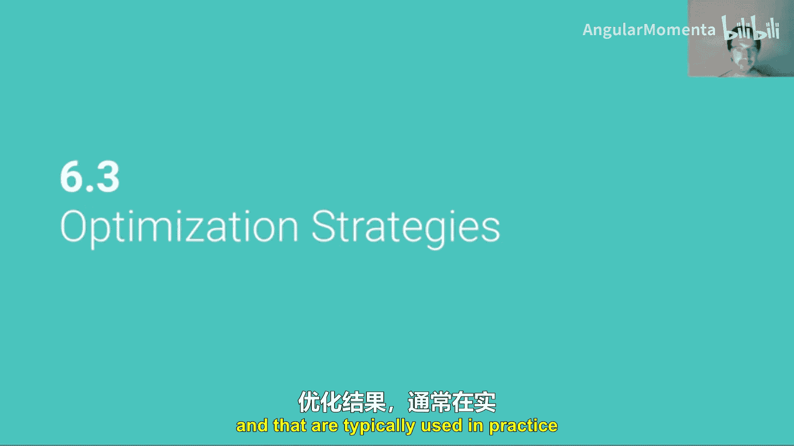
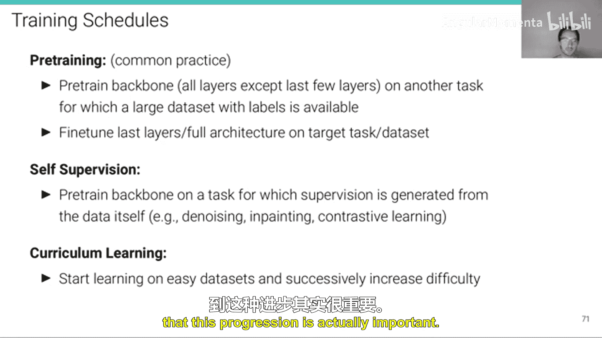

# 【精译】蒂宾根大学《深度学习》-p32-32--6.3（优化：优化策略）--BV1eDbrzhENK_p32-

After having looked at some of the most common optimizers for optimizing the peris of deep neural networks。

Let's now look at some optimization strategies that can help to further improve。

The optimization results and that are typically used in practice and that are very important to apply。

As already discussed。Choosing the right learning rate schedule is important we've already seen that learning rate should be decreasing。

Otherwise， we will。嗯。Continue oscillating around the optimal value。

 however it shouldn't decrease too quickly because we might get stuck in a region that is far from a good one。

So heres the example again， well with a fixed learning rate， even when initializing at the。

A true minimum will not stay there， but we will oscillate around。哎了。

So fixed learning rate is not a good idea。It's not a good idea because it doesn't converge。

 it's also not a good idea because it's。To slow in the beginning and to fasten the end。And那不是。

Popular learning rate schedule is a。Learning weight schedule that applies this inverse proportional decay that we've already seen motivated by this。

Robins and Monroe fearem。However， this decay is very fast and often too fast。

 also observed that here there is of course a hyperparmeter left。

 so this multiplier to this decay still needs to be chosen manually and implemented。

One can also apply exponential decay， where I have a hyperpermeter alpha to the power of the number of iterations T。

Again， multiplied with some。Fixed learning rate E。And then finally and what is probably most common in practice is step decay。

 so we let the model converge at a particular learning rate and then once we see that it doesn't change that much anymore。

 so here's an example from this paper here。Well， you can see different steps here where the learning rate has been changed。

So when it means converging at a particular learning rate。Then we start decreasing the learning rate。

 we set the learning rate to a new value， a smaller value。

 and then we let it converge at that learning rate and then we set it again to a low value and let it converge。

So we can now decide。What is。Learning rate values are。

 but we can also decide at which iteration we want on。Decrease the learning rate。

That's called step decay。What's common in practice is that we reduce the error rate by a factor of half or a factor of two。

 So we we multiply a half to this。Previous learning rate。And。We， we choose the。

Locationations of this step， based on experimentation。

Another thing that's very important when training is to actively monitor the training process。

It's very important to get an intuition about。This process and how the model behaves in order to understand。

Which hypopermeters need to be changed。If there's some general problem。With the model or the data。

Or if we should choose a different optimizer。So here are some examples of looking at。Learning plots。

 so here we typically plot both the training and the validation loss。

That's the most basic thing you can do， and in this case we observe overfitting。

Because neither the training not a validation loss is able to significantly decrease starting from the first iteration。

 we have this small linear decrease， but we don't have this classical curve where we have a steep decrease in the beginning and then convergence。

So probably the model does not have enough capacity。

Probably we have an underfitting situation in this case。Here's another situation in this case。

 we observe a decrease。But we also see that the model probably hasn't converged yet。In this case。

 we just need to。Run training longer。 And that can mean we can sometimes in some cases。

 have to train for very long times。 Some models require days。 Some models even require weeks。

 so it really depends on the model。Number of parameters。

And the architecture on how long this model requires to train。

Here's another example where we observe that the training loss continues decreasing。

 but the validation loss starts to increase again， and this is the classical situation of overfitting that we have seen before。

So， in this case。嗯。We might want to use a regularizer， such as early stopping。

Or change the capacity of the model。But in general。

 this is a behavior that's quite common in practice。And here is an example where we don't have。

Overfitting， but the training and the validation loss curves are quite well aligned。

 so it's also a common situation in practice。In this case， we see that the train loss。Converges。

 and the training curves looks looks nice here in blue。

 but the validation curve in orange is very noisy and oscillates。

 And that might mean or indicate that the validation set has just been chosen to small。 Of course。

 there's always a price to pay if we evaluate every and epoch。

 we have to run the forward pass for the entire validation set。

But it's important to not choose the validations that too small。

 otherwise you will not observe something meaningful。It will have too much noise。嗯嗯。

It might also happen in some cases that the validation set is actually easier than the training set。

And here we can see an example of this situation。In general。

 it's highly recommendable to use some of the tools that are available in the community for monitoring the progress and a great tool that almost everybody is using is Ten support。

我s。Originally coming from Tensorflow community as the name indicates。

 but there have been many adaptations of this software， so can also use it from Pythch。

 and it allows you to very easily during the course of training monitor the learning and validation curve。

Also， other factors such as。Not just the loss functions， but maybe the actual accuracy。

That you can't optimize， but that you're interested in the end or other things。

 you can look at individual mini batches， you can visualize individual samples using various visualizations you can show a graph of the neural network and distributions and histograms of activations and this is really useful and it's very important to debug your neural network。

It's also important to choose the hypopermmeter as well。

What are hypoparmeter Hyparameters are all parameters that are not optimized by the great great and decent optimization algorithm itself。

 so for instance。你。Perarameters of the neural network are not hypoparameters。

But the network architecture itself。Which is not optimized by gradient descent or the number of iterations or the batch size or the learning rate schedule or。

The weight of the different regularizers。Is a hypoparameter。

So we have less hyperparameters than we have parametersmeter in our model， which is good。

 but there's still a significant number of hyperparameters to search the space efficiently。

Yeah this is a difficult problem and it's actually still the most common situation to manually search that space based on intuitions。

 building intuitions and looking into the local neighborhood of where we currently are looking into the literature。

 often papers have a separate section on how these parameters are chosen or specify these parameters in the supplementary。

So starting from a good model and starting from there or starting from looking at related models and choosing the parameters accordingly。

 the hypoparameters。Is a good strategy。Of course， if you have enough compute resource。

 you can do something like grid or random search where you define some ranges。

That you systematically study， so here is a range over the first parametermeter and a second parametermeter and you systematically try out these values。

Until you obtain a low validation arrow， but of course， this requires a lot of training runs。

 which are very expensive。Random search is similar to grid search except that you don't search on a regular grid but more randomly。

AndThen you can， of course， do this at multiple scales so you can start with a course grid and then narrow it down。

Or when you're narrowed down， you can always search in a local neighborhood。

And it's probably a good idea to still combine this with。

Human intuitions that you have built up because the parameter search space is still too large to do this efficiently。

Yeah， maybe what I should also mention is that there's a whole research area on auto automatizing this process on。

Developing algorithms that can automatically find good architectures。 is called。

Neural architecture search。But many of these algorithms are very。嗯。Require a lot of compute。

And the big GPU farms。And。therefore can often be used only by big companies that are willing to spend these resources and the amount of energy into getting some percentage out of the model。

Yeah， there's also。No architecture search algorithms that try to do it in a gradient based manner。

 but that's much more difficult and often these algorithms are only able to manipulate smaller components of the architecture and are not able to explore the entire search space over hyperparameters。

So how to start。How do you actually。Start when you implement your model and you want to train and test and see if it works。

It's a bad strategy to， to build your entire model and。

And then directly run it on your full data set。 It will almost always。Not work， or if it works。

 it might actually give you the feeling that it works correctly， but it does not。

So it's a good strategy to start small， start even with a single training example and use a very small network。

 maybe just one fifth of the layers in your full model that you want to develop and first verify that the output is actually correct that your model predicts。

嗯。嗯。And then by overfitting to this one training example。

 you already can see if your training procedure works because the accuracy should be 100%。

 you're overfitting to one sample， so your model is in almost all cases flexible enough to fit this example exactly if that doesn't work。

And you will be surprised how often that doesn't work， then there's something wrong。

 and you need to find that problem before going any further。

Because all of the follow up results will be meaningless otherwise。Also。

 when you overfi with a small network on a single training sample， you have very fast debak cycles。

 which is of course important。If you run your model。

 if you train your model for three weeks and then you get your results， and there was a mistake。

 then you lose three weeks， but if you can do this in minutes， you get your answers fast。

And you need to choose a good learning rate， so you should choose one of the common values that are used in practices。

Now。Once this works， you can start increasing your data set， increase it to not the full data set。

 but 10 training samples and verify again that the output is correct。

Overfitting to 10 samples should still yield in a accuracy that's close to 100% because its a very small data set。

And what you can also do is you can measure the time for a single iteration and identify the bottlenecks in your model。

 sometimes there is a bottleneck in data loading because the data is always loaded from disk and not efficiently stored in GPU memory。

E cetera， et cetera， our data needs to be uncompressed because you started as PNG images。

And not as raw data files， etc。🤧嗯。And once this is working then and it's fast enough for your purposes。

 then you can increase the data set size from 100 to 1，000 to 10。

000 samples and you can also start increasing your network size and at some point you should by observing the training and validation plots you should see generalization。

But it's important to make only one change at a time to identify potential causes of problems。

There's also various strategies to improve gradient flow。

Grading flow is very important if we don't have a proper gradient in flow during the back propagation。

There is some parameters that are not properly updated。

 so maintaining a good gradient flow is very important。

 and you should visualize gradient in flow and you should make sure that it's always proper。

So we have already seen that enerization is very important。

 so you should use proper enerization such that activation distributions remain constant。

 for instance， gausian across all layers with the same。Mean and standard deviation。

Another technique that。Enforces this。Yeah。This constancy of distributions of activations across layers。

 but during optimization， not only doing training is called or batch normalization。

What is's done in batch norm is to over a individual batch， so capital B is the batch size here。

To calculate the mean and the variance of the activations for each individual channel separately。

 so C is the channel or neuron in a layer here。🤧嗯。So you do this for all the layers in your neural network。

And then you can subtract the mean and divide by the variances to get a whitened signal over the mini batch。

And then because this is not flexible enough because you can't add a bias that way anymore any bias that is added before is going to be eliminated by this operation。

There is an additional learned bias that is added here again。Yeah。

 so you normalize each channel by the mean and variance over the bench。

Which is implementing something like this， but during training。And this， this， of course。

 works a training time because we， we can do this average over the batches。

 But what do you do at test time Well a test time， you just take an average running average of the。嗯。

Mean and the variance that has been estimated during training and keep that fixed。

So then this operation here becomes effectively just a linear operation。The entire operation here。

And we have this learnnable scale and shift perimeter。That we add to the model。

And then we can add such a batch normalization layer after each fully connected layer and before the activation functions and this will。

Help with the distribution of activations during training。There's。

All kinds of different flavors of batch normalization。

 what I've showed you on the previous slide is deep。Default version。

 but you can normalize over the batch。There's also layer norm， you can normalize over the layers。

 you can normalize over the instances， and there's also group normalization。

 So these are applicable mostly for。啊。Images and convolutions。

One thing that's particularly problematic for deep networks。

Is that gradients are propagated very slowly because gradients are back propagated and if you need to back propagate for many。

 many layers， potentially hundreds or thousands of layers， then once you arrive at the early layers。

 the gradients are very small。系。And。And this paper here has has actually been observed that this leads。

 so this was in the context of。Improving performance on the imagenet challenge。

Where the networks became deeper and deeper。So in this context。

 deeper networks often perform worse than the more shallow ones。

And this is counterintuitive because if you have a shallow network and you add identity transformations as layers。

We just hand code identity transformations。Then of course you get the same performance as the shallow model。

 so the deep model should be in theory， at least as good。In terms of accuracy as the shallow model。

Now the solution that was proposed in this very popular paper here on residual networks is。

Instead of。Classical。Convolutional or。Fully connected layers。To learn the receual mappings。

 so there's a skip connection here， this is one block in this receual network。

 there's many of these blocks。There's a skip connection here that adds the input to the output of these two layers such that these two layers just need to learn the delta from X。

 which is much easier because now it's much easier to realize the identity transformation the identity transformation just that these two layers here just basically predict zero so that the input is directly past as the output and this is much easier and it turns out that this is。

Tremendously helpful for learning deep models using these residual blocks within the model。

And it's come practice today as well。Now talking a bit about training schedules。嗯m。

If you have a small data set， it's common in practice to improve performance by pre training。

This is what almost everybody does。What does pre training mean Well pre training means you pretrain your backbone。

 this is all the layers except the last few layers that might be specific for your task。

So pretrain this backbone on another task such as IageNe。For which a large data set imagenet。

With labels， grant of labels is available。So pretrain that backbone。

And the network already learns lot of useful information about how images are formed through this process。

And then you can find you enable just the last layers or the full architecture on your target task and data set that has less samples annotated。

And it has been shown that this。Leads to significant improvements in performance。

 and so many people just start by pretrain networks on some task。

And fine tune them for their task of interest。This is a kind of a transfer learning。Another strategy。

 if you don't， want to rely on this。嗯。This label data sets us to use self supervision where you pre train the backbone on a task for which supervision is generated from the data itself。

s as a denoizing task or an in painting task， and we're going to talk about some of these in more detail later throughout this course。

And then there is curriculum learning， which for some task such as optical flow estimation。

 is also extremely important。 It depends on the task if you want to use this or not。

 and the idea of curriculum learning is that。Re start。

With learning on some easy dataset sets and then successively increase the difficulty。In the data。

 So， for instance， in the case of optical flow， you start with some very toious。

Simple scenes that don't have a lot of complexity to them and learn an optical flow estimator for them。

And then you continue training with increasingly more difficult data sets until you arrive at the real data set that you're interested in。

And it turns out that this is extremely helpful for some tasks to get good performance。

 So it's important for the model to learn something easy first。

And then continue with harder problems， and that's also related to human learning， actually。

 where it has also been observed that this progression is actually important。

