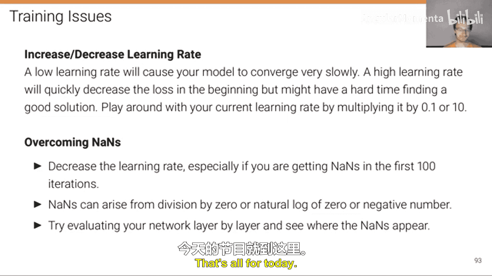

# 【精译】蒂宾根大学《深度学习》-p33-33--6.4（优化：调试策略）--BV1eDbrzhENK_p33-

When training deep neural networks， there's many things that can go wrong and in this final unit we're going to cover some common failures and discuss some debugging strategies。

In particular， this unit is based on a block from Slaav Ivanov。

Called 37 reasonsons why your neural network is not working。

And you can find the link here at the bottom。So it's a slight modification of the。

Comments at Bur given in this block。So the block starts with the network had been trained for the last 12 hours。

 it all looked good， the gradients were flowing and the loss was decreasing。

But then came the predictions， all zeros， all background， nothing detected。What did I do wrong。

I asked my computer who didn't answer。So it's really a complex system that we're dealing with。

And it's sometimes very hard to find the problem。Also training times are long。

 it's difficult to debug and so this little guide should give you some intuition on how you could get started。

So the first thing。Is an emergency first response list that are the most common that that could cover the most common problems that could occur in your。

A model。So the first thing is you should always start with a simple model that is known to work for this particular type of data。

For example。Before going into some more。Sophisticated。

Deep learning architectures maybe you should want to use the AlexNe or the VGG architecture for images。

And use a standard loss。Make sure you start by having something working。

And then turn off all bells and whistleles。 for instance， regularization and data augmentation。

 This is a very important point。 Whenever debugging a complex system。

 it's important that you simplify actually the。The advice that I give most commonly to also my PhD students。

Simplify， make the problem smaller。Try to find the smallest instance of the model that still shows the phenomenon of interest that still shows the problem。

That still doesn't work， make it so simple that it almost must work。But it doesn't。

 and then you will find the underlying cause。Also， make the model and the data set smaller。

In order to increase the debug cycles。To have more debu cycles in the same period of time。

If I turning a model， double check the preprocessing。

You need to make sure that the preprosing for the fine tu stage is the same as the preprocessing that has been used for pre training。

Verify that the input data is correct。It's very easy to get the input incorrect by swapping the channels in a different order or loading a different image size。

Or passing the incorrect index of the mini batch。Visualize visualization is also one of the most common advices I give。

It's often the case that when you have a good visualization。

Then you can find problems much more easily。In machine learning or computer vision。

 it's often hard to define unit tests that are useful， but visualizations and simplification。

Can help you enormously in debugging your projects。Then start with really small data sets。

 start with one sample overfit， if it doesn't overfit。

 there must be something fundamentally wrong already at the very basics of your model IO， data。

 whatever。And then once this is working， gradually add more data。

 once you overfit perfectly on one sample that you get the desired result。

 gradually add more data until you see some generalization happening。

And then also start gradually adding back all the pieces that you omitted from the original model。

Don't start with a full model， but step by step add things， augmentation， regularization。

 plus functions。More complex architectures and rig go one step at a time so that you know。What？

The cause was of a particular fail mode or what a particular change in your design achieved in terms of。

Maybe a accuracy or quality of results， etc。So let's now go over some of these common issues in more detail。

 Let's start with data set issues。The most important thing is really check your info data。

 and make sure that what you feed to the network makes sense。For example。

 it's easy to mix up the width and height of an image。

Sometimes you just pass the wrong index or you're feed in zerorus by mistake because the data was loaded incorrectly。

Or you load the same batch over and over。So in every iteration of your algorithm。

 you always see the same batch，' overfitting to the same batch， but you will not achieve gization。

So print and display a couple of batches and make sure that everything makes sense。🤧嗯。

A good deepb strategy is also to try random inputs。

 drypas random numbers instead of actual data and see if the error behaves the same way。

 see if the model stops with an error or if it does not stop。If the arrow behaves in the same way。

 it's a sure sign that your net is turning data into garbage at some point。

If the data that you're actually feeding in behaves the same as the random numbers。

 then it must be something wrong， and then try to debug layer by layer and look at the individual results and see where things go wrong。

Also check the data loader， your data might be all fine on the disk， but when you have it in memory。

 it might be corrupt because the data loader doesn't work。

So print the input directly before the first layer。

To make sure that it has actually been loaded correctly。

Also make sure that the input is connected to the output。

 check if a few input samples have the correct labels。

And make sure a shuffling input sample works the same way for the output labels。It's a common。Of。

Mistake that。When you load the data， you shuffle the data， shuffle the mini batches。

 but you forgot to shovel the labels， so really when you do that you need to shuffle both in the same way。

Yeah。Then verify noise in a dataset。嗯。There are so many bad labels。

Sometimes that the network simply can't learn， so check a bunch of the input samples manually and see if the labels seem off or not。

Also， shuffle your data。When you create the mini batches， if your data set hasn't been shuffled。

And this could negatively impact the learning。Because the nearby samples。

 samples in the same mini batch might be highly correlated。Also try to reduce class im balance。

If there is much more examples for one particular class in the case of image classification and much less examples for the other class。

Then you might need to balance your loss if you find both are equally important。Also。

 verify the number of training examples if you are training a net from scratch。

You probably need lots of data for image classification。

 typically people say that you need about 1000 images per category or more。If you cant do that。

 then you need more data augmentation or you need to do pre training and fine tuning。

Also make sure that your batches are randomized enough that they in the case of classification don't contain a single label。

 but that they contain a mix of inputs with different label。🤧嗯。

And this is also related to shuffling the data set。What's also important is。

That you should always start with a standard data set that you know that works。

That's equally important for the architecture was also important for the data sets。

 so when testing your new network architecture or writing a new piece of code。

 use standard data sets like Ms sciR or image at first instead of your own data。

And this is because there are many reference results for these data sets。

And you know that they can be solved， so make sure your model is also able to solve them before going to some different data set this is also part of this step by step procedure。

Let's now talk a bit about data normalization and augmentation issues。

It's often helpful to standardize your inputs in particular if your inputs are very far off。

 if the ranges are very， very large， make sure that you standardize your input for instance。

 to have zero mean and your variance。Also， make sure you don't have too much data augmentation。

We have we have covered this in this class that augmentation has a regularizing effect。

 but too much of this combined with our forms of regularization can cause the net to heavily underfi so you shouldn't overdo regularization as well。

Then check the preprocessing of a pretrain model。If you are using a pretrain model。

 make sure you're using exactly the same normalization and pre processingcess strategies as the model most。

Using when training and testing。For example， our images in range 01。Or zero to255。

Also check the preprocessing for training， validation and test sets。Any prepocessing statistics。

 for instance， the data mean。Must only be computed on the training data and then apply to the validation test data。

As in the case， for instance， of batch  normalization。For instance。

 computing the mean and subtracting it from every image across the entire data set then splitting afterwards in the train。

 validation and test would be a mistake。Because the test set is not accessible。

So you can only computer statistics on a training cell。Implementation issues。

Very important advice is to try solving a simpler version of the problem first。

 and this also helps you to build abstractions about the problem and the issues。

It will help you find more quickly where the issue is。For example。

 if the target output is an object class and coordinates try limiting the prediction to object class only and see if that works before adding the coordinates。

Also make sure that your training procedure is correct。

 it's easy to forget toggling between training and validation mode for instance。

 make sure you're using the right inputs， it's also easy to forget setting the gradients to0 before back propagation。

And again， there is no easy unit test for this， so you really need to go through your checklist。

 you need to be very thorough when you do programming， when you write the code。That all of these。

Aspects are taken care of， and you need to visualize well。Then， of course。

Check your loss function if you implemented your own loss function。

 check if there is any bugs in them， visualize the loss function。

 add unit tests for those in this case it's possible。

 for instance you can compute numerical differences for the derivative。

Often wrong losses hurt the performance of the network in a subtle way。

 so you might not see the effect really。You still get a result， and it looks okay。But， it's just。

not as good as it could be if you would be using the right loss function。

Vify the loss input if you're using a loss function provided by your framework。

 make sure you're passing it。What it expects， for example， in pytorch。You can often mix up。

The negative look likelihood loss and cross entropy loss。

The former requires a softm and the letter doesn't， so it's important that you pass the right inputs。

In the right range is to the right loss functions。I trust the loss weights。

If your loss is composed of several small loss functions。

 make sure their magnitude relative to each other is correct。

This might involve testing different loss weights。So it's important that you get the relative weighting of the loss functions right if you have multiple loss functions。

 and in general， of course it's desirable to work with as little loss functions as possible to reduce the number of hyperparameters。

Monitor our metrics as well when you have your tens of board， don't just look at the loss functions。

Sometimes the loss is not the best predictor of whether your network is training properly。

 if you can use other metrics like a accuracy or matrix that also reveal something about the properties of your algorithm。

Tests any custom layers。Did you implement any of the layers in the network yourself？

Check and double check to make sure they are working as intended。

Make sure the output has the right format。As we mentioned before。

Like passing a soft mask to a loss that expects raw logic is not admissible， for instance。

Also check for frozen layers or variables check if you unintentionally disabled gradient updates by detaching the gradients for some layers。

That should actually be learnable。 And so they don't。Get modified。Increase the network size。

 Maybe the expressive powerful network is not enough to capture the target function。 In this case。

 if you observed this underfitting， try adding more layers or more hidden units。Yeah。

Check for hidden dimension errors。This is something that can go easily wrong。

Because if you're working with tensors， sometimes easy to。

Lose an overview of what the right dimensions are。 And sometimes the python code or the Pytorrch code still runs through。

 even for it doesn't。Do what you expected to do。For instance， if your input looks like KHW 64，64 64。

 it's easy to miss errors related to wrong dimensions because all of them are 64。In this case。

 use different numbers for the input dimensions。For instance。

 prime numbers and check how they propagate for the network such that all the dimensions of the intermediate layers are actually correct。

Explore gradient checking if you implement gradient descent by hand or a particular compute node by hand。

And you didn't use auto differentiation for computing the gradients。

Make sure that your crs are correct， for instance， using。numericalmerital differentiation。

Training issues。对。Start solving a really small dataset。

This is really important overfi on a small subset of the data is the first you should do in order to make sure。

That training in general could work。It's not a sufficient condition that it works。

 but is a necessary condition。For example， train with just one or two examples and see if your network can learn to differentiate these。

Move on to more examples per class。Also， check weight energy station。

If unsure use javier or ha initialization， also your initialization might be leading you to a bad local minimum。

 so try a different initialitization and see if that helps。Initialization is also a hyperperameter。

 and sometimes you might need to modify。Change your hypoparameters。

 maybe you are using a particular bad set of hypoparameters。Try to modify them and if possible。

 do a small grid search。Reduce regularization。 Too much regularization can cause the network to underfi。

In this case， reduce realization such as dropout batch norm。Wes， bias， L2 regularization， etc。

Give it time。I've seen it， often that。People weren't very happy with their results。

 but then they trained the model for a week more and the results kept getting better and better。

Deep learning optimization can be very slow， so maybe your network just needs more time to train before it starts making some meaningful predictions。

If your loss is steadily decreasing， let it train some more。Switch from train to test mode。

 Some frameworks have layers like batch norm dropout and other layers behave differently。

During training and testing。Switching to the appropriate mode。I's necessary， of course。

 for a network to predict properly。And very important。Always visualize the training process。

Monitor the activations， weights， updates of each layer， make sure the magnitudes match， for example。

 the magnitude of the updates to the parameters。Should be 10 to the power of minus3。

Consider visualization， like。Tenorboard or crayon in a pinch you can also print weights。

 biases and activations， so these are really useful tools that help you。

Be on the lookout for layer activations with a mean much larger than zero。

AndT a batch norm or other forms of activation functions in this case。

Weight histograms should have an approximate gaussian distribution after some time， for biases。

 these histograms will generally start at zero and will usually end up being approximately gausian。

 keep an eye for parameterss that are diverging。They've become very large。Try a different optimizer。

 your choice of optimizer shouldn't prevent your network from training unless you have selected particularly bad hypoparameter。

However， the Proing proper optimizer for a task can be helpful in getting the most training in the shortest amount of time。

 so you might need to switch from the standard optimizer for your particular problem。

Exploding and vanishing gradients。Check the layer updates as very large values can indicate exploding gradients。

In this case， gradating tipping might help。Also check the layout activations good standard deviation for the activations is in the order of 0。

5 to 2。And if you have values significantly outside of this range。

 this might indicate vanishing or exploding gradients。

Increase or decrease the learning rate a low learning rate will cause the model to converge very slowly。

 a higher learning rate will quickly decrease the loss in the beginning but might have a hard time finding a good solution。

Or even divert， so you need to play around with your current learning rate， for instance。

 by multiplying it by a 0。1 or 10。Overcoming lens。Nance are not a number that appear， for instance。

 if you divide by zero。Decrease the learning rate， especially if you are getting Ns in the first0 durations。

 it might just be that your model diverged。Nans can arise from division by zero or natural log of zero or negative numbers。

 so keep an eye out on all these operations that could potentially cause NNs。

And try to evaluate your network layer by layer and see where the nuns appear for the first time。

That's all for today。

