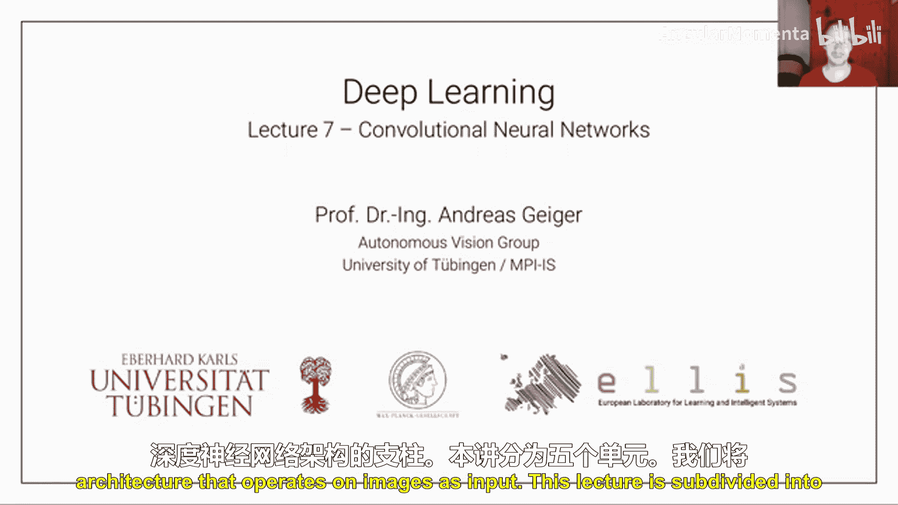
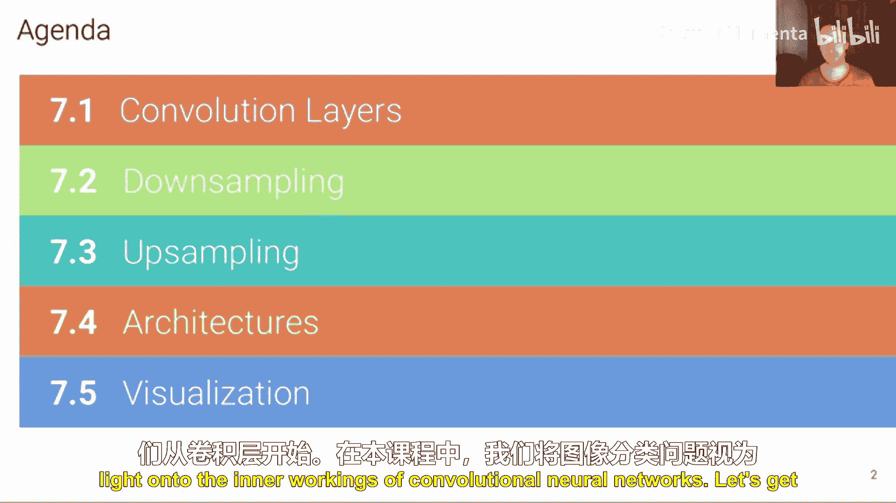
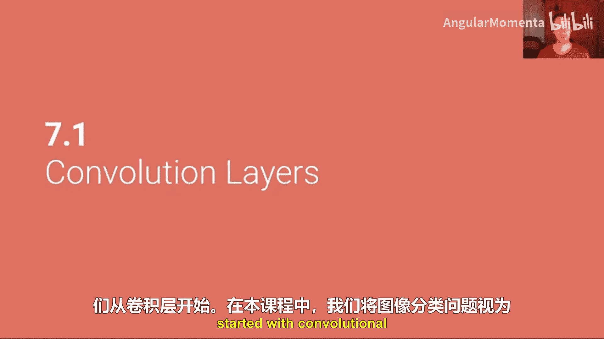
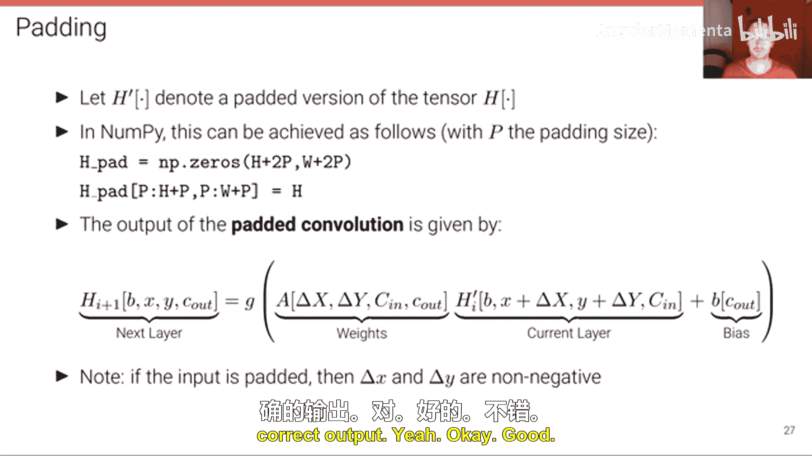

# 【精译】蒂宾根大学《深度学习》-p34-34--7.1（卷积神经网络：卷积）--BV1eDbrzhENK_p34-

Welcome to the seventh lecture of the deep learning course。

Today we're going to be talking about convolutional neural networks。That our。

The backbone of almost any modern deep neural network architecture that operates on images as input。

This lecture is subdivided into five units， we're going to start by having a look at the basic convolutional layer。

Followed by down sampling and ups strategies that are able to。

Alter to shrink or to expand the spatial dimensions of the feature map。

We're going to have a look at historical and more recent。Neural network architectures。

And we're going to also have a brief look at visualization techniques that shed some light onto the inner workings of convolutional neural networks。

Let's get started with convolutional layers。

Throughout this course， we are gonna consider the。Image classification。Problem， asked Steve。

Work horse that we are。I'm working with。In image classification。

 the goal is to build a model that takes an input image and then outputs one out of many possible classes such as bus in this case。

Traditionally， this problem has been approached by handcrafting features。

 yellow are hand designed components here。Such as filters。

 certain filter banks that produce some sort of gradients from the input。

Or histograms that operate on this gradients to extract more higher level features。

 and these features were then input into a classifier such as a support vector machine that was trained to predict the correct class label for that particular input image。

This approach was successful until around 2008， 2009 where suddenly performance plateaued and couldn't be increased anymore。

Until roughly 2012， where with the advent of modern convolutional deep neural networks。

That for the first time， were successful on these challenging computer vision tasks。Performance。嗯。

Could be improved again by significant amounts or error rates could be reduced dramatically。

Which before was believed to be very difficult。And of course， as we all know。

 deep neural networks do not need any handcrafted。Features， but they are。

Learning all the intermediate representations by back propagation。Which is part of their success。

Why they are so powerful And today in this class， we're going to learn how these features can be best learned。

For image level inputs， where a standard multi layerop preceptron is not the ideal choice。🤧嗯。

This picture here。Shows the results on the imagenet large scale visual recognition challenge。

 which was driving a lot of the progress in。Bringing deep learning。Into， you know， reality into。

Um to make deep learning work for data sets that were you beyond the simple M data set that can be already classified quite successfully with very shallow models。

So what we can see here from right to left is the state of the art。

 the best method in a particular year so there was a challenge that was posted with a workshop at one of the leading computer vision conferences every year and so here are the top performances and this is error rates so called top five error rates it's a very difficult task it's a task where you need to classify。

An input image into one out of 1000 object categories。

And because many of these object categories are very similar， such as different dog species。

This is very ambiguous and so a model was an error was only counted if a model wasn't producing a label within its top five labels to be a bit more robust against these data set ambiguities。

So top five error means。An error is counted only if the correct label is not within the top five labels predicted by the method。

So here on the right you can see two of the traditional shallow techniques where performance plateaued for several years at around 26。

 28。But then in 2012， with Alexnett， the first deep neural network that was applicable to this challenging。

 at that time challenging task， performance dropped significantly from 26 to 16 using a eight layer neural network。

And then over time。The the error rate dropped further and fer until today we have a state of the art of 1。

3% error rate， which is well beyond human level performance on this task that is around 5%。

At the same time， you can also see how depth of the neural networks has increased over the years。

Which indicates that。The depth of neural networks is really key for generalization。

And then this class， we're going to。See some of the network architectures that have led to this success。

However， in the first units， we're going to focus as a running example on one particular network architecture that's called VGG。

 here somewhere in the middle。That is a prototypical network architecture that illustrates the。

A typical convolutional neural network quite well， I think。Theres a typical neural。

A typical convolutional neural network has three types of layers。

 It has convolutional layers in white here， pooling layers in red and fully connected layers in Scion。

As you can see， in contrast to an MLP。A convolutional network keeps the spatial image dimensions throughout the operations of a neural network。

So the input here is 224 times 224 pixels times three color channels。

This is transformed using a convolution operation into a feature map of size 224 times 224 times 64 feature channels。

This number here， the number of feature channels is the number of neurons per spatial location。Okay。

Before in an MLP we just have neurons per layer， now we have neurons per spatial image or feature application。

And then we have these red pooling layers， which reduce the spatial dimension in this case。

 from 224 to 112。 and at the same time， convolution operations increase the。A number of features。

The number of feature channels， the number of neurons per spatial location again in order to keep the capacity roughly the same across the layers。

To not shrink the capacity too much。So this is done several times。

 as you can see here until we reach a resolution of 7 by7。

 which is then pooled to a resolution of one by one。At this point， or we have one by one times 4000。

Nurs at that spatial location，11。We effectively have a MLP。

 we don't have any spatial resolution again。And we have a fully connected。

Network that connects from every neuron to every neuron in the next layer。So。

Once we have reached one by one。We have one or two more fully connected layers。

 and then the output is finally a soft mark that outputs a discrete distribution over these 1000 different class This is the typical architecture of a convolutional neural network for image classification which。

Needs to success which successively shrinks the spatial resolution as it has to arrive at a single class label that describes the entire image。

 you can imagine these features here as very low level local features that are produced from the input。

And。The higher we go。In or the deeper we go in this network， the more expressive these features are。

 the larger the region in the input is that they describe。

Until a final classification is made for the entire image。Okay。Okay。

We will now make this all a little bit more formal by introducing the notation that we're going to try to be consistent with for the entire lecture。

So we're going to use B the batch size as before。And we are going to write W and H for the width and height of the input image or intermediate feature maps。

And then we have the number of feature channels， which is the number of neurons per pixel C。

And if we describe a layer， we need to describe the input and the output。

 so we have a C in and a C out。Just to distinguish input and output for a particular layer。

For example， in the first layer。Where the input is the inputted network。

If the input to the network is a gray scale image， then in the first layer C in this one。

Or similarly， if the input to the network is a color RGB image。

 then the input to the first layer is free for RGB。Yeah。And then further in convolutional networks。

 we have something called a convolutional kernel， a filter kernel that has a certain size in pixels。

 we consider square kernels here。Of size K by K pixels is the size of the filterche。Yeah。🤧。Okay。Yeah。

 as already mentioned， in contrast to MLP's conin layers have a spatial extent。

MLP can be described a feature。Mapp in MOP can be described by a matrix where we have on one axis the neurons。

Or channels and the other X is the batch size B。Which we all need to feed in the forward past in parallel。

In confidence， we have two additional dimensions， W and H。

 which is the spatial dimensions of the feature map， so we have a four dimensional tensor。Again。

 B is the batch size and C is the。A number of channels， the number of neurons per spatial location。

And then we need to define an operation that takes。

One of these four dimensional tensors and produces another four dimensional tensor in the Conal network。

And one of this operation is the convolutional layer。

So here is a comparison between a fully connected layer on the left。

That is what is used in MLPs and a convolutional layer on the right。

Now I said on the left we have something that's like an MLP。

 but still here it's structured in this four dimensional tensor。

 we didn't flatten the image like in the exercise where we were doing endless classification with images。

Or we just had two dimensions B and C， but we're keeping the image。

Sppatial dimension intact for the input tensor， yet the operation is exactly the same。

 we connect every neuron in the input。With every neuron in the output。

So we have a fully connected layer。Which is what is happening in an MLP。

Note that I have drawn free input channels here， but only one output channel just for ease of visualization。

 of course the output can have more channels。🤧。Okay。Now a convolutional layer here on the right。

It's different in a convolutional layer， we don't have as many connections here in this weight matrix A is the weight matrix。

 but we have a weight matrix that defines a filter of a certain size。

 typically a very small filter like free by freeing。And so what we do here is we take。

We take a filter at a particular location that corresponds to a particular output location。

 so this dark red and red。Pixel location here correspond to each other。

 we have this filter centered at that pixelel location。And then we multiply the filter。Weais a。

So in this case， we have an a of three by3 by3。With each element of the input。

In order to compute the input to the activation function for the output。はい。

So in contrast to connecting the output neuron to all the input neurons。

 we are now connecting the output neuron just to a subset of the input neurons。In this case。

And this free by free by free。呃， neuro性。Over all the channels and K times k spatial dimensions。

And of course， we do the same thing for multiple channels of the output， but is not shown here。

So this is the first change we're not connecting to all inputs， but just to a local neighborhood。嗯。

The second change is that we apply the same filter operation at every spatial location。

I have simplified the filter now and show only this one channel。

Just imagine this filter being applied to all channel it just for simplifying the visualization here。

Now what we do now is if we have a filter with weights a that maybe assigns a weight of 5 here。

 and we apply this filter at the adjacent location。Then we apply the same weight。

 same five here at the same edge。This is called weight sharing。

We're using the same weights for that filter。No matter where we are。

In terms of the spatial location in the image。That's why it's called a filter。

 We take a filter with a certain weight matrix， and we。

Apply it to many locations to all locations in the image。

 so we swipe it through these locations and then successively compute the output。

But these are the two differences。We focus on a local region and we share the weights across all spatial locations。

We do not share the weights across the output channel dimension。

 so we have one filter per output channel。But we have。So one different filter per output channel。

 but we have the same filter for all spatial locations here。And again。

 I haven't drawn all the input channels， but this filter is applied to all the input channels。🤧Okay。

Now this has consequences for the number of parameters。In a fully connected layer。

 if we consider very high dimensional inputs， let's say a megapixel feature map or image。

 a megapixel feature map as output。Then we have this quadratic complexity in terms of memory。

 because we have。1 million times1 million connections。 So in。Or more precisely we have。

This is the input here， W times H is the size of the input times the input channels plus 1 because we have a bias that we need to add for each element。

 and then we have this connected to all the neurons in the output， which is W times H times C out。

 the number of neurons per pixel。In contrast in a convolutional layer， we have just k times k。

 which is much smaller than W times H， maybe just three by free， this is a filter size。

Times the number of input channels plus one for the bias。

And then we multiply this only with C out because we have just one different filter per output channel。

 but we have the same filter for all locations W and H。

Now we have significantly reduced the perimeter。Number of parameters by making this assumption that the weights are the same no matter where we are in the image。

To。And the intuition behind this is quite simple。In images。No matter for instance， where objects are。

 you're going to need to use the same filter， so I don't need to learn edge detection and don't need to learn to detect。

 let's say， vertical edges。Again and again for every pixel location， but I can use the same filter。

To do vertical edge detection and then aggregate the results。

So it can significantly reduce the number of parameters in my neural network compared to a vanilla MLP using this clever trick。

Okay。Now， in order to define。Convolutionional networks more formally。

We're going to introduce something called Einstein notation。

 which is a notation that makes writing down these convolutions easier。

This Einstein notation has been。Introduced by Albert Einstein in the context of。

In the theory of relativity， but it's widely applicable whenever we work with tensors。

We use a modified form of that notation where capital letters are used to denote slices of a tensor。

So really， the difference to regular an is here。 we have small and capital letters for indices。

 which denote different things， for instance， if we have。Like small indices， like AIj。

This is a standard。Notation where we denote where we index into one element of a matrix a。

So there's nothing special about this。But if we use a capital letter like a small I big J。

 then we denote。All the elements in all columns of that row eye。

So we denote the entire i f of matrix a， or similarly， if we have big a big I small J。

 we denote the entire J f， a J column of matrix a。Or if we say a big I big J。

 we denote the full matrix a。And the same holds for higher order tensors， of course。Yeah。

So what can we do with it this？Well。This Einstein notation makes it easy for us to express summation without actually writing down the summation symbol because summation is considered implicit in the Einstein notation whenever we have a product。

We implicitly know using Einstein notation that we have a summation。So for instance。

 this matrix product Y AX。Which。Is written normally as this summation over the elements of A and x。

Can be conveniently written in Einstein notation by using the big subscript J。

 which denotes that we sum over the product AX。Across the J dimension。And similarly。

 we can write x transpose A in a convenient fashion。Okay。Why is this useful， well。

 the indices of tensors typically have types such as batch index or coordinates。

 image coordinates or the channel feature channel index。And writing a tensor as for instance， B X， Y。

C with batch B coordinates X Y and feature channel C makes the type of the tensor elements and the order of the indices really explicit。

It's very easy to see in which。Dimension， we have which data。And therefore。

 it also disambigus a from a transpo。So it's a much more explicit representation where it's often hard if you see A and A transposed to think about what has to be multiplied。

 if you look at Einstein notation， you can clearly see which elements are multiplied together。

Therefore， we will use Einstein notation in the following to describe some of these hidden layers and filters in the CNn。

And I also want to remark briefly that Einstein notation can be used in numpy， there's a special。

Command called Nmpy Einom， which you can try。Okay。So let's move on to convolutional layers。

And describing them in a concise mathematical notation。Here we have the。

The mathematical formulation in Einstein notation for a convolutional layer。We have H。

 this is the input layer of the layer and H plus1 is the output tensor of that layer。

We have B the batch index x by the spatial locations。

 this is the spatial location we're interested in computing the value for for at a particular batch index and for a particular output channel。

 C out。And we have the feature channel C in andC。What you can see here is that it's very convenient now or easy to write down。

U by the way， G is the activation function， so this is just a linearity like a relo。

So we have a nonlinearity of a linear transform here where the summation is implicit now in this einstein notation with some over all the capital letters。

 which is some delta x delta y and the input channels， so we go for this particular location x。

 little x and little y， we go from minus1 to plus1 in each x dimension。

 this is this delta x and delta y， and with some the filter kernel multiplied with the input。

And then we add the bias。At that particular output。Channel offer that particular output channel。

So it's easy to see that the summation here of this project here goes over deelta x。

 delta y and the channels， theres a sum over free indices。

These are the three dimensions that are illustrated in red here。Okay。

And this is done for each image location， right， So does is does is just。

Illustrating the operation for one particular x and y。

So let's look at some example in some concrete example with numbers what this operation actually does。

Here we see an example with a two by two filter kernel A。

And this is the input layer or tensor H and the output tensor H plus one。

So what this convolution effectively does is we multiply these elements with these elements and add the bias so we have two。

Plus two plus one is5。Or here we have。Well， in this case。The multiplication。

 the product here is zero。And because。We multiply0 with  two and then these zeros with these elements here。

And we add the bias so we get one。Then we apply it here， we got minus1， we apply it here。

 we got minus2。And so it's very simple。This is the operation， the convolution operation applied。嗯。

For one particular output channel and assuming there's only one input channel。🤧嗯。Okay。

 so some remarks first， technically cons actually implement correlation， not convolution。

 So it's like a little bit of a misnomer in a convolution， this filter kernel would be flipped。

 However， flipping doesn't change the。don knowExpressivity of this operation because we can just express the filter flipped。

So in practice or in theory it doesn't matter， and in practice we can simply implement it in the correlation way where we don't flip it。

 we just multiply， it's much easier to look at it and multiply。

To this this number here with this number and not not with the ever number。Yeah。Yeah。

 so this is a minor technical remarking。Another remark is that。If you have。

Typically in convolutional networks you avoid big kernels because they lead to a lot of parameters。

 but if you have big kernels in some case it might make sense to approximate them using。

What's called separable convolutions if we have。Low rank kernels or kernels that are close to low rank。

 then you can replace these convolutions， these 2 d convolutions by21 d convolutions。

 which is even more efficient。 again some speed ups and some neural network architectures that are particular efficient that may be。

Are designed for the edge。Are exploiting those。So here's some concrete example of what these filters could look like。

 these are actually common image processing filters indeed deep learning of course our goal is to learn these filters。

 but still filters like those also get learned and automatically emerge through learning in deep neural networks。

So in this case， this is a free by free kernel that approximates a Gaussian convolution operation and you can see how this input is becoming more smooth。

Similarly here we have a so called so filter which is an edge detector and you can see how edges in the input get detected here or activated in the output tensor。

Now this convolution has a specific or is often denoted with a specific operator with this star operator and with a little abuse of notation。

 we're denoting actually this correlation operator here with this star。

So this is not the star that you will find in the textbook， but it's。

It's the simpler form where we use the correlation version。

These brackets here denote function composition， so we have a composition of two functions here。

 and then we have an evaluation at x so basically we compose A and H。

We have a convolution of A and H， and then we can evaluate the outcome of this。

This composition of functions at a particular location X， this is what this notation says。

And this is simply expressing the convolution of a feature map H with a filter kernel A。

And this can be expressed using this sum here， as we have seen before， so be sum over a deelta x。

With a discrete domain。And then， well， this filter A is only specified in a certain。Range。

And so we have a of deelta x times h of x plus delta x。So this is the。嗯。The input。Ts or H。

 and that is producing the output， this is the output here。Now。

One important thing about these convolutions， as they appear in。

Deep neural networks or convolutional neural networks is that they are translation equivariant。

Which is a particular。Which introduces a particular bias。

 inductive bias into convolutional network architectures that's actually quite important for making them work。

Now let's first have a look at what equivariance is and why these convolutional operators are equivariant。

So this is about equivariance。Okay。There's two different things， there's invariance and equivaris。

Let's assume we have an operation and we want to like a convolution and we want to determine if that operation is invariant or equiance。

With respect to a particular transformation， in this case。

 the transformation is T with some parameters theta。

A operation is invariant with respect to that transformation if no matter how I transform the input I always obtain the same output。

The function or the operation applied to the input tensor is exactly the same as the function applied to any transformed version of the input。

 no matter how I transform。Conference are not。Invariant。However， they are translation equivalent。

 so they are equivalent with respect to the translation transformation T。What is equivariance， Well。

 equience means that。No matter how I transform the input tensor。

And apply this operation after the transformation。For that particular class of transformations in the。

Case of confidence translations。The output gets transformed in the same way。

 so this is a transformation now applied the output to the operation F。And then。

Evaluated at the feature map or the inputage。So I can。If I transform the input。

I transform the feature maps。Of the output as well。

So I get the same feature maps as before without the transformation。But they are now transformed。

In the case of convolutional networks， if I translate the input image。

I also translate the feature maps。That arise from the convolution operation。

So it's very intuitive something that's easy to see if you think about this convolal kernel that has the same way。

 it's no matter where it's applied， so if I change the input then the output changes in the same way as the input does。

 it translates in the same way as the input does。But we can also see this not just intuitively。

 but also more formally by proving it， this translation equivariance of the convolution operation。

So here we have the convolution operation。Now applied to the transformed input Age。

So if we write down the convolution operation， we have the sum over deelta x。

Of H of a of deelta x times the transpo H。Add the location x plus delta x。

I can I expand the translation operation， translation， simply means I'm adding some T here。

 let's say I'm subtracting some T here。So that gets this expression from this expression。Now I can。

 of course rearrange the symbols inside this。Arguments of age。So I get x minus t plus delta x。Now。

 if I inspect this expression closely， I can see that this is again a convolution。

But a convolution evaluated now not at like here at x， but at x minus t。 So I have。H。Convoluled。

NowA convolved H。At x minus T。And that is， of course， the definition of。

NowNow I expanding the translation operator again。嗯。

The translated version of a convulive H because we just have a translation here。

 so we've seen that translating the input affects the output in a similar manner。In other words。

 convolutions are translation equivalentant， but they are not translation invariant。

That's an important difference。Or more informally， shifting the input results in a shifted output feature map。

And the exception here is image boundaries where the input is not defined。

And this can be interpreted as I mentioned before， I say。

 inductive bias that's built into the continent architecture， and that's very important。嗯。

Doing image classification is a very complex task and so having the sps of saying。Well。

 no matter where I apply a local filter， it's valuable anywhere in the image， so for instance。

 if I want to do object detection。A pedestrian could appear anywhere in the image and it will roughly have the same silhouette。

 so having the same features in any location is valuable。

To the network and can significantly reduce the parameters。

 so we get a huge reduction in the parameters。 we need much less data。

 we become much more data efficient。And this was really key for making deep learning work for images and basically all。

Deep neural network architectures， almost all deep learning architectures。That take images as input。

 they use some form of convolution。Inductive bias。Now。

 one open question is how can this be implemented as in our computation graph framework？Well。

The only difference to what we had before is that these。

Clonnels are now local and the weights are shared across different locations。

 so for instance here we have this is the input layer， this is the output or input tensor。

 this is the output tensor， and we have not this kernel W1 W2 that we swipe over the input to produce the output。

You can see we have the same weights， W1，w2。If we write down the computation graph for this particular operation here。

We can see so we have not this one operation here with solid lines and the other operation with dash lines。

 we can see that for instance， W1 contributes to both operations， of course， contributes to this。

This summation here and contributes also to this summation here。

And the same holds for W2 contributes to this summation here and contributes to this summation here。

What that effectively means is if we now do back on this computation graph。

 we have again a head to head relation at the parametermeter nodes。And we know， already， by the。

Rule of the total derivative that we have to sum up that we have to accumulate all the gradients。

 So it's nothing else than what we know already， we just have to。

 all the gradient thats that are flowing into particular。咁。

A parametermeter need to be summed up and now of course we have much more gradients flowing into these same parameters because we have weight sharing across spatial locations and you can already imagine how this becomes much more data efficient because we have much more information that's propagated to the same weight because it's applied at any location in the image。

O。Now there's one more thing。That's important to consider and that's padding。

What I've ignored so far is that the convolutions are actually only defined if the kernel lies entirely within the input domain。

 so for instance we can。Calculate the value at this location。Because we can。

 if we have a free by free kernel， we can。Multipied at free by free kernel with all the。You know。

 inputputs with all the channels and all the spatial locations here because it's lying completely inside that domain。

However， making this assumption is often undesirable。Because as you can see already here。

 we cannot evaluate in regions that are outside at the boundaries of the output layer。

So we can evaluate in these regions here。But what happens here， there is no inputs。

 so what should we multiply with， or here there's even less inputs that we can multiply with。

And so if we assume now we have to always lie within the。You know。

Within the valid region we will automatically shrink the layers with each layer。

 we will shrink the spatial dimensions and that's coupling the architecture and the input size and that's very inconvenient and often also undesirable because in some cases we want to just maintain which just keep the same spatial dimensions across all the layers throughout the neural network。

And this is where padding comes into play， and it's a very simple idea to solve this problem。

And the idea is that we add the boundary of appropriate size with for instance zeros or by mirroring the input feature maps。

At the boundary。And we define that around inputpottensor。

 in most cases we just use zeros and the network learns to cope with this。

So now if we have expanded the input， so the input is the wide region here。

 but we've expanded it by one in each dimension because we have a free by free filter。

 if we have a filter that's larger， like a five by5 filter。

 we need to expand by two in each dimension。But in this case。

 expanding by one is sufficient to completely define the。Validly， the output。And we specify a zero。

 we manually insert a zero at all of these locations， then we can execute the convolution operation。

Of course we are not back propagating to these zero， these are not any learned parameters。

 we' just using zeros in order to define properly output， something like like fixed dropout。

And we can implement that also quite easily。 So， for instance， we can， you know。

Call H prime the padded version of the tensor H， the nuy， for instance。

 what we can do is we can create conveniently a new tensor of size H plus 2p and w plus 2p p is the padding size here was one in the previous example。

And then we reset the corresponding。Ranges from P to H plus P and from P to W plus P to。

The original input h the nonpaded， so we have created a padded version of the nonpaded version。

And then we can simply apply the standard convolution operation from before that is exactly the same equation。

Now to this padded input H prime and we get the output at the next layer at the same spatial extent。

One brief remark here， if the input is padd， then Delta x and Dlta y are non negative。Because。I mean。

 that's easy to see here because。I just。I if I index that that kernel now just from0 to01 and2。

 then this is exactly the index elements that I have to add to。嗯。

To the input tensor in order to arrive at the correct output。Yeah。Okay。Good。

