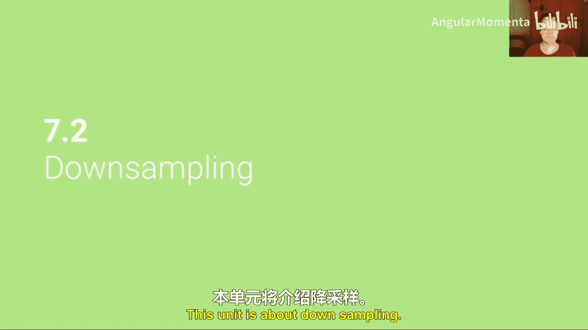
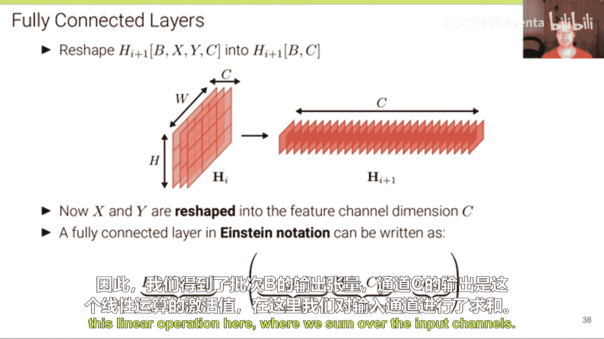
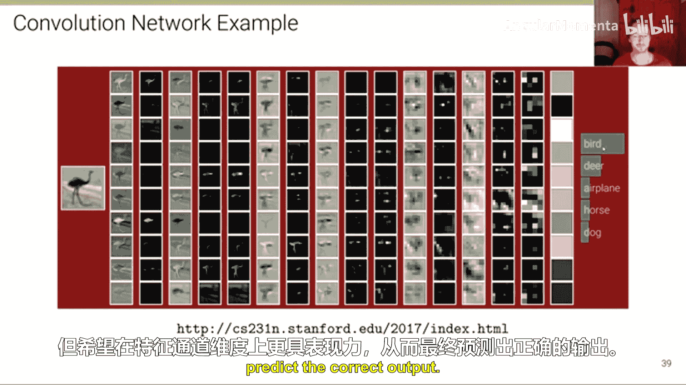

# 【精译】蒂宾根大学《深度学习》-p35-35--7.2（卷积神经网络：下采样）--BV1eDbrzhENK_p35-

This unit is about down sampling。Here we see again our VGG network architecture。

As we've seen in the previous unit， convolution operations maintain the spatial resolution of the input。

They leave it unaltered。However， down sampling operations such as max pooling。

 they reduced the spatial resolution in this case here from 224 to 112。

Downsembling operations are useful in convolutional networks to successively reduce the。

Sppatial resolution， for instance， in order to arrive at a single outcome such as a label that describes the entire image。

But also in order to successively。Arecate more and more global information about the image by looking at larger and larger regions in the image。

Okay。So down sampling here these red operations mark pooling as one example。

Successively reduces the spatial resolution。And at the same time。

 increases the receptive fields increases。The domain or the input region that influence a particular neuron。

In the end。Here。These neurons are influenced by each single pixel in the image here。

While in the beginning， the first convolutional layers。

Only very local neighborhoods are influencing individual activations。Yeah。One of the simplest。

And maybe most common down samplingling operation is called pooling。And there's different variances。

Maximum pooling， minimum pooling， average or mean pooling， for instance。

Pouling has no parameters poololing simply operates。

 it operates on each channel separately and takes particular region in the image。

That's defined by the pooling kernel in this case here in this example is free by free。

And takes the pooled value， for instance， the maximum in the case of maximum pooling and puts that value at that output location here。

And then it moves on with a certain stride， so it doesn't look at the direct neighboring pixel of the input。

But it typically moves on with a certain stride， so it jumps over one input pixel here in this case this stride would have been two。

And then again， it looks into this。Reach and defined by the kernel and maximizes all values and puts this maximal value at that location。

And it does so as well for this location here of the output and this location here of the output。

In this case， this is a max pooling operation that has a free by free kernel， but in practice often。

A kernels of size2 by2。That with a stride of two that reduced a spatial dimension by  two are common if you have a stride of two。

 then you reduce the spatial dimension by roughly two。

Here is the mathematical expression for this operation。

 So we have the tensor at the output tensor here at。B and the spatial location， X， Y。That is。

The maximum over all deelta x delta y of the input tensor。

Where we take the current location multiplied with the stride。Typically2 plus deelta x and S。

Times y plus Delta y。We maximize over Delta x and Delta y。As you can see， there is no parameters。

 it's just a maximum operation。And it's applied to each channel separately。

 So we apply this separately to each input channel。

 which means that we keep the well we don't keep the spatial dimension， but we keep the。

Number of the channels， so the number of the output channels is the same as the number of the input channels。

So here is a concrete example。Where we have used a max pulling operation with st2 and kernel size 2 by 2。

 which reduces the spatial dimension by a factor of 2。

You can see the red cell here that corresponds to these red input cells。

 the green cell corresponds to the green input cells and so forth。I can also see that。

We obtain a six here because6 is the largest value amongst all values in the red input cells。

A here is the largest value amongst all values in the corresponding green input cells。And so forth。

One little remark here is that max pooling provides some invariance to small translations of the inputs that has often been used as an argument of why max pooling is useful。

But in practice， often today， people have replaced Max pooling with what's called astrid convolution。

Straide convolution is simply a standard convolution operator that has a stride in it。

So this is an operation that unlike Max pooling， it has parameters。

In the same way as a convolutional layer has parameters。

But you can reduce the spatial resolution without requiring additional type of。Puling layer。

It's a standard convolution with a stride。So here we have this is the equation that you' have seen before。

 a convolution， the only difference is now highlighted in red here that we have。

For the input X Y location。🤧We query the input layer or the input tensor。At stride times x。

Plus delta x and stride times y plus delta y。So what we effectively do is that we move the convolution filter not by one pixel。

But we move it by a stride of S with respect to the input tensor。Still， we have。

The same parameters A and B for the weights and the bias as we have before for the regular convolution。

嚟啊。And so this is a form of learn down sampling in contrast to。Max or mean pooling。

 which does not have any parameters and is not learned。

And it's used in many modern network architectures such as Fsnet， for instance。So， finally， I。

Want to briefly mention the notion of receptive field and also。

showhow you a little bit the relationship between the size of the input and the output tensors。

So receptive field is defined。As all pixels in the input X that influence a particular neuron。Okaym。

So let's assume we have a two layer neural network like here， where we have a。

Input X this is the image that's input to the network and we have two hidden layers。

 maybe we have more hidden layers。But we are only interested in the second hidden layer here。

And let's say we are interested in this neuron。If we want to know which pixels have an effect on that neuron。

🤧。And if all of these two layers are using free by free convolutions。

We can go backwards from that pixel and think about well， which pixels or which spatial locations。

 which features。In the first layer or feature map， have an influence on that one。And clearly。

 because we have a free by free convolution， all the features that are outside of that free by free convolution don't have an influence on that。

So we have only this area here， which has an influence。

Now we can apply the free by free kernel on all of these locations here。

And we see that this is the area， in this case， it's5 by5。

Where inputs have an influence on that neuron， because for instance， for this pixel here。

This pixel influences。This feature here and that feature here influences that neuron。

And so the maximumim area ordered。The union of all pixels that have an influence on a particular neuron are called the receptive field of that neuron。

 This is what the this particular neuron attends to， what this particular neuron is influenced by。

 that's called the receptive field。And of course， if you would add one more input layer。

Before layer X， then you would see that the receptive field grows， and it grows。Even larger。

It will grow even quicker if you use， for instance， a pooling operation。

As you have a straightit that。That expands more quickly。So if you would want to shrink。

The spatial resolution of a。224 by 224 pixels limit， in other words， using just convolution layers。

 you would be very slow it would just be linear， but if you shrink with pooling。You're going much。

 much faster than linear。Okay。So here's some arithmetics。

It's important when implementing convolution neural networks to specify the correct number of。

Channels and the correct spatial dimensions of each tensor。And those depends。

On the filter size and the size of the input tensor。

And the number of channels in the input tensor and the padding and stripe。

 so here we are only concerned now with the spatial dimensions。As the channels。

 they can be chosen by the convolution operation in Pytorch。

So if we want to calculate what is the output spatial dimension of the output tensor？

Then we see that this can be calculated with this expression here where this。

Operation here is the floor operation， the rounding operation。Okay， so let's have a closer look。

 so we have the width and the high dimension here， both are almost same。

s just like the w that changes to H。And what we do here is we are adding to the input。

Twice the padding because we do padding at both sides and then we subtract the kernel because the kernel shrinks again the spatial dimensions。

And then we divide by the stride。 if we have a stride of two。

 then we reduce the output by approximately two。Now， if this operation here is a fractional number。

Then we need to round this fractional number to the bottom because we can't at the next step we wouldn't be able to calculate the output because there is some inputs missing and that's why there is this floor rounding operation around。

And then we're adding one again here in the end。嗯。Complete this expression。Right。So here's some。

A simple example for a simple operation that has all of these properties here or all of these。

Prameterters set in in some non trivialbal way， so we have five times five dimensional input。

 we have padding one and we have a stride of four。And a kernel off free by free。So in this case。

 if we go by a stride of4， we move from here to there。

This means that we cover the entire padded input， which is good so specification is proper and the output is just a two by two。

嗯。Tensor， a tensor with spatial dimensions，2 by2。We can now also plug in these values into this formula to see that this formula is correct。

We have5 plus two is 7。-3 is 4 divided by straight 4 is。one。

The rounding operation is not effective here， so we have one plus one is 2， so the output is 2 by 2。

So this is an easy way of。Calculating the layer size when you develop these convolutional architectures。

And finally， we briefly talk about the fully connected layers that are also part of this convolutional or part of some of these convolutional network architectures。

Fully connected layers are actually the most intensive， memory intensive。

 memory hungry part of convolal network architectures。Because they are fully connected。

 so in this case here we have 40 like 4096 neurons that are connected to 4096 neurons in these layers here。

So this is very memory intensive compared to these convolution kernels that are relatively memory lightweight。

Yet in this particular architecture， they have been found useful for achieving state of the art performance。

In order to apply。Fully connected layers， we need to shrink。点。Spatial dimensions。For instance。

 from7 to7， from7 to7 to one to one。From seven by seven to one by one。So how do we do that？ Well。

 we do that exactly the way how we shrunk。The spatial dimensions of the mist digits to vectors in our。

MLP exercise。 We simply flatten inputs。 So let's assume we have a feature map of size3 by free with free channels。

Then we reshape， we apply a simple reshape operation to go from the tensor。

With four dimensions to a tensor with two dimensions。Right now。The channel dimension absorbs the。

Bth and the height dimension here。So we have now。Basically， concatenated all of the。

Features from each of these spatial locations here in one big vector that why。

Here we have a one by one by。27。Dimenssional of tensor while here。

 the input was a free by free by free dimensional tensor。We just stack all these individual。啊。

channelss per pixel。Into a big vector。And this is easily accomplished by a Ny reshape operation。

Now X and Y。The X and y dimensions are reshaped into the feature channel dimension C。

And we can then apply a standard fully。Connected layer on this vector here。

 which in Einstein notation。Can be simply written as this one here so we have。

The output tensor for batch B and channel C out is the activation of this linear operation here。

 where we sum over the input channels。

Here is a example of what this looks like for a simple convolutional network to classify images。

 and I encourage you to have a look at this website here， which has a nice。

Interactive demo that you can have a look at。So this is a network where you can see。

 So the first column here is。The output of the convolution layer before the activation。

Then the second column we see the activation。Then we have a second layer here with the output before and after the activation。

 and then we have a max pooling operation here， which you can see reduces the spatial resolution。

Then there is， again a convolution operation， never convolution operation。

 and a never max pooling operation。Then there's another convolution operation。

Another convolution operationration， these two columns and another max pooling operation。

 And then finally， a soft max to predict。A discrete distribution over the outputs。

You can see how successively features are becoming more and more coarse in spatial dimensions。

 but hopefully more and more expressive in feature channel dimension to finally predict the correct output。

