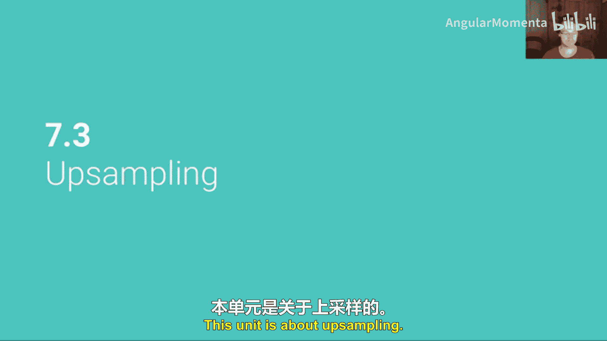
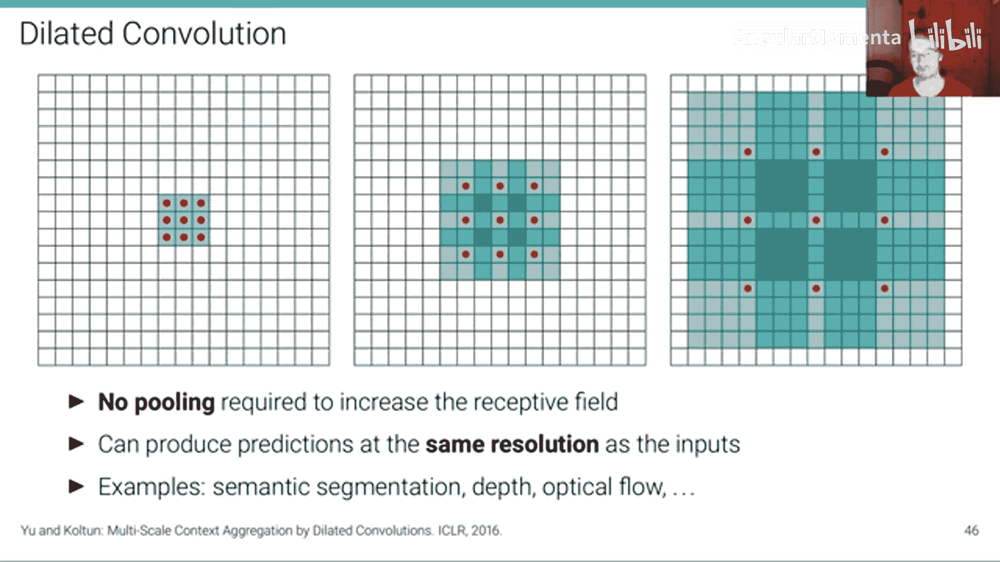
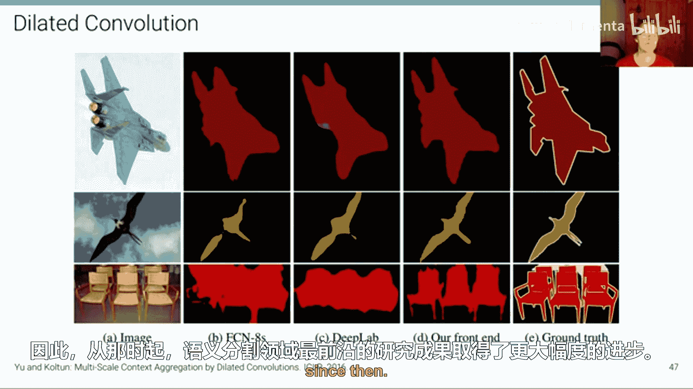

# 【精译】蒂宾根大学《深度学习》-p36-36--7.3-（卷积神经网络：上采样）--BV1eDbrzhENK_p36-

This unit is about up sampling。In many situations， we might not be interested in image level predictions。

 but rather in pixel level predictions。For instance， if we want to。

Predicts a depth map that is a depth at every pixel location or the motion at every pixel location or a semantic label map。

As in this case here， where for every pixel， for every input pixel。

 we want to determine what is the semantic class label such as tree or。

Poll or car or road or sidewalk or building that is visible at that pixel location。

If that's the case， then pure down sampling is not sufficient。

 but we also need to up sampleample again。And this is an example of such an architecture where we have both convolution and pooling operations as well as。

Upseling and convolution operations to go from the low resolution back to the high resolution。Now。

 why do we need to down sample in the first place？If we wouldn't downs sampleampble。

 we wouldn't get any strong features that have a large receptive field。And therefore。

 downsling is necessary to aggregate over larger image regions more quickly。With a。

A limited a number of parameters in the network。Upsling then yields results at the same resolution as the input and often there is some ressonite like skip connections that pass information directly from the early layers to the upsling layers in order to。

嗯。Maintain a high level of accuracy at boundaries of objects， for instance。

So this is a very common architecture for such。Encode a decoder network。

 often also called a unit architecture because it has this U shape。

There's multiple ways in which up samplingling can be implemented。So here are some examples。

 For instance， what we could do is we could use nearest neighbor upsembling where we simply。

Set each element to the nearest neighbor。Based on the input feature tensor。

We can also use bilinear assembling。Or something that's also very common is the bed of nails upsembling where we simply insert。

Sparrsely， the locations of the input and the output and everywhere。In between， we add a zero。

 and then this is followed by a convolutional layer to fill in these missing components。

 which works actually quite well。So the type of up samplingling that you want to use really depends on the application and different types of up sampling have different artifacts。

For instance， if you use bilinear upseling， you often get two smooth results。

If you use bed of nails upseling， sometimes these nail like it is called bed of nails because some of these values stick out and others are0。

 these nail artifacts are still visible in the output。

 so there's different ups and downsides to any of these upseling techniques。

There's also something called Max unpoing。In max unpooling。

We first remember which element was maximum during the pooling operation。So for instance。

 here in this。Amongst those four elements，6 was the maximum， amongst those four elements。

8 was the maximum and so forth。And then when we assemble some particular feature map so this is in the downsling stage and this is in the upsling stage。

 then we take that value that we want to ups sampleble and using this bed of nails representation we inserted at the location where the maximum was found during the down samplingling。

And the idea behind this is also to keep some of the high level details and structures。

 but it requires always corresponding pairs of down sampling and upsling layers。

 so it cannot be implemented in any arbitrary unit architecture。However。

 this is the approach that has been used in Sgnet， one of these foundational。Neal network。

 encode a deco architecture of semantic segmentation， which I showed here。Another alternative to。

Up samplingampling is to use styllated convolutions。For dilated convolutions。

 you don't need to downs sampleample because dilated convolutions are a technique to increase the receptive field size while keeping the spatial resolution of the feature maps constant。

In dilated convolutions。You're having a multiplier to the deelta x of the input tensor。

That effectively disperses or distributes the。Sampling locations。

 locations where the kernel is multiplied to the input。 And so with different Ds。

 you can get a very large kernel without actually requiring more parameters because it。

It queries the input more sparsely。Now this works to some extent。

 but even in the original one of the original publications here that is shown here at the bottom。

 the offers still required some standard backbone in order to actually make this work。

But the idea here really is that you can increase the receptive field without。

Having to increase the parameters or reducing the spatial dimensions so you can do this。

At the end of your network。To with a very， with very few parameters。

 refine your output at the same resolution， and that works very well。

Here's another illustration where you can see how this is progressively growing in the first stage。

The second stage， third stage can see the receptive field size。ok。

YeahExles where this can be applied is a semantic segmentation step for optical flow。

So here's an example for se segmentation。You can see the problem of standard unit architectures can be to some extent be mitigated by these dilated convolutions as they are capable of preserving some of these details better。

 however this is a。A little disclaimer here is that this is a paper from 2016。

 so state of the art results and semantic segmentation are。Have much more advanced since then。

