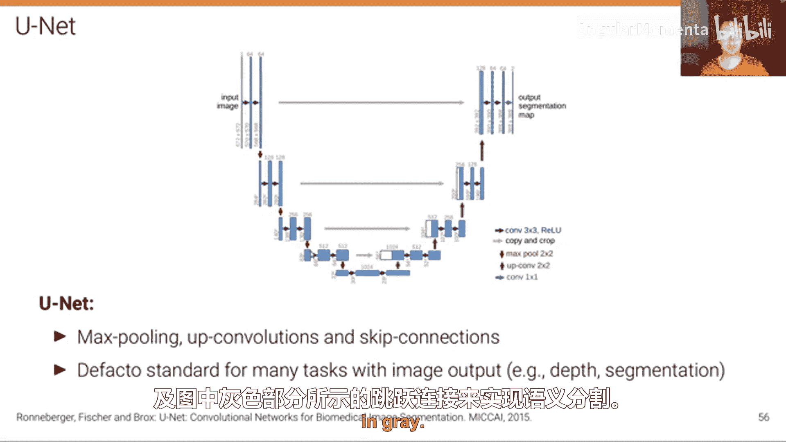

# 【精译】蒂宾根大学《深度学习》-p37-37--7.4（卷积神经网络：架构）--BV1eDbrzhENK_p37-

。In this unit， we're going talk about some of the。Classically。

 more historical convolutional network architectures and also some more recent state of the art。

 convolutional network architectures。

This is the picture that I've showed in the beginning where we can see that。In the last 10 years。

 performance on this imagenet classification problem has significantly increased or the errors have significantly dropped。

While at the same time。ThatThe network depth has increased。And this is a。

A common trend in these days that deeper networks lead to better generalization provided enough training data and compute。

And today nearly all state of the art networks for image applications。

 all state of the art networks that use images as input use convolutional layers。

 so this is really the dominating paradigm today。It all started sort of with Lette。

Lette is a network architecture here in its fifth version。That has been developed by Alicn。

Favor of modern convolutional networks， and is a very simple and shallow。

 still relatively shallow network architecture has just two convolutional layers。

 two pooling layers and two fully connected layers。

 But it at the time was a chief state of the Arctic Cursey on Amnest。there was prior to the Inet era。

 there was no large scale imagenet data set available。

 everybody was training on MNIST and testing their algorithms on MNT。

So here you can see the architecture of this network。

 it was using convolutions and subsampling to reduce the spatial dimensions and then fully connected layers in the end to do the final classification of these small little images。

Of diits。Then in 2012， which is often taking us the year where。The breakthrough started。

 this was really the breakthrough was because of a clever combination of several ideas like Raylu and dropout and data augmentation plus for the first time it has been demonstrated that using GPU training these network architectures can actually be applied to data sets that are bigger than MNIS。

 data sets like INe。And produce state of the art results on this data sets。

So this Alexnet architecture， 2012 had eight layers， you can see the layers here。

 and it was distributed across two GPUs just because at the time GPUs were still very small and had only three gigabytes of memory。

 so it was really a memory problem。嗯。And we already see this trend of feature channels increasing with depth and spatial resolution decreasing throughout the network。

So it was a combination of convolutional layers and max pooling layers。

And raillo activations was using dropout and data augmentation to regular training。

And this really triggered this result of seeing that。Deep learning actually works outside this。

Restricted small scale， rubber simplistic machine learning data sets。

 but works in the real world and data sets that the computer vision community is interested in was really triggering the deep learning revolution。

Then in 2015， so there were a couple of steps in between， so I'm jumping ahead slightly。

The VGG network architecture was proposed。This is the architecture I've already shown to you it uses free by free convolutions everywhere。

 there was keys， here there was a key difference from this network which still had many more parameters also because it was using larger filter sizes here in the beginning。

So it showed that using just three by free convolutions everywhere has the same or even better expressiveness with fewer parameters because for instance。

 three by three layers have the same receptive feel as one，7 by7 layer。

 but they have less parameters can easily show that and they have at the same time more nonlinearities because there is three layers。

 not just one layer。So they've shown that it's actually better to。Use layers。

 convolution layers with smaller kernels， and that's also the dominating paradigm still today to use these small and simple layers and rubber create deeper networks。

Then of course， training becomes a problem because of vanishing and exploding gradienting problems。

But if you can train them well， then these models can generalize better because they have fewer parameters。

So they show that deeper networks with smaller kernels are better and they propose two different variants。

 one variant with 16 and one variant with 19 layers。In 2015。

 offers from Google proposed InceptionNe or GoogleNe also sometimes called。

Wwhichch is a network with 22 layers， so it's even a little bit more deep than BGG and it's very efficient it has 27 times less parameters than BGG because it doesn't use fully connected。

It doesn't use like these large fully connected layers in the end。

 but very quickly narrows down to the softmax operation。It also has a couple of other innovations。

 for instance， it uses these。Inception blocks here。

 you can see that multiple this block here reappears multiple times throughout the network。

 And what this block does is it uses different。Have it here。

 it uses different types of convolutions with different filter sizes one by one3 by3，5 by5。

 and also maxs pooling all inerel and then concatednates the results kind of an assemble。

That leads to better performance， what it also does is it has multiple hats so it because it's very difficult to train such deep networks at least at the time。

if you just propagate gradients all from the end here。

What they did is they used some intermediate hats that are not used in the end for final classificationation。

 but they were just also trying to solve the same problem for back propagating gradients and helping the gradient flow through the network。

And then they are using one by one convolutions in some variants of their network to keep the efficiency high。

 one by one convolutions can be used to alter or change or reduce the number of feature channels。

Without actually changing anything else， changing the spatial resolution or the receptive field。

 just changing the spatial the number of feature channels and they were doing this multiple times throughout the architecture。

 in particular in cases where for instance max pooling was keeping or there's no way you can define max pooling。

And the same time， reduce resolution。So they did this immediately afterwards to reduce the number of feature channels sorry to reduce the number of feature channels and effectively reduce the number of parameters of the following layers。

Then in 2016 was another real breakthrough renet， which is。Like。

Underlying most of this data of the art architectures today in image classification。

Innet with Resnet was possible for the first time to train very deep networks up to 152 layers。

And it's a very simple and easy network architecture， as you can see here。

With have a very regular structure， with only free by free convoluts。

It uses dilated convolutions for done sampling and really this breastnet like architectures are dominating today。

 and the reason why they are so powerful is that for the first time they allow for training these deep networks。

So what is the reason behind， well， what the authors have realized is that if you have a network with 15 layers。

16 layers like BTG and you add 10 more layers。Then the performance actually drops。

 and it's not an overfitting problem， and there was surprising。

So despite this not being an overfitting problem， adding more layers drops performance。

 despite the fact that if I would just use identity layers。

I just used the identity for all these 10 additional layers I would get the same performance of the original 16 layer model that performs better than the 26 layer model。

And that's surprising。And the offers realized that the main problem is in optimization is problem of vanish ingredients。

And so what they did as a change to the network is that they introduced these residualceital blocks here where instead of just a standard feet forward layers。

They introduce the skip connections here。Where these layers just had to predict the receual。

So theseions， these layers here just have to predict the residual to the previous value of the input。

And now of course it becomes much easier to realize the identity。

 the model basically starts with the or close to the identity。

And so the problem is much easier to train and it doesn't suffer from this problem that adding more layers。

Very quickly leads to the problem of。嗯。Allowing the model， not training anymore。

And so this was really key and these residual connections can be found throughout many。

Many neural network architectures today。So here's an overview over the complexity of the different network architectures。

 you can see that VGG is what you see here is basically the size of the network in terms of the disk size and the operations that are needed for executing it。

And the accuracy on imageNe in this case is top1 accuracy。

 you can see that VGG 19 is really a heavy network has many parameters is very slow。

On the other hand。GoogleNe for instance， is much faster and smaller， but it doesn't perform as well。

And then there is this inception and ressonnet。Architects that are somewhere in between。

Combining different ideas， leading to better performance with smaller and faster networks。Yeah。

And then one final architecture I want to show you is this unit architecture that has been popularized in this segment paper that I've shown before。

 but also in this unit paper that was first applied to biomedical image segmentation actually。

But is cited a lot today as its its the default unit architecture that is taking an input and producing an。

Image or a pixel level output like semantic segmentation by。

Combining downscaling with upscaling and skip connections here in gray。

。