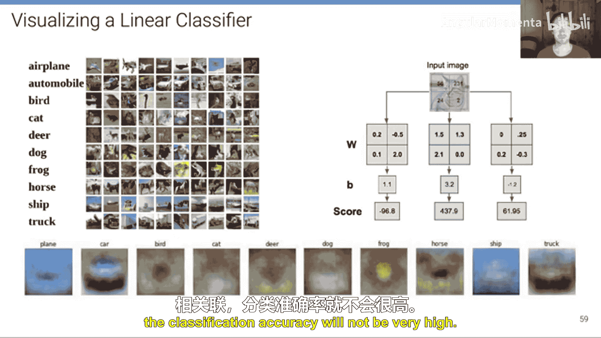
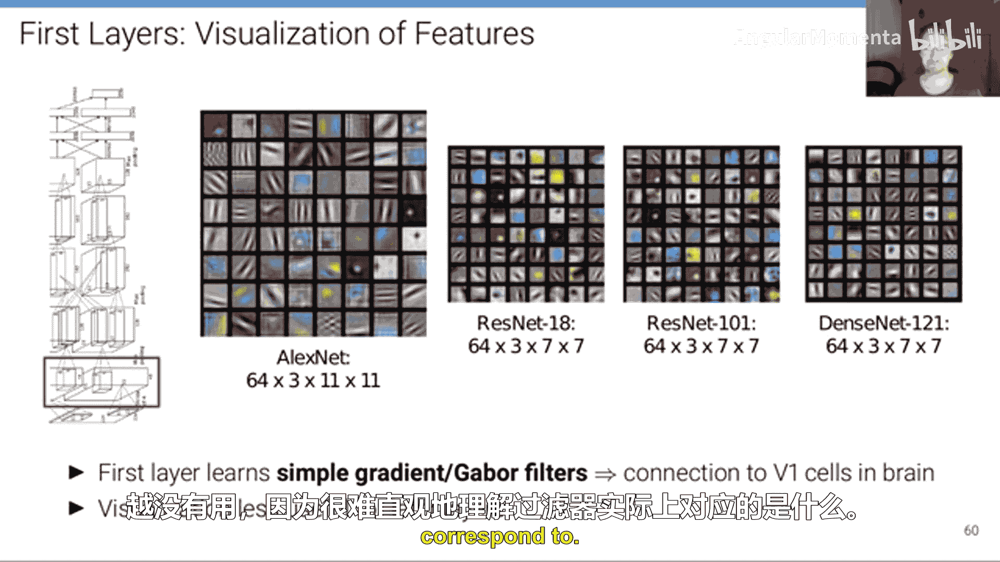
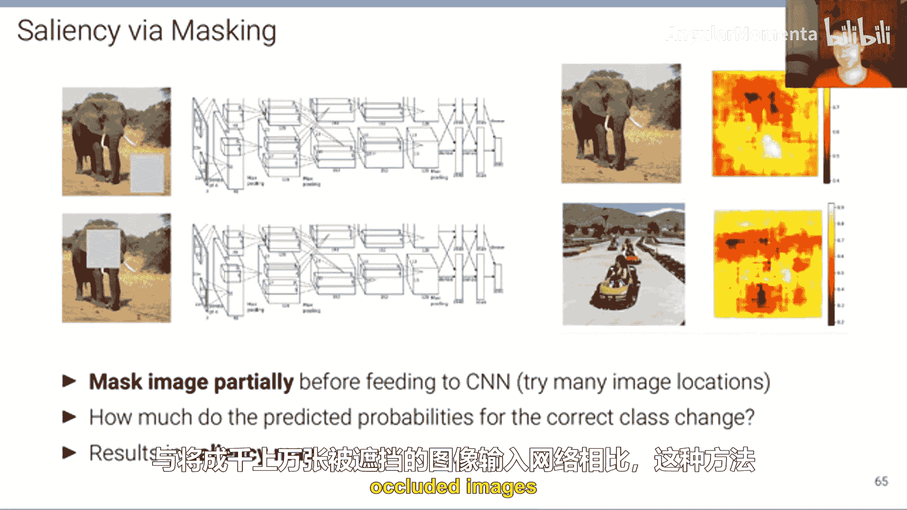
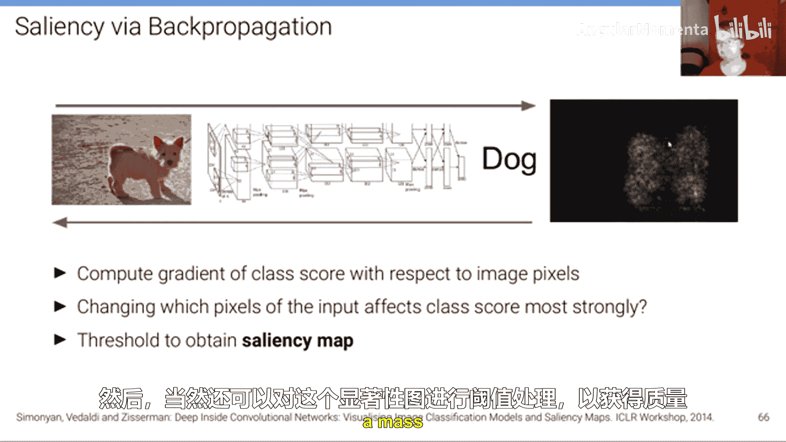
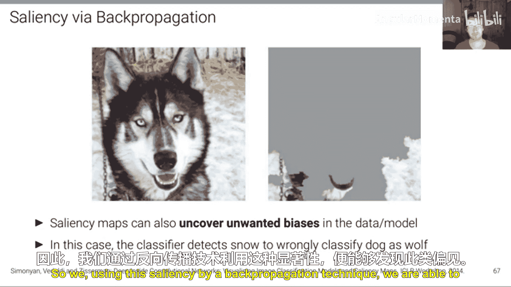

# 【精译】蒂宾根大学《深度学习》-p38-38--7.5-(卷积神经网络：可视化)--BV1eDbrzhENK_p38-

In the last unit of this lecture， we're going to look at some visualization techniques。

Visualization is important to gain a better understanding of what happens inside a neural network and sometimes it's also just fun to play with visualizations。

In order to obtain some artistic effects， as we will see at the very end。So the question here is。

 well， after training such a deep convolutional neural network。

 which to the outside is just a black box where the parameters have been adjusted using gradientding descent。

What are the intermediate features or layers actually doing。

 what are they looking for can we somehow gain a better understanding of this。

Let's start by trying to visualize a simple linear classifier model such as a logistic regression model。

In the case of such a model， visualization is actually relatively easy because we just have a shallow network with a single layer that is illustrated here。

 so we have a。A set of pixels that get multiplied with a weight matrix。Addit a bias。

 and then the result is a score that is passed through a logistic function。Now， in this case。

 we can directly have a look at the weight matrices and see if we can figure out something from these weight matrices because these weight matrices are everything that the classifier has in order to make the prediction and indeed if we look at the weight matrices of a classifier trained on this data set。

 we can see if we visualize the weight matrices， we can directly see that the outcome is a somewhat average result of these object in the specific category。

One can already see or it's easy to understand why the shallow model is not a very good classifier if it basically just has the opportunity to correlate such an average。

Image with the input。The classification accuracy will not be very high。

Okay， so let's look at more interesting models， let's look at a deeper convolutional neural networks such as AlexNe。

 ResNe or DNe。What is easy to visualize and to understand are the first layers。

 particularly in the first layer， we can directly visualize the filters which has been done here for different types of networks so what you can see here is a subset of the filters that have been learned in these different networks and you can see that they have different size because for instance an AlexNet the first layer uses larger kernels。

And in Res 18， the first layer uses a smaller kernel。

And what you kept about is common amongst all of these。

A visualization is that the first layers apparently learn some simple gradient like gap or filter like features can see some very basic patterns that conduct。

Edge detection in color space sometimes sometimes blockb detection。

 so very basic primitive structures that are detected with these filters and this has some connections to what also happens in the brain in particular in the V1 cortex in the brain where also very basic patterns like this are extracted。

While this works well for the first layer， these visualizations are less and less useful for later layers because it's less intuitive what the filters actually correspond to。

So let's go all the way to the last layer of such a Alex Nut， in this case。

 try to understand what happens at that level。So。One naive thing we can do is we can take a test image。

For instance， this flower here and pass it through this network。And read off the feature vector。

 in this case， the 44096 dimensional feature vector。

At the penult layer right before the classification layer。This is a 4096 dimensional feature vector。

 and what we can now do is we can pass。All other test images。

Or validation images through the same network， and we can also record these features。

And then we can find the closest images。But not in image space， but in this feature space。

 So we take， in this case， the top six results in terms of L2， the squared L2 loss。

With respect to the test image in that feature space， in that 4096 dimensional feature space。

And what you can see is that the network actually did something useful。

 the features that are the images that appear on top of this list ranked by this feature space embedding are actually images that are semantically very close to the test image that they are ranked against。

In the case of flowers， we do get flowers， in the case of an elephant， we get elephants。

In the case of a pumpkin， we got pumpkins， etc。In contrast， if we would just。

Apply nearest neighbor search for a particular image in pixel space。

We get much less meaningful semantic correspondences， for instance， for a ship。

 we might get a horse and for a dog， we might get a ship， etc。

So this already indicates that the network has learned something very useful。

 something that transforms it has learned a mapping that transforms the input images into a useful representation it doesn't。

G。As an idea about how he did that。But it gives us an idea about how good。

And how semantally meaningful this feature space is。We can also visualize that feature space。

In a little bit more quantitative way by using a dimensionality reduction technique such as principal component analysis or TI to embed this 496 dimensional space into two dimensions only。

And this is what has happened here for the Ms data set， and you can see that。

Similar numbers are grouped together， indeed。So here on the top。

 you can see that in that feature space， similar numbers are grouped together。

And because this feature space is very semantic， this is also the reason why。

Training deep neural networks first， on a。A data for which a lot of data is available and then fine tuning the last layers so this is called pretraining and then fine tuning the last layers on the target data for which less data is available or where we have an entirely different task is actually producing really good results it's actually working quite well so we can do this transfer learning just by bootstrapbbping the network weights by training on this large image in a data but then take this network and fine tune the network or just the last layers for another task on the target data and we obtain much better result compared to。

Training the network from scratch on the target dataset。

Here is another form of visualization of this。L dimensional embedding space。

 a 2D space where now all the images have been put into a grid based on their semantic relatedness and if you would zoom in。

 you would see that，Images of different of similar kind are arranged a group together like images of fields here or。

Different types of cars or sebels and boats， etc。So there's another way of。

gaining a little bit of an understanding of how that feature space looks like that the network has created。

Another thing you can do is called maximally activating patches。In that case。

 you run many images through the network。And then you record which of these images or maybe just patches maximally activate a specific neuron。

 So now you're interested in a specific neuron in their neural network。

 there could be a neuron at any layer at any intermediate layer。

 and you want to know what that neuron。Attends to。And to do that。

 you run the entire dataset set for the network and record where the neuron activates。

 and then you rank your inputs or your patches based on the activation level。

And this has been done here and you can see as each of these rows is a different neuron in the neural network somewhere in the middle of this neural network。

And you can see that different neurons respond to different。嗯。Inputs， but in a way that。

There is some semanticness to it， so for instance。This neuron here detects around things like eyes and nose or this neuron here is somehow responsible for detecting text。

And there is a neuron here that detects multiple circular shaped objects or a neuron that is specific for faces。

 and this has automatically emerged。By training this data set。On this classification task below。

So this is interesting so you can。We easily find which neurons are actually。呃。Spific。

Activate for a particular。Inputs。Another technique to find。

What to figure out what happens or what is important in the input image。

 so this is now regarding the importance of the input image。

the relative importance of respect to particular locations of the input image。

 which features of the input image are actually relevant for a particular decision that the network does。

Its salliency via askinging。What happens in this case is that you take a image。

And you pass it through the neural network。And then you occlude a certain region in that image。

And you occlude different regions in that image， so you take this window that is occluding parts of that image and you swipe it through that image and for each of the possible locations of this occludeder。

You pass the occluded image through the neural network and record the classification response。

And then you can， of course。Display the results in terms of a so called saliency map that displays for each location of the occludeder。

How much would the classification performance in terms of classifying this image as an elephant drop with respect to the unoccludeed image？

And what you'll find is that， for instance， in a case on elephant， when you occlude the face region。

The performance will drop most。That's intuitive。 or in in the case of this card image performance will drop most if you occlude the frontmost car or some of these track regions in the back。

So there's another way of。Figuring out which。Elements of the input image the network is actually sensitive to。

Another strategy to figure out what。In the input image is relevant to the classification result is saency via back propagation。

 This is a much cheaper technique than running thousands and thousands of。

Ocluded images through the network。

Because what you do here is you take a specific image。

And you compute the gradient of the class or with respect to the image pixels。

And then you display the magnitude of this gradient。 you get an image like this。And this shows you。

Like how much a change in any of these input？Image pixels would actually affect the glass score。

So the white pixels here demonstrated in these areas。

Changing the input pixels would affect the class most strongly。And then you can， of course。

 also threshold。This salience this， this。And a saliency map in order to obtain a mask salliency map。

Okay。Salency mapps can also help to uncover unwanted biases in the data on the model in this case。

 for instance。嗯。Something unexpected happened。So this is an image of a husky which is a dog。

That has been wrongly classified by the neural network as a wolf。

And if you visualize the saliency for this particular image， you will find that。

The network actually was not looking at the object at all， but it was looking at the background。

I was looking at the background because in order to distinguish Doc from Wolf。

It was easier for the network to figure out if the background is white because wolves。

Most often have been captured in front of snow。Rather than actually classifying the object。

Where the wolf is actually quite similar to the dock category。So the network has taken this shortcut。

To optimize the classification accuracy， but of course。

 the shortcut is not something that we prefer the network to have incorporated so。

Using this salliency via bike propagation technique， we are able to uncover such biases。

Another very popular technique。Has been proposed by S and Fergus in 2014， it's called deconvolution。

Where the idea is to construct or to reconstruct the convolutional network in reverse order。

 starting from one neuron。And for instance， for max pooling。

 remember the maximal activations during pooling for the backward pass so that you can backproagate information in a sense。

 to the image regions that are most responsible for activating a certain neuron。

And here are some results of this technique。So these results are sorted by layer。

 you can see that in the first layer。As we have seen previously， there is very simple。

Edges that the network attends to， then in the second layer we already see certain parts of objects appearing。

In the third layer， we see already bigger constellations of objects like。Head and torso。

 for instance。And in the fourth and the fifth layer， we see entire objects appearing。

 such as entire phases or。I hear animal faces。Yeah， and。As I mentioned in the beginning。

 you can also have some fun with these visualization techniques， so there's this。

Famous blog post from Google， which I really recommend you to have a look at。

called inceptionism going deeper into neural networks。

And the idea here is to take an image like this one here。

And to amplify the activation of a chosen layer with respect to a given image。

They can be simply done by setting the gradient。Of the backward pass。To the activation itself。

 So you want you want to activate neurons that are strongly activated already by this image more。

This is all applied to a pre trained image network network mine， so I want to activate the。

The features that are strongly activated by this image， you want to activate them more。

And you want to deactivate the features that are not highly activated。

So we'm going to reduce that factor。And you do that by back propagating gradients。

 not to the weights。But to the input pixels and modifying the pixels such that they activate what is activated already more。

And if you do this。Then you get interesting results such as these。 It's called deep dream。

 where you now see in this image of the clouds or some， some。artistic objects appearing。Such as。

 you know， some fantasy animals like an admiral dog or a pig's snail， camelbird or a dogfish。

That's all for today。Thanks。😊。