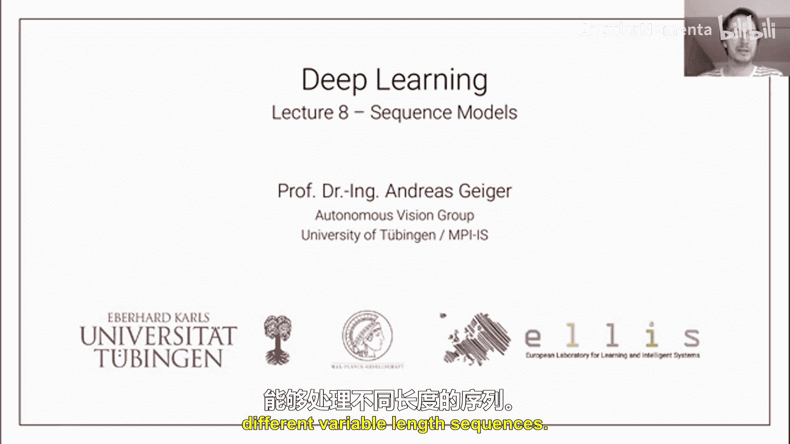
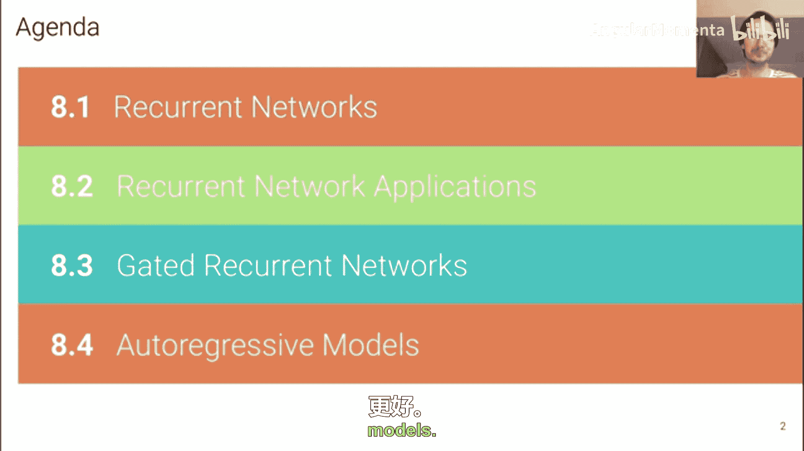
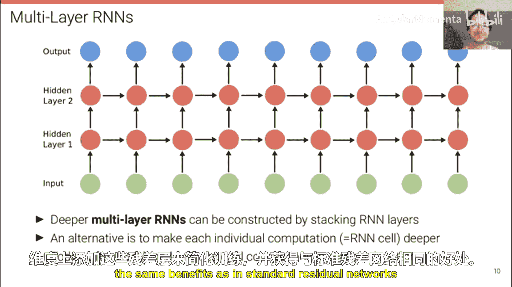

# 【精译】蒂宾根大学《深度学习》-p39-39--8.1（序列模型：循环网络）--BV1eDbrzhENK_p39-

Hi and welcome to the8 lecture of this deep learning course。In the past。Lectures。

 we have discussed models that take a particular， a single object as input， such as an image。

 or in the case of。Multtilieop perceptrons， we have first converted that image into a vector。

 and then given that fixed size vector as an input to a neural network。In this lecture。

 we're going to talk about more powerful models that are able to。

Deal with sequences of variable length。In some applications， as we will see shortly。

It is useful to have models that allow for operating not on fixed size vectors only。

 but on sequences where the length of either the input or the output or both is flexible and these models。

 the same model can handle different variable length sequences。

Oh。This lecture is structured as follows In the first unit， we'll talk about recurrent networks。

 which is probably the most well known。Sequence processing model in deep learning。In the second unit。

 we will cover some recurrent network applications to demonstrate the flexibility of these type of models。

In the third unit， we're going to have a look at gated recurrent networks which are able to overcome some of the problems that vanilla recurrent networks have。

And then， in the final unit。Which is a little bit more controversial。

 We' are going to discuss autoregressive models， which are purely fit forward networks。

 There is no recur in these models。But which have recently been demonstrated to perform for a broad variety of tasks almost as well or in some cases。

 even better than precurrent models。

So let's start with recurrent networks。Let's first recap computation graphs。

With an example of a feed forward neural network， in this case。

 a one hidden layer multi layerer perceptron。Which we can see here on the left side。

This one hidden layer multi layer perceptron takes an input X， processes it to a hidden variable H。

And then makes a prediction in the second layer， prediction Y hat。 and each of these two layers。

So's a hidden layer and there's an output layer in this network。

 it's a two layer network with one hidden layer and one output layer。Each of these layers。

 each of these two layers has。A set of parameters that's associated with that particular layer。

 So we have two sets of parameters here。And we are following the notation that we have introduced in the second lecture。

Which highlights compute node in red， input node in green and peri nodes in orange。Now。

 in the following。For simplicity and clarity of illustration。

 we are going to drop all the parameter notes and consider them implicit to the compute and the output layers。

So here you can see an example where we have。Illustd the same model as we see here on the left。

 but dropping the parameters and making them implicit， the parameters are still there。

 we just don't show them。And the second change that we have done here is that we have introduced a new color。

Which is useful for illustrating these R andNs that we're going to have a look at in a second。

We have introduced a new color blue for output layers。 So this is also a compute layer。

 but to distinguish output layers from。Compute layers that are internal to the network。

Hidden compute layers。 We're using this color blue now。

 in addition to the color red for the hidden layers。So inputs are green， hidden layers are red。

 and output layers are blue。Now， this is。A comparison of feed forward networks to recurrent networks。

 which are the main paradigm for this lecture。 In contrast to feed forward networks that propagate information in a feed forward fashion from the input to the output。

In a recurrent neural network， we have so called feedback connections that feedback information from one node into the same node again。

 illustrated here by this little。Errow that is pointing from the compute node H。

Back to the compute node age。The core idea of recurrent neural networks is that there is a hidden state that is。

Updated based on the input X and the previous hidden state using some updated rule where the parameters are shared。

So what we can do is we can take this recurren neuralial network and unroll it over time。

 we're always going to use T as the time index in this lecture， T could be any sequence index。

 but in most applications it will be time。So， we're gonna always。Refer to。This index here。

 as the time index。So this is the same。Illustration。

 as this illustration just that we have now unrolled。

 we say unrolled over multiple times step this graphical model here of this RNN into this unrolled graphical model here。

 where we have now a feed forward representation of what is effectively a recurrent neural network with a feedback connection。

And while， of course， the feature maps might change over time。

 what this is important is that the computation that is done at each of these。

Layers here is the same as the computation that is done in the previous layer in other words there's the same parameters associated with H1 H2 and H3 we're doing exactly the same computation just that we have different inputs for instance in the case of H2 we're taking the input H1 and x2 and in the case of H3 we're taking the input H2 and x3。

But we are applying the same。We're multiplying the same weights to these inputs。系啊。

So you can think of this as x1 x2 and x3 being an input sequence， let's say is a sequence of。

Natural language text， these are three different characters in a sequence， let's say。

And if we want to translate them into some output language， then we have the output here on the top。

 where we have a translation for each of these characters awards。Now with this model。

 because we have specified。Or we have shared the weights across the time steps。

 the weights are the same for all the time steps。This allows us for applying this particular model。

 this R and N model to sequences of arbitrary length， the parameters。

 the number of parameters doesn't。Depend on the。嗯。leength of the input anymore because we're using the same parameters over and over again。

 so we can extend this to any length indicated here by these three dots。

What is also important about these type of models is that they have infinite memory。

In theory at least so this is because this hidden state vector H can store information from infinitely far ago from the very first time step very early on and this introduces very long- term dependencies right so for instance here if we have time step1 and then we imagine this chain of computations to go all the way to 1000 or 10000 time steps。

Then we can。Process that x1 and store some of the information that is present here into H1。

 and this information gets carried over all the way to times step 1000 or 10。

000 if it's advantageous for the model for making a prediction。So in theory。

 at least these models have infinite memory， but we will see in the next lectures that in practice that for reasons of trainability that doesn't hold true necessarily。

Okay。So let's have a little bit more closer look at what such a recurrent neural network does and let's look at a particular R and N cell。

 So we call these modules here， these computations here。

Cells and this is this is red cell is this is one cell that we are looking at here。

You can see that the input to the cell is the tensor， the hidden state from the previous time step。

And the output is the tensor or the state at the current time step。

And the cell takes us input the previous tensor and。The current input。So this is H T minus1 and Xt。

And it concatenateates them into a feature vector or tensor。That contains both。

And applies then some transformations to it， which in this general form， we have just called FH。

 which is a transformation that transforms from Ht minus1 and Xt。

From the concordninated version of these two。Transforms those into a new hidden state HD。

And then you have another transformation。Wwhich you call in the most generic case here， FY。

 which takes the hidden state at time T and produces the prediction at time T。Again。

 we use T as the time index。And this is in contrast to feed forward networks。

 you can think of this as layers of a feed forward network。

 but here we have a time index T and to contrast it to feed forward networks。

 we use this time index T in contrast to the index I that we have used as a layer index in standard feed forward networks。

And the crucial difference here is that in this case， the parameters are shared。

 So each of these cells here， the parameters of the function F H and FY。Are the same。

 the functions do not change over time。So if we apply them at the next time step， they stay the same。

Okay。So this general form does not specify the form of the hidden and the output mappings。

But one of the most basic implementations of a recurrent neural network is the so called vanilla single layer RNN。

Which uses a。FN transformation on the inputs and a tonage linearity team。

 and then an FN transformation to produce the output。So let's have a little bit more closer look。

 This is also what is illustrated here in this diagram we first。

Do the condination of the input and the previous hidden state。

 then we apply an F transformation on that。And then a 10H non nonlinearity。

 and then we pass that state to the next RnN cell and apply an aine transformation to produce the output。

mathematicalthematicly speaking， we have。HT， which is the hidden state at the current time step。病你。

Tnage of。A linear transformation of H T -1 and Xt， which we can write as simply the sum of H T minus1 times a weight matrix H。

A H and X T times a weight matrix A X plus the bias vector B。 And then for time step T。

 we have the prediction as the weight matrix A Y times the hidden state H T。In other words。

 the hidden state HT is a linear combination of the input Xt and the previous hidden state Ht minus1。

 and the output is a linear prediction based on the current hidden state HT。

It is very common that RNNs have a very shallow structure。

 so this single layer RNN is not an uncommon choice to have this RNN cells to be very shallow right in this case we have a single layer where even within that cell which we could make deeper。

 we are just doing a linear transformation plus a nonlinear nonlinearity。

 it's basically a single layer。It's very shallow， but it's quite common that these networks are not too deep in practice。

 they' are just a couple of layers deep typically。The TnNH is commonly used as an activation function for RNNs because it processes data that is we can think of as data in a range of minus12 plus1 roughly and produces new data。

A new state also in the range minus1 and plus1， and as we have seen。

 it's a zero centered activation function， so it has desirable properties in terms of the distribution of the activations。

And this is particularly important for RNs because we are stacking many。

 many of these shallow cells over time and so as we're going to see。

 we we're going to have to deal with these gradient issues anyways。

 but it's good to choose a nonlinearity that is，ASecent to start with。Yeah。We've said it before。

 but just to highlight it again here in this。At this particular point where we are mathematically more concise。

 the parameters。A， H and X， Y。And the bias B are constant over time。 They don't change。

 They don't depend on the time step T。 And that's why these recurrent neural networks are able to process。

Sequences both input and output that are variable flexible in length。

We can also write the mathematical expression for this R and N cell and the output layer in terms of the Einstein notation that we've introduced in the last lecture and this is what it looks like you can see that we are writing down the expression for a particular patch element P and a particular。

嗯。Output feature， See out。And you can also see that we are expressing this summation over the product of A and H as this capital letter CIN。

As this is an implicit definition in the Einstein notation to sum and multiply over。

And we do the same here for Ax and X team。And then we have the bias。

We can equivalently write this in terms of a single matrix instead of using a matrix AH and AX for H and X。

 we can combine them into a bigger single matrix A。And stack the。For or tensors， H T minus-1 and X T。

On top of each other as an input to。Or to be multiplied with this bigger matrix a。

 this is how you can think about this concatedination here。So this is equivalent， of course。

And then we have the output， which is just a linear transformation again here in Einstein notation。

This diagram here shows what kind of mapping types can be realized with a recurrent neural networks。

Recur neural our networks allow for processing variable length inputs and outputs。

 and both the input and the output can be flexible or not。

 and it depends on the application that you want to tackle， which type of model you want to use。

On the very left， we see the classical one to one mapping。

 which is technically not an RNN because there's no recurrency over time。

This is the classical model that we've seen in the beginning of the lecture。

 a classical ML feed forward MLP or convolutional neural network。

Then we can realize using ER andNs now we can realize， for instance。

 one too many mappings where we have a single input。But we have a sequence of。

the output is a sequence of elements。This might be。Relevant， for instance。

 in the context of image captioning， where we have。An input image， a single image。

 and we want to create a sentence for it where the sentence is represented in terms of a sequence of words。

 so we want to produce a sequence of words as output。

We can also realize a many to one mapping where the input is a sequence and the output is a fixed length element。

This is， for instance， the case in action recognition where the input is a video。

 So we have a sequence of image frames and the output is a。Action class， say cooking or running。

 etc cetera。Okay。We can also realize many too many mappings where the input is a sequence。

 possibly of different length than the output， which is also a sequence。

This is the case in classical machine translation， where the input is a sentence in one language and the output is a sentence in another language。

And then we can also realize many too many mappings in a way where one element of the output is associated with exactly one element in the input。

Note that this is not necessarily the case for machine translation。

 where languages are very different。 So there's no one to one mapping between words。

At least not at the same location or same time step。

But in some applications we might have such mappings， for instance。

 in object tracking where the input is a video， a sequence of frames。

 and then for each of these frames we to if we want to track one object over time。

 we want to infi the location of that object in that frame。

 so we have one object location per input image frame。

Because we have variable length sequences that we deal with here， it's important to ask。

How long the sequences are for the input we know that。

 but how long should the output be and one common way to deal with that problem is to also predict a stop symbol。

Over a binary variable that says continue or stop or make this part of the number of output classes。

 increment the number of output classes by one where we have one additional stop symbol that we can predict in the case of classification。

And if we predict that symbol， that stop symbol， then we dem the。Output to be complete， and we stop。

Maybe one more words about RNNs RNNs， of course， can process any type of input tensors and as such they can also do weight sharing over certain。

Dimenssions of the input tensor， for instance， we can have an R and N。

Like a convolutional LSTM or a convolutional R R& N that operates like a con， but now。

Over each time step。And so we have a conant at each time step。

 but then we have a recurrency over the time steps。

 so we can apply these I andNs in a very flexible manner and combine them also with the idea of convolutions at each individual time step。

 depending on how we structure this。Hidden layer transformations for the。

sakeake of this class we will or this lecture here， we will stay， however。

 with the more simpler MLP like vectorto like representations that we're going to look at。Yeah。

To train our Ns， now we need to back propagate gradients。Over time， obviously。

 and the algorithm has a name is called backproagation through time。

It's the idea is very simple if we have like many too many mapping problem here with inputs in green and outputs in blue。

 then for each of these outputs that we predict we apply a loss function。

We know there's a supervised learning so we know what the true output should be and we can compare the true output to the predicted output with a loss function。

 and then we can back propagate the arrow from that loss function， and so we have a loss。

For each element of the output。Right effectively。So we back propagate。And then， of course。

 because all of these are connected over the entire。Sequence length。

 we have to back propagcate the gradients throughout the entire sequence。

It just indicated here by the blue arrows。This is called back propagation for time。嗯。

Or in short BBT team。嗯。Maybe one brief mark， as all hidden R in N cells share their parameters。

 the gradients get accumulated as the gradients get accumulated in a convolutional neural network where the parameters are shared across spatial locations here we share the parameters across time。

And so， the gradients。Get accumulated。嗯。Yeah。Now the problem with back propagation through time is。

 of course， if these sequences are very long， then it's very difficult to back propagate。

very large memory and it takes very long to compute to forward in the backward pass。

 and we do very small gradient updates in the end because we take so much time for a single gradient update。

So it very quickly becomes intractable， think about， for instance， processing articles in Wikipedia。

 which is not very uncommon these articles are very long they have a lot of characters and a lot of words。

And so we have many， many time steps here， much more than we have layers in a typical convolutional neural network。

And so back for vacation， food time becomes intractable， unfortunately。And therefore。

 what people typically use in practice is called truncated back propagation for time。

And as the name indicates， what we do here is we don't back propagate through the entire model。

 but we back propagate through a truncated version where we truncate over time。

So for this particular example that we've seen here before。

UWhat we do is we back propagate gradients only within this。A gray box。And once we have done that。

 we back propagate gradients within this gray box and then within this gray box， of course。

We lose in the backward past， we lose the connection of the long term dependency。

 so we have to choose these boxes large enough such that they capture the context that we want to capture。

That the capture in other wordss the inputs that are relevant for making the prediction for the output cannot be too small。

So typically these boxes are at least 20 or 50 time steps long。

And what we can also do is of course we can propagate from left to right the forward state of the hidden layer so we can do this backward pass here and then we have a hidden state here if we do the forward pass and then we can forward propagate the hidden state here and we can use that hidden state in order to do the forward pass for computing then in the backward pass the gradients of this box。

But of course， the backward path we then stop earlier， so we stop here。once we have done。

We have applied the gradients， then we do the forward pass here with this new model。

 with the new gradients。And then we carry over the hidden state here。

 and then we can apply the forward pass and the backward pass on this gray box。And again。

 the total loss is just the sum of the individual loss functions if we think about this in terms of the negative local likelihood。

And finally， we can also make this。Vanilla， single layer iron and steeper， of course。

And this is what people do in practice。Typically people don't go as deep as we have seen in the case of convolutional networks where we had hundreds of layers。

 but a couple of layers with non nonlinearities typically help and so one way of making models steeper is simply to stack another hidden layer on top of the previous hidden layer where we have again now R in end cells thats consider the previous。

Hidden state。 but at the same time， also the current at the current time step。

 the hidden state from the previous layer。So we do exactly the same operation as in the first layer。

 but now。Taking the states of the hidden layer， one as input in contrast to taking the inputs as input。

Yeah， so mathematically in Einstein notation， this can be easily expressed where we have now introduced another index here in the superscript。

 which indicates the layer， so we have an index one where we produce now the hidden states of the first layer and then the hidden states of the second layer depend on the hidden states of the first layer and the hidden states of the second layer at the previous time step。

And then the output prediction depends on the hidden the second hidden layer。

 and of course we can make this model deeper and deeper as we desire。

An alternative to this is to make each individual computation， each R an end cell deeper。

 So instead of。Using this model， we can look at this model and inside each of these cells add more layers。

 and this is also sometimes done in practice for this type of model seem to be more powerful。

And today， often these models， these multi layer RNNs are combined with。

All the tricks that people have developed and used in multi layer perceptrons and convolal networks such as。

 for instance， recceual connections。We can apply rece connections in time because we have now sequences with different inputs and outputs and we have the same parameters。

 but what we can do is we can apply rece connections in the layer dimension。So we can。

 we can simplify training by adding these residual layers in the。

Layer dimension and get the same benefits as in standard procedural networks。是。

