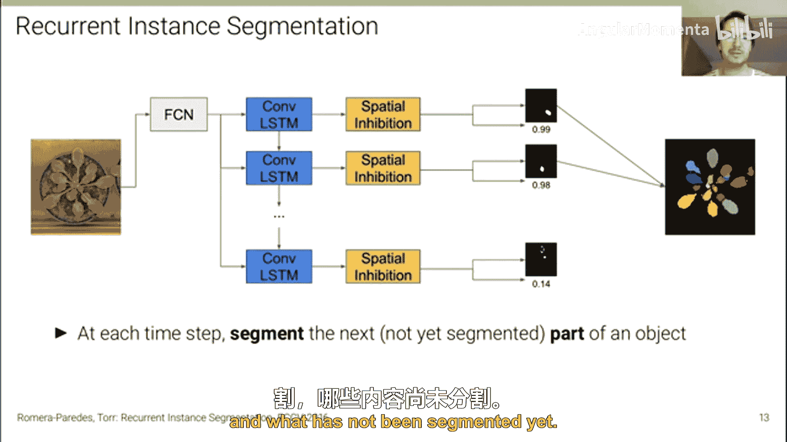
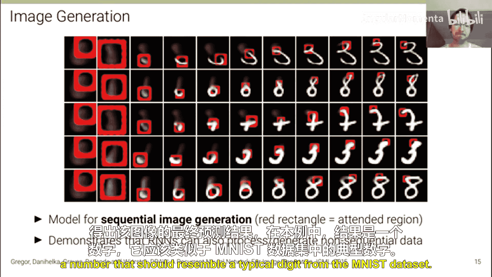
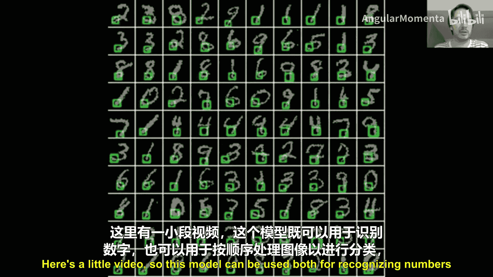
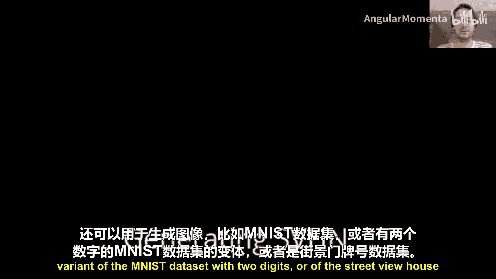
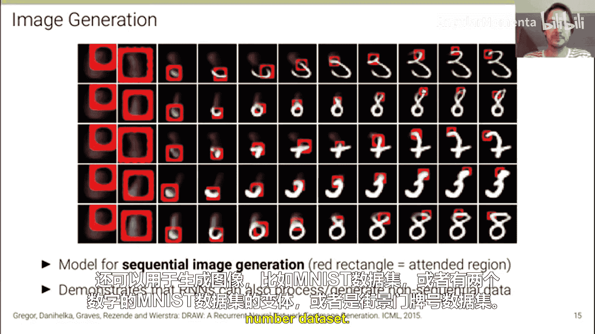
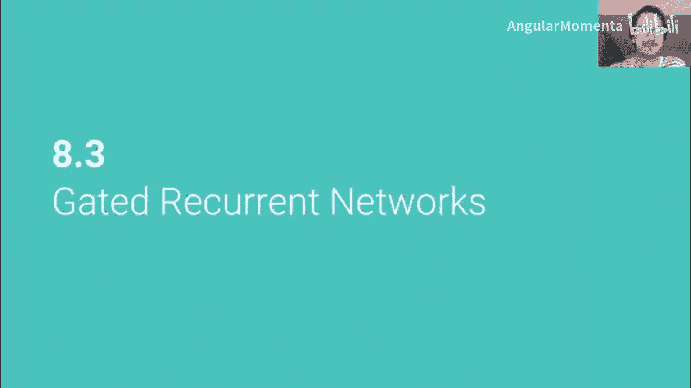

# 【精译】蒂宾根大学《深度学习》-p40-40--8.2（序列模型：循环神经网络应用）--BV1eDbrzhENK_p40-

In this unit， we're going to have a look at some of the applications that recurrent neural networks are able to address。

One example is， if we wna recognize multiple objects， such as a。

A street number that's composed of multiple digits in an image。

So one way of addressing that problem is to deploy an RN that like a human。

Iteratively attemptss to regions of that image， just as mu iteratively process the scene by performing sats with the eyes。

So at each time step， the model perceives a glimpse。

Which is just another word for a small image region。For instance， in this case here。

 the model attends to this region and then perceives that region and processes that region at the time step。

And then it predicts a saaccade L3。This is a location where the model should look next。

 most likely to make the next prediction。And then at that location， L3 it。

Extracts that local region here around L3 and makes the next prediction for both the class label as well as the next location where to look at。

This is an example of an R& N operating on。An image， sequentially。

RNNs can also be useful to recurrently perform instance segmentation。In this case。

 the input is a image that's processed with a fully convolutional network to a feature map。

 and then there is an RN in this case， a convolutional LSTM。

That produces one segment at each time step。In this example here on the right。

 this output from the model， you can see each time step colored with a different color。

 So each part is segmented at a different time step and then。

The union of this segmentation is fed back into the model at the next time step in order for the model to know what has already been segmented and what has not been segmented yet。

Here's a example of object tracking where we want to track one or multiple objects over a video with multiple frames by updating each object's internal representation using an RNN。

And the internal representation describes the object it could comprise information such as the location of the object。

 the extent of the object， the size of the object， the appearance of the object。

 or maybe the velocity of the object。It's quite interesting that these RNN can be applied to problems that are not sequential in nature。

 as we've seen before， they can be applied to recognizing multiple objects in an image that can also be used for generating images this is a task that's typically addressed using convolutional neural networks where we hierarchically generate that image but not sequentially over time。

 but it has been shown that it's actually possible to also sequentially generate images。Okay。

In this work by Gregor Eal at IML 2015， for instance。

 what has been done is they have developed a model that sequentially generates image regions。

 You can see the。Red rectangle here， determining the region where the model draws to next。

You can see that it first draws a rough outline of the object， and then。嗯。

Continueuous with finer and finer predictions until it arrives at the final prediction for that image。

 which in this case is a number that should resemble a typical digit from the MIS data set。

Here's a little video， so this model can be used both for recognizing numbers for sequentially processing images to classify。

As well as for generating。Images in this case of the Mnes data set or of a variant of the Mnes data set with two digits or of the。

Street view house number data set。

没。In this model by Oral at IML 2016， a similar model has been developed that predicts from an occluded image a non occluded variant。

 you can see the input to the model on the left and the ground roof on the right。And of course。

From this occluded version， it's very unclear what should be happening in the lower part of the image。

 there's multiple things that are equally probable。

And so what these RNs are able to do very easily is to output distributions over， let's say。

 pixel intensities。 And then we can sample from these distributions and input the sampled value into the next。

Time step。 And that way， we can generate a diverse set of completions。 As you can see here。

 all of these images that you see here are completions for this occluded input。

 You can see that they are very different， but all somewhat plausible。

Maybe for this image with this swimmer here， it's harder， but for this dog。

 it's more clear what could happen。 But even in this case。

 the dog could be in different poses or it could be occluded by an object。 So the completion。

Task is highly。Abiguous and multimodal and this RNN can capture this easily and it's easy to sample these RNNs in a stochastic fashion to generate multiple diverse outputs。

And this is a nice property of these models。One thing that's also important is image annotation and there have been models proposed for annotating objects and images using RnNs like polygon RN。

 which is an interactive object annotation tool， this is of course important if you want to create a big annotated data set for training your instant segmentation or object detection model in this case here。

 given a rough outline as a bounding box of the object。

 the model determines sequentially by predicting。The vertices of a polygon vertex by vertex。

The outline of an object。And then this outline can be modified by the annotator to better fit that object and therefore significantly reduce the time that's required to annotate the outline of that object。

Here's another example。 road layouts are also something that is hard to specify in a。

Fixed length vector structure representation。Typically they are represented if you think about Google Maps or opensStreet map as spatial graphs with verticies and edges and so this RNN can also be used to generate such spatial graphs as you can see here this is a model that has been trained on New York so you've got New York like street patterns this is a model that has been trained on London and you've got London like street patterns and these are examples where there's also an input condition and then the model is producing a。

A street layout that corresponds to that bird's eye view。Image that is shown here。

This is very useful for automatically mapping new regions。

 new areas that haven't been mapped before or that undergo changes due to construction， maybe。

This is another example， this is image captioning which we have already talked about briefly before。

 where the goal is for a particular input image to generate a description and natural language description。

Or a sentence for that image。And so for this particular model by S it all called show attendantele from ISML 2015。

 what the offers do is they take this image and produce a small resolution。

 14 by 14 pixel feature map that describes that represents that image and then there's an precurrent neural network that operates on that small resolution feature representation。

In this case， an LSTM。And sequentially attemptss to regions in that image and produces sequentially a sentence that describes that image in this case。

 a bird flying over a body of wardro。It generates that sentence word by word and by looking at different regions of that image。

Or that feature maps so for instance。When generating the word bird， it looks at the bird。

 when generating the word water， it looks at the background。Because it deems like， based on the。

The sentence that it has already produced and the previous in terms of the hidden representation。

And the input image that this is something that is indicative of what。Should be described。So。

 here's a。A more complete illustration of the output of that model where you can see so called soft attention and hard attention maps。

 which indicate where the model looks at when generating each of the individual words of that sentence that we have just seen。

Okay。So here's some results of that model on here in the first example here。

 we show some successful image captions。For instance， a woman is throwing a frisbee in a park。

And if we look at the attention map of Frisbee， we can see that it successfully recognizes the Frisbee。

Or a stop sign is on a road with a mountain in the background。 And if we look at stop。

 then we see the attention map indicates that the model looked at the stop sign。

 So this is this results are quite impressive。But。In fact， there is many things that can go wrong。

 This is a little bit cherry picked here， so there is， of course， also failure cases。

 and I would just want to show you a little bit what can go wrong。

And also how attention can be useful in order to reveal insights into what went wrong and maybe improve the architecture or the model。

So for instance， in this case， we have a large white bird standing in a forest。

 so there is something standing in a forest， but it's not a bird， but if you look at the region that。

Model has looked at， you can see that it might look a little bit like a bird shape here。

Or hear a woman holding a clock in her hand， so it's clearly not a clock。

 but it has a round shape so it's misclassified as a clock。

 so the internal representation that a model has learned in terms of classifying clocks is not as good as we wish it would be。

A person standing on a beach with a surfboard。嗯。Well， it correctly classifies the surfboard。

A woman is sitting at a table with a large pizza， so thats not a that's not a pizza。

 but it might look like a pizza， so you can get some insights into。

Whats the model attended to and what might have gone wrong。

Another application is a more recently proposed task called visual question answering。

 where the input is an image and a natural language question sentence。Such as for this image。

 who is behind the pattern？And the output is an answer sentence。Where in many cases， for instance。

 here the multiple choice answer is given so we are providing to the model also multiple possible answers and the model has to pick from these answers the correct one so for instance。

 who is behind the better and then the correct answer is the catcher。

Or what irons the tops of the post？And the correct answer is scs。So in this case。

 the input is an image and a sentence， so we have a fixed length input and a variable length input and the output is either a answer sentence。

 or it's a multiple choice answer where the output is then a fixed length vector。

It's just a classification vector。This is an example of neural machine translation。

 this is a Google system that has made a big ga at a big leap at the time in 2016 in improving the internal representation for machine translation that Google is using and offering to its users。

You can see that there is a encoder。 Now， in this case， we have。

Variable length inputs and variable length outputs。And it's a many too many mapping， where。

Words don't correspond in the input and the output。And so the model works as follows as it has。

An R N encoder that produces a。A representation。 and then that representation is decoded using an R and N decoder into another sentence。

Now。Let's last thing I'd like to show you is a couple of examples from Andre Carpartti。

Where you can find the link here at the bottom that I encourage you to have a look at。

Where he was playing with very simple。Are in anti models for language generation。

To demonstrate that RNs are capable to generate natural language text character by character with a very simple model。

In this example here on the right， for instance， there is a simple alphabet the four characters， H。

 E， L and O。And each character is simply represented by a one hot vector。

 as you can see here H is 10，0，0， E is 0，10，0。And then the model predicts a distribution over the next character via softmax function。

 So here's the R&N。The model takes the input， computes a hidden representation。

 I let's say it takes the E， computes a hidden representation using the previous hidden state and the current input and then。

The output is a。Anommalized。You know， distribution over the probabilities of the particular output character。

 which is then normalized using a softmax。So in this case。

 we have 50% probability for the character L that follows。E， if the first character。

 which hopefully is captured in the hidden state， has been H。

So model predicts a distribution over the next character via the soft Max function。

 and then we can sample from this model。As I've also mentioned before。

 very easily by drawing from the distribution， For instance， in this case， with 50% probability。

 we would be drawing a。L here with。嗯。5% probability will be drawing some other character， etc cea。

And then we can take the character that we have drawn from this distribution and input it as input as a one hot encoding to the next time step。

 in this case actually 5% probability was L was still drawing the correct character even for that probability was so low。

Okay。And so we input that and then we can get another distribution over the next character and by sampling these distributions and feeding them back into the next time step。

 we can generate diverse。Samples from that model。So heres some examples and you will find more of these examples on this website。

So these examples have been generated with a free layer recurrent neural network with 512 hidden nodes。

In this case here， the character level language model was trained on all works of William Shakespeare。

 which has more than4 million characters。And you can see that。

Despite training has been initialized randomly， the model learns useful structure in natural language text and generates this text。

 for instance it has learned that there is this dialogues where there's first the person speaking with a column symbol and a new line and then it has learned that different words are typically separated by spaces nothing like this has been input to the model。

 this has all been learned by the model and that in some words are followed by comma and and the sentence always ends with a point。

et， so these dialogues don't don't make too much sense， but they are no， Shakespeare risk。

 I would say， and I recommend you to have a look at some of these dialogues is quite fun。

Here can see what the training process look like looks like in the beginning， the model learns that。

That theres words separated by spaces， but the words don't make too much sense yet。

 And then the words， after more training， the words start to。

The actual votes from the real distribution of all this Shakespeare text。And then with more training。

 the model learns that there's things like。Prenheses， etc cea。

The model can also be used to generate latex。 in this case， the。嗯。Andrea Cappartti has。

Train that model on a large textbook of。Mathematic algebra and has trained the model not on the textbook PDF。

 but on the sources of the PDF， which were written in LaX。

And then the model was actually capable of generating proper lateX output that with some minor modifications was。

Could be converted into a lateX source file that actually compiles and produces something like this which is quite beautiful。

 so it generates lemas， it tries to prove these lemas， it generates diagrams。

 none of this makes sense， the model of course doesn't understand math。

 but it generates proper syntax and thinks that on the first glance look like they come from a math textbook。

The model can also be trained on source code， and in this case it was trained on the Linux source code。

 which is 470 megabytes。Sampled and what I show here is a sampled code snippet from that generative model that was trained on the Linux source code。

 you can see that these while these code snippets typically don't compile。

 they look reasonable overall， the model has learned that it should reite di new license in the beginning and then there is some includes and after it includes there is some defiance and then there is some static variables。

And then there's some definitions of functions coming after that and classes， eta。

 and it learns that how syntax works， that brackets should be closed。

 and that variable should be defined， it also learns to add comments， so it's quite fun。Here。

 the model was applied to a。A dictionary of 8000 baby names。

And then it was able to generate new baby names。 You can see that these。

 these are all names that are。Not present in the training set of 8000 baby names。

 you can see that they still sound a little bit like reasonable baby names。嗯。

One interesting thing now is to look at what this model has learned， of course。

 and while only 5% of the neurons。That the offers have looked at。

Seem logical and human interpretable。What these neurons have learned is actually quite interesting。

So for instance， if we look at， what you see here in color is from blue to red。

 how much a particular neuron inside that iron and activates， we can plot that activation。

For different。Characters in the input。 you can see that there is some cells or some neurons that are。

Responsive to or that are representing the position in the line so that the model has an easier time in determining when a sentence should end。

 basically it counts how long a sentence is or how long a paragraph is in order to determine when it's reasonable to start a new one。

There's also cells that turns。That turn on inside quotes。

 so for instance here there's this cell that basically is blue inside that quote and then becomes red outside and then if there's the next quote。

 it turns blue again， etc。There's also cells that activate inside if statements so you know inside if you're inside an if statement or not and within which。

Which if statement you are inside， So they is able to produce proper syntax。

But theres also a large portion of cells that are not easily interpretable， as shown here。

 that are still useful to the model。But just for the human are hard to understand。

