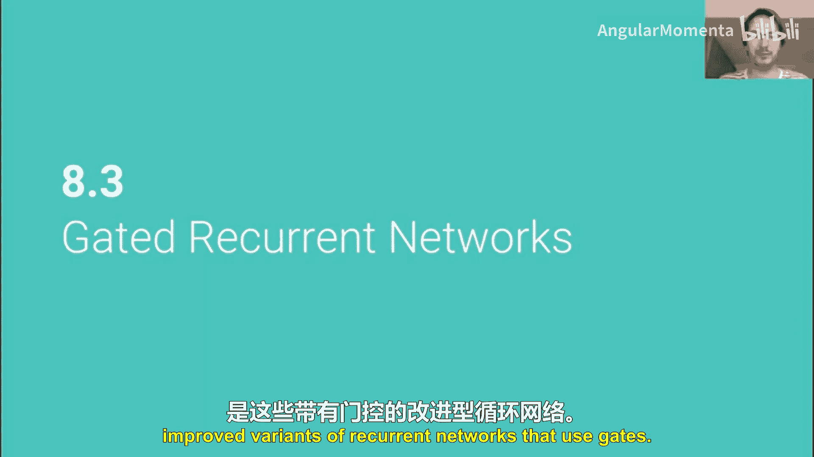
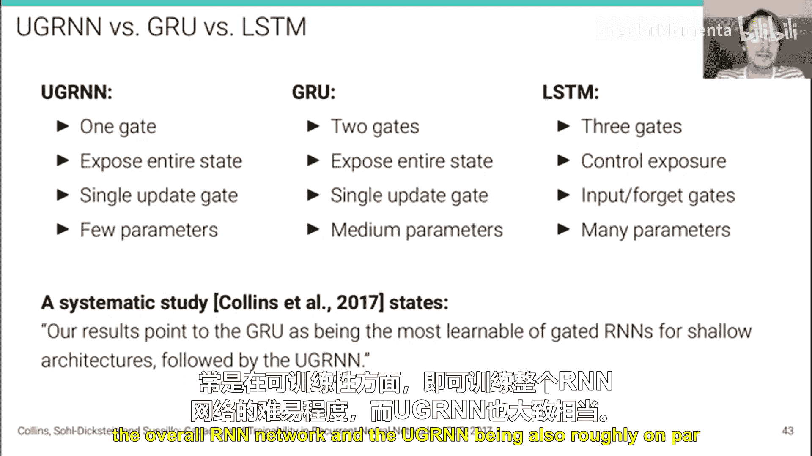

# 【精译】蒂宾根大学《深度学习》-p41-41--8.3-（序列模型：门控循环网络）--BV1eDbrzhENK_p41-

In the first unit of this lecture， we have seen the basic vanilla recurrent neural network architecture。

However， this vanilla recurrent neural network architecture is difficult to train for reasons we will see in a few slides。

And in order to improve drainability of recurrent neural networks。

 almost all modern recurrent neural network architectures use gates。

And this is what we will talk about in this unit， gated recurrent networks。In fact。

 all of the applications that we have had a look in the second unit were using these improved variants of recurrent networks that use gates。

Okay。So what is the problem？Let's have a look at the recurrent neural network as we have introduced it in the first lecture。

This is the diagram of a cell of this recurrent neural network where we now have omitted for clarity。

 the output layer， and also we haven't explicitly stated the aine transformations。

This1nage here in this context contains the Aend transformation， if you wish。

But the model is exactly the same， just the illustration has simplified a little bit。As such。

 we have the same update equation， this is the update equation that we had on the previous slide。

In Einstein notation， describing how the hidden state evolves by taking a linear combination of the hidden state at the previous time step and a linear combination of the input at the current time step with the weights。

Plus， on bias。And the state update。Each H T is modeled with a0 center 10H。

 which assumes that the process data is in the range-1 and plus1 here on the right。

 I've plotted the10H again for reference。So you can see it。

Takes variables from rangrranging from minus infinity to plus infinity and maps them to the domain minus1 and plus one。

Okay， so what is the problem with such a vanilla r n structure。In order to see this。

 let's first consider a recurrent neural network with just a single one dimensional hidden state HT。

 so HT is element of R。If we assume Ht is element of r and also the input is one dimensional。

 then the equation from the previous slide now in in regular math notation。

 not in einstein notation anymore simplifies to this here， so we have just one dimensional scals。

Scaalar variables that get transformed。 We have a。A product of some scalar A H with H T -1。

 the hidden state at T -1 plus this parameter here times the current input plus a。

One dimensional bias that is transformed through the10 H in order to obtain the new state H team。

Now the derivative of Ht with respect to Ht minus1。

 which is needed in order to implement back propagation through time。

In order to implement back proagation for time， we need to just apply the chain rule backwards。

 so we need to multiply a lot of these derivatives with each other。

 So this derivative of H T with respect to H T minus1。Is the derivative of tonage。

So this symbol here indicates simply the derivative of1 h of x with respect to x。

Times the inner derivative， which is just an application of the chain rule and the inner derivative here with respect to Ht minus1 is simply Ah。

 the parameter that is multiplied to Ht minus1。Okay。

 so this is the derivative of H T with respect to Ht minus-1。Now， if we。Consider a longer chain。

 a longer sequence of such computations within an R&N。

 and we want to compute derivative of the loss at the very end of that chain with respect to an earlier note。

Then we have to apply the chain rule in order to compute the derivatives for this computation graph。

So for instance， what we can do is we can compute the。

 let's assume T is a particular instance in time。And let's assume this is a longer chain。

 So we also have。Hidden states at earlier time steps。

 let's assume there's at least k earlier time steps。

 then we can compute the derivative of Ht with respect to Ht minus k。And this is， of course。

 then multiplied into the derivative of H T with respect to。The parameters at t minus K。

 So this is this is a multiplier to the weight update。

 the effective weight update that we do in the end。

So the derivative of Ht with respect to Ht minus k is via a chain rule。

 simply h with respect to ht minus1， ht minus1 with respect to ht minus2 and so on until we reach A minus k plus 1 with respect to Ht minus k。

好。In other words。Because we know that a single such derivativeive has this form。

 We have the product of。From I equal T minus k plus 1 to T。Of some derivative of1 H expression。

Times a H to the power of k because we have this expression k times。Note that again。

 the parameter is the same for each of these computations。

 so it factors out we have a to the power of k。 This is not a superscript This indicates power here。

So we have Ah multiplied k times。But this expression here is of course。

 this is the activation this can be different at every time step。

 that's why I use the subscript I to denote that this can be different at every time step。Okay。Okay。

 so this is the gradient of Ht with respect to Ht minus k。

In the case of this one dimensional example。Now， what what are the problems with？

Updating the weights。 Well， the first is， again， the vanish gradienting problem that we have discussed in earlier lectures。

Whi happens if 10 h sets， this is exactly the same as in feed forward networks， if 10h sets。

 then this gradient here is zero， and so back propagation stops。

 therefore R ends require particularly careful initialization to maintain a proper distribution of gradients through the network and also as a consequence a proper。

Flow of gradients backwards through that graph。Okay。However， this it cant get worse。

So the gradients might still misbehave。Let's now assume that we have initialized the R&N properly。

 such that all the activation functions， all the tonages， are not saturated。うんうん。😊，Al。

 so let's assume that。The argument of each of these 10 ages here。

 this is the argument of these 10 ages。Is within let's say minus-1 and plus1 if I go back to slides。

 you can see if I'm between -1 and plus1 then I'm first I'm not saturated。

 I'm not in this region here the gradient is not close to0 and furthermore。

 if I'm in this small range here then I can approximate tonnage with。The argument itself。

 it's a linear， it's a linear function with slope 1 in other words in this region。

 approximately linear here。Okay， that's what。I's written down here， ton of x。

Or that should be actually1 H，10 H of x is approximately x。So if ton H of x is approximately x。

 then this expression is， of course， approximately this expression here。And therefore。

 the derivative of H T with respect to Ht minus1 is simply A H。The perimeter。That is multiplied of H。

Now， in this case， we have that the derivative of Ht with respect to Ht minus k by the chain rule is simply a to the power of k Ah to the power of k。

Okay。Now what is the problem with this， well， because we are multiplying k times the factor Ah。

 we have the problem and because of all of these AHs are the same。

 we have the problem that if AH is just a tiny bit bigger than one。

 the gradients will become very large for earlier time steps。In other words。

 we say the gradients explode once we back propagate gradients through this RNN starting from the terminal load or from the node T。

 and this causes divergencement training as an example。For A H equals 1。1。

 just a tiny bit bigger than1 and K equals 100 so。Proagate gradients 100 steps backwards through that RNN。

We have。The partial derivative rootive of H T， with respect to H T minus k is 1。

1 to the power of 100。And that is。13781。You can see that this gradient is getting big very。

 very quickly。Now this problem can be addressed in practice or is in practice often addressed using a technique called gradient clipping。

 which is simply reducing very strong gradients by clipping their norm and we'll discuss that on the next slide。

Also note that the forward values do not explode because we have used this bounded tonnage activation function。

In other words， despite in the forward pass。Things behave。Well， in the backward pass。

 we can have this problem of exploding gradients， which can be addressed using gradient clipping。

 for instance。For a H， a tiny bit smaller than one。

 the gradients will start to vanish on the other hand。

This means that there will be no learning happening in earlier time steps。

 The parameters will simply not be updated。As an example。嗯。Consider A H equals 0。9。

Just a little bit smaller than one。And again， K equals 100 time steps。

We have the partial derivative of H T， with respect to H T minus k is 0。9 to the power of 100。It's 0。

000，0，2，6。So extremely small， almost no update to these parameters of net。嗯。Early time step。Now。

 this problem cannot be addressed using gradient clipping。

 this problem requires an architectural change that we will discuss in the following as well。

And this is where the gates come into play。Unfortunately。

 using the idea of recital connections that we have used to address the problem of vanish ingredients in standard feet forward architectures does not work here。

As the parameters are shared across time。And the input and desired desired output at each time step are different。

Note that this is very different from a typical re net。

Where we are trying to already in the first step make a prediction that comes close to our ultimate classification result。

 and we're just doing updates to this prediction， adding residuals to this prediction。

Here in this case， we have a different， a potentially different output at every time step。

 and we make we cannot tune our predictions at every time step because the parameters are always the same。

So residual connections across time do not work， and therefore we need to really change the architecture and this is addressed using the gates that Billll discuss。

Okay。Now this analysis here was done for the one dimensional case。Of course。

 this also holds for the vector valued case。Now we go back and consider the original equation again。

 where we have vector valued hidden states and vector valued inputs and vector valued biases and where we have。

Weight matrices。A， H and A X， instead of scrs。Again， if we assume that this argument。

I's roughly between -1 and 1。 We can。Approxmimate this1h expression with its argument。

And the derivative of Ht with respect to Ht minus1 is now the matrix， the peri matrix A H。

And therefore， the partial derivative of Ht with respect to Ht minus k is this。嗯。

Matrix to the power of K。Now let's analyze this situation a little bit。

Let's assume that we can decompose this matrix， A H。With an e decomposition。

A H must be a square matrix， right， because we are multiplying on the right side a vector of the same dimensionality as we expect as an output。

 So a H must be a square matrix。 therefore we can use。

 we can apply an eigen decomposition of that matrix。That decomposition has this form。

 We have a matrix of eigenvalues。 Then we have a diagonal matrix of。I'm sorry。

 we have a matrix of eigenvectors。Then we have a diagonal matrix where in each entry of the diagonal we have the eigenvalues。

And then we have the inverse of the matrix of the eigenvectors。嗯。Now。

 if we take this expression to the power of K。Then it's easy to see that we obtain this expression because every time we multiply this expression。

 Q to the power of minus1 and Q cancel。Okay。嗯。Now， therefore， we see that we have an expression。

So8 H to the power of k。Is an expression where we first multiply with a matrix of eigenvectors inverse。

And then apply k times。This diagonal matrix， where the eigenvalues of that matrix Ah are on the diagonal。

And then we transform back with the matrix of eigenvectors。Therefore。

Because we apply this K times here。If for components where the eigenvalue is smaller than one。

The gradients start to vanish， the more we go backwards in this chain of computation。In contrary。

If the eigenvalue is bigger than one for a component， then the gradients start to explode。

Note again that AH is shared across time， unlike in layers of a feet forward network that means。

We always multiply with the same eigenvalue we multiply the same component with the same eigenvalue。

 This is why we apply this here， k times。To the same component。

 we multiply the same eigenvalue and therefore we get。A vanishing gradients。

 if the eigenvalue is smaller than one or exploding gradients， if the eigenvalue is bigger than one。

 both can happen at the same time。And both lead to learning able to stop。

Because of not enough gradient inflow or two divergence where the program will just stop。🤧Okay。

 so now we have。Seen these two problems solve。Of vanishing exploding gradients。

 let's first address the problem of exploding gradients and there is a simple heuristics that is typically deployed in practice。

Which clipsick gradients to a value that is a hyperpermeter of the model before applying the gradient update during stochastic gradient descent。

Okay。In particular， what we do is we make sure that the L2 norm of the gradient。Is smaller。

 equal to some threshold or tau。In other words。If the L2 norm of the gradient。

 this is the notation that we have introduced in lecture2 about computation graphs is just denoting the gradient of a that has the same shape as a itself。

So this is a gradient of the Jacobian with respect to A。So if that gradient。

If the norm of that grade， think of this as a vector。

If that norm of that vector is already smaller than the threshold， we don't do anything。

And if that norm of that gradient is bigger than that threshold。

Then we clip that gradient to by dividing this gradient through its norm so that now the norm is one。

And multiplying with that threshold， so that。The norm of the gradient after this operation is exactly tall。

And this maximum gradient in magnitude tau is a hyperparameter。

 and in practice often set to something in between 1 and 10。

This is a simple heuristic to avoid the exploding gradienting problem。

 but what can we do about the vanishing gradienting problem？

In order to solve the vanishing gradienting problem， we introduce gates into the architecture。

Several variants of different architectures proposed in the literature。

With the most influential and the first， but also the most complex。

The LSTM being introduced first in 1997 by Ho Haer et al， as you can see here on the right。However。

 for the purpose of this lecture， we are going to go in opposite direction of time。Because later。

 it has been found that much simpler architectures。Are working as well while being easier to train。

So we'll start with what's called the updateate gate recurrent neural network that has the simplest architecture and just a single gate。

 each of these sigmas is a gate here， so we have one gate for this architecture two here and three here。

So we start with the UG RNN， and then we will talk briefly about the gated recurrent units and the long short term memory。

The long short term memory is the oldest and was also the most transformative。

 it has basically revolutionized NLP， for instance in 2015。

 Google has completely changed their system to adopt LSTM based。Machine translation。

What is common to all of these architectures is that they are using gates for filtering information and we'll see why this is helping in。

Maintaining a proper gradient flow and also a little bit get to know the intuition behind this sating。

Okay， so we'll start with the。Update Gate Recur neural network。

So here's a diagram of this update gate recurren neural network cell。아。

What you can already see is that it has a much more complicated structure than the standard vanilla RnN。

 it's not just a tonnage， but it is a tonage plus another transformation here。

And plus some element wise products and sumations。In。All of the following slides。

 I'm going to denote with these boxes here， operations that have a linear an aine transformation and a nonlinearity where the type of nonlinearity is denoted by the symbol in the box。

So here we have a sigmoid and here we have a tonage。In contrast， so these two boxes。

 they have parameters。They have different parameters。

 but the parameters are shared across time steps。In contrast。

These operations in circles like1 minus some number or the element Vi product don't have parameters。

They are just deterministic functions。Okay。So we have two different types of transformations。

 we have linear transformations followed by a sigmoid， which is used for gating information。

 that's why there is a sigmoid transformation there， which is mapping to the space0 and 1。

 we can either let information pass where in which case the sigmoid is one。

 or we can completely throwaway information in which case the output of the sigmoid is0。

On the other hand， we have these data operators where the input is data and the output is data。

 which is between minus 1 and 1， and that is why the intuition why we have a tonage in addition to these gates。

 which are sigmas。So how does this now look like， here is the Einstein notation for this update gate R N cell。

We have a linear transformation on the。Concodation of the。

State vector at the previous time step and the input at the current time step。 In other words。

 we have a， and now we have two sub indexes here。 One is indicating that this is a matrix。 Again。

 the matrices are matrices are shared across time， but we have different As within a U G are in N cell。

 And so this。In the indices of the matrix a indicate what they belong to。

 so we have one matrix a for this the calculation of this update gate U， this is this first one here。

And then H， because this is the matrix that corresponds that is multiplied to the previous state vector。

And then we have U。And x here， because this is the matrix a。For calculating the update gate。

That is multiplied to the input X at the current time step。嗯。

So this is just a linear combination of the previous state and the current。Input。Plus， a bias。

And then transformed with a sigmoid， and this is what we call an update gate because it determines if the hidden state H shall be updated or not。

Okay。And then we have the data transformation。Which is。Computing the next target state。

 and this is again， the same linear transformation， but with now a different parameters， AS S H， AS。

 S X and bias B S。Where we then use a tonnage nonlinearity。

Now we have computed the update gate and the new target state。

And we are combining them in this manner。We're using the update gate to control how much of the previous information。

 the information that is input。Um。Shall be used。And how much of the new target stage shall be used。

 so it's a linear U， you can think about you as a linear weighting。Of。The previous state。

And a newly computed target state。That is newly computed from the concodnation of Xt and Ht minus1。

Through this operation here。So's just a linear combination of these two things that is controlled through this update gate。

 if the update gate is one。In that case， we don't consider the newly computed information。

 but we directly let the information from the previous time step through。

We direct directly copy that state。If U is the ever extreme， if U is0。

 then we completely ignore the previous state。And we fully copy what has been computed as the next target state。

Yeah。Note， of course， that all of these operations here are per output channel so you can decide or this this update gate can decide to let some of the channels from the previous day pass and to update。

Other channels or other features from the state vector， food is new target state。Okay。One brief note。

All of these operations here。嗯。Are expressed in einstein notation。

 but we can also express them with standard vector notation in which case we need to use the socalled Hadamma product。

 which is the element vice product indicated with this symbol here。

 that's why we use also this symbol here as the product symbol in the illustration。In other words。

 this expression here in Einstein notation。Can be written as this expression where we have now written this in terms of vector notation。

Where we have computed the element Vi product， which is the product of the first element of UT with the first element of Ht minus1 and the product of the second element of Ut with the second element of Ht minus1 and so forth。

In terms of see out。And we are denoting this product as this。

Symbol with the circle and the dot inside is called the Hanaama product or elementement wise product。

We'll use this symbol to denote element wise products throughout this lecture。Good， okay。

 so now we have introduced a more complex cell， the U G RN cell。 And the question is。

 what do we gain。Okay。And here's the intuition。On the left， we see the R N cell from before。

 where the gradient， as we have seen before of。HT with respect to Ht minus-1 is simply or can be approximated in the linear regime of the tonage。

With the weight matrix， A H。And this leads to this vanishing and exploding gradient problems because we multiply this many。

 many times together。Now in a UG RN N cell， the situation is different。

If we compute the gradient of Ht， we get a longer expression。That doesn't even fit on that slide。

 so I've omitted the last terms here， but what is crucial is that。Inside that equation。

 there is one term， which is directly U T。Because。Here we have the。

The multiplication of Ut with H T minus-1 and so。We have the derivative root of this expression is the derivative root of the first one times。

H T -1 plus。The derivative。Plus Ut times the derivative of ht minus-1 with respect to Ht minus1。

 which is1。So we are left with UT here。What this means is that this UGRN can determine how much of the information。

In the forward past should， we should let through directly from the previous state。

And at the same time， in the backward past， how much of the gradients can flow directly through that cell。

 and that way it can reach this behavior of long term dependencies。

 it can learn to ignore in some elements of the state vector information for a very long time and as a consequence。

Pass information over very long time steps backward in time。

And this is because we have this UT here if we set this gate to1 and then this gradient can directly pass through。

 no matter how small the other terms in this gradient vector are。

 because we always multiply at least UT， which is close to1。So a UG R， in our words。

 can maintain the gradient flow despite a small。AH。

 which will be multiplied within these expressions here。对。A more intuitive example is given here。

A UG RN is able to keep the state of a variable over a long time horizon。For example。

 it can implement a logic to keep track of being inside a quote or not we have seen before that some of these。

Our cellsll emerge as。Being indicative of the RNN currently returning something that's inside a quote or outside a quote as shown here。

Blue is inside a quote， and。Red is outside the quote。And this can be now very easily implemented。

 because we can。In the forward pass here， we can we can look at。

What was the previous hidden state and supposedly in the previous hidden state there's encoded somewhere that we are inside the quote and then we can create a simple logic here for this gate that says。

 well if I'm inside a quote and I observe a quote then I'm。

And then that state of that feature should just change。

So it's very easy to implement this type of logics that lead to this long term behavior with these gated recurrent neural networks。

Now， this was the U G R N。The next more complicated architecture is the gated recurrent network。

The gated Recurrent network was before the UGRN。And is slightly more complicated。

 It employs a reset gate， there is this first one here。

 which controls which parts of the state are used to compute the next target state it's multiplied with the previous state in order to determine what is concatenated with the input the current time step in order to compute with this10age。

 the next target state。And it has。On the right hand side， the same behavior as the UGR&M。

 it has an update gate that controls how much information to pass from the previous time step。

And how much information to pass from the new target stage。

So the right hand side of the gr cell is the same as the UGRNN and the left hand side has this additional gate that is the reset gate and controlled。

 which parts of the state should be erased in order to compute the new target state。Okay。

And then finally here is the long short term memory。

 which is one of the most complex of these type of gated recurrent units。It has free states。

And it has it passes information not only along the hidden state dimension here。

 but there's an additional dimension of the same size。Which is called the cell state C。

So these three gates that the LSTM uses are a forget gate here that determines。

Which information from the previous cell state， this is the internal state that is not directly revealed to the outside of this cell。

So that forget date gate determines which information to erase from the previous cell state。

It has an input gate that determines which values of the cell state to update。

It's multiplied with the target state in order to update or add to the previous cell state。

And it has an output gate that determines which elements of the cell state。

 this internal state to reveal at time T to the。Hidden state and that hidden state is then。

Used to compute the output and time T。This is not part of this illustration。So in other words， this。

Update1 h here simply creates new target values S T for the cell state。Yeah。This one here。Now。

Which of those should we use。Here is the comparison of， of those three。

The UG RNN is using just one gate， it exposes the entire state。

It has a single update gate and few parameters because theres just one gate。The gr uses two gates。

 exposeoss also the entire state， has a single update gate。

 but a medium number of parameters because of the two gates。The LSTM has three gates。

It controls how much of this hidden state is actually getting exposed。

And it has input and forget gates and even more parameters than the drew。Now。The Lste was the first。

 It's often the case in research that complex thingsins get。

Invent it and then later one one finds that simpler structures actually work as well。

 and this is the case also here。In a systematic study。

 and I' have listed that study here by Collins Zal ILR 2017。

 the authors found that their results pointed to the gr as being the most learnable of the gated irons for shallow architectures followed by the UG RNN。

Which means。Also observed by others that the gr in many cases actually outperforms the LSTM。

Often in terms of accuracy， but very often in terms of trainability。

 which means how easy it is to train that。The overall RNN network and the UG RNN being also roughly on par。

