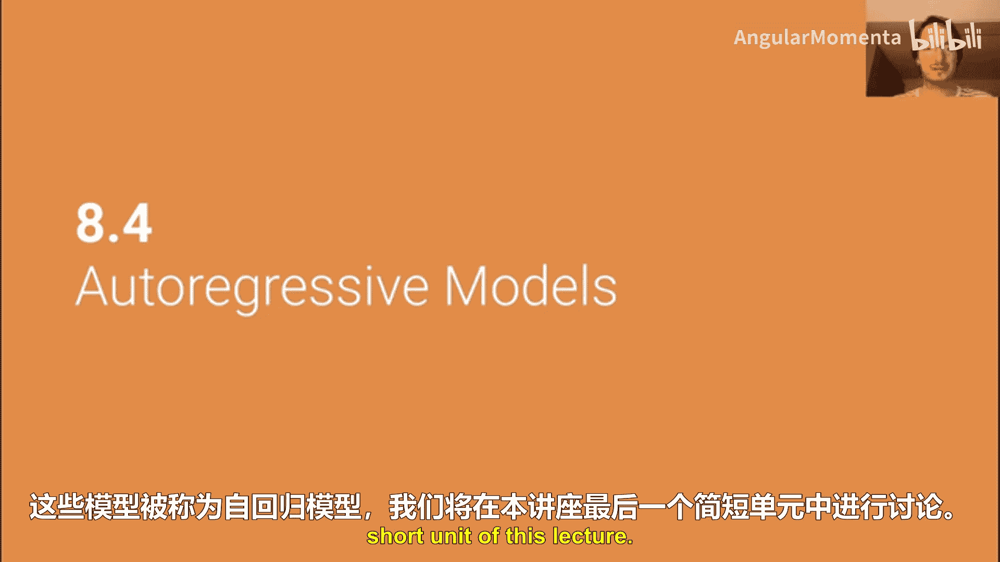
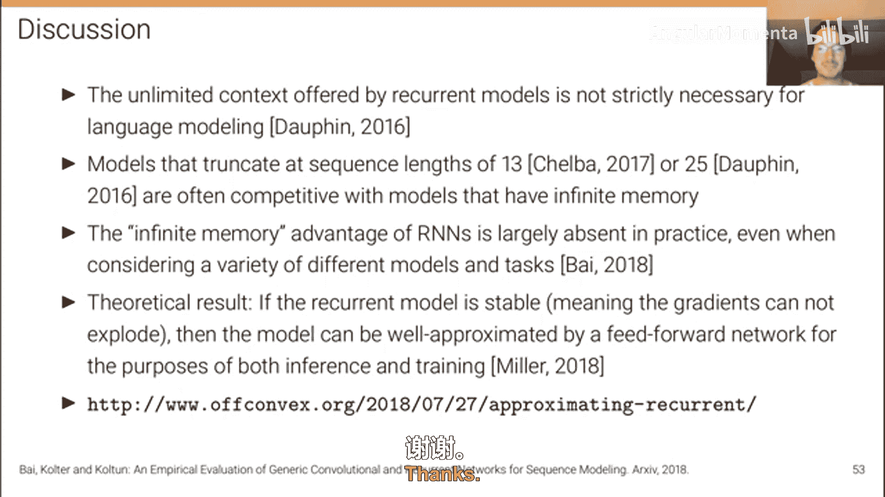

# 【精译】蒂宾根大学《深度学习》-p42-42--8.4（序列模型：自回归模型）--BV1eDbrzhENK_p42-

We have seen that recurrentin neural networks are a powerful family of models that are able to process sequences of arbitrary length。

And it has long been believed that recurrent models are the only type of models capable of doing that。

But recently， it has been demonstrated that there is actually a class of feet forward neural networks that are able to achieve。

Performance on par or even surpassing the performance of recurrent neural networks。

And these are so called autoaggressive models that we will discuss in this last short unit of this lecture。

What is an auto aggressivegressive model。A cave order auto aggressiveive model is a feed forward model which predicts the next variable X T in the time series。

Over again， T indicates time based on the K previous variables， X T minus-1， X t minus-2。

 and so forth。In this example here， in this graphic illustration。

 we have x5 depending directly on x4 and x3， so k would be 2 in this case。嗯。

Note that I've used dash lines here just to indicate more clearly。The different mappings。

 how what belongs together。But the dash and the solid arrows are actually the same。

 it's just to better separate the different mappings。Again， S in our N。

 the parameters are shared across time， which means we apply the same function at each time step T。

 the function does not depend on a time step index T。Or the parameters of that function otherwards。

As in R and Ns， the weight matrices don't depend on time step T。 They are shared across time。Okay。

As we can see from this illustration here， if we think about this as a graphical model。

We make a strong， conditional independence assumption here now。For example。

 x 5 is conditionally independent of x 2 given x 3 and x 4。

This is different from ourNs and we'll have a look at this again in a few slides。Now。

 with a little abuse of terminology， we can extend this concept of autoregressive models that predict their next own value。

To the situation that we have been looking at for sequence modeling where the outputs and the inputs are different。

In this case， we have now the inputs in green and the predictions， the outputs in y。And we have。

A function。Or the prediction at time T depending on the inputs at time T and t minus1 and t minus2 all the way until k。

So in other words， Yt is dependent on X， where I is bigger or equal than t minus k and smaller or equal than T。

And it is independent of all Xs where I is smaller than t minus k in this example here。

 y5 is independent of x2 or x1。Okay。Now this is the most basic form of such an autoregressive model。

 we can see it's a pure feed forward model， there is no hidden state that gets recursively updated。

Here we compare the auto aggressiveive model to the unrolled version of the recurrentinal network。

In contrast to the autoaggressive model， recurrent models summarize previous information through their hidden state while in the autoaggressive case。

 we have a direct connection from previous time stepss to the current prediction。

 but only until a certain K， so we are clipping information we are completely ignoring information from the past。

 we have this hard constraint here， while for a recurren neural network in theory。

Information from very early on can be remembered for predictions very late。So in other words。

 in contrast to autoregressive models。Which do not have an infinite memory。

Wwhichch make this hard conditional independence assumption R and ends don't do this。

 and they in theory have infinite memory。 but of course。

 the question is how valuable is that and that's what we're going to have a look at in this unit。

In contrast to recurrent neural networks that require back propagation for time。

 which has all the problems associated to it， as we have seen in the previous unit。

 autoregressive models are much easier to train as we don't require back propagation for time。

It's a standard feet forward model where we have standard supervised learning problems。

 we have them even independent for in this case y5， y4 and y3。

 we can just apply this learning imp parallel and update the weights here of this shared weight matrices parallel。

The auto regressive networks are easier to train and more stable to train than recurrent neural networks which require this back propagation free time。

Autoregressive models like RnNs can be extended to deep versions with multiple layers by simply stacking layers of this autoregressive nature where we now have two these are two different functions again parameters are shared across time。

 but now in the layer direction they are different。

 so we have one function that maps from x to H and then one function that maps from this hidden layer to the prediction layer Y。

What we can also see is that these autoaggressive models effectively perform multiple causalal temporal convolutions。

Because we have shared parameters across time。Each of these layers can be thought of as a 1 d convolutional layer where we swipe a kernel filter matrix here on this layer in order to produce。

The outputs。And they are causal in this case， in this particular case here。

 because we are only considering for making a prediction at time T information at time T and at previous time steps。

 but not at future time steps。Depending on the situation you might want to consider causal or non-cosal structures if you want to process an entire batch an entire sentence。

 where you don't have this online requirements， you might want to also consider information from the future so you can add this information similarly in recurrentinal networks theres something called bidirectional RNNs which also go left and right and right and left。

 so also take into account information from the future， but for the scope of this lecture here。

 we're going to consider RNN in the standard setting which is the causal setting where it're just taking information from the past in order to make a prediction。

Of course， these type of models can be now combined with all tricks that we have developed。

 the community has developed in standard deep neural networks such as residualce connections across layers and also dilated convolutions in order to increase the receptive field size much more rapidly while keeping the parameters the same。

The first model of that type that was really successful and was demonstrating a breakthrough was from Ordal called WaveNe 2016。

This was a model。There was a generative model for raw audio waveform which generates realistic speech that is hard to distinguish from a real speech for a human observer。

It combines residual and skip connections with dilated convolutions， as you can see here。

 which is really important to。To。Consider context to consider input information from any previous time steps。

 and this is important for audio audioudio is hard in a sense because we have so many samples per second such that typically raw audio waveforms are avoided in the RN in the sequence processing community now here it has been demonstrated that not even with an RNN but with a feet forward network it's possible to produce raw audio waveforms。

Using this， these ideas of dilated convolutions where we can with few parameters very quickly extend the receptive field size。

 and with this idea of of deep multi layer architectures with residual and skip connections。

 So this was really a breakthrough in the。Generation of raw audio waveforms。

 which is notoriously hard for sequence processing models due to their。Structure at multiple scales。

 There is structure at at microscale at millisecond scale and structure repetitive patterns at at second scale。

 So it's hard to capture this structure at these multiple time scales。

 And this has been done very well by this type of model。

And also demonstrate in terms of quantitative performance， these are measures of。

How natural speech is and Wavenet has demonstrated performance far better than an LSTM。

 rivaling natural speech by humans。And then this idea has been taken further。In。

This paper here by by atal 2018， where we have demonstrated that a simpler architecture。

That uses the same ideas， deep multi layer networks with residualcedural layers and dilated convolutions and zero padding for information or for for connections that range outside the input。

The input domain here。😔，But otherwise， very standard network have demonstrated。

Very good performance across different tasks。So here are several different tasks from image processing。

 adding， copying， music processing， natural language processing。

 and across a whole variety of these tasks that have been considered the home turf of LSTMs and grooves and RNANs。

They have demonstrated that these very simple and easy to train feed forward networks can actually outperform these recurrenret。

Models。And of course， the question is， why is that the case？Are these recurrent networks needed。

 are they。Are they actually utilizing their theoretical advantage of infinite memory？

And this is still a topic， an open topic for discussion。And I want to point you to this website here。

 which is a nice blog post centered around this topic。

And here are some quotes from recent papers that have investigated that problem。

Dolphin has in 2016 found that the unlimited context offered by recurrent models is not strictly necessary for language modeling。

 for instance。Models that explicitly truncate the input sequence length at 13 or 25。

Are often competitive with models that have infinite memory， which indicates that。Maybe in theory。

 the models with infinite memory are better。But in practice。

 they don't utilize infinite memory or for these particular tasks， infinite memory is not necessary。

This has also been observed by Pi etol in 2018。They say the infinite memory advantage of RNNs is largely absent in practice。

 even when considering a variety of different models and tasks。

So seems like these temporal convolutions are a real alternative to recurrent networks in many situations。

And Miller in 2018， provided a theoretical result。Which showed that if the recurrent model is stable。

 meaning the gradients cannot explode， which is a property that， of course。

 we always want when training recurrent models， then the model can be well approximated。

By a feed forward network for the purpose of both inferenceprints and training。

 So there seems to be also theoretical。Evidence for the fact that。

The theoretical advantage of recurtinal networks of infinite memory。

It's actually not present in practice。I wantna。Close with this discussion and it's a good starting point to think more about this problem and read more upon this。

Thanks。