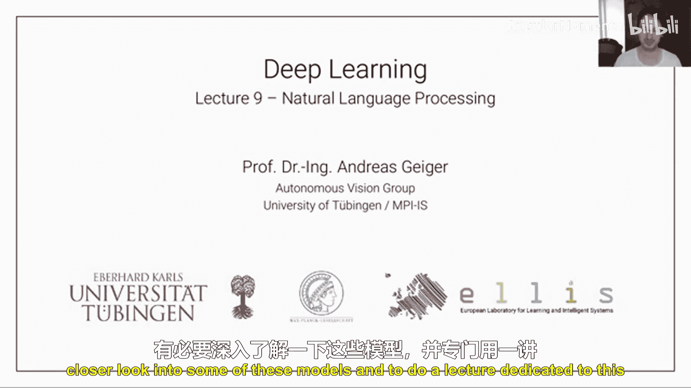
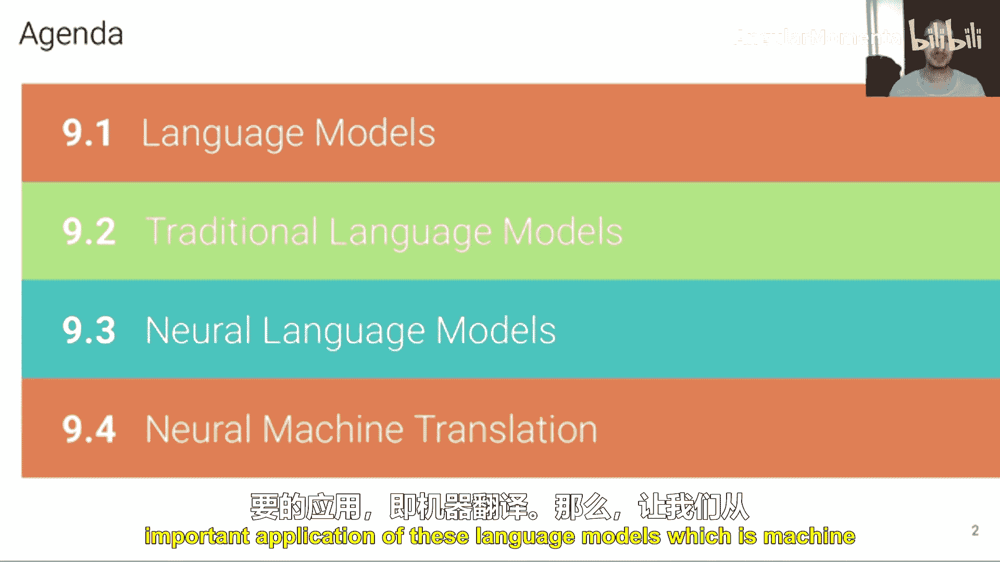
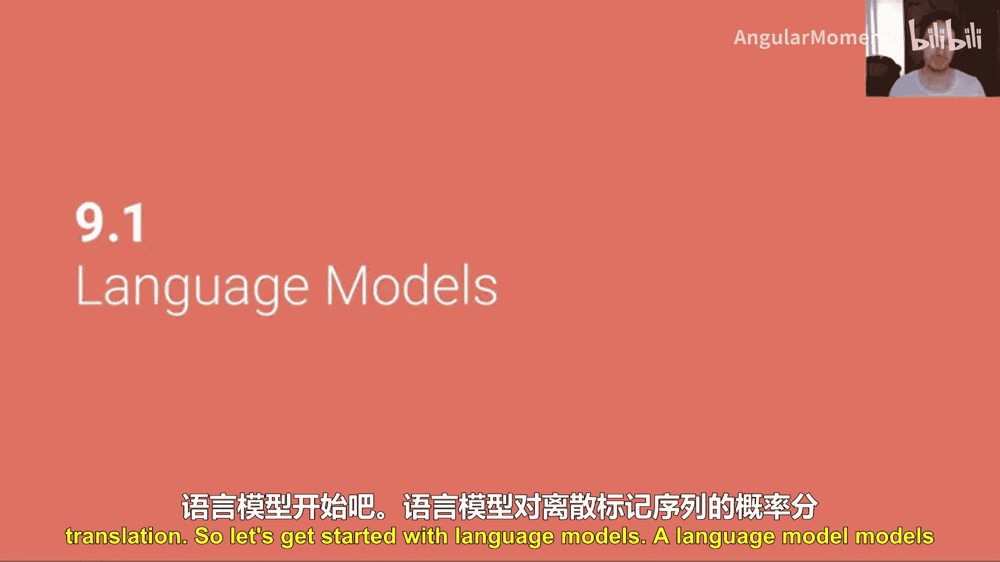
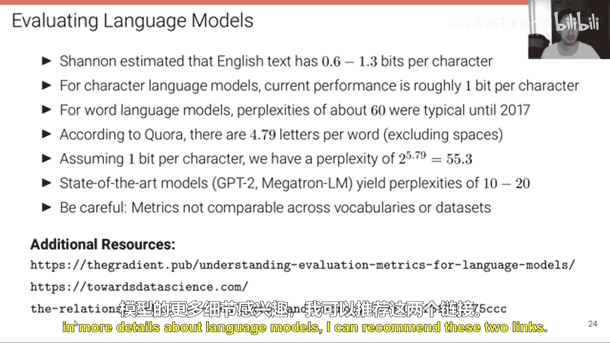
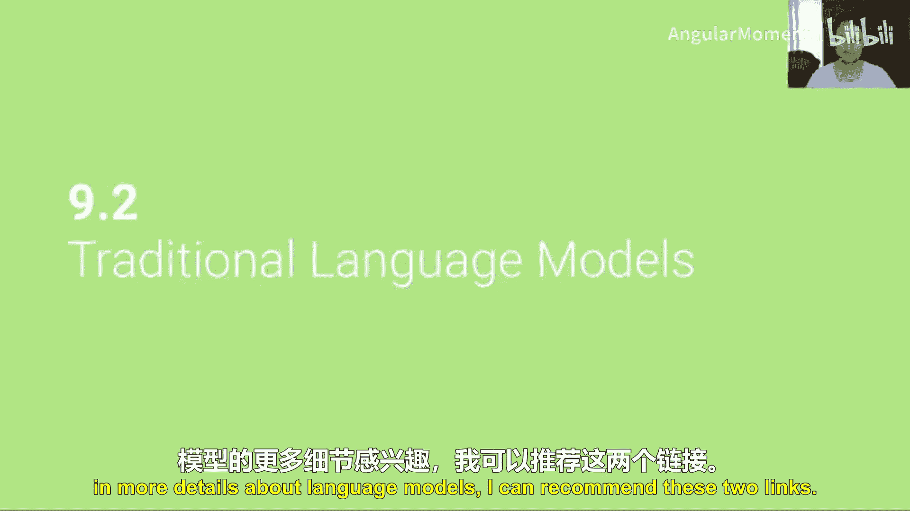

# 【精译】蒂宾根大学《深度学习》-p43-43--9.1-（自然语言处理：语言模型）--BV1eDbrzhENK_p43-

Hi and welcome to the ninth lecture of the steep learning course。

Today we're going to be talking about natural language processing。In previous lectures。

 we have talked about convolutional neural networks。

 which are an ideal architecture for image processing。

And in the last lecture we talked about recurrent neural networks and feed forward auto aggressiveive models for sequence processing。

And natural language is an ideal application for these type of models。

 so I thought it would be good to have a look into， a closer look into。

Some of these models and to do a lecture dedicated to this particular topic。

This lecture is structured into four units。In the first unit。

 we're going to introduce what a language model is and show some examples。In the second unit。

 we're going to talk about traditional language models as they have been used in the 70s and 80s and 90s。

Then in the third unit， we are going to talk about the more modern reincarnation of these models。

 which are neural language models that use neural networks。And then in the fourth unit。

 we're going to talk a about a particular。But a particularly important。

Application of these language models， which is machine translation。

So let's get started with language models。

A language model。Models the probability distribution over a sequence of discrete tokens。

These tokens could be words or characters， whatever。

Where each token can take a value from a vocabulary v， we have xt element of v。

 So here we have a sequence of these tokens x we have。

Sequence length T and assume these are words we have the first word， a second word。

 and so on until the T word。And so we model a probability distribution over this。

sOver this sequence of discrete tokens。We had a joint distribution over the sequence。

 or this is the sequence， the first word， the second word， and so on until the teeth word。

The joint distribution over this sequence。Decomposes。Into a product of T conditional distributions。

P of X T given all of the x with。Index smaller than T。

And this is simply a consequence of the product rule。

 sometimes also called the chain rule of probability。We're not making any approximation here。

 we can simply rewrite or decompose any joint distribution。

Without doing any approximation in such a form。Or if I write this out， I have p of x1， given p of x2。

 given x1， and those two multiplied together are of course。

 p of x1 given n x2 so the join distribution。Times p of x3， given x1 and x2 times p of x4。

 given x1 to x3 and so on。is this is just one particular。Way of decomposing a joint distribution。

 and were decomposing it such that each word only depends on or each token in that sequence only depends on previous tokens in that sequence。

喂。Iteratively applying the product rule。That's one of these fundamental rules of probability。

So depending on the language model， a token can be a word。

 a character or a vi or something else we have already seen in the lecture on recurrent networks and straightforward models。

Language models that use that operate at the character level。

But there's also language models that operate at the word level。

 which I're going to talk about today。The difficulty of operating at the word level is that the vocabularies are much。

 much larger， it's easier to operate at the word level because we it's easier to model long term dependencies at the character level。

Long term dependencies are hard。Because if you consider sentences， then in terms of characters。

 words are far away。So so that's easy， more easy in when modeling at the word level。

 but what's hard is that compared to the character level where vocabularies are in the。

Order of like  tens or 20 or 30 characters。At the word level。

 we typically have vocabularies of size 10，000， 20，00030，000， depending on the language。

 and so we have very large vocabularies， we need to predict distributions over a very large state space。

い。And then one thing that's also important is that。

We typically introduce in language models a special token。

 the end of sentence token into the vocabulary。So the vocabulary is。

 let's say the vocabulary of all words that we want to model plus。This end of sentence， token。

Which indicates the end of sentence。So every whenever we predict the next word。

We can predict one word from the vocabulary， or we can predict the end of sentence to determine that the sentence is finished and next sentence can start。

Let's look at an example， so here's an example for a word language model。

And the example is the probability this language model that assign a probability mass to the sentence be dark ran away end of sentence。

And this decomposes based on this。Product rule into the conditional distributions， P of D， P of doc。

 given V， P of RA， given V doc， and so on。We can see that。Language models， in general。

 but in particular， also this word language model are autoregressive models that predict the next token given all the previous tokens in this sentence on the sequence。

So these are auto aggressivegressive models。And a good model has a high probability of predicting the likely next word。

So let's look at some applications。Okay。So one maybe the most straightforward application of language models is language recognition。

Assume we have trained two language models， P and p prime。

 and they assign probabilities to sentences， but they are different models。

 so they might assign a different probability to the same sentence。P assigns one probability。

 P prime assigns another probability。And let's assume that P has been trained on English。

A large text cobra of English sentences。And Pe has been trained on French sentences。

We can then determine which sentence the language is coming from by simply classifying according to such a rule。

Language of x is。English， if the probability。If p of x is bigger than p prime of x。

 the probability for an English sentence is bigger than the probability of a French sentence。

Or it can be。Oh it's classified as French。Otherwise。That's say a very simple example of。

The usage of a language model。We can also use a language model to sample new。Sequences。

So assume a word language model over sentences。P of x。

Wwhich has already been trained using the decomposition into conditional probabilities。

 P of x1 times p of x2， given x1， etc， we can efficiently sample new sentences from this distribution。

So we start by sampling PRr by sampling x1 by sampling the first word。

And then we sample the second word conditioned on the first word。

And then we sample the third board conditioned on the first two words and so forth。

So it's very easy in linear time， we can sample from this model。

 which is sampling a words based on all the previous words。

We can also use these language models to do Bayesian inference。So let's assume in this case。

 this is an example for machine translation。Let's assume we have a language model trained PFx。

And let's consider this as a prior over possible sentences。

And then assume a likelihood or maybe also a proposal mechanism。Proposs。

Translations y for a sentence X， and it tells us according to this model how likely that is。

 this is how machine translation models have worked in the past。Often these are rule based systems。

 very complicated systems that propose sentences and assign likelihoods to these sentences to translations given the input sentence。

sentenceent X is maybe in English and sentence y is in French。

 so we want to find a translation and we can find such a。

And we can define a likelihood model for this that assigns a probability for y given x。

These sentences might not have the same length， which is indicated here by T prime and T。Now。

 if we have these two， then we can use base rule to infer the posterior over the translated sentences。

So P of x given y。Right。Is P of y given x times p of x divided by P of y so we can basically。

Multiply the prior probability of a sentence X in。So access is the target domain。

 this is where we want to translate to。So this tells us how likely that sentence is in a target language。

And then we have the likelihood y give next。So we multiply these two together to get the posterior。

Probability of x， the sentence in the target language given the probability given the sentence in the source language。

Okay。Now。Modern。Machine translation systems don't work like this。

 they are not this is an example of a generative model where we're using a generative model to infer a discriminutative decision role。

In modern。Machine translation systems， the probability of x given y is directly modeled。

 so we're directly modeling this distribution by conditioning on the source sentence and modeling a distribution for the output sentence and we're going to look at some examples of these type of models in the last units。

Okay。So how are language models trained？So far we have considered just generic distributions。

 but now to make it more precise， we now use P model of x given parameters W to distinguish the model in particular from the data distribution and to indicates that the model has some parameters W that we want to train I think of this as a neural network or some other type of model。

We're going to look at probability tables in the second unit， for example。

So this is a model that has some parameters。So we're going to use this expression from now on。

So let's X denote a training set of sentences X I， so this is one sentence。

And we have TI because the sentences might have different length。

And calligraphic X is the set of all。Sentences in the training set。

We can then train an unconditional language model， so this is an unconditional model， right。

 we're modeling an unconditional distribution over x。嗯。Why are maximum likelihood？

This is a standard formulation that we've seen before where。The prediction。

 the maximum likelihood prediction is the arc max。Over the parameters。Of。

The product of the model distribution for the entire data set， I equals 1 to n。

 this is the size of the data。So this is the same now this is the same as this expression。

 if we apply the logarithm to it， the logarithm is a monotonic function。

 so we can pull this through this product so the product turns into some so we have arc marks of w。

Of I equals 1 to n。A logarithm of P model X I given the parameters。

So we see that now we just added a minus and minimized instead of maximized。

 we see that this corresponds to a minimization problem of the cross entropy。

 We have the cross entropy here。 It's the expectation of。The data。Of lock P model。

With respect to the data distribution， so here we have the data points that we plug in here。

We have this expectation off。L P model of x free respect to the data distribution。

 there shouldn't be an index I here and there should be just x。

So if we minimize the cross entropy between the data and the model distribution， that's intuitive。

 if we minimize that， then the model is as similar as possible to the data distribution。

And that's what one， that's what training is。Okay。Now let's talk about evaluation。

We of course want to measure the performance of such a trained language model and character language models are typically measure performance in bits per character。

In order to do that， we first need to introduce some basic。Quantities from information theory。

The first is the Shannon information。Given a character sequence x of length t with probability P of x。

The so called surprise or Shannon information。Normalized by the sequence length T is the normalized negative log likelihood of x。

This is called the Shannon Information already Surse。So if minus1 over t。

 this is a normalizing constant。To normalize with respect to the sequence length。

To get independent of the sequence length。And then we simply have the logarithm。

 the basis of 2 of p of x。And because P of x。Can be decomposed into this sequence of conditionals。

We have the sum。T from 1 to T， the sequence length of log2 of p of xt given all the previous x's。

And we measure this， the unit of our this is spits because we are using the basis2 for a logarm here。

So and we see we'll see in a second why it makes sense to。Measure this in bits。Intuitively。If。

Consider a。Distribution over x。If we observe an X。And the probability for that x is low under that distribution that we have。

Then the negative logarithm of that expression is large。So the surprise is large。

 the surprise or the information when observing something that's unlikely under our distribution。

Is large or conversely if we observe something that has a high probability of occurring。

The information or the surprise is low， we're not surprised to see that because it's likely under our model anyway。

That's how you can think about。They shn information。Now。

 the expected surprise of the model under the data distribution for sequences of length t。

Is therefore given by the normalized cross entropy。

 What we did here is simply take this expression and take the expectation over the data distribution。

 We average over the entire。Data set。N words。And this is Steve。Expected surprise that we have。

Given our trained model， P model。Right。And a model is better， of course。

 if the expected is if the model models the data distribution well， the expected surprise is low。

Better models。Have a smaller number of bits。Now we can take this one step further。

If we consider sequences of arbitrary length by taking the limit， the limit of T to infinity。Okay。

By the Shannon McMillan Braman theory， the cross entropy simplifies in this case。

 so here we have the expression from before cross entropy。off。

The model distribution with to the data distribution。And we can approximate that。By。

The expression inside the expectation。As each sequence。Its sequence x。

Overall which we calculate this expectation。Occurs in proportion to its probability anyways if we consider long enough sequences。

So think of an infinite text x that is generated from some data distribution。

And because this model distribution factorizes into this expression where a into these conditional probabilities。

Where a word depends on all the previous words。So you can think of this as a large with the logarithm as a large sum。

So we have the sum over the entire data set of， let's say sentences。

 and then we have a sum over each sentence now if we let the sequence length or the sentence length go to infinity。

Then， the expectation。Doesn't matter because we are each sequence anyway occurs in proportion to its probability。

系。So each of these terms that are。Add it together。Anyways occur。 Anys occur in。Proportion to。

Their probability。 So for long sequence length， this is a reasonable。Approximation to make and。

That's what people typically compute in practice when they report。Cross entropy in bits。

 which is the measure for。ACo level， language models， and lower is better。Okay。Now。

 one little remark in practice， of course， this cross entropy H is evaluated on a test or validation sequence X we're not evaluating on the training sequence because that might just measure overfitting。

But we are measuring generalization performance by evaluating on a test or validation sequence x。诶。

Sequence or data set， a very long sequence that's not part of the training set。So here's an example。

 So we're making an example for or several examples for this expression here to get an intuition of。

What what these numbers will look like So remember this expression minus1 over t lock 2 of P model of x。

So in the first example， we consider a vocabulary V。With two symbols， A and B。

And the sequences of length 10。Now， assume。That。This probability distributionbuttion。

The data distribution。Over sequences of length t。Factorizes completely into the probability of each individual talkingken in a sequence。

In other words。In the simple example。The probability of the next word is completely independent of the previous words。

 so a very simple distribution is fully factorized。

 but it serves the purpose of this illustration here。

And let's first assume that the probability of each of these sampless occurring in that sequence。

Atage。Location in that sequence is 12， so with 50% we observe a， with 50% we observe B。

 and then for the next character with 50% we observe A and 50% we observe B。

And let's assume that is the case for both the data and the model distribution。In that case。

 the cross entropy is。inus1 over 10， this is the sequence length， normalizer。

 log 2 of 12 because each of these occur with probability12 to the power of 10 because we have。

A sequence length of 10。So this model。It's simply factorizing here like this。

 so we have product over one half。We this we have 10 of these products here。

So we have one half over 10。Now we can bring this normalizer here to the exponent。

 so we have 10 divided by 10 and we have a minus1 half turns upside down， so we have log 2 of2。

Which is one bit。So in this case。The amount of information needed to predict the next character is one bit in the simple。

 we call it a unigram model because。And for the next word does not depend on the previous words。

 it's called a Uniigram model， we will see this in the next unit。

And the amount of information needed to protect the next character is one bit。

As the next character is either A or B with equal probability。

 and the previous word doesn't tell us anything about the next word。Now。

 we can already see why this measure of one bit that Shannon proposed in his famous paper in for the aid makes sense。

Because one bit is。The best encoding possible， if you would want to code this language into a bitstream。

This is the best encoding that you can find to transmit this language from a sender to a receiver party。

嗯。There is no better encoding。 Each character can occur with probability12。

 You need to spend one B per character。 There is no better compression that you can come up with。

As a more general remark， a uniform distribution as we have it here。50，50。

Always maximizes the entropy and therefore this is a upper bound。For a vocabulary of respective size。

 So 1 bit is。An upper bound。In terms of the information。That we need to transmit。

If our vocabulary has size too。Let's consider a second exampleble。Again。

 we have a vocabulary of two elements A and B and sequences of length 10。 and again。

 we assume that we have such a unigram model where the distribution over。

The characters completely factorizes into the individual distribution of each character。 But now。

 in contrast to before， we assume the probability of。

Seeing A is1 and the probability of seeing B is zero。

And let's assume this is true for both the data and the model distribution。Now in this case。

The cross entropy is one over 10 to normalize log2。And then one to the power of 10。

 because we have probability one for a。And with probability 1， we also observe a。

 so we have 10 times 1 and1 to the power of 10。Which is the logarithm of  one， which is0 bits。

And this is intuitive in this case， the amount of information needed to predict the next character。

Is zero bits as the next character is always a。In other words。

 we don't need any capacity to transmit this language through some channel as it contains no information。

The receiver， it would be sufficient。For the receiver to know that it always expects A。

If the receiver knows that it always expects A， nothing has to be transmitted。嗯。

It's always receiving A。And the same remark as before here we have the lower bound zero bit is the minimal value for the entropy across entropy。

 it's a lower bound， but this is of course a bound that for realistic distributions will not be or for realistic applications will not be achieved because。

This would be a language or a problem doesn't make sense to always transmit just the same character。

This is a third example in this case we consider vocabulary of two tokens A and B again with sequences of length 10 as the same setup。

 completely factorized， but now we have the probability of a。Being 0。

1 and the probability of B being 0。9。And again， we have this for both the model and the data distribution。

So in this case， they cross entropy on average。Is one over 10 log 2 and then。In this case。

 we observe。One time。啊，A。So we have one over 10 to the power of 1 and nine times in this case here。

 this is on average right so but let's assume we have a concrete sequence where we observe a and then nine bs。

 so we have one over 10 to the power of1。And 9 over 10 to the power of 9 because we observe B9 times in this concrete test sequence。

Now this is 0。47 bits。We need 0。497 bits as we sometimes observe a but most often observe B。

 and therefore the information conveyed in this language model must be larger than0 bits。

 this is the extreme case where we always observe one character and smaller than one bit which is the upper bond。

 which is the case when we observe each character with equal probability。

And here is a fourth example， in this case， again， we have the two character vocabulary and sequences of length t and fully factorized distributions。

And also the probability for a being 0。1 and B 0。9 is before， but in this case。

 only for the modelist division。But we assume now that for the data distribution。

 the probability of observing A is 1 and the probability of observing B is0。In this case。

 they cross entropy1 over 10， log2， and now we have one over 10。Right。嗯。To the power of 10。

 because in the data， we always。And in the data set in the tests that we always observe a。

 But under the model， a has only probability 0。1。 We can already see this discrepancy。

 The model is not a good fit。To the data distribution， in this case， we have log2 of 10。

 which is by 3。32 bits。And we can see that in this case。

 where the model and the data distributions are not the same。One bit is not the upper pound。

 we need more than one bit now as the model fits the data badly。And we can decompose these 3。

32 bits into two numbers， the first is 0。47 bits which are required to encode any possible outcome of P data using the code optimized for P data This is the situation that we had before。

This is the case where the model and the data distributions are the same。And we need 0。

47 bits in this optimal case。But then we need additionally 2。

85 bits to encode any possible outcome of P data using the code optimized for P model。

 where the model in this extreme case here that we've chosen for this example is actually。

A bad model for that data distribution。In other words。

 and this is an equation that's universally correct。The cross entropy。

AOf the model distribution with respect to the data distribution is the entropy of the data distribution。

Plus， the K L divergence。Between the data and the model distribution and because。

This KL divergence just is this 2。85 bits。Must always be bigger or equal than1， bigger or equal to0。

We know that the entropy of P data is a lower bound。

On the cross entropy of P model with respect to P data。

So the cross entropy that we obtain because our model is always imperfect。

Must always be bigger or equal to the entropy of the data distribution。So in other words。

 the entropy of the data distribution is a lower bound to the cross entropy that we compute in practice。

This was for character language models。Now we move to word language models。

 it would be natural to measure word language models in bits per word。

 we have measured character language models in bits per character， so it would be natural。

To measure word language models in bits per word， however。

 word language models are traditionally measured in perplexity。

 which is a measure that's very related to bits per word to the cross entropy。

And it's related in the way that perplexity is two to the power of the cross entropy。嗯。

So this is the way people typically measure the performance of word language models。

Two to the power of H is this expression here。Assuming T is large。

And this expression can be simplified to p all of x to the power of minus1 over t。

And then if we consider this P model distribution in terms of its。Conditional distributions。

 we get this expression here。So the perplexa team can be interpreted。

As the inverse probability of the test set， normalized by the sequence length。

 so again we have this normalization factor here which acts as a geometric mean。And again， of course。

 this perplexity measure， this metric is evaluated on a test or validation sequence。

 not on the training sequence。So let's look at some examples。In this case。

 we consider a vocabulary with three elements， A B and C and sequences of length 10。And again。

 we assume。Unigrams， are the fully factorized case。Where we have。

A probability of one third for each of the。Elements in the vocabulary。

 in this case for both the data and the model distribution。So let's now compute this expression here。

 we have one third to the power of 10。And then to the power of minus1 over the sequence length。

So these two cancel here， so we get three。And we can already see that this has some intuitive interpretation。

 which is probably also the reason why this is such a popular measure for evaluating word level language models。

Namely， we see that the perplexity models the number of possible next tokens to choose from。

In this case， the model is maximally confused which of the free tokens A B or C to pick because they all occur independently with equal probability。

Ifve probably want probability one third。嗯。We should pick a with probability one third。

 we should pick B， and with probability  one third。

 we should pick C so the model is maximally confused。And each of the three is equally likely。

And therefore， publicplexities of not are called the average branching factor。Because we have a。

Free branching opportunities here that are all equally likely。

 so the model has a average branching factor of free。

The same remark as before a uniform distribution， as is the case in this example。

 maximizes the complexityity， So it serve as an upper bound for the。Pplex team。

In the case that the model and the data distribution are the same。Yeah。

Now consider the same vocabulary， the same sequence length， the same factorization。

 but now let's assume the probability for a is 1 and the probability for B and C is0 again for both the data and the model distribution In this case the complexityplexity is 1 to the power of 10。

Because we're always picking one in each of these。10。For each of these 10。Words， A， B， and C。

 in this case are words。But I used A， B and C for simplicity， but think of words。

So we have probably one for word A， we have that 10 times。To the power of minus1 over 10， which is 1。

And so we see that the perity reduces in this case as the next choice is certain。

 the average branching factor is one， we know we have to choose a。The model is not surprised。

 in other words， to see the test set as it is able to break the test set exactly， its all Ace。

And the same remark one is the minimum value for the perplexity measures as a lower bound。

 and however， this is only achievable for languages that contain only a single token are that are always but each token is the same in that language。

 which of course is not very useful in practice。But it's a lower bond。Now， in the third example。

 consider the same vocabulary， same sequence length， same decomposition。

But now let's assume that the probability for a is 0。1， the probability for B is 0。

9 and probability for C is 0。And assume this for both the data and the model。In this case。

 the perplexity is one over 10 to the power of 1 on average， we observe font times。A and9 times B。

And if you calculate this。😊，For this particular test sentence where we have one times we have a and nine times we have B。

 we get a complexityity of 1。38， which is slightly larger than1 as the model is quite certain that it should predict B。

 but sometimes it should predict a， so it's not。Not just one， it's slightly more than one。

But it it's lower than free because the model and data distribution in this case are the same。

And so freeze the upper point。And now let's consider the case in the fourth example where the model and the data distribution are actually different。

So we have the case from before with P of a 0。1， p of b， 0。9 p of c0。For the model distribution。

But let's assume。The test sentence is just a' if probability 1， we observe a。

 which means that we have one over 10， the probability for a that the model 10 times。

We observe 10 A's。And this yields a complexity of 10。

 so now the average branching factor is even larger than the number of symbols in the vocabulary because we're having a very bad fit of our model for that particular data distribution。

Okay。Some concluding remarks for the evaluation of language models。So Shannon， already in '48。

 with the primitive tools that were available at the time。

 estimated that English text has approximately 0。6 to 1。3 bits per character。

And it turns out that his predictions at the time are actually quite accurate。

For current language models， the current performance is roughly1 bit per character but for word language models the perplexities。

Of around 60 were typical until 2017。How do these two relate？Well， according to Qra， there are。

On average， 4。79 letters per word， excluding spaces。

So if we include spaces and assume one bit per character for a language model。

 we have a perity of 2 to the power of 5。79 richs。55。3 that is roughly aligned with this 60 here。

 so we can see that。Character and word language models at that time were roughly comparable。不是。

But state of the art models， as they have appeared over the last two to three years， like TPD2， TPT3。

 megatron LM yield complexities of 10 to 20。How is that possible？Well。

Absolute numbers are difficult to compare for language models。In particular。

 metrics are very difficult to compare across vocabularies or data sets。It's not。嗯。The same。

To trunccate the vocabulary， as is often done in these cases to maybe the 10。

000 most frequent words and compute perplexities over those truncated vocabularies compared to computing perplexities over the entire vocabulary of all of English in the world。

And also， these data sets or these models are applied to data sets。That in many cases。

 are very specific。They're still general， but they are not as general as general language。

That could be a technical textbook or Shakespeare or anything else。

And so we need to be careful when we compare perities and we need to always consider the same vocabulary and the same data set。

Finally， I want to point you to two additional resources on the web。

 if you're interested in more details about language models， I can recommend these two links。

