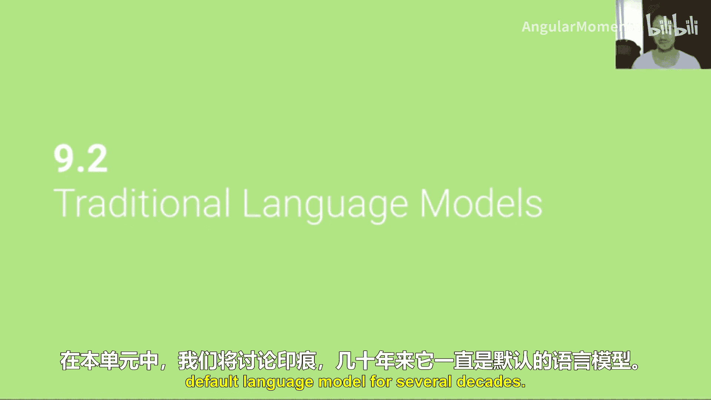
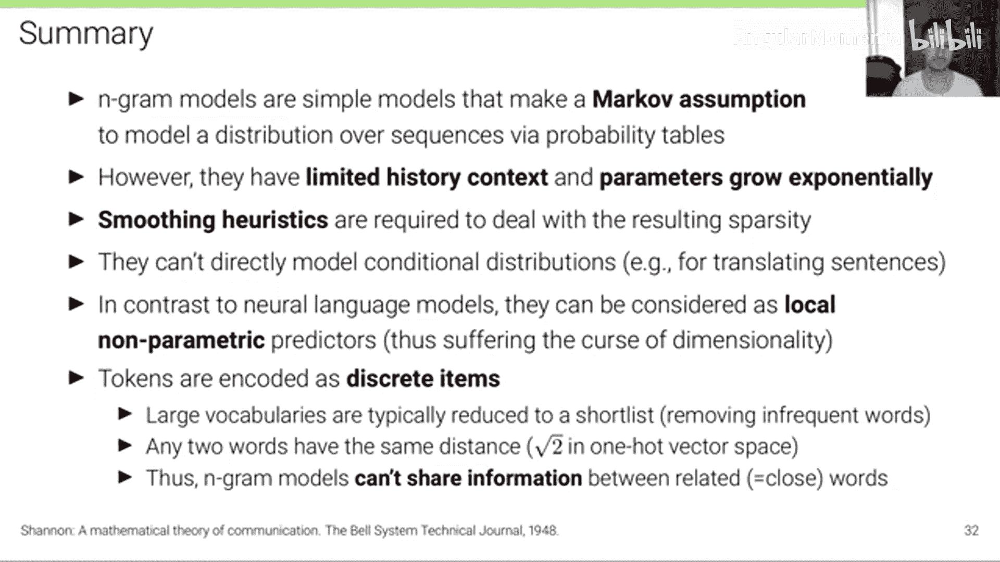

# 【精译】蒂宾根大学《深度学习》-p44-44--9.2（自然语言处理：传统语言模型）--BV1eDbrzhENK_p44-

In this unit， we are going to be talking about engrams， which have been the default language model。

For several decades。

Let's just briefly recap， a language model models a probability distribution over a sequence of discrete tokens where each token can take a value from a vocabulary B。

And we decompose。This language model into a sequence of conditional distributions。Now， the history。

The conditional variables。In such a language model is typically called context and LRP。

So in this case， where we。Decompose。Exactly into these conditional distributions。

The context of any word。Is all the previous words。All the way until the first word in that sequence。

That's what's called context。In the unit on convolutional neural networks。

 we call this the receptive field here it's called context。闹。

The simplest possible way to model these conditional distributions over discrete。Random variables X。

Is to use probability tables。We have a probability table， for instance， that says well。

For each of the possible values that x2 can take。What is the probability given that I have observed。

A particular x1。 So in this case， I have it。A probability table of。With two dimensions。

 this is a matrix。In this case here I have a probability table with three dimensions。

 that it's a tensor， I need to store for every combination of x1 and x2。

What is the probability for every value that x3 can take。

 and you can see that this grows very quickly。So learning the entries of this table becomes intractable very quickly as the sequence length of such a naive language model grows。

So for instance， the probability table for a P of xt， so this is the last word。In that sentence。

Given all the previous words except for the last words， x1 to xt minus1。Comprises。

Vocabulary size to the power of T entries。But let's assume we have a vocabulary with 30000 words。

 which is not uncommon if we want a model。English text， let's say。Then we have 30。

000 to the power of， let's say， 10 if we assume sequences of length 10。

 which is also not uncommon in English text。So this becomes extremely large。

 it's impossible to store all these。Probabilities。Huge memory and also very large training sets are required now。

Large training sets are required or would be required if we could even store that would be required because for sentences of length 10。

We have so many combinations that only a very small fraction of them would actually occur in the training set。

 so we need exponentially large memory and exponentially large training sets to actually observe。

The true distribution。For this probability table myth。10 words。And this is where engrams come in。

 Ngrams make an approximation。 They shorten the context。Yeah。An mgram。

 so in this unit we refer to ngrams as both sequence of an tokens so for instance。

 in the sentence v do gra away， we have agram V doc bygram means we have an n equals 2 gram。

 so it's a 2 gram bygram。Two words。We doc， dogran or runaway are all ngrams from that sentence。

So we use Ngram to denote both sequence of tokens， but we'll also use Ngrams to denote the probability table。

 the conditional probability of a word given。N minus-1 previous words。That is Agram models。

 which are also probability tables。But now the approximate the history context by the last n minus1 tokens。

Instead of。嗯。Here's an example instead of。Considering the distribution of xt given x1 to xt minus 1。

 we consider the distribution of xt given xt minus n plus1。To X T -1。 So we are cutting off。

The first words and only keeping the last。And -1 words。In the history context。

To predict the current word。So for a bygram， for instance， we would just consider xt given xt minus1。

In other words， what this means is that we make a very strong mark of assumption， or in other words。

 the model is memoryless。The T word does not depend on any word that comes before X T minus n plus 1。

Now in order to write write up this probability distribution， a joint distribution。

What we do is we have first the join distribution over the x1 to x n -1 words， because we are not。

 We don't need to decompose them。 They are smaller than。To store this。

 we need to store something that's smaller。Then the Ngram probability table itself。

So for instance for a diagram。By n equals 2， we would just need to start the marginal distribution。

Of x 1。And then we multiply this with these conditional distributions where the history context is cut to the last and minus one tokens。

And now， of course， this becomes much more tractable in particular。

 if you consider small ends like n equal 2， n equal 3， n equal 4 decide on the typical。

Ngramms that are considered in the literature where now with tensors of size， two or three or four。

 we are able to still store and compute these tensors。

So the idea is similar to autoaggressive models here that we have introduced before。

 where we also have cuts to history。Except that each of these conditional distributions in engrams is represented by a probability table and not by a neural network as we have used them for autoregressive models。

Okay。And well。Early language models considered diagramgrams and trigrams and later people try to increase n。

 but you can only go so far， so n equal 4 and equal 5 maybe。Let's look at two examples。

So here are word language model examples， the first is for bygrams where n equal two or in other words。

 the history length is one。So in this case， if we have four words x1 to x4。

 then we have p of x1 times p of x2 give next1， you see p of x3 give x 2 and p of x4 give next 3 we can see that the context here。

Is a cut。After the preceding words or before the preceding word。

 you have P of x3 given x2 instead of p of x3 given x2 and x1。Or with a concrete example。

 the probability of the dog ran away then the probability of me， the probability of Do given the。

 the probability of ran， given do， and so on。And similarly for a trigram where n equals 3 and the history length is 2。

 we have p of x1 and x2 times p of x3 given x1 and x2 times p of x4， given x2 and x3。Now， how do we。

Calculate these conditional probabilities from a training set。Well。

 the conditional probability from for such an engram， which is written here。

 this is the same equation from before。Is or can be simply written。

By the product rule can be written as the probability of M the Xt minus n plus 1 to Xt。

Divided by P of x t minus n plus 1 to xt minus1， where we excluded the last word X T。This is。

 this is just another way of writing this conditional probability distribution by dividing by。

The probability of the variables that are。Coming after this conditional。Simple here。

Or in other words， this is this probability here divided by the same probability where we marginalize。

The。Teef， random variable。There's an implication of this sum rule， the second fundamental rule of。

Probability besides the product group。Now， for a bygram。These equations look a bit nasty， I agree。

 but if we just assume n equal to， then this reduces to this simple expression P of xt given x t minus1 is p of xt minus1 and xt over p of x t minus1。

Or。Over P of xt minus1 xt marginalized over xt。So we see that we simply need to count the number of n grams and n minus1 grams in the whole training corpus to populate the probability table of the ngram model we simply need to count how often does。

X T-1。 how often is x t-1 followed by X T， followed by the word X T。

Divided by the number of occurrences of xt minus1。So it's very simple， it's just counting。

 training amounts to counting， the most simple training process， no grade in descent， just counting。

Now for larger ends， like trigrams or four grams。Qutogramms。

Probabilities are often0 as still there is a lot of these consider there is vocabulary size of 30000。

 There' is still a lot of possible combinations of words that。Are not part of the training set。

 but yet they might occur in the test set。Which means that we are overfitting。

And a simple technique to counteract this to not assign zero probability at test time。

Which is which will be bad。Is to use a technique called smoothing where we have a heuristic that simply adds one to all possible engrams。

 engram counts that the probabilities are very small for something that hasn't been observed in the training set。

 but it's not exactly zero。And there's other heuristics that work a little bit better than the simple heuristic that。

I sketched here。Yeah。Now， as en models are autoaggressive models， we know already sampling is easy。

 we can just create a word given the previous words or in such a。

Tgra model we create a word given the two previous words。

We iterically draw new tokens from this conditional distribution until we reach the end of sentence symbol as EOS。

And here is a random example drawn from a tri model that has been trained on Jane Austen text。I was。

As you can read。Might not make a lot of sense， but it's still natural language as it could potentially occur we can we can really that this is something that could。

We could relate to the trainings that you were uniformly charming cried he while a smile of associating and now and then I bow and they perceived Jason forward to Bifor。

 it doesn't make any sense。It's a very simple tri model。

But it's not just a random collection of words。And here's some examples from a language model。

Mve different engrams。From。A trained on Shakespeare text。

And you can see that as we increase the context size。For。A unigram， a bigram， a trigram。

 and a forogram here， we see that the texts become much and more realistic。In the first case here。

 the words are just random， we have sometimes we have single word sentences。

And then as we go to high order statistics， we get sequences of words that start to make sense。

King Henry， what？ I will go seek the traitor。A great bank had serveded in。 it cannot be， but so。

And I encourage you to have a look at this website where you'll find more examples。So to some。

To summarize。Aular models are simple models that make a markov assumption to model a distribution over sequences via。

Probability tables。However， this is also the downside， they have a limited history context。

 they cannot model long term dependencies。And the parameters still grow exponentially with M。Yes。

So smooth characteristicsuristics are required to deal with the resulting sparsity in the data set。

Or in the model。They cannot directly model conditional distributions。

So this is just a generative language model， it's a model for the language。

 but it's not a model that's conditioned on an input sentence， producing an output sentence。

 which we'll see later。And in contrast to neural language models。嗯。

They can be considered somewhat as local non parametric predictors。

 which is also where the curse of dimensionality comes in We're not。

Considering closeness of individual items but we're considering a local non permit predictor。

And one of the main downsides of these type of language models that people have realized in the 2000s and where a lot of innovation and a lot of boost in performance came from is that。

In these type of models， tokens are encoded as discrete items。One downside of this is。

 and this is still a problem that large vocabularies are typically reduced to a short or have to be reduced to a short list。

So for from all possible English words， we need to remove all of the maybe except the。30。

000 most frequent ones in order to have a fixed vocabulary of size 30000。

 that's not becoming too large。It doesn't become too difficult to predict and to store peri form。おく。

But then something that's really problematic is that any two words in such a discrete representation of words have the same distance if you think about a one hot vector for each word。

 the distance between each word is square root of2。And therefore。

 the engrams can't share information between related words。

There might be two words that are semantically related。

It would be beneficial for the machine learning model to exploit that。

 but it's just impossible with such kind of agram models。

And this is also the motivation for the next unit。

