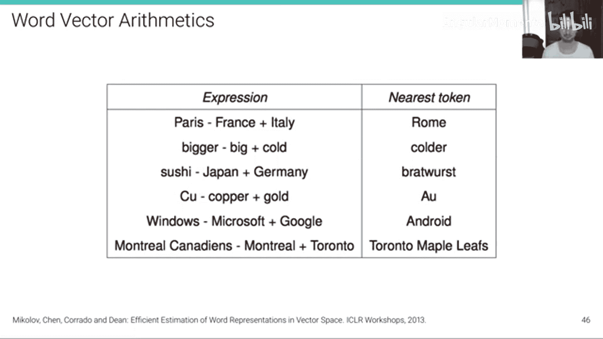

# 【精译】蒂宾根大学《深度学习》-p45-45--9.3（自然语言处理：神经语言模型）--BV1eDbrzhENK_p45-

This unit is about neural language models。Language models that。

Utilize neural networks for predicting the next word。

We've seen that Agram models。That effectively are just conditional probability tables suffer from the course of dimensionality。

Yeah。For instance， modeling the joint distribution of n consecutive words with a vocabulary of size V results in intractable。

嗯。Vocabulary size to the power of N10 to the power of 40 parameters。Even if we limit。

The history context to 10。However， and this is。Where the idea for this type of neural language models came from。

Below， I referenced the paper from。So Ben you it neural probabilistic language model， Jlarard 2003。

However， continuous variables。Even modeling continuous variables。

 we obtain generalization much more easily than in this discrete case。

Because the function to be learned is expected to behave locally smoothly。

And this has been observed in our context before the type of representations that we're going to talk about have been used in our contexts before。

 but they haven't been used for NLP and it has made a tremendous impact。

 they have made a tremendous impact on the performance of。NlP algorithms。Okay。

So that's the difference。 modeling discrete distributions is typically hard。

 modeling continuous distribution is easy。 So how can we。

Formulate this discrete problem more continuously。You can imagine as an informal description of the question that has been asked。

So the core problem is that in discrete word representations。

 we assume the same distance between any two words。

Let's assume W denoting a one hot encoding of a word。

We're going to use this type of encoding throughout this entire unit。

Let's assume two different words。Think of these vectors。

 this one hot vectors as vectors of dimension 30，000。

 where there is one element is 1 and the average of0。So the first word is 10，0，0， etc。

 and the second word is 0， 1，0，0，0， etc。Then if we subtract these two from each other。

And compute the L2 norm。 But this is the L2 distance between these one hot vectors。

 We get a distance of square root of 2。No matter which combination of any two words you consider。

 unless it's the same word where the distance is zero。

This means all words have the same distance to each other in this simple representation。However。

In reality， some birds are much more similar than otherss。So consider the sentences in the following。

The cat is walking in the bedroom， and the dog was running in the room。

The sentences at the word level， the one hot level， are very different。But semantically。

 they are quite related。And having seen the first sentence with the cat， should。Ideally。

 help our machine learning model to generalize making the second sentence。

Also more likely as cat and dog and walking and running and D and A have quite similar semantic rules。

 but this cannot be captured in purely discrete models as engram models are。And therefore。

 the idea that has been put forward in this paper is to use a different representation。

 a so called distributed representation that map one hot vectors。

 these are these long vectors where it's one element is one。Yeah。In high dimensions， let's say 10。

000 vocabulary size。Two word embeddings。whichch are in r to the power of M of much lower dimensions where maybe M is 30 or 100。

Therefore， these representations。These distributed representations。

 that's where the name comes from distribute the representations and along all dimensions of the embedding vector before there was just  one1 and everything else was0。

 so all the information was。If you will， contained in this one dimension。 But now we have。

A real valued vector where there is a different， real number for each of these30 dimensions。

 And so the semantics of that word。Is now distributed in that representation。

And the advantage of this is that now we are able to model similarity between words。

Another way of thinking about this is that these representations。

 these distributed representations distribute probability mass where it matters rather than uniformly in all directions around each training point because all the distances are the same。

Now we can model something that's more informative。 We'll see an illustration of this。And therefore。

 they allow generalization across sentences。This word embeddings like this mapping from this 1 hot vectors to the。

Our M。So these real valued vectors are often realized through a very simple linear mapping。

 it's basically just a matrix multiplication where the one hot encoder encoding goes in and out comes this lower dimensional vector。

It's basically just a matrix。Look up that we're doing and inside the matrix， this。

Embbeddings are stored。And then these embeddings。Become the representation of the word。

 and they are then further processed by some。For instance。

 feed forward or recurrent neural network or by。A transformer model they will get to know in the last unit。

Here's the number illustration。On to give a little bit more。A feeling for why this is helpful。

 But unlike in this illustration， we do， of course， not attach actual labels to words。

So this is about semantic relatedness so this is the current word， this is the next word。

 and these are some features you can think of these features as this distributed representation。ASt。

Has or isn't academic in colleges are academic and schoolhouse belongs to academic。

And then academic is related to papers， so it's much more likely that any of those are followed by papers than they are followed by bill。

 which is maybe more related to legislators through the politics feature and so forth。But again。

 this is just an illustration， of course we don't actually attach semantically meaningful labels these are just。

Real valued vectors。That represent words。Okay。So here's a concrete example。

 assume a training set with the following free sentence， the cat is walking。The dog is walking。

And the cat is sitting。Now a distributed representation should learn or can learn to embed cat and dog nearby。

So that they are semantically similar in that。30 dimensional。Ebedding space， they are nearby。

And now given that the probability of the cat is sitting is high because it occurred in the training set。

 and cat and dog are related， the probability of the dog is sitting。

 which is not part of the training set。Is also high。So this is crucial。

 we can model through this similarity， we can model sentences to be more likely that are actually not part of the training set。

 and this is impossible with an a model to realize due to the way words are represented。

So here's a graphical illustration of how these local and distributed representation spaces might look like。

 so here we have three words and we have a local representation。Of walking cat and dark。

Where as you can already see this is a one hot encoding so only for each of these three points only one element is 1 and the others are0 they are in other words on the axis and the distance across or between all of these is the same it's a square root of 2。

 the L2 distance。And now the goal is to transform this into a lower dimensional representation。

 a distributed representation。In this particular case。

 we go from three dimensional to two dimensional。Well now cat and dog are closer to each other than they are to walking。

And once we have learned these word embeddings。We can also visualize these word embeddings。

Here's an example of a two dimensional TN visualization of word embedding where you can see these are assumed in regions。

 the word embedding is of course or the vocabulary is much larger。

 so we assume into particular regions and we see that in one region we see countries and the other region we observe。

Dates or years。And so it has learned to relate dis semantic entities to each other by learning from text。

 but we always have to be careful with 2 visualizations， there is this famous quote from Jeff Hinton。

That illustrates how difficult it is to imagine and how easy it is to be misled by high dimensional spaces I basically said in a 30 dimensional grocery store so imagine a 30 dimensional grocery store and showvies can be next to fish and next to pizza toppings and so in high dimensions everything can be next to everything even though if we visualize word embeddings we can really just do it in 2D everything else is beyond the scope of our imagination。

So we need to be careful with visualizations， that's all I wanted to convey。

So this paper that I referenced below is the first language model that used a distributed representation。

 which have been used before mainly in connectionism。Hinton an alman or symbolic reasoning。

 but not for language and there was really a breakthrough in NLP。Everyone is using。

Distributed representations now。The key ideas for this paper。

 this is what I took from the paper actually， are to associate with each word in the vocabulary a distributed word feature vector。

 never words it's a real valued vector in RM。To express the giant probability function of word sequences in terms of the feature vectors of these words in the sequence。

And to learn simultaneously the word feature vectors and the word parameters of the probability function。

So we have an end to end training process， this was the first end to end model that simultaneously learned the word feature vectors and the probability function。

The parameters of the probability function。And this is what the model looks like。

 this is a picture that I extracted from the paper。And on the left。

 you can see a informal description。So this model has some inputs which are the indices of the words desire we can think of this as the one hot vector。

And then there is。So have a sequence of these one hot vectors， there is a matrix C。

That transforms them into a word embedding for each word。

 we have this fairly dimensional word embedding。And then we concatednate all these word embeddings into a big vector。

 and we have a first layer followed by a tonnage。 This is a hidden layer。

 and then we have a second layer。 This is fully connected， followed by a tonnage。

 This is fully connected， followed by a softm where the softmax is then outputting the probability of the next word in a sequence。

 W T。Given all the previous words， t minus1， t minus2。I' the way until t minus n plus 1。

This is the context， these previous words。And they also have a small variation of this model where we have direct connections from this first layer to the last layer。

YeahBut here these are the word embeddings that are concatedninated in input to this second layer of the model。

The output of this model is the probability of the next word。

Here is a more formal description of this model。The probability of word T。

 given all the previous words。Is a soft Max。Here I used Y index of WT， because we have。This。

What I use here for W is the one hot vector， so I'm using index to get the index of that1 hot vector。

Nmalized by all the others。And then the Ys are predictions。

 linear predictions of these direct connections here。 This is the first part plus。

A linear prediction of。Followed by a tonage linearity。From x where x is a condation。

 is concatedation here of all the one hot vectors for each previous word multiplied with this。

Ebedding matrix C。This is C times W is then this3 dimensional。

Distributed word representation for each word。And each of these C matrices is R in R to the power of M times the vocabulary size。

 so M is this。30 dimensional， low dimensional space， and V is the vocabulary size here。

And we can already see that now the model scales linearly with the vocabulary size because if we increase the vocabulary。

 the C also has to increase but it increases linearly with the vocabulary size and we use the same C for all。

Time steps， so these parameters are shared。But what's different from before is that now the model also scales linearly with n。

Before we had the vocabulary size to the power of N。And now the model scales linearly with n。Because。

We are basically just increasing the length of the concatedninated vector that we input to the second layer。

And so the number of parameters in that second layer increases linearly， not exponentially。

And this is actually a common trick that's used in。😊，when working with neural networks that。

Instead of representing something， some conditioning， explicitly， we we input the conditioning。

OhThe conditioning is an input to an neural network and therefore。嗯。We gain in terms of complexity。

The model becomes more tractable， meaning I'll have a linear dependency in n rather than having to model the conditioning on each of the combinations of the inputs。

It's also something that's， for instance， used in the context of。Reinforcement learning。

So the trick is here to make the。The words or the word embeddings。

We concatenated word embeddings and input to a neural network。

 and so the parameters only grow linearly。In contrast to the probability tables that would grow exponentially。

 so there's more a lot more sharing of information and parameters that takes place。

So there's a lot of results in that paper， but I just want to summarize them by giving the main results from that paper。

 and this has been copied has been taken from that paper。

If you're interested in more results I just recommend to have a look directly at the paper。

 so the main result is that significantly better results can be obtained when using the neural network in comparison with the best of the engrams。

The a test perplexed a difference of about 24%， which was。

Significant at a time on Brown and about 8% on AP news。

 these are data sets when taking the MLP versus the Ngram that works best on the validation set。

The results also suggest that the neural network was able to take advantage of more context。

Because we can now make n larger。On brown， going from two words of context to four words brought improvements to the neural network。

 not to the engrams。And this is because。Of the similarities that are learned and the generalization that is implied by that。

And they also showed that the hidden units are useful。

And then mixing mixing the output probabilities of the neural network with interpolated tri also can help to reduce perplexity。

 So they combine this model even with。More traditional triger models and got a slight proof of performance was an ensemble model effectively。

Now， just a little side note， this is number of papers called word to back efficientff estimation of word representation in vector space。

 One problem that's still。That still there is that。And this is why language modeling is hard。

 is that at least at the word level is that for large vocabularies。

 we need to compute a very large softm。 We need to compute a softm over the next word。Over maybe 30。

000 or 10，000 word possible words。And this is both memory。Intensive and computation intensive。

Now in this paper。What they proposed is so-called skipogramms where the goal is to predict a word in the surrounding context it' kind of an unsupervised training task instead of predicting a distribution of words however they switch to a binary prediction problem where the model is giving pairs of words and just needs to distinguish if the word occurs next to each other in the training corpus or they are sampled randomly and then they can just use logistic regression as a classification task and this can be trained very efficiently with lots of data and yields very good word embeddings。

Very efficiently。And then we we can do some fun stuff with these word embeddings。

 So what we can do some， some word vectoror arithmetics。

We can see some expression on the left and the nearest most likely token on the right。

 so we can take the word embedding vector of Paris and subtract the word embedding of France and add Italy。

And we get Rome as an outcome。We can take sushi and subtract Japan and add Germany and we get brabust。

And so forth， that's quite fun。And it also shows， you it's fun。

 but it also shows that the semantics that these word embeddings have learned is actually。

Quite meaningful。

