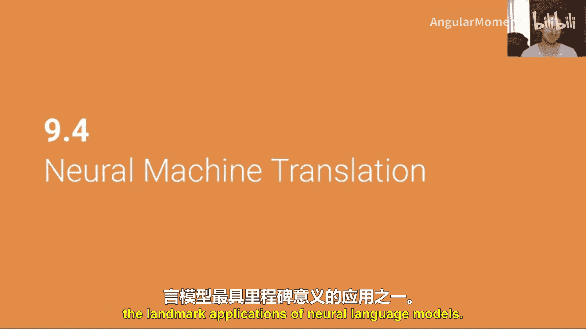
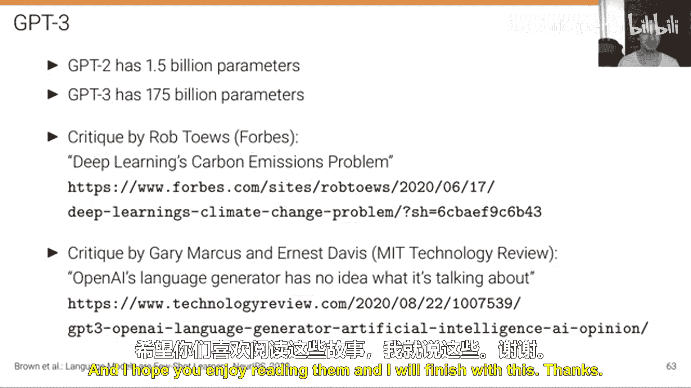

# 【精译】蒂宾根大学《深度学习》-p46-46--9.4（自然语言处理：神经机器翻译）--BV1eDbrzhENK_p46-

The last unit of this lecture is on neural machine translation。

 which is maybe one of the landmark applications of neural。

Language models。And。This is。A paper that came out at Nuip's，2014。From Elilia Segiver it al。

 sequence to sequence learning with neural networks。

And what they proposed is a very simple end to end trainable model for machine translation that shocked the community。

Because it was the first paper to produce。Results that outperform all of the previously developed。

Hand engineered rule based systems for machine translation。And the key behind this。

Was basically just a very well engineered but simple model。

In combination with a lot of compute and a lot of data， like one of the。

One of the main insights of many of the deep learning。Sucsses in other fields as well。

 if you have enough data， if you have the right model and if you have enough compute。

 you can deep learning can do amazing things。So what they did is we used four layer。

 we talked about these recurrentin neural networks with layers in the last lecture。

 so we used four layer LSTMs for encoding and decoding the source or target sentence respectively。

Where encoding operates in reverse order of the input sentence。

 let's assume we want to translate a sentence from English to French。

 then we reverse the order of the input sentence。And this is advantageous because it introduces short term dependencies because we end with the first word and then the decoder starts to decode with the first word in the target language and。

By reversing the input sentence。You get shorter dependencies because the the first word in the。

Input sentence is likely related。To earlier words in the output sentence。Yeah。

But otherwise is a simple LSTM， so here's an LSTM that processes these reverse ordered words word by word。

So the words are embedded in a， a distributed word representation and there's a hidden state。

That is carried forward through this recurtinial network。

And then there's an intermediate representation。That's called a thought vector。

 This is the representation that stores the meaning of that sentence that shall be translated。

So once we reach the end of symbol， end of sentence symbol。

We produce we have the thought vector as the hidden representation。

It's a global representation of the input sentence。 And then that fourth vector is decoded。

 and the reason why。We have this interface of the thought vector is that the input sentence and the output sentence may have a different length and also the word order is very different in different languages depending on the grammar of these languages。

So we create a global representation of the input sentence default vector that is passed to decoder。

 and it has long been believed in a community that such a simple system cannot work。

Because it's impossible， people have claimed it's impossible to generate a thought vector。

A global representation of a sentence that captures enough to decode it well in the target language。

But then this was the first paper that demonstrated that this is possible surpassing all of the existing techniques that have been developed so far。

So they used an wording embedding of 1，000 dimensions and the decoding was done by a beam search。

 which we're going to have a short look at in a minute。

And was the first enterine system that outperformed all of the state of the art models。

And was also the first system that demonstrated that this is really possible at large scale and that led to deployment。

 So that was the time then in 2015， when， for instance， Google。

Completely transitioned to neural from the traditional language translation models they had to neural machine translation models in 2015。

So how let's talk about decoding， how can we do decoding。

 well let W1 to WT denote the target sentence and let V denote this font vector that we have here in red。

Then sampling a translation from the LSTM decoder is really simple because we have this autoregressive nature that we can just。

Sample new word from the distribution that is predicted by the LSTM given the fraud vector and the previous words。

嗯。Where the previous words are summarized in this hidden state in the case of an LSTM。

But this is not what we want to do in translation， what we want to do is we want to compute the most probable translation for an input sentence。

 or in other words we want to find W1 to WT that maximizes P of W1 to WT given the thought vector V。

Now， this is very costly。Because there's a large number of possibilities。For possible translations。

So searching that exhaustively is intractable。But a greedy algorithm might actually work well。

 and it often does in practice， and a greedy algorithm is one which basically word by word finds the best word that maximizes the probability up to that word。

So we take arc max over only WT if we compute the next word T。

Given V and all the previous words before the word team， So this is called a greedy algorithm。

 it's important to note that these two are not the same。They don't lead to the same result。

 but the greedy algorithm is often a good approximation。

So here's an example of a ph case of a greedy algorithm。

 let's consider the sentence apples are good and the sentence those apples are good。

Those apples are good。The probability of apples are good。

In a training operara might be larger than the probability of those apples are good because。

Apples are good of course more frequently。 However。

 there is more sentences in the training corporate that。Start with those compared to apples。

 so the probability of the sentence dose。Like the partial sentence dose is bigger than the probability of the partial sentence apples。

 or the sentences that start with apples。So if we do greedy decoding， then we would start with those。

 even though the probability of the probability of apples are good is bigger than the probability of those apples are good。

And this is where beam search comes in。 beam search is somewhere in between。 It's。

 it's better than a purely greedy algorithm， but it's still only an approximation to the true。

A solution that searches over the entire search space。the idea of beamm search。

 and that's also what is done in this paper for decoding is that at each time step we maintain a list of the Kist words。

 ver casea hyperparameter。Of beamm search。And we keep a list of these K best words and the best of the corresponding hidden vectors。

And this can be used then to produce a list of k best decodings for the following word。

 So for for all of these K best words with the hidden vectors， we can look at。

All possible next words。And multiply the probabilities。And then find the best combination。

 and then just。Get a list of like ansorted list of these best combinations and shorten that list again to k for the next step and so forth so this is why it's called beam search we keep we always keep a beam of k solutions。

And through that， we can come up with better solutions compared to nave greedy search。

 but we're still just doing an approximation and is' still tractable。He has an illustration。

 there's also the website where you can find a little bit more explanation。

 buts it's very simple we start here with an empty。Sequence， and then we have AP， DES candidates。

And A and C are most likely， so we。With a beam of size 2。

 we keep track of A and C and then for A B is most likely and for C is most likely。

 and then we continue AB and C so we maintain short always this short list of two hypotheses。

And it could， of course， also be the case that here。

AB and AC are both more likely than CE in which case we would continue with AB and AC here。闹。

This was a big step。 the paper that I mentioned before made a big step and it led industry。

To change the algorithms they were using in practice。 So it， it meant really that it started working。

Neural machine translation started to have an impact in practice。

But then in 2017 there was another big step， and that was the transformal paper that completely changed the architecture of previous neural machine translation models into a。

Purely attention based architecture。 So the transformer is an attention based model。

And we'll come to that。Which doesn't rely on recurrency or convolutions。

 There is no R and N or no convolutional layers in the model。 I'm going to show you。

 It's just an attention based model。 And the advantage of an attention based model over a R and N。

 for instance， is that there is no sequential dependencies。 You don't need to wait。

For the previous words to be computed until they can compute the probability for the current word。

But all the tokens can be processed in par and it's advantageous because now nowadays all the computational gains are through paralleluralism。

 and so we want to have our models also as parallelizable as possible in order to take advantage of the massively parallel hardware that's available today。

So that leads to significant speedups when using modern GPU clusters。

 and that's what this paper exploited。This is also a paper from Google。Okay。Self attention。

Is what has been used in the transformer。And self attention relates all the tokens。

 all the words in a layer with each other， which means not only that。

This can be computed in parallel， but it also means that it can more easily capture long distance dependencies compared to an R&N where these long distance dependencies have to be carried over the time steps through the hidden state。

With all these problems of managing gradients here， were doing parallel processing。And。Therefore。

 we can directly relate any element to each other in the sentence。

And transformer like architectures have now replaced RNNs in LLP applications almost entirely。

 they are defector standard for all state of the art models， for instance on the superglue benchmark。

 which is one of these standard benchmarks to evaluatevalte。Mine translation performance。

So let's have a bit more closer look into what the transformer does。

Each layer in a transformer has a shape of L where we use L for layer。

 this is Einstein notation now that I'm using L of T and J。

 where T ranges over the position in the input sequence and J ranges over the neurons at that position。

 this is basically a matrix， or for each position for each word， we have a vector， a word embedding。

And when processing sentences of words， T is the sequenc name。

So this is basically the same shape as in an RnN， it's a sequence of vectors。

So here we have a sequence of vectors。Little T big J is a vector。However。

 unlikeing RNs in the transformer， we can compute the layer。

The next layer L plus 1 from the previous layer completely iner， that's what I mentioned before。

So we go from one tensor to the next tensor completely in pro without this sequential。Relationships。

So in this respect， the transformer is actually more similar to a CNN than to an RNN。

But it's different from a CNN because it has attention and it doesn't do convolutions。

The fundamental innovation of the transformer is the self attention layer for each position A T in the sequence we compute an attention over the other positions in the sequence。

We'll make this more formal on the next slide。And then the transformer uses multiple hats。

So initially we tried to of a single hat， but then they split up the computation into multiple heads because。

This gave them empirical benefits。So there's eight different hats in the original implementation。嗯。

Each of which computes。Its own attention of aeration。It's not very well described in a paper。

 why they use multiple hats。But it just empirically works better than just using a single of these attention heads。

And then the self attention is constructs a tensor。We call it a for attention。

With indices K T1 and T2， which specifies for head to K， case the head index from 1 to8。

 the strength of the attention weight。From T1 to T2， so the attention that T1 pays to T2。

 that word t1 pays to T2 in a particular layer of the transformer for a particular head K。

So that's very abstract， but we'll make it more formal。And。In the paper。

 they used an embedding dimension for each word is a word embedding dimension of 512。

Token means word， this is a word model， so per token 512 dimension。

And they use eight hats so that they used then because we have eight hats。

 they used for the query and the keys and the values that this attention self attention layer utilizes。

 they use 64 dimensions， 64 times 8 is 512， so we break the problem。From 512。

 they do computations at 64 dimensions， but they do it eight times and then they concatednate again to get 512。

In fact， they concatenate and they do a fully connected layer so they could use a different intermediate dimension。

 but they wanted to keep it comparable so they used exactly 512 divided by 8。

And this query key and value embeddings are。Properties of this or。

Values of the self attention layer that we're going to talk about。

So this is the transformer on one slide in termserm of equation。

 this is the self not exactly correct， it's a self attention layer。

The transformer has multiple layers， but one of these layers。

 the most complex one is the self attention layer， the multi headed self attention layer。

 and this is what is on this slide。Okay。So for each head k and each position for each word in a sequence。

 we compute a key query and value vector， these are the 64 dimensional vectors。And the queries。

 we call Q， the keys we call k。And these are used to compute the self attention matrix A for that hat。

And then A， this attention matrix。😊，Is multiplied with the values B to yield embedding vectors H that are then concatedninated。

 these are the 64 times 8。We concatenate eight of them。And they are done。

Multiplied with a matrix to yield the output of that layer。

And so this is what it looks like in Einstein notation so we have。

So we start at the bottom where we have chest。Wordom。

Words represented maybe as one hot vectors or word embeddings of one hot vectors。

So we have some word embeddings of these one hot vectors。And。

We multiply these so this is a time step T， we have a vector。

 this j is all of the elements of that vector， and we multiply this add layer at the first layer with a matrix W。

WQ to get a ferry vector。Yeah。嗯。So this runs over I so I could have used capital I here as well so we have this query vector we have for hat K at time step T and that runs over I and this is 64 dimensional so we go from 512 dimensional j to 64 dimensional I using this matrix multiplication and we have different matrices three different matrices。

 one for the socalled query， one for the key and one for the value so we get。

Qury key and value vectors of 64 dimensions for each head and for each word。And then we。

Multiply the query and the key if they are similar。

Then this leads to a strong activation of the attention matrix A。

There's some normalization vector here as well， and then we do a soft max over T2。

 so this is basically here， you can see this goes over T1 for Q and T2 for k and so we get this matrix of T1 attends to T2。

Relationships here for head K。And it's over all day。

This is vector multiplications over all the elements of these。Qury and key vectors。

And then the softm to normalize。And so then we have this attention matrix and we multiply this attention matrix to the value vector B。

Where we now sum over the t dimension of this vector v and the T2 dimension of this matrix a。

This is how T1 attends to T2 point a time T。Okay。So we got these 64 dimensional vectors H。

 which we then concatenate， So this is here over the different heads so we have had0 up to hat k minus1。

So we concatenate them。And then we。We compute a。Matrix product。

In order to get the output of that layer， and that's it。In summary， we compute queries。

 we compute keys， and we compute values for each head and for each times step our word。

And then from the queries and keys， we compute attention。

And that attention is multiplied with the values， so we extract。

 we take the values where the model attends to。And these are then concateninated。

And fit to the next layer。And here's an illustration of this。

 There's multiple illustrations that will find on the Internet。 This is one。Duffing fingers。

 quite intuitive。There's the web link as well。Now in order to use this。

 what I've just described is just this self attention layer， there's additional layers。

 there's some feet forward layers， there's some normalization layers。

 but this is really the core of the transformer。And now if you want to use this for。For translation。

 you will have a sequence of input words that are going to be encoded here on the left you can see the encoder。

And then information from this encoder is given to the decoder in particular。

K and the queries are given to the decoder， and they are combined with the values of。

Each word in sequence encoded through this。Encoder that's part of the decoder。

So there's an output sentence here that's successively established through this decoder by combining case and queries from the encoder with values from this decoder。

And this decoder always predicts the next word and now there's some tricks here， for instance。

 in order to make sure that。This stakeholder doesn't attend towards words in the future。

Because it should only produce one word at a time， like weights in the future on masked out。

 for instance。So here's a little illustration of how this works。 So this is the encoder on left。

 it's a translation problem。 we have an French input sentence and then English output sentence。

 and so the French input sentence is encoded using this stack of there six of these。

Transformer layers。And then the features of， these keys and the values are the basically the pass to the decoder。

And then a query by the decoder， is is actually the keys and the values are passed from the encode to the decoder。

 and then combined with the queries of the decoder。Yeah。Not the keys and the queries。So step by step。

 we produce the output sentence then end of sentence。

So here's an illustration of what this attention looks like， so we have a sentence here。

And we have the words making， and we can see for these eight different attention heads shown in rows here。

 what they attend to。Is illustrated with stronger colors。

 you can see that making tend tends to more difficult more than it tends to other words。

So the model has captured that there is a relationship between these two words。Now。

 if you look at the state of the art in machine translation。This is the benchmark to look at。

 this is the so called Super view benchmark， you can see a whole bunch of models here that get better and better over time。

 achieving performance that people thought previously was impossible。And。U。

All of the state of the art models use transformer architecture in one or the other way。

They all differ in terms of the details and in terms of how training is done and the data sets。

And the hardware， but they're all building on top of the similar ideas。

Maybe you have heard of GT2 GT2 is a model from O AI。

 which is basically also just a transform model that they combine with unsupervised pretraining。

 so we first pretrained unsupervised on very large text probra with extremely large hardware and then supervised fine tuning。

And they proposed this application of Ser shot learning。

 where the task that is given to the model at inference time after the model has been trained。

Is to continue from a prompt。So you give the model a sequence of words and ask it to continue from there。

 and there's a couple of great examples that you can find on the OpenmiI website。

And this was really surprising to many how well this could work。

People started to believe that AI is possible and then they saw this first。So here's an example。

They gave us an input the following in a shocking finding。

 scientists discovered a herd of unicorns living in a remote。

 previously unexplored valley in the An's Mountains。

Even more surprising to the researchers was the fact that the unicorn spoke perfect English。And now。

 this is。你。A continuation of the machine does the machine talking。

The scientists named the population after their distinctive horn of its unicorn。

These forhorn silver wide unicorns were previously unknown to science。 Now。

 after almost two centuries， the mystery of what sparked this odd phenomenon is now finally solved。

 Doctor George Perez， an evolutionary biologist from the University of La Paz and several companions。

 were exploring the Anne's Mountain， when Perez and his friends were astonished to see the unicorn herd。

While examining these bizarre creatures， the scientists discovered that the creatures also spoke some fairly regular English。

 Perce stated。We can see for example， that they have a common language。

 something like a dialect or dialectic。Doctor Perris believes that the unicorns may have originated in Argentina。

 Some believe that perhaps the creatures were created when a human and a unicorn met each other in a time before human civilization。

However， Perris also pointed out that it is likely that the only way of knowing for sure if unicorns are indeed the descendants of a lost alien race is through DNA。

This was really shocking to many。That something like this was possible。

And then GPT3 is now the newest incarlinnation of this system。

And there was this famous case of a blogger， an undergrad that got access to the system。

And queried the system。very simple queries and then put the results out as a blog post。

And that blog post got a lot of press and got a lot of。嗯。

Comments and people didn't realize that a blog post was written entirely by a machine。

So here's the input。The prompt is feeling unproductive， maybe you should stop overthinking。

And this is what the machine says or produced。In order to get something done。

 maybe we need to think less Seem counterintuitive。

 but I believe sometimes our thoughts can get in the way of the creative process。

 We can work better at times when we tune out the external world and focus on what's in front of us。

I've been thinking about this lately， so I thought it would be good to write an article about it。

 so what exactly does this mean？Let's start with some definitions， definition one。Creative thinking。

CT is the act of using your mind to come up with ideas that are not already present in reality or that have never existed before。

 it is a form of mental activity that involves the use of logic and reason。Dfinition2。

Over thinking O T is the act of trying to come up with ideas that have already been fought through by someone else。

 O T usually results in ideas that are impractical， impossible or even stupid。 and it goes on。

So this was really impressive。But there's also some downsides to these models that I'd like to mention here。

 and there's several critiques and I picked out too。嗯。

So one problem with these models is that this is not the models you might want to train at home GPT2 has 1。

5 billion permeter this was already。A huge amount of parameters at the time。

GPT3 has 175 billion parameters， more than two orders of magnitude more than the previous model。

These are models that really can just be trained in an industrial setting and they are not fully open source。

It's not exactly clear what will happen to these models。Okay。

And there's several critiques centered around these， one critique is by Gary Marcus and Ernest Davis。

 you can look at this article in MIT technology Review。

 OpenMeI's language generator has no idea what it's talking about。

 and they have shown if you query that model，With something that it doesn't feel comfortable with。

 it's hard for the model to， it becomes very quickly clear that the model has no idea what it's talking about。

It's easy for the model to produce output like this。But it's hard harder in other subjects。

 and you can very quickly come to a point where。It's clear that the model is not thinking as humans would。

Okay。And then another critique， which is a critique in general to deep learning， but it has been。Um。

Emphased that it's particularly problematic for these huge language models with millions of parameters and a very large compute plus that's needed is the the carbon footprint that is。

嗯。Left when training these models and it's not only training these models once。

 but you have to these models have been trained by searching for their hypoparameters they have been trained many。

 many times leading to large carbon emissions， so there's also an article on this。And。系。

Hope you enjoy reading them and they。We'll finish with this， thanks。

