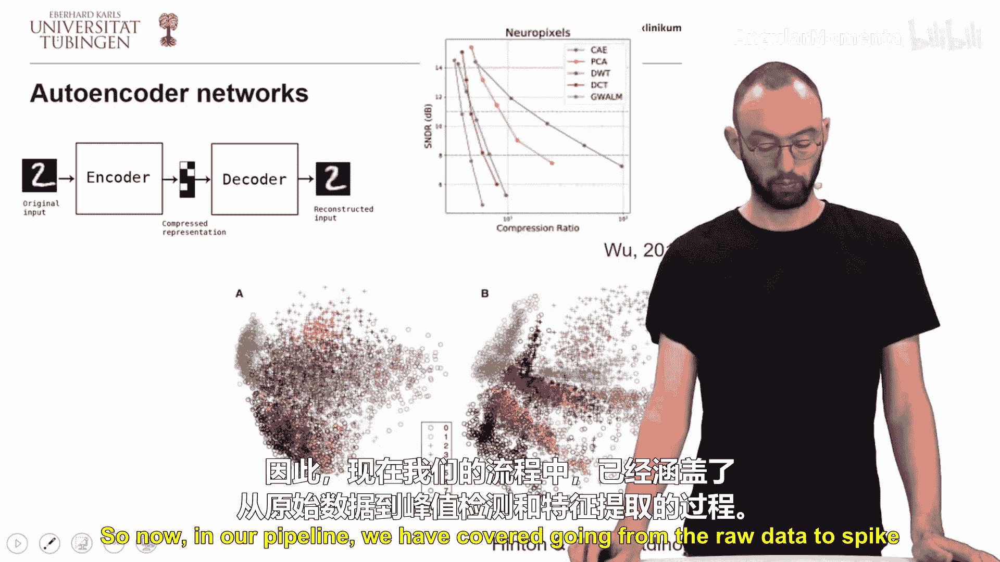
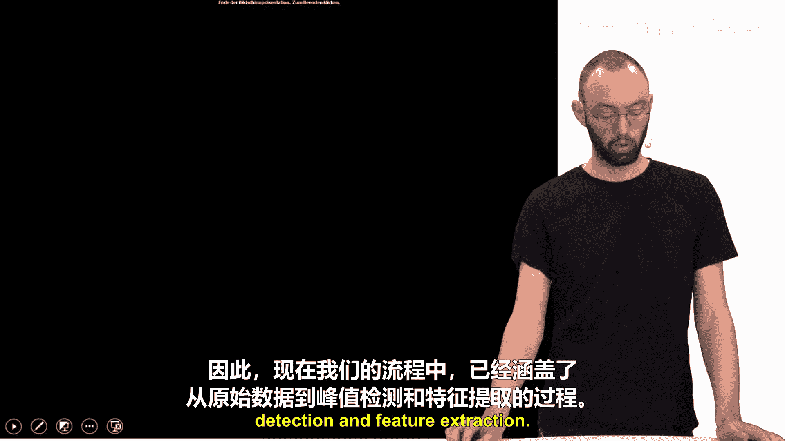
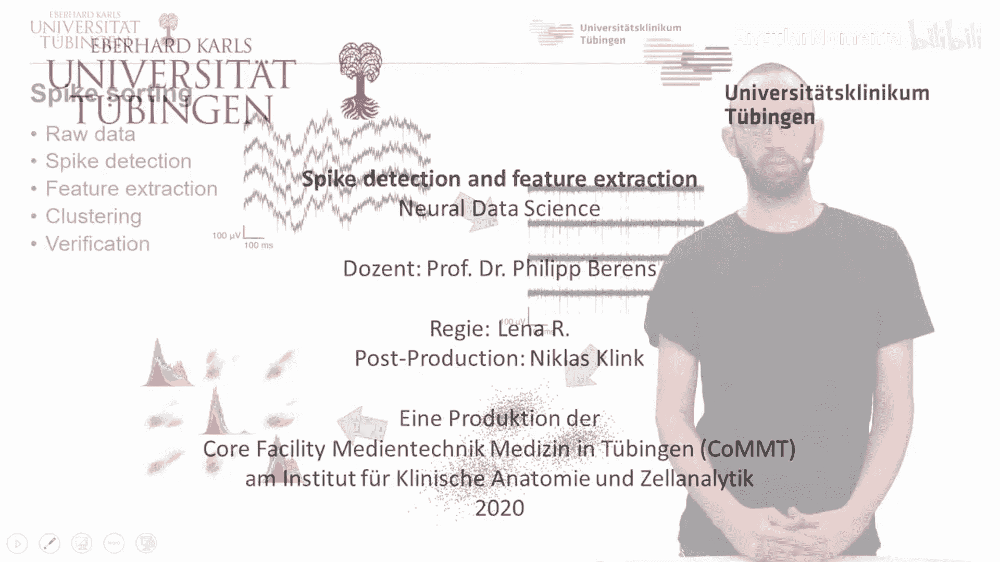

# 【精译】蒂宾根大学《神经数据科学》-p01-01-峰值检测--BV1DEYozGEMW_p1-

Hello， welcome to the first lecture in neural data science。Today。

 we will talk about our first real problem。Spike detection and feature extraction。

So how do we record electrical activity from neurons in the brain。The principled methods to do that。

Really go back， almost。70 or 80 years to the work of David Ul and Torsenvisasel。

Who were really pioneers in developing methods to record activity of nerve cells in the brain。

They developed。So called Tngston electrodes and are sharp electrodes like this。

With which you can approach a neuron in the brain very closely。 They have a very sharp tip。

 You can get close to the neuron。And if you then amplify the signal that is coming out and record it。

Nowadays， digitally。Then you can visualize the activity of that neuron and the changes in membrane voltage that this neuron undergoes as a result of that activity。

Of course nowadays there are many ways to record brain activity and if you're interested in all the different ways and to learn about them in detail。

 then go back to the course on neuralural experimental techniques that is offered also at the G Training Center for Neuroscience。

These methods differ a lot in the scale that they are able to monitor both in time。

And in the spatial scale。So FMRI and PT imaging， for example， cover activity on relatively large。

 spatial and temporal scales。In this course， we will hardly talk about them。Of course。

 some of the methods that we discuss will be also useful for these kind of data。

 but we won't cover them specifically。What we will talk about here in this course。Its rather。

Techniques to record activity of neurons on a ferry。Short timescale。

 a very quick activity of neurons， activity that allows you to monitor individual action potentials or spikes。

And also at a fairly small and spatial scale。 So that allows you to resolve individual neurons。

We will also talk about imaging techniques， but rather imaging techniques that also work on that level of individual neurons。

For example， using calcium indicators or voltage indicators。If you look at the。

 the development over time， also， there's more and more techniques coming out here in the in the 50s。

 you have the tungsten microbi electrodes。 And if you， if you look at them in detail。

 they look like this， they're actually very simple。 it's basically a conductor。

That is coded by an insulator。And then， just at the tip。

Theres the conductors is free and can measure the electrical activity in the surrounding of the electrode tip。

There's a further development from that direction called Teros。 And in this case， it's a。

 it's a microwire Tero。 It's an electron microscopy image of a microbire Te road。

 You can see these little wires here bundled together， four of them， and their tips exposed。

How do these work？Well， ten roads， you have these four。Different wires。

 you have neurons in the vicinity of the tenros。 And because you have the spatial arrangement of the four different wires。

The voltage signature of each neuron will be slightly different on each of the different channels。

This is a principle that we will exploit later in this lecture for efficient spikes。There's also。

Electros that looked like this。 This is so called Utah array， but rather looks like a needle cushion。

Here， these are made from silicon。嗯。And also have these e chunks here and also expose the tip。

 It's 100 electrodes。And they are not so good for actually recording individual neural activity。

But they can record very well the activity of several neurons in the vicinity of the electro tip。

In the recent years， development has really picked up pace so that nowadays。

 one is able to record from several hundred electrodes routinely using silicon probes and their further developments。

 So silicon probes are actually already quite old。 Theyre these huge shanks。 So these are 10 mm。

 But at the tip of the shank。 It looks like this。So。Us using silicon Waer technology。

One can actually print electrode。On these chips。And in this case。

 is a fairly early example of this technology record from these eight channels simultaneously。

Then on each of the channels。You can see the signature of certain neurons。 These blepsium。

 These are the signatures of action potentials of actual neurons in the vicinity of those electrodes。

So this first one here， for example， the blue neuron will probably be lying somewhere up here because it's only visible on the top three channels。

 You can see that in this continuous recording down here。

The blue neuron fire an action potential at this particular location。In contrast， for example。

 the green neuron is visible on the lowest action potentials。On the lowest recording channels。

 these ones down here。 And you can see that a green spike occurs， for example， here。Now。

 our task for the first couple of lectures will be。Actually， to go from a recording such as this。

 we will use a tat recording。 But whether it's 4 or a channel doesn't make a difference in principle。

To go from a recording vector。2。An identification of the neurons that contributed to the recording。

Nowadays， there's the so calledled neuropixels probes。

 the neuropixel probes are really quite an feat of engineering。

 and what the engineers managed in this case is really to make the the the cables that relate the signal from the electrode tipss to the recording chips smaller and smaller。

So that。The noise doesn't swaramp the signal。You can see here。

This is the tip of such a neuro pixelixs probe， and it really has a huge number of recording sites。

 So you can see that along the shank。Dreious。Has almost 1 thousand0 sites。

And if you look at the activity that you can record with such a probe。

It's really just a thousand channels。Which is， which is quite amazing。

 And if you use several of these in parallel， which we can do。

 you get the activity of hundreds of neurons at the same time。

If you are interested in that technique in more detail。

 there's now a second version called Neurpixels 2。0。

And you can go to bio archiveive and read the paper。

So what are we going to do now in our lecture here？In the lecture here。

We will work with data that was acquired usingteros。A tanro， as I said。

 are these four microwis bundled together。And we will try to find out from data that looks like this。

How many and which neurons contributed action potentials to that particular recording。

That is a challenging task。And we will go through it step by step over the next two or three weeks。

What you have to be aware of， what we are looking for is these tiny blips。

 These tiny blips correspond to changes in the membrane voltage of a neuron。That。

Is equivalent to an action potential o spike。It's also important to keep in mind that the four。

Channels here that are being recorded that they are recorded simultaneously and actually have to be analyzed as such。

Our goal is to have。Such sorted signals。 These are the signatures， the spike waveforms。

Corresponding to the different neurons that we can identify on a particular recording。

And we want to go from the raw data to such a nicely annotated data set。

The principle by whichtero spike sorting works is by triangulation。

 So what we exploit is that neurons around the vicinity of thete road are closer to some of the channels than to others。

 So， for example， here， neuron1。It's closer to the yellow channel。

Then neuron2 and neurourn2 vice versa is closer to the pink channel than neuron 1。

They both have the same distance to channel to the green and the blue channel。You can also see that。

If you look at the signatures on the different channels up here。Of course， this is a toy sketch。

But if we now were to plot the amplitude on the blue channel and the green channel versus each other。

 we wouldn't see any difference between the spikes of the two neurons。On the other hand。

 if you look at the yellow and the pink channel and we brought the spikes of the two neurons against each other or the amplitude of the spikes。

Then we can see a clear difference between the signatures of the two neurons。

And this is what we will exploit。Later on。So spike sorting is the task to go from raw tata。

Detect the spikes。Extract features by which we can do clustering of the spikes。

 So to sort them actually to individual neurons。And then think about methods。

 how we can verify that what we found out using our clustering method actually makes biological sense and really corresponds to distinct neurons。

Let's start with the first bit， Spike detection。We have a raw signal that looks like this。

 And to emphasize， again， these are tros。 you have to deal with the four channels in parallel because they were recorded in parallel。

 So if you detect a spike on any particular channel。对 also。You also have to extract。

The signature of that spike on the other channels。And if you detect a spike on multiple channels。

 you have to somehow deal with that， because。In the end， each spike can only be count at once。Now。

 you can see that the signal does not only contain spikes， these little blipps here。

But it also contains very slow。Low frequency fluctuations。To be able to see the spikes more clearly。

 we want to get rid of the low frequencies per fluctuations。So these is， for example。

 here is a signal of a spike and。These you have to extract together and keep together for analysis。

So how do we remove this low frequency fluctuations。

 These low frequency fluctuations are also called local field potential because they correspond actually to the summation of electrical potentials in the vicinity of the electrode tipip。

We want to go from this to that。 And in addition， sometimes there's also very high frequency noise that we might want to remove。

So while here， it's very hard to detect the individual spikes here。

 the blips of the spikes are clearly visible。What we do to remove， for example。

 the low frequency fluctuations is we filter our signal。

 So let's take a very quick detour here on time series filtering。 If you know。

 if we want to know all the details about signal processing and filtering。

Have a look also at the corresponding signal processing course。

The material here is taken from this online resource， which I heavily recommend。 You have a look at。

So let's say we have this time series here， which has a slow frequency trend。Then。

We can convolve that time series。 So compute this convolution here with a filter beta。

That looks like this。 So let's say a Gaussian filter。嗯，To remove。High frequency component。

 So this would be a low pass filter。If we apply this particular filter to the time series。

 you get the blue trays。And the blue trace is similar。To the original traces。

 But it just has some less high frequency vehicles。So it has been loz filtered。

If you look at the transfer functions， or take the Fourier transform。Of that low pass filter。

 you can， you can see that effect。The gain of the slow pulse filter。Looks like this。So。

Low frequencies are hardly changed。And high frequencies are strongly attenuated。Of course。

If you can do low pass filtering with a filter like this。

 you also can do high pass filtering with a filter like this。

So here we saw that a transfer function of the dopa filter emphasizes。

The low frequencies or keeps the low frequencies intact and removes the high frequencies。

 so just accentuating the low frequencies of the signal。In contrast。

 if we apply such a hybrid pass filter。Then we keep the high frequencies intact。

And attenuate the low frequencies。If you apply this to the time series， then it looks like this。

This particular time series， of course， doesn't contain much information in these high frequencies。

 So now it looks like pure noise。 But I think the principle becomes， becomes clear。Ideally。

 you find a filter function for doing so。That has a steep drop off。

 So where for some frequency range that you specify。The power isn't changed at all。s S constant。

 Then there' is a very steep fall off， and the rest of the signal is really almost removed completely from your signal。

If you want to do that？😮，And because we want to filter out some low pass signal and some high pass signal。

 we use a band pass filter。And one particular band pass filter that one can use is the so calledled Butterworth filter。

And the Butterworth filter。achieveies exactly that。 So here's the gain function。

 Again is really as constant as possible。And then has a fairly sharp drop。He。

In terms of which frequency it filters or lets pass through。

You can also see that here in this illustration。 So there's a sinusoidal frequency。

Embbedded into that with some high frequency noise and some low frequency variation。

 But at the band that the filter lets through。 So at 600 Hz or around 600 Hz。

 So this one filters from 500 to 500 Hz， roughly。嗯。This is allowed to pass through。

 And this is the green signal that you recover down here。Okay。

 so how do we apply that to our problem of spike detection well。We simply take。Our signal。

 our raw signal containing the local field potential。We take a butterworth filter。

Were the appropriate cutoffs。 So typically spikes are somewhere between 1000 herz and 3000 herz or have most signal between 1000 Hz and 3000 Hz。

And then we do a band pass filter in that region。Play around in the coding exercise a little bit with these with these filtering ranges and maybe also look at in the literature what is common。

Then we end up with a signal like this。So now how do we detect the spikes。Spins， indie signals。

Are typically downward reflections。This is due to the。

 to the to the physics of the recording process， but you will typically see spikes go downwards。

So what we want to do is we want to put a threshold。

From which on we consider something to be a spike。One way to do that would be to try to estimate the standard deviation of the noise in the background。

And then put a threshold at end times that standard a deviation。The problem is。

 if we put the threshold。If we put the threshold too low， let's say at this gray line here。

Then we get many signals in there， which in the end we will not be separated into unique spikes。

On the other hand， if we put our threshold too high。

Then we may be too restrictive and throw out spikes or not detect spikes that really could be separated into individual neurons。

So a typical threshold or or a typical good threshold is at three or four times the standard deviation of the noise。

But to be able to， to put that threshold in a， in a well defined manner。

 it's important to get a robust estimate of the standard deviation because。

If you have a lot of spikes， this will bias your estimate of the standard deviation。

So what we use as a robust estimate is written down here。

 So we take the mediumn of the absolute deviation。From the median and divide by 0。645。Now。

 this sounds like a rather magic number。But you can actually show that this provides a robust。

OfAnd at deviation， if the data， in fact， is Gauss。So why？

And I we briefly want to go over the deri of that。 If you're not interested， you can skip ahead。

So the mean absolute deviation is defined as the median。

Of the absolute value of the deviations from the median of the data。Nowao。You can realize。That。

The probability with which。The data is smaller。The， the。

 the absolute deviation from the mean is smaller than the。Mean absolute deviation。Is one half。

And then you can rewrite that。Like this。And by this， we see that the probability that the Z score。

 so the。Dviation here divided by sigma to standard deviation。

The probability that the absolute value of the set score is smaller than the mean absolute deviation divided by a signaligma。

That this is equal to one half。Nowo。嗯。From this， it follows。这样子。The嗯。

It a normal distribution function。Of this value minus the normal normal distribution function of minus this value that this is one half。

 So this is if you。Where to。Look at the Gaussian distribution。Now。

 this would be somewhere from here to here。 And here is the middle。 So this together， if this。is。

Mad divided by sigma minus。AndMa。Divided by sigma plus。

Then the probability that the data falls into that middle part。 that would be one half。Now。

 and now it's really basically using some basic rules of how to manipulate these distribution functions。

 And then you find that。The normal distribution function of。

The mat divided by sigma is equal to three quarter。And then if you simplify that。Or solve for sigma。

 You find that sigma， in fact。Is equal to that。Okay。

 now we have a good way to estimate our threshold。We put that threshold and we take all events that have the magnitude that goes below that threshold as spikes。

 So we simply annotate our recording with these now binary indicators where spikes are。So。

From a recording recorded at 30 kiloHtz。We now go to a simple list of values。Where a spike was。Now。

 to be able to process the data further。And actually get the signatures of the individual neurons。

 we now have to extract the waveforms on the four channels。So for each of these spikes。

 we now look at what was the signal in a tiny box around that spike time。

And then you can see that typically， these deflections， if you plot them at higher resolution。

 So now this is 。5 milliseconds before that was 100 milliseconds。

 If you plot them at higher resolution， then you can see that these typically have。

These downward deflections， because， of course you were already looking for such downward deflections in the recording by your spike detection。

On modern electrodes like the neuropixels probe or related electrodes， this， of course。

Looks already a bit different， and it gets already much harder to visualize。 So what they did here。

 for example， they， they plot1 hundred 20 channels。As a function of time。

And because if you plot 1 20 channels， the time series like we did before。It getss hard to see。

 They really plotted them as an image， so。This is really like a spatial image。

Of the signal coming from these 120 electrodes across time。And if you look at that。

 you can clearly see the signature of individual spikes from different neurons。In that image。

You can zoom in on individual spikes and extract this footprint print。

 the spatial footprint of these neurons。 So， for example， here。

 there's a spike that occurs on just some of them。And now， part of spike sorting is to go。And。Tk。

These footprints and extract useful features that allow us them later to cluster the data and assign them to individual neurons。

Why do we do that？😮，If we take the full data that we have。 So in our case。

 it's four channels times 32 samples。 so that would be 128 dimensions。And depending on your computer。

 you could run into memory issues。 The computing takes longer。 But importantly， the。

 the model that you have to use to， to model or cluster the。The data becomes very complex。

 and the number of parameters grows a lot。Qudraically in the number of features， in many cases。

So what we do is we do first dimensionality reductions。

Reduction to get rid of some of the features that we don't use or some of the dimensions that we don't need to use for solving our problem。

Of course， choosing the features。In such an unsupervised learning setting is not easy。

 So what we want is a small set of features。Robustly discriminates between different neurons。

It should be robust against noise。And help us to sort our neurons into different the spikes into different neurons。

Now， what is a good feature for doing that。嗯。Something like this would be okay， right here。

 you can see clearly in the slow dimensional feature representation in the marginal distribution。

 you can see two spikes。 Something like this actually would also be good。

Something like this probably isn't as helpful。And what is good for Sp sorting probably also。

 to some extent， depends on your choice of algorithm。

People in the past have used descriptive features。 So， for example。

 the peak to peak amplitude or the peak to tro ratio。The width of the spike， the energy of the spike。

 and so on。The problem is that sometimes these features are undefined。 let's say there's no tro。

 They often don't have a Gaussian distribution。 So you have this， for example， here。

 some of these features can have zero values。And also。

 they don't use the available resources statistically in an optimal way because they can be correlated。

 So， for example， the the total energy of a spike is， of course。

 correlated with a width and the peak to amplitude ratio。So what can we do in stand。

One thing that one can do。For example， to simply use principal component analysis。

 many of you will have heard about principal component analysis or know the algorithm， in fact。

 very well。If you haven't done so。I linked the video from our machine learning lecture in the winter term on YouTube。

 and I also provided on our Iliaas page。So if you want to refresh your memory。

 there's an entire lecture dedicated to principal component analysis here I will just mention some of the most important basic facts。

So what principle component analysis tries to do is it tries to find a direction in the space that captures the maximum variance。

You can write that formally like this。But you can also see it in this little animation here。

So here you have a set of dots。It's the direction of the。

Largest variance in that space is clearly like the line is currently looking。

You can see that by measuring the spread of the red dots on the low dimensional projection of the data。

Now， you can see again that it becomes bigger and bigger grows until this direction is found。

And then it becomes smaller again， And the direction of smaller variance is exactly that。

And this is simply measured by this formula。Now， an alternative problem statement would be to find the direction that looks for the minimum reconstruction error that when you project on that dimension。

And try to reconstruct the original point that this becomes a minimal。

 And you can see that for problem formulation。By the length。

Of all of these errors that connect the projection。

 the low dimensional projection of the data to its original location， so。In this case。

 the total length of all these red lines is maximum。

 While when we wait until the line has reached this direction。

 the total length of all these red lines is minimal。To find that direction。

We solve an eigenvalue problem。And then we can do that in an iterative way and also find multiple principal components。

And by design。 so by the statement of these two problems。

 these principal components capture the maximum amount of variance in our data in as low dimensions as we want。

To specify。So for the spikes。It provides us with an orthogonal basis， so they are uncorrelated。

And the first direction is， again， as I said， the direction of largest variances。

So if we reconstruct our spike waveforms。Using different amount of principal components can see that if we use。

 let's say， three principal components that we then already can reconstruct about 95% of the variance in our data。

All the tiny additional wiggleles。That are captured in the higher principal components。

 We can also think of them as noise。 Maybe there are some recording artifacts in there that get filtered out。

So a few components in our case should actually be fine。To capture most of the variance。

Why might PCA be also problematic。So sometimes large variance doesn't mean that。

The direction is good for clustering。 So， for example， in this direction， we have a lot of variances。

But it doesn't help us probably for clustering at all。 Well， this direction。Would be one that has。

Less variance because it's smaller in brand， but still helps us for clustering because it actually is bimodal。

This is unfortunate， but at least in the framework of PCA and also in the framework of unsupervised learning。

 it's very hard to change。There are some ways in which also nonlinear techniques can be used to extract features from data。

 One is， for example， so called kernel PCA in kernel PCA。We。

Define a similarity measure or covariance function on the data。Using nonlinear kernel functions。

 I don't want to go into any details here。 Just want to mention that this can be done。

And just as linear PC A decomposes this linear space。

Or decomposes the covariance matrix of the data into its eigen values and eigen vectors。

Colonnal PC A does the same for a non nonlinear computer so calledled kernel matrix。

 which is the equivalent of the covariance matrix。 And by doing that。You can， for example。

 if you have data in the original space that is structured like this or two circles。If you do PCA。

 it doesn't change that structure。But if you were to do kernel PCA。

 then it would actually be able to unfold that with a proper non nonlinear kernel。

Another way in which one can extract nonlinear features that may potentially be helpful is so called outer encoder networks。

 So this is very early work here from hintintonon Sa I Ho enough。Where they trained in。

Origin from the original input。 So this was Mist。To a compressed representation。

 via an encoder network， and then we are decoder network to the reconstructed output。

 And you can see if you simply do PCA on these Mnes numbers。

 then they are cluttered all over the place。 Well， if you use such a nonlinear autoer encoder network。

 then you can get these partially very nicely separated representation。

So these encodeder and decoder networks can be potentially non nonlinear。

So today it's very easy to implement such an architecture and you can actually see it as a relatively straightforward generalization of PCA。

In PC A， in this framework， your encoder network would be simply linear， a linear one data network。

Do your compressed representation。Of the desired dimensionality and then a decoder network that reconstructed the output and your loss function would have to be the squared error loss between the two。

 Then this is exactly equivalent to the PCA formulation that we had earlier。But。

With modern deep learning libraries， it's very easy to replace these encoder and decoders to something nonlinear and potentially extract more information from the data and a nonlinear compressed latent representation。

So， now。In our pipeline。

We have。Covered going from the raw data to spike detection。And feature extraction。

 So now we are at a stage where we can start clustering once we have done the coding exercise。

I hope the content of this week was interesting to you。

 We will follow up next week with more information on spike clustering。Thanks a lot。

