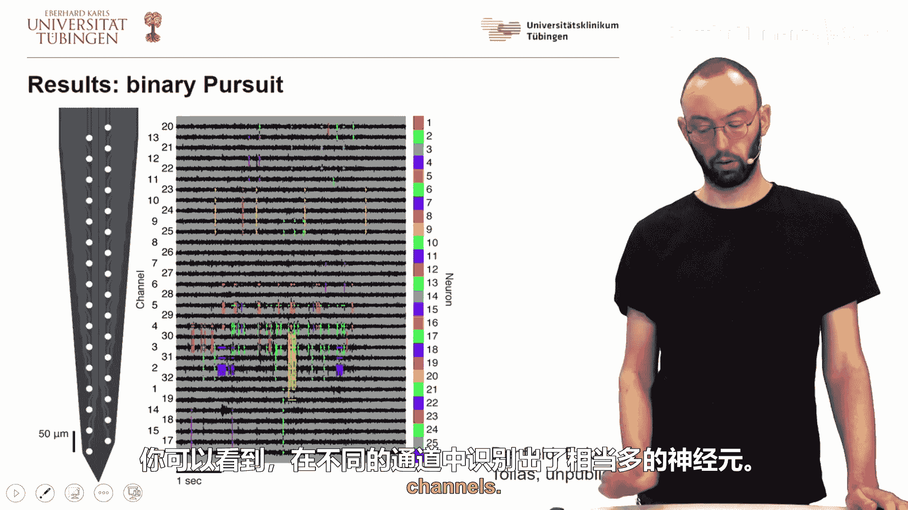
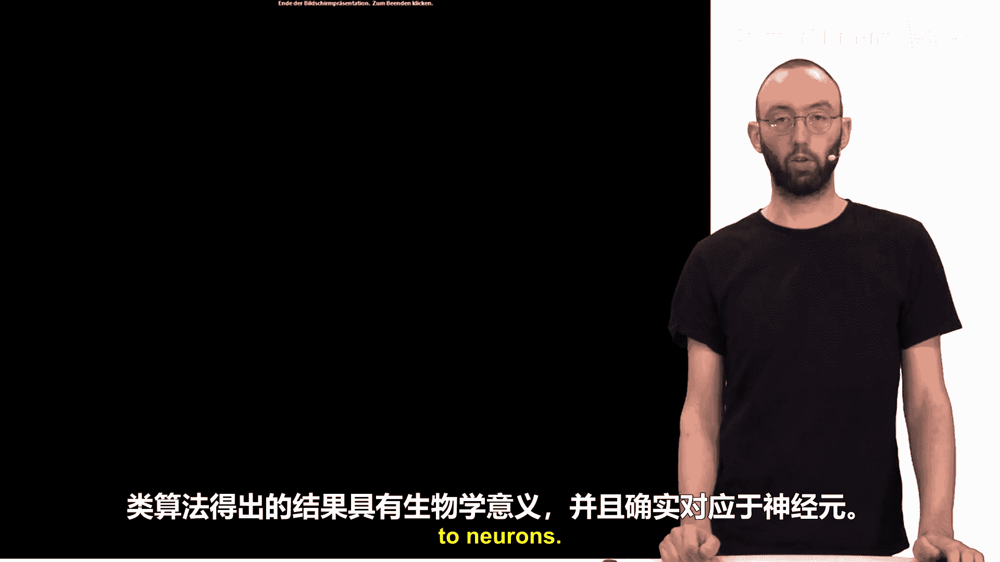
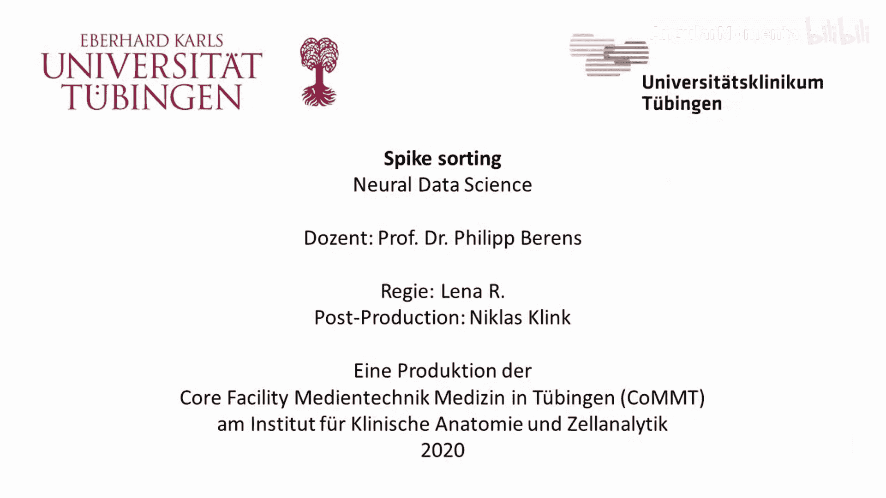

# 【精译】蒂宾根大学《神经数据科学》-p02-02-尖峰分类--BV1DEYozGEMW_p2-

Welcome to the second week of neural data Science。 Today， we will talk about spike sortting。

This is part of our pipeline。 and if you want， it's kind of the central part of it。

So over the last week， we went from raw data to spike detection and feature extraction。And finally。

 today， were actually going to do the spike sorting or the clustering。

So what we try to do is we tried to take these signatures that we extracted last week of the different spikes or action potentials from individual neurons。

 and we try to group them in a way that they actually correspond to individual neurons。So。

This means we need to go from these unsorted spike waveforms over our four channels in our T recordings。

To something nicely cleanly separated， such as this。So for example。

 the purple neuron here has a high signal on channel 3。When the yellow。

Cluster here has a much lower signal on all of the channels。

 The rat neuron maybe also has a high signal here on these lower channels。So how do we go about that。

 So what I show you here is a scatter plot that we will repeatedly look at over the lecture also in the exercise。

What I plot is all pairs。Of first principal components on the different channels。

So this is Cha 1 versus Cha 2。 This is Cha 1 versus channel 3，1 versus 4 and so on。

 So therefore it's four channels。 So it's six plots in total。Now。When we。

 when we plot these first principle components on all of these channels。

 we can clearly see some structure in the data。 So， for example。Ds this。

Nor on here that I circled in red。It has a high amplitude on channelnnel 3。

And is really clearly separated from the rest of the data。

Possibly there's another another cluster that one can separate reasonably well from the data when looks at these two dimensional marginals。

 which is this one down here。So。How do we go about finding out these clusters。

If you look at some of the tools that companies。Ship with the electrophysiological recording equipment。

 There's often software for manual cluster cutting。

 So manual cluster cutting would be equivalent to what I just did in this scatterpld。

One would simply go， draw an eipse and say， well， this is a cluster。Of course。

 because the space is typically high dimensional。 it's very hard for us as human to do that on。

 on low dimensional projections。So here's， for example。

ASoft to do that and by circling all these yellow spikes， one can identify a neuron。

How good a strategy is that， though。This was actually validated in already， quite some time ago。

And basically， it's clear that it's not a good idea。It's subjective。 It has fairly high error rates。

People draw suboptimal boundaries。 It's also super time consuming because you have to go through each neuron individually。

It's not reproducible between different experimenters and also not model based。

So here they created some synthetic data to do that and。On each of the five simulator channels。

 on average， graders found more units than they really were。 So on average， there was one unit。

 and people typically found on average， about 1。5。Maybe speaking to the fact that when you。

Painfully acquired a recording， you rather want to see more neurons in it than less。Also。

 in this case， they measured false positive and false negatives rate。

 And you can clearly see that the data on that isn't very good。 and it's also。

Different than in between different individuals。 So subject E here， for example。

 had a very high false negative rate， but a very low false positive rate。

 So it was quite conservative。 Well， subject E was the contrast， low false negative rate。

 but a very high false positive rate。 And then it gets very difficult to interpret the data。

Scientifically。Also， if you think nowadays about silicon probes or neuropixel probes where there are hundreds and thousands of channels。

This approach just becomes infeasible。 So we need to do something algorithmic。

 We need to do something automatic。There's another paper that illustrates that， that fact。 So in the。

 in the letters。We have the human operators with fairly high false positive and false negatives rate。

 And then if you use a number of principal components。嗯。Then， you can do。Fty well。

And this was an example where they also had ground truth data。And I'll talk more about that later。

So in contrast， automatic clustering approaches can be more objective， they can be model based。

 theyreproducible because if you put out the code and the seed that you use to do your analysis。

 then anybody can run that on the same set of data and obtain the same results。

They are quantifiable in the sense that it's straightforward to compute some measures of quality。

And so on。The problem with clustering per se， and no matter which methods you use。

 is that it's an unsupervised learning problem。And。While there are many solutions for that problem。

 the general， there， there are also many unsolved questions that are also very hard to speak to。 So。

 for example， one of the big unsolved questions in clustering is how to choose the number of clusters。

And there are no principled solutions to these problems。Yet what we will use methods such as ks。

 which you probably know or， and this is what we will also implement a mixture of Gaussian algorithms。

If you're not familiar。At all， with these basic algorithms。Then I would recommend。

 did you go what back to the winter term。And watch the lecture on mixture of Gaussian and camemin clustering from the machine learning one lecture。

Which I've linked to you here in the lecture video and also on areas。

I will briefly recapamp the most important bits of information about mixture of Gaussian transfering。

So a mixture of Gaussian models are a density of points。As's the sum。

Over Gaussian components that are mixed with a certain proportion。

The parameters of the model are such the mixing proportions。

 the mean of the Gaussian components and their covariances。So in this case。

 the data has been generated by using three Gaussians in two dimensions。With three different means。

And equal mixing proportions。 This one has a large larger covariance matrix than this one。

How do we find the parameters of such a mixture of Gaussian model， Well， as often。

We try to optimize the log likelihood of the data under the model。When we write that down。

 we can see that in this case， it looks like this。 So we have a sum over data points。The log。

 and then over the sum of the components。Because is this sum inside the log。

We are unfortunately not able to produce a closed form solution for the parameters。So here。

 the P K are the mixing coefficients。 Again， mu K are the means of the di of the cluster and sigma K are the covari covariance of the cluster。

So if we cannot compute a closed form solution， as we do， for example。

 for estimating the mean of a Gaussian or the covariance of a Gaussian。

 how do we deal with that problem。We use an algorithm called expectation maximization。

And expectation， maximization or E M an algorithm can be used to find the maximum likelihood estimate of any latent variable mode。

A latent variable model。嗯。As a model in which not all of the。

 of the variables that are necessary to specify the models have been observed。In our case。

 these are the cluster assignments。 So we don't know which of the clusters。

 which of the co components of the model。A specific data point has been generated from。

So in E M algorithms， we always have some model parameters in our case， the mixing coefficients。

 the means and the covariances， and we have latent variables that are unobserved in our case。

 the assignment of data points， to mix two components。

 and then we have some data which are in our case， the observed spiking signatures。

What we do in an E M algorithm is that we alternate until the algorithm converges in terms of local likelihood。

 for example。To E step called the expectation step。

 where we estimate the latent variables that given the current set of parameters。

For the case of spike sorting， that means we estimate the cluster assignment based on our current estimate of the cluster parameters。

In the M step， so called maximization step， we do the opposite。

We update the parameters to maximize the likelihood。

 given the current estimate of the latent variables of the cluster assignments。

Let's look at that in detail。What do we do in the E step in the E step。

 we evaluate the responsibilities with the current parameter values。

 That means we compute the probability of a data point。

 the posterior probability of a data point to belong to cluster K。We do that by this formula。

 So the probability or the posterior。off。嗯。The data point N to belong to cluster K。

Is simply the probability under the Gaussian。Off cluster K。

Normalized by the probability of all the others。If we do that， for example， in this case here。

 it's a little toy example。 We visualize the blue and the red cluster at these particular places。

 The first step in the first E step， we simply compute these responsibilities。And when at colour。

The points。With regard to these responsibilities， you can find that the of course。

 the data points that are closer adhere to the blue circle。 They are coloured blue。

 so they have a higher responsibility， a higher posterior probability to be assigned to the blue cluster In contrast to the red points over here that are assigned。

More likely with higher posterior probability to the Red cluster。

Then we do an update an M step when we update the means。

 the covariances and the mixing coefficients and the formulas for that are actually fairly simple。

 So for the mean， we just take the weighted average weighted by the responsibilities of the data points。

We do the same for the covariance matrix， and the mixing coefficients。And then， we can， with a new。嗯。

With new parameters， we can go back to the E step and compute the responsibilities again。

 And this we do in an iterative fashion。So here this was how we initialized our model。

And then in step one。We update the parameters in the Mt。 we move this particular ellipse。

 We move it up here。 So we move it here。 So to the mean of the red data points and the blue ellse。

 we moved down here to the mean of the blue data points。Then we compute new responsibilities。

And it rate that。Until we have converged， and nothing changes。

So either the look like doesn't change any more or the cluster assignment doesn't change any more or whatever stopping criteria that you want to formulate。

As I already said， there is no universally accepted solution to the problem of finding the number of clusters if this is unknown。

So if you look at this data set here， you would probably say， well， for that data。

 I require one Gaussian here， a Gaussian there maybe， and then either one or two Gaussians down here。

One at least principled way to， to look for the number of justice is to optimize the so called Bayesian information criteria。

So why can we not just use the lock likelihood？Well， if you look at。

The number of clusters and the negative log likelihood。

 then we will find it will go down if we keep adding clusters。

Because the optimal negative lock likelihood period。

 we find if we add a single Gaussian on every data point。Right， this explains our data。Optimly， of。

 but， of course， it doesn't tell you anything about the true underlying structure in the data。

So what we instead have to do is we have to somehow balance the fit of the model to the data and the model complexity。

 This is what the Bayesian information criterium does。By penalizing the number of parameters。

We get a compromise between a two complex model that doesn't tell you anything about the true structure。

And a model that fits the data well。So in the， in the Beijing information crum。

 we have this term here that corresponds to the local likelihood。

And we have an additional term that penalizes the number of parameters P in the model。

The like likelihood， as I already mentioned， goes down as the number of clusters increases。

But the number of parameters， of course， goes up as the number of cluster increases。

 So the what the B I C and the patient information criterum does is it balances these two trends。

And returns an optimal solution somewhere。It's， of course。

 not a unique way to do that and some assumptions it can be shown that it's optimal。

 but for any particular data and finite data， it's basically a heuristic to choosing the number of cluster as well。

 and you can either choose the number of cluster such that you really minimize the Bayesian information crerion or you can use it such that you go to the point from which it doesn't descend by much anymore。

 So there's a lot of heuristic choices involved in that。 in the end。

You have to convince yourself by other means， by biological means or by domain knowledge means that whatever comes out of your clustering。

 that this makes sense。One issue with the algorithm is。

 in addition that it has local maximum or can have local maximum。 And this is。

 this is very clear if you think about how the model is specified， of course。You could have。

A cluster。being called cluster 1， that is， let's say located here and another cluster being called cluster 2 that is located here。

 But you can also swap these two， of course。 And these are equivalently good。Sos。Of your。

 of your model。But even beyond these trivial examples。You can have local maximumim， and of course。

 you want to find the best optimal solution。 So for example。

 if you just run youre clustering on this particular data set and you do that several times it's possible that one of your solutions converges to a solution that looks like this while the true solution rather looks like this。

So how can we make sure that we find the best possible solution。

One way to do that is to do simply multiple independent runs with different initializations and simply pick the best in terms of the B。

 I C。There's also another algorithm that is called split and merge that I would like to briefly explain to you。

So。Restarting to avoid local minimum。Is， is' very simple and conceptually， I think， very clear。

 So if we start out here， then we will by optimising a likelihood。 So this is our cost function。

 we will end up in this local optimum By starting out here。 We will in end up in this local optimum。

And by starting a peer， we will end up in this local optimum。And then， of course。

 we want to pick this best one。 And this is simply how。嗯。

Running multiple iterations of your clustering on the same dataset set with different initializations。

 how that works。It a conceptually， very simple。Split and merge。

Is also a heuristic approach that tries to get you out of local optima。It works like this。

 So after your E M algorithm has converged， you can test。In each iteration of the algorithm。

 whether your Bayesian information criterion can be further degrees。By either splitting a candidate。

 So going through all the possible clusters and asking whether if I run a partial E M just on replacing that one cluster here with two clusters。

And keeping all the other component fixed， whether this significantly improves your BSC。And then。

 likewise。Whetherer。I can merge to clusters any pair of clusters。

Where I simply replace the two clusters here by one cluster and running a few E M iterations。

And by artificially interfering into the model optimization like this。

 one can sometimes bump the model out of local opta。 And， for example。

 one would maybe go through this process here。And say， like， O K。

 if this is my candidate cluster for splitting， it probably gets better。

If I replace this and optimize the parameters a bit， or for these two here。

 one could imagine that one could。Re replaced them by a single cluster。And the so such that the。

 the fit。To the data doesn't change much。 So it look liker doesn't change much。 But in this case。

 for example， the number of parameters would be reduced such that the B IC in the end。

 has a better value for the case of the splitting here of that guy。By two clusters。

But two clusters that would look maybe like this。嗯。The PIC hopefully， also goes down。

But in this case， the fit to the data would get better。

 although we have to spend a few more parameters。But this model， as it is。

 currently spends too much weight here somewhere in the middle where there is no density of data。

So split and merge is one approach to be able to cope with local optimum。

Another problem that we sometimes have in such no recordings instead of outliers。 So our data。

 of course， in truth， are not Gaussian distributed。But for example， they can have heavy tails。

 So there's， if you plot。The distance。Of your， your data。From the mean， the malobous distance。

 it's a distance rotated。 this is the formula of the malobous distance。

 It's a distance taking the covariance structure of the data into account。

 If you plot the monoob distance against what you would against the probability of the data。

And if you had a Gaussian， you would expect a straight line。But what we see in this， in this。

 this monoobs distance or chi squared plot is that in， in， in many cases of our recordings。

 we find data that are farther away from the mean than we would expect with a higher than chance probability。

So you can have these outliers in the data or the。The data distribution is set to have heavy tails。嗯。

This is also shown here。 So if you plot the the histogram of the residuals or how well the。嗯。spi。

 the， the mixture model models the， the spiking data。Then we can see that for these higher。

Volattages that there is a higher than probability than what is modeled by a Gaussian。

 One way to deal with that is to replace the Gaussian mixture components。

 actually by T distributions。 T distributions is a。Generalization。

 So a special case of the T distribution is the Gaussian distribution。

 It has one additional parameter called degrees of freedom。

And if the degrees of freedom are infinity， then it's just a Gaussian。

But you can view a T distribution as a mixture of Gaussians with the same mean。That。

Allow you to model。嗯。That allow you to model data that is habitated or has more outliers than you would expect from a garage。

And one can show and to in this paper， for example。

 that many spiking data sets a fit better by a T distribution。Then by a Galian institution。

If you want to implement a mixture of T distributions， you can also do that in your coding exercise。

One further problem that we sometimes have in these kind of spike sorting data sets is that of waveform drift。

So if we look at all these spikes here。And we look at where they land in the principal components space。

 and we can see kind of two clear clusters， this one and this one。

But if we look at the temporal structure in which these spikes were collected。

 we can see this one is， is fairly stable。 It just stays at a place and looks nicely Gaussian。

 But here， this kind of elongated banana shape。 This is produced by the fact that apparently the electrode and the neuron moved relative to each other。

 So， for example， the electrode drifted a little bit into a certain direction。And therefore， the。

 the energy of that neuron on way from one became smaller and smaller over time。

These kind of drifts we can also incorporate in our model。

And one way to do that is to extend our Gausian mixture model into a mixture model of kman filters。

So we take a standard Gaussian mixture model， but we let the cluster means by using a drift term over time。

 We let them drift over time。 So we say in each discrete time junk。Our mean is the mean。

In the time drunk before。But with a drift term。And then。We can use。This drifting mu。

In the Mt and updated we standard forward backward Kman filter record。

If you don't know about the details of a comment filter， that's， that's not a problem here。

 I just want to tell you that you can extend your model in this way further if you want to solve particular problems。

This works actually fairly nicely， so here you can show。In in dash。

 we see the solution by the Gaussian mixture model。

's just here models one nice component and then a huge component here。

 While the common filter mixture model。Pretty much places all the Gaussians on top of each other for this red neuron。

 but for the black neuron allows them to drift over time。Finally， one can put all of that together。

And develop a drifting mixture of T distributions。If you're interested in the details of that approach。

 you can go here。You can see that a scatter plot in the feature space here was different。

Channels look actually very nicely。 Lots of neurons in that particular recording。

We can visualize the different bike wave forms of the different clusters very nicely there。

 They seem very clearly isolated。 And if we look at the cluster location over time。

 then we can see that for some of them， there's actually a little bit of drift。

 so that this really helps。TheThis drift term really helps to model the data well。

If we also look at the cluster deviations from the centre。

 then we can also see that the T distribution is for this data set， in fact。

 a much better distribution than a Gaussian distribution would be。If you're interested in details。

 you can look at these two papers， or there's also an implementation of that on my colleague Alexander Ecker's Github page。

Okay， one final problem that I would like to discuss is the problem of synchronous spikes。

 So most of the time， spikes are fairly short events。 They occur isolated。From one another。 But。

 of course， if， especially if there's a lot of neurons in the vicinity of the electrode。

 you can have overlapping spikes so that you have multiple spikes from multiple neurons that。

Overlaap in the window that you would use as their signature。

To illustrate what kind of effect it can have。Instead that， if you have。

A neuron whose spikes cluster appear and another neuron whose spikes cluster down here。

And then for a very low fraction of the spikes， you get these mixtures。

Then you would observe these mixtures。 potentially even they occur frequently。

Even as a third neuron somewhere in the middle。 But this would be a false inference from your data。

You can also have various time shifts at which they is superim。

 And then they get these smeared out kind of outliers， potentially。If you。Would like to。

 to cope with these overlapping spikes。 And you can see here， for example， that。

There are spikes here and spikes there。 and you can then even predict the position by a different jitter between these two neurons here in that feature space。

This becomes， of course， also even more of an issue if you use multichannel probes because the probability that you find spikes that are are at least partially overlapping on some of the channels just increases by a lot。

我我 so in this。Similar to what I showed you before。So what we can do to deal with that。

Or also for the multichan props， also because the， the amount of data is just so， so immense。

Is to use a quite different approach to spike sorting than the clustering approach that we discussed for the main part of the lecture。

Rather than using a clustering approach or an approach where we extract some features and tend to clustering。

 one can also go into a direction where we use actually a generative model of the data。To。In the end。

 find the black trends。So in this case， we model。The voltage signaled over time。

 we model that as a superposition。Of spikes。Where。These WNs are the spike waveform here。

And we have just discrete spike times。These are these XN。 These are the spike trains are just binary。

 So they have a penuli prior。And we add some， some noise to model the observed voltage trays。

If we use this as a generative model for our spike sorting algorithm。

 then we can all of a sudden also deal with overlapping spikes。So how do we。

 how do we optimize such a model， It's actually not so easy。

 And the reason why it's not so easy is the fact。That the spikes are binary signals that occur at discrete points in time。

We solve that by alternating。Estimating the waveforms， assuming that the spike times are given。

This we can do simply by linear regression。And assuming that the waveforms are given that these are fixed。

And determining the spike times by template matching。

 there's an algorithm called binary pursuit that we use for that。 So what does binary pursuit do。

So in this generative model。We have a loss function that is both a function of the spike trains and the waveforms。

And we want to say， well， it's a， it's a loss function。Looks like this。 we want to。

 to model the observed  voltage strings。As good as possible。 So we。From the voltage traces。

 we sub the convolution of the spike train matrix by the waveform matrix。And we have a term here。

 that models the。嗯。Dispasity of the spike trains。To solve that。We can actually compute， analytically。

The change in the loss function by adding or deleting a spike in a given time bin。

From our spike train matrix so we can， can do that。So。To implement a greedy algorithm， to do that。

 we just。Look at all the possible changes that we can do。And。And flip。The， the spikes。

When this change is， is largest， and then we update our change in the likelihood or in this loss function。

 and we iterate it as we go on， iterating with also estimating the spike waveforms。

It's also important to initialize this algorithm。 Well。

 We would do that with an approach similar to what we discussed in the first part of the lecture。

And then repeat， repeatedly estimate the waveforms by linear regression。

 Given the voltage data and some assumed spike times。T compute residuals。

And the prior probabilities for each neurons。 and using that。

 we can then estimate the spike times again， using the binary pursuit， updating greedy algorithm。

So this would be something that one can put on top of the mixture of Gaussian mixture of T distributions or mixture of drifting T distributions approach that we covered in the first part of the lecture。

If you do that， the results are actually quite nice。 So here is a。

Example with from a 32 channel recording。Using that particular algorithm。

 you can see that quite a number of neurons。Get identified across the different channels。

You can also zoom in and look at the signatures of the different neurons that one finds。So here。

 this yellow neuron， for example， has really higher signatures。

 but also many of the others are clearly visible from the background noise。With that。

 I thank you for your attention during this lecture。And then in the next lecture。

 we will cover how we make sure that whatever comes out of our spike sorting algorithm makes biological sense and it senses。

 and it actually corresponds to neurons。 Have a good week。

