# 【精译】蒂宾根大学《神经数据科学》-p03-03-单神经元识别--BV1DEYozGEMW_p3-

。🎼。

Hello， this is the third lecture in of lecture series neural data science。 Today。

 we talk about how to identify single neurons from spike or data。Just as a reminder。

 this was the outline of the entire process that we will cover in the first three lectures。

We start with raw data， we filter to detect spikes。Then we perform feature extraction and clustering。

Today。We will talk about how to verify that clustering step。Biologically。

 and to make sure that what we found out with our automatic clustering procedure makes sense。

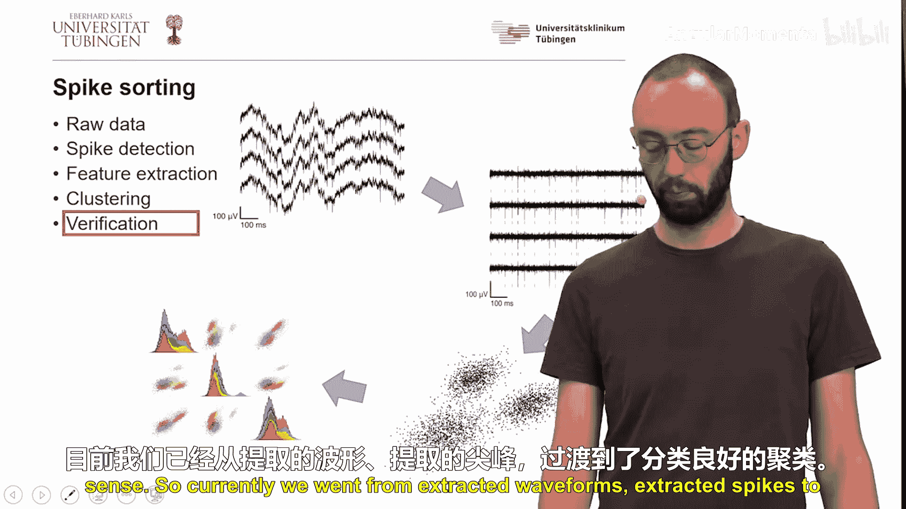

So， currently， we went home。Extracted waveforms。 Exed spikes。2 nicely sorted clusters。

 So you can clearly see that， for example， here on Cha 3， the data is much more homogeneous。

After being sorted into the different clusters。 So all the big spikes， for example。

 went into this purple cluster。Now， we would like to know which of these clusters that are just。

sorted by waveform similarity， which of these clusters actually correspond to signatures of individual neurons。

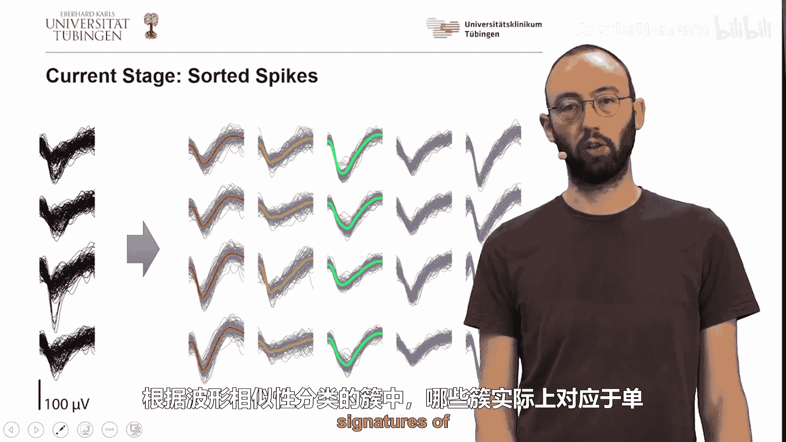

We can do that on the one hand， by looking again at the two two dimensional projections。

 the two dimensional marginals。Of the high dimensional data。 So remember。

 the clustering we did in a 12 dimensional space with three principal components extracted from each of the channels in parallel。

Here we only look at a subset of these features。The two dimensional projections along the first principal components on the first three channels。

You can clearly see。That the blue。Crusster here。Clearly， sticks out。

This can be well isolated from the rest of the clusters。

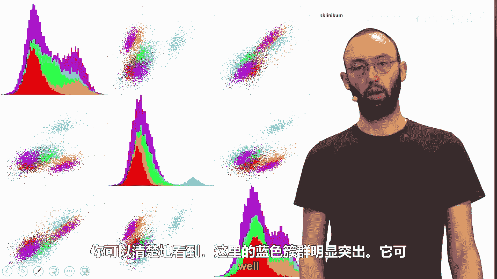

There's also a pair of clusters here。So this is the one that is well isolated。

 There's also another pair of clusters that is reasonably well isolated from everything else。

 but not so much from each other。 So let's look at this in more detail。

How do we interpret these cluster results。Not all of the clusters necessarily represent the spikes of an individual neuron。

There can be single unit clusters where a unit or a cluster really represents the spikes of one individual neuron。

 or multi unit clusters where signatures of multiple neurons have been grouped into a single cluster because they lead to similar waveforms。

We can understand that by looking again at this illustration of how Tero recordings work。

So neurons that are very close to thetero within a radius of a few dozen microns。

 they lead to very large signals to on thetero channels and often can be isolated。

Into single unit clusters。 But there's a larger group of neurons。

That are located in the larger radius around the tro。

And because they are more distant to the electro tip。Their signatures are damned quite a lot。

And often cannot be distinguished from each other。Here。

 we are only often only able to detect multi unit activity。

 So groups of neurons from one particular location。How can we evaluate。

Whether a particular clusterer is a single unit or a multi unit clusterers。

 we need to bring in additional biological knowledge。

One tool that we will use is the temporal structure of the spike trains。Namely。

 we will look for a refractory period。So if all the spikes in one cluster come from a single neuron。

Then they have to have certain pauses after each sp each spike corresponding to the refractory period。

Also， we will develop tools for quantifying cluster separation。

So what is the refray period to refresh your memory on that basic biological fact。嗯。

I here briefly explain again how action potentials work。

So this is the action potential waveform similar to what we extract。After simulation。

You have depolarization phase， a repolarization phase where the membrane potential falls again。

And then a refractory period where often the membrane potential also overshoots and becomes more negative than in the resting state。

What is happening is that。This is along the distance of the axon the。

Action potential is travelling in this direction。Here in the depolarization phase。

 we have the sodium channels opening。They in an they become activated from the passive state。

 the resting state。 they， they move to an activated state。

Then we have the potassium channels opening as well。Leading to the report ofization。And。

Then we have this refractory period because the sodium channels， after becoming activated。

 they not go straight straight back to a resting state。

 but they go to a deactivated or inactive state where they cannot be easily opened directly again。

And this is the physiological basis。Of the refractor period。

How can we detect that in a spectrum train。A tool to do that is the so called auto choreogram。

 or cross choreogram。So the cross correlation function is simply the convolution of two。

Time series with one another。Written like this。And because spike trains are。

Time series where events happen at discrete time points。We can reformulate the correlation function。

 simply as a histogram。Of the difference of all pairwise differences in spike times。

So how do we do that， So let's say we have two spike trains， this one and this one。

So we start in the second spectrum train。With this particular spike， now。

 we look at when relative to that spike， have all the spikes in the other spike train happened。

What are the differences in timing between this and the other spikes。

And then we add into these particular bins where a spike was， we add plus one。

 So we do a histogram and we add it up。 Then we move to the next spike。In our reference bike train。

And again， we count。In which of the bins， the different spikes in the comparison spike drain have happened。

 And we add the respective number to our histogram。And so on， and so forth。

If we do that with a spike train of a neuron with respect to itself。Then we call that autoogram。

What we can see in the autoer coreogram is a lot of structure。 For example。

 we can detect a refractory period if we do that at the。Proper time resolution。 So here。

The time resolution is much to course for that。Because this is on the scale of seconds。If we do that。

Between two neurons。Then this is the socalled cross choreogram。And this can be used， for example。

 to detect also some sort of coupling between neurons。

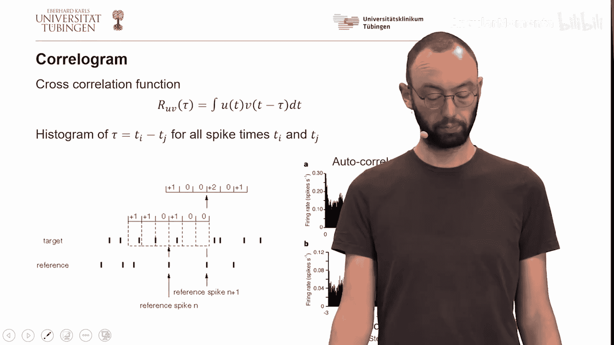

So let's look at the cross and autoer choreograms of our clusters。

 or at least of a subset of the clusters。What are features that are important to note here。So first。

This red cluster， the red cluster has a cross our autochoreogram， which is relatively flat。

And also doesn't show a proper。Pause in the middle。

 A pause here in the middle would be a signature that the refractory period is observed。

 No at the time scale。 This is now zoomed in from -30 to 30 milliseconds。

 So refractory period should be at least on the order of plus minus a couple of milliseconds。

 But there's nothing to indicate that this rest red cluster here has such a refractory period。

On the other hand。The orange， the blue and the pink clusterster all show evidence。

For a refractory period， you can clearly see this tro here in the middle。

Plus minus a few milliseconds。So all of these， we can retain as candidates for single unit clusters。

In addition， if we look at the structure of the cross choograms。For two arbitrary neurons。

Or for two arbitrary clusters， we don't expect necessarily to be much structure there in very。

 very rare instances。 And I show you on the next slide how that would look。

 One can find coupled neurons where spike actually leads to a spike in the other neuron。

 But this is not obviously the case seal。This year maybe could be a sign for that。

 but it's not strong in conclusive evidence yet。But what is striking。

Among these structures is that when you look at the joint。

Cross choralogram here of the orange at the pink cluster。 Then this still shows a refray period。

This is remarkable， because。Indicates that very likely the spikes in this orange and in this pink cluster。

 they actually come from the same neuron。Because。You may remember that the clusters of the orange and the pink clusters。

 they were also overlapping。 So probably， as we discussed last week。

 there can be factors like electrotririft or， or other things or also spike amplitude adaptation。

 So probably these were spikes from an individual neuron that changed slightly over time。

 and thus ended up into clusters。We can even form a further hypothesis for what kind of spikes they are。

 because the cross choalogram is slightly assymmetric。 So the pink cross coogram has a higher。

Bchel on the left side， indicating that the orange clusterster typically fires before the pink cluster。

So this might be a sign of spike amplitude adaptation over time。Okay。

 so now our summary of the interpretation of that slide is that the red cluster is probably a multi unit cluster。

The blue cluster is very likely a single unit cluster corresponding to an individual neuron。

 And together， the orange and the pink cluster form another neuron。

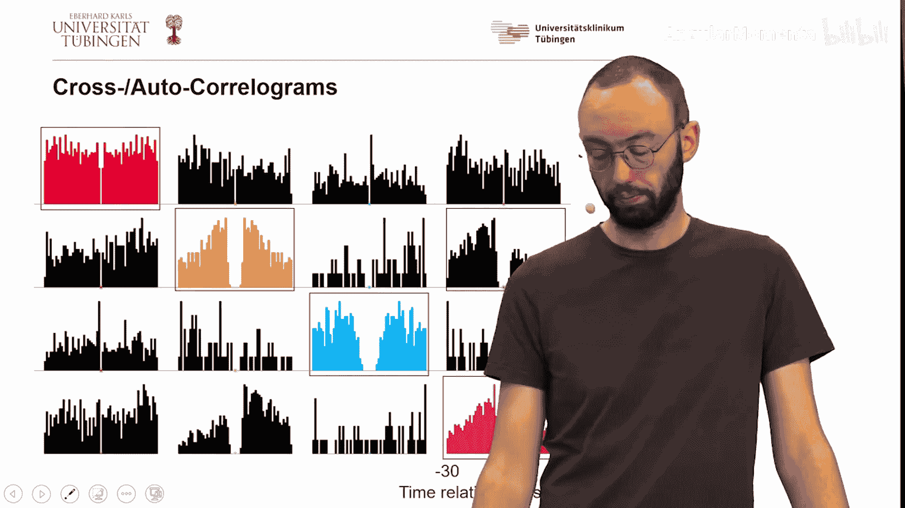

How would coupled neurons look like？ So here's an example。Reding from the group of Ser Bzaki。

With this first neuron and the second neuron here。And in their cross choreogram。

 you can see a very sharp。And very prominent peak。This would be a sign that you could identify。

Could interpret as a sign of coupling between these two neurons。As I said。

 there can be factors like spike amplitude adaptation。 And in this case， here。

 this is a neuron that fires bursts。 And the first spike in the burst is bigger than the later spikes。

 So a burst is just a very rapid sequence of spikes。

Or it could be such a tablet spiking cell where the initial burst just consists。

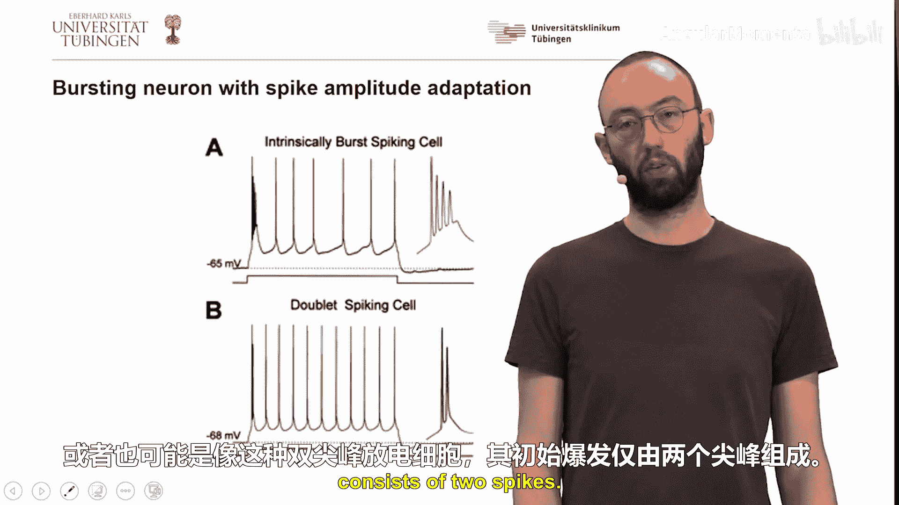

Of two spikes。

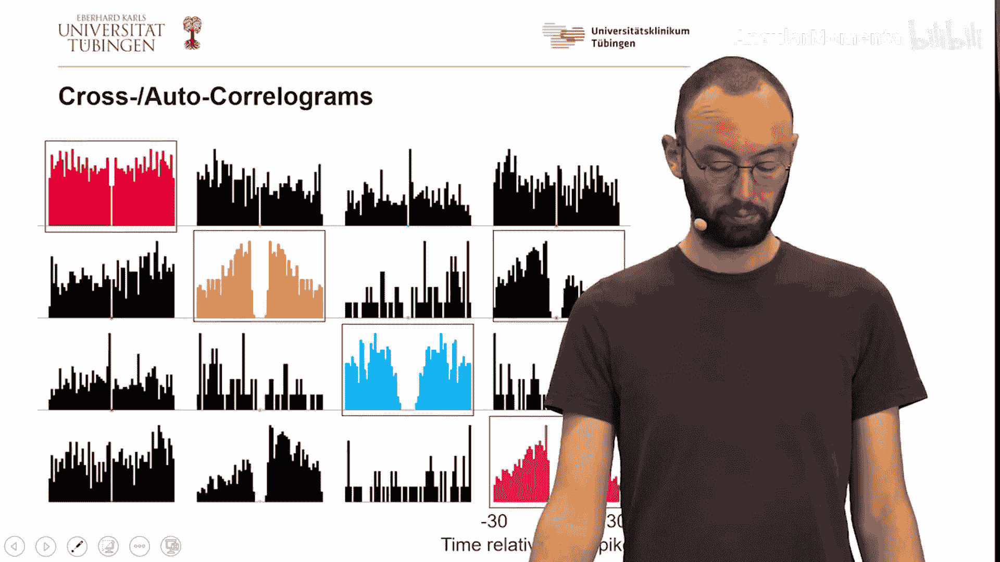

This also now， if we put this together， fits nicely together with our interpretation of the clustering。

 So here is the well isolated b neuroron。That also has a nice auto choreogram so that we would。

 after this analysis， except as a single unit。And then there's this pair of orange and pink clusters that also have these joint。

嗯。Altocorredoograms。And even the joint cross choreogram with a refectctorory period。

 So probably form a single unit clustered together。

This kind of pro post processing is actually typical for what you have to do even after an objective clustering procedure。

There's one more tool that I would like to show you。

 and that is how we could quantify the pairwise cluster separation。

So we will mainly use that as a tool for visual inspection。Namely。

 we will project the clusters onto a single dimension。

And then look at how separated the clusters are along that dimension。Now。

 which dimension should we pick， So we could pick this dimension， and that would be rather arbitrary。

So they would be separated like this here， the black and the。Red clusterer。

We could pick this direction。 Then they would be highly overlapping。

 or we could pick the optimal direction to separate them。

 And then they would be nicely separated like this。 So how do we find this optimal direction。

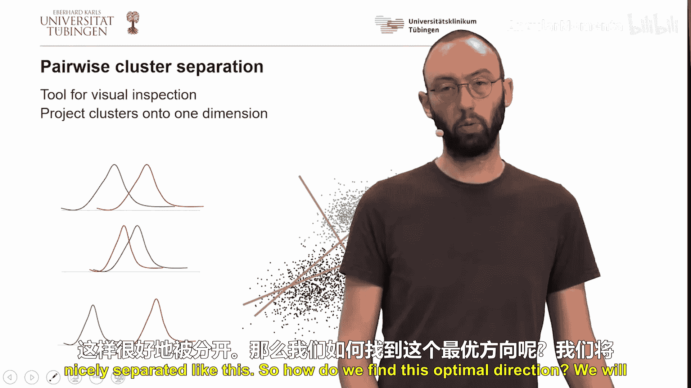

We will use a technique called linear discriminant analysis。 I will go over the details of this。

 very fast。But if you need a refresher， you can watch our machine learning one lecture from the winter term。

 which I will link to this you to this video。Okay， so linear discriminant analysis gives you a handle to compute the optimal direction in a high dimensional space that separates two groups of points。

It's。In the case where the two groups of points have an isotropicvari structure。

 it's actually simply proportional to the difference in the means。But if the covariance structure。

 like in this example is not isotropic， So not the same in all directions or slightly tilted。

 then you need to rotate rotate this line as well。 You can clearly see that if we just use the difference in means。

As a discriminant or as a low dimensional direction for projecting the data on。

 then they do have quite some overlap。In turn， if we rotate to the inverse of the covariance matrix。

Or the inverse of this kind of scatter matrix。 Then the two groups can be nicely separated。Here。

 we will simply use that as a tool for visual exploration， so we will compute。This direction。

For all pairs of clusters， project the data onto these。

 this one dimensional direction and then visualize the result。

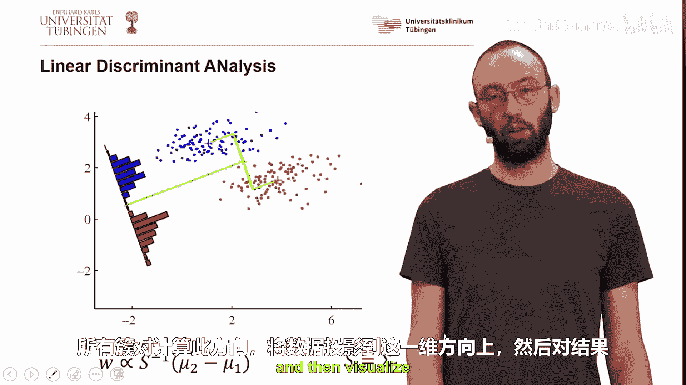

Can do that。 And it looks like this。So what this shows us is which of the clusters are really well separated and which are not。

So， for example， we can note that this blue cluster here is really well separated from pretty much everything else。

Also。We can see that the red and the the pink and the orange clusterer。 Let me look for it here。

That they are actually overlapping quite a bit。This is just a sanity check。 Doesn't provide。

Objective。嗯。Answers， answersers yet for that one would have to do a little bit of more computation。

 but it's a， it's a good visualization because in one dimension。

 we can argue but in higher dimensions， we cannot。Okay。Now。

 this completes our entire bike sorting pipeline。 So over the course of the first three lectures。

 we actually ran from raw recordings。We detected spikes， extracted spikes and extracted features。

 We performed clustering， and then we verified which of the individual clusters we found。

 which of these actually corresponds to biologically meaningful quantities like single neurons。

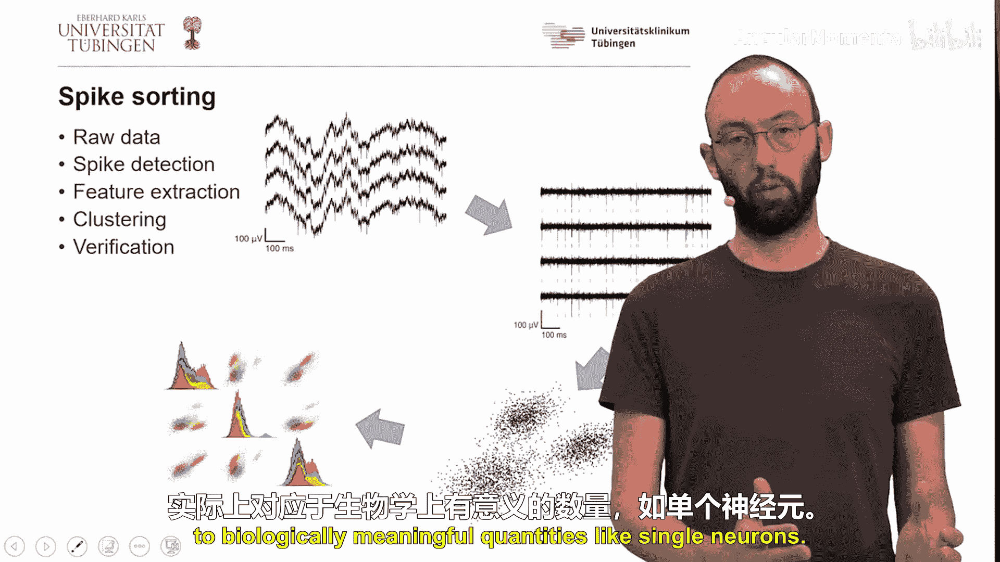

How can we。Benchmarks such spike sorting algorithms。 Does this actually a challenging。Field。

Because ground truth data is actually very， very hard to combine by。

 There are a few cases in the literature where people have gone through the laborious experiments and actually collected ground truth data。

 So what you need is you need simultaneous recordings of intra and extracellularly recorded neurons。

Technically， this is very challenging and has very low yield。Also， because there's a few data around。

 excessively relying on these ground truth experiments can overfit algorithms to few data examples。

An alternative to that would be to create synthetic data。

Where you can easily generate large amounts of training data。

 But the conclusions you can take away from that to some extent。

 depend on the degree of realism of your data。And， finally。

You can create hybrid data where you use real data， real recordings， but you manufacture real spikes。

Of real neurons into that， you inject them into your previous recordings at known times。

 And then you look at how difficult is it to get those back。

So let's look at some examples of these three strategies。

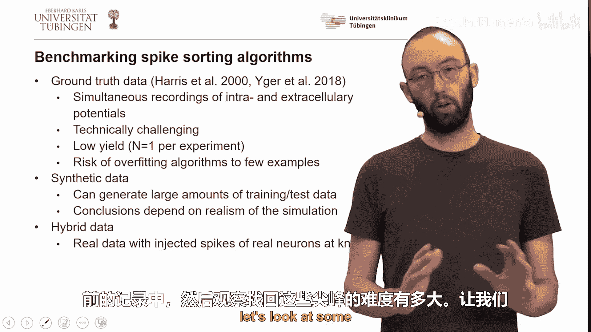

So in this case， the study by Ige and I。They performed multi anec array recordings from the retina。

They perform peak detection， like we did。They looked at a certain radius and used a template matching procedure with density based clustering。

And then an iterative procedure to identify the the neurons。

Now that I collected the verification ground truth data。

So the retina is particularly suited for that。 Here's the multi electrode array。

 There's the one layer of gangngion cells on top。And in the gangyian cells that they recorded on the multi electrode array。

 So this is the extracellular channels here。 See the time resolution。 These are 10 mill。

10 milliseconds。And up here， you can see the ground truth spikes。

So what you can clearly see is that these ground spikes here， they don't need to。

Signals on the individual channels at exactly the same time。

 But you can see a signature of these ground truth bikes。

At these two channels here then a bit later here and much attenuated on these two channels。

They recorded a few dozen of these neurons。

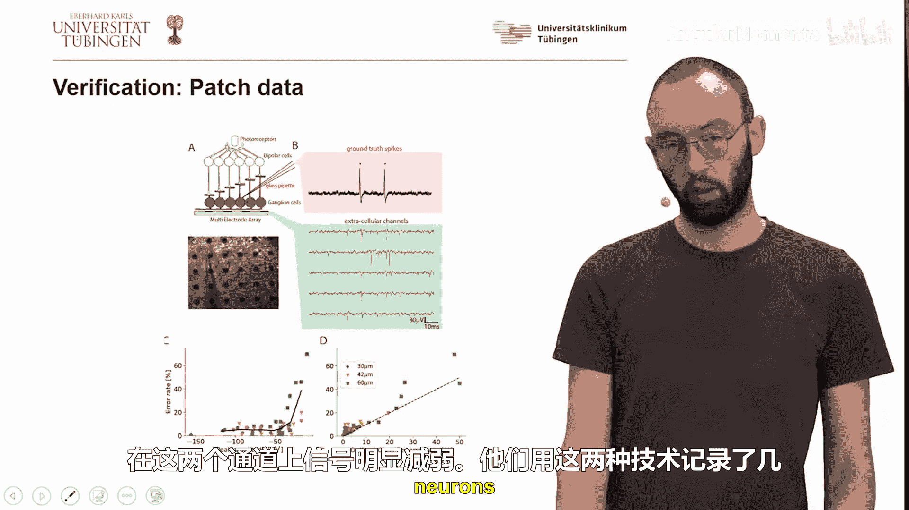

With both techniques。And by that， they couldn then evaluate how well the。Nurons could be recovered。

And to some extent， not surprisingly， the neurons that had the largest peak amplitude in their spikes so that had the most clearly visible spikes。

 they could also be。Recovered more easily。 And there was a certain threshold from which on。

The recovery rate or the error rate become much， became much higher。

Think one takeaway that one could。Take from that is that when shouldn't try to salvage single units。

That are really， really close to the noise level or to the multi unit level。

So this is really an objective evaluation of the， of the C of the algorithm。

An alternative would be to use synthetic data from simulations of tissue。So in this case， here。

 for example。The group by， by haging it al， they simulated a cortical column with many neurons in the。

 in a computer simulation。 they added noise。They added all the， the S simulations， the S。

 the spike simulations， the so voltage simulations。The extracellular potential and so on。

 And it added all of that together and used that for evaluating spike sorting algorithms。

They use these， these highly detailed pyraidal neurons for the bulk of their simulations for getting。

 getting the the action potentials and the extracellular waveforms， right。

And they created recordings， artificial recordings such as this。

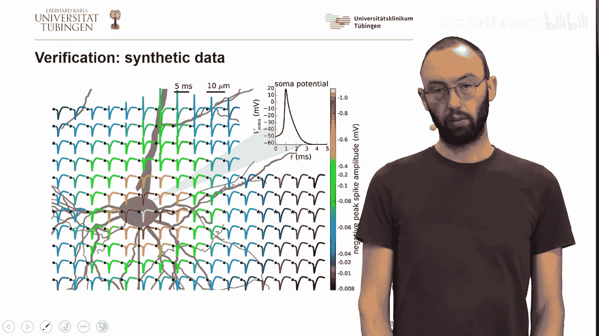

This can be very useful， but empirically， it actually turned out that it's very hard。To。

 to mimic the realistic properties of noise。So。You can download also the s synthetic data is's all available online。

 But when you， when you look at it and you compare it actually to real data， there's。

 there's quite a difference in there。 So the conclusions。

That you can draw on your particular spike sorting algorithms。

 It may be hard to transfer them to real data。So currently。

 at least just the synthetic data is not so easy to come by。

 at least not inequality that is sufficient for benchmarking a spike sorting algorithm。Finally。

 there's this approach of creating hybrid data。So synthetic data doesn't appear to be realistic enough。

 especially the noise properties。 So why not just use。Donor cells， donor neurons。

 where we have a known spike waveform that we can also quantify。

And injected copies of that spike waveform。Copies of the spike template。To an acceptor neuron。

At no times。 then we ask。Can we I extract those back。

 We can simulate a little bit amplitude variability and drift。We can control these factors。

 We have full control over， over what we do。To the， to the donor specs。And then， but the。

 the noise structure of all the background of all the other neurons in there and so on。

 this is exactly as it would be in a real， in a real recording。This is actually a quite。

 quite good approach If you want to benchmarks by exing algorithms at scale。

 or we can use biological factors outside of our clustering procedure to verify what we did。

And we discussed。3 different techniques to benchmarks by exing algorithm， including。

Ground truth data。Simulate data。And hybrid data where we inject spikes of a known neuron into real recordings。

This concludes this kind of first chapter of our lecture。

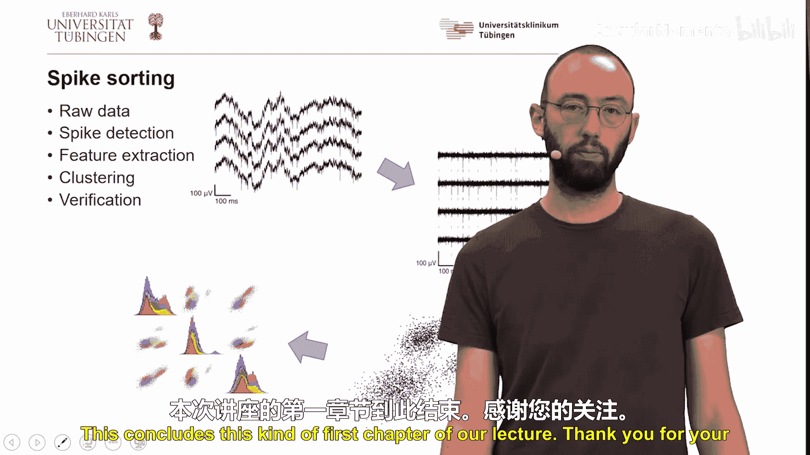

Thank you for your attention。

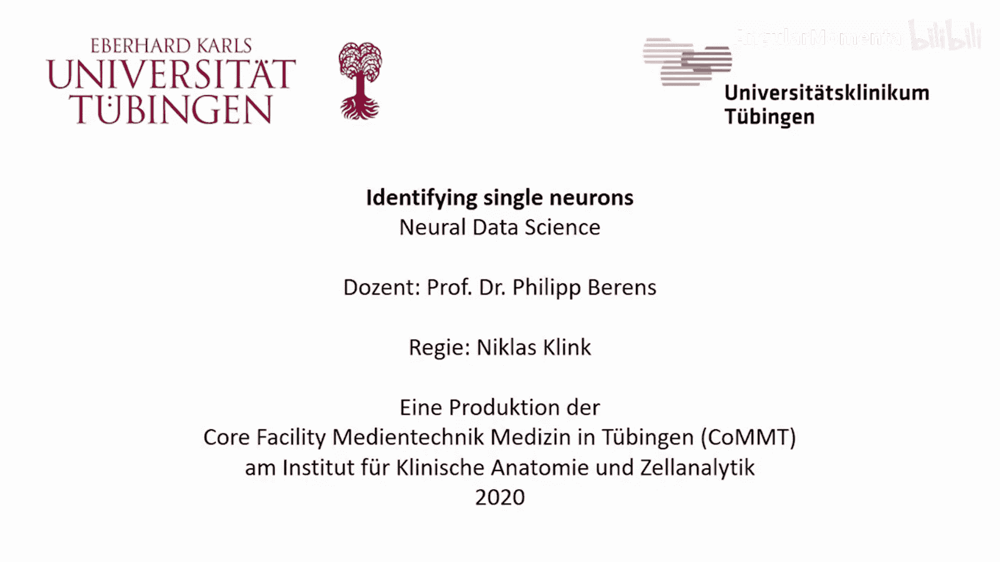