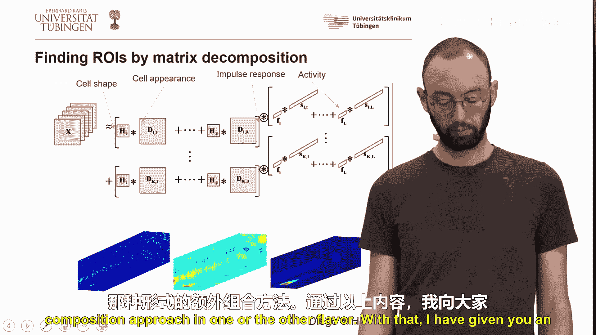
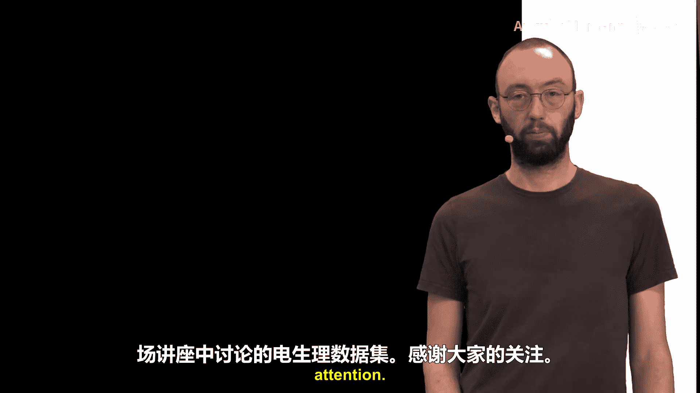
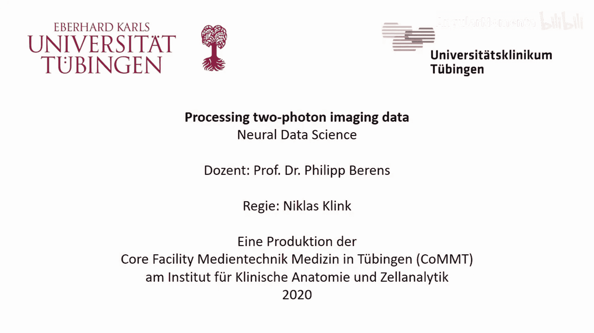

# 【精译】蒂宾根大学《神经数据科学》-p04-04-钙数据中的脉冲推断--BV1DEYozGEMW_p4-

。Welcome to the fourth lecture in the lecture series neural data analysis。 Today。

 we will talk about how to pre process two photon imaging data。As a reminder。

 in the last few lectures， we talked about a pre processingces chain for electrophysiological。

 extracellular recordings called spike sorting。 So we went from raw data to sorted spikes。

What are the limitations of such extracellular electrophysological recordings。Well， on the one hand。

 you can record only cells that actually fire action potentials。

So we will probably bias your estimates of the average firing rate or the average number of neurons that is active at any given point in time。

 You will bias that upwards。Many cells， especially in cortex， are actually silent。

During a wide range of stimulation conditions or tar or behavioural tasks。

And these you cannot capture with electrophysiology easily。the。

 a second problem may be that you can only record cells that are very glow， close to your probe。Also。

 you get limited information about the spatial layout of the cells。And finally， it can be hard。

To obtain cell type information。 So today in many experiments， we have c lines。

 we have genetically modified animal lines where we can express， for example。

 a fluorescent protein in a certain cell population。 And then during with two photon microscopy。

 we can easily identify those types。 So， for example， we can find all paral positive interne。

 which is a specific subfamily of of interno and just study what they do。

For electrophysiological recordings， this is possible。In principle， using， for example。

 of the genetic tools， but a bit more difficult。So， therefore。

A complementary technique has emerged over the last。20 years or so， called to photon imaging。No。

It's almost as widespread as electrotrophysiological recordings。

The principle of all two photon imaging experiments is pretty similar。

 I will only very briefly sketch it here。You use a calcium indicator that you bring into a cell。

In early days， this was typically a synthetic dye， like O GB1。

This is still a very good dye with a very good signal to noise ratio。

 You can see here that if you have that die inside of cells。

You can very clearly see their cell bodies here in green。In this particular example。

 the red or the orange dye stains glal cells。Then， inside the dye。In the cell。

 the dye binds to the intracellular calcium。And changes its fluorescence。

In response to changes in the intracellular concentration in calcium。And this process。

 So the fluorescence， you can measure using two photon imaging。

 So you have a laser that excites the fluop4 inside the dye。And then you have a receiver。That。

 that measures the emitted flu reescence。You can see that over the time course of such an experiment in multiple neurons。

 you can see how the， the fluorescent changes over time。

The reason this is interesting is that the intracellular calcium in the cell。

 that this actually changes as a function of the activity of the cell， even neuro spikes。

There's an influx of calcium into the cell。Such that the concentration of intracellularial calcium increases。

So the fluorescence is a proxy measure。Also an indirect measure for the activity of the neuron。

So you can see these relatively sharp blips here。But mind， the time scale。So typically。

2 photon imaging is at a slower time scale than electrophysiological recordings。

In electrophysiological recordings， you can sample with a few kilohertz。

 and you can record spikes with a precision。Of submit milliseconds。In photo imaging experiments。

 you typically record with a maximum recording rate of a few hertz。Or a few dozen herz， maybe。

And spikes cannot not be as precisely located as a consequence。

This is also because the underlying change， the dynamics of the calcium signal。

 they are much slower than the actual voltage signal。

So how are calciums and spikes precisely related one can do similar ground truth experiments。

As we discussed in the case of the spike sorting。So we can go with an electro tip under the guidance of the 24 gra microscope。

 we can go adjacent to a cell。And then perform set attached recordings。

 So here we see one action potential， two action potentials。

 And you can see that there are corresponding signatures here。In the， in the signal。

And you can also see that the blip for the two action potential is slightly bigger than that。

 for one action potential。And this is also systematicly true。 So one action potential。

 two action potentials，3 action potentials。This almost seems， at least at a very first glance。

 See seems almost linear。In recent years， there have been also a myriad of genetically encoded calcium sensors。

That can be expressed genetically inside of a cell。

The big advantage of that is that under these circumstances。

 you don't have to bring the synthetic dye into the tissue and into the cell with a specialized technique。

 but the cell reduces the calcium sensor itself。And you can relatively easily express the calcium sensor only in a subpopulation。

 For example， the pav in into neurons that we mentioned before。

There's also downsides to that procedure because the calcium sensor also acts as in calcium buffer。

 and there's evidence that this can actually change developmentally the signaling of the cell。

So one has to interpret also to for imaging experiments and outcomes with a grain of salt and with some caveats。

Also， these genetically encoded。Consum senses。Clearly。

 show a behaviour A relationship between spikes recorded down here。And calcium activity。

 This one is a calcium sensor called G Cam 6 S， which has a bit slower dynamics。

 but very good signal to noiseisy ratio。 And this is G Cam 6 F， which has somewhat faster dynamics。

 You can see here， typically the roll of of these calcium events is a bit slower faster than appear where slower。

Now。Recently， also， it has become possible to perform really large scale imaging。In this case。

 of more than 10000 cells。Simultaneous， simultaneously。

In calcium imaging always means that the laser rusters throughout， through the images。

 And in this case， also through multiple layers。So it's only quasi simultaneously。

That this imaging is performed。So these 10000 neurons。

 they recorded with a sampling rate of really only a few hertz，2 Hz or so。

 And they very quickly had a had a mechanism by which they could very quickly change the depth at which they recorded。

 And this allowed them to recover that many neurons in a single experiment。In this case， of course。

 it's entirely impossible to draw， let's say， a region of interest on each of these。

On each of these cells。So the two questions that that typically arise during post pre processingces or post processing。

 as you want to call it of two photon calcium imaging data on the one hand。

 to identify the cell bodies or regions of interest。 And on the other hand。

Infer from the signal that you recorded。Back the spike train。 So from the calcium signal。

 you want to know when where the spikes。In small scale experiments such as these。

 where in a field there are about 80 neurons， you can go through the laborious process and。

 in principle， draw all of the ros manually。So this is a paper that I contributed to and there we did that We did。

 in the end， we did many， many experiments recorded over 10000 cells。 But now。

 if you record in an individual experiment more than 10000 cells， you cannot do that。

 do the processing manually。 You need some automated algorithms to do that。Similarly。

 if you want to go back。From the calcium signal to the spike chain。

 you need to do that in a quantifiable and automated fashion。

Keep in mind that it's not necessary to do that。 for many applications。

 it's actually totally sufficient and maybe even better to simply analyze calcium signal and incorporate them as they are。

We will start with a second step going back from the calcium signal to the spike drains。

This has been A a process that， that has fascinated people over the last。20 years basically。

 since two photon imaging has been around。And we will start with a very， very simple model。So in a。

 in a very simplified calcium imaging model， we have a time series of events。And we model each。

Calcium event， we simply model that。And the linear convolution with the calcium kernel。

That calcium kernel has an exponential shape， and typically with a tower with a decay time of about 500 milliseconds or for most common dyes。

So then we convolve this time series of events with this calcium kernel and add some noise。

 So we get an artificial calcium signal。This is a very note that the。

 the rate in this example is very high。 So one cannot resolve the individual calcium events very nicely in that particular recording。

Now， how does that look if we have this kind of spouse bursting behaviour with just a few action potentials。

 then this looks a bit like the recording I showed you on the other slide。

If we have continuous firing， you have this kind of ramp up。If you have faster continuous firing。

 they all go into each other and you get this kind of calcium saturation。If you have random spiking。

 then， of course， you'll also get random fluctuations in the true rate。And in the curs same activity。

Basically， the， the rate function here is a linearly convolulved。

It's linearly convolved with the exponential calcium kernel to obtain the red function。

 So this is simulated data。Now， how can we go back， basically the idea to invert the forward model？

So， we simply deconvolve。Our calcium signal。By the inverse kernel。

 so we can compute because everything is linear in the Fourier domain。

We can compute the inverse forier transform。Of the inverted of the kernel。

 giving us an inverted kernel。 and then deconvolve with that inverted kernel。

 the convolve time series。To obtain bank something that should ideally resemble the time series of events。

Now， note that this inverted kernel looks a little bit like a temporal derivative。

A specific algorithm。That is proposed in the em Yazi paper that I just based my。

Presentation on would be to first low pass filter the。

The signal again to remove some high frequency noise。

And then use an additional custom built iterative local averaging procedure that they describe in the paper in detail to remove noise below a certain threshold。

 So the reason is they don't want these little noise events。

 they don't want those to trigger the inverse kernel to produce artifactual spikes。

And then they deconvolve with an exponential kernel。So there are few open questions also with that。

 very simple algorithm。So how would you find the right time constant for the calcium kernel for this exponential kernel that you need to deconvolve the data with。

You can do that by trial and error。 It's just a single parameter。

 but you need some data to calibrate with some ground truth measurements。Also。

 this algorithm only allows you to reconstruct low pass filtered firing rates。

And sometimes it can produce negative rates， as we will see in an example。So here。

 the reconstruction actually works fairly nicely， but mine， there's no noise。 But even there you can。

 or hardly any noise。 But even there， you can see that this produces negative firing rates。

 which is not desirable。 This is also the case here。For these two examples。

 where the rates are fairly high， the algorithm works also fairly nicely。This， of course。

 simulate data。On real data， this algorithm is unfortunately often not sufficient to produce good estimates of the spike rate。

So how can we go on。We can use a bit more complex model。And I will explain that now， step by step。

Our measured fluorescence。FT。We model that as a function of the calcium data。Time some scalear。Plus。

 an offset。 plus noise。And the temporal evo evolution of the calcium signal。

We model as this kind of difference equation。Where N T is an innovation term that comes in from the spike train。

These are the， these are the actual spikes。And we assume that these areisson distributed with a rate of lambda times delta。

 where deelta is the size of the time window。And we further assume that， because。

And is from a persona distribution that this comes from the natural numbers or a 0。

This is how the simulation of this as a forward model would look like。

 So here we have the individual spikes。Then here you have these innovations through the occurrence of the spikes。

 plus quite a bit of noise in that particular simulation。Now， how do we invert that model？ Well。

 what we want。Is we want the most likely spike train？So， the maximum。嗯。

Of this quantity here so the probability of a spectrum， given the fluorescence。

The measured fluorescence。When you， when you look at that and do some， some math。

 you can write it down like this。 So this would be maxim， the maximum a posterior estimate。

 So this part here is just simply due to you wanting to fit the fluoreorscent stresss and your Gaussian assumption on the noise。

But then this later part here comes in。 and this is from your consoleson prior on the spike train。

The problem occurs with that latter part here， when you take the logarithm of the factorial of the number of spikes in a particular bin。

 and this is not bounded。From above。 So therefore， this can be very hard and inefficient to evaluate。

So you ha， so therefore evaluating that ex entire expression and actually searching for an optimal spike train。

 especially over。The if we want the entries to be from the natural numbers can be very inefficient and cumbersome。

 So this cannot be optimized easily。 So what do we do。We compute an approximate solution。

 So we still try to maximize this posterior。 But instead of using this posor prior。

 we relax our assumption that the spike chain has to come from the natural numbers。

But we allow it to be continuous， positive numbers。So we just。Put instead of a poisson prior。

 we just put an exponential prior over continuous spike trains。In this case。

This last part looks a little bit differently， and can be easily evaluated。

Then this is convex in the spike train， given that the remaining parameters are fixed in the paper。

 they use so called interior point optimization methods because you have the threshold。

And then you iterate solving for the spike train by fixing the other parameters。

And then solving for the parameters， fixing the spike train。This procedure actually works quite well。

So here's a a sd data set。With the spike trains。 And if you use this here labeled as fast filters。

 what is nice compared to the decoconvolution approach down here is that it continuously only produces spike train estimates that are positive because this was put in as a constraint。

But also the spike times here are actually fairly nicely located。

One can even extend this model further。To an algorithm called M L Spike。 What they did for M L Sp。

Is they use the same basic model， but they allowed for a drifting baseline flure。So they allowed for。

 for sort of long term low frequency drifts in the calcium baseline， which often occur in recordings。

And they allowed for variation。In the calcium。Signal amplitude。For example， they。

 some of the indicators have the properties that when there's a lot of spiking happening。

 that the action potential amplitude that they find in the calcium that diss saturates。

Or sometimes it may also increase superlineally。And these properties saturation or super linearity。

 they can both be modeled。In this extended model。So。They derive actually。

 a very sophisticated optimization scheme using a Vitabi style back recursion。

For the latent calcium trajectory， and the spike times。If you go to the paper。

 you can actually watch a nice movie that is very illustrative。Of how this algorithm works。

 So they start in the beginning。And they go back and always compute what is the most。

 what is the distribution over different trajectories of the calcium signal。

At any given point in time， given the remaining signal。AndThey do that here as well。

 And then you can compute through that， an optimal trajectory。You can also。

 they develop a set of heuristics for estimating the parameters of that model。So， for example。

 because they know that there's only one spike， two spikes，3 spikes。

 they look at the transient amplitude histogram and simply fit that。

With a multi peak histogram to get an estimate。Of the spike amplitude in the calcium signal。

They also collected huge amounts of ground truth data， and very different data sets。

Collected using OGB， using different genetic indicators， and so on。And across all of these。

 this extended algorithm actually works quite well。

 So here you can see such an example of a drifting baseline。 So it stands a bit higher。Then later on。

And you can see that these recordings here are much more noisy than， for example。

 these recordings appear， and yet the algorithm is able to deal with all of them in a good way。

All of these algorithms that I showed you so far， they start with a generative model of the data。

 They， they start。With a model where you specify how you think statistically。

 at least or semi mechanistically。The measure data has come about。

They're informed by the biophysical process of how bikes influence the intracellular calcium。

 and then the fluorescence generation process。And。From the first model by Yai and Fri to the model by Ste Deu。

 this becomes more complicated。 And algorithmically。

 they're able to deal with more complicated components in those models。However， there's also。

Another approach that one could use that is quite different and pretty much agnostic to all the biophysical details of how the signal is being generated。

And that would be to resort to supervised learning。So by now。

 we have quite a few data sets available that are apparent recordings of calcium activity with。

With a set attached electrode。So we could use these to learn a regression function from features of the calcium activity back to the spike train。

😊，This is something that we proposed in a paper in 2016 with a colleague。So， we。

Specify like likelihood function that is also parceson。

And we say that the rate of that poisson distribution。

 that this is parameterized by a small neural network。In this particular case。

 it's only a kind of a two layer neural network that looks like。

 looks like this with multiple filters and some， some quadratic non nonlinearities in there。

But people later on， also took that further。If you do that。

It turns out that you can infer the spike grid actually quite well， so。

This is the algorithm that I showed you in the beginning。 Just simply clip to only positive values。

 You can see that in real data， it actually produces a lot of background noise。

This is the second the blue line here is the second algorithm that I showed you。

 It's already much better。 And then our estimate is this black line。And we show that。This， actually。

 for a wide range of data sets， produce the state of the art estimates。

Off bike train reconstruction accuracy at that time。Now。

 we wanted to know how hard can drive that and which of these two approaches supervised learning versus generative modeling。

 which of these two approaches is actually better。So we organized the so called Spikefiner competition。

The Spfinner competition had a run time of six months。 We had some sponsored。

 sponsored awards and more than 50 submissions， in the end， from teams from all over the world。

We collected all the results in a big table。And then， later on。

Evaluated the best of these algorithms in detail。So we published the results of this competition in a paper in 2018。

And we included in the paper all algorithms that produced results that were actually better than our small neural network at that time。

So this is the correlation coefficient。Between the true red。And the inferd rate。

And of sampling frequency of 25 Hz。 So relatively high， sampling frequency， but also not crazy high。

The first thing to note is that no matter what you do。

The correlation coefficient at that timing accuracy is actually fairly low。

So point5 means really that there's only a  point。5 correlation between the inferred spike rate and the。

 the true spike rate。But you can also see。 So this here is our algorithm。 This just for reference。

 is the。The， the second model that I explained before。 So all of these improve on our method。

 even quite a bit。 Many of them work as well for the OGB and the Gcam data sets。And actually。

 there was a group of algorithms。Of， of about 5 or6 algorithms。

That were statistically indistinguishable from each other。Interestingly， know。

This group of algorithms。Contained。Both purely data driven， deep neural network based models。

But it also contained generative models。 Among them。

 the ML L Spike algorithm algorithm that I introduced earlier。

We found that some of the deep neural network based algorithms that they had actually overfit quite heavily to the。

To the training data。 So this is something to really be aware of if you have to train a network with little data。

But many of them did， did quite well。 And from both classes of algorithms in the same manner。In fact。

 when we。Looked at。Whether all of these algorithms， even the different kinds。

 had learned similar things or different things。Could be。

 in principle that the data driven algorithm had learned some part of the structure intergenerative model algorithms had learned another part of the structure。

 But we found that the correlations between the predictions。

Of all the algorithms that were there were really quite high。So to our surprise。

 there was no clear winner， neither the data driven nor the generative model algorithms。

And possibly in the future， merging these two approaches。

Can yield even better results with more and more data coming about。Okay。

 so now we discussed how to infer spike trains from the calcium signal。 And as a next step。

 we will talk about what really in the processing chain comes before that。

 we will talk about how to identify cell bodies or regions of interest from the images that are taken during two photon imaging。

One problem that you can have during that process， especially in。

 in cortical tissue or imaging in live animals， is that of motion artifacts。

 So this is a reference image here。 This is a particular frame。Of activity。

And if you look at the different images， different images between them。

 you can see that this blob here。That should correspond to that cell is a little bit shifted to the side because the corticker tissue。

Can change over time。 It can pulate。 The animal can move， and so on。

This distortion can be different for different places in the space。

So we need a motion correction algorithm that is actually capable of doing that。

If you simply compute the cross correlation。Between the， between the movie frames。

 then you get a fairly broad peak。But there's a technique that is also quite commonly used in computer vision algorithms called face correlation。

 But you compute the correlation in the， in the Fourier space that yields a much narrower peak。

So this explanation here is simply taken from Wikipedia。 But I think it's actually quite good。

 So for two input images， G and G A and G， B， you simply compute the Fourier representation of these images。

Then you calculate the cross power spectrum between them。

And to obtain the normalized cross correlation， you simply take the inverse Fourier transform。

And then to， to detect the shift between the two images， you simply find the peak。

So why does that what we want。You can show。It is actually not so hard。

Is that if you shift the images。Then。The maximum of this correlation function will be really a delta function。

At the location of the shift。Because the distortions can be different in different parts of the space。

We need some way to re recover the transformation in a non rigid way。

 So we need non rigid motion correction。 So we do the motion correction in many overlapping squares and compute such a。

Forier transform based face correlation map for each of these。You can do that， for example， here。

 you can see for each of these small patches in an example recording， you can see。

These different maximuma。 And when you plot。The， the movement as an error。

 you can see that there was this kind of movement across space with both the direction and the magnitude pointing to towardss different directions。

Once we have done motion correction， we cannot now take this entire space time blo。

 So this entire structure or entire movie。And try to find regions of interest。Again。

 there are algorithms that are more inspired。By the generative approach or algorithms that are more inspired by a data driven approach。

 the generative modelling approach is exemplified by this year。So here we say the movie is generated。

嗯。By a set of sources corresponding to cells。And these cell appearances。

 they are in these little filters age。They are placed at locations where this is a location mo。

And then over time， they have fluorescence templates。And spike trains。

And if you multiply all these things together in a three dimensional form， you actually， in the end。

 get a calcium movie。Now the challenge is again， to go back and invert that process。

So does the cell shape， does this the cell appearance where it appears。

There's the impulse response and the activity。An alternative approach would be to find these regions of interest using commonly used computer vision D。

 D N Ns that can simply segment the cells。This also has been done。

 but it's actually much less prevalent。 So current， the main current tool boxes。

That are around for processing calcium imaging data resort rather to that matrix stone composition approach in one or the other flavor。

With that。I have given you an introduction to pre processing of two photo imaging data。

 to complement the electrophysiological dataset sets that we have talked about in the last three lectures。

 Thanks for your attention。

