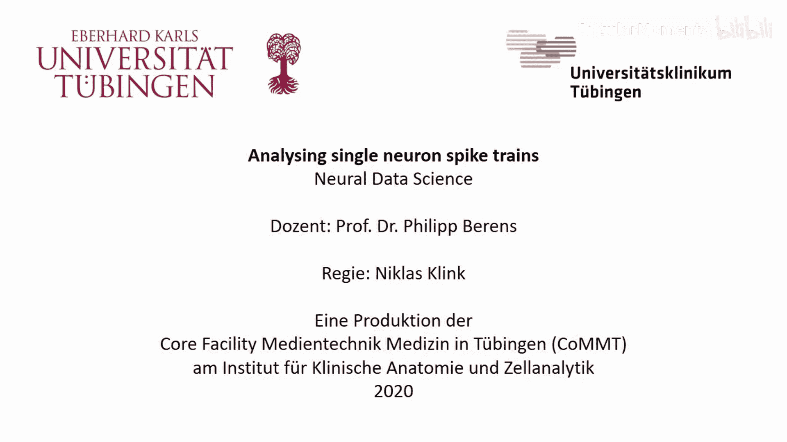

# 【精译】蒂宾根大学《神经数据科学》-p05-05-分析脉冲序列--BV1DEYozGEMW_p5-

Welcome to the next lecture for our lecture series， neural data analysis in the summer term。

After the last three lectures。4 lectures， where we talked about pre processingces neural data。

 So going from the actual raw recordings to something that we can later work with。

 we will start now talking about what to do with the data then。Today。

 I will show you a little bit how to analyse single neuron spike trains and what to。

 what one can do with that kind of data。We will talk about visualizing spike trains and ra plots in peri stimulusulu time histograms。

 We will talk about how we can identify simple and complex cells。

And we will talk about how to summarize neural activity， as tuning curves。So for orientation tuning。

 for direction sensitivity activity and also develop a statistical test for their significance。

In many cases， such tuning curves are used to summarize the relationship between some external experimental variable of interest and to spike rate。

So before we start and go into details。I would like to briefly mention some general strategies for analyzing data。

Please， please， please always look at raw data。 If you want to visualize relationships， let's say。

 between the direction of a stimulus and the spike trains。Visualize the spikes。

Don't directly fit tuning functions or compute some tuning indices or something like that。

When you have looked at the raw data。For quite some time and convince yourself that the effect you're interested is really there。

Then you can also compute summary diagrams。But often in appations。

 students show me direct plots such as this。So let's say you have two conditions and you have a bunch of different populations。

 And then I get a summary plot like this。 This is very hard for me to， to read and for you， as well。

You need to， to argue your case。 You need to use your data to tell a story that then in the end。

Can be certified or verified with a statistical analysis， but the data should show you。

The effect that you're interested in。We will base this analysis on the data that we already analyse during the first three lectures and exercises。

So it will be the electrophysiological recordings that we have。During these recordings。

A stimulus was shown to the animal， a drifting cr graating presented in trials。

 So over multiple repetitions。There were about two seconds per trial。

The stimulus was a gring such as this moving in 16 directions of motions with the details of the specification given here。

So， the first。And simplest way to visualize the spike train data is to simply sort the recording。Bai。

The direction that was shown during a particular trial。

And kind of align them on the onset of the stimulus。 So this is what we did here。 So at 0。

 this is the onset of the stimulation。And we simply grouped the blank trains。

For the direction that the stimulus was moving in。 So here this is 0 degrees，22 degrees。

45 degrees and so on and so forth。What becomes directly apparent is that this particular neuron doesn't fire for all of the directions and orientations。

 So for large parts。Here。😔，Of the data screen。It's pretty empty， hardly in spikes。

 except maybe for one or two spontaneous ones。In fact。

 this particular neuron only seems to care about directions of motions of 22 and45 and 202 and 225 degrees。

And this direction is even a bit more preferred than this direction。Also。

 we see that kind of wavy response structure， which we will discuss more later in the lecture。

We can now convert these spike trains into a so calledled peri stimulus time histogram in a peri stimulus time histogram。

 we。Align the spike trains， again。On the。Onset of the stimulus。 So this is 0。

 So time is here always measured relative to stimulus onset。

And then we do a histogram with reasonably small bins。

And simply count how many spikes are there in each of these bins。If we want。

 we can then further smooth that histogram to obtain nice curves or something called also spike density function。

So we have repeated measurements of a spike trains with a reference time to align on。

 it can be stimulus or onset of a movement or a sad。

And this allows us to then visualize the event related single neuron dynamics in the firing rate。

We can also do such a population rest plot， such a rest plot for a population of neurons or simultaneously recorded neurons to look at the population dynamics。

So for example， here， these are not trials， but cells， and at this time。

 and we can see that there are periods where all the cells jointly are active and periods where they are all are relatively silent。

This is a very related concept to our single neuron rustster plots and single neuron peritimulus time histograms。

So how do we computes？Let's focus on the Per stimulus time histogram up here first。

Here we compute the average firing rate in a bin and possibly smooth them。

The red here are the different spikes。 And then we divide time into relatively co bins。

We count the number of spikes in each bin。Here it's higher， bit lower。And so on。

 And simply plot that curve over time。 If we smooth it， we get a curve like this。Of course。

 in real life， you would probably make these bins much smaller。

But you always have to balance how much data you have to actually estimate the spike rate in these bins accurately。

You can also directly compute a spike density function or a kernel estimate of that spike density function。

By placing little。Chronnal templates。On each of these spikes and then computing the sum over them。

 And this would result。In a smooth， spikegrade estimate， such as this。

Both of these are valid approaches that each can be useful in different scenarios。

 and are very related。Is there a principled way to select the size of the bin， the bin red。

In practice， this is often a matter of going back and forth between different bin ws。

 And because this is mainly a visual exploration tool。

 then using one that brings out certain features in the data。

But we can also think about is an optimal strategy to do that。So if you have a rate function here。

Then in a particular bin of size delta， your estimate of that rate function， we call theta。

So this is the average。Of the rate function in that particular bin。Now。

 our estimate of that average rate Theta had。We simply compute as the number of spikes。In the。

In the bin。So how can we select an optimal bin size？ Well。

 we divide the observation period into n bins of with deelta。

 and then we count the number of spikes from all the trials into that particular in that particular bin。

Then we can compute two numbers， one。Is the。Average of all the the spike。

The average of all the M spike ride in these bins and the variants。

Then we can compute this quantity here and search for a data that minimizes this cost function。

And this cost function optimizes the mean squared error in estimating the average。This average。

Distance between Theta and Theta had。Okay， so how does that look。

 So here is an example of simulated data with an underlying rate function。

 Some simulated spike trains。 You can note that the spike rate here is fairly high。

 and the number of trials is also fairly high。And now if you compute a histogram where the delta sort of bandwidth is too small。

Then you will also get a P PSDH that has quite a lot of variability and is a bit zang。

If Delta is too large。On the other hand。You will miss a lot of structure in the data。 So。

 for example， these later fluctuations here are completely hidden by the large bins。

The optimal delta is somewhere in the middle。So if you plot just the cost function against。

The pin size， you can find that there's an optimal delta here。 And this is what LED to that plot。

 And indeed， in this case， it seems to bring out the structure quite well。

You can also do that for selecting the kernel width。

So if this is the underlying rate and these are the spike sequences。

 then the kernel width can be either too small。 Then you get here structure in the data that isn't really there。

 It's highly variable you estimate。It can be too large。 In this case， it would smooth out the entire。

Sep rides in the firing rate at the beginning here。Or the optd W， in this case， looks as。 And again。

 this can be implemented in terms of a cost function。

 which can be derived from estimating the mean square error of the true average rate in a certain time window。

In you will be implementing one of these approaches in your， in your programming homework。

But you will also realize that in， with real data， it's often not so easy to apply them。But。

But they can give you a good indication of where to start your search for a suitable parameter for your PDH。

Especially when you have a large number of neurons。

A problem with these PDH approaches is that sharp transients are often blurred。 if you have。

 for example， like here the。The， the bin edge。Not where the transient occurs。

And this is also true for the spike density function approach。And also。

 you have to estimate a lot of parameters。 So basically the rate in each of these bins is a parameter of the model。

 So of your non parametric histogram model。And for many of these。

 the rate actually is quite constant。 And yet you have to spend a lot of parameters。

So there are some techniques that have been suggested for dealing with that。

 And one of them is called Bayesian pinning。So in this case， you modeled the PSDH。

As a sequence of intervals and within each of these intervals， the firing rate is constant。

So this allows us to write down。嗯。嗯。A probabilistic model for the PD H。

 And you use Bayesian inference with dynamic programming to optimize that model because you have to optimize both the parameters。

 the rate estimate with image of these spins， and then also the bin borders。So here。

 the Ks and the F's。This can actually work quite nicely。 And instead of estimates such as this。

 which here has the kind of the bin at the wrong place or smooth out edges。

 it actually can produce these very nice and sharp transients。And also estimates some way。

 some measure of uncertainty around that P S D H。In practice。

 these particular approaches are a little bit hard to use because they are also time consuming。

But also， other approaches based on Gaussian processes have been suggested。Now。

 what else can we do with spike trains or what other measures might we be interested in。

One particular thing that has interested people for a long time as well is the latency。

 So how long does it take until a neuron spikes when a stimulus is presented。So here。

 the stimulus is presented where the red liners。Now。

 the latency would be probably if we eyeboled somewhere here。

 This is where the firing rate of the neuron visibly increases。So。😊，In general， theoretically。

 it's very easy or for model simulation。 It's very easy to write down what it change。

 what the latency is and when the firing rate changes， right， It's basically。

 you have spontaneous activity。 And then at some point， after showing the stimulus。

 you have a response。And the time difference between them， we call agency。

To detect that from data is actually nontrivi。So。And quite a different number of measures have been been suggested。

 So one of them， for example， is to say， well， we compute the maximum。We compute the half height。

 So where the half of this maximum has been reached。

 And then we call latencies simply the difference。Between stimulus onset and that and until the rate has reached its half height。

This is lawn parametric。One can also use a threshold criterion。 One can use， try to。

 to estimate some kind of spontaneous firing rate for neurons that are actually spontaneously active and some kind of spontaneous noise。

And then， try to estimate。Using a threshold。For spontaneous firing。

But we can also formalize this problem as a statistical problem。And called a change point detection。

 So change point detection is actually studied a lot in statistics。 And it's， you want to。

 you have two processes。Let's say。嗯。With different， let's say， Poisson rates。 So up to the latency。

 our spike chain produces spikes with a rate of lambda 1。And after that， so after theta。

 after the latency， it produces spikes with Lada 2。

And then you can actually work out the maximum likelihood estimate for when that。Point theta occurs。

Theoretically， this is all nice in practice。Implementing such change point techniques for spike trains。

Toppic doesn't work all too well。Pagenient binning also comes with a way to estimate the latency。

 because you can explicitly compute that。From the formulation of the model。

So from your specification of this PD H， you can pro compute a probability that a certain time bin is the latency。

 And in principle， such an integrated probabilistic treatment with uncertainties is， of course。

 very desirable。Now let's go back to looking at our PH。

We looked at how to compute these PD Hs or also spike density functions。

 We come looked at how to optimize the bandwidth and talked about the latency of the firing。

 But what we haven't explained yet is why these PDHs show these oscillatory pattern。

Think about that for a moment。And think about the structure of the stimulus。

The structure of the stimulus is such thats a moving， creating， moving across。

The the eye of the animal and also about the receptive fields of these neurons。In visual cortex。

 we often have receptor fields that have this。Gapbo like structure。

 Well this is at least what our model assumption of these neurons is。They are called simple cells。

 and they are selected for the spatial frequency and orientation and are modulated by the phase of a grading。

So the response pattern that we see is very consistent with that of simple cells。

 As you move the crating across， sometimes the face。Manches is the preferred phase， so though。

Dark spots are aligned with these dark spots in the receptive field。

 and the bright spots are aligned with the bright spots in the receptive field。

 and that excites the normn the most。Such simple cells are are thought to be in a very simple model built from LGN centres around receptive fields by simply combining them。

In a spatially arranged matter。 And this makes them sensitive to the face of the grating。

For complex cells。This is the other class of， of cells， and。It， it actually would look like this。

 So they should be， at least if they are real complex cells or model complex cells。 They。

 they should be totally insensitive。To the phase of the grding and simply fire when their preferred orientation or direction is on。

They are selective for spatial frequency and orientation， but invariant to the face of the grading。

 one could imagine those being built from a variety of simple cells。Combined to form a complex cells。

We can quantify them。How much a sale。Corsponds rather to the idea of a simple cell or the idea of a complex cell by computing something called linearity index。

By this， we simply compute or compare。The oscillation at the stimulus frequency， F1。

To the oscillation。At or to the D component， to the strengths of the D C component。 So we。

 we compute how much power there is。At that particular frequency compared to the strength of theDC component。

And this ratio is also shown here for a number of cells。 There are some cells that are complex。

 some cells that are more simple。 And then in this particular study， they found that in。

 in monkey cortex。The highest number of simple cells。

 so that are strongly modulated at the where the firing react is strongly modulated at the stimulus frequency。

 they are found in layer 4 B and 4 C， which are also the input layers into cortex。

 So that makes a lot of sense according to that toy model of complex simple cells being formed from L G N cells。

In all the other layers， they are more complex cells than simple cells。

Another feature of these spectrums that we observed was that this。

 that there is quite strong orientation and direction to me。How can we model that？Now。

 instead of looking at the spike trains over time， we can compute simply a rate estimate over the entire trial。

 So compute how many spikes per second are fired over the entire trial on average。

And plot that as a function of the direction of motion。

And then we can clearly see what we already suspected by inspecting the raster plot。

 The highest activity occurs here。For these particular directions and the lowest act and also elevated activity for these directions。

We can describe or summarize our understanding of that with a so called tuning function。

So the tuning function is always the relationship。Of the firing rate versus some parameter of the stimulus that we systematically vary。

Throughout the experiment。Could look， for example， like this。However。

 we start with a simpler model tuning function that can be derived from the standard model of a simple cell。

 So if we have a gobo like filter and we rotate a crating that is centered on that filter。Over time。

 then the activity of the neuron will get modulated。In a cosine fashion。

This is so called cosine tuning curve。We can also see that geometrically。

And model orientation tuning in a linear way。 So， or in， in the linear model framework。

 So if we have。Or we can write。嗯。Orientation is a 2D vector of unit length。

 So an orientation of theta can be written as a vector with two components， X 1 and x 2。

Where one of the first one is the cosine of theta， and the second one is the sine of theta。

And then we can write the tuning function with respect to， to the angle here。As。

F of x equals a plus B transpose x。Where the B models the tuning curve of the neuron。This would be。

Such a resulting tuning curve。Where Phi here， this， this phi in the tuning curve filter。

 this simply sets the preferred orientation of that neuron。

And if the stimulus points towards that direction。Then this dot product will be large。

 whereas it points towards this direction， the dot product may be small。So does equivalent。

To this formulation。Well using trigonometric identities。So， for our。

Data analysis just means that we can use our linear model in the Fourier domain。

And we simply used the。The average and the， the second Fourier component as basis function。

And project our data onto that。Then we can get the preferred orientation orientation。

As the complex argument of the second Four8 component。So。

We can estimate the parameters of the tuning curve by simply computing the projection of the average by count vector。

On these four components。So that we have a tuning curve。Like this。

So if we put these components together， we have a gaor receptorive field that we multiply with a Gaussian stimulus in different orientations and as I told you before。

 this will result in a cosine tuning curve。If you look at the tuning curves of real neurons。

 they are often a little bit sharper。Then those obtained from a cosine tuning behavior。

So we can add a non nonlinearity to that， this will also make our spike ratess strictly positive and get a so called phmeesis tu curve。

If you look at the formula for that， this is really just the exponential of the cosine of the difference between the preferred orientation of the neuron and the orientation of the stimulus。

Many neurons。 And that you will also observe。And the data are， in fact。

 direction selective or not just orientation selective。

Dires that activity means that the neuron responds more strongly to these orientations than to these orientations。

If you use the phmeesis tuning curve like shown on the last slide。

 you will obtain a tuning curve function like the blue curve here。Over the entire 360 degrees。

 which is clearly not direction selective。We can， however。

 easily modify it by adding the first harmonic to the model。 So adding an additional term here。

That will create this difference between the two peaks。How do we fit such a tuning curve to the data。

 We assume a Poisson model that is， we assume that for each orientation。

 giving a mean firing rate determined by the tuning function。

 the spikes of the neuron will be Poisson distributed。In the poisson distribution。

 the spikes have always a variance that is proportional to the mean or identical to the mean。

So we write down the likelihood。Like this？So this is just a Poisson distribution。

 You can take the lock of that。And only certain terms remain here because the rest are constant。

And then we differentiate these， this look like here with respect to the tuning parameters and the tuning parameters just enter through the。

Through the rate， that depends on the stimulus。This we will do in the exercises as well。

If we have data we are often interested in the question， is the， the tuning of a certain cell。

 I that significantly different than just a uniform firing rate across all the orientations。

So how can we test for that？One possible test for that。

 because there's no ready to use statistical test。Is developed on the following slides。

So let us briefly review the basics of statistical hypothesis testing。So as an example。

 let's take the student' T test that we use， for example。

 to test for the difference between the means of two groups。

Or that we can also test whether in a single group， some quantity is significantly different from 0。

We in， in a statistical test in the standard hypothesis testing framework。

 we usually compute a test statistic in the case of the T test。

 that is the mean and the data divided by the standard deviation。Add the standard error of the mean。

We compare this measured value of the test statistic T。To its distribution under the null hypothesis。

 assuming that there is no effect。This is this curve。So if we empirically find that T is 1。99。

 What do we do， We convert the test statistic to a so calledled P value。

 and the P value is the probability of observing a value of T as or more extreme。

Under the null distribution。 So this is computing the area of these blue shaded。Ts of the curfew。

These we sum up， and this is our P value。 The P value does specifies。In some sense， how compatible。

The observed data set。Is with a non hypothesis that， for example， in this case。

 the mean is equal to 0。If this P value is smaller than some prespecified threshold。

 So alpha is often set to 05。It's also called a type 1 error red。Then we reject the nu hypothesis。

 and we claim as's a statistically significant difference。Now。

 for our orientation or direction tuning selectivity testing， we would like to do something similar。

 So how can we test for tuning strength。We build our own hypothesis test。

 and we use the concept of a so called permutation test。Here。

 we use the linear model and use the coefficient Q2 in the model。

So the projection on the Fourier component as a test statistic。

 because that tells us how much variation there is around the circle of different directions。

We derive a null distribution from the measure data by shuffling the trial labels。

So we create many permutations where we assign the spikes to trials artificially。

 So different than in the real data。Under this non hypothesis of no tuning。

 all trials are equivalent so we can shuffel their labels。

then for each of these artificial data sets， we also measure the tuning strength with the coefficient of the Fourier component。

We do this many times， let's say a thousand times。And then we just count a fraction of runs。

In this artificial dataset set in the permutation set。

 that produces a coefficient Q2 larger than what we have observed with the trial labels intact。

If this fraction is very low， we reject the null hypothesis because under the null hypothesis。

 the probability of observing the data that we have actually measured is very low。So we can do that。

 for example， in this case。 So here， because there's lots of noise in the data。

It's not so easy to decide whether that cell actually is significantly tuned。

So we create a null distribution with label shuffled based on 1 thousand iterations。

This is this black histogram here。And we measure。The tuning strength in the data。

 which is much larger than almost all。Of the one， of the tuning strengths method from the null distribution。

So we say our P value is really small。Smaller than 0。001。 And we say the cell is tune。

Thank you for your attention。And see you again， next week。

