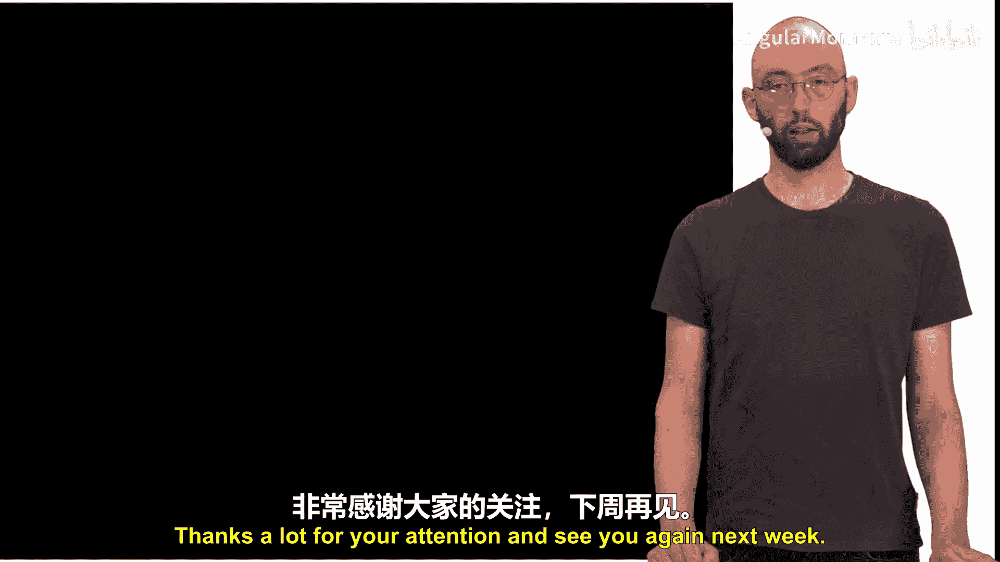
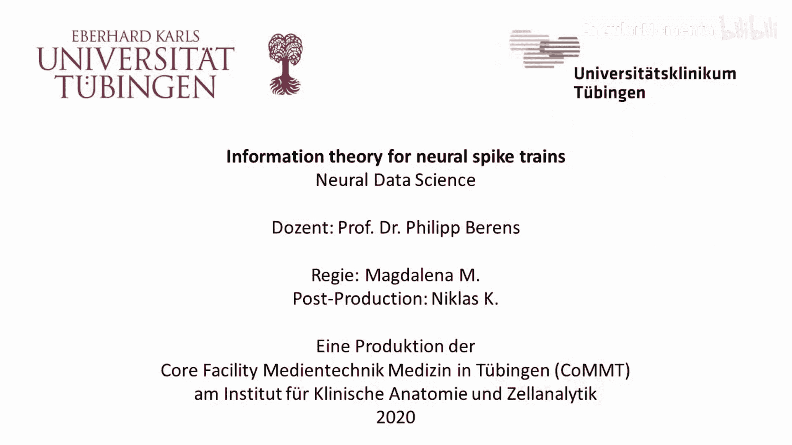

# 【精译】蒂宾根大学《神经数据科学》-p06-06-估计神经脉冲序列中的信息--BV1DEYozGEMW_p6-

。Hello， today， I would like to talk about how to apply information theory for neuro spike trains。

So what is information theory， Information theory is a mathematical theory on how to measure information So far。

 not surprising。 It goes back to the 1940s and 1950s。

 where people like Claude Shannon really coined this term。Originally， it was not applied in。

 in biological science， but rather in developing satellite communication or surveillance tactics during World War I。

But soon， it became also clear that for other communication systems， like， for example， neurons。

 information theory could be possibly a framework of interest。So in information theory。

 our model is always that we have a sender that sends information across a channel to a receiver。

And in that channel， the information is corrupted by noise。The sender sends。Symbols X。

And each of that symbols has a given probability， P of X。In our setting of of neuroscience。

 this is often taken to be the stimulus。That we sent into the system。Then we have a neural system。

 That is our channel。 And on the receiving side， we observe spike trains。That。

Are recorded as symbols why。That occur with a symbol。A certain probability P of y。

One important measure， or maybe the most important measure of information theory is the so called entropy。

 and here we will only cover discrete entropy。The formula for entropy looks like this。

 So the entropy。Of x， of a random variable x。It's the sum over all the elements。

 the minus is important。P of x times log2 of P of x。So let's look at some examples。

The entropy of a coin。Ts， so the newly distribution with a certain parameter P。

You can simply write down as minus P log p minus1 minus P log1 minus P。

So if you write that down and look at how much entropy there is in this random variable of a co simple binary coinntus。

Or of a simple binaryistriion， depending on。The variable P here。The probability of a success。

You obtain this curve。 So from this， you can see straight away that a fair coin where both。Events。

 so heads and tails are equally likely that this has the highest entropy， namely the entropy 1。

 So there's one bit of information in observing the outcome of such a chance experiment。

Entropy measures the information that a chance experiment。Conveys to you。

So how much more do you know。After observing the outcome of the Qus， then。To before。If you have。

An unfair coin， with a probability of success being not equal to 0 2。5。

 then the entropy will be lower。Because beforehand。

 you can guess the outcome of the experiment with a higher probability。

The entropy of k equally likely outcomes， so let's say throwing a dice。It's simply this。

 So it's minus the sum over one over a k， like one over a k。

And then you can see that if there are K equal you like the outcomes， that this is simply log K。

Mineus okay。In general， one can say that the entropy for a given random variable X is the average number of questions。

That you need to ask to determine the outcome is between the entropy and the entropy plus one。

And we also know that the entropy， the smallest entropy is 0。

And it has to be smaller than the log of the number of symbols。This is because。Maximum。

 you can already see that here in the case of two symbols。

 and then we can generalize from that just because the maximum entropy always occurs if the K symbols or the here X symbols are equally likely。

So why this formula for entropy， Why is that a good measure of information。In the。

 in the beginning in information theory， people defined a few desideerta of a measure of information that they wanted this measure to have。

 So information， for example， should be non negative。You can't be confused through。

A proper piece of information。Events that occur with probability 1 or 0。

 they should not be informative because they are certain。 So you're not。

Any wiser after observing the event。The measure， entropy should be continuous and monotonically decreasing。

In the probability。And information should be additive if two events are independent。

 And if you put all of that together。Then you can actually derive。

This kind of equation here and show that the only function that satisfies that is the。

 the logarithmic function that entropy actually uses。Of course， you can choose the。

 the basis of your entropy measure。 So it can be either， for example， two basiss 2。 Then it's M。

 the outcome measured in bits， or it can be two basis E。 Then the outcome is measured in nets。

 These are the two most common ones。There's also the concept of conditional entropy。

 What does that mean。So the conditional entropy。It's the en So if this circle corresponds to the。

 the entropy of our， all our stimuli。And de stimuli。Elicit a certain spike train。But， of course。

When we observe that spike train and we try to estimate the stimulus because this process is schastic and there's a certain amount of noise on the channel。

Then there's a region in the space of stimuli that is compatible with that spike train。

So this spike train is， there's a certain amount of noise in that spike train。

Which is due to the disruption here in the channel。 There's a certain stoasticity in that。

And this eits。A bunch of stimuli that are compatible with that spike train。

And the conditional entropy。Is。The entropy of that red box here。

Given that we know this was the spike train。So H of x， given y is this quantity here。

This is symmetric。 We can also define it in the other direction so we can have an entropy of the spike drains and the conditional entropy of the spike drains。

 given that there was a stimulus。We can use these quantities to define the mutual information。

The mutual information is simply， for example， the entropy。In the stimuli。

Minus the conditional entropy of the stimuli， given a spike。So if we go back to the last slide。

 the mutual information measures the size outside of the red circle here。

 It's the reduction in entropy after observing a spike train。

This is a symmetric measures in both direction， so we can also define it as the probability of the entropy of the spike trains。

 minus the conditional entropy of the spike trains， given a fixed stimulus。

 So then we measure mutual information as the reduction and about which spike train will be observed if we know the stimulus。

There's one very fundamental。Inequality of information theory。

 the so called data processing inequality。 So if we measure the mutual information between two random variables。

 X and Y。And we do some processing on one of these variables。

Then this always reduces the mutual information。And in the context of neuroscience。

 this can be various things。 So， for example， if we observe our exact spike times and then bin the response。

Or ignore correlations between the spike trains。 This leads to a reduction in neutral information。

So all sorts of kind of misspecations that we do。R always necessarily reduce the mutual information or estimates of mutual information。

So， for example， here， these are spike trains and they actually nicely code。U。

Here the different stimulus conditions in the different colors。

 But if we misspecify these windows in which we count spikes。

 then the mutual information that we compute from the outcome of this experiments about which stimulus was shown will be lower than it could be。

So one could think this is good news for app。Mutral information in a neuroscience setting。

 because if our estimate of mutual information is downward biased through the processing that we do。

 then everything is fine because we can't overestimate mutual information。

 We will say later that this is not the case。Information theory in neuroscience was heavily influenced by。

 by this book called Spikes exploring the neural code， which provided a quantitative framework。

 an ideal observer framework for the case of neuroscience。

 especially they used it a lot in in flying neurons。嗯。But in general， information theory is。

 is today not the preferred framework for analyzingnalying neural data。 So why is that。

One criticism that was voiced very early on was that information need not be used by the organism。

 It's a， it's a purely syntactic concept。The other one。Despite behavioural relevance。

Is that it's actually very difficult to estimate from data。 and we will see that now。

So if we estimate entropy from from data， we can， for example， for spike trains。

 describescribe spike trains as short discrete sequences of spike or no spikes or as binary outcomes。

 So let's say like this。 So this is a word。With 10 letters。

 and it either has a spike or a non spike in a certain time bin。So mathematically。

 we would model these spike trains。As elements of the。The numbers0 and1 in 10 dimensions。The space。

 this discrete space has 1024 states。As you can easily see。So two to the 10。

The probability distribution with the maximum entropy here。Is this right we said before。

 so if we have k states， then if we assign one over K probability to each of these states。

 this has the highest entropy。So if we assign to each of these words， the probability one over。1024。

Then this has the highest entropy among all possible distributions。

The entropy can also be easily computed in this case。 It's log of 10 to20。It'slock of 1024。

 which is 10 bits。So we know the true entropy in this case。

So now we observe a set of data that has been generated from that distribution。

 So we observe a set of x through Xn。And our first estimator of entropy that we build is that we simply count how often each of these different words occurs。

 So we say。The frequency one is just the number of times that the our X I's were equal to the words of all zero。

 So if we don't observe any spikes in any of the time bins。And so on and so forth。We can show them。

That the maximum likelihood estimator。Of entropy。In this case。

 if we just take this empirical distribution。And we estimate the distribution as these frequencies over the total number of samples。

This gives us a relatively easy and naive plug in estimate of our probability distribution。And now。

 if we just plug this into the formula of our， of the entropy。

 then this gives us the maximum likelihood estimate。How good is that estimate？

The problem are unobserved symbols。So because we only observe finitely many of these words of these spike trains。

 there will be some spike trains that should occur with the equal probability as the other spike trains。

 but that we don't observe in a finite dataset set。And this biases our estimation of entropy。

 in this case。What do we mean by that？ So there are two fundamental properties of estimators。

 And if you want to know details， I refer you bank to the machine learning one lecture from the winter term。

 There's the bias of an estimator， and there's the variance。The bias。Of an estimator is the。

Difference between the estimate and the true value。And it's its expectation。

Well the variance is the difference squared what there expect a difference squared from the true value。

You have an unbiased estimator。As you increase your number of samples。This bias goes to zero。

And an efficient estimator means that。It is unbiased and has minimal variance。For any estimator。

 we always have a trade off between biasers and variants。

So the total error that an estimator makes is the bias squared plus the variance。

 This is the so called bias variance trade off。For。Entropy estimators， especially the bias。

 is a problem。So here we make a simple graph where on the X axis。

 we have the number of samples and on the Y axis， we have the entropy。Here I mark with this line。

 I mark the line。Of the true entropy， so 10 bits。You can see。

And this is over many iterations of that。 So running that repeatedly。

 So we even have error bars is that the estimate of the。

Entropy with our maximum lightweight estimator is severely downward biased for low number of samples。

So， even if we have。10 to the three so more than 1000 samples or 5000 samples。

 We still have a downward bias。Only with 10 to the four samples in this very easy distribution。

Do we approach the true value of the entropy？So the expected value of our entropy estimator is lower than the true true entropy。

So why is that a problem？The problem is how entropy enters into a mutual information calculation and mutual information is the quantity that in a neuroscience setting we would be mostly interested in because we want to know how much the spike trains in a certain area。

 how much information they convey about some set of stimuli。So。H of y。

Is the entropy of the span trains across all the different stimulus conditions。

So we can pool the data from our entire experiments to estimate that。So for this quantity。

 the bias will be comparably small。The problem is the conditional entropy， H of Y given X。

 because for estimating this conditional entropy， we can only use those spike trains that we observed in response to a given stimulus。

 So for that， we have much less data， and our bias will be large。Overall， because of that。

 because this has a significant downward bias。This difference has a upward bias。

So if we just naively estimate the mutual information from a set of data。

 we will overestimate the mutual information。In this setting。And it is a problem。

 because that may lead us to wrong conclusions。And may lead us to claim effects or to claim relationships between spike trains and stimuli that are not really present。

So what can we do？Over the years， a huge number of different techniques to correct for this mutual information bias have been suggested。

 and one very simple one is the so called Miller meow correction。So if you do a tail。

Expansion of the biasers。 Then one can show。That the buyers to first order is this。

Where D are the symbols that are actually used in the， in the， in the alphabet。Thus。

 we can bias as correct our estimator by using。The maximum active estimate as before and just add a term。

That is just count as the bias。Where our empirical Dha。

It's just the number of words for which the probability is larger than 0。

 So we just add a simple correction factor here。Does that work？Well， yes， but only to some extent。

 So you can see that the blue curve here with middle metal correction is closer to the true entropy than the simple maximum likelihood estimator。

But still， it's too far away。There's another technique called jacknife estimator。

It's a re samplingling method that is useful for bias and variance estimation。

And it can reduce the biaspen order of magnitude。For creating the jacknife corrected estimate。

 we simply take。The true estimate or the Ma， the maximum likelihood estimate of entropy。

 and we subtract。This term here。Which is simply the maximum likelihood estimate。

If we leave out sample I。So we can， in turn， leave out each individual sample。

 and this will allow us to get an estimate of the overall bias， and then we subtract that out。

This actually works surprisingly well。 It's a very simple technique。

 and it already approves our estimation quite a lot。

 So while before we needed about 10 to the 4 or maybe 0。8 times 10 to the4 samples。

So almost an overest an over sampling of the distribution by 10 times。

 Now we can get by with about 10 to the three samples。

 So on the same range as there are possible states in the alphabet。

Or possible spike trains that we can observe。Can we still do better。

There's the another technique called the so called coverage adjusted estimator。

And the coverage adjusted estimate。Works as follows。

 So if we say S is our set of observed symbols or spike trains。

 So these that we actually observe in the data。Then if we decompose our formula for entropy into two parts。

 one that has all the observed spike trains。And one that has the ones that were not observed。

So this is mine， this is the， the， the formula with the， with the true probabilities here。

And soon set S。Is defined on the observed symbols。Then。This letter part here。

These are the unobserved summons。 So for those， the estimated probability will be0。

 So we underestimate that part。And on the other hand， because we underestimate this part。

 we overestimate this part because it's the inflated summons。

For which the probability of observing these summons is larger than it really should be。

The idea of the coverage adjusted estimator is simply to adjust for both。

So we first shrink the estimate of P for all the observed symbols。

So we just add a correction factor that。Is below one or slightly below one and just simply reduces their estimate a bit。

Then we need to， at the same time， inflate the contribution for rare words。

And we do that with this formula。So this is a coveant to a regularized estimate of our probability distribution P。

If you look at how well that works， this is actually interesting because。On average。

 it reduces the bias really a lot。So the， the mean of the screen line here is even with only 100 samples。

 it's very close。To the true entropy。But on the other hand， it trades。The bias？In some respect。

 into a lot of variances。 So you see that across different runs， the estimate becomes quite variable。

So for any given run of the estimator， you also don't know how close to the true entropy you really are。

This is not everything。 So there's quite a diverse range of different estimators。

 and there's there's very good online blog posts and tutorials on how to choose them。So you can。

 for example， here go through this list and try different， different options。At home。

 I would like you to implement also some of these more advanced estimators。

So you can see how remarkably well some of them do。So for example。

 the so called best upper bounds estimator。嗯。Is almost as good in introducing the bias on average。

 like the camera adjusted estimator， but it has much less variance。

 So using that estimator shown in pink here。One can estimate the entropy accurately in this case。

 with about 200 samples for distribution that has 1024 different states。

I find this very surprising that this is possible， but it's a result of the inductive biases that are put into this estimator。

 I won't go into any mathematical details here because they're quite involved。

 But I would like to just demonstrate to you that estimating entropy from finite data is possible。

But one needs to take care about which estimator one uses and whether that is suited to the problem and the distribution that one has at hand。

If you go back to the website。Of the course， take a look at these blog posts。

 They explain some of these estimators in more detail。Also。

 some of the material shown in this lecture is based on them。

 So thanks for all of the colleagues for contributing them。

Thanks a lot， for your con for your attention and see you again next week。

