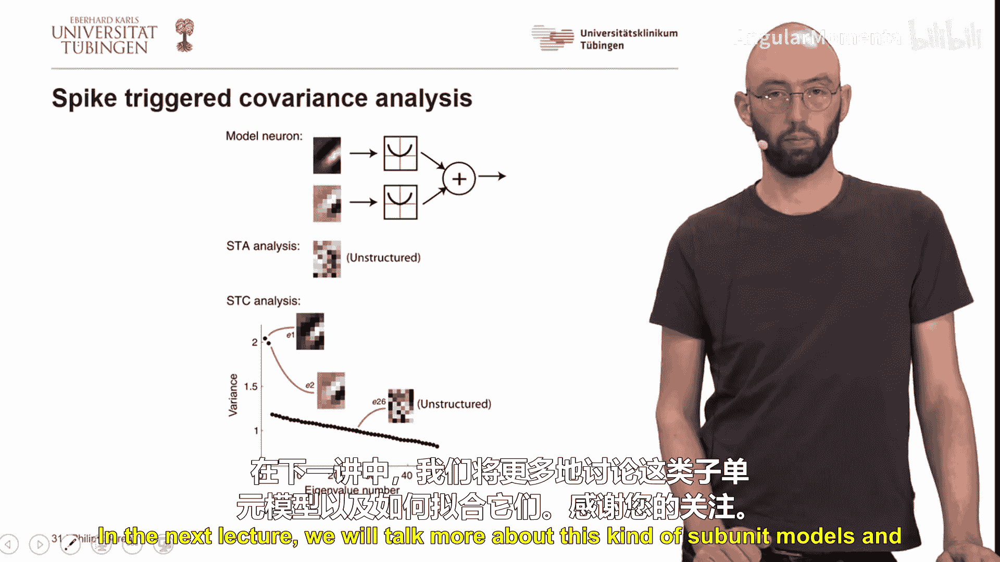
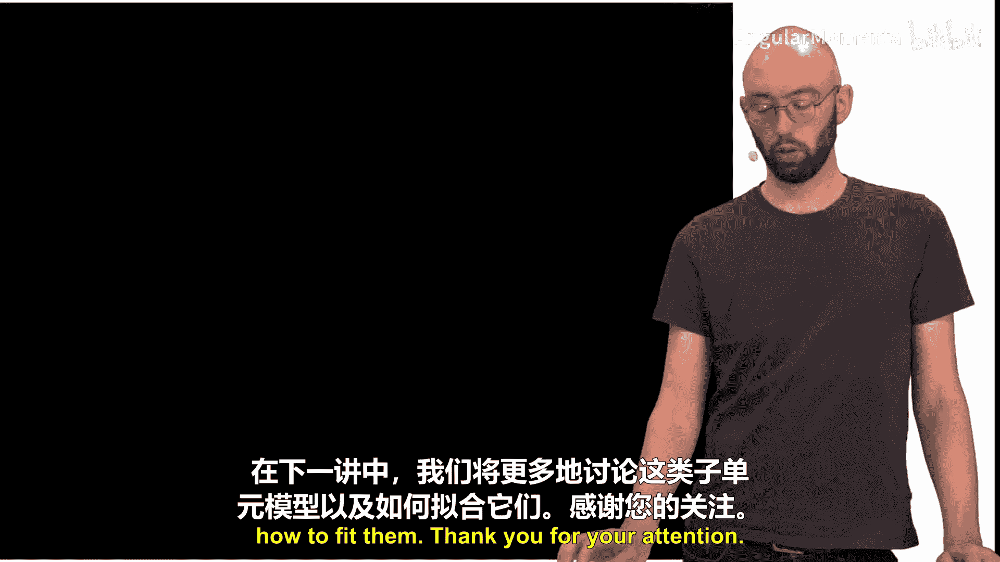
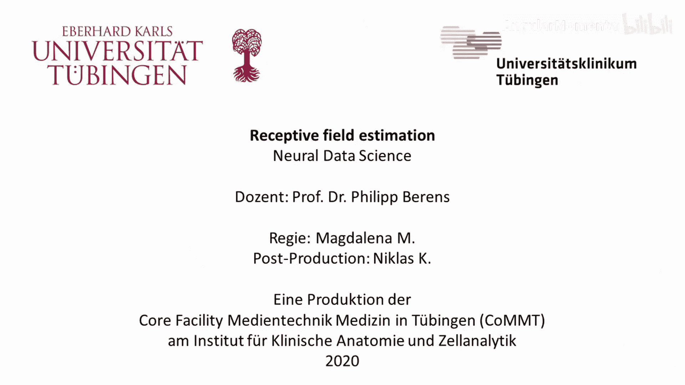

# 【精译】蒂宾根大学《神经数据科学》-p07-07-单细胞感受野估计--BV1DEYozGEMW_p7-

Today， we will talk about receptive field estimation。

 Welcome to this lecture of our lecture series neural data science。

So what makes a neuron fire in the last lectures， we discussed already the concept of tuning curves and tuning curves。

 We had a simple parametric stimuli stimulus。That we modulated and then changed this changed the firing rate of the neuron。

 Typically， tuning curves are a concept that is used if the stimulus is1 or at max 2 dimensional。

In general。And one can view that as a generalization of that question。

We still would like to answer the question， what in the stimulus or what in the behaviour of an animal makes a certain around fire。

So one example here could be weak electric fish in the electrosensory lateral line dope to have an electrosensory organ that is able to sense fluctuations in the。

Electric field around them。And the neurons react to that。So if we have a stimulus here。

 the modulation of the electric field around the fish。And record from the activity of a certain unit。

In in these neurons， in this lateral line lobe， then we find that it spikes sometimes。

 And if you look closely and look for relationships between these two signals。

 you will see that these spikes occur mostly on the falling phase。Of the receptive field。

Of the electric field。How can we make this relationship a bit more quantitative。

We can build a linear model between our stimulus and the electrical activity of the neuron。

So we can try to estimate the rate。As a convolution of the stimulus with a receptive field kernel。

And if we compute this kernel in that case， this looks like that。

So if the stimulus was up and then was falling， the neuron spiked would be already suspected。

In general， the theory behind that， one can goes back to a series is expansion。 This works。

Somewhat similar like Taylor expansions for functions。

 But here we ex expand a function in terms of other functions。And these kernels here。

 these we use as。As our receptive fields that describe the relationship between our stimulus and the response of the neuron。

So。For we if we want simple cell in space and time， this might look like this。So。

If we go back about 30 milliseconds in time。Then we have a spatial receptive field where we have this elongated shape。

 positive shape and an elongated negative shape。 And if we go。Thanks through time。

Then we see this becomes more pronounced and then fades again。

So this convol can be not only in one or two dimension， like in the case of an electrical line lobe。

 but it can be actually also in three dimensions。 So where we go over space and time。

We can see in this case that the neurons latency， the quantity that we already also discussed。

 So the delay between a change in the stimulus and a change in firing that is related to it was probably about 75 miseconds because here。

 the receptorive field has its most strong expression。

We can also see that if we just cut these receptive fields here in a single line。

 we see that the amplitude here is highest。Actually， it slightly reverses here towards the end。

Over time， if we just look across the temporal dimension， let's say of the top pixel here。

Then we get a curve like this。 So first， it gets activated， then reversed。

A receptive field such as this is called a space time separable receptive field。

 So if we just plot one spatial dimension and a temporal dimension here。

 this means that we can obtain our two dimensional receptive field。Simply by a multiplication。

Of a spatial and a temporary kernel。So the two dimensional receptorceptive field can be decomposed into two one dimensional receptorceptive fields。

We have a spatial kernel and a temper kernel。So how do we look at， let's say， the。

 the direction selectivity of such a receptive field。

Or orientations that activity of such a receptive field for that。

 We need to be able to show a moving grading in a space time diagram。 Otherwise it gets hard to show。

 So here again， we have the spatial representation where x and y are spatial coordinates。

 And we move this grading here over time in this direction。 So what smaller x。😊。

So that means if we just plot x and T over time。This movement here， parallel to the， to the X axis。

This will look like these diagonal stripes here。So for a certain point。X， this one here， for example。

A little bit after the movement starts。The grey bar will appear in the。Will appear。

 This corresponds to a movement into this direction。So how can we think about。

Orientation selectivity with these space time separable responses。Well， in this scenario here。

Where the grding is moving into this direction。The black curves are the black spots in the reive field are aligned with the black spots。

Black bar in the， in the grating and the white spots in the reive field are alignedd with the white bars in the grating。

Of course。😊，At another phase of the motion， the black。

Spots in the graating are lined were the white bars。And the。

White spots in the reive field are alignedd with the black bars。 and this results。

In a modulation of the response over time。Also， if we move the grding in the opposite direction。

This occurs， essentially， identically。And these curves look the same。 So in both cases。

 if we move a gring over such a space time separable gaor like receptorceptive field。

Then the direction of the movement doesn't matter。So how can we？Find direction selectivity。 How。

 how can we make a receptorive field direction selective。For that。

 we actually need a nonseparable reive field。 So we need in the space。

Time diagram of the receptive field， we needed a tilted axis。

Because if we have such a nonseparable spacetime receptive field。Then in this case。

 the alignment here is large resulting in a high response。And here。

 the inhibition is also large well。If the movement is going into the opposite direction。

 there's almost no response， no matter how the alignment is at any given point in time。

So four direction selectivity， we need a time a non space time separable receptive field。Now。

 we talked a lot about relationships between。Stimuli and responses and space time separable receptive fields and non space time separable receptive fields。

 Now we would like to go to data analysis。So often， we summarize。This relationship as a simple。

 predictive model， the so called linear non nonlinear Poson model， or L And P model。

In the N& P model， we assume that we have a stimulus。It has either one or two spatial dimension。

 and a time dimension。The modern neuron has receptor fields， linear filters。These。

 the result of the applying these linear filters in space and time to the stimulus is passed through a linearity。

And then with some noise defining process， in our case of the LP neuron， usually upon some process。

 we generate responses of the neuron。How can we estimate the parameters of such a neuron。

One quantity that we are interested in here is the so called spike trigger ensemble。

The spike got ensemble。We look at those stimuli that preceded a spike。 So if this is our response。

With spikes at these time points。Then we extract from the stimulus。

The part that was occurring shortly before the spike。

And what we are then interested in is looking at any meaningful structure in that spec at ensemble。

If we illustrate that in two dimensions， it could， for example， look like this。 So in black。

 we have all the possible stimuli。 and in white are the stimuli that elicited a spike。

The first quantity that we。Can compute from the spec trigger ensemble。And also。

 an easy estimate of our receptive field is the so called spike trigger average。

 which is take these individual components of the spike trigger ensemble。

 sum them up and divide by the number of spikes to obtain a spike trigger average。

So in our two dimensional scenario， again。If these white ones are the spec at ensemble。

 their average is the spec average。Which points in this？This。

Sp at average tells you what a neuron in general， on average， prefers。

We can also illustrate it again here。 So again， in this one dimensional stimulus。We have。

Spikes at these time points。 And then we cut out the stimulus before them。

We put them underneath one another， and we simply compute the spike triggered average by summing them up and dividing by the number of spikes。

So this would be a neuron that strongly reacts to a dip。In the， in the stimulus。

Sppect to get average again， put formally is this。Nao。If our stimulus is a white noise stimulus。

 So that means that spatially and temporally， there are no correlations in the stimulus。

Then the linear receptive field， as defined in the beginning in terms of such a serious expansion。

 is actually the specet average。For a white noise stimulus and our NNP neuron， this is also true。

In general， however。This need not be the case， and we will discuss that in a bit。

One thing maybe to note here is that in many cases。

 we write our notation continuously in space and time because space and time are continuous quantities。

But for the computer scientists among you， of course。

 it's very hard to represent continuous signals in the computer accurately。

 So we simply discretize base and sum。And turn all our integrals into nice sums。

And compute the quantities like this。So as I already said， the spectrum at average。

Is a estimate of the receptive field， but in some cases， it is biased。 for example。

 if the stimulus is non white。 So that， if there are correlations in the stimulus， and this is。

 for example， the case， if you show natural movies instead of just simple white noise。In this case。

 we can do maximum likelihood estimation。Like in the case of our tuning functions， we again。

Assume a lock likelihood。 assume a personal likelihood。

Where the spikes in a given time bin are distributed according to a poisson distribution with parameter lambda。

 So the red parameter lambda。And in this case， the rate is not specified by one dimensional tuning functions。

 but rather by the product of the receptorceptive field with the stimulus。

Then we can write down the likelihood。Compute the negative log likelihood， and the ref。

Compute the derivative。Differentiate with respect to the parameters of the receptive field。

You can do that。In the exercises at home。And then we can take an optr。

 optimize the likelihood to find its maximum。And the estimate of the linear filter， for example。

 in the L P neuron model in general， for arbitrary stimuli。

One problem when you do that is that your estimate are unbiased on average， but have high variance。

 So if this is the true receptive field。With some amount of data。

 you will get a maximum likelihood estimate that looks like this。This is， of course。

 undesired because it's really， really noisy。 You can see the overall shape。

But it's almost covered in noise。What we can do in standards is。

 we can regularise our estimate or in a Bayesian setting Comp a maximum a posterri estimate where we enter our pre assumptions about how receptive fields should look like into our inference framework。

We could write that in a graphical model like this。 So our response。

 Y is determined by a stimulus X and a receptive field K。

 And we have some hyper parameters over this receptive field K that determine its properties。

This is also called a prior inpatient inference。This part here determines the likelihood。

 just is what we already had before， but what is new is this prior with hyperparas。

And then we take the receptorive field that maximizeimises the a postterri probability。

 So the reive field K， which maximizes the product of likelihood and prior。There's， of course。

 a whole range of different pair that one could use。So。If you're prior， is that the coefficients。

Follow a normal distribution。Then your penalizer something like this。This is equivalent to the rich。

 so called rich penalty or L2 shrinkage。If you don't remember these terms。

 you might want to go back to the respective lecture of the machine learning one lecture series that I've linked above。

And then。With this L2 shrinkage， you already get much better estimates of your receptive field coefficients。

At least the variance is reduced by quite a bit。You can also put a Laplace distribution as a prior or use a laplace distribution as a prior。

 and that is equivalent to using a laso penalty or L1 shrinkage This induces sparseness in the coefficients of your receptive field。

In this case， you can see that many of these entries here actually pushed to exactly zero。Overall。

 the receptive field then looks a bit more zigzaggy than before。

 but it follows quite nicely the overall shape。These are good， but one can even do better。

With two techniques called automatic locality detection and automatic smoothness determination。

Aut take locality determination。You get a filter estimate such as this。

By assuming that in space time， your receptor field is localized。So， as a prior。

You somehow localize your receptor field in space time。Then you need in your， in your prior。

 you d not assume that you're。Your coefficient estimates are independent anymore。

 but you need a covariance matrix for your prior distribution。 This can look， such as this。

You can also do that not on。 So this was assuming locality in space。

 but you can also assume locality in the Fourier space， meaning that。Only some three components。

Are allowed to be active。 So you put a prior on your fourier spectrum。

 And this works actually surprisingly well。And you can also combine the two priors and get already really good estimates。

Of， of the receptive field shape。Now， how do we find the hyper parameters。Of， of such models。 So now。

 until now， we just simply assumed them。 But the authors in the paper in which this presentation here is based。

 So Mjoong Park and Jonathan Pi， they use a technique called empirical base。 So for empirical base。

 where in this Bayesian framework。嗯。But we。SComps term here， called the evidence。

And we simply use that hyperparmeter that maximizes the evidence。And for some models。

 it's actually possible to compute the evidence in reasonably closed form or reasonably efficiently。

So from that， we get a whole zoo of different receptive field estimation methods that are all better than the naive maximum likelihood estimate。

 So one can put a two shrinkage or rich penalty， laso penalty。And then various priors in space。

 frequency or in space frequency that localizes。Based on some pre knowledgeled localizes our estimates of the receptorive fields already。

And obtains。With， even with only very little data， very good receptive field estimates。

You can also apply that to real data。And you can see。

That here these maximum likelihood estimates with only one minute of data。

They all have clearly discernible shapes。But are quite noisy。 The background is noisy。 There's。

 there's lots of fluctuations。 If you use the。Automatic locality determination in space and frequency。

 all of this noise in the background is gone， and the structure comes out really nicely。

 This almost looks better than using the maximum likelihood estimate with all data。

 which I think in this case， we're about 20 minutes worth of recording。

So by using an in bias in your model。You get estimates that are much more data efficient。Now。

 what I brushed under the carpet so far is that to compute the empirical base solution for the hyperpars。

 we need to use a linear Gaussian model。 So we need to use a model。

Where we have a linear receptor field with Gaussian noise can't be a linear non nonlinear poson model。

But， of course， we it would be nice to also be able to compute such。😊。

Good data efficient reive fields in the linear， non nonlinear proson model。

And also optimizing this doing this evidence optimization step is often very time consuming。

So what we have recently done is we developed an efficient alternative。

Namely to use a spline basis here， we have a prior belief that we specify in our choice of basis function。

 in this case， splines。blindlines are smooth functions or the smoothest possible function with certain criteria。

And a certain class of sps that we use here。嗯。Are these。And you can see。

 they look like these Gaussian hats with a little bit of wobble。On the sides。

And using these sp bases， we can easily approximate different shapes of receptorceptive fields。

 for example， such as this。Or we can also do so in two dimensions。Because now。

 sp bases can be also efficiently computed in more than one dimension。

And then we can use multiple of these spaces functions， for example。

 and approximate a spacetime receptive field。What do we gain by that？

If we take our high dimensional stimulus， because each， each pixel is a dimension。

 and over time as well。 for all of those， we have independent coefficients。And we can。

 we use sp basis in that。 We reduce the dimensionality of the stimulus space from that of the number of pixels in our three dimensional receptive field to the number of sp basis co components that we need。

If you do that。One can also get very nice looking receptive field estimates。

 So here is the spike trigger average， the whiten spice trigger average。

And here is a maximum likelihood estimator with a sp basis。

 And here with the added L1 penalty and the sp basis。

 And you see that without this framework of automatic locality determination or detection。

 we get as good estimates。As in this Bayesian framework。So what about。

Sales that are non nonlinear in their computations。In one of the last lectures。

 we briefly talked about complex cells and the Hubilant weasel model of complex cells。 So the idea。

Was that simple cells in the cortex they are generated by projections of L G N neurons were sents around receptor fields in an orderly manner that creates these striped gbo like receptorceptive fields in simple cells。

 Our complex cells were thought to be a combination。Of simple cells that have the same， preferred。

Orientation， but different preferred phases of the stimulus so that the complex cell overall would be insensitive to the phase of the stimulus。

The linear receptive field for such complex cells is actually just flat。So if you want to， to。

 to model their response， you need to do something more clever。In general。

 the dominating model for complex cells is the so calledled energy model。 We have。

 where we have this pair of filters， a cosine and the sine filter。

 So that are combined by quadratic non No non nonlinearity and added up。And through this operation。

 this quadratic linearity， we make the response of the cells insensitive to the precise position of the stimulus。

 So induce some position in variance。We can recover such filters with a technique， for example。

 called spike triggered Covariance。So in spectrum at covariance。

 we take again our spectrum got ensemble， so。In this case， let's say the， the white points。

 the average of these white points is exactly in the origin。

 where in in the middle of the stimulus distribution a priori。

But the shape of the distribution is different。So we take the spec ensemble computes covariance matrix and do an eigenvector analysis。

 pretty much like PCA。And use these eiging vectors。

That kind of fall out of the spectrum as spike triggered components。

 as spike triggered covariance components。Here， if we have a model neuron that is specified according to our complex soil model。

 So with these two filters and quadratic non nonlinear narrativeities that are summed up。

Our STA will be unstructured。But if we look at the。Eigvalue spectrum。

Then there are two filters or two components， two eigenvalues that clearly stick out。

 So this fall of is quite typical of eigenvalue spectra。

 but these ones are higher than than expected。And these two components here。

 they nicely recover all original filters， despite this quadratic mal lineararity。

In the next lecture， we will talk more about this kind of sub unitit models and how to fit them。

Thank you for your attention。

