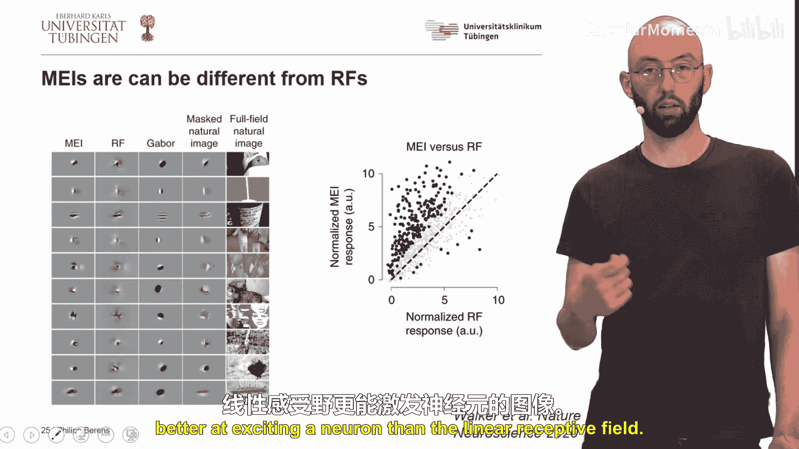
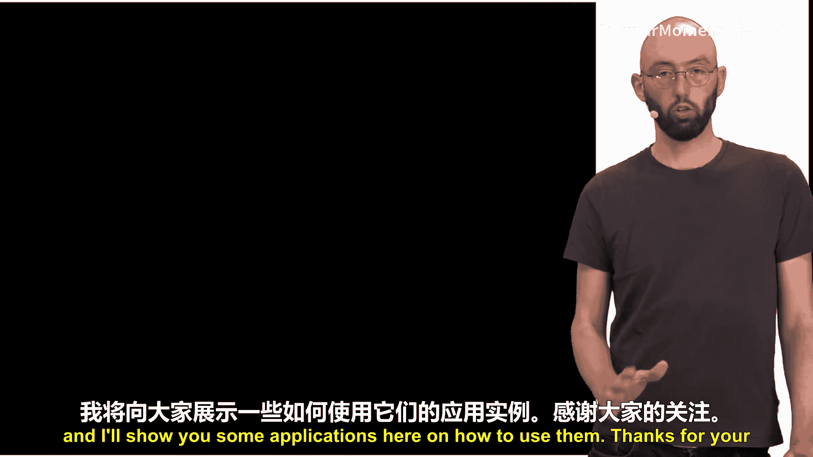
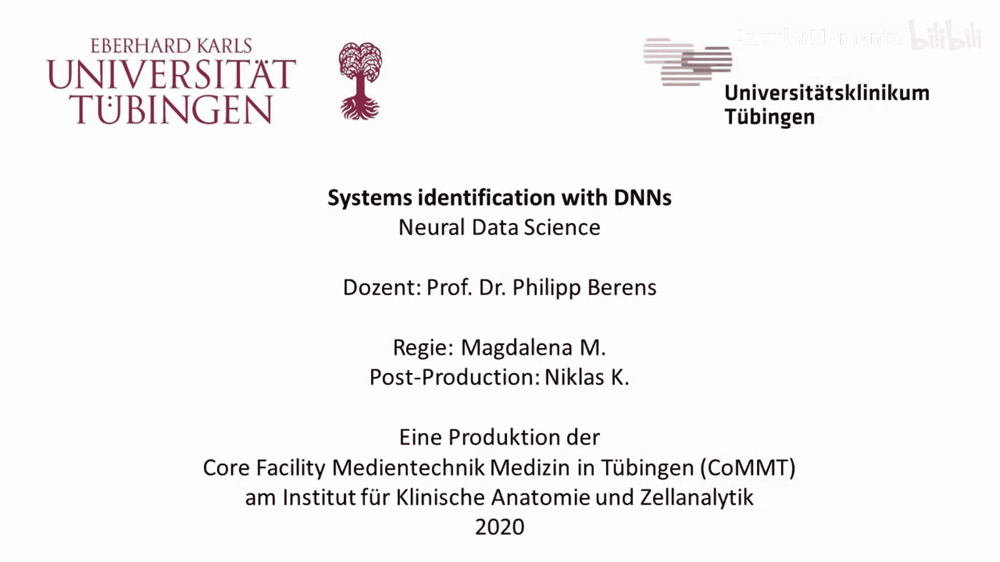

# 【精译】蒂宾根大学《神经数据科学》-p08-08-基于深度神经网络的系统辨识--BV1DEYozGEMW_p8-

Welcome to the next lecture in our lecture series， neural data Science。Last week。

 we talked about receptive field models and how to estimate the filters of receptive fields from data in an efficient way。

Well， today we talk about more complex systems I identification tags in more complex models。

 for example， using deep neural networks。We started last week with a model similar to this one with a linear non nonlinear proson model。

Where。The stimulus。Was filtered with a linear receptive field。

 which was passed through an non linearity。And with added noise， we generated a response。

 for example， using a personal assumption on the noise。

We already saw in the last lecture that for some neurons that perform non nonlinear computations。

 for example， for the complex cell， such a model may not be sufficient。Therefore。

 we can extend this concept to a so called linear nonlinear linear nonlinear subunit models。

In this case， the stimulus is passed by an array of receptive field filters。

Which all have their own laity。Before the output of these nonlinearities summed together and passed again through an output No nonlineararity。

With these class of models， we have richer possibilities to model stimulus response relationships。

Optally， we can also add something like a response history filter。

So subunit models such as these are somewhat in complexity between very simple。

L N L andP style models that overs most of the computations that happen in real neural systems。

And very complex。Models of the retina circuitry， in this case。

 for retina data or also cortical circuitry， for cortical data that in all its details is probably also hard to infer from data。

These kind of sunent models are situated at a moderate level of complexity somewhere between these two extremes。

In the last lecture， I already introduced the concept of using a sp basis for inferring receptive fields。

 And because such subunit models have have even more parameters because one parameter that has been has to be learned for each of these subunits。

 using the sp basis is even more helpful in this case。 So here we have。

An L&P model for a certain gangs that is learned from data。And here we have the subunit model。

 and you can see that with the amount of data we have available。

 these subunits are quite noisy and come out very faintly。If we use the sp basis。

 we can both get a better fit with an L&P model， but also get very nice and localized receptive fields for the individual suls。

Such subunits can improve model performance in some systems。So here if we have a recording。

 we have both an LNP and an L an LN model with subunits。And the predictions are both shown here。

 Then we can plot the correlation coefficient as a measure of prediction quality between the predicted response trait。

 the predicted response rate either by the N andP or the by the subunit model and compare that。

To the true data。 And then we find that in this case here。

 the subunit model always improves the predictions。In some cases。

 it actually has been shown that subunits in such a model can correspond to elements of the。

Actual circuitry。 So in the retina， gangion cells get input from bipotter cells。

 which are pre synaptic to them。 And there's some evidence。

 at least in some recordings that the subunits obtained by such subunit models that they actually correspond to individual bipotter cells。

 So in this case， for example。We have。A S single L N model。Of the gangangan cells。

 And if we measure its width， it has a distribution with an average between 1 and50 and 200 micromres。

And if we fit a subunit model in stand， we get such four subunits。And the size of these subunits。

Is on the scale of what we would expect from the presynaptic patterns of the ganglion cells。

 the bipolar cells。So it is possible， and there's also more direct evidence that shows that that these subunits。

 in fact， correspond to bipolar cells。So subunit models can also be used to close the gap between statistical and circuit based models。

We can even build models with more circuit structure and build。嗯。

So there's a a whole cascade of models where we have here， stimulus， individual subunit。

That are filtered and then pre processcesed。 There's delay terms that feeds back in the by history terms or delay terms。

On various levels。And if we build a hierarchy of such models。

 then we can get closer and closer to predicting the spike trains in this case of ganganglion cells in the retina。

So the， the most complex model here is a linear non nonlinear feedback delay。

 some non nonlinear feedback model。 And this actually， on average predict。

Neural activity of gangin cells， the best。The advantage is that we can look inside all of these terms in these models and try to interpret them in terms of their in terms of their structure。

 So here we can see that， for example， the delay term， this really。

Is responsible for shifting the around。A bit backwards。

So while these subunit models are typically inspired。By getting closer to the retant circuitry。

 one could also take another approach and say， well， we basically make the subunits continuous。

And use deep neural networks。To predict neural activity。In deep neural networks。

 especially in convolutionional networks， we have this kind of subunit mechanism already built in。

So the idea behind a convolutional neural network is that you have a filter that you move across the entire image so that could。

 for example， correspond to an individual bipolar cell type whose receptive field is applied across the entire image before it is stand combined back。

Before a certain ganglion cell type samples from these representations by the bipolar cells。

 So if one one， one can see。These kind of deep neural network representations or these。

Convolutional neural network representations here as an also as an alternate attempt。

To be inspired by the circuits of the retina。To predict the responses。And in fact。

 deep neural networks do quite well at that。 So here one can see that they really close the gap to the overall reliability or the fraction of variants that can be explained in the data。

We can also go back and look at the units and the filters and actually find that they。

 they look a bit。Like receptive fields of preynaptic elements of gangmbion cells。

 So on white trained on white noise， they have receptorceptive fields。

 These kernels here in one of the earlier layers that remind are reminiscent of the receptive field of bipolar cells。

Interestingly， the structure。Of these recept fields also differ betweens between different stimuli。

 So whether you use white noise or natural scenes。 Then they are。Larger and more smoothed out。

 and had stronger surrounds。The good thing about using deep neural networks to predict neural activity is there's a whole bunch of different open source tools。

From the entire deep learning industry， you kind of add your fingertips and you can use those。

For your systems identification with neurons。So implementing a model as on the last slide。

 is actually super simple。The parameter influence in deep neural networks。

The key ingredient for that is so called back propagation。 So where we have the the forward pass。

 we put a sample through a neural network with parameters， B and W。

We compute a linear representation and then the nonlinear one。

And we pass that through the different layers until we can evaluate the loss function。

For that particular stimulus， backpack obligationation then the process of efficiently passing the。

 the loss signal。The derivative signal backs through this graph。So we compute， for example， here。

The derivative often loss with respect to that function and the derivative of that function with respect to the parameters in that layer。

If you want， again the details， I refer you back to our machine learning one course in the winter term that is linked above。

With this toolbox of deep learning， we can even implement more complex models。

While the models that I talked about up to now were fit also for individual neurons。

 we can or had features that were trained for individual neurons。

 we can now also use feature sharing across neurons。

So we can use a feature space that is learned from the data but models the responses of individual neurons。

For example。This can be useful。For recovering cell types。So in the simulation here， we had two types。

 small ones and large ones。 and the learned kernels in our feature sharing space really corresponded quite well to these types。

 So if we use the， the activation of these two filters。In a two dimensional scatterap plot。

 you can see one class of neurons down here and the other class of neurons up here。

One can add more bells and whistles to such models。 So， for example。

 one can have such a feature extractor。嗯。One can also add a temporal dynamic。And then， for example。

 if one records the eye movement of a neuron。Or activities such as running or modulation of the pupil size。

 we can additionally add that into our model with modulator and shifter networks that automatically correct for those and take them into account。

We can also use not only de novo trained networks， but also pretrain networks。

 What do we mean by that？So they are large architectures of neural networks， as for example。

 the AlexNe or the VGG 16 architecture that are available online and they were trained to do object classification on a huge set of images。

One can now use these networks with the parameters as they are to also predict neural activity。

 So basically， in this case， one states the hope。That the representation learned by the network is somehow more generally useful beyond P。

 P， pure object。Clrasification。So， for example， we one can use that for we want systems identification as done in this paper from colleagues in tubing。

So here they showed to， to the， two monkeys in the visual quatex。

 They showed a series of briefly flashed images。And then try to model the relationship between these images and the elicited neural activity。

So the experiment looks like this。So this great dot is the。Fixation spot of the the monkeys。

 So it shows you where the animal is looking。 Then you can see it's looking around when it's looking in the middle。

 Then over the receptive field of the neurons。A number of different。Images are very briefly flashed。

The recordings were done。With such a laminar probe。

 And you already know from the previous lectures how to interpret such plots。

 So you can see for the individual spike sorted units。You can see the footprints on on the probe。

Can also see PD H， Raster plots， how they modulate the activity upon the change of an image。

 and here linear。STAs of these neurons。The authors then used a VGG based model where they've simply used the parameters of a pre trained VGG to compute a representation。

In a certain feature map。And then train linear reads to model the activity of the neurons。

So this part was kept fixed， so in this case， they didn't learn an entire feature space。

 but they used the feature space from object recognition or object classification。

To predict neural activity and just as read out was learned。In this case， one kind of course。

 tried to select the optimal layer for prediction and here it was somewhere in the middle。

 so it that kind of makes sense because the data that was modeled came from early visual cortex。

And one could expect， for example， that if one went to more higher object recognition quatices such as IT。

 then maybe this best layer would be somewhere up here。

One can also add lots of regular rises to such a model。 so one can add， for example。

 a smoothness constraint， sparsity and so on， and then also study what happens if one gives out those constraints or these these regular rises。

 and these can have dramatic effects。 and if you don't regularize at all。Then， also， your。

structure doesn't look good。Now， if we look at how well such a transfer learning network does。

 it actually does really well and even better than a convolutional network for that particular data trained in nouvo on the data。

 because it's more data efficient because it has a lot of inductive biasers from your object classification task。

 So you can see here， the best model is the VD G。Now， in general， over the past years。

 it has been shown that these that such deep neural networks。

 they are not particularly close to the underlying circuitry or the biophysical mechanisms that that are used by。

 by neural tissue to come compute information， that they provide really good predictive models。

 and one concept that can demonstrate how good these predictive models are instead of most exciting images。

So here。A set of natural images is shown to an animal， to a brain where we。

 where a lot of responses are recorded。And then。An artificial neural network is trained to model these responses。

It can predict the responses really well。And so one can use the model to find an image that should optimally excite。

 so most exciting image that should most strongly excite a certain model neuron and then on the next day。

 the authors of that study went back and showed that particular most exciting image to the neuron to check whether really the prediction is true that this MEI excites the neurons more strongly than other images。

These MEis。I， in fact， different from simple receptive fields。So in some cases。

 they are reasonably similar， but in other cases， they can also be quite different。

And if we look at the response of neurons to the MEI or to control stimuli， for example。

 the linear receptor field。Then typically， the response to the MI is much higher。

So through the nonlinear。Deep neural network。 It was possible to find images that are actually better at exciting neuron than the linear receptive field。

So， today。Deep neural networks are versatile tools in systems identification of neural systems。

 And I showed you some applications here on how to use them。 Thanks for your attention。

