# 【精译】蒂宾根大学《神经数据科学》-p09-09-神经群体分析（一）--BV1DEYozGEMW_p9-

🎼Yeah。🎼。

Hello， in the past few weeks， we discussed how to analyze single neurons。

 So neurons recorded individually or as a group in response to different stimuli。Today。

 we will extend our models further。And talk about how to analyze whole populations of neurons recorded simultaneously。

So， what we currently have。Are pretty much variations of models that have a stimulus dependency often modelled as a linear dependency。

 as a， as a linear filter。That is passed then through nonlinearity before we have a stochastic spiking process so that no spiking activity is generated。

In the past lecture， we also covered extensions of this basic framework。

 where the stimulus filters can consist also of subunit models， some multiple parallels。

 stimulus filters or even of nonlinear deep neural networks。However。

 what we did not include or not explicitly discussed so far。

Are effects of the spiking dynamics of individual neurons。

 such as a refractory period or bursting or also interactions between neurons that are recorded simultaneously。

 This we will discuss today。To remind you， the refractory period is the time after action potential in which a neuron。

Is not able to spike again。The biophysical basis of the refractory period is that the sodium channels after being activated and deactivated。

 go into an inactive state。In which they cannot be directly opened again。

To model the refractory period in our neural data here， we need to include a cell feedback time。

This is a term which exhibits ex excites or inhibits。The neuron after spikes。

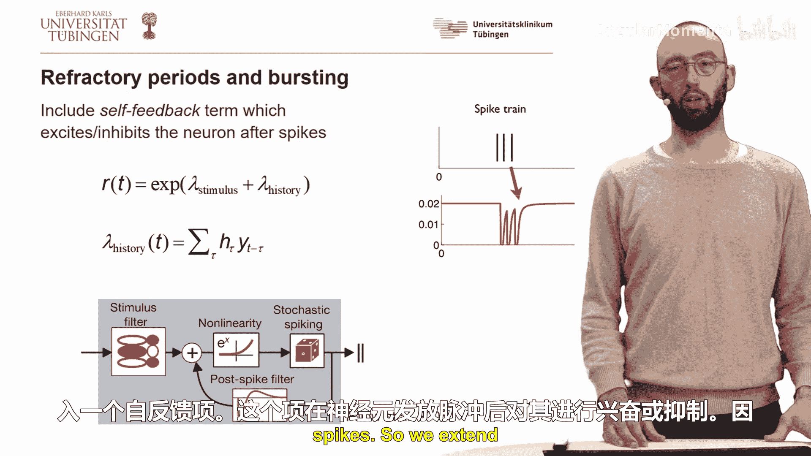

So we extend our rate function here。R of T buy a term for the spike history。

 And we model the spike history also as a linear filter。You can see that also in the diagram on here。

 where the stochastic spiking of the neuron itself enters back into the model as a post spike filter that is added to the effect of the stimulus filter。

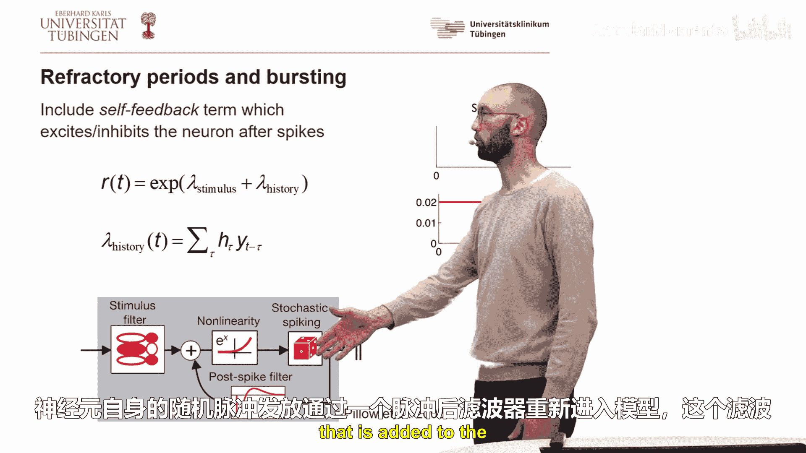

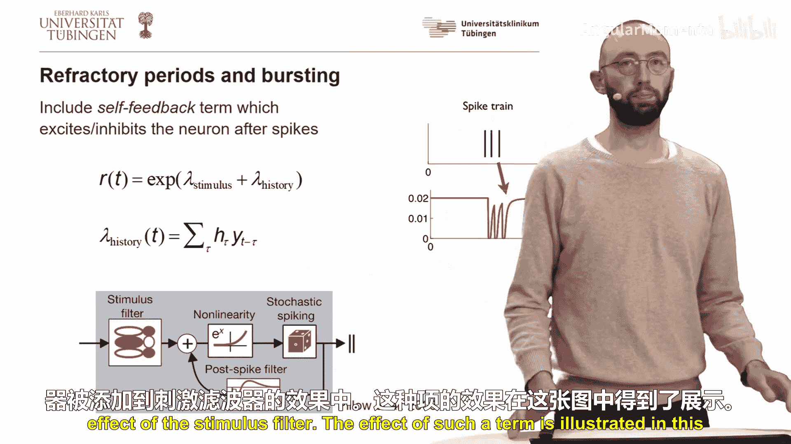

The effect of such a term is illustrated in this graphic here。 So after each span。

 an inhibitory self feedback term。Just lowers the probability that a spike will occur at any given moment。

They can be very different history effects that you can model with this framework。 So， for example。

 if we just enter a filter that models a refractory period。

 this subtly changes our spiking statistics。

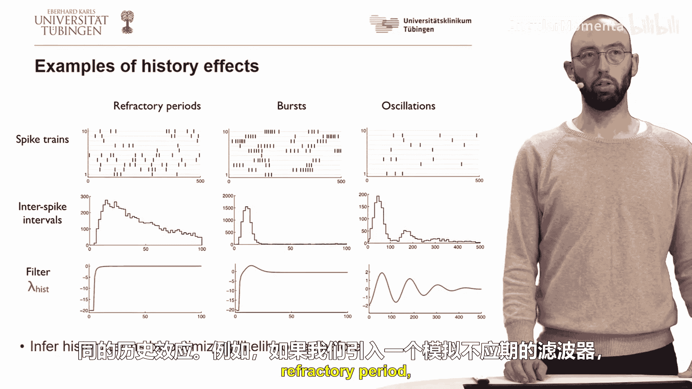

So， down here。

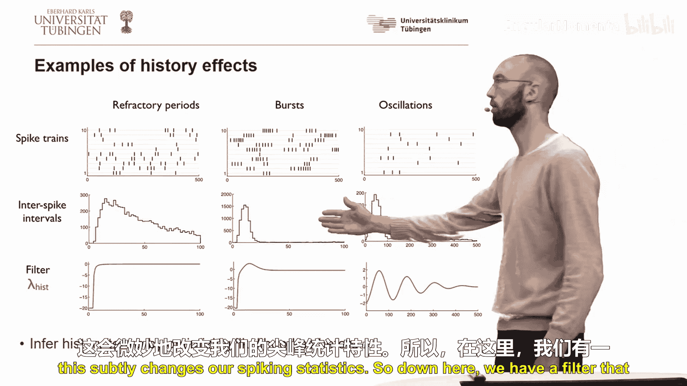

We have a filter。That prevents spikes from happening for a very short time after each spike。 So here。

And if you look at the effect on the intersspec interval distribution。

You basically also see that dip in the probability at the beginning here。

The spike trains that can be generated or samplesd from the model actually look pretty normal。

If you want to model burst。 So you can clearly see that once a neuron here。

 once a neuron spikes a bit， then it always sends directly a few spikes。

This can be modelled with an such a bursting filter that， in addition to the refractory period。

 has this kind of self excitation bump shortly after a spike。

This is so strong that in the interspect interval distribution。

 you see a clear bump shortly it positive time lags。Finally。

 we can also generate oscillations in the spiking activity。

 They are a little bit hard to spot here in the， in the raw spike data with oscillatory spike history filters。

😊。

And these then also generate ocillatory intersp interval distributions。You can in。

These filters from data。By optimizing the likelihood， just as before。

It's important if you have data that consists of multiple trials and you want to simultaneously model the P T H or the stimulus dependency and to spike history dependency。

 then you need to infer these two terms simultaneously。Because if a spike occurs at time T。

Then this can either occur because the stimulus induced rate is high because of the stimulus onset。

 or it can happen because the spike is a consequence of the recent spik in history， for example。

 in a burst。If you just average across trials before you infer the model， this confo the two。

 So if you infer them simultaneously， then you can disentangle these effects at least to some degree。

Can illustrate that here。 So if we F have this kind of data here， where the neuron。

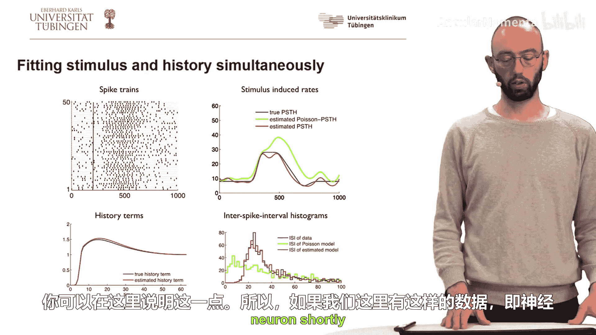

Shortly after the stimulus onset has a period of elevated firing。Then。By the stimulus。

 if we just estimate on the。The PDH on the data without considering spike history effects。

 then we obtain this kind of PDH here。 But if we estimate these two things simultaneously。

 then this actually matches here our。Model PSD 8 and some of the variability。

 some of the dependency here is， in fact， attributed。To yourself self。Exting term。

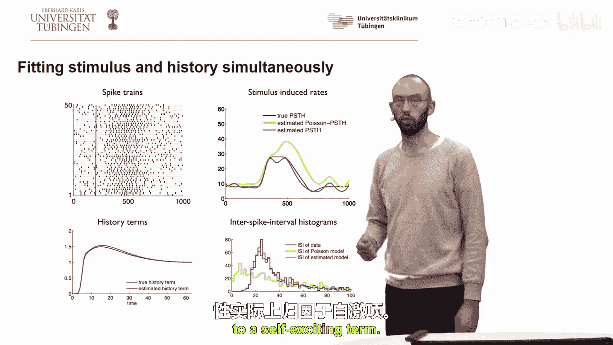

You can also go beyond Pawise effects。And model interactions between simultaneously recorded neurons。

So these are graphics here from a paper by Jonathan Pito from 2008。

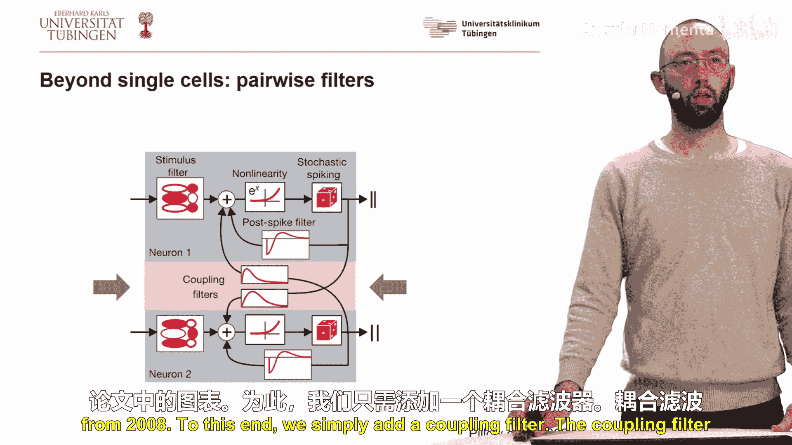

To this end， we simply add a coupling filter。 The coupling filter just works as the post spike filter。

 but it enters the spike activity of one neuron， filters it and enters it to another neuron and vice versa。

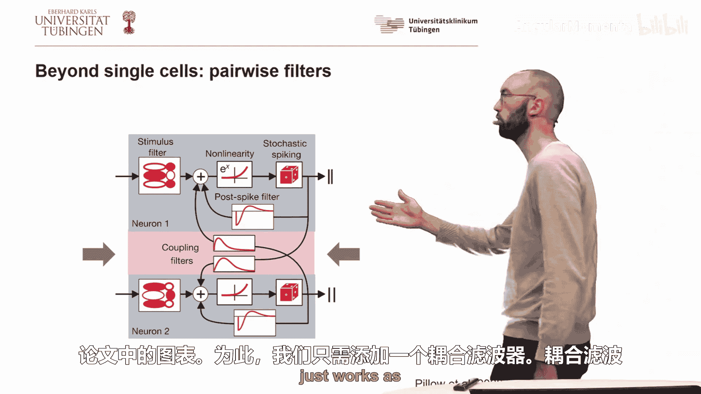

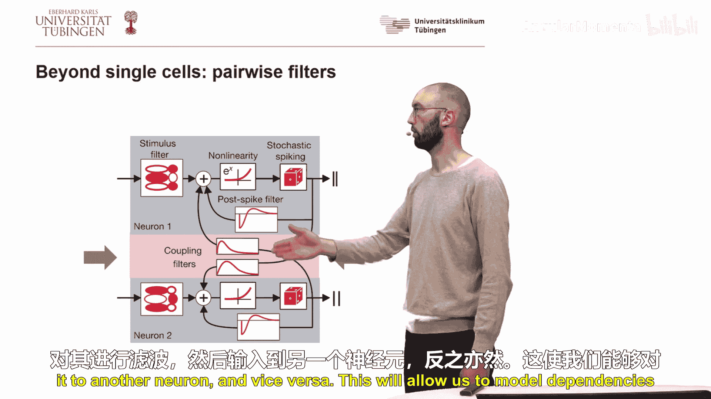

This would allow us to model dependencies between individual neurons。

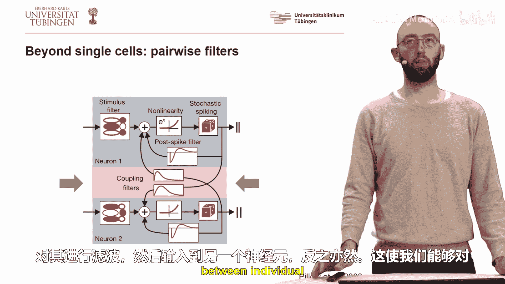

So， for example， here in this paper from 2008， they fit such a large scale population model。

Two mosaics of on and off gangion cells from the Makaque retina。 they inferred， in fact。

 individual stimulus filters。Both in space and in time。They inferred the post spike filters。

 So you can clearly see here Also the refray period。 And then they also looked at。

 they also looked at coupling filters。 And， for example， here， for this on sale in the middle。

 you can look at all the coupling filters from the surrounding on and off cells。

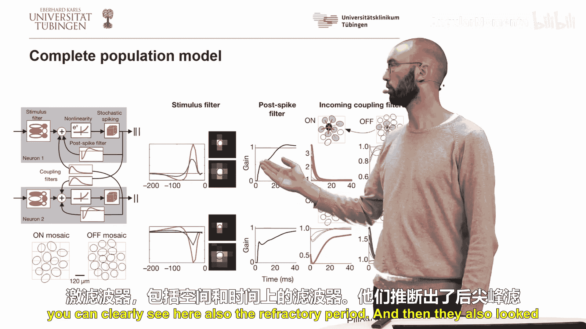

And the coupling to the other on cells here is， is positive。Yeah， some also。Heel。

 and then the coupling to the to the surrounding of cells is， in fact。

 negative for this off cellll here in the middle， the coupling to the。

Other other off cells in the vicinity is positive while the coupling to the other on cells in the vicinity is negative。

 So they， they D cells show correlated activity that influences each other。

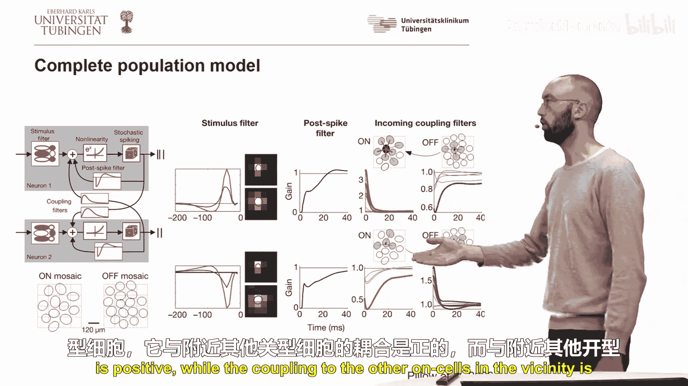

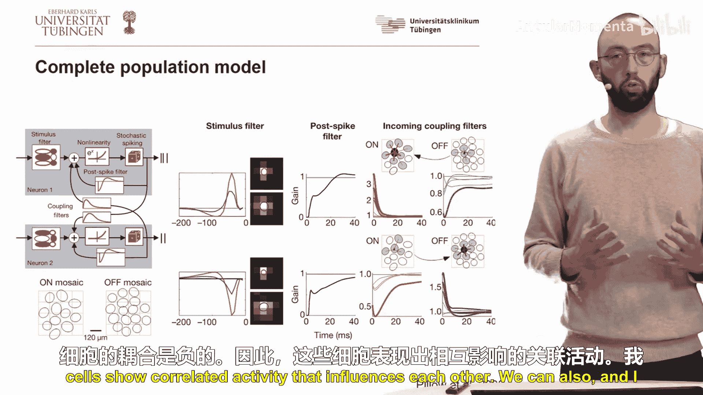

We can also， and I briefly mentioned that before。 we can also replace our non nonlinearity。

 So typically， we work with exponential non nonlinearity。

 So we have a basically Poson generalized models in statistical terminology。But we could also use。

 for example， a sigma eal non linearity。 if we make our time bin very small。

 such that in every time bin we only have one spike at max。

 then this is a binomial or beulli generalized linear model。In principle， we can also。

Make our nonlineararity very flexible and fit that from the data。

 either in a histogram approach or also using using a sp basis。 So here， for example。

 you can see that this nonlinearity is parameterized by the coefficients of the sp basiss and can thus model very flexibly different relationships between the output of the linear stage of the model and the spiking activity。

So to summarize， our predictive population models that we have here are quite flexible。

 we can adapt them easily。 There are lots of existing frameworks that we can use to fit them。 So。

 for example， the GLM fit toolbox that is available in pretty much every programming language。

 And theyre also from a statistical point of view， theyre very well understood。

 And if we have additional terms that we would like to add into the models。 So， for example。

 behavioral data， eye movement data running data， it's very easy just to。

 to enter another predictor into the same framework in the same way that we included our spike history filter。

There are also numerous extensions that people have looked at to estimate hidden neurons or London nonlinear interactions。

 model， common input， model， the state depends and so on。

One general issue that you have when you fit such model to data is that in the end。

 the coupling filters that they don't have a good mechanistic basis。

These model the functional or statistical connectivity between the neurons， but they。

 they are not a good or not a necessary model of the true synaptic connectivity underlying these functional implementations。

So you， in the literature， you will hear the term functional connectivity a lot。 And it's， it's。

 if you want， it's actually not connectivity。 It's rather。嗯。

A functional influence or directed correlation or something like that。

There's a second class of population models that I would like to discuss today。

 and that is statistical population models In these statistical population models。

 our goal is not to predict the response of a neuronto stimulus or a population of neuront stimulus。

 but it's rather to describe the probability distribution over neuro responses。

 either during spontaneous activity or in response to an ensemble of different stimuli。

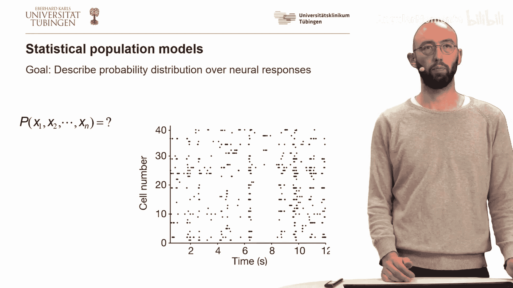

So our goal is to model this distribution P X 1 to P， X， N。

 which models the activity of the population over certain timeend。 So， for example， here。

 we have 40 neurons and time in this dimension。 And now we can chop up time into windows of different duration and model the the the resulting activity pattern statistically。

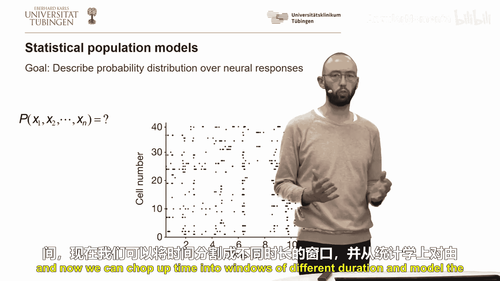

So how can we do that。So if we make our spike count windows large enough。

 then we can simply assume that our spikes follow a Gaussian distribution。

And approximate the spcon distribution， although it is discrete by a simple Gaussian。

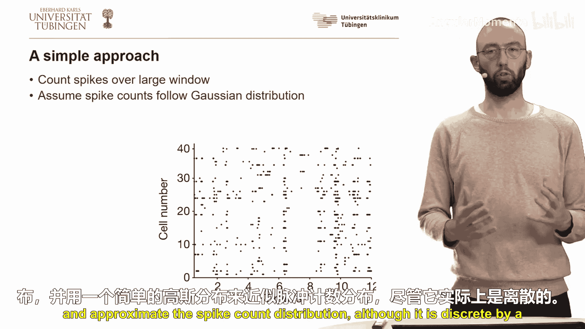

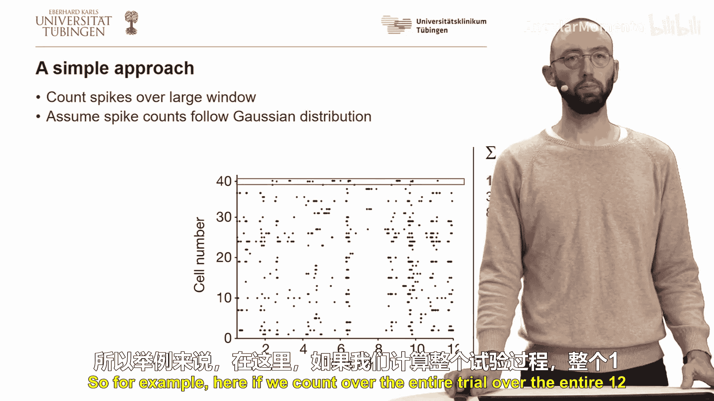

So， for example， here。If we count over the entire trial over the entire 12 seconds。

 then we get fairly large numbers such that our spikey count distribution as a。

 as a Gaussian is a is a good model。 The Gaussian also allows us not only to model the average spikey counts。

 but also their covariance or correlation。So the mean and covariance fully describe the spikey count distributions for large time windows。

Actually， using a correlated proson distribution。Is much more difficult in this case。

 because of the discreteness of the prop of the distribution。

But most interesting processes that we that we want to model happen at much faster time scales and then spike counts are clearly not Gaussian。

 So let's go to the other extreme where we model spike counts in very short time windows。

 let's say 20 milliseconds also， where we typically find either one spike or no spike at all。

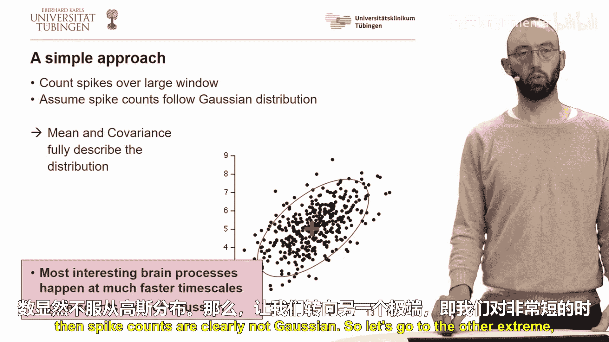

This looks like this in this case。 So here， if we zoom in on that subpopulation over a small window of time。

Then we can see that any of these indicated time bins。

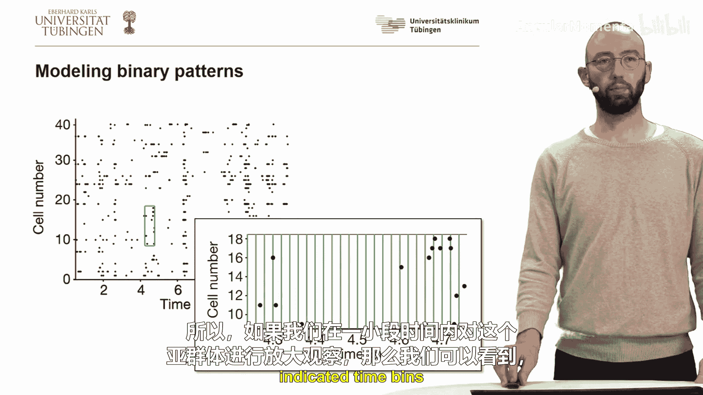

That this either contains 0 or one spikes so we can turn our spike pattern。

 We can turn that into such a binary pattern， as is shown down here。We write these patterns as as B。

 And then we ask， what is a good probability distribution for these binary patterns， B。Of course。

 it is not a Gaussian。 It's a bad approximation of a binary distribution， but。What。

 what else can we use。Well， our first starting point would be an independent benoulli distribution。

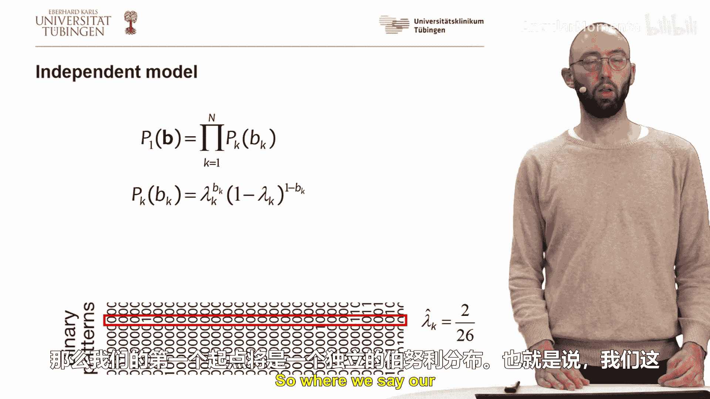

So where we say our probability distribution here， the independent probability distribution of over these binary patterns B。

 iss just a product。Of benoulli distributions。For each individual neuron with its marginal spiking probability。

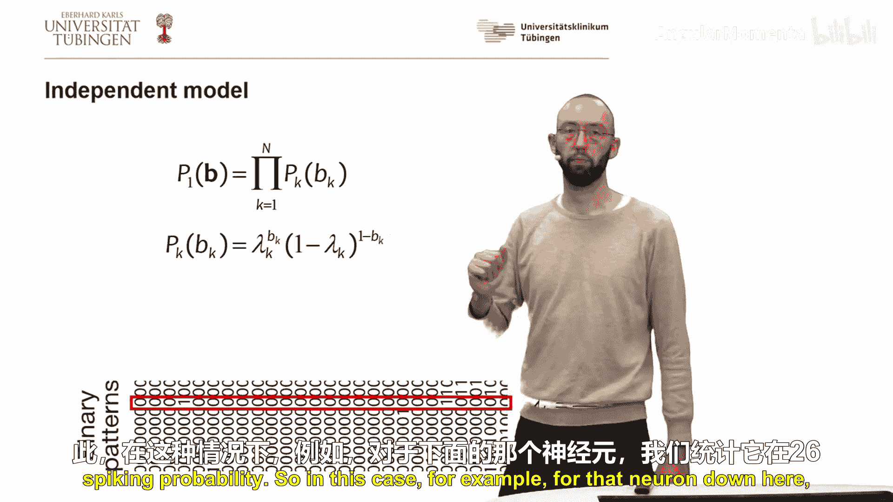

So in this case， for example， for that neuron down here， we count that in 26 time bins。

It spikes twice， so we have an estimated spike rate of 2 over 26。

And use that as the mean of our manually distribution。If we do that。

The parameters of that model are very easy to estimate。

But it does not capture any dependencies between neurons。We can also。On the other side。

 end of the extreme， we can just specify the full model， the。

 the distribution over all possible states in a given population。

So here for these 10 neurons down here， we have in total 1024 So two to the 10 different states。

 and each of the different patterns can be uniquely assigned one state index。And then in principle。

 we just need to count how often does each state occur in the data to estimate its probability。

This is shown up here。However， because of the。This exponential relationship。

 So 2 to the 10 for 10 neurons，2 to the 20， for 20 neurons。

 The parameters of that model get very quickly infeasible to estimate， because。

It captures all the dependencies between the neurons， but it's too complex to actually fit the data。

 So for 10 neurons， we have。1000 states for 20 neurons。

 we over already have a million different states that partially will occur only very， very rarely。

 And because our estimates of our models are always limited by our recording time。

 This is then heart of it。

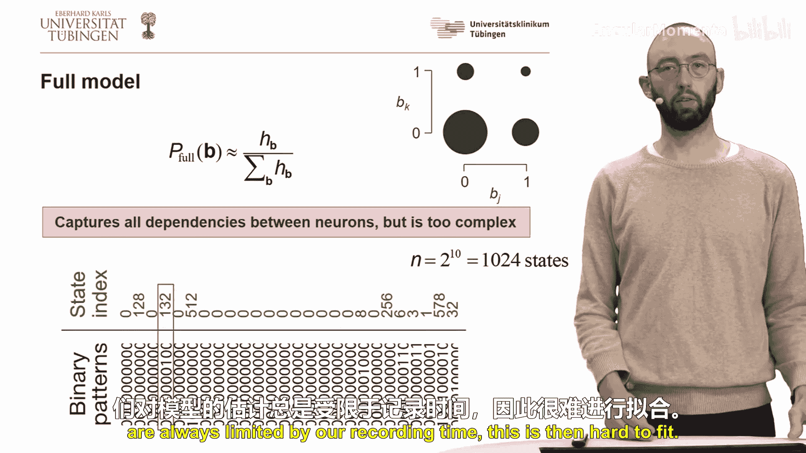

So what else can we do。So we will resort to a principle called the maximum entropy principle。

 You already know what entropy is from one of the past lectures。

And the idea behind of the maximum entropy principle is actually very simple。The ideas。

If we know some statistics， So sta is simply a measurement of this by account vector。

 We know some statistic of the activity patterns。 So， for example， the average。

Activity for each neurons， their correlations， the population spy count also on。 So these are these。

 these functions， F， K of B。Then。We want to answer the question。

 what is the distribution that satisfies these constraints。

But does not impose any other statistical structure on the distribution of the data。

 So it's as constrained as needed， but not more constrained。

And this is the so called maximum entropy distribution。

 So you find that distribution by maximizing the entropy H of B subject to these constraints on the statistics that you have。

 and you can show。That， for example， for for a set or in general， for a set of statistics。

 F K of B that。

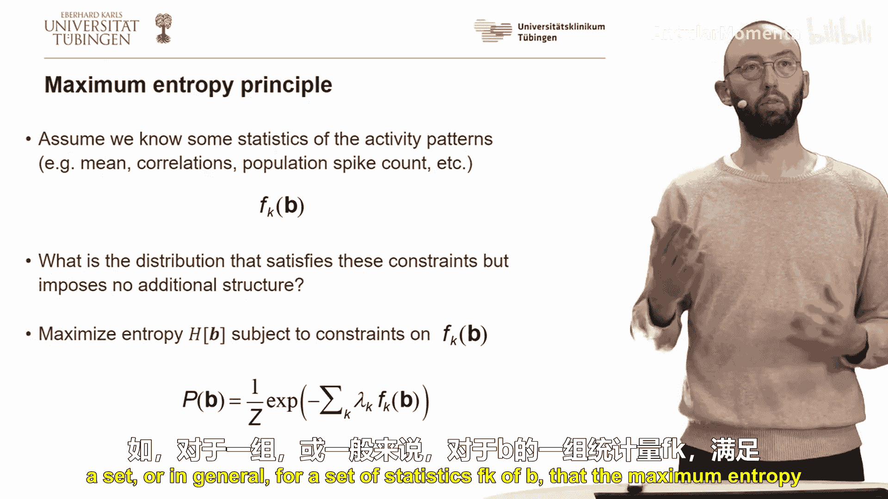

The maximum energy distribution that satisfies these contrain takes the simple， exponential form。

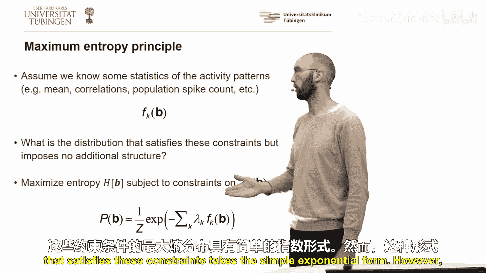

However， the simplicity of that form is， is deceptive because the devil is actually in the detail of the normalising constant set。

 This is very hard to evaluate， as we will discuss in a second。So here are some example statistics。

 So if we just set F K of B to B， this is the mean。 If we set it to this term down here。

 then we have the covariance or we can also have the populations bank account。

So in the pairwise model， we would like to constrain our model to capture the pairwise correlations between neurons。

So if we have no correlations between these neurons and then some correlations between these neurons。

 what we do is we basically， we make the probability。Of this dot down here。

 where both of them spike simultaneously。

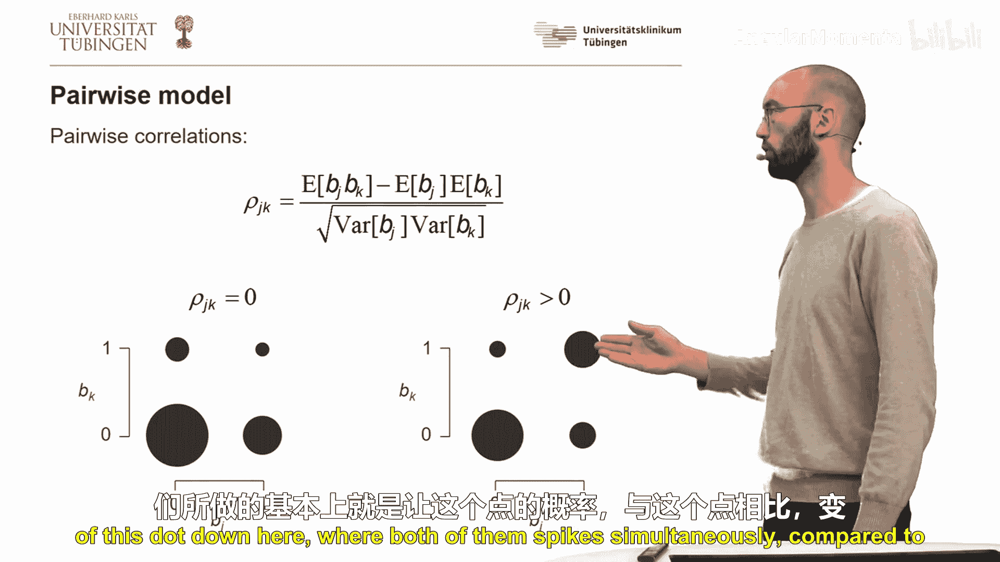

Compared to this one here， we make that larger。

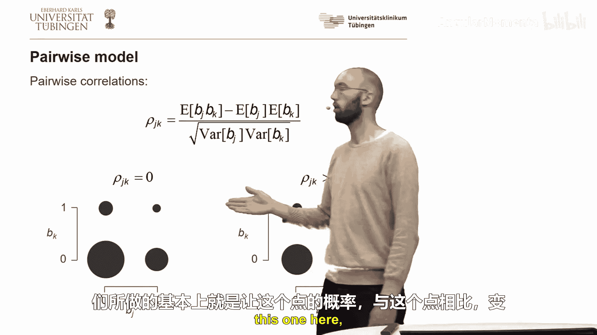

Okay， so and。If we write down the maximum entropy distribution that satisfies the constraints of the means and these correlations。

 So the second order maximum entropy model， it's also called easing model after the。

 the German physicist andt easing。It takes this form here。Where the parameters of the model are。

 in fact， the J's and the Hs。And these need to be estimated from data。

 You can see as a quadratic model。 it has 653 parameters。 So n times n plus 1 divided by 2。

 So for it， a 10 dimensional model。And learning these parameters is difficult， as I said。

 because you need to estimate。

This normalizing constantantia。In， in every to evaluate the probabilities。

 because this cannot be done in closed form， because you need to， again。

 some over all the possible states。

You need to approximate that through sampling， for example。And therefore。

 there's no closed form maximum likelihood solution。

 What you can do is use a technique called Bolsman machine learning。

Where you just evaluate the gradient。After pra of the likelihood with respect to the parameters and then do gradient descent。

And the interesting thing is， so the in， the interesting part is it actually this formula here。

 which shows you how you need to change at each step。

The pairboys cuping parameters J， J K。And you simply。

 what you do is you evaluate the correlation in the data。

And you subtract the correlation predicted by the current model with the current parameters。

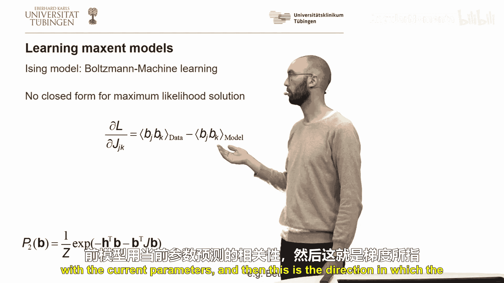

And then this is the direction in which the gradient points and in which you need to take a step。

You get these， these predictions from the model you get， for example， by， by Monte Carlo methodss。

 So you need to， to sample from the model， for example， using a technique called Gib sampling。

And with from this gib sampling， you can also then approximate this normalizing constant that if you need to evaluate probability。

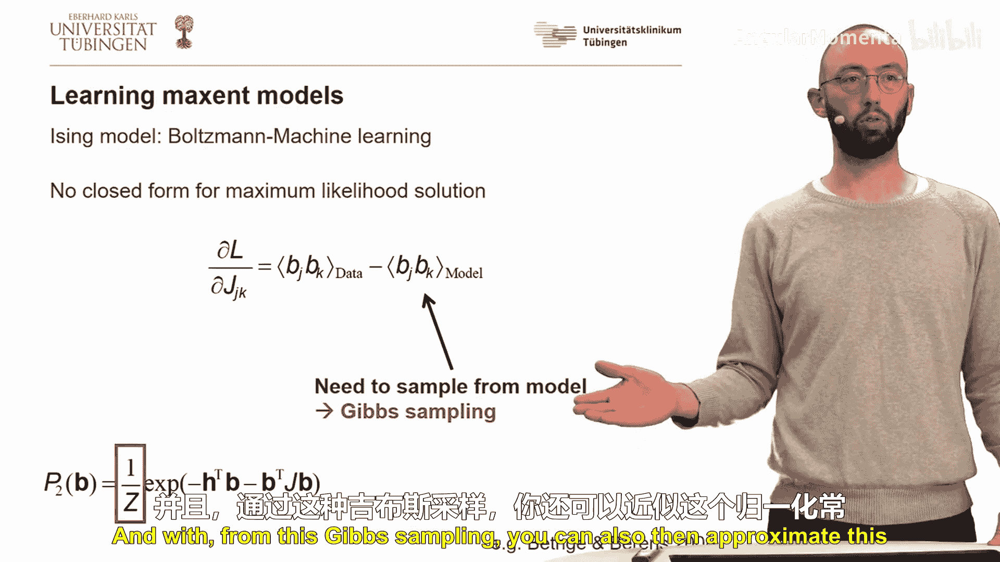

But now there's a lot of techniques that that approximate various aspects of that model or that that use various tricks to make the inference faster。

 But this is the， the basic inference step that you need to do。

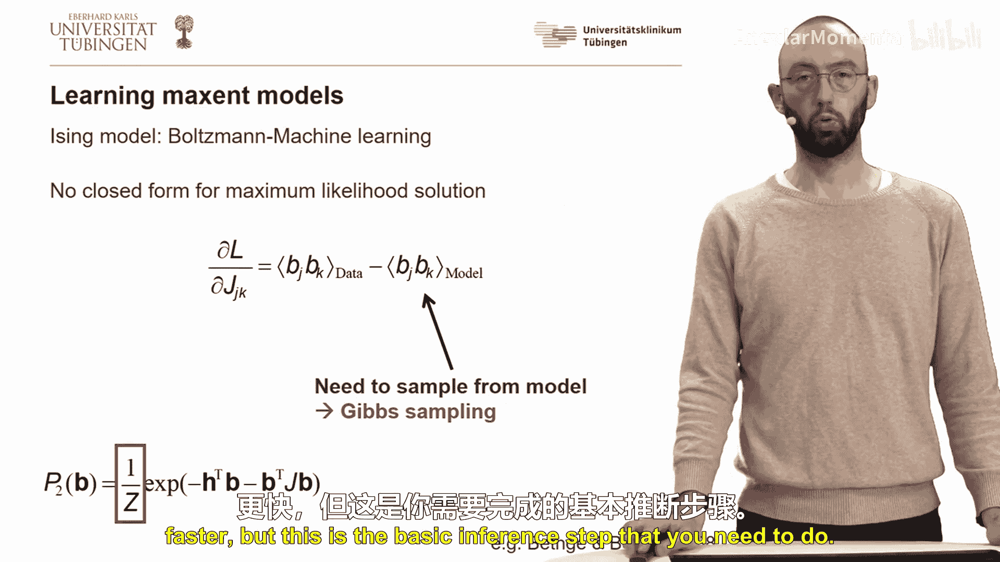

Now， how good are all these models in describing the spiking activity of neural populations in the retina。

 for example。So。What we can see here is the predictions from the independent model down here。

 you have the observed pattern rate。 and across there， the pattern rate predicted by the model。

 And as you can see， there's quite a few scatter quite a bit of scatter along the diagonal here with a patterns with one spike up here。

 Pats with two spikes down here and so on and so forth。

 So the independent model for that particular population is not a terribly good model。

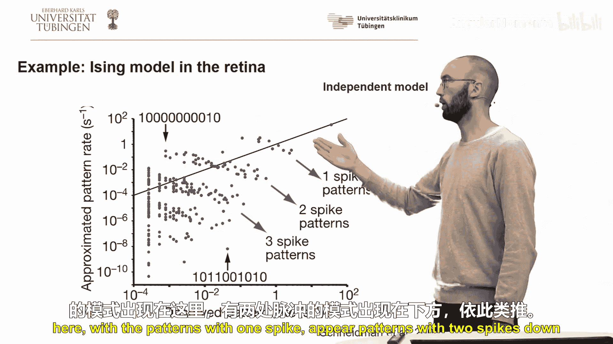

If use the easing model to fit the data。 Then all these points move much closer to the diagonal。

 In fact， you can show that the scatter you observe here from the。

 from the diagonal is almost as close as to what can be constrained by this data set in principle。

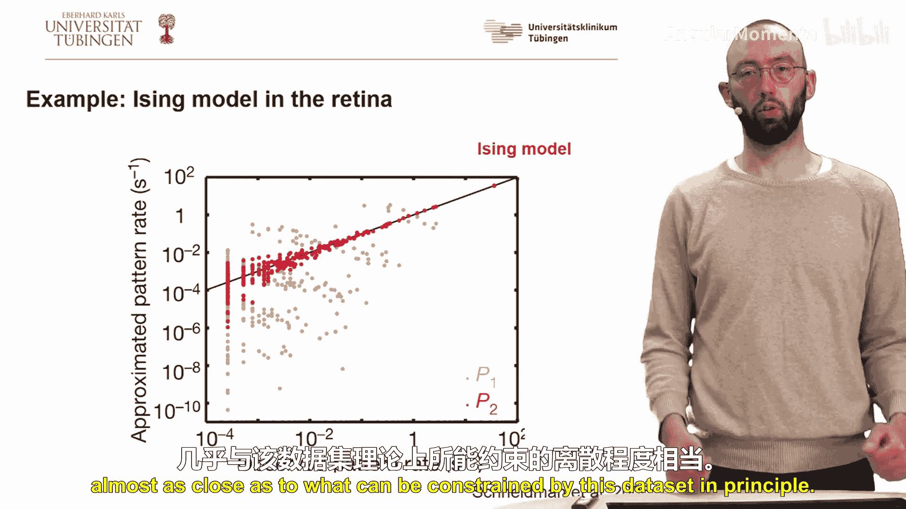

One can then。Also， evaluate how much of the total structure this model explains。 So if we。

 if we try to fit this， our， our total model and the second order model。 And in this case。

 you could see here that this almost explains more than 9090% of the variance in the data。Because。

All this sampling and the inference for the model parameters is not so easy in the easing model。

People， including us， have thought for a long time， also for alternatives。

And one very simple alternative that can be easily used， for example。

 to generate binary data with specified mean and covariance sources is the so called dichotomized Gaussian model。

 The dichotomized Gaussian model， you assume you have a latent variable。

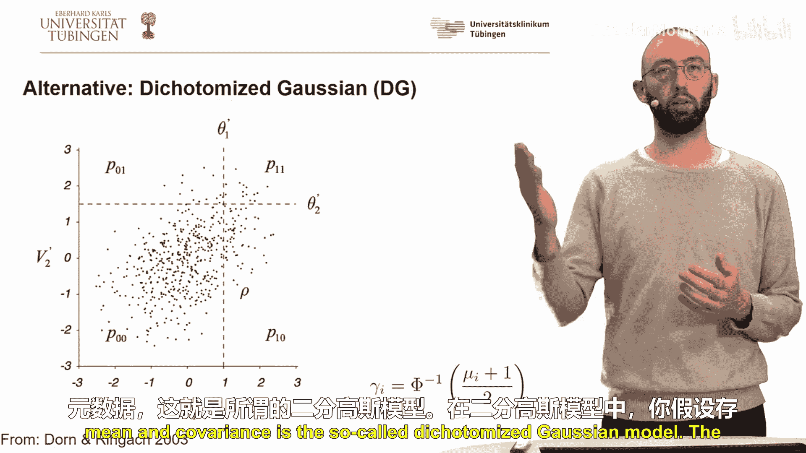

That has a， a correlation and A a latent mean。 And then you have thresholds， Theta 1， Theta 2。

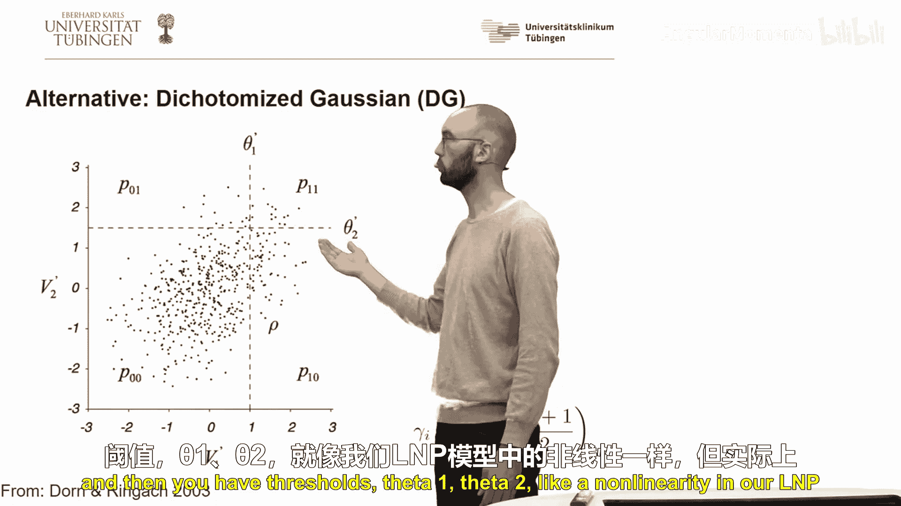

Like a non nonlineararity in our LNP model， but really a threshold non nonlineararity。

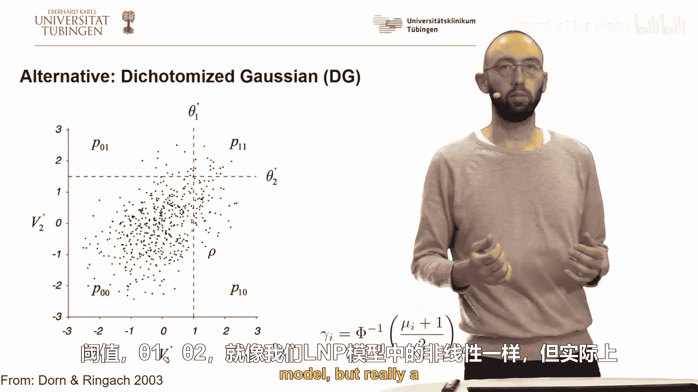

That dichotomizes this latent continuous distribution into discrete binary outcomes。

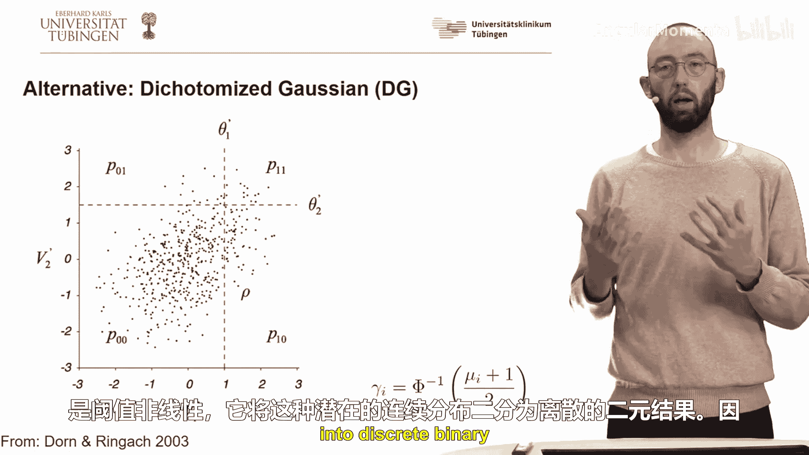

So。If you sample from your latent Gaussian distribution and your point follows in falls into this quadrant here。

 then you would assign that 0，0 state。 So where both of these neurons don't spike。

 If it falls in that quadrant up here， you would say neuron  two spikes downt here。

 neuron1 spikes and up here， both of them spike。

So by moving the， the mean of the late gal around or equivalently keeping the mean at 0 and moving the thresholds around。

You can easily change the mean activity of each of these neurons。

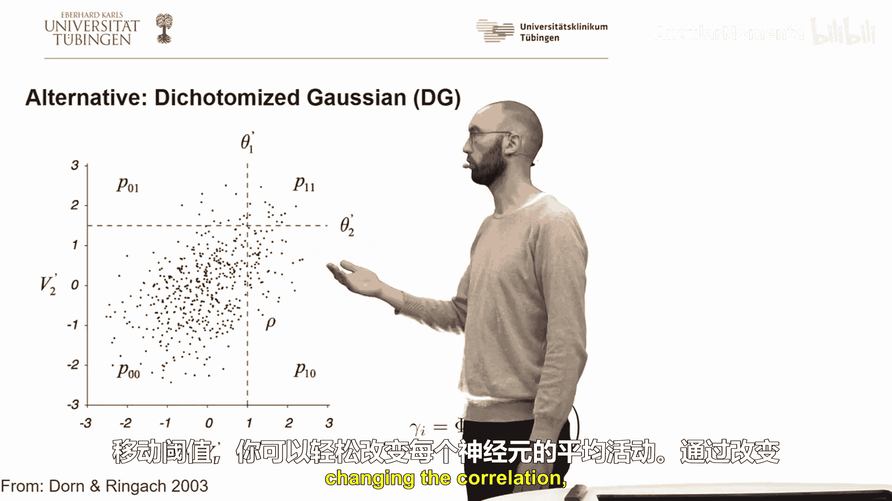

And by changing the correlation， you can change the probability。

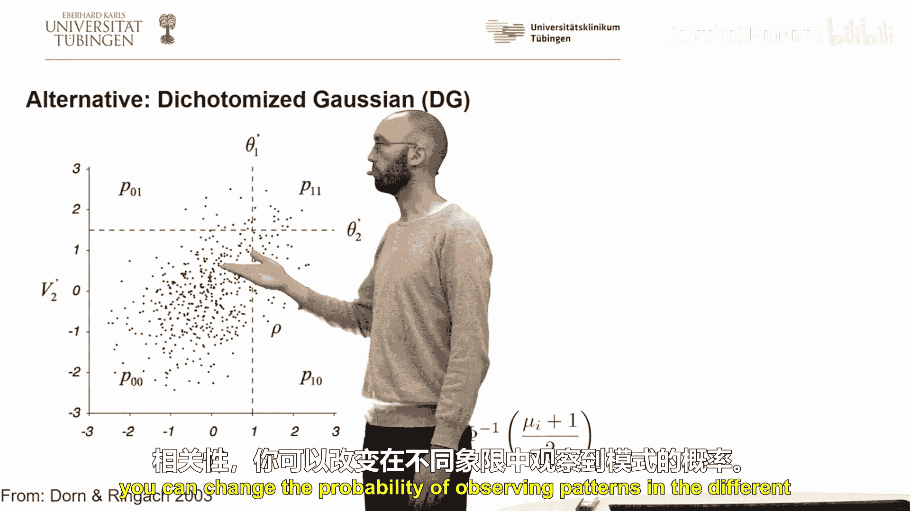

Of observing patterns in the different quadrants。In some sense。

 you can think of that as a membrane potential， very simple membrane potential voltage model。

That flagctuas with a Gaussian distribution in the background。

 and it generates spike if it passes that threshold。

The advantage is that the parameters of that model can be computed in a very straightforward way。

So by using the inverse G normal distribution function。

 we can simply from the mean of the observed binary data。

 we can simply compute the mean of the threshold of the。

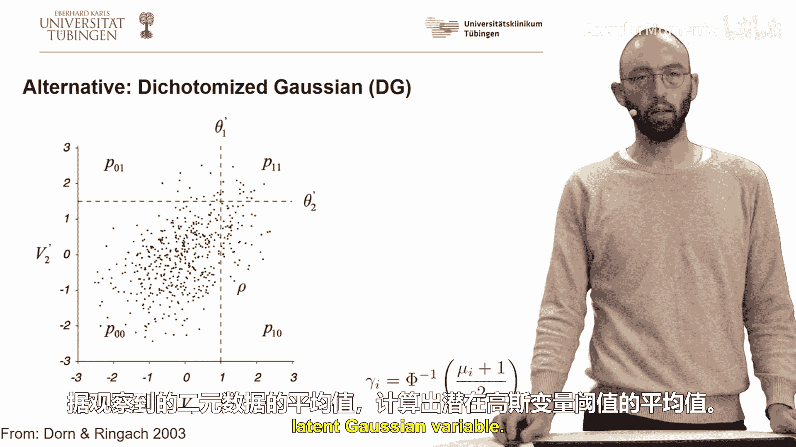

Late in caution variable。And we can do the same for the parameters of the covariance matrix。

The good thing about the good Da my Scussian model is that for a large fraction of the parameter space is it has actually very close to maximum entropy。

 So it makes very little additional assumptions。 And these assumptions can also be well understood。😊。

So if we compare here， for example， the difference between the dichotomized Gaussian model and the easing model for a range of the parameter space。

 you can see that as long as your correlations are not too large。

The entropy of both models is actually very， very close。

 If the correlations become large and the means very small， then they diverge quite a bit。

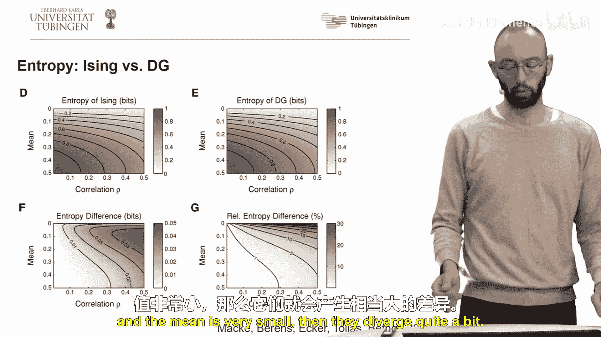

The advantages of this dichotomized Gaussian model are that the model is much easier to fit。

Thenhan the eas model， but maintains the property that it has close to maximum entropy。

 So it doesn't make more assumptions about the structure than is strictly necessary。

You can interpret it as a threshold membrane potential。

 and it can also be generalized to spy counts different from0 end one。

But there are binary redistbutions for which node dichotomized Gaussian model exists。can show that。

 And there's also no simple way of computing the likelihood。

 So you also would have to evaluate high dimensional Gaussian integrals。With this。

 I showed you two ways to model population structure in neural populations in recordings of neurons that were done simultaneously。

 And I thank you for your attention for this week。

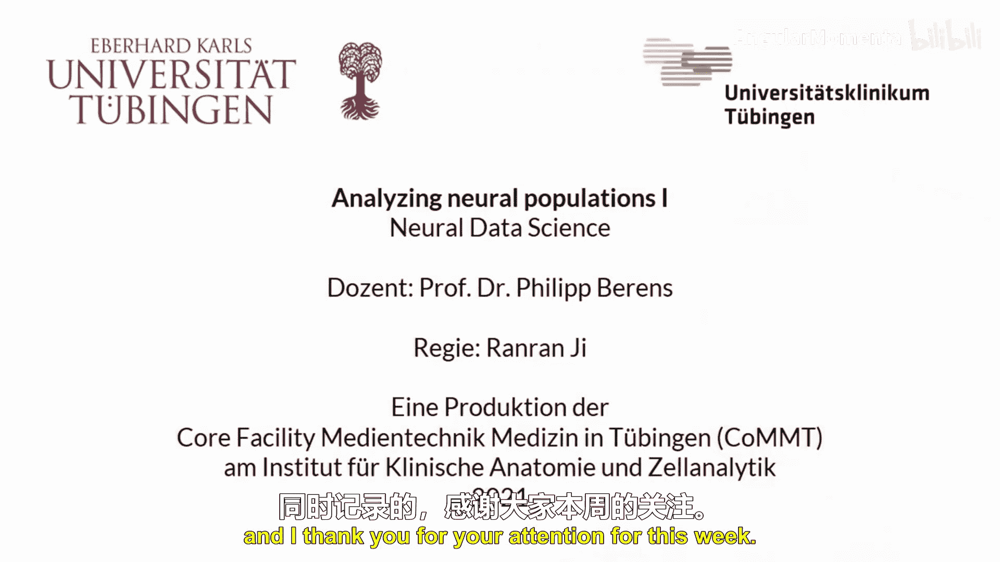