# 【精译】蒂宾根大学《神经数据科学》-p10-10-神经群体分析（二）--BV1DEYozGEMW_p10-

🎼Yeah。🎼。

Hello and welcome to this week of neural data science。 Last week。

 we started talking about how to analyze neural population activity。

 and we would like to continue this theme this week。😊，The responses of neurons。

If you record the menu times， even to identical stimulus conditions are highly variable。

 You can see that in this example over here， where down here。

 you see the peri stimulus time histogram， as we have also plotted in this lecture。

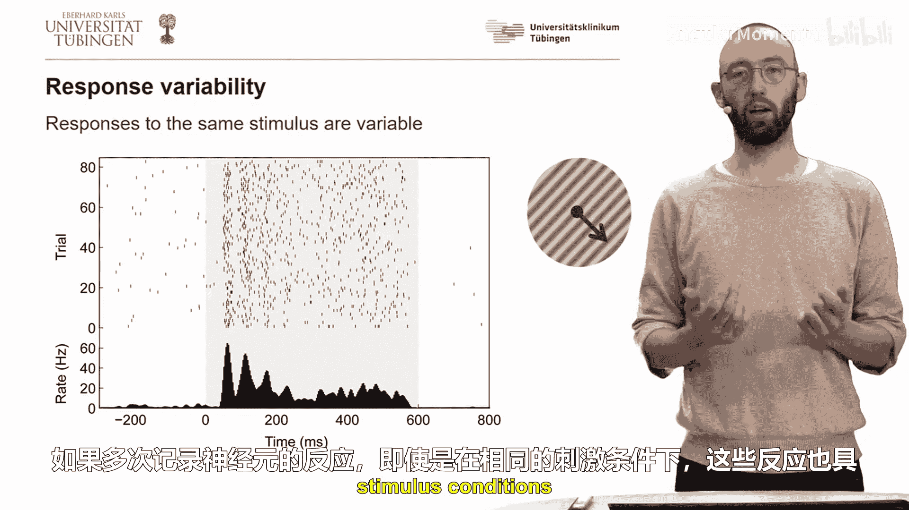

During this great time， we had grating shown to the neuron， such as this。😊。

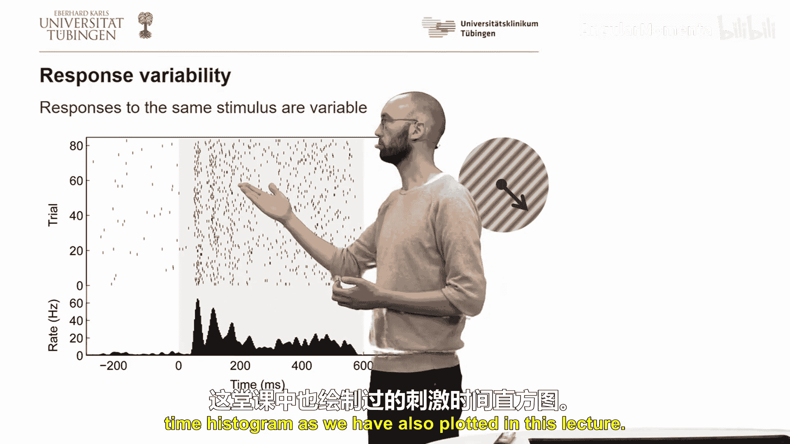

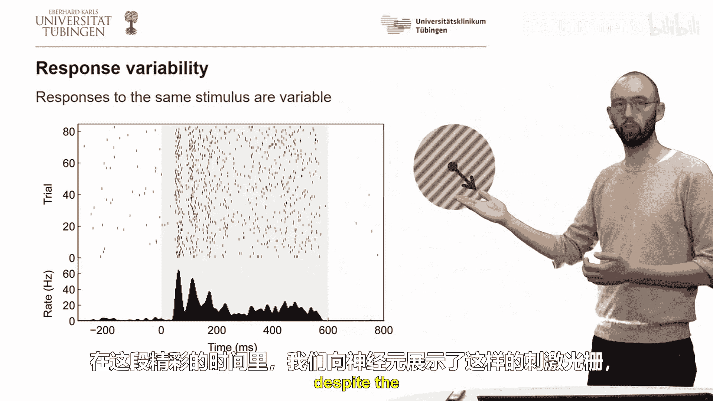

And despite the fact that the stimulus is the same across all these trials。

 you can see that the individual spike times vary quite a bit。

 but likely also the spike counts varies between these trials。

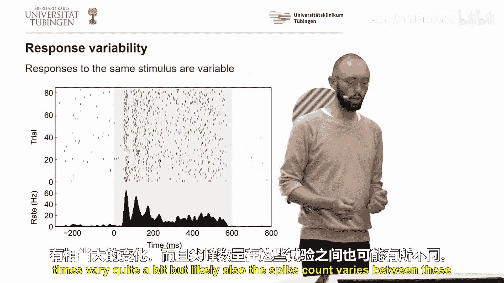

We refer to this variability often as， as noise in the data or variability from trial to trial。

 in many cases。This variability can even be correlated。

 And then we refer to that as so calledled noise correlations。

We distinguish these noise correlations from so called signal correlations。

So here we have the tuning function of a neuron。

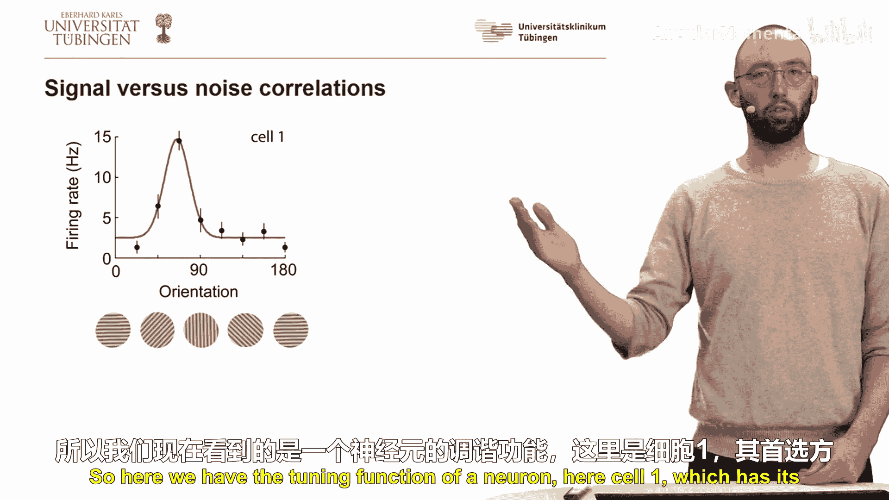

Here's  one， which has its preferred direction or orientation around 75 or so degree。

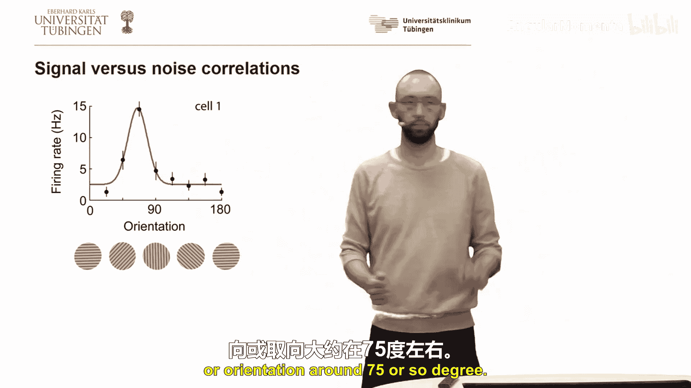

We have a second cell here。Don here。This also has its preferred direction around the same place。So。

 in this case。嗯。The tuning functions of these two neurons are very similar， so。

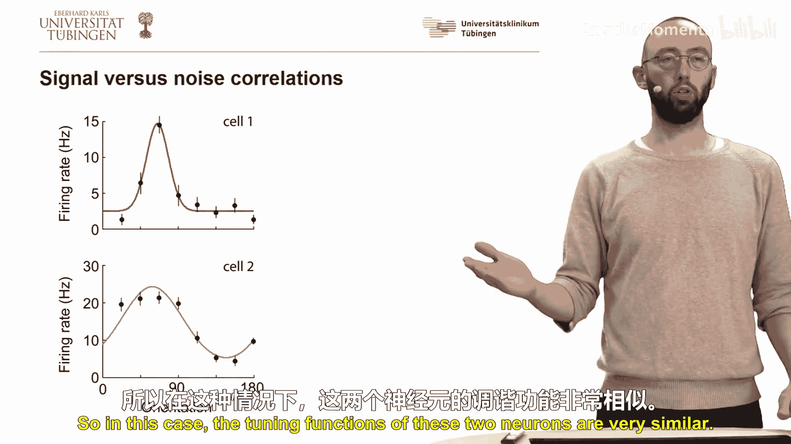

They have the preferred direction in the same place so that in general。

 it's much more likely that if this neuron fires a lot， this neuron fires a lot as well。

 And these correlations are the similarity between the tuning functions。 This is what we refer to。

 typically as signal correlations。

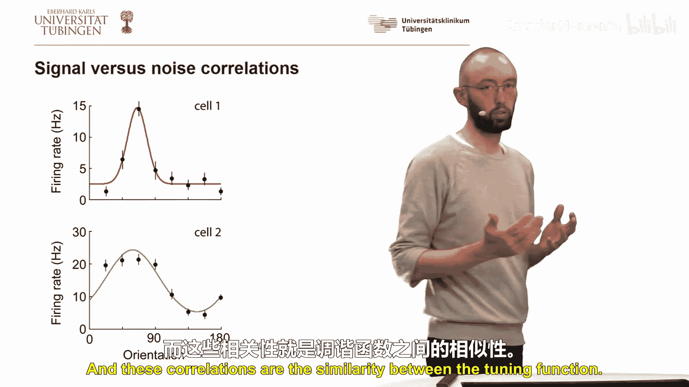

If we now focus on an individual stimulus， such as this one。

And we plot the spics across different trials versus each other。

 So this is now conditional on stimulus， this particular graing here。Then。

We refer to this as noise correlations between， because these are joint fluctuations between these two neurons that occur in the variability around their spiking mean。

So how can noise correlations be generated， One of the classic ideas going back to Shedland and Newsom in the 1980s and 90s。

Posits that noise curs are due to common input。

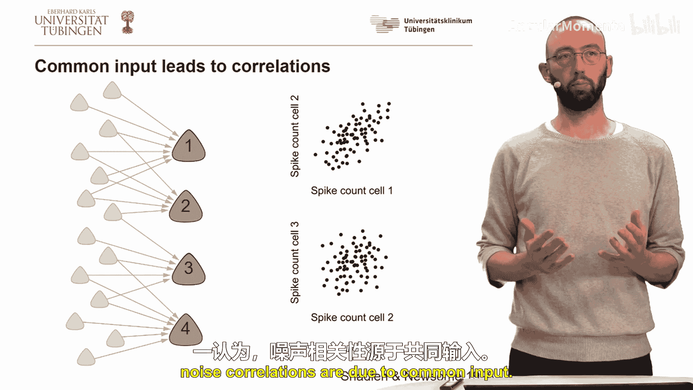

So， for example， in this， in this model here， neuron 1 and neuron 2 receive quite a lot of common input from a bunch of these neurons back here。

And they also have high noise correlations。 On the contrast。

 neuron 2 and neuron 3 just have this one neuron in common that provides common input to them。

 And therefore， their noise correlations conditioned on the stimulus are much lower。

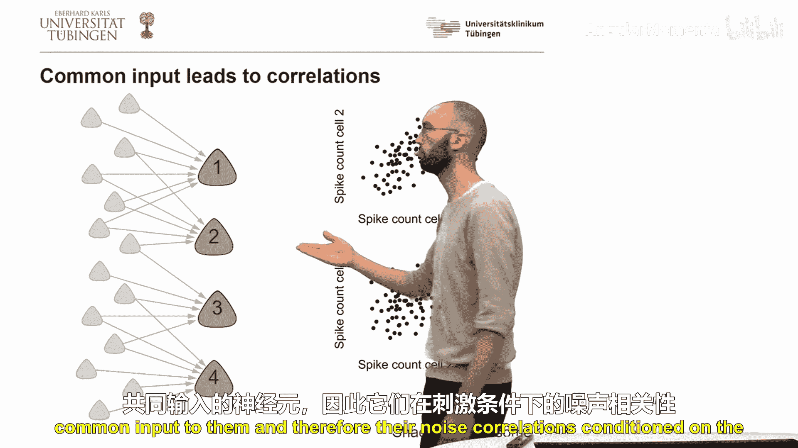

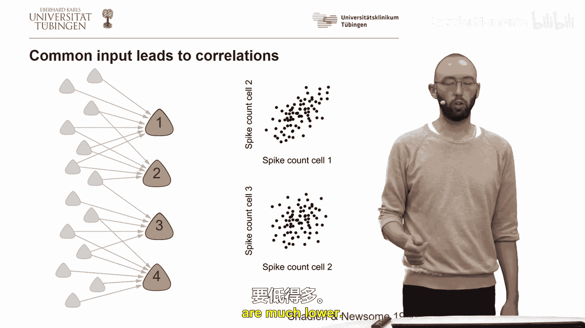

What are the consequences or the potential consequences of noise correlations。

So let's say we're in a setting where we would like to distinguish。

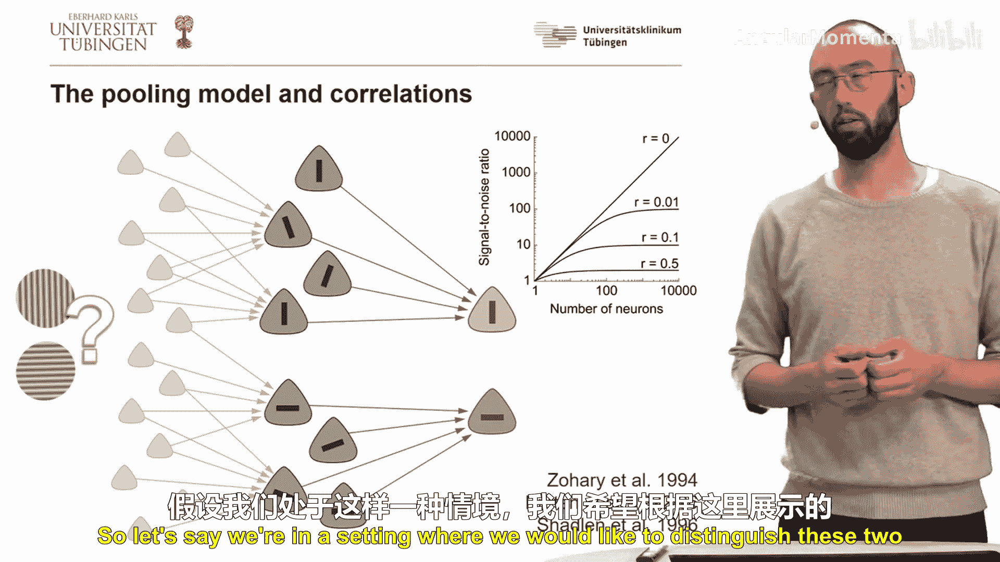

These two stimulus， stimuli in vertical and in horizontal grading based on the activity of a population of neurons。

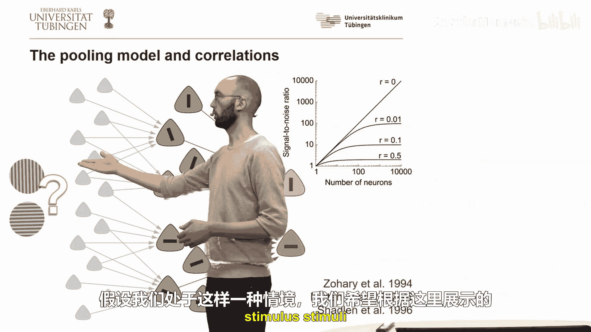

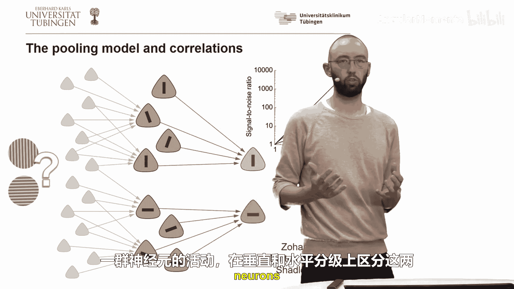

Such as here。Now， let's say we have two decision neurons， this one and this one。

And this one simply pools by summing up all the neurons that have a preferred orientation close to horizontal。

 And this one pools simply by summing up the activity of all the neurons with preferred orientations close to vertical。

😊，Now， if you are in such a setting and you ask， what is the signal noise ratio or what is the information that I can extract from these two decision making neurons。

If they pool。Pools of neurons with increasing size。

Given the amount of noise correlations in the data。

Then you can see that if your noise correlations are0。That then。

The signal noise ratio grows with the population size。

 But as soon as you have positive nonze noise correlations。

 the amount of information or the amount of signal noise ratio actually saturates and it saturates the the more quickly the higher the noise correlations are。

Now， that means that after a certain point， adding additional neurons to the decision making process doesn't help you anymore。

Why is that， Why， Why is that important well。People people found during experiment that often the sensitivity of。

 of individual neurons was remarkably close to that of the entire organism。

 And they concluded from that fact and the finding of noise correlations that it might be possible that the pooling process that can be achieved by having many neurons to pull over is just severely limited by the fact that they are correlated。

Now， this is， of course， a very simple model。 This simply summing up of activity can we is。

 is that also， if we read out the information in an， in a statistically optimal way。

That that stood the hold。And the， the answer is， yes。So in this kind of population coding studies。

 we typically plot neurons as a function of their preferred orientation。

 So that red neuron here has its preferred orientation at 45 degrees。

 so we would plot its activity at 45 degrees。

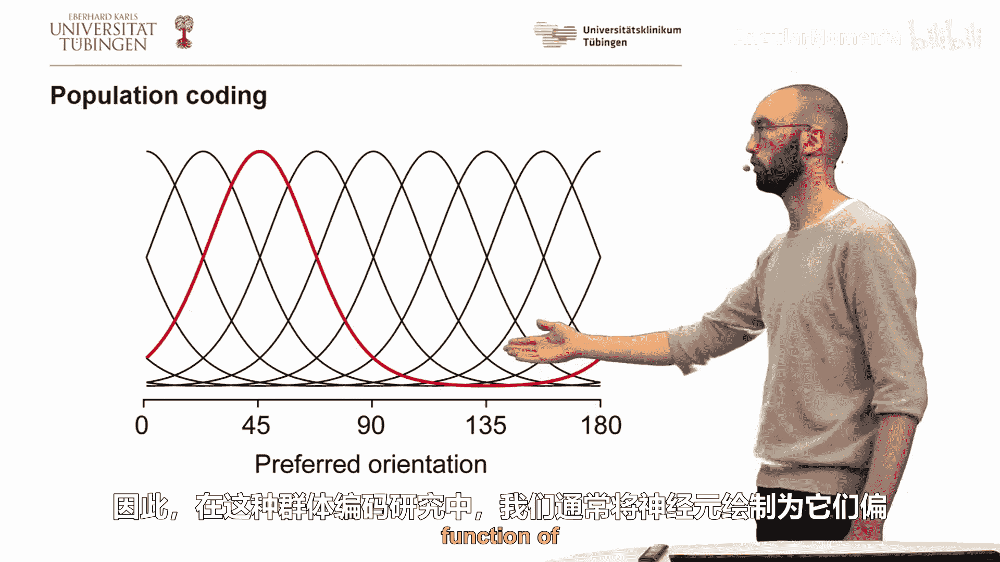

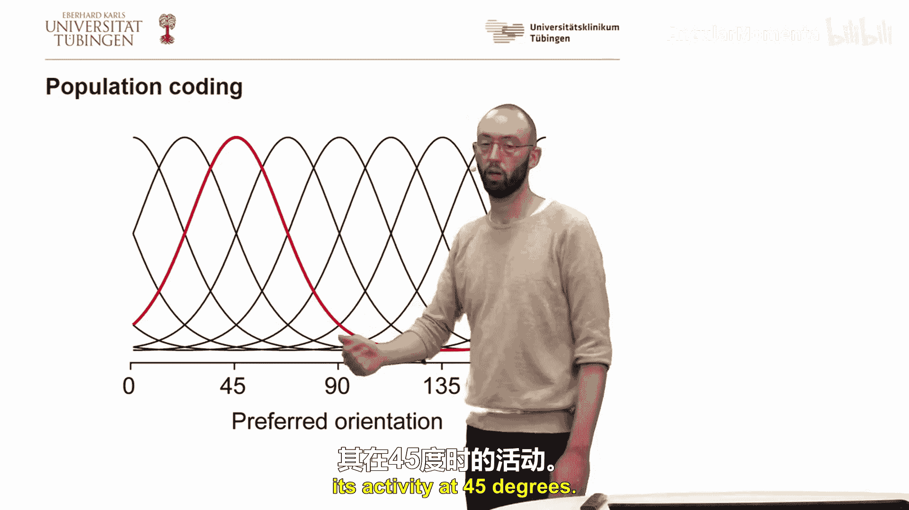

And now I would like you to give an intuition why these Norris correlations are actually bad。Now。

 in an uncorrelated activity。 So be reminded， this， again。

 is a plot where a population of neurons for which each neuron is a dot。

 and the dot is at the preferred orientation of that particular neuron。In blue and red。

 I show you two different trials。 So two different samples from the population activity。

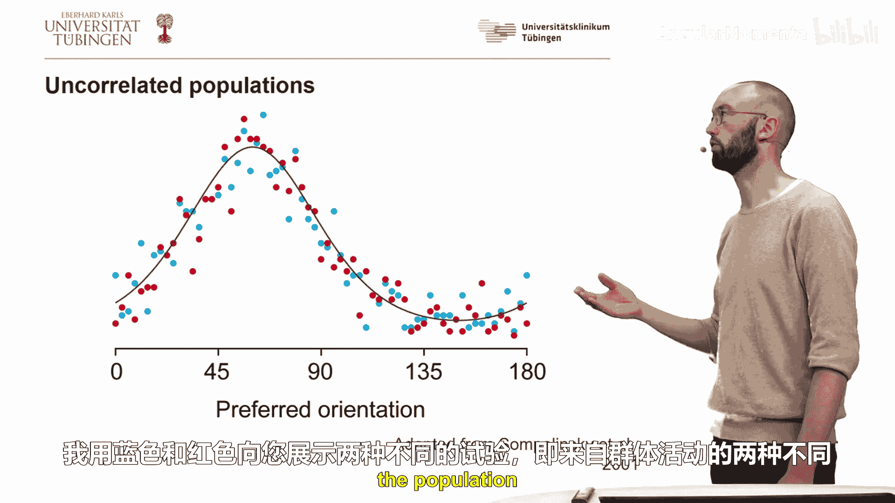

And you can see that for this uncorrelated population or， overall， the shape of the activity follows。

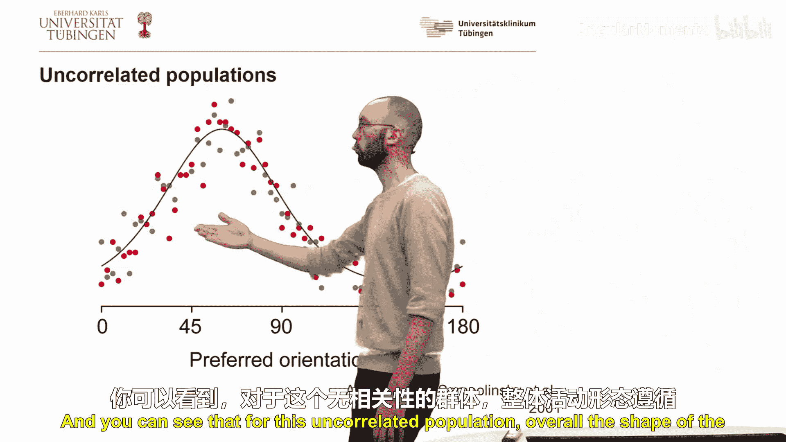

The it's average， which is the black9。Which is equivalent to a single neuron tuning curve。

 But in this case， it's actually the average population activity。

But if we now change the correlation structure， this is not the case anymore。

So two correlation structures have been discussed in detail。

 One of them is the so-called No uniform noise correlation structure where all neurons have the same noise correlations independent of their preferred orientation。

 and the other one is the so- called limited range correlation structure where neurons that are close in preferred orientation have higher noise correlations than neurons that are farther away。

In the case of the uniform correlation structure。嗯。

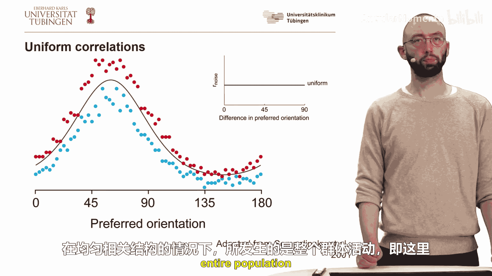

What happens is that the entire population activity。

 So this entire population hill per trial shifts up or down。

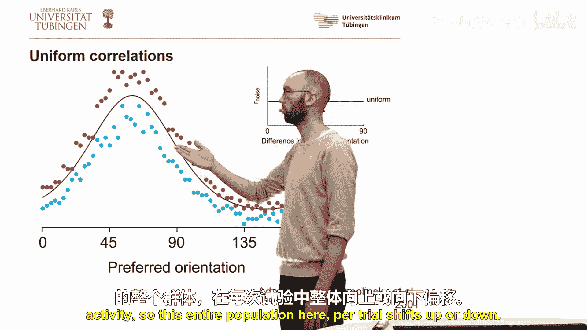

So part of the variability in this case actually gets injected into this global shift。

 And if you can disambiguate that， that can actually help you and make your decoding more accurate。

In the case of limited range correlations， and these are the correlations that have been classically reported to be found in neural systems。

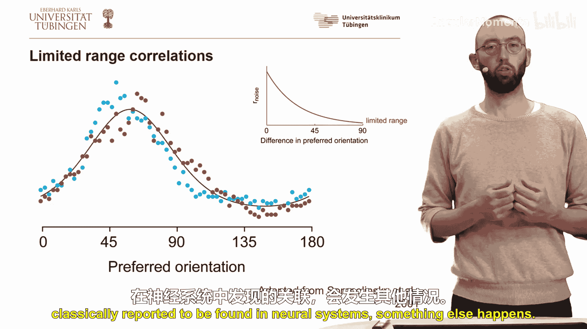

Something else happens。 In this case， neurons that are closer together in preferred orientation space。

 If any of them has a higher activity， then also the other neurons closer closer around to it also will have a higher activity。

😊。

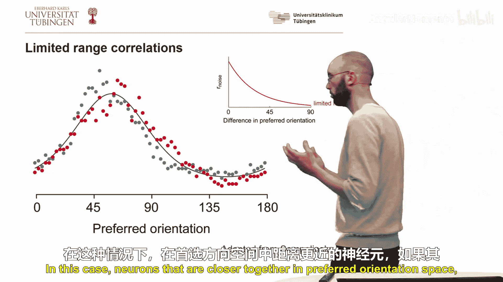

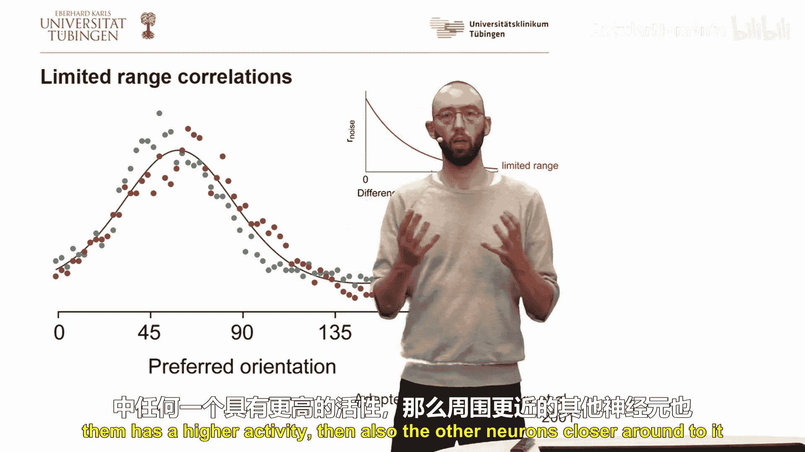

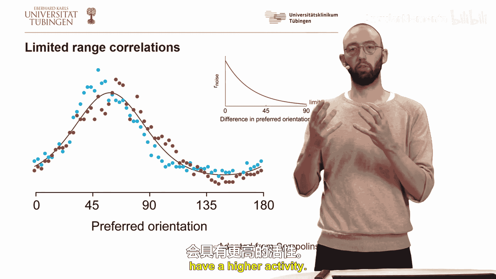

So what happens。In this case， is that the， the peak of this population hill actually shifts。

Shifts around。 So the in the red trial， the highest bump in this population hill is around here。

 And in the blue trial， it is somewhere up here。So from this illustration。

 you can immediately see that if you try to decode this population activity。

 that your estimates will be much worse than from the independent population。

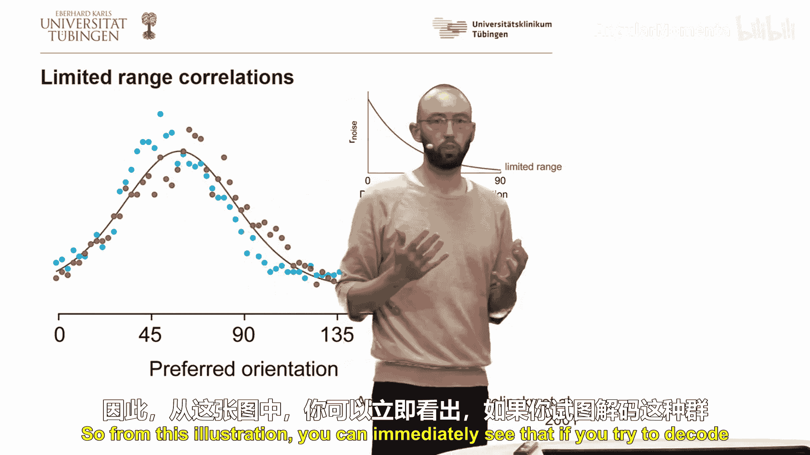

So that means that in this case of limited range correlations， even with an optimal readout。

 such noise correlations can significantly impair your signature noise ratio or coding performance。

Well， uniform correlations can actually help you。Now。What about real systems， So what。

 what do we find。So a study， which I was also part of together with my colleague， Alexander Echo。

 who's now in， in cuttinging。 We did the following experiment。 This was actually very simple。

 And these are the experiments where also lots of the data that you've analyse so far comes from。

 So we had。Such oriented greetatings。That we use to stimulate。The neurons in the visual cortex。

 we performed spike sorting just as you did， and we quantified the contamination and the spike sorting quality。

 and we focused exclusively on the neurons that were really well isolated。

So this was in awake animals。We then fitted all tuning functions。And we computed noise correlations。

 So at this time。The， the existing dogma in the field was that these noise correlations are actually relatively large。

 especially among close by neurons。 When we looked at our data， to our surprise。

 we found that actually， for example， in this example， electrode here or in this example。

 Te showed noise correlations were typically very small。 So on average， in this case。

 only about point02。We looked at all the pairs that we recall could record from neurons on the sameteron。

 So ones that are physically very close together。 And as you can see here。

 their average is really small。

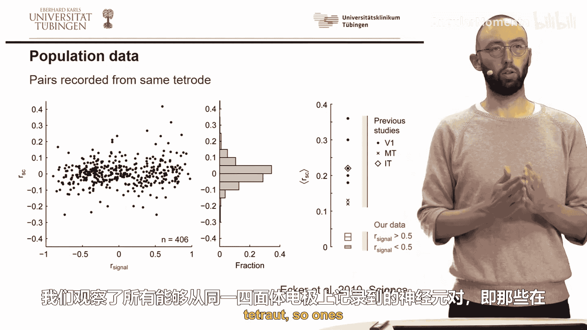

So， very close to 0。

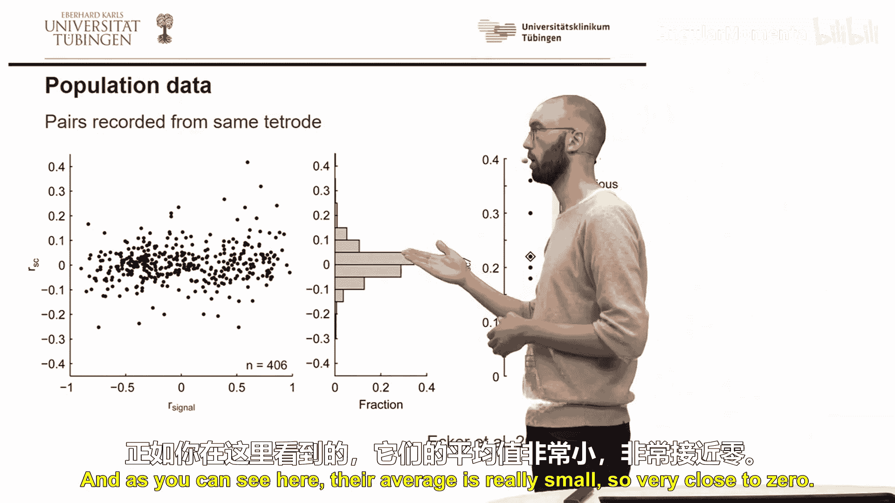

So even if we split by day， by neurons that have very similar tuning functions versus ones that have more dissimilar tuning functions。

 even for the similar ones， the average is below below 0。05。 and for the dissimilar ones。

 it's even smaller。In the graph above， we summarize previous studies that all of them。

 where all of them show much larger estimates of these noise correlations。So with our data。

 pudding would make much more sense， or decoding would be much easier。From these neural populations。

 compared to all the other data。So why stand？ So which factors are estimate influencing our estimates of correlations。

The one hand， their global brain states。So if you put an animal to sleep or under anesthesia。

Then your brain starts to fluctuate。 The activity starts to fluctuate between up and down statess。

And this is， this is pretty global。 this affect all the sales simultaneously。 And， of course。

 this kind of global common input to all of them causes。causesuse noise correlationronations。Also。

 noise correlations could be due to decision making。 For example。

 if an animal pays attention to a particular part in field， all the neurons that have its attention。

 its receptive field in this area may receive a gain modulation。

Could also be due to different strategies， and so on。Finally， of course。

 neurons can also be affected by different technical artifacts。

 such as errors in spike sortging or electro drift。

 And if you are interested in these technical factors。

 go back to our original paper where we discuss them in detail。Today， I would like to focus。

On noise correlations， and anesthesia。So the effect of global brain states。 So in this case。

 global brain state would be induced by anesthesia。嗯ng。And the anesthesia。

Ituces sleep like fluctuations across the cortex in the neural activity。This can be really。

 really strong。So what you can see here。Is a raster plant。Of a neuron。But in this case。

 it's actually sort of different than what you're used to。 So this is one trial， one such box。

 It one trial with 1 hundred and 20 neurons recorded simultaneously。 Two given stimulus。

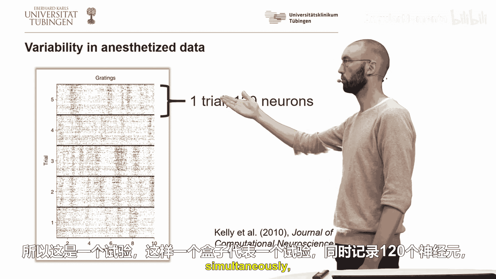

So the stimulus is always the same in this plot。

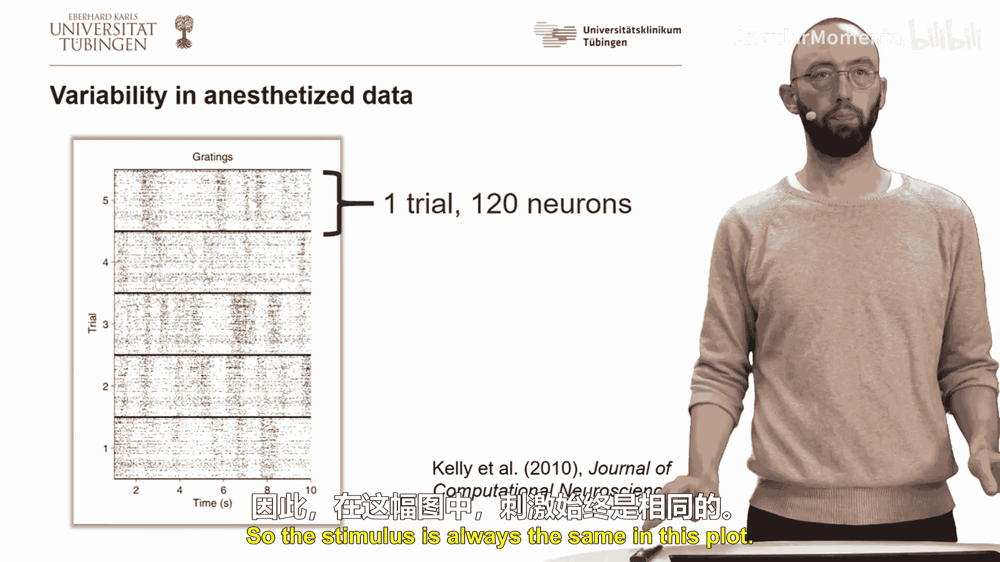

And you can clearly see there these， these stripes that become apparent in every trial。

And these are joint modulations of the activity of these neurons induced。For example， by anesthesia。

 or hypothesis was that this is induced by anesthesia。And these again。More trials。

With the same stimulus， the same neurons。And you can see that this pattern is different every time。

 and it's not locked to the stimulus。

So it has to be some other global process that makes these neurons fluctuate inactivity together。So。

We went back。 We also recorded activity under anesthesia。

And if you group the population activity by trial。Just as in the last plot， on the right hand side。

 we have the weight data on the left hand side， we have the an naesthetized data。

 On the right hand side， you can clearly see the effect of the stimulus。 So these fluctuations。

 they are simply due to the phase of the stimulus。

But on the。

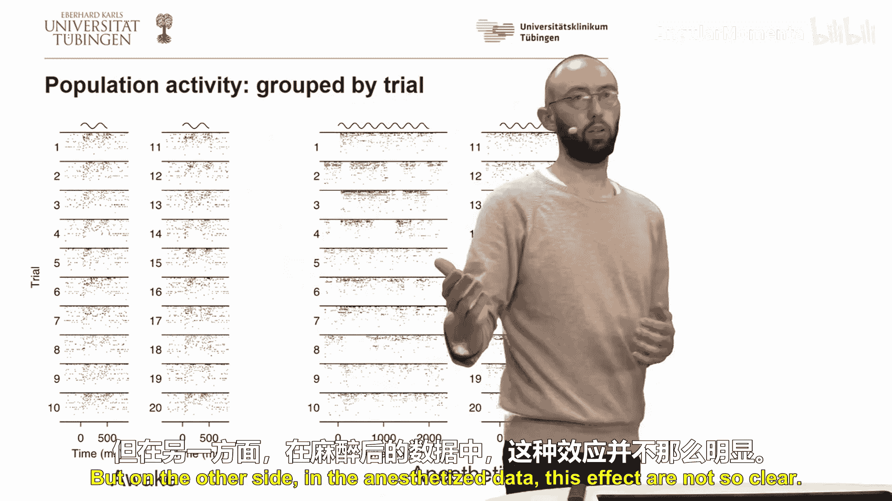

Other side， in the anesthetized data， these effects are not so clear。 Rather， you have pauses。In。

 in firing， as for example， here。We here。我 here。That are not locked to the stimulus onset。

 They are different from trial to trial。 So if you compare these first three trials。

 they are always slightly different。嗯。But still very consistent across the population of neuron that has been recorded simultaneously here。

And these typically don't occur in the wake data。So these pumps in the awake data。

 they are clearly due to the modulation by the stimulus。If we group the activity by neuron。

 then we can see， again， all kinds of population of response patterns here。So， these have。

They fire very clearly to the stimulus onset。 Some fire very precisely， such as this。

 Some are modulated strongly by the phase of the stimulus。 Some are less。

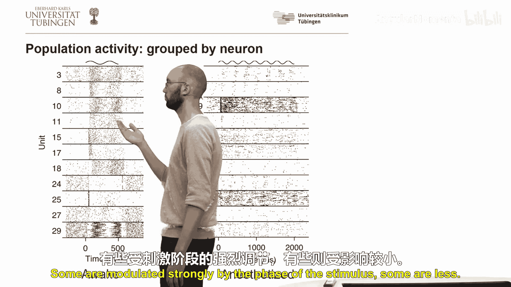

The same kind of diversity can also be seen in theesthetized data。

 although the structure already from this point of view looks a bit different。

 but there are also clearly some neurons such as here that are modulated by the phase of the stimulus。

 So it's not like the data between these two data sets is like really。Entirely different。Also。

 no matter whether the recordings are done under anesthesia or in the awake animal。

 all of these neurons show clearly tuning curves。Now， if we look at what other properties change。

We can see， for example， that the phfactor changes。

 The phfactor is a measure of the total variability， if you want。

 So it's the ratio of the variance to the mean。For Poson distribution。

 the final factor is actually equal to one。 So the variance is equal to the mean。

And this is actually very close to what we have in the awake data here。 The fan offactor is 1。1。

The case of the NA tennis data， the found factor is much higher，2。4。

So there seems to be more fluctuations in the neural activity。

 So the neurons seem to fluctuate more widely than during the awake state。是。

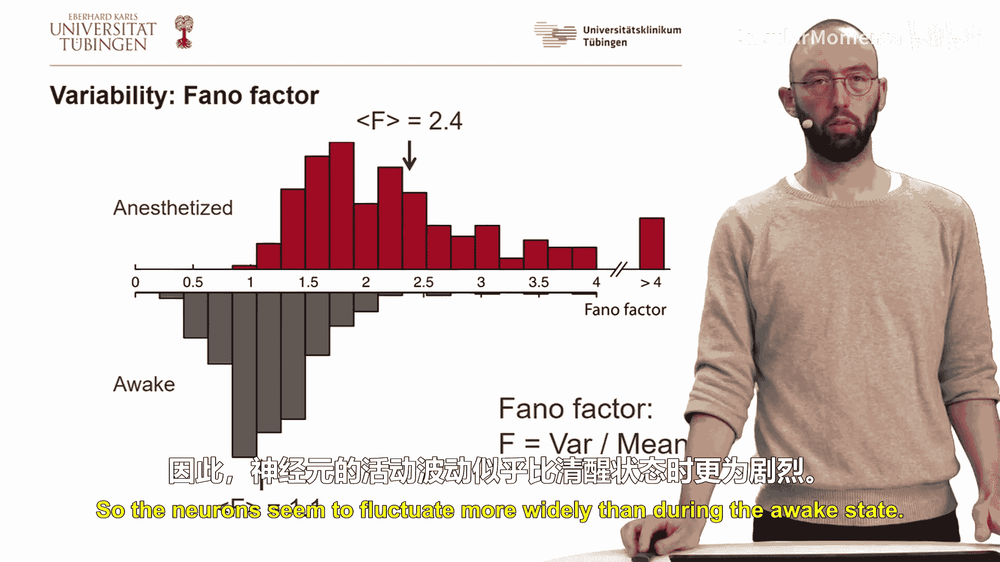

F。Again， compute our noise correlations。 So the correlations between the activity of neurons for fixed stimulus。

Then we can find that on average， in the awake state， the noise correlations are 0。01。

 While in the anesthetized state， they are 0。06。 So just averaging across all pairs。What。

 what induces this shift。In the。In the activity， in the variability or covari of these neurons between the two conditions。

And can we understand that， or can we。Can we make。somehow certain that it's really the change in the。

 the brain state between anesthesia and the awake that is responsible for this。

So if we look in in more detail into the， the shape of this correlation structure。

 we can both plot it as a function of the， the mean firing rate。

 as well as as a function of signal correlation。Then you can see that in the。

 especially the nesttheized state， the noise correlations go up。

With the average firing rate of the pairs， So the noise cors are higher for neurons that fire more。

 and to some extent， is also true in the awake state。

 But there's quite a difference between these two curves。

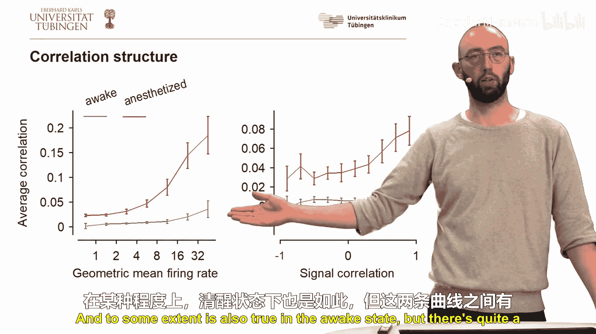

The same is true for the noise correlations plotted as a function of signal correlation。

 So here also， the entire curve is shifted quite a bit to the top。

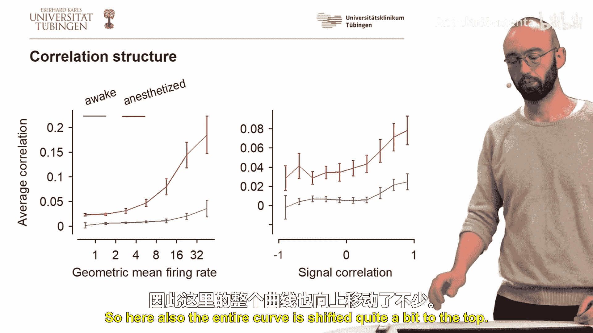

So now this is where neuropopulation models are coming in in case you were wondering。

So now we build a model。Of the neural population activity with which we tried to infer the latent brain state。

In this model， we will， we will use a a latent variable model。

 So called Gaussian process factor analysis or GFA。Gauussian process factor Ana assumes。

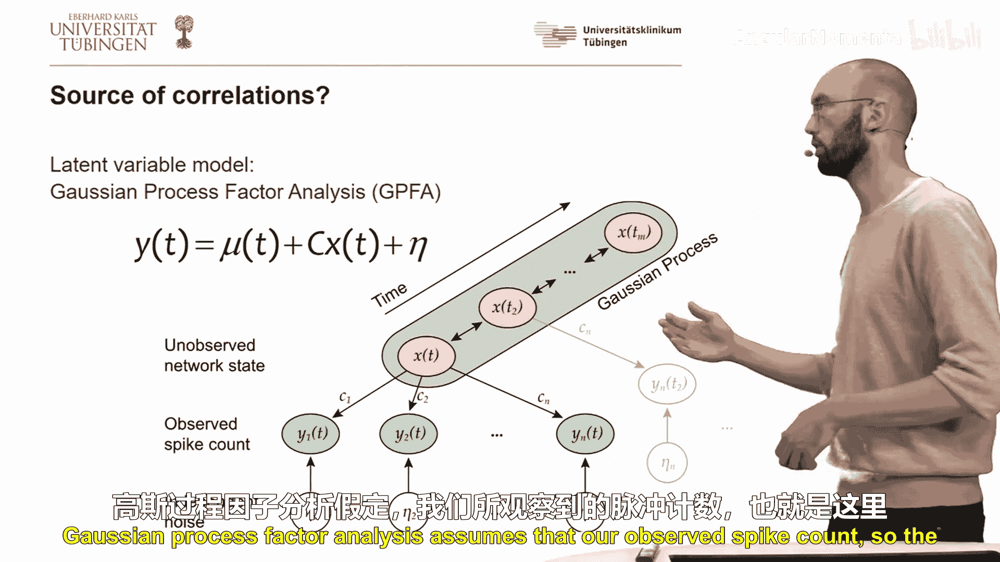

T our observed spy count。 So the green boxes down here。That they have been generated。

From an unobserved network state， the red box is here。That evolves smoothly over time。With some。

 and then there's some added， added noise that occurs independently between neurons at any given time。

 But this unobserved network state， this， in fact， influences all the neurons simultaneously。

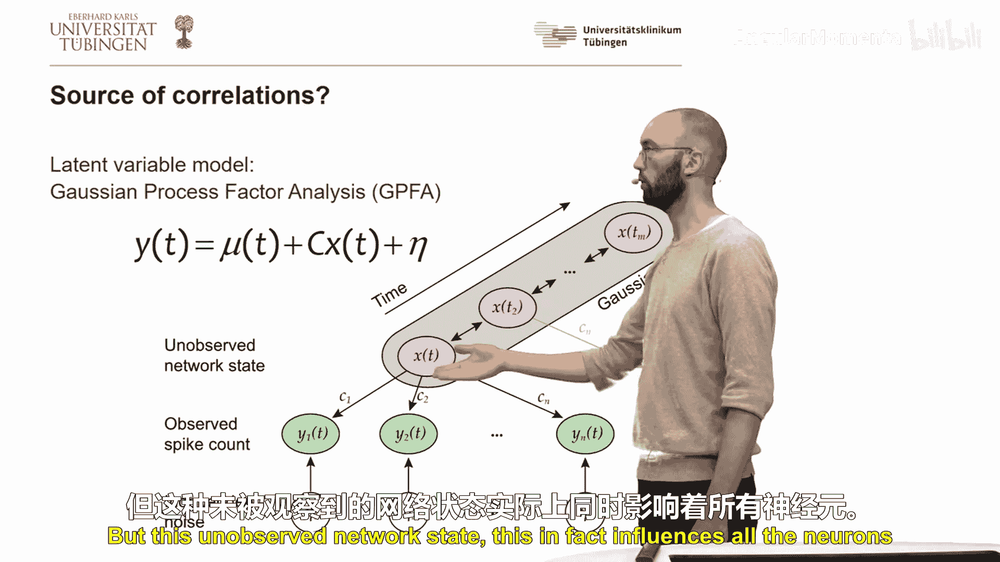

So this， if we postulate such a latent state。And if we postulate that this latent stage corresponds to the brain state induced by anesthesia or changes in brain stayed induced by anesthesia。

Then we can test this with this model。In the model。

 we have a number of parameters that we need to estimate。 So one is simply the mean firing rate。

Then we need the latent variable， X T。Some mixing weights that how these latent variables are are mixed to result in the observed spy count and then some independent or private noise。

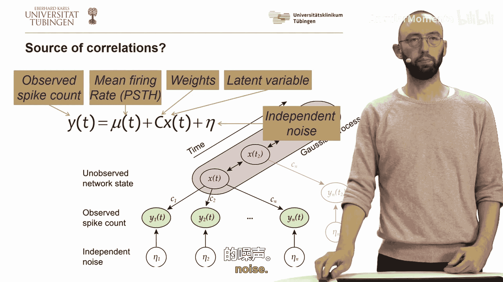

So， if this。Pararameter vector C， for example， looks vectors。

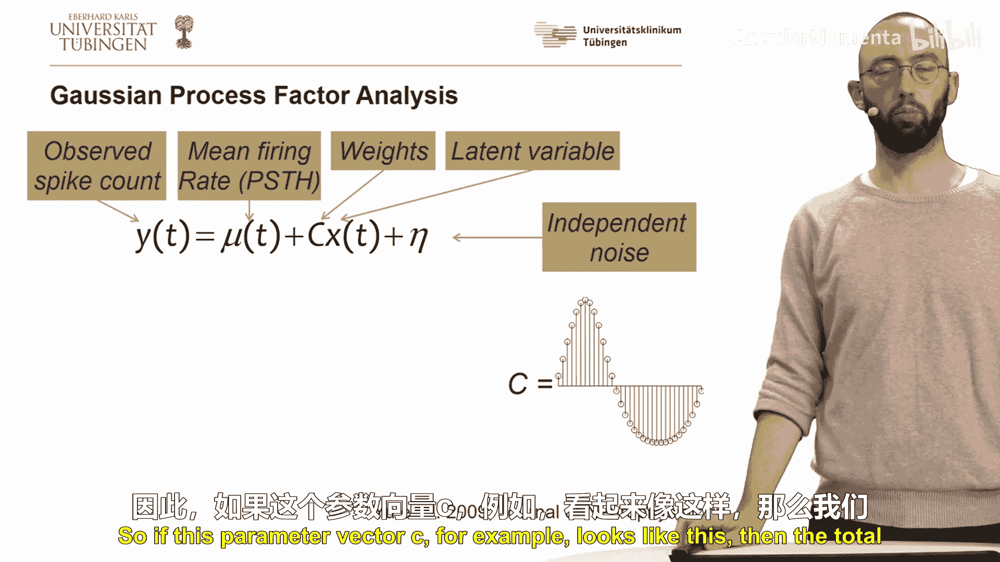

Then the total covariance。Of our responses， Y can be computed as the outer product C， C transpose。

 So this looks like this。

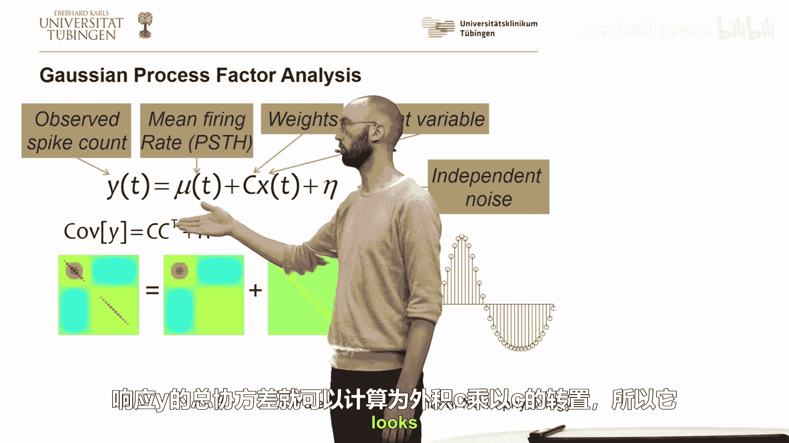

Plus， the diagonal matrix that comes from the independent noise。

So we decompose the total correlation or the total covariance into a path that is explained by the latent unobserved factor。

And a private plant。

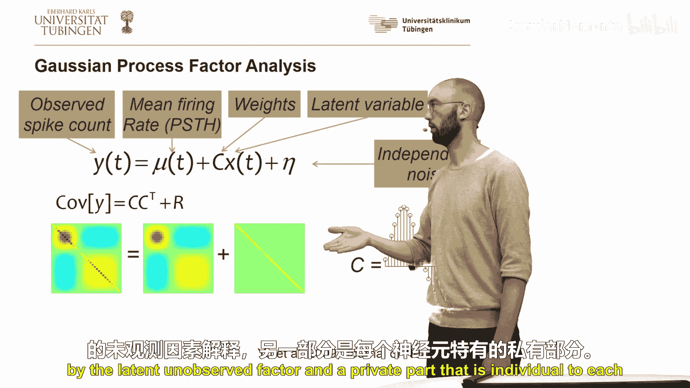

That is。Individual to each neuron。This wait C and the variance of the noise are learned from the data。

In， in Gaussian process factor analysis， we， in addition。

 assume that the latent variable is smoothly varying over time。

 So we assume it to be a Gaussian process。And the Gaussian process to have a covariance structure with a length scale of tau。

If you don't remember the details of Gaussian processes and you feel like you need a refresher。

We didn't cover that in the machine learning one lecture。

 but probabilistic learning by Philiplip panic covers everything you will want to know。

So this is the covariance matrix over time， and this is the covariance kernel that we use in the Gaussian process。

The latent state。So we can write down this joint model for。

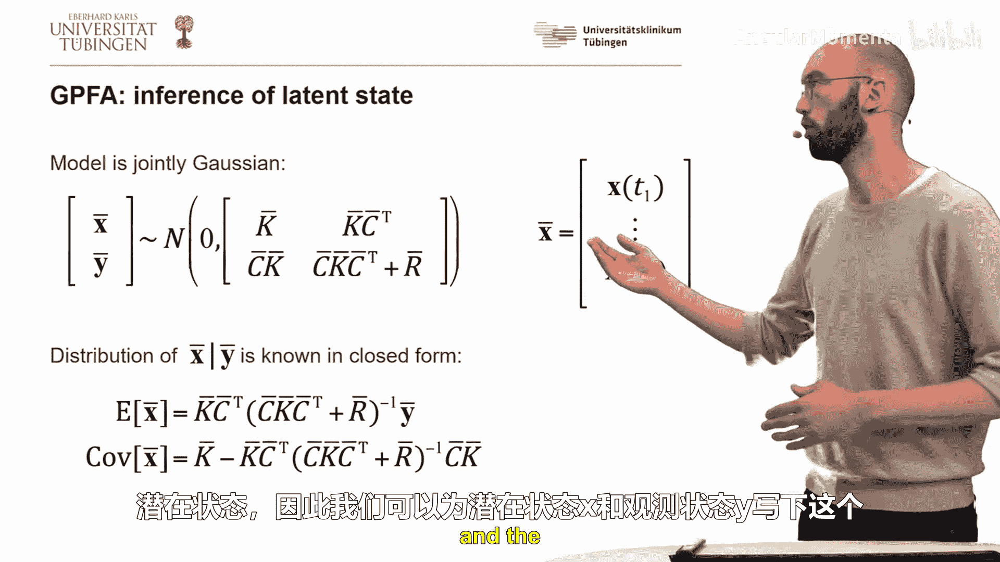

The latent state X and the observed state y。

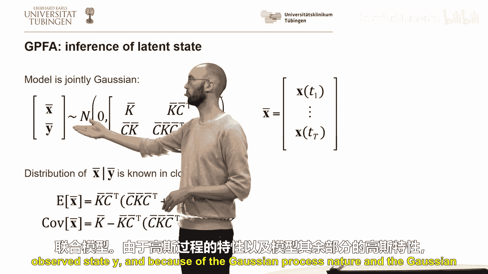

And。Because of the Gaussian process nature and the， the Gaussian nature of the rest of the model。

 we can write down this joint distribution here。 And it's also Gaussian。 And therefore。

 we can then condition on observations y。

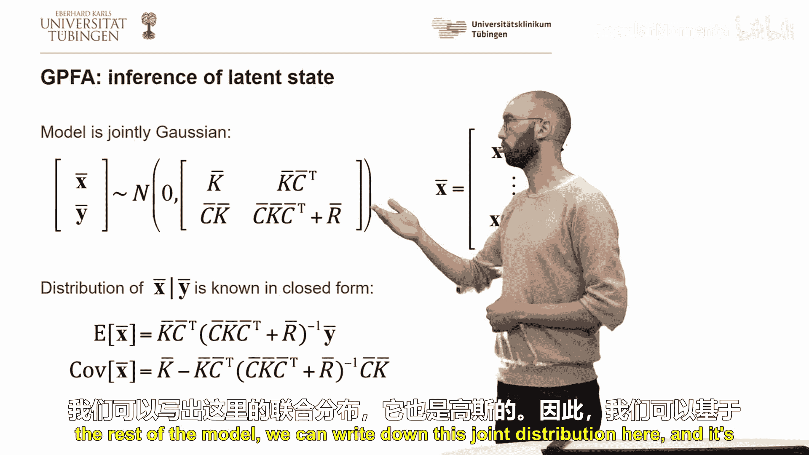

So we can compute the latent state X based on or conditioned on observations。 Y in closeded form。

Given our estimates of C。And are。Now， what happens if we estimate the latent state。

 So here is an example of 20 trials recorded under anesthesia。

 And you can see the latent state in red。So here， for example， in trial 2。

 you can clearly see that the latent state is down， then goes up when all the neurons fire。

 then goes down again， when the neurons are silent。

 goes up again when the neurons fire goes down again， when the neurons are silent。

And really seems to capture these fluctuations in neural excitability across the population。

We can also do the same in the wakestead， and there it looks much less structured。

IfWe want to learn the estimates of this， if if we want to estimate the parameters of this model。

 then this is not possible in closed form。 But again。

 we need an expectation maximization algorithm just as for the mixture of Gaussian model。

 you alternate between the E step， the expectation step。

 where you compute the best estimate of the latent state。

 the latent variables of your model under the current model using this closed form Gaussian formula that I showed you before。

And the M step， the maximising step， where you update the parameters。For the， the weights。

The variance of the noise and the length scale of the re gausion process。

 given your current estimate of x。If you're interested in code。

 you can refer to these two resources here。Now， we can， of course， also look at the weights。

 And one interesting thing is that under anesthesia。

 we find for a single state variable that almost all the weights for the neuron are positive。

 Some are stronger， Some are weaker， but very few are negative。

So that means that this inferred latent state seems to influence， in fact。

 all the neurons in the same way as we would want from a con correlation in usingcing process。

You can also see that in this histogram here。We can。

Thus separate the variance into two co contributions。

 So this is the kind of the variance ex I if we want to compute the variance explained。

 And what we're interested in is knowing what part of the variance is explained by the latent state。

And to this end， what we compute。Is the variance explained by the。

 the weight vector or by the late and state C。So this is simply C K square divided by the variance of Y K。

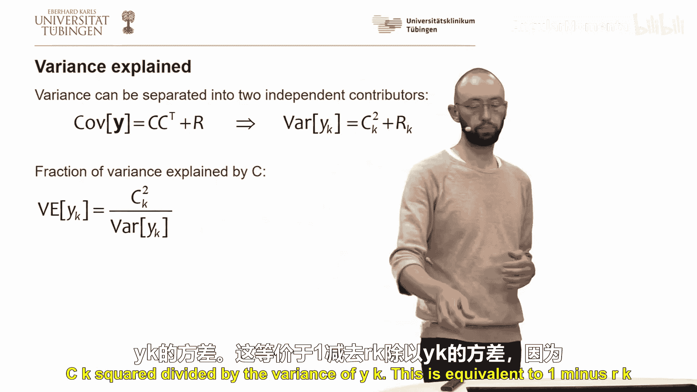

This is equivalent to 1 minus R K divided by variance of Y K， because together。

 they have to sum up to the total variance。And this has to be larger than0。Now。

 one problem that can occur when you try to estimate that is that of overfitting。

 So if you overfi your model， then you can also get negative variances explained。

So to estimate variances explained in a， in a proper way。

 you would train your model on a subset of the data。 So you cross validate your model。

 You keep your weights C and the time scale tall fixed。

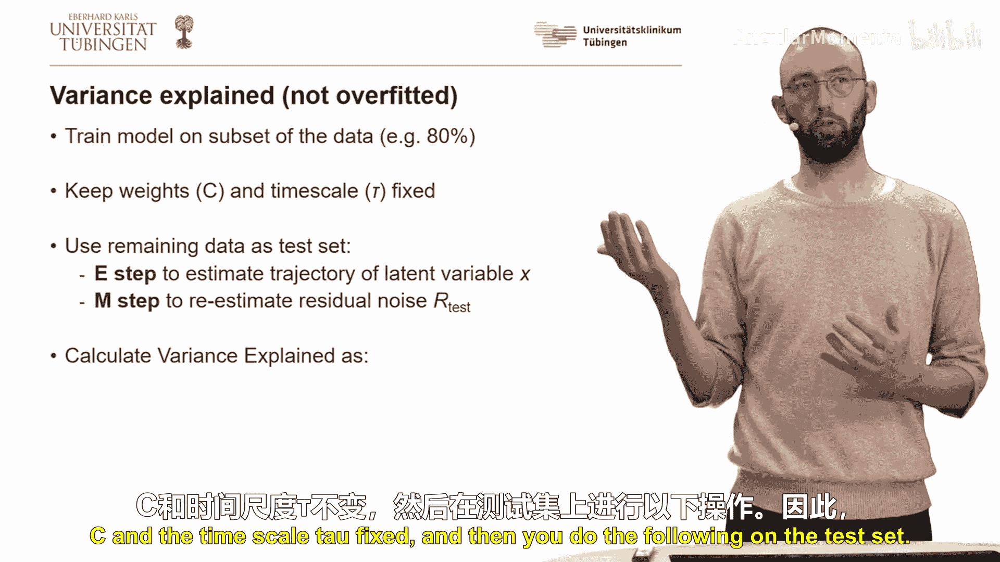

And then you do the following on the test set。 So on the test set， you estimate in an E step。

The trajectory of the latent variable x。 And then you need to reest the residual noise on the test set。

So basically， on the test， you run a partial E M step。

But also just one with fixed weights and time scale。

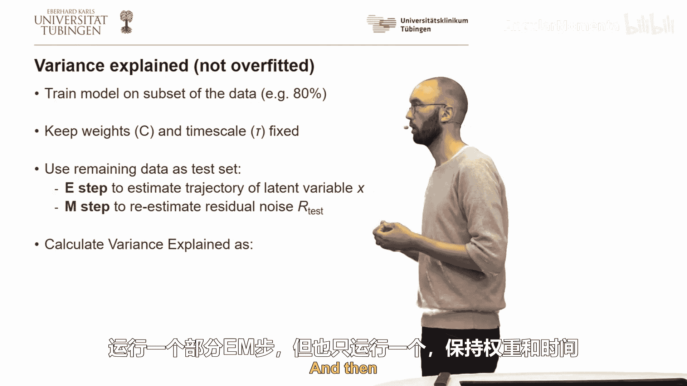

And then you calculate the variance explained。Using this estimate of the noise on the test set。

So if we do that， then we find that up to 40% of the variance under anesthesia can be explained。

 in fact。By this GFA model。嗯。Under wakefulness， so in in， in the awake animal， it's， it's much。

 much lower the fraction of variants explained by this latent state。 But under anesthesia。

 it can be actually very high， especially for neurons with high firing rates。

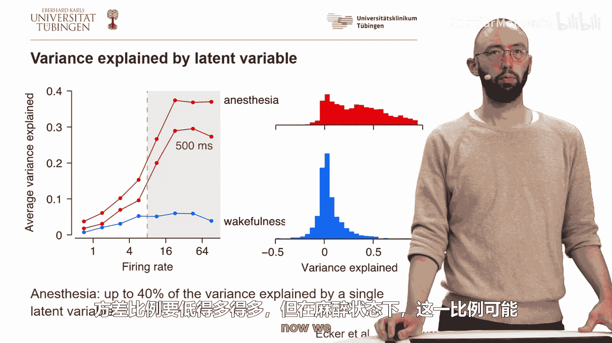

So now we can use the model to calculate the noise correlations。

In the data that would occur if we subtract out the effect of that latent state that we believe is due to anesthesia。

So again， like in the case of the variance explained。

 we estimate C and tau on a training set and then keep them fast fit fixed。 but then we estimate。

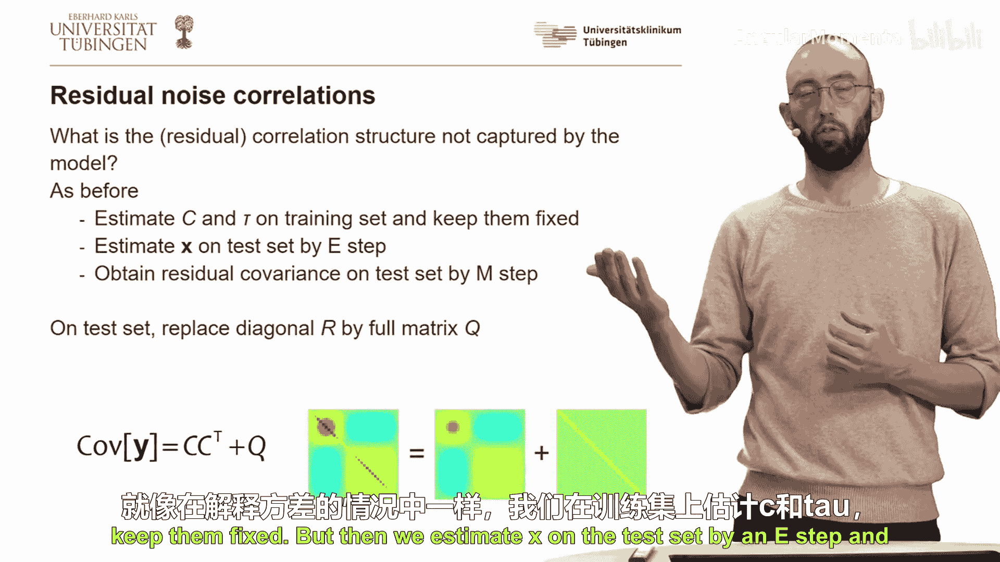

X。On the test side， buy an E step。And compute the residual covariance matrix on the test set by an M step。

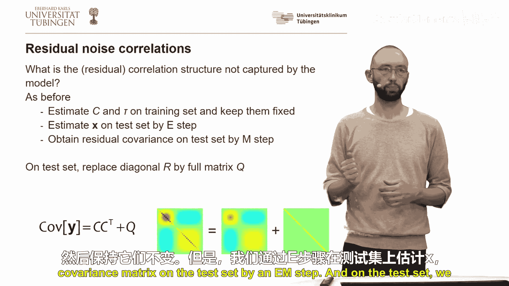

And on the test set， we replaced the diagonal matrix by the full matrix Q。

And then com compute this residual matrix。

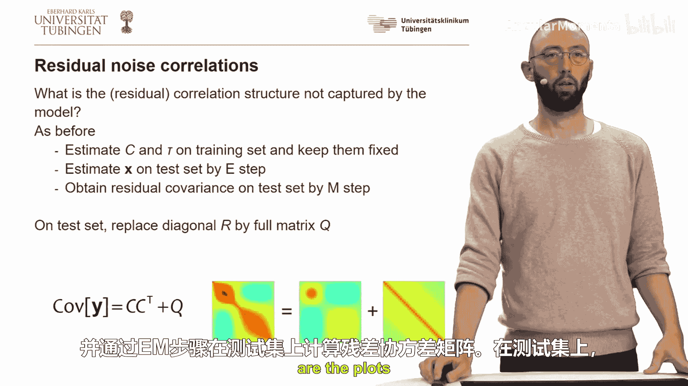

Now， these are the plots that I've showed you before。 So to remind you。

 the red graphs are under anesthesia， the noise correlations。

 independent of signal correlation and firing rate。The blue grass。During wakefulness。And now。

 if we remove this one factor， this latent state that we think is due to anesthesia。What happens。

Basically， now， all the lines fall on top of each other。

And the correlation structure becomes pretty much indistinguishable from the correlation structure in the awake state。

So we think that we can explain this fact that the correlations were much higher during anesthesia。

Simply by the correlation， inducing properties of an of the anesthesia process that this does in the brain。

 It's just a global brain state that fluctuates over a certain time scale that makes neurons fire at certain times and not at others。

This single state variable is sufficient to reduce correlations and anesthesia to the level observed during wakefulness。

You can also look at the timescale of the fluctuations。

 So the median length scale of the Gausian process of this latent state is about 250 miseconds。

 So fluctuations on the order of  one to2 herz。 And these are also known to be the fluctuations。

 as you observe them during anesthesia。You can further extend this Gaussian process model。

For example， in the following way， So we could say our latent state。Influences simply the。

 a rate function。At each time step。 and then the， the spiking activity is not assumed to be generated by a Gaussian or from a Gaussian by sampling。

 but actually from Poissant to take care of the discrete nature of the spikes。

In this case， the Gaus the， the whole model is not so easily tractable anymore。

 And one has to resort to either variational inference or to approximations or sampling based approaches to infer the parameters。

Also， more recently， there have been lots of extensions of these kind of population state models。

 And one of these is so called latent factor analysis。 We are dynamic systems。Where。

The observed spikes here。 So trials by neurons are encoded by a recurrent neural network。

Into a state variable。Then there's a a generating neural network， also recurrent。嗯。

Some mixing activity， non nonlinearities， and then inferred spike rates。

And then we compare these inferred spike rates to observed spikes during an experiment。So here again。

 we use components from neural network research。 So the weaker neural networks that form the encoder and generator。

And this kind of framework of outer encoder networks to model population activity。

And what is actually very nice is that。This， this model allows to do single trial analysis。So if we。

 this is during a a reaching task where a monkey pushes a lever into different directions to steer a cursor。

And during， and most of the neurons， they have a preferred or direction in motor cortex that that they respond a lot to。

And here in the， in the upper line， you can simply see the， the condition averaged PSD Hs。 And here。

 for example， this neuron here in the。This learn here in the middle this clearly prefers the blue direction。

 This one out here， the yellow1 here， maybe the red one。

 But this is averaged over all the trials in one condition。 On a single trial level。

 if you just smooth the individual spikes by a kernel。

 you basically don't get any discernible structure。If you put。

If you put the data through a GFA model， you see somewhat more structure。 Like， for example。

 down here， you can see to some extent that this neuron responds to， to the blue thing。

 but there's still a lot of noise。 and this latent。This Lfas model。

 this really sorts the trials even on a single trial basis already quite consistently。 For example。

 here， you can see very nicely the structure from the condition averaged results even in the individual trials。

So by this， such a model can help you analyze decision making strategies and so on on the basis of individual trials。

嗯。So these， these latent state inf inference models， they are also a huge topic of current research。

So latent variable models can be powerful tools to study population dynamics。

 You typically combine a low dimensional state space with a mapping to the neural response。

Can make different assumptions about the time scales of fluctuations。

 smoothness and time or other structure in the factors。

 And many of the limitations of GF A that can can be overcome by more complex models。

Thank you for your attention for this week and see you again next week。

