# 【精译】蒂宾根大学《神经数据科学》-p12-12-神经形态分析--BV1DEYozGEMW_p12-

🎼。

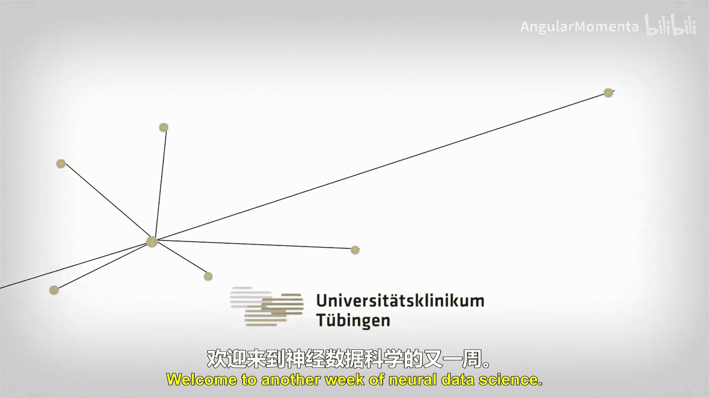

🎼。Welcome to another week of neural data science。 Today。

 we will talk about how to analyze neural anatomy。Or。Neurimmorphologies of individual neurons。

The anatomy of neurons has fascinated scientists probably since the beginning of neuronssci。

 So here you can see Santiago Ramoni Cahalal in his laboratory where he looked at neurons under the microscope and made a whole range of observations that still build the cornerstones of two days modern neural anatomy of individual neurons。

 So in these drawings， you already see very detailed characterization of a host of different neural cell types。

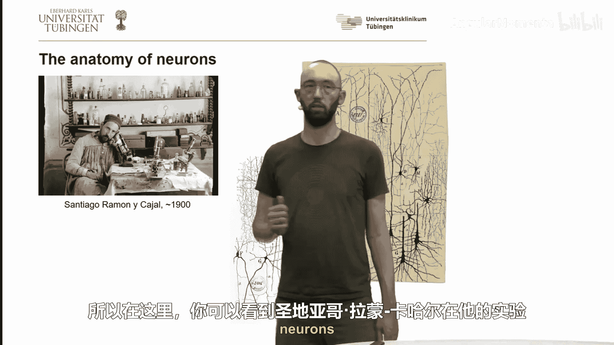

So。What are experimental techniques that I use to characterize neuro anatomies and what is special about the anatomy of an individual neuron。

That， that needs to be respected when we analyse it。This is what we will discuss today。

 in this lecture。There are a number of different methods for， for looking at neural anatomies。

And some of them work by basic light microscopy。 for light microscopy， you need to stain the tissue。

Or the neuron with a certain technique。In the initialile staining， for example。

You use a colour called turidine blue。And this stains mainly cell bodies。

So you can't see the detailed processes of a neuron that make up much of its function and much of its identity compared to other neurons。

One of the techniques that has been around almost as long as neuroscience is the so called gol G staining method。

 This was also the method that was predominantly used by harmoniconicikahalal。

Here you immerse tissue sections first in potassium dirommate。

 and then you stain it with silver nitrate， and the really cool thing about that technique is that it allows for a spars staining of individual but more or less complete neurons。

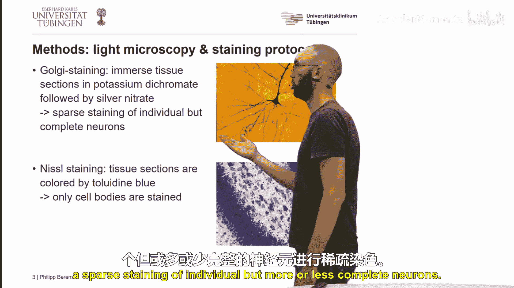

So you don't get a dense staining of the entire tissue， but you really get it sparsely。

 And this is also what enabled Ramononic Kahal to then make his famous drawings。

There's another method that is also still used quite frequently today。

 And this is the so calledled biocy and staining。He inject neurons like you can。

 can see here in the upper picture with biocyan， which itself is not not a dye。

 So it it doesn't carry。 It doesn't make the neurons colourful。

 but you can later tang it by a fluophorre or by staining with hydroxy peroxidase。

 And then you get stains like this。For this one cell here， or like this for the other cell。

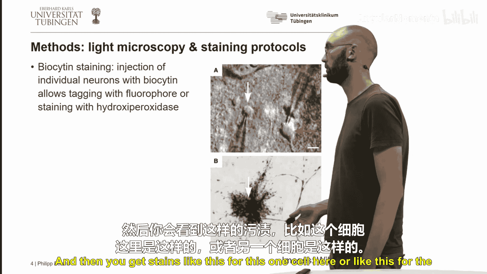

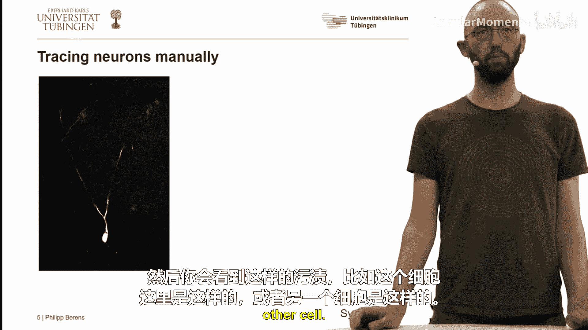

Now。From such an image or a stack of images， how do you go to really the reconstruction of an individual neuron。

 Because in the end， when we， when we work with that data。

 we don't want to feed it just individual images of of stain neurons。

 but we want to feed it in more abstract representation of the three dimensionmenal structure of that neuron。

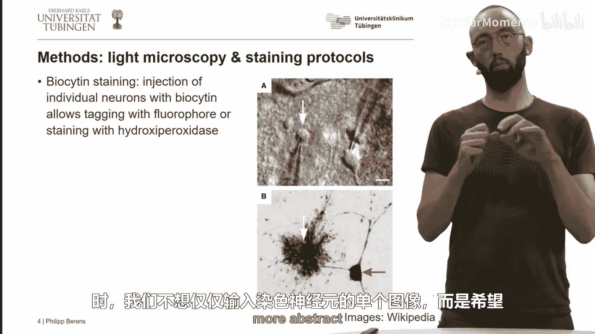

The way this is done today still in， in many labs。 and it's， it's really， in this case。

 just the gold standard is to trace neurons manually。

So you would have a softwareer tool like this one by the Sidder lamp， for example， So neuron J。

 where you can load a stack of images。 and then you can go through this stack of images and add a tracing path to it。

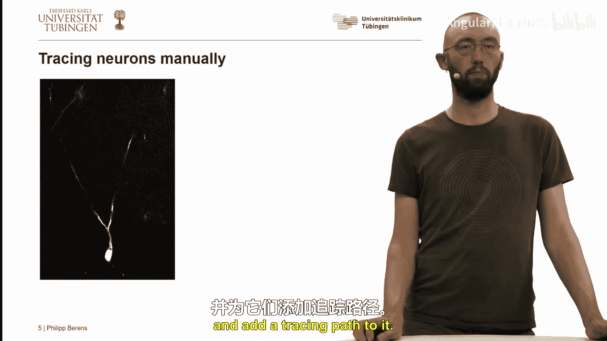

And then you can also zoom in and try to really optimize your manual tracing to the data that you have。

This is a process that is super time consuming。So if you want to， to reconstruct， let's say， from a。

By and stain cortical neuron。 if you recon want to reconstruct not only the the denritic tree。

 but also the entire axon。 Then first of all， this can only be done really by trained experts。

 And second of all， it takes per neuron。 it takes almost a day of manual label。

And yet it's reasonably errorprone because it's， it's really challenging to look at that data and。

 and do this these manipulations， either digitally or under the microscope。 And， of course。

 it's also not standardized between labs。 So it's very hard to get a sense of quality。

Of a given reconstruction。If you think about， well， then why not go and automatize this。In this case。

 it's actually not so easy。 And in the end， there are no good standard solutions around。

And one of the issues is that such light microscopy data sets， they are really huge。 So to capture。

Such A， a single cortical neuron or such a single neuron at a sufficient scale。 you need to。

 to image。Little stacks。In， in， in three dimensions。Like this。So it's。

 it's really a number of slices。 And then you also need to make a mosaic of different imaging fields because the neurons are just too large。

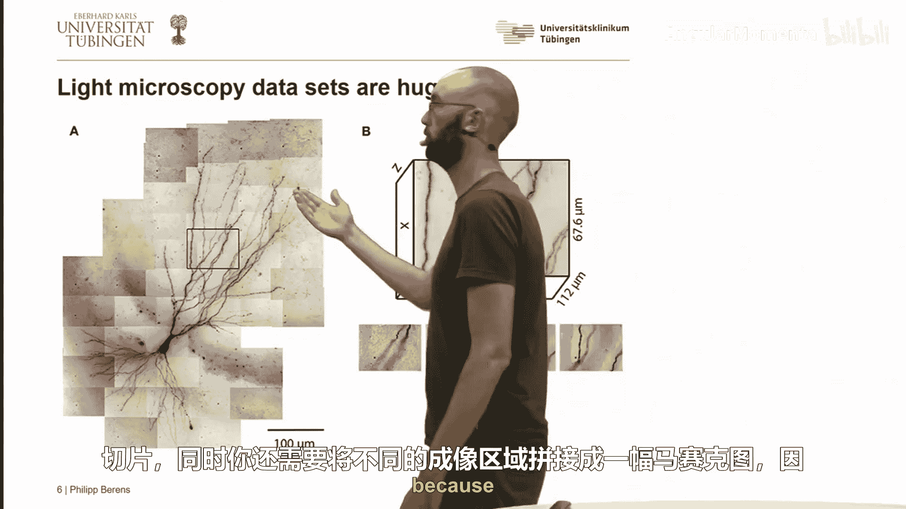

If you want to do that at high enough resolution。And even then。

 if you do that because of the also the limits of life microscopy。

 you can see that there are some artifacts that are introduced。Into the imaging process。嗯。So it's。

 it's。A large amount of data for an individual neuron。 And there's today， even today。

 there's very little training data available。 So it's not so easy to simply throw。

A deep neural network also at， at such an， such an image collection and simply。

 simply run and train it， as it is in many other cases， where really good training sets。

 large scale training sets are available。So here， most solutions that are on the market actually rely on fairly simple。

Or fairly， fairly old school image processing techniques。

 And then add in quite a bit of pre knowledge about how such neurons look。So。

 let me illustrate again the。We some of the reasons why automatic tracing at hard is hard。

 It's not just the sheer size of the data or the lack of training data。So in some cases。

 you simply at you， you are looking at structures that are simply at the resolution limit for the optical microscopy。

 such as as up here。And then it gets very hard to discriminate different structures。Another problem。

 especially in in cortical data， is that you have these synaptic protonons that sit on top of the neurons。

 and they are often confused with neuron branches that go out。 Also， you have crossings between。

Different cellular compartments。 And these are very hard to， to disambiguate。

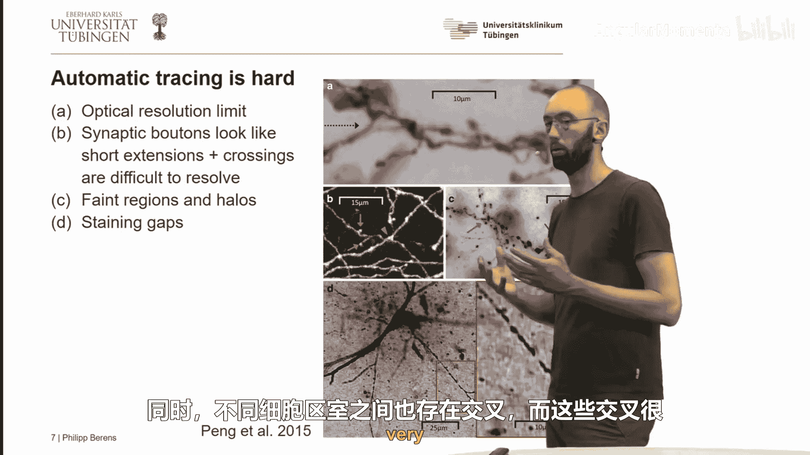

Finally， in many stains。Especially also in cortical tissue， it's， the。

 it's not so the staining is not so consecutive。 It's not just a simple line running through。

 but it's actually more either like beads on a pearl structure。EPs on a， on a chain structure。

Or there can be even actual staining gaps where you don't find staining for a bit。嗯。Of the。

 of the tissue like here。And for these， of course， you need to。

You need to do quite a bit of adding knowledge into them to cope with that。

 Also these kind of artifacts here or artifacts by， by spilled die in the background。

So you need to deal with all of them。Of course， over the years。

 a number of automatic tracing workflows have been， have been suggested。

And they typically consist of a prepros stamp where you correct for imaging artifacts。

 you suppress noise。 You do some image filtering to select parts that are plausibly related to neurons。

And then in a second part， you try to segment the image into a plausible tree that is consistent with the anatomy of the neuron。

 So these algorithms either work globally through a binization。

 skeletonization step that then fills and prune some of the things to reduceuce a graph representation of the neuron。

Or they work locally by predicting the next likely。

Point on the tree and fitting like an internal model of how the。Morphology will likely develop。

So in in this slide， we already see what， what we are looking at when we think of neurons as a data type because we have a three dimensional structure。

With path that need to be followed。A neuron is best represented as a graph。It's an basically craft。

 So you don't have have loops。嗯。But it's a graph where each node in the graph has actually 3D coordinates。

I would like to show you one example of a really fairly simple algorithm。

 The so called shootter tracer that seems to work nevertheless， reasonably well。

So what they do is they have a first step in which they try to turn the image after some correction methods into a binary mask。

 So they start with the image。And the first thing is that they sub a smooth background image to sharp a bit the boundaries and remove some of the low frequency variations in the background。

They then use a range of so called valley detectors。Which are nothing but simple goor filters。

And convolve the image with those。

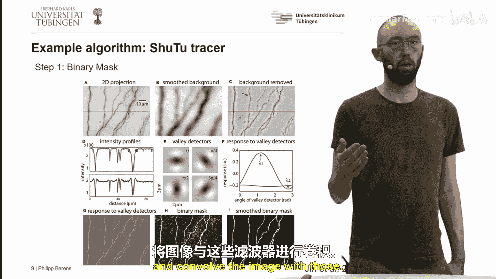

And in the end， get an image that contains these responses to the value detectors or to the maximum of the value detectors。

And from that， you can binize that we have some thresholdholding procedure。

 Then you still have a lot of stuff in the background that you don't care about。

 But you can get rid of that， for example， by smoothing or by noise suppression。

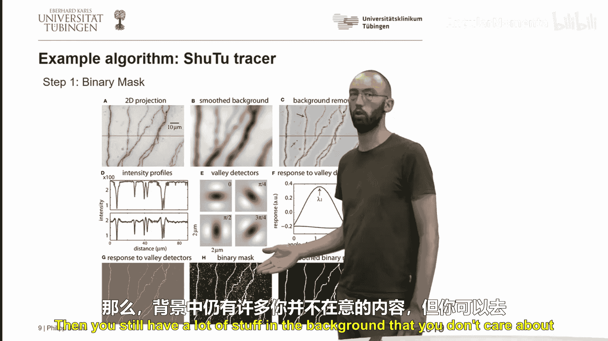

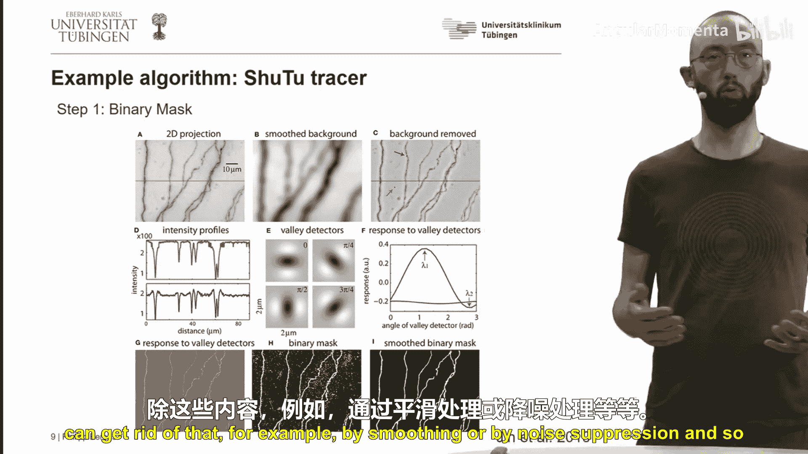

And so on。So then after this first step， you have such a binary mask。Now， they。

 this binary mask can still be a few pixels wide in places。

 So now they try to turn that as a second step into a skeleton。And to this end。

 a computer distance transform to the closest part that is not part of the binary binary map。

 You can see that here。And this。

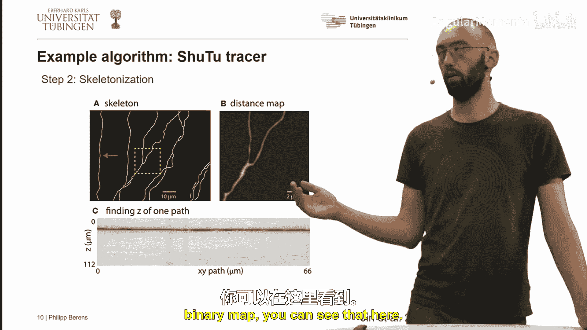

Allows to put a single path along the rid of the maximumima of these distance transforms and use that as a skeleton。

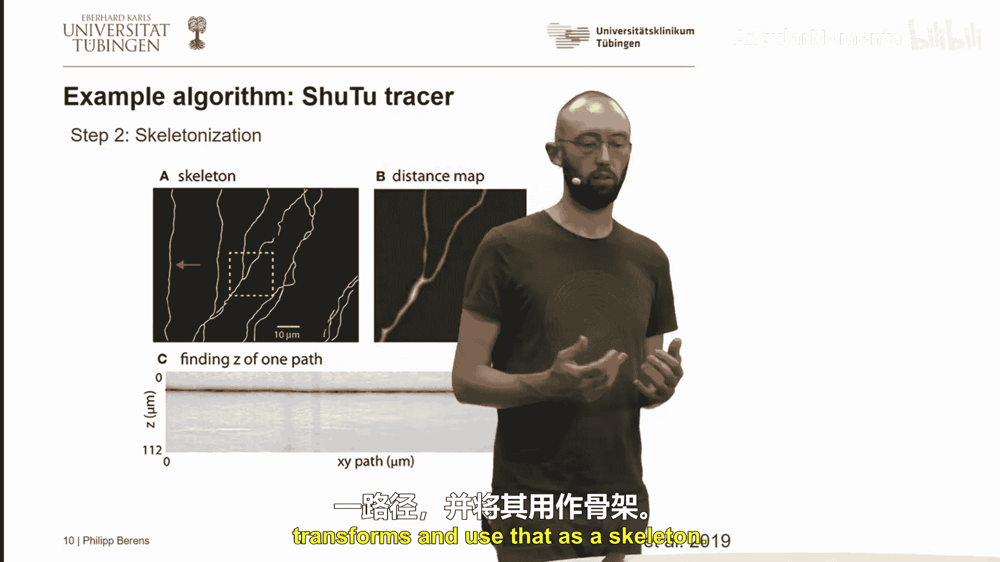

The skeleton is then stored。In a file format called SWC file。

 This is the standard format for morphological data of neurons。 And it's actually very simple。

 So it just keeps tab of the numbers。

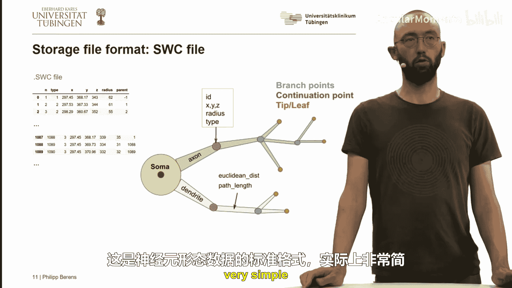

Of the， the different nodes。Of the types， So whether it's a so node， a dendite node。

 an axon node or so。The 3D coordinates。The radius， if the radius， is defined。And whether this is the。

 the parent or whether this is a node that has a parent。 So， and if so， which is that parent。

 So you can see that again here， illustrated in this schematic。

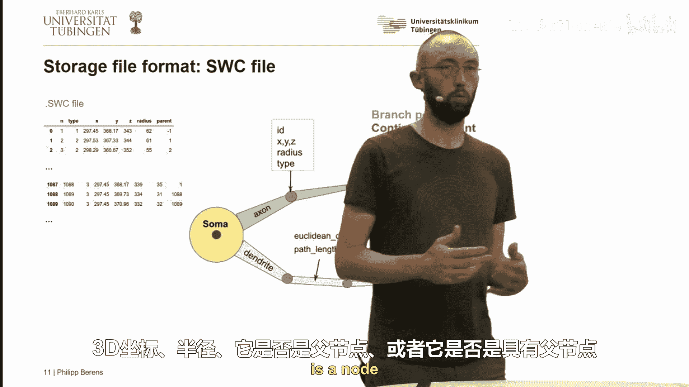

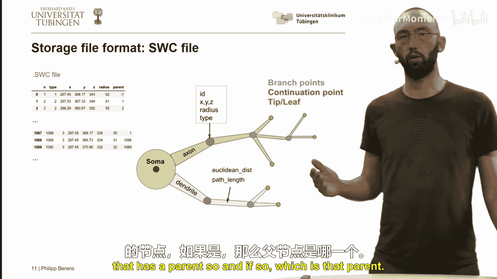

We have a representation for the soma。 We have separate representations for the dendr and the axon。

 and each node is represented by its type， its radius， X X， Y， Z， coordinate and its ID D。

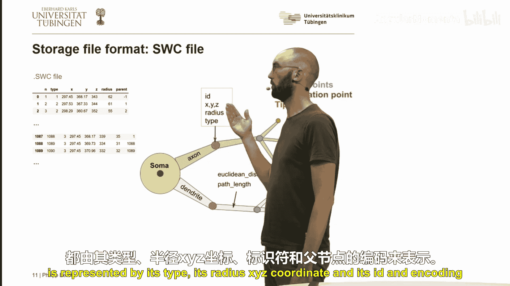

And an encoding of the parent node。Once we have that。

 we can now look whether all the pieces of our neuron that we have in our SWC field。

 So this whether this neuron tree is actually continuous or whether it contains， for example。

 multiple pieces of axon。And whether， whether it makes sense and is consistent with our data overall。

The authors here do that in a few steps where they do correction and continuity measures。

 where they also compute some， some sort of width of the， of the structure。

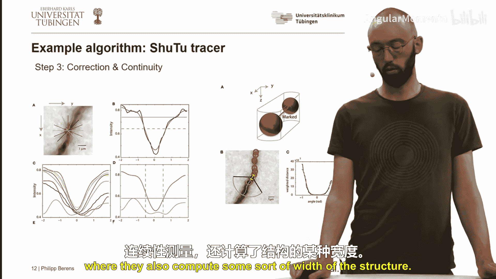

So sometimes， for example， you need to correct additional S segments。 So here。In this case。

 you need to correct segments and you need a good heuristic for when to do that。

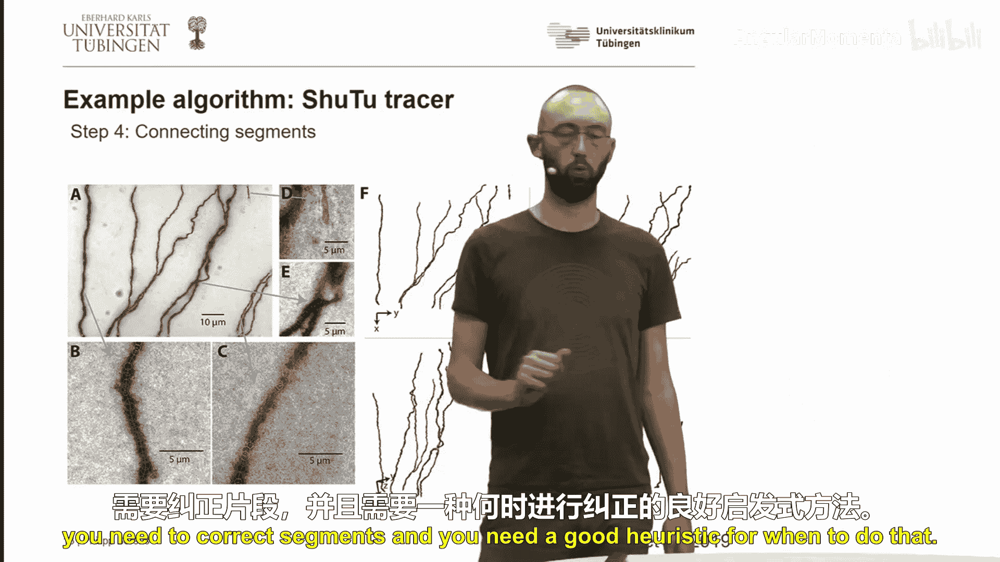

But in the end， you can then combine all the stacks and also have a manual correction step that hopefully is much easier because you did the preprocess and the automatic pre analysis before and much。

 much quicker than that。 So here， for example， they say， okay， if you miss such a branch。

 then you can use the software tool to paint that in。

 Or if such a bit of noise in the background survives， then you can simply remove that。

So while these automatic methods exist， they're still not。

 not there yet that one could simply use them fully automatically。

 and they still require quite some extensive correction work in the end。However。

 if you want to work with morphological data， because you find that interesting。

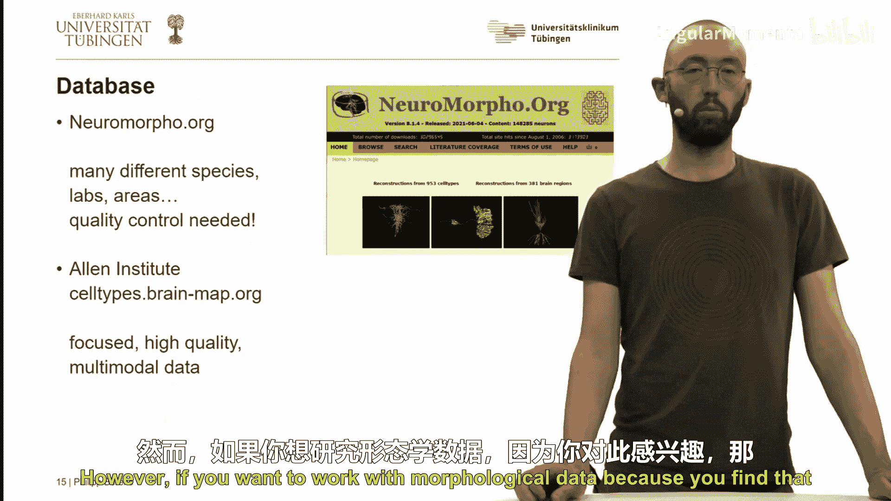

There's the possibility to go to public databases that contain， contain lots of。

 lots of morphological data。 The biggest one is probably neuromorph dot org。

 You have many different species， many different labs， many different areas in the brain。

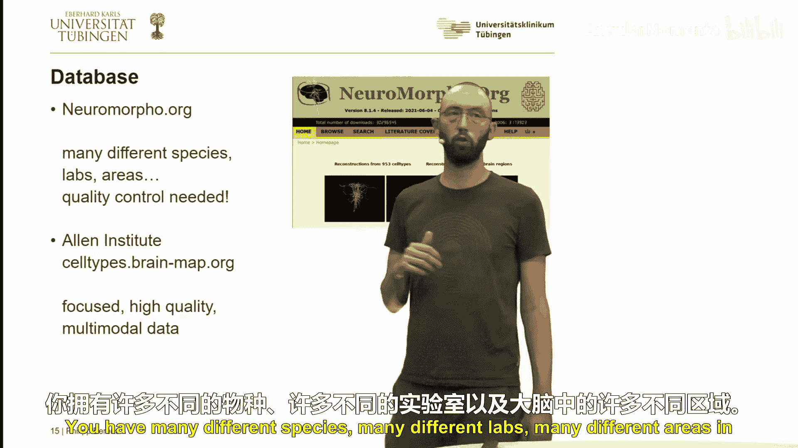

But what you， of course， need to do there is you really need to do quality control， and you need to。

 to carefully select the data sets that you're working with if they're suited for your purposes。

 and also if theyre in general good enough。A more focused database is the cell types database by the All Institute has quite consistent high quality data。

 often also combined with electrophysiology or even transcriptomic data。

 like we've discussed in the last。Last lecture。So。That it looks like this。

 You can look at the reconstruction and the original images and get a lot of information about the cells where they was recovered and which cell habit likely is and so on。

Now， as an alternative technique， one can also use electron microscopy。

Especially since about 20 years ago。High throughput electron microscopy techniques were starting to be developed。

 One such technique is the so called serial blockface scanning electron microscope developed by Winfrey Tnk and Hman。

And this works as follows。 So you have a tissue block here that is embedded in some material。

And then you have a cutting device that always scrapes of one layer。

 So you take an electron microscopic image like this where you beautifully can resolve even intracellular structures。

 And then after that image is taken， your scrape of the first。Few nanometers。

 And then you take an additional image again before scraping off again and so on。 And you do that。

In depth throughout a stack of tissue。So you would then， in the end， end up。

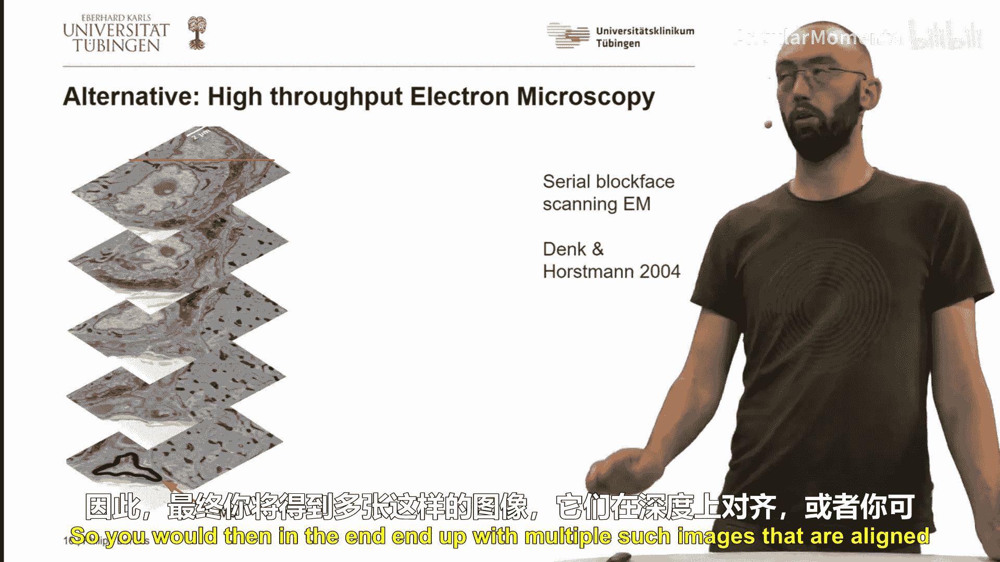

With multiple such images that are aligned in depth or that you can align in depth。

Where you can resolve actually， tissue structures in 3D。At subseular resolution。

So here you can see this very nice three dimensional tissue block。

This is also not an easy technique to， to implement and use， as you can imagine。

 it requires some careful setting up so that you don't suffer too much from technical artifactacts。

 but， and it also is very time consuming。 But now there are techniques that do the scanning with multiple。

 multiple beams。That are already quite fast。Also here。

 the big challenge and maybe even bigger challenge is automated reconstruction。嗯。

The reason why it maybe even the bigger challenge in this case is that the tissue that you deal with is actually stained densely。

 So in the morphological case of the light or in the light microscopy case。

 we usually use a dye to stain in individual neurons， neuron that then could be， could be traced。

But here we have dense tissue staining。 So we don't just need to trace an individual neuron。

 although this can also be done。But ideally， one would reconstruct。

All the bits and pieces that are in a given cube。 So an estimate。

Is that for reconing complete reconstruction of all the。

 the cells that are in 100 microns cube that this would take about 100 thousand00 hours of human labor。

And this is clearly too much。So therefore， we need good algorithms to do that。

And a number of deep learning based segmentation techniques have been proposed to that。 And。

 for example， and this is the algorithm that I will also present here in more details。

 so calledled flat filling networks。In flat fitting networks introduced by Ynoheevsky and colleagues。

 you start with a image such as this， right， This is very nice。

 You can see lots of intercellular structures here。嗯。

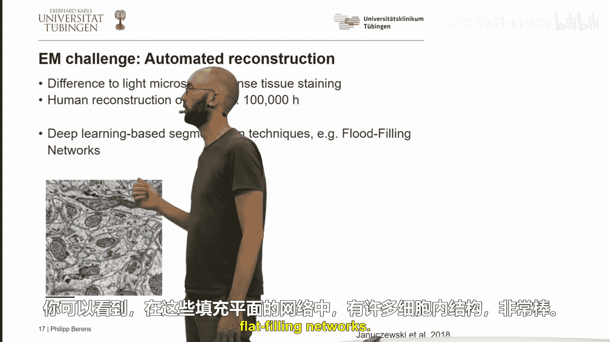

In， in these flatfeing networks。So， they worked like this。So， in each iteration。

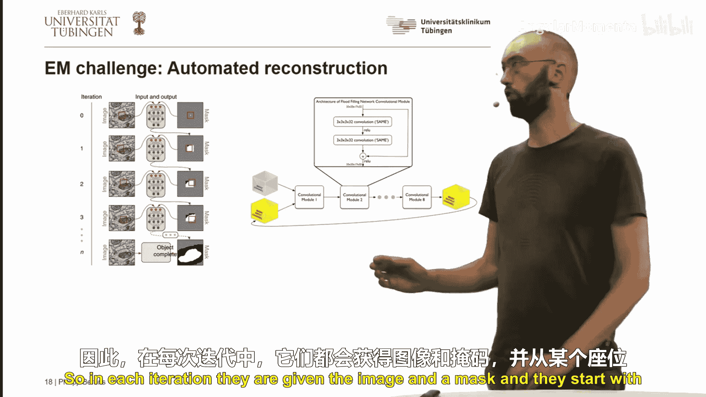

They are given the image and a mask， and they start with some seat location。And together， the。

 the network processes。The image and the mask to extend the mask。And this is done iteratively， until。

An entire object。Is segmented and covered by the mask。

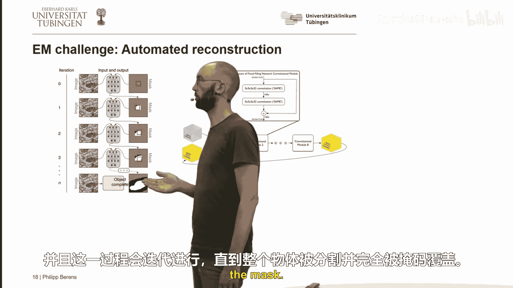

The internals of that flatfi network are really not quite con complex。

 It's a number of comp convolutional modules that are fairly standard and， and not too。

Too complicated。They are trained on a small subcu of data that has been fully annotated by a set of expert annotators。

And then the， the authors propose a scheme by which to select the starting locations。

 So the flatfi network starts by。Fitting this area here， it finds in the end this rat one。

 the next starting location is down there。It finds this large blue region。

After that goes to this orange region here。 and it does so。

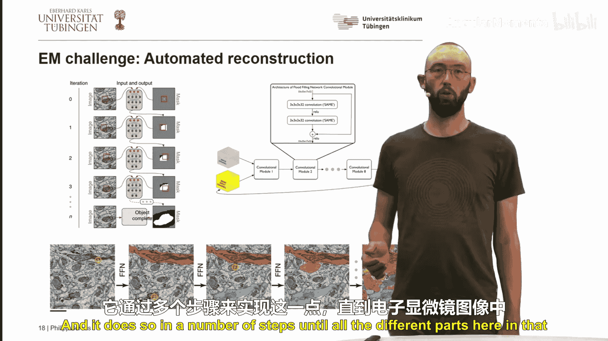

In a number of steps， until all the different parts here in that image。

 in that electron microscopic image are segmented。Then the the， the key bit is， again。

 to have good heuristics for。for dealing with， with errors in the data and one of the potential errors is。

 is like here。 So here apparently。When starting at this location， a。

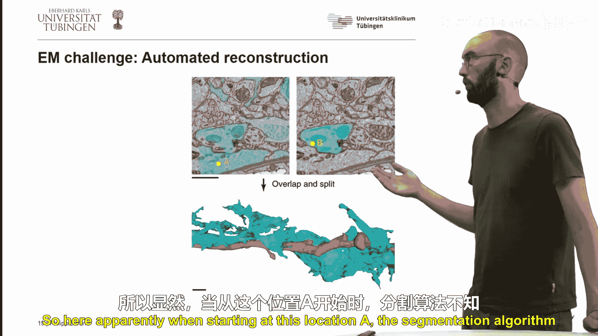

The segmentation algorithm somehow added a lot of stuff all over the image into it。 while。

 for example， here starting at location B， it's really only detecting。

That bit that probably the belongs to a particular cell。

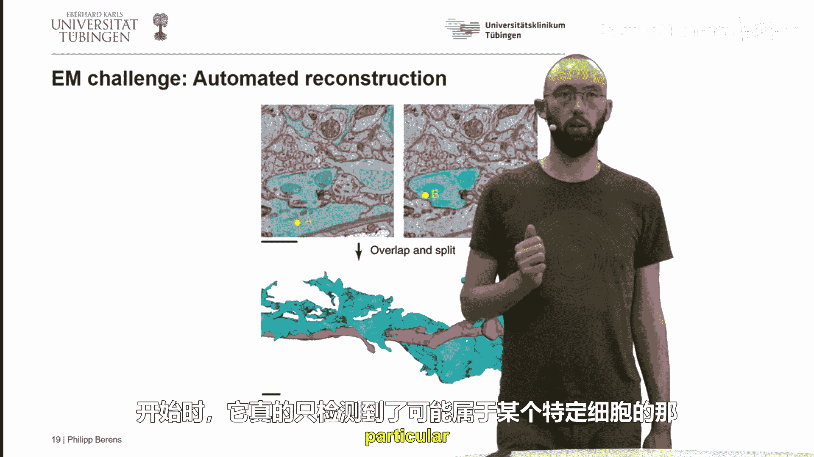

So what one can do or what they propose to do is to start at multiple locations and then take the。

The intersections of all the regions that are found and take the， the smallest。

Bits and pieces that are segmented together。 So to rather oversp a bit。

 because then data one can collect stuff based on semantics。

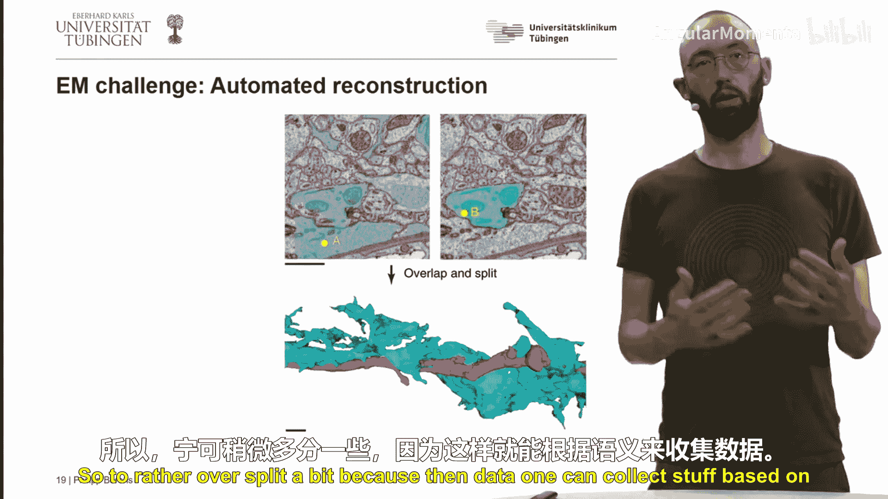

So for that， for avoiding these incorrect mergers， they use an asmbling approach， they also。

 for example， use high and low resolution， multiple starting points and so on and keep the most fine grained objects in the end to work with。

The other thing that can happen that a region that is really based on one neuron that this is incorrectly splited by the。

 by the。By the segmentation algorithm and what they do。 So you can see that， for example， here in。

 in this image that this blue ddrite and the red danddrite that they should really belong together and that this split here is incorrect。

So what they do is they check all pairs of neighboring segmentation regions like here。

And then they initialize segmentation runs close to the boundaries。

And if they do that and they find that the network actually。

 if started at this right critical location， segments the whole area as， as one object。

 then they will merge the object。 And if it doesn't， then they won't。

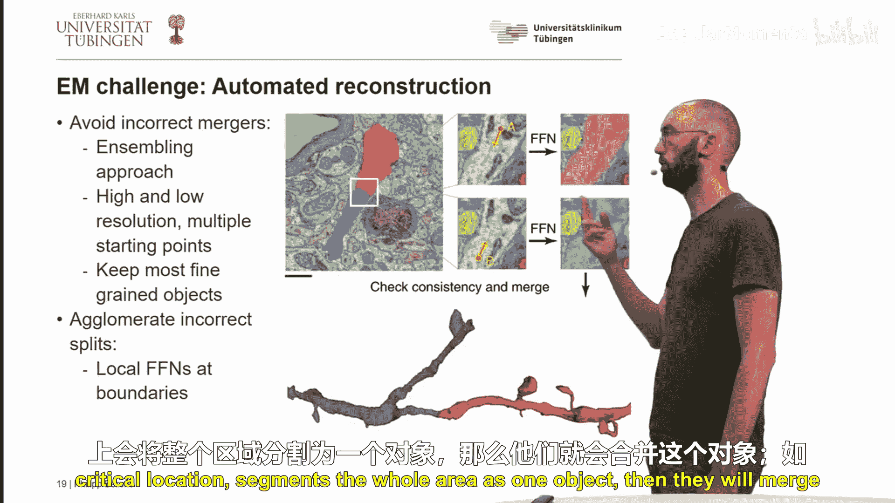

And with these heuristics， plus a few more that I don't go into much detail。

 they are actually able to get very impressive automated reconstructions from these E M tissues。 So。

 for example， if you look at this automated reconstructions。

 you can see that there are really very few errors left。 So there's。

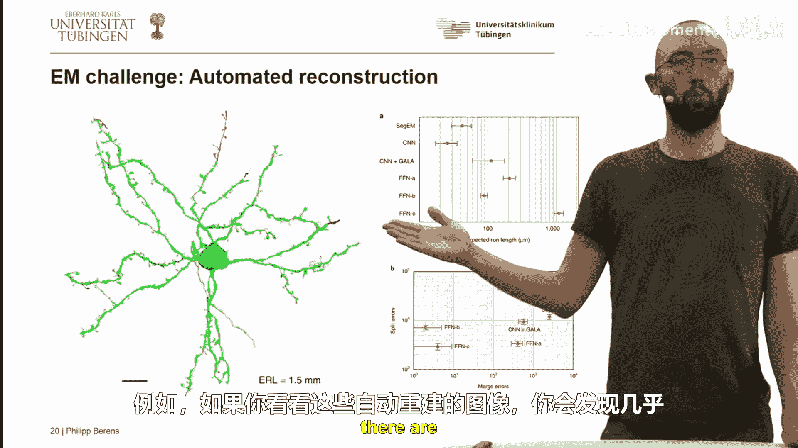

Some stuff up here that has been segmented erroneously， and there。

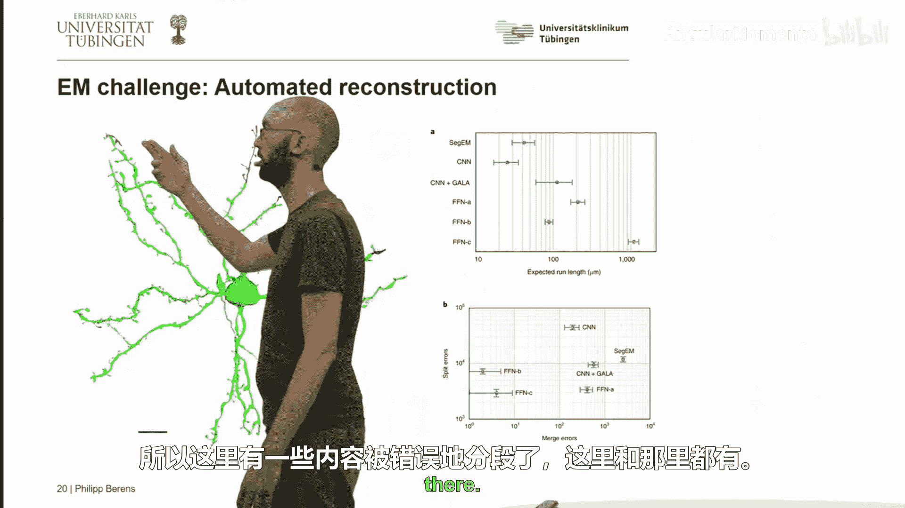

And there。But if you look at the overall evaluation。

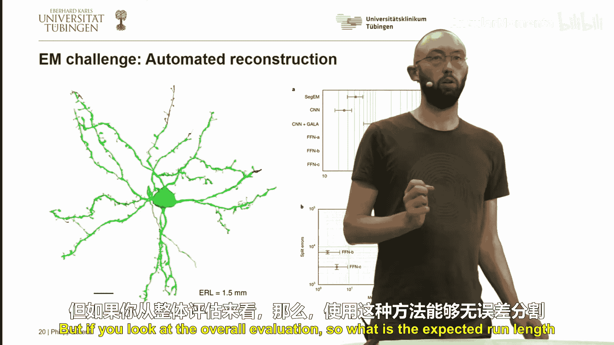

And so what is the expected run lengths of neural tissue that you can segment error free with that。

 It's much higher than in， in many other previously proposed techniques。

 And it's about 1000 micromres。 So you have every thousand0 microtres。 you have an error。

 And that is something that you can then。Then， live with。And also。

 in terms of marriage and split errors， it's much lower than what has been proposed previously。Now。

 either from manual reconstructions， from automatic reconstructions of。

Light microscopy or electron microscopy data。 we end up with morphological structures。

 with graph representations of how neurons look。Some does。And we want to， want to work with that。

 right？ And it's unlike any of the data we've seen so far。

 It's not like images where you can compute simple convolutions or time series or also not like single search transmittedcom data。

 It really has the structured data nature of a graph。

So there's a few different ways that one can deal with them。 One can co， for example。

 compute morphmetric statistics and distributions。 These are simple measures。

That simply try to quantify certain aspects of the neurons that we can， for example。

 measure the height of the neuron along the cortical axises or the width。

In any of the different dimensions。 But we can also do more complicated things。 So， for example。

 we can look at the average or the distribution of angles at which。

The major branches exit from the Zoma，ma。 or we can look at how many branches there are overall in such a tree。

 What is the highest order of nodes in the tree that you can find。And so on and so forth at。

 at what angle do the， do the different branches of dendrites typically exit from their。

 their mother branch and so forth。

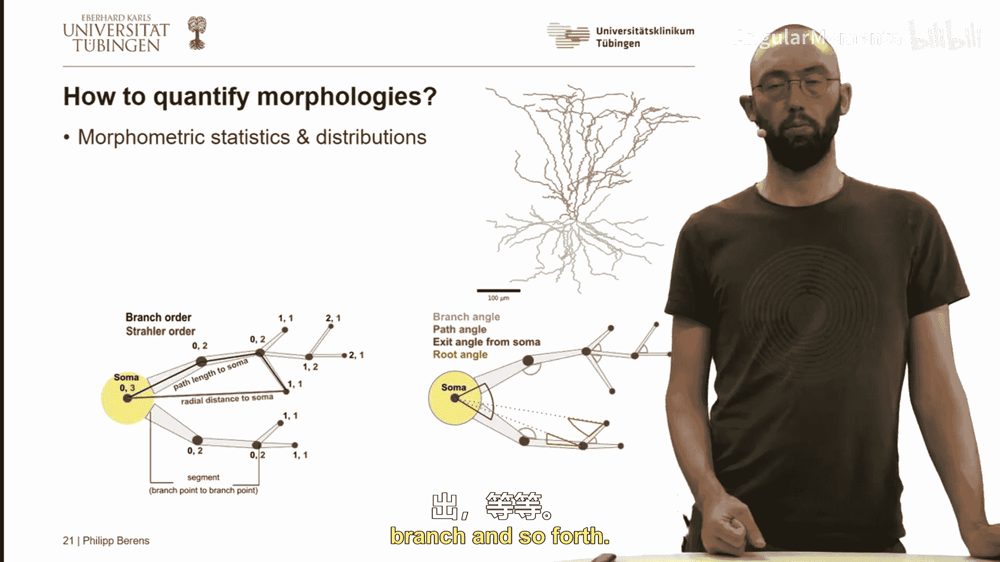

This has been classically used quite a lot。The other thing that we can， of course， do。

 we can simply take such a， such a graph and turn it into an image because for images。

 we know how to deal with them。So we can simply count how much of this noite length。

 How much of that is in small boxes in a discrete grid。

 And then we get such a pixelated representation of a neuron。 We can further smooth that also。

 if we want。And use that as a representation。

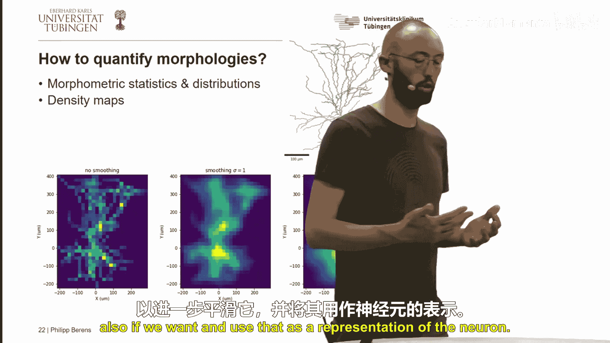

Often or on。And it turns out that in many cases， this is actually a quite informative。

 very simple representation of the neurons。 So we convert it from its graph structure。

 simply ignore all the messy details of dealing with graphs。 We simply convert it to an image。

We have written a Python toolbox for quantifying such neuromorphologies called morphpy that you can find online on Github。

 and that you will also。Used in the exercise that is associated with this lecture。嗯。And we just to。

 to show you a bit what one can do with these representations that we first ask ourselves。

 which of these different representations that have been used in the literature。

 which is actually best in some sense， to discriminate between different cell types。

 So we used three different data sets from the retina and from the cortex。

That had been annotated by experts。嗯。Regarding the cell types of the neurons。You can see that。

Across the different cell types， there's quite some variability in how these neurons look。

 So they have quite some shape shape differences。 So there are some that are more thin and spinly than others are more extended。

And so on。Others are round and more like balls。But also within each of these groups of， of cells。

 there's also quite some variability。 So these are cells that have all been assigned the same time。

 and yet they look slightly different。 So there's some individual variability between them。Now。

 what we ask is， if you take in some of the representations that I've showed you。

 like the morphmetric statistics or some morphmetric distributions。Or。Also， the density maps。

 How well can you use them to discriminate between these different types。To that end。

 we made a pipeline， standardized evaluation benchmarking pipeline where we first computed different feature representations。

And then we evaluate them after reducing the dimensionality to a comparable size using logistic regression classifiers and。

And regularization。In a cross validation。Setting。And what we found was that， actually， to our。

Surprised somewhat that actually very simple representation。

 So morphometric statistics that experts think capture well。

How these neurons look and even density maps are just。Convert neurons into。

That convert neurons into images work really well for their task。Now， part of the reason。

That these fairly simple approaches are the best available representations is that probably not too many people yet have thought about really how to analyse neurons as graphouse。

 And we have made a very small step into that direction。

 trying to detuce good representations of neurons automatically and combining that with a way to。

 to have a generative model for neuro morphologies such that you can generate new morphologies that look like a given morphology。

 So this is what we wanted to do。 And we came up with an an autoenr architecture。

 So variational autoenr for neuromorphologies。

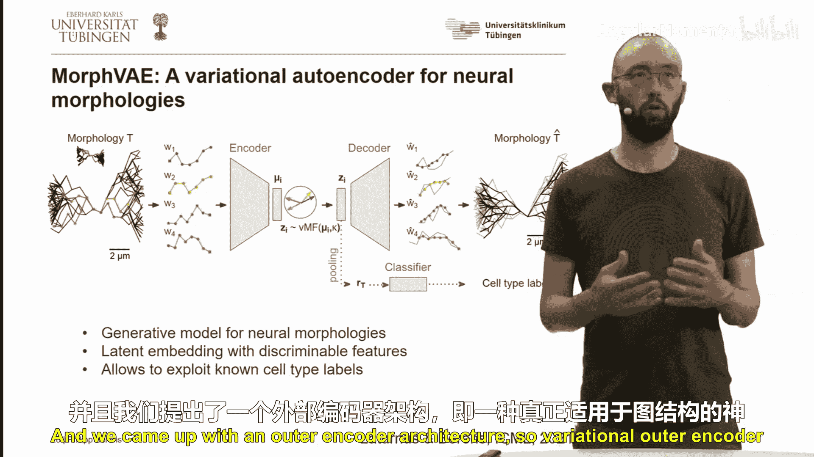

That really works on the graph structure。So we， we take the this。

 this graph that describes our morphology and we。We look at that by generating random walks through。

The graph。And then applying an encoder network， which consists of a bunch of stacked。Linear LTMs。

 shorter memory units。And this goes into a latent representation with a certain assumptions about the distribution of these latent representations。

And then has a decoder network that goes back to S to generating random walks on the。

 on the morphology that are then used to reconstruct really the， the true morphology。

What is nice is that if we have cell types tables， we can actually add them to our architecture。

 So we， we have a feature representation here in this， in this variation of bottleneck。

 we can add a classifier。😊，It tries to classify between different known classes of cells to that representation。

 such that we can use these labels if we have them to find tune and how that representation works。

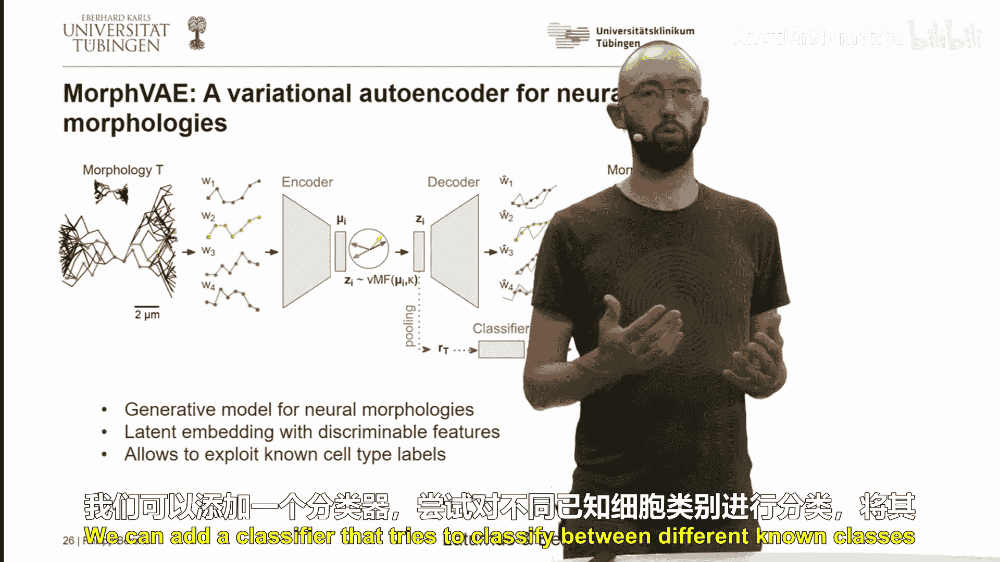

And this is an approach that we also applied to different data sets。Including an artificial data set。

And if we look at the effect of adding training data。 So in this case。The。

 the representation that you obtain by looking at density maps is actually not so great。

 It can still separate the three artificial classes。But our auto encoder can actually learn。

A much better representation， even if only provided with 1050 or 90% of label data。 Of course。

 if you use the most label data， then the representation also gets best。

We can also apply this to the real data sense。And this looks a little bit messy。Overall。

 even without labels， it typically captures the shape of the distribution quite well。

 but one can see， for example， down here that the different broad glasses of cells that the they really get separated also better when providing the encoder with label information。

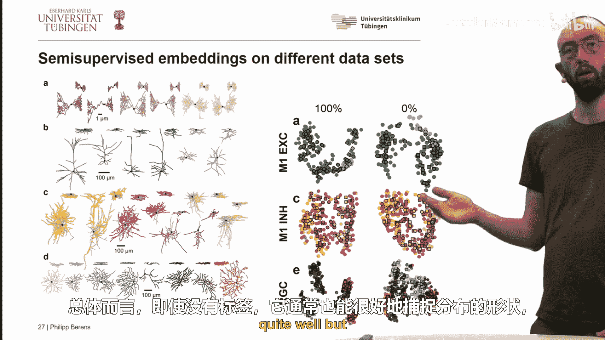

The cool thing about our architecture is that then for any given neuron， let's say， for example。

 for this one。😊。

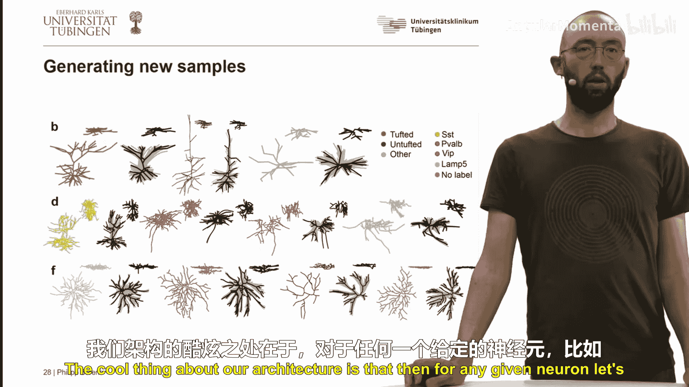

You can simply put that into our machinery and generate new samples that roughly look like this one。

 but don't replicate it exactly。So you can now generate artificial neuron graphs。

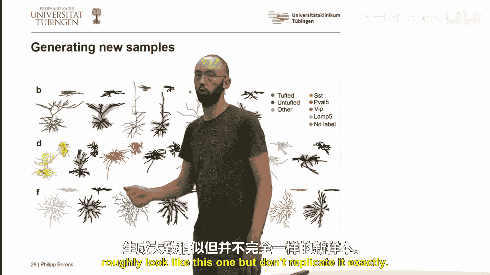

嗯。For any given sample neuron that look reasonably like they should。 And this is also at at run time。

 this is quite efficient。So through that， we think that it should be possible also in the end。

 to learn better representations。For neuromorphologies that are better than just simply measuring a few statistics based on the neurons or simply converting them into images。

Also here， there's。A lot of recent work on extracting anatomical or morphological data from light microscopy。

 from E M images， from， from ever larger blocks of tissue。

 So I think there's also exciting challenges for neural data science ahead in this area。

Thanks for your attention。

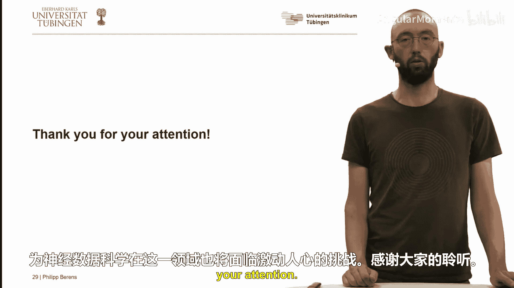

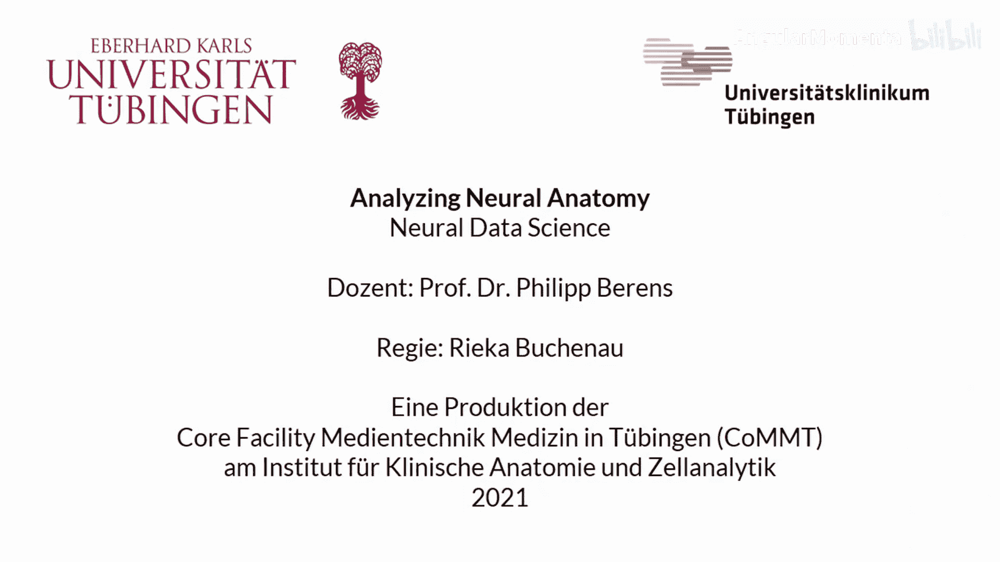