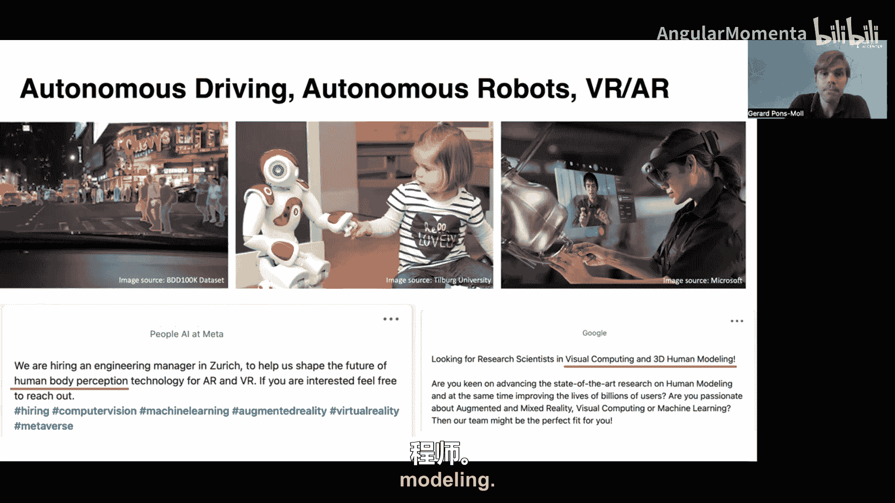
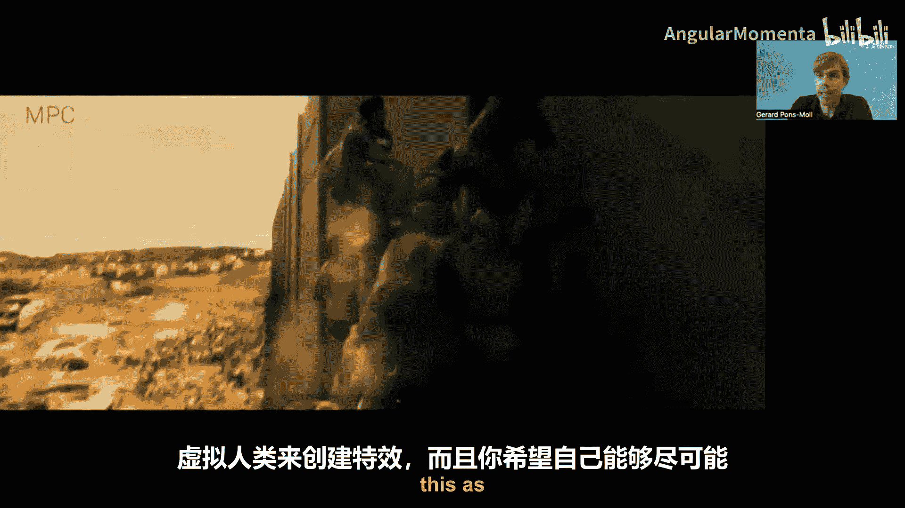
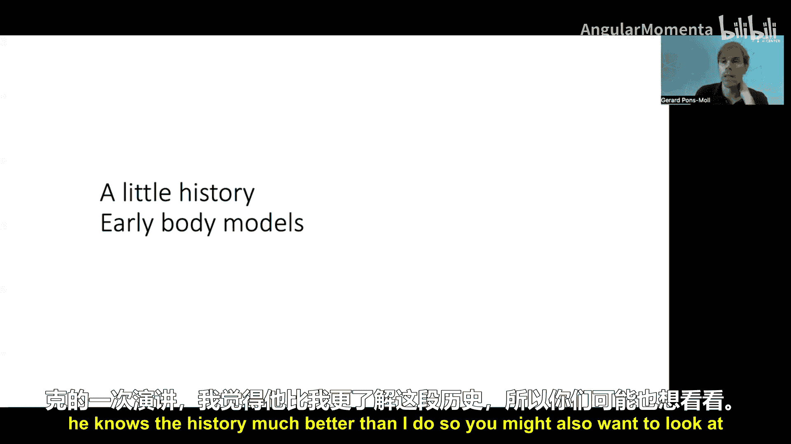
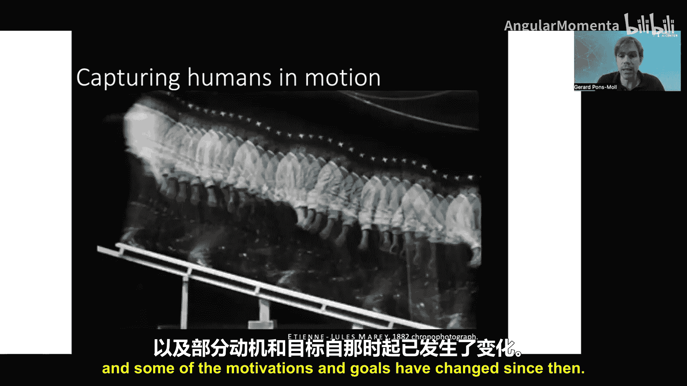
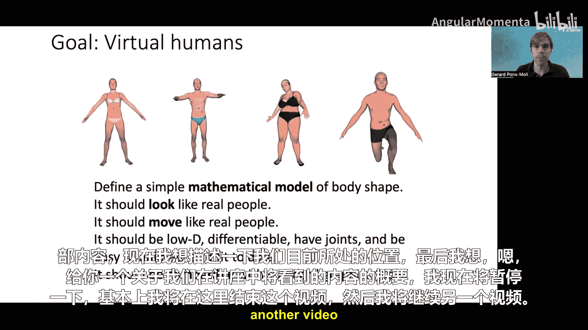

# 【精译】蒂宾根大学《虚拟人类》-p01-01.1-人体模型的历史--BV1TAbkzpEva_p1-

Hello， welcome to Vi Human lecturec 11， this is introduction to human models and in this lecture we're going to see。

What are the key ingredients to build the human model and how to fit it to data。 And in particular。

 we're going to look at a little bit of history of。

Earlier works that led us to the point where we are right now。

So let's get started so since the beginning of civilization we spent our lives interacting and perceiving humans。

 that's the society we live in where humans play a central role。

The human body and human interaction has been depicted many times throughout history。

So humans interact with the world to change it， they touch， they manipulate。

 and they form the world around them。They interact with each other， to form relationships。

 to find love， to make friendships， to dance， to influence people。

They interact with the world to change it， for example， to move and grab objects。

 to climb and to become full partners with humans， computers need to be able to see us and by see us we mean understand our interactions。

 our intentions， our gestures， our body language。And our interactions with the world， we real humans。

 we do this like subconsciously and we have these predictive models of the world which are necessary in order to live and interact with other people。

And so if computers can see us， they would basically be able to learn about us by watching this。

So since humans are at the center of many applications and at the center of social interaction。

 it's not surprising that there's so many applications that require virtual humans， so for example。

 for autonomous driving you need to understand what humans are doing to avoid accidents。

For mind machine interactions， if we want natural communication。

 like they need to understand our intentions and our emotions。And for virtual un augmented reality。

 if for example， we want to communicate with people across the globe seamlessly， like not with Zoom。

 but in a more immersive experience in 3D， we need these virtual humans like be able to reproduce like indistinguishable virtual humans in this so-called metaverse。

So of course， like the big tech companies then are very much interested in investing in rural humans and this is reflected by a lot of hires in these area。

 I'm just showing you two posts， for example， from Facebook Me。Google。

 where they are hiring researchers and engineers in the field of human body perception and visual computing and through human modeling。

So I'm often asked whether I have students that are interested in doing internships or entering as a full time employees in these companies。

And I think this is basically growing every year。对。

Of course like virtual humans are also needed for any application that requires 3D content creation。

 so for example like 3D movies like often make use of virtual humans in order to create special effects and you want this you would like to be able to create this as fast and。

As fast as possible and in an efficient manner that is not time consuming。So。

As I said these big tech companies， they have a growing interest in building digital humans or virtual humans。

 and for example here you see virtual humans of the CTs of the CEOs of NviDdia and Me and some of these demos are truly impressive。

 like they create virtual avatars that look very， very realistic。嗯。Wwhich is already very impressive。

 however these models are very specific to one subject and they require a long time to produce so how they typically produce this digital characters and these demos is by capturing people with multiple cameras in light stages so by changing the lighting they build like a personalized model that then like they can you know test time they can change the light and they can perhaps even animated it but these models are specific to one person and they require an expensive equipment and do not scale very well if we want to do this very quickly for example with a consumer camera。

So the goal of research is to democratize this human model creation to make it as accessible as possible。

 as fast as possible。And for this， we need to go beyond personalized models。

 we need to have models that generalize across a population of people。And so basically。

 we need to build statistical models of virtual humans。

So let's look at what the ingredients that are needed to be the virtual humans when I talk about virtual humans。

 I typically think about either the appearance or the behavior and I like to think about these two things separately。

So the appearance is how we look， basically how do we build the surface and the appearance such that it produces like a person that looks like a real person。

so these virtual models they should move and look like real people and they should be easy to control and to animate and easy to fit to data。

 we will see later why it's so important that they are easy to fit to data。

So when it comes to model people without clothing， like we have a good understanding and we've made very good progress when it comes to modern people with clothing。

 like things are developing very fast and we have very cool like neural based models。

 but I would say there's still a lot of work to do and also to model like realistic facial and hair。

 facial expressions and hair and these details that make us real。

 there's still lots of work to be done。but the idea of these virtual humans that you have a few parameters that produce different people。

 right， they are not specific to one subject， but basically they generalized across a population of people。

So this is the generation， this is more of a computer graphics problem， this first part。

 but there's then like a perception problem， which is like I'm given like some visual observations。

 for example， images or video， and we want to understand what people are doing。There's been like。

The dominant paradigm has been to detect us the key points of people in images。

 but we want to go much beyond that， we want to estimate like the 3D shape， the pose。

 the geometry of people， like including the appearance and detectors and capture all the personal details that make us real。

And so this is a classical computer vision problem and you can imagine that these two problems。

 generation and perception are very intertwined and if you have a good generative model。

 you can leverage it to perceive humans in images and vice versa if you are able to perceive people in images。

 you can link it and build these generative models from more and more observations。

So when we talk about behavior so far， the state of affairs in research。

 we are talking about how people interact with the 3D world this requires to perceive people not in isolation。

 like it has been traditionally been done but capture people within the context of the 3D environment and for these like researchers。

 this is， for example like work from our group where we capture the 3D environment first and then we capture。

The human and we localize the 3D human within the environment。

 and we believe this is crucial to understand how people actually navigate and interact with the 3D world。

And now if we're able to perceive how people behave in the3D world。

 like then we can build virtual human models that can interact autonomously within the3D world。

 we can synthesize human motion that looks realistic and that adapts to the different environments。

 like what I'm showing you here。So these two goals like both are modeling appearance and to model behavior。

 these are two goals that are interrelated， so one is the computer vision goal。

 which is train computers to CSs。And then it's the computer graphics task。

 which is trained avatars to basically mimic us。Now the boundary between these two like is not very clearly defined because many times to solve one problem。

 you need to solve the other or you need to solve both problems at the same time。So but。

 but it's traditionally like this has been like。Two different two different goals。

So in terms of perceiving people in images。Why why is this difficult we can do it with no problem but for for a computer this is very difficult so the challenges are first of all from an image you're losing the depth you don't have like 3D in these 2D projections so it's very difficult to know like you know how like to estimate the depth from a single image。

You have unusual poses， which makes a very complex space of high dimensions。

 but basically these poses live in some manifold。诶。And then basically you have occlusions。

 like people occlude each other or like theirre self occlusions because some body parts of one person includecc like some other body parts。

 sometimes you have low contrast， you have noise， you have different backgrounds。

You have different shapes of people， you have like kids or people that are。

Thinner people that are heavier and yeah you can have like all sorts of lighting conditions。

 different clothing estimating people under clothing is challenging so you can already imagine that modeling people from visual data is a real really challenging problem and this has been a core problem in computer vision for many years。

So I think it's really interesting to look a little bit about the history and look at early models and what were the first body models that were built。

 I personally find it very interesting to see what people were doing before I even started my PhD before even I was born。

 I think it's sometimes illuminating and sometimes it's inspiring to see how ideas develop and how and which ideas made a breakthrough in their time。

So these slides are based on the simple made simple tutorial and they are based on a talk that was given by Michael Black。

 I think he knows the history much better than I do， so you might also want to look at this as well。

So since the invention of photographic techniques， people have been using them to study emotion and in fact。

 in part， the development of these techniques was driven by the desire to understand human and animal motion。

And the topics we will cover in this lecture for within this long tradition of motion analysis analysis through image capture。

However， the tools and the techniques and some of the motivations and goals have changed since then。

So a key influence in the field was the work by Johanson where basically like let me read this except from the paper。

 which was published in perception and psychophysics。

 it's like the motion of the living body was represented by a few bright spots describing the motions of the main joints。

10 to 12 such elements in an adequate motion combinations evoke a compelling impression of human walking。

 running， dancingsing， and so on。And it's true that these key pointss evolved this impression of a human。

 but of course there's a lot of things that are missing here and。In some way。

 like all these things that are missing， I mean， the key points are the things that we're going to be interested in modeling during this lecture。

However， this was a key influence in the field and basically this key point tracking has been a dominant paradigm in computer vision。

 people there's lots of papers and just tracking the key points and they are excellent and they are the building block for doing more elaborate things。

But of course， there's a question of like are key points just enough？So first of all。

 like these joints are not visible in images like this these joints of the body are not visible so they are not directly observable so it's。

It's interesting that there's been so much interest in this when they are not even like observable。

So basically if we went to model interactions with other people and with the world。

 we need to think about contacts and the joints don't contact the world， it's the surface。

 it's our skin that touches the world， so in that sense it makes sense to model the surface as well。

Also the impression you have about other people is not based just on the posture。

 but it's based on everything right on like the facial expressions and our body shape and even the clothing we're wearing so all these things that they need to be modeled as well。

Yeah， so our shape is also related to our health and basically how we look basically is related to how the world perceives。

So let's look at a little bit of history and I like to think of these three components in inferring human models from data。

 and it's interesting that these three components have not changed that much over the years so these are still the three components that you find in all algorithms。

So the first two are basically you have to define how your human model will move and basically you have to parameterize。

Like some primitives or some surface with with a motion model。

 this is what is called a kinematic parameterization and we're going to look we're going to see this in the lecture what parameterizations exist for rotations which are very suited for the human body because you could think of it as a。

As a collection of parts that rotate relative to each other。

Then you need to define what is the shape， this defines what is the identity of the person and you will see here like models are more and more sophisticated。

 the beginning people were using very simple primitives like cylinders and now people are using very sophisticated surface representations based on neural networks。

But still like the models nowadays， they need to define this human model and then there's the inference part。

 how do you fit the model to observations？And。The inference techniques have changed significantly。

 earlier works were generative and based on optimization or particle filters nowadays。

 it's mostly based on neural networks or combinations of neural networks and optimization。

So for inference， what？What you want to do is to find the maximum a posterior of the model parameters x。

 this model parameters control， for example， the posture and the shape and the identity of the person。

Given some observations and if we're considering images。

 these observations might be the image I so you want to find a maximum a posterii and what you typically do is you maximize the likelihood times a prior the likelihood is like finding those to maximize the likelihood you have you find to find you have to find。

Those parameters x that make the observations as likely as possible and to maximize the prior。

 you want some parameters x that are within the space of valley poses， for example。

 the space of valley shapes。And this you can basically learn before you see any visual observations。

So in terms of techniques like the earlier works were mostly based on optimization。

 so techniques that are based on taking gradients or second order methods or based on particle based optimization which this is basically approximating the posterior based on。

A set of samples， every sample is like a hypothesis for the post shape parameters x。

 and those samples are weighted according to how likely this sample is。Right。

So essentially like the the steps for most algorithms are similar。

 so basically you have the image you extract some features。

 these features might be silhouettes or edges。Anything that can be predicted by the model？

And then basically you try to reproduce these features with your model。 You basically。

 this is what is called。Analysis by synthesis you synthesize the silhouette with the model so this is the original silhouette of the image。

 this is a silhouette of the model and then basically you find some correspondence between these two and then you take gradients with respect to the parameters in order to align these two silhouettes for example。

 so you optimize。And in terms of features， you can use silhouettes or you can use edges。

 distance transforms， features。Opic flow， so there's many papers have used many different features in the end like any feature that can be predicted from the model and is fast to compute and differentiable well for some algorithms then is a good feature。

So basically the algorithms more or less like look at these different components now let's look at。

A little bit of the history of human body models and it all started many years ago as far as 45 years ago。

 interesting interestingly by a paper by from Hinton in which he had like this puppet based on rectangles and he was trying to fit this puppet to key points and basically。

The argument of the paper is that if you try to feed every rectangle independently。

 it's going to be very ambiguous， but if you consider all the rectangles jointly in a holistic manner。

 then basically you can like have a better interpretation of where the human。

Where the puppet lies within these key points。And this was actually his first paper。

And there's a long history in modelingdi of the body。Like some like。

Works that were really the first ones where the work by Nevati and Bingford and Marra and Nihihada。

 which they basically proposed a collection of primitives based on cylinders and they basically had a theory on how to adapt these cylinders to different shapes and then basically they would fit this to range scanners and what is interesting is that nowadays you can just take a connect and you know you get your depth data but back then they had to build their own rangech scanners in order to like to demonstrate this so in that sense it was very hard to do research at that time。

And。The first work to really fit human models， 3D human models to images was the groundbreaking work of ho。

 which basically the model was based on matching model lines to edges detected in the image so this was this generative approach that I was talking before and this was as early as 1983。

And so it was called like a program to see a walking person。

And this was like he is a video of the tracking and this was really like。

Groundbreaking work and really ahead of its time。So how did this how did this body model look like it was basically a set of handcrafted rules that defined。

Like。Basically like how the geometric primitives should look like and how they would relate and how they could move relative to each other with some handcrafted limits and so on so it was very much like hand design。

And then like in the next decade， actually there were。

No papers and so it's apparently like people had a hard time re like the results from Hawk or they were basically they were only intimidated by by the results that Hawk obtained and there was nothing and。

Then 10 years later it picked up again and based on this classic idea that the body can be represented with a collection of parts and the motion can be parameterd with a kinematic tree where you have some parameters that define how each part can rotate and translate and then basically every part rotates and rotates relative to each part and this is what is called a kinematic tree and this classic idea is still like。

Is still being used， I mean these are the basics of the simple model， for example。And then basically。

 the posture of the person is parameterized with a set of joint angles。

And then once you have this model and you have observations。

 you can fit this model to image to the images by extracting features and comparing like this model to this。

mIage features that might be what I was saying like distance transform edges or or whatever you can synthesize and extract from the image。

So then like as I said， like it picked up again like in from '94 to 2004 and people were able to reproduce the results from Hog and。

Yeah， there were several works that basically used more elaborate primitives like based on instead of cylinders based on super quadrics that could approximate the body better so the work of Carpeta also like build on this and push this idea further and showed like like body model based on the super quadrics that could be fit to multiple view images of a human and he used that to。

To track humans and notice here how this model these are the models of a male and a female。

 and basically this is what he did during his speech synthesisthesis。

Then the work by P and Malik in CPR 98 basically showed how to was one of the first words that could like differentiate through the ob through the likelihood with respect to the parameters so here what they did is to parameterize the optic flow with the parameters of the body model and basically you would find the parameters that would minimize the the typical optic flow objective if you have syn it in computer vision。

 this is typically asking that pixels of one image warp to the next frame or vice versa you want that this is consistent and you have a low error and this optic flow arrows right basically they were parameterized with the。

With the body model， so this was actually a very influential paper and in fact。

 this was the first paper I read when I started my PhD。

Which I found quite interesting and basically they were parameterizing the body using twists and exponential maps。

 which is parameterization of rotations。That that is used， for example， in the simple body model。

 which is widespread nowadays。But these models were all handcrafted they were defining these primitives and they were not learned from data and the first model that actually learned a model from data was this work by Boumberg and Hawke learning flexible models from image sequences in which they took silhouettes。

Of people， they brought them into canonical pose， and then they did PCA on these contours of people in order to have a model that with PCA。

 you could basically produce different identities。But of course。

 like the problem is that we don't look like this like cylinder persons and the models don't match the data。

 it's difficult to synthesize these features as I was saying。

So basically these systems using these models， they tend to be not very robust and essentially if you want to have like a more robust model。

 you have to be able to explain the data better with a better body model。

And for the computer graphics problem as well， you want a model that looks more realistic。

So there's other works that there's many works actually this is just a small collection of samples。

 but some works worth mentioning， for example， is the work of Smciesscon tricks so as early as 2001 they had a model I think it's also based on superquarics。

And the cool thing is that they showed how to do tracking and they have really wide impressive results for the time and they showed how to differentiate through the model and basically they propose many objectives that are still like relevant nowadays and there's also the work by there's apoism and taxes that they basically fit dis deformable models into images。

嗯。And then they were by planers and F in which they had like these spheres。

 like these implicit spheres that would approximate the shape of the human body。

But none of these models looked like really realistic like a real person and the breakthrough really started with a face and basically this is the work by Bs and Fetter a morphable model for the synthesis of 3D faces in 99 in which they captured so here I'm showing you the。

Different。Faces produced by the model。So essentially。

 what they did is to capture a lot of people with a scanner that looked like this。And interestingly。

 this happened in Topingham in 1989 and basically the。Oh sorry。

 the paper like came up in '99 and the scanner was first built in '89 and basically like what they did is to scan a lot of people and they built the model of the geometry of the face and also a model of the albedo of the face and also of the lighting。

And so basically they could both synthesize new faces or they could invert the process by fitting these model parameters into the image。

 and then basically they could reconstruct faces from images。

I'm still really impressed by these results because this is 99 and I think these results are of a quality that matches some of the current state of the art。

 so this was really groundbreaking work。And happened here in begin。So of course， then。

The obvious question is like okay why don't we do this exactly this for bodies let's scan lots of people and let's build a model of human bodies Well the problem is that the body is much more complex I mean has 600 muscles 200 bones。

 200 joints and many types of joints so here you don't have to model only the face but you have to model many more things you have much more variability if you want to model clothing that makes it even more difficult。

And basically we b， we breathe， we flex， we jiggle， our body our body changes throughout the day。

 so it's definitely a much more challenge。The first thing。

 if you want to follow the same approach is blinds and fetter。

 you need to extend the technology of bodies of scanners， of face scanners to body scanners。And。

the first body scanner was built by Cyware and then around 99 there was a US Armyies survey in which they scanned they3 scanned 2000 men and 2000 women from US and Europe。

 and they build this data that is called the Cesar data set。

 which has been instrumental to build body models and it stillies。

But it's worth noting that this data set doesn't reflect the population of the world。

 it reflects the population of the US and Europe in 1999。

 so the body shapes like the demographics have changed and also there's many ethnicities that are not represented in this data set。

So so a reallyone pioneering work is the word by Alan Eal。

 which they really showed us that basically you can take a template。

 you can register the template to each can and then build the statistical model from it they didn't have a a model for the formation of post but they had the first model of body shape statistics and this idea is still prevalent and this is basically the core of。

Of simple which is based on registering a template to different scans and then building a statistical model for it and we're going to see why this is this registration step in the third lecture I think it is like we'll see why this is so important so we will see this also in more technical detail。

So basically like the post model was missing， so that's why like animating the shapes didn't look very realistic。

 but as I said this work was really instrumental because it showed us that you can model the statistics by registering everything to a common template。

So。Like a breakthrough model was definitely like thescape model which appeared in 2005 and basically like they modeled the shape statistics and then using a single subject they model like how our body deforms according to pose so basically how the elbows deform when we flex how the shoulders bulge and and change when we are performing different poses and this was the first model that was actually quite realistic ball in terms of。

Shape identities and also in terms of animation quality。So apart fromscape。

 there were other models like one by Allen that had many of the components that are present in simple。

Probably they didn't have enough data， like some of the things were not。

executed as they should and therefore the results don't look super realistic。

 but the ideas were really really important and instrumental for papers that came later。

 like for example， like the simple model。There were other works that were basically having a collection of bones。

 this the work by Hassler et al， so these were like different body models that appeared also one worth mentioning is the To model which was basically based on a tensor factorization of bows and shape。

诶。And then it's worth mentioning that。Around 2010 actually when I was starting my PhD like the use of human body models was not widespread。

 there was no human body model available and so what we did to track is like we3 scan the subject that we want to track for example here right I mean they would scan this subject and then basically you would manually insert a skeleton in and then you would have an algorithm that would compute how the body can deform and this was a very tedious process we had our tools automatize this and make it fast but still it took。

Like a few hours to build a single model that you could animate。诶。

And also like it basically was limited to the clothing you were wearing at that point。

 so we didn't adapt to new。To new clothing you might wear and it was of course subject specific。

 so you could not use the same model for different shapes。

And then there were works that essentially they were looking at skeleton free or combinations of a skeleton with skeleton free deformation。

 this is essentially。You you can attach like。Like what is called like a note that determines how local geometry can deform and then you impose that the geometry should change should deform smoothly and this gives a lot of flexibility。

 but also like these models tend to be a little bit brittle because the skeleton is much more constraintsstrain the motion much more than these models that are more free form。

 but this work called like freeform surface deformation， which have many degrees of freedom。

 they are flexible but they are typically like they have too many degrees of freedom when the observations are noisy。

Okay， so this is as much as I wanted to describe about the history of body models now I would like to describe a little bit where we stand right now and at the end I want to give you a gist of what the things that we will see during the lecture。

I will make a pause now and I will basically end this video here and then I will continue with another video。

