# 【精译】蒂宾根大学《虚拟人类》-p02-01.2-+-01.3-人体模型介绍与课程概述--BV1TAbkzpEva_p2-

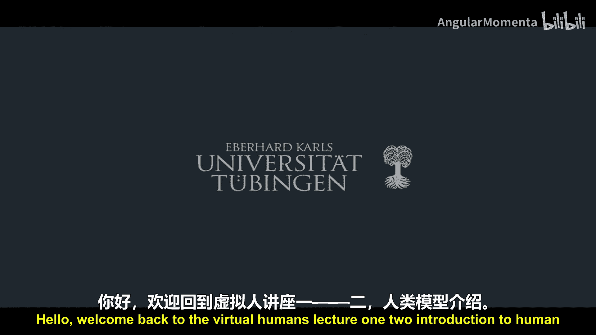

Hello， welcome back Bveral Human lecture 12 introductiontro to human models。

 so until here we've seen a little bit of the history of human models and now we will see what is the current state of the art。

Okay。So prior human models were either not publicly available or not very easy to use。

And that prevented its widespread use in academia and industry。

So if virtual human model should be a simple mathematical model of body shape。

 it should look like real people， move like real people。Ideally。

 it should be low dimensional and differentiable in order to fit it to observations。

 have joints in order to have more interpretation， and one should be able to easily animate it and fit it to data。

And also， it's important that it should be compatible with standard graphics tools like for example。

 like one should be able to import the model to tools like Maya and so on。

If you want a model also like non rigid deformation of soft tissue or clothing。

 you will need something more than a static scanner。

 so this is a scanner that was built here in tubing and。

 this is in microblslab in perceiving systems which captures like a dynamic bodies in motion and so basically this scanner was first built in tubingen in 2014。

 I think I was opposed out there and I remember that we were all very excited to see those first 3D shapes in motion captured at the high temporal and spatial resolution。

So essentially this scanner captures the human person， the person from many different views。

 and at a high frame rate and from these multi view cameras， you can reconstruct the 3D shape。

 as you can see here。So to build a human model， basically。

We followed similar principles then compared to what was already shown in Alan's work and Angelngeo's work forscape。

 so basically the idea is to collect three scan of thousands of people of many different shapes and thousands of poses and essentially you want to synthesize all these into a mathematical function。

So you want to learn a mathematical function that takes a set of parameters， bows shape。

 soft tissue and appearance and produces the vertices of a model which can be rendered as a realistic surface of a person。

So essentially like。So hopefully the results of the model look like a realistic person。

 although like what you're seeing here is the model generalizing to new poses。

So what is the body model， essentially on the left you see the 3D scan with the texture and the ground roof shape。

 and on the right you can see the model which is essentially generalizing to new poses。

So how does it generalize it has seen many people and how they deform。

 how the shoulders deform when they articulate their body and from this data。

 you can learn to synthesize this realistically。So essentially， you're learning this function。

 mathematical function M that takes a set of input parameters and appearance and produces these vertices。

Of a realistic surface。So essentially we represent the whole body as a 3D mesh and the mesh is segmented into parts and every part rotates in a kinematic tree。

 this builds on these classical ideas that I showed before and so basically every part rotates relative to the parent and you have like this skeleton that defines this collection of parts and how they rotate relative to each other。

So the body is then like 7，000 vertices， if the mesh has this topology。

 and this means that a body is just 21，000 numbers。

The problem is that most combinations of these numbers do not correspond to。A realistic person。

 It just corresponds to basically a randomness。And so the task is to learn a mathematical function that will take a set of low dimensional parameters and produce this。

This sets these combinations of vertices that correspond to realistic human bodies。

So when you build like like a virtual human model， it's useful to factorize it into the pose affirmations。

 the shape。The formations and be able to synthesize different poses and shapes。

 so basically here you can see that this model here on the top we see the different poses for static shape on the bottom you see for a static human apo you see different body shapes and then basically you can combine these factors to produce any person in any body pose。

So basically the model is parameterizing these deviations from this template mesh。

 and we will see this in more technical detail in the third lecture。

You might be interested in finding other factors， like for example。

 breathing or soft tissue dynamics， basically you have to parametermeize these displacements that account for this type of variations。

So how do we build these models， The first problem we encounter is that the 3D scans are not。

Register they they are sets of point clouds that have no semantic meaning。

 This means that I don't know which points correspond to the face。

 which points correspond to the torso and so on。So if we don't have this semantic meaning。

 then it's more difficult to do statistics from it because we cannot use the tools from linear algebra。

So what you typically do， recent works， they skip this step of registration。

 but what we typically do is we register a common template to all the scans and then we build a statistical model from it and by registering a template I mean you start with a template that might be in a different pose in a different shape and you optimize the parameters of this template in order to align with these 3D point cloud of the scan。

And you do this for every single scan such that you are bringing essentially all the scans into good correspondence because now everything follows the topology of the template and then now you know which points correspond to the。

To the phase and which points correspond to torso and so on and so forth。

So having good registration is crucial to build a good body model。

But this registration step is a very hard one。 So why is it difficult， Well， first of all。

 it's very ambiguous so。You have like high resolution scans and a low resolution template。

 and so a single template point could match to different scan points。The body is like in many parts。

 doesn't have these thing features， so it's very easy to confuse one point for another and this makes the registration challenging。

And。Essentially you might have very difficult poses for which you need a good initialization in order to converge and you might have self-contact which makes registration even more difficult and so it's a very challenging task you will by the end of this course you will know how to do registration on your own so one exercise is dedicated to this so you will learn how to do this。

 how to do registration of one template to a scan。So these are for example some registrations for different body shapes of the scissor data set。

 and the important thing to note here is that every vertex， if you've done a good job。

 every vertex of every shade corresponds to the same semantic part， for example。

 like the vertex 100 might correspond to the vertex to the nose and so on。

So you can do registration forward。Like dynamic scans as well is。

We did this in a paper published at Siggraff called Dynina in which basically we obtain alignments to these dynamic scans。

 here is like the challenge is that it's very difficult to track all the details。

 all the soft tissue motion from the scans realistically。

So basically like what I'm showing you here are registrations that are based purely on matching geometry。

And of course， because of this problem of this ambiguity that some areas of the scan are fairly smooth and they don't have these thing features。

 the question is like， oh， is the registration good enough？

And it turns out it's like with just geometry， that the registration is not perfect。So。

What you can do as well is like you can place stamps on the human body and then you can track these dynamic deformations more accurately by using like appearance based cues so by tracking pixels in the images。

So essentially you can put like these high frequency patterns which allow you to extract features more easily and to track with optic flow techniques。

 for example， to track the skin of the human surface more accurately。

So you can see this like like the difference between tracking using。Just geometry。

 so what you can see here is you will understand this better。

 so don't worry if you don't understand all the details right now。

 but basically if you see these texture maps， these texture maps are like an atlas of the body and if you see things moving a lot。

 it means that you haven't done a good job at tracking the surface。

 if you've done a perfect job at tracking the surface。

 these texture maps should look static because it means that all the motion is explained by the vertices moving and not by the appearance changing over time。

Again， you will understand this better once we see what the UB map is and what techniques we have for registration。

 but I just want to point out here the difference between tracking using just geometry versus using geometry and appearance on the left。

 you see this better tracking， you see that the UB map changes much less then here on the right where you have many more like what I would say like tracking errors because the UB map should essentially be static。

So essentially， like if you want to build a model of she statistics。

 what is really important is to register the data。And then bring all the shapes into a canonical pose because this is when you can study the statistics of body shape without factoring in like the effects of human of pose basically。

 so it's very important to normalize the data into canonical pose and then you can trade every shape as a single vector and then basically you can compute the statistics using linear algebra techniques。

So here this is the average shape of 2000 men and 2000 women。From the CSesar data set。

 so this is how an average person looks like。And now if you want to model the statistics of body shape。

 there's a question of what you can do and if you look a little bit at the statistics here I'm just showing you height and you can see that these this is I'm showing you just height but other features follow pretty nicely a linear Gaussian model and we can see that the men women have like two separate it's like they are like essentially two separate Gaussians with different modes and different variances。

So this goes for a linear Gaussian model or for a PCA model to model shape statistics。

 so basically this is done using shape blank shapes。

 so a blank shape is just the set of displacements from a template so essentially you start with this 21000 dimensional like surface of the template and then every shape is basically has some displacement relative to this template which you can compute by just subtracting one mesh with another if you have good registration。

And if you have everything in the same pose， what you can do is essentially you put everything into a matrix and and then you perform PC of this matrix so you're explaining this matrix as。

Like this matrix U of eigenvectors， recall if you've taken mathematics for machine learning。

 like basically this is the matrix of eigenvectors and these are the principal components plus mu which is the mean shape and so essentially we are reducing the the dimensionality from this like full like 21。

000 dimensional set of vertices to this betas which are like just the shape components and it turns out with 10 components。

You can explain a lot of the variance in a population， so some it goes up to 90， something%。

 which is very convenient because now I don't need to carry this 21。

000 numbers that can correspond to。To non realistic humans。

 now I just need to worry about this 10 to 100 parameters betas。

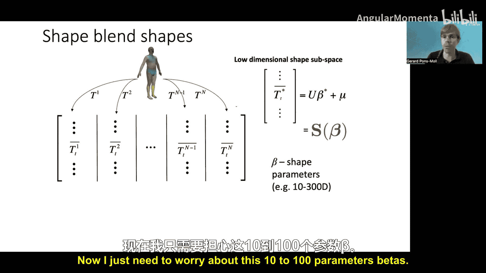

So this is like how like the different principal components look like so what we're doing here is we're looping over the different principal components from the first to the fourth and were plotting plus minus three standard deviations so we are adding this plus minus three standard deviations to the template to see what these components are modeling and you see that the first component models like scale the second component is more related to weight。

And then other components model like more subtle details。

So you can see this is the scale and this is more related to weight。And so on。

So you could think that basically to produce a target body shape。

 you're doing mathematics with body shapes。Basically having different linear combinations of people in order to obtain like a target shape and this is essentially what you're doing once you have all the shapes into correspondence。

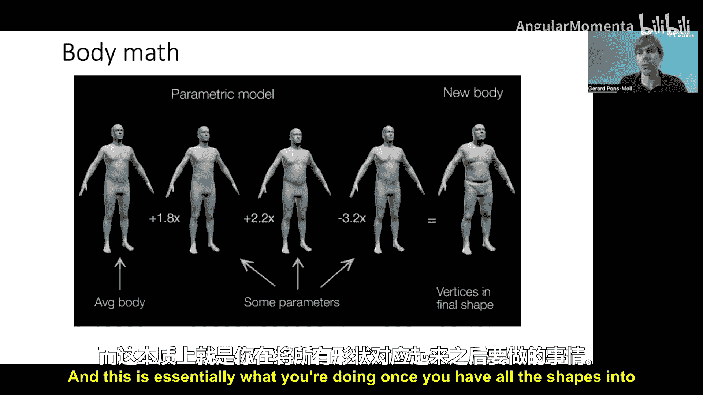

So this is modeling the statistics of body shape， but you are also interested in knowing how the body shape changes as we move and for this you need a post training set in which you have different shapes in different poses。

And basically， then from this， you want to learn like this model capable of synthesizing what you can see in the training data。

So here， like the standard model that is widely used in academia and industry is the simple body model。

 and the simple body model is mostly based on standard skinning。

 which has been used in computer graphics for many years。

So essentially you start with some breast posts versST and some joint locations of the skeleton and some blend weights that segment the body into parts that move rigidly relative to each other。

 and then you have post parameters that determine how these parts rotate relative to their parent part。

And so essentially you want to learn the skinning is a function that takes these parameters and produces veresis output okay so with simple what we're doing essentially is like we're parameterizing standard skinning we're parameterizing some components of standard skinning with this low dimensional pose and shape parameters so for example the template in the canonical pose will be a function now。

Of shape and bow， the joints will be a function of the shape and so on。

And we want to learn basically。Like a function that takes like this low dimensional theta and shape parameters in order to produce like vertices。

So we will see this in more technical detail， but I just want to give you a gist of what are the ingredients in a virtualt human model so you start basically this is for simple。

 you start with a template mesh。

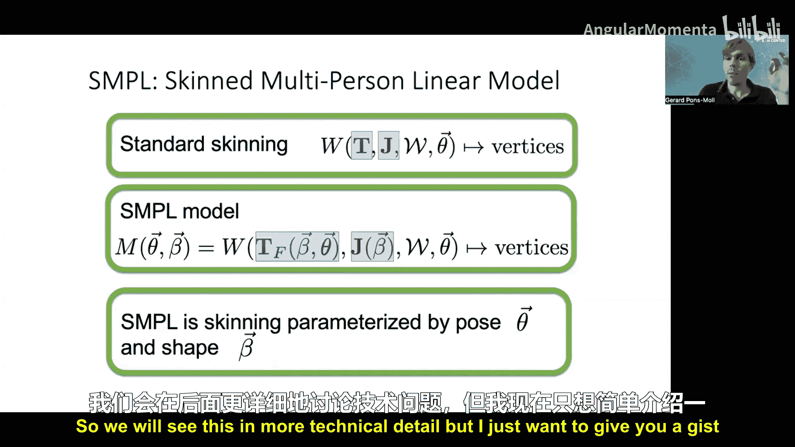

That is segmented into parts and you add if you're in a producer shape。

 you add what are called the plain shapes that change the identity of the person。

And notice how the joints change along with a person because the joints are a function of the surface。

And then there's the learn post blank shapes that essentially they are displacements that account for。

 for example， muscle bulging and。All sorts of distortions that happen when you rotate parts。

With rotations alone。So essentially， once you've learned these components。

 you can produce animations that loop。Like realistic， like what you see in the 3D scan data。

So we will see exactly what these pose blank shapes are， but just so that you get an idea。

 you see as the person moves， there's a set of displacements on this canonical shape that are being applied and they are learned from data and they are a function of the pose and they basically deform this canonical shape such that when I apply the set of rotations to the parts it produces a surface that looks realistic。

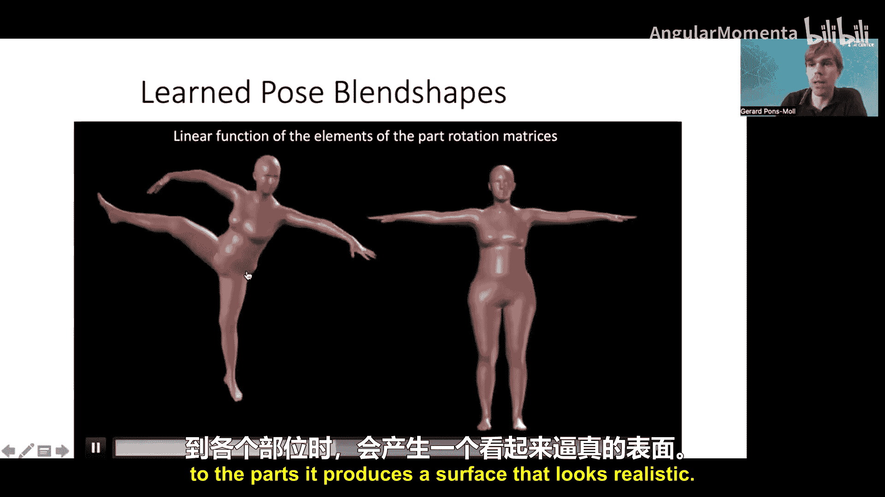

对。So essentially simple is taking this and shape parameters。

 these are the input to the function M that you're learning。

 and then you have a set of model parameters， which are the template。

 which is the average over the population， the blank shapes which are。These eigenvectors。

 the post blend shape matrix， which accounts for this post dependent effects。

The blend weight of the segmentation into parts is also learned from data and then you have a joint regression matrix that maps from the outer surface the to the joints。

So essentially we are like what S is boils down to is to learn standard skinning and you're parameterizing standard skinning with this pose in shape。

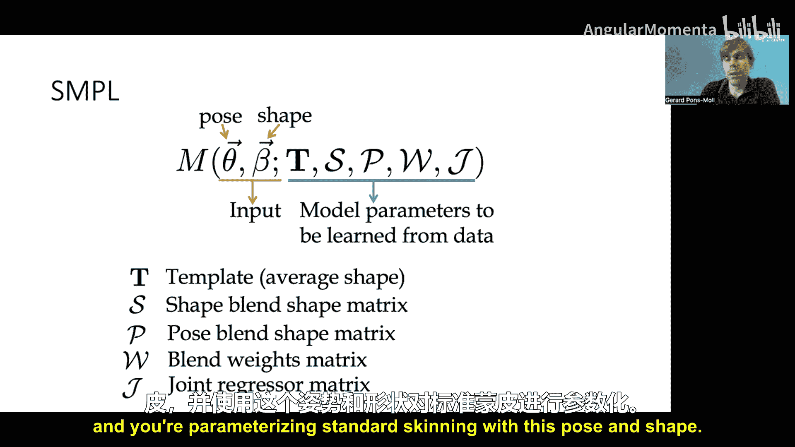

And then basically， like you learn all these parameters from these registered scans in order to minimize the surface to surface error。

I know this is going fairly quickly right now， but we will see this in the third lecture in more technical detail and we will look also at the math behind this。

And if you want to model soft tissue， basically you need to add a component that controls the soft tissue。

 but this can also be done if you have registrations。

 and then essentially you can add soft tissue and you can see that simple cannot model the soft tissue because it's not trained from dynamic data。

 but essentially we also showed how to model soft tissue ones you have for these scans of people。

then basically， you can make the model， produce soft tissue formations in order to wipe to the realism。

So here， for example， like this is a registration on the right and this is theforms produced by our learned model。

嗯。Of subtition。Now。for many applications we are interested in more than just shape and bowse or even soft tissue。

 we are also interested in emotion and body language and so the simple model is not enough for this。

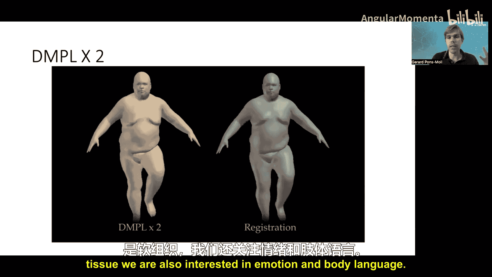

And there's also other models that include more than this。 So include basically like hands and faces。

 This is what is called the simple X model。Which includes like like the hand and the faces and the techniques to build like a phase and a hand model are pretty similar to the techniques used for building like the standard like simple model。

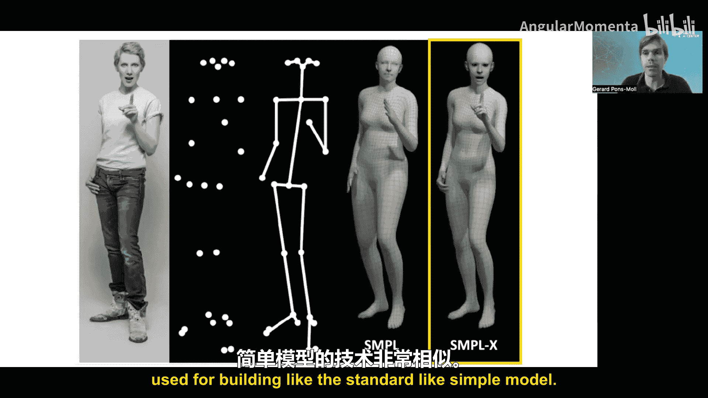

So basically， there's also models of the human phase that extend this blends and fetter model to cover the whole head and not just the frontal phase。

And basically， they also factorized theforms of phase according to shape， bow， and also expressions。

 as you can see here。Let me play the expressions。Ily， yeah， different expressions。

And for modeling the hands， like yeah， basically the model underneath what is called the mono model。

 which is modeling the statistics of shape for hands is also fairly simple to the simple body model。

Okay， so up until here， hopefully you have now rough idea of what it entails to build a human model。

 but we will see this in more technical detail。In the third lecture and now I want to give you an overview of the topics we will cover in the lecture and for this let me switch slides。

Close this。Okay， so this is like the part of lecture 13。

 which is basically just an overview of what we will see during the lecture。

So essentially I just want to show you in a nutshell what we will see so first of all。

 we will be interested in recovering human models from visual observations like images and videos and for this we first in order to invert this process we first need to understand how images are formed so we will see a little bit of image formation。

This part will have some overlap with a computer vision lecture if you've taken it given by Enre Geiger。

And basically， we will see a different， we will see also different types of rotation parameterization and surface representations。

So this is what we will see in the second lecture。

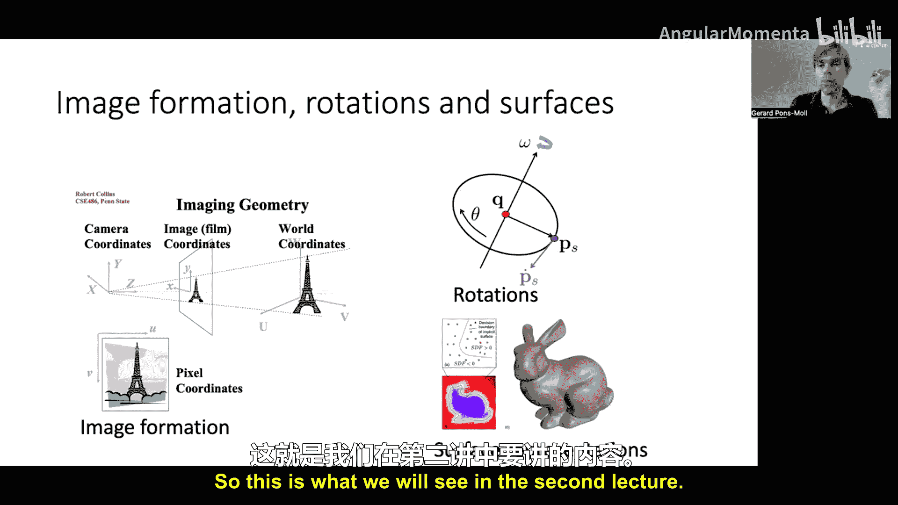

We will see more technical detail how you actually build a vertex based human model like simple。

 so what we've seen but with mathematical detail as well。Now this broke， sorry。

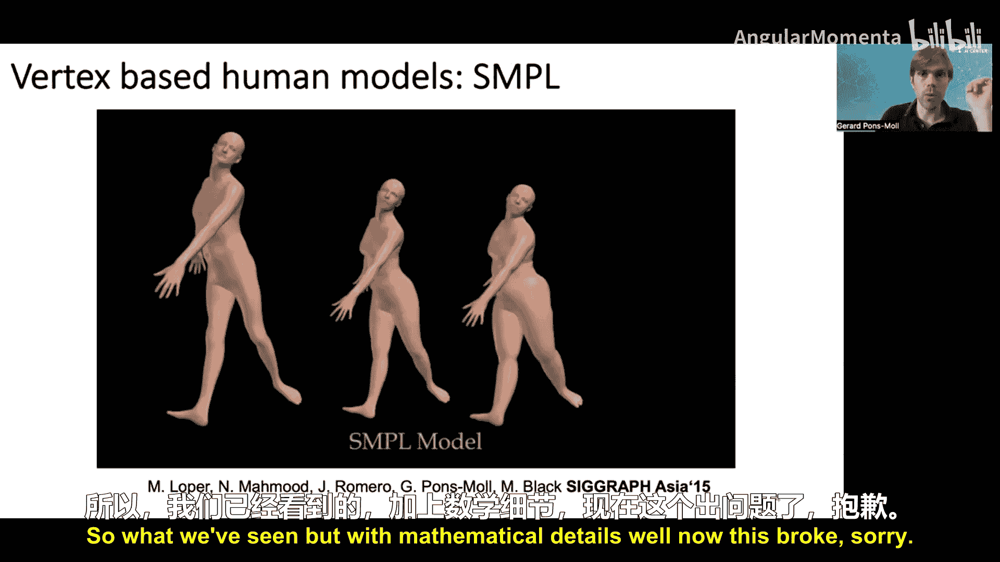

うん。😊。

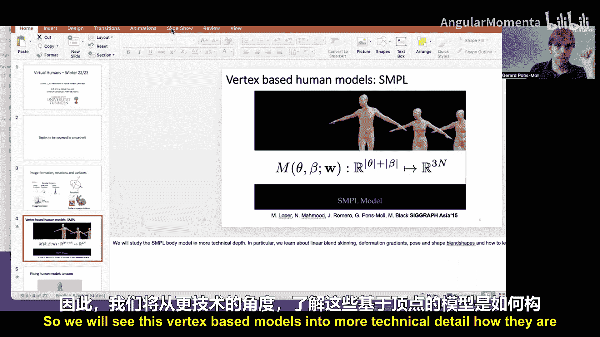

Just just this year。

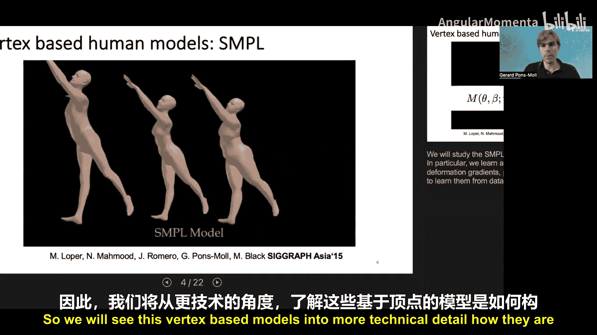

So we will see these vertex based models into more technical detail。

 how they are built and what is the mathematical form that it takes and how you learn them from data。

We will also look at how to fit。Human models to scan data， so this registration process。

 which is crucial to build a virtual human model and this you will do yourself。

In one of the exercises， you will also play with a lot of models like S during the lecture。

We will look at how to infer human models from images。

 So this is the task of single image reconstruction。 We will see optimization based methods。

 and also。Models that are based on regression based on a neural network。

And also hybrid models that basically take the advantages of both techniques。

 so basically techniques that predict with an neural network。

 an initial estimate and then Hu findings this estimate against the observations。

Sometimes we're interested in capturing humans without requiring external cameras。

 this is the case for example， when we are recording outdoor sports or we want to record humans going across different rooms and it's not possible to place cameras everywhere or for example。

 like we are interested in a virtual reality application in which we do not have external cameras。

 in this case you can use wearable sensors or inertial measurement units that you can attach to the body。

And those provide the orientation and acceleration of that particular body part。And。

So they provide orientation acceleration and we've shown in some papers that it's possible to recover the full human motion just based on five IM used placed at the extremities of the body and we will see again also during the lecture how this is done and here also there's methods that are based on optimization and methods that are more direct and based on regression learned from data。

Now this is very it's very useful for many applications where if you do not have external cameras。

 so here the external camera is just shown for reference， but it's not used for the estimation。

Of course， to produce realism， let me stop this so to produce realism we need to think about clothing and perhaps the easiest way to model clothing is using vertex displacements。

And。And so basically the first work to track the human body and the clothing of separate layers was cloth cap。

 which was presented at S 17， and here what we did is we tracked the human body and each garment jointly a separate mesh pieces。

And basically we had everything into good correspondence such that given scans of people。

 you could just parse the different clothing parts。

 estimate the body shape under clothing and then transfer this clothing from one subject to another。

 so what you're seeing here is that the last subject is a real captured subject。

 but the right subject which is myself actually。or like a virtual human of myself was never captured with this clothing but we're transferring the clothing from this source subject to the target subject so there's no learning here we' just it' just based on having good registration of the human body to the underlying so the clothing to the underlying body and then we can transfer this vertex displacements from one mesh to another we're going to see more details about this。

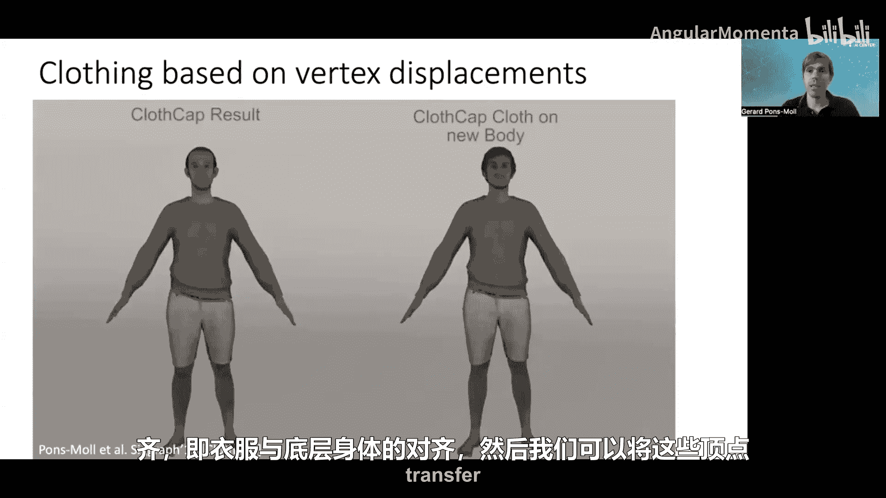

So of course like for clothing we're also interested in being able to synthesize clothing and this means for different poses generalize how the clothing will deform。

 so this is， for example， like one model that is based on vertex displacements。

 which is called Taylorornet。Which generalizes to different poses and also。Two different shapes。

 so see how the clothing here is accommodating for the different shapes and then basically you can have control over this shape and post parameters。

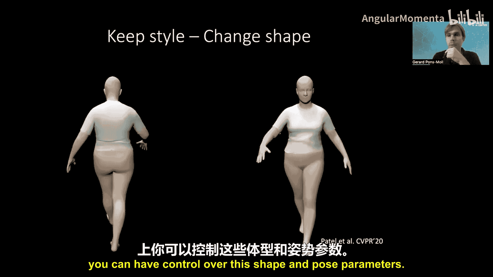

So these are models based on vertex displacement and more basically those came in 2020 so two years ago and now more recent works they are moving away from vertex displacements because vertex displacements have the limitation that they can only model clothing that is relatively close to the body and they cannot model like topology changes for example opening a jacket。

 we will understand better why that's the case and so people have started looking at implicit surfaces and how to parameterize these implicit surfaces with a neural network so essentially。

Implicit surfaces are basically defining the surfaces the zero levels set of a function defined in 3D。

And this allows you to track topology changes and to deal with more complex clothing。

 as you can see here， for example， like this jacket。And we'll see why these models。

Do not require registration， but they also have with they come with their own limitations。

Apart from implicit surfaces， people have been looking at other representations， for example， like。

Like floating neural points。 So these are points that have some neural features such that when you render them。

 they produce a realistic surface of the human。And more recent works that are based on Nerf。

 we will see N if you dont you've never heard of it。It's basically。

It's basically a method that stores like the 3D geometry in appearance of a scene in a neural network。

 and then basically you produce images of this scene by rendering，诶。And then querying the density。

 like querying the network。To know what the density at every point in space is。

 so we will see this also in more detail。And and then towards the end of the lecture。

 we'll look at behavior， behavior， meaning like being able to track humans。

 interacting with objects and 3D scenes。Building models， for example。

 that are capable of knowing how humans interact with the sins or knowing given a sin what human poses this sin affords。

 we will see the concept of affordances。And of course， we will go beyond static poses we will also。

Eventually， we want to build virtual humans that are autonomous so that they perceive the 3D scene and know what to do with the scene and know how to interact with the scene we'll see like human motion synthesis models。

 for example， that are capable of。Interacting with an object like a chair。

 they are capable of sitting on a chair and we'll see how to。To add control to these animations。

 for example， by specifying where the human should contact the chair， for example and。And yeah。

 we will see the different techniques to be able to synthesize human motion in three environments。

Okay， so these are the topics that we will see yeah special thanks for the slides for this first lecture they are mostly based on slides from Michael Blacks。

 you Tnk Javier Romero and nowre Mahmoud。So you can find more resources in the following links like in our group's website and also these there was a simple made simple tutorial given at CBPR。

One or two years ago， I cannot remember an also Sgraph course that we gave in 2016。So thank you。

 that's the end of the first。Lecture and please form group remember to form groups of two people and basically the Ts will share like a Google Docs where you can share this information and basically then you will be able to complete the exercises in pairs Thank you very much that's the end of lecture one。

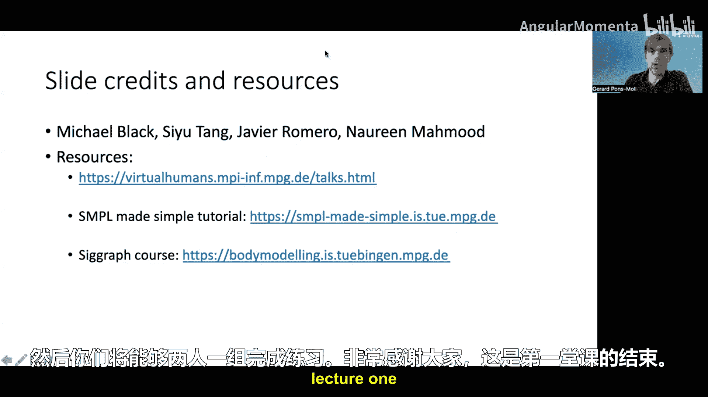