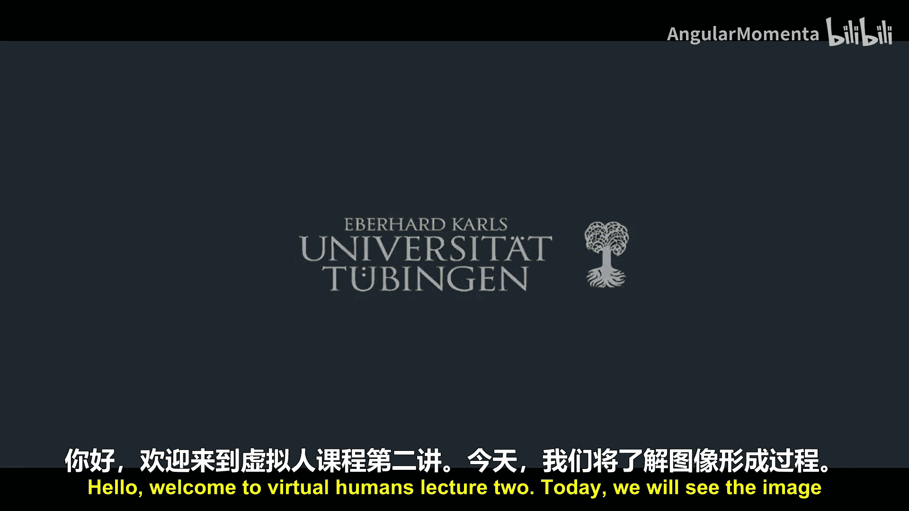
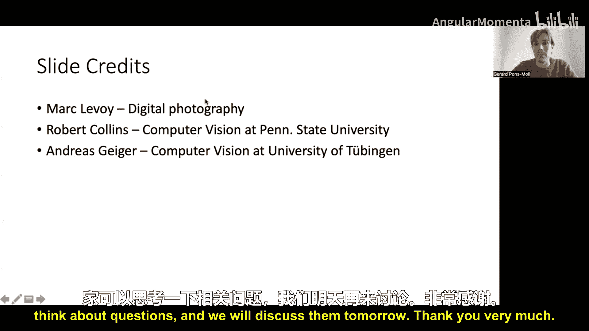

# 【精译】蒂宾根大学《虚拟人类》-p03-02.1-图像形成--BV1TAbkzpEva_p3-

Hello， welcome to Vitual Humans Lecture2。Today we will see the image formation process。And basically。

 although this is a virtual humans course， oftentimes we're interested in extracting 3D human models from images。

And in order to do that， we need to understand first how images are formed and how real people appear in images and what are the effects。

 the projection effects that occur。So we will start with an introduction to get an intuitive idea of things like linear perspective。

And then we will formalize this and we'll see how we can express the whole image formation process。

 the geometric part of the image formation process。With a projection matrix。

So one of the goals that we will see during this course is to extract 3D virtual humans from images。

And。Essentially， in order to invert this process， which is a new post problem because we are missing the depth dimension。

 we first need to understand how an image is formed。 This means how a 3D world。

Object gets projected into the image。Essential， there's slide。Buncing off the surface。

 and this light is capturedd in the image sensor。 And at the image sensor。

 there's an image that is formed。 and essentially we need to understand。What is the geometric。

Transformation that occurs to go from the 3D world to the 2D world。🤧So for the graphics problem。

 of course， it's even more direct， we also need to understand given a 3D object or a 3D representation of a human。

 we need to know how to render a realistic image of our 3D scene representation。

So for both types of problems， generating realistic images and inverting the image formation process。

 we need to understand the image formation process first。So essentially。We have the following。

Problem， we have like a world。sn as you can see here。

 and then we have like a camera with its own coordinate system and we have like what is called the image。

 the sensor， which will have like its own image coordinates。

And what we're going to see in this lecture is how do we go from this world。3D object to this。

Coords into the like x and y， and eventually pixel coordinates。So let's start with the basics。

 the laws of perspective。So common assumptions are that leaving an object travels in straight lines。

And these lines converge to a point in the eye。And already Oaklet knew about natural perspective。

Natural perspective is this intuitive。Fact that more distant objects obtain smaller visual angles。

What does this mean？So consider an observer here shown as this I over here and consider an object which is defined by these two dots。

呃。Which is managed by these two dots as the object gets closer to the observer。

The subended angle that the observer sees increases。 That's why theta 2 is larger than theta 1。

Sorry about that， let's skip updates。So。Essentially like。At the beginning。

 people didn't know how to draw a proper image。 They understood this concept of natural perspective and they tried to essentially draw paintings in which further objects they tried to make them。

Smaller， but there's something off in these pictures， something doesn't look quite right。

 so the tower here behind looks looks a little bit too big。So here。

 like this painting over here also doesn't look quite realistic。

And that's because this painting is not quite correct。

So natural perspective is not sufficient to draw a proper painting， to draw a proper painting。

 to project the 3D scene into the image， you need to consider the linear perspective。

So Indian perspective was discovered by Filipo Bruelesski in the year 1，413。And basically。

 it says that a perspective image is formed by the intersection of the lines with a picture plane or the canvas。

So in natural perspective， we've seen that as the object gets closer to the observer。

 the subtended angle gets bigger。Now， in in linear perspective。

 we are going to obtain an image by intersecting the race going from the object。To the observer。

 and we are going obtain。Like like a pixel or like a dot in the canvas as the intersection of this line of this re departing from the object and intersecting this image plane。

So the same as with natural perspective as the object gets closer to the observer。

The object appears bigger， so this height of the object in image y1 for this distant object gets larger。

 gets to y2 as the object gets closer to the camera。This proportion， however。

 of how much larger the object gets， is not the same as with natural perspective。

 This means that the quotient of y 2 over y 1 is not the same as the quotient over of theta 2 over theta 1。

So how can we describe this mathematically it turns out that linear perspective is quite easy to describe mathematically because we can use similar triangles to figure out what the height of the object y should be so imagine I have an object with height H。

And we want to know what this y should be on the image plane。For this。

 we need to know how far the observer is to the image plane， this is what is de as F。

 which we will see that we will define as the focal。Fcal distance。

Then like we have that the object is at the depth。Depth is how far it is from the observer Z。

So by similar triangles， we can figure out that。Hge。This triangle here。

Is similar to this triangle over here， this small triangle。So H。

Divided by Z should be equal to y divided by F。Therefore。

 y should be equal to H times F divided by Z。And this is how。We obtain this object coordinate in 2D。

So a few remarks here。Notice that。This is not a linear mapping。😡。

With respect to the object coordinates。Because we have this division by Z。So。

As the object gets further away， Z gets larger， and therefore the object will appear smaller because this Z isn't a denominator。

Another thing that you should observe is that as the focal length。Gets larger， F gets larger。

 like the object will appear larger in the image。So these are the things that this is the most。

Simple model that is widely used in computer vision and we will see more of this later。

So basically you have this division by that， so you basically can already understand that if I'm。

Twice as far， I will appear half as big in the image。

 and this is very important when trying to understand， for example， humans in images。

So as I was saying， linear perspective is not a linear mapping。So lines will remain straight。However。

 like。Parter the lines in the three world will not remain parallel。

Since the object appears smaller and smaller as we get further away from the camera。

 parallel lines will converge to so called vanishing points。

You can observe this in these columns over here。 So， of course。

 these columns are getting further away from the camera。 And although these lines over here。

Are parallel in the 3D world。 They will not be parallel in the image because these columns are further and further away until like they will converge to a single point。

The same can be said for this part of the lines that you observe here。

 so have here one vanishing point， another vanishing point。And another vanishishing point。

So one natural question is how many vanishing points there are in a prospective drawing。

What do you think？There's going to be three because there's three dimensions。Infinite。

The correct answer is as many vanishing points as parallel lines。

 there can be infinite vanishing points。 every pair of parallel lines。That are not。Essentially。

 on the。Plain perpendicular to the line of sight will converge to a vanishing point。

So now another interesting and perhaps counterintuitive question。But the answer is con。

 So imagine I'm looking at the。At the first eight。And the facecade is really， really， really long。

 okay， really long。For example， I'm looking at like perpendicular to the Chinese like wall。

 for example。So the question is like， should the distance end the distant ends of this facade？😊。

Should they be drawn smaller than its center in a perspective drawing？What do you think？

So I recommend now you pause the video and think a little bit about this problem。

So imagine the long facade is this and I'm looking perpendicular at this plane where the the building is built。

 should it look like that such that。This。Get smaller and smaller and smaller。Think about the depth。

Is the depth changing as I'm getting further away to the right and to the left。

The depth is not changing。Therefore， in linear perspective。

This is this is not what should happen like straight lines remain straight so and lines parallel to the picture plane do not converge。

 they should remain basically parallel。So when you see a very large。Drawing of a very long facade。

They will like the distant ends， they will appear。Smaller when you view the drawing drawing。

 but this is not because of linear perspective。 It's just because of natural perspective。

 because the angles subed to the eye will be smaller。Okay。

 so I hope that' so you can spend a little bit of time think about this because it's something that is perhaps confusing and counterintuitive and it leads to confusion when thinking about computer vision problems。

So now ask the following question， I am an observer and I observe columns。Okay。

 like this columns over here and I take a picture or I make a drawing and I get this。

And the question is like， why does this drawing look distorted？Any ideas？Well。

 this drawing is not distorted， it's just that you're viewing the drawing from too far away。

To see this drawing correctly， you should be looking much closer to the drawing to respect the the。

The distances in which it was captured in the first place。

So this is something thats a physical property。And yeah。

 you cannot get rid of this when taking pictures。Okay， so。

This was a quick introduction into linear perspective financial natural perspective， so just a recap。

Is that natural perspective is the visual angle subended by a feature in the world。

Linear perspective。Is a way to contrie the right way of drawing images。In an image。So basically。

 it's constructed by intersecting the lines of site with a picture plane。And an image has。

 because of the linear perspective， has infinitely many vanishing points。

One per direction of line in the sea。And lines parallel to the picture plane。Do not converge。

多办你新 point。Okay， so until here you can think of questions which we'll discuss in the Q&A。

Like session。So here I'm showing you a picture of。Camera。

 and you can see here there's a lot of glass。 This is the lenses of a camera。

And here you have the sensor。And a natural question is like， do cameras need lenses？

Can we just put a sensor out in the world and just record an image？What do you think would happen？

Well， the image you would get would be pretty much very blurry and it would be some sort of an average。

Think of the points， the light that every pixel in the image would be recording。

Like you would be recording lights coming from all possible directions， right？

So essentially like the color that you would record there would be an average。And furthermore。

 this average between nearby points， for example， this red point and this yellow point would be pretty much the same。

 so you would obtain a very much blurred。Image and that's because at every point in image。

 you're integrating over all the race。Hitting that particular pixel。Okay， so that's not an option。嗯。

So since ages， it has been known that you can make a hole in a wall like what you can see here。

And put a sensor on the other side， this is the sensor， a canvas。

And to create a picture on the other side。This is what is known as binhole camera or cameras obcura。

With this， we will obtain an image with a correct linear perspective。

Notice that the image will be inverted though， because like the top。

The top of the object will appear at the bottom of the image and the bottom of the object will appear at the top of the image。

So。Ignoring like some like。Some effects that we will not cover in this course。

 everything will be in focus because every point in the image is recorded。

And basically it records a single ray like hitting that particular point in image。So。Rightight。

So the model of a pinhole is as follows， it's very simple it is what we saw a little bit before。

 so the pinhole is in the middle and here have the wall and here have the 3D。

So completely equivalent is like what is called the Duers's class。

Which is basically you can consider the image without inverting by placing this in front of the pinhole。

As opposed to placing it behind the pinhole， but the models are completely equivalent。

 and it will be easier to consider that the image plane is in front of the pinhole because then we can do it's easier to see like the relationships with similar triangles see what what we've seen before。

So what is the effect of。Or what do you think is a potential problem with a pinhole？

But if the pinhole is very small， it will let very little light go through the pinhole。

This means that the image that it will produce will be very dark or basically nonexistent。

So that's why。We don't use just pinhole to create images because there's not enough light。

Going through the pinhole。So you might say， well， I can make the pinhole a bit larger so that more light comes in。

What do you think will happen then？Well， then what's going to happen is that。

Is that the image will get blurred。Because for a given pixel。

 there's going to be like a cone of race that that。

That arrive at that particular pixel and this will make the whole image look like blurt。

So this is this can be visualized here。 so for a given pixel you have a cone of。诶。

Like rays that come from 3 same points that converts the same pixel， right？

And this is true even for very small pinhole， and that's the reason we do not use pinhole。Luckily。

 a lens does the same thing。Takes all the race。高ing。From a point。

 and it focuses them on a single pixel。And it still produces a linear perspective。

Ignoring some like braidal distortion art effects。So photographic camera produces the same 2D planner geometric projection as a camera obscura。

And a lens replaces the pinhole and feel more digital sensor becomes the picture plane。

So rotating the camera and lens， of course， around the lens center adds or removes vanishishing points right that's when you change when you rotate the camera。

So we're not going to get very deep into geometrical optics。

 but I think it's important to understand a little bit the basics of how an image is constructed and to know a little bit like the basics of lenses。

So with these two principles that I'm showing you here， you can derive pretty much everything。So。

These are the common sort of approximations。And these two principles are saying that given a lens。

 like parallel rays， converge at the focal length from the lens。

And this focal length is a physical property of the lens， okay？so different lenses。

 depending on their geometry， they will have different focal length。Okay。

 so parallel ray converge to a single point and this distance at which is the parallel race converge is called the focal length。

Then rays going through the center of the lens are not deviated。Hence。

 they have the same perspective as a pinhole。So。With these。

 we can already understand the Ga's rate racing construction。

So we're going to have that for a given object。We're going to shoot a ray and this ray will converge。

Forgiven。Like。Point in the image plane and by symmetry。

 I can send a array back and it will land on the object and any array in between here that departs this point in the object will converge to the same point。

This is when this object is in focus in this image play。So essentially。

 the lens is focusing a lot of race into a single pixel to construct an image。

 so it's basically it's like having a pinhole camera model。

With enough light coming into the image sensor。Okay， and different points in the object， of course。

 they will convert at different points in this image plane and this will render the image of an object in the image。

So as I was saying， like par of race converge。At the distance of the focal length， Okay。

 are this are the parallel arrays and this parallel rays are in focus。Now。

 if I move this is when the sensor coincides with the focal length。

 this physical property of the lenses。Now。When I move the sensor away from the focal length。

What begins to happen is that objects that are not at the infinite start to be in focus。Okay。

 so and depending on where do I， where I move the sensor relative to the lenses or relative to the focal length。

 I will be focusing different。Object。so this is a difference with the lenses and a Pinghole camera。

 A lenses can only focus。诶。A given distance to the camera perfectly right so that's the main difference in a pinhole everything is in perfect focus here you're focusing particular objects at a particular focus distance。

Okay， and this is how actually focusing can work in a camera。

 you can move the sensor away from the lenses or vice versa。

 you can make the lenses further or closer in order to focus a particular object。

You can also like change the。By combinations of different lenses， you can change the shape。

Of the lenses or effectively change the the shape of the lenses in order to change the focal length in order to zoom or zoom out。

Okay， so。Like with the two principles that we saw before parallel rays con at the focal length and rays going through the center of the camera are not deviated。

 we can derive the most important formula for lenses。

 which tells us how to place the sensor relative to the lenses in order to focus a particular object at a a given distance SO。

So this triangle here has the same angle as this triangle over here， so by similar triangles。

We can derive the following that Y I should be equal divided by y0 should be equal to S I divided by S0。

Okay this is this equivalence over here。Now， we can construct another pair of triangles。

 which are also similar。 This angle is the same as this angle。 Therefore， Y I divided by。

Y0 over here should be the same as S minus F this segment over here divided by F。Now。

 taking these two equalities。This Y I divide by y0， we can equate this two。

Equations and obtain what is the most important formula that we know for lenses。

 which is1 over S plus 1 over S equals 1 over f。So。Now that we have this formula。Under or belt。

 like we can look at this picture that I was showing before， how to focus。

 And now we know exactly how far we have to move in order to focus， right。

 So for a given object distance as 0。This formula tells us。

Were how large SI should be in order to have everything in focus， okay？So this is given by this。

That formula over here。So now I pose a question。In which situation？Do I have an image？

That is of the same size as the real world。And。I will not give you the answer and we'll discuss this in the Q&A tomorrow and then we will see other examples of this。

 so think about this。Okay， so something I want to make clear is。

Like the difference between the F that we use when we talk about pinhole camera models in computer vision and the F which is a physical property of the camera and this can be confusing and I think a lot of people confuse this and so it's important to know that they are different so when we talk about the pinhole camera model we have this for the following like model where F is the distance from the。

The pinhole or the viewpoint to the image plane。And we obtain the object height y as F。

 which is this focal。We call it focal length， but let's let yeah F times h divided by Z。

 what we saw before， right where depth with Z is the depth。Now， with a camera lens model。

 we have something slightly more involved where we have here。The F is the focal length。

 which is a physical property of a camera， it does not depend on where I place the sensor relative to the lenses。

And。We have that y， which is the object height， is going to be equal。Two。

 what matters is this distance S， which is the distance。

To the lens okay because by similar triangles I can construct the same triangles as before like this like this this triangle over here right and this triangle over here。

And so basically， I have that y equals S times H divided by Z， where S I is now F， which is these。

Physical property of the lens。Plus。X， which is how far the sensor is placed from this focal length point。

Okay。So。In practice in computer vision， we most of them work with this model above and we don't worry about this。

This differences anymore， but it's important to know that they refer to those slightly different things。

So a few more remarks for the lens camera model， we derive the following relationship one over Z plus1 over SI equals1 over F。

 no design change here as zero by Z， but yeah I mean， it's the same。

So one thing to note here is that as the depth goes to infinity。Zep goes infinity， we obtain that S。

This distance from the sensor to the lenses， tends to F。Right， and I。And in this situation。

 like the lens with focal length F is equivalent to a pinhole at distance F。

So another natural question that we can ask is。If the sensor size is constant。

How does the focal length change？The filter view， right， the filter view of the image。

So as the focal length gets smaller， closer to the lenses， the field of view will increase。

We have a white。Wide angle camera as the focal length increases， we're getting towards。

Telephoto camera， and basically the field of view will get smaller。How much smaller。

 well that's also again very basic trigonometry， we have this triangle over here。

 but we're interested in this field of view at two times this angle。And basically。

 we can consider this triangle over here。 So essentially， this base here is。

F and this height here is h hs。 so we need to take the a tangent。Of eight hs divided by F。

And we need to multiply two times because want this angle two times。

 So this is the formula that relates the filter view with。With the focal length。RightSo of course。

 if the sensor size is smaller， the field of view is smaller too。

 and smaller sensors either have fewer pixels or smaller pixels。

 which then become noisier because they gather less light and then you have more noise。

Something that is important and it's again， perhaps a little bit counterintuitive is that because of this linear perspective。

We can have different relationships of sizes of people。Depending on how。

How big the focal length is when we take the picture。So look at these three pictures。

The frontal person。Appears of the same size in each of the three pictures。However。

 like the person that is a bit further away like looks very different in size when we take the picture with a wide angle camera or when we take the picture with a telephoto telephoto camera means like large focal length。

Why does this happen， like take a second now to think about this and perhaps pause the video。

To think about this effect。So the first thing you should notice is that by because the depth controls the height of the person。

 but also the focal length controls the height of the person。

 we can move back while we increase the zoom in order to keep the size of the frontal person。

The same。We can do this with a camera， we move backwards， but at the same time we're zooming in。

But moving back changes the perspective effects。So one way you can think about it is that because the focal length gets very。

 very large， the difference in depth between the frontal person and the back person becomes less important。

So you can figure out mathematically like what are these effects and you can derive all this with the formulas that we've seen。

So yeah， so moving forward while shortening the focal length lets you keep objects at one depth the same time and this in cinematography is called the Duli zoom effect or vertigo effect which was used in the movie vertigo where you can see that when they are going up this tower and this this stairs。

 if you've seen the movie like the cameras like you can see how。

Everything keeps in focus and this is done by either getting further away and zooming at the same time or vice versa。

Now when taking pictures， this effect is very important because it can make people appear very different in images。

So this is the same person。Taken with different camera with different focal lengths。

 so from wide angle to standard to telephoto。And notice that as the。诶。😊，For the wide angle。

 you have like this perspective effects because the nose is closer to the camera and this perspective effects become more important as the focal length is smaller if you're you're further away you're further away from the object。

 these differences in depth between the nose and the rest of the face become less important and the focal length is much more important in relation in relationship to that so in in that sense like this is。

As we move and further further away， it's as if the person would be on a single image plane and you have no perspective effect。

For this region of the face。Okay， so that's something to consider because when we are trying to extract 3D from images。

 you really need to think about。Like in the first place how the image was formed。Okay。

 so to recap Phole cameras compute correctly in your perspective， but they don't gather enough light。

 therefore the images look dark。Lenses gather more light。

But there's only one plane of the scene in focus。The distance from the lens to this plane is called the focus distance。

And you can change what is in focus by moving the sensor or changing the lens。

By changing the focal length。So the focal length is a physical property of the。

Of the lenses and it determines the field of view and from Yrango to telephoto。Okay。

And it depends on the sensor size， the field of view。Okay， so now we have like。

An intuitive understanding， now let's formalize this mathematically。

Basically now the goal will be to express the image formation process with a single projection matrix。

So we start with world coordinates。This wall coordinates is like a coordinate system that you can choose in the 3D world and then the objects are represented in this wall coordinate system and then you have the camera coordinate system。

 this is the coordinate system of the camera and by convention like the Z of this coordinate system is always in direction of is the optical axis is direction where the camera is pointing towards and then the y explain。

The Y and x are parallel to the image plane and F in a pinhole camera model is called the focal length。

给。Which is F units away from the image plane in。From the optical axis。Okay。

 so an equivalent as we've seen before， an equivalent model is to place the image plane in front of the Phole。

Right here， and we can derive how large the image will be based on similar triangles as we've seen before。

So an image gets digsitized into pixels and basically the process is that there's a series of transformations。

And for each of these transformations， we will see what is the corresponding matrix。

 and then basically we will concatenate all these matrices to obtain a single projection matrix。

So essentially you have like you first go from world coordinates to camera coordinates。

Then you go from camera coordinates to image coordinates by linear perspective。And then finally。

 you basically have to account for center size and the pixel size and the center and other effects to obtain pixel coordinates。

So essentially like the forward projection goes from more coordinates， camera coordinates。

 film coordinates， and finally pixel coordinates， and I think of this each of these operations as a。

As a transformation and basically we'll concatenate all these transformations into a single matrix。

Okay。Notice that in computer vision we are often interested in the reverse problem going from pixels to world coordinates。

 and this is a new pulse problem we need to use priors in order to revert this lawsuit。

Projection model。And。But first， we need to understand how the forward projection model works。

So let's first understand how do we？Do linear perspective perspective projection from camera coordinates to film coordinates。

 and this will be a big repetition of what we've seen already。So essentially。

 like a scene point P right gets projected into the image according to the following equations。

 F big x， which is the big x will be the coordinates。Of the 3 world point。

 the 3D point in camera coordinates divided by Z， which is the depth。

This is the depth is always the distance from the optical center。To the image play。Where。

to the image plane where the object is captured。So by similar triangles。

 you can derive that for both the x and y， you can derive that x is to big x as F is to big Z。

 therefore we can derive these formulas over here and you can do the same for y。

 so that's why you have these relationships over here。

So how do we represent this with a matrix equation？Well， first of all。

 can we represent this with a matrix equation？I thought that we can only represent linear mappings with matrices。

 so how can we do this？So the division by Z means the mapping is actually not linear。😊。

So if we want to represent this with a linear。With a linear with a matrix。

 we need to do a change of coordinates and therefore we need to introduce here homogeneous coordinates。

 which will be very。Like convenient for our purposes。So what are homogeneous coordinates。

 you probably have seen these in other lectures。So basically。

 you represent a 2D point by a 3D point by adding a fictitious third coordinate。And by convention。

 we specify that。We can recover the 2 d point with a fictitious third coordinate as follows x prime divided by Z prime。

 y prime divided by Z prime。So okay， this might look a little bit awkward construction。

 but we will see how this is very useful for dealing with image projection。So now the following。

 like if I add a third coordinate that is one or if like if I consider the following ogenous point x Y1 and now I scale it by any non negative。

Salar K。I will recover exactly the same point。2 x to Y 2， K， X， K， Y， K。

 because then I will end up dividing K X divided by K and K Y divided by K。

 I will obtain exactly the same point X， Y， Okay， so these points are in agenous coordinates。

They would recover the same to the point。Okay， so。Now what we can do is like with this homogeneous coordinates。

 we can represent this essentially with a linear matrix like these equations over here。

 like all I need to do is like okay， so I need to multiply by f in the corresponding entry of the matrix and that's it and I need to add a1 such that the homogeneous third coordinate will be the depth itself。

And because we said we defined it this way。That the point will be recovered by dividing by Z。

If we place the right depth here， we will recover these equations over here so this matrix。

Four Mingeneous coordinate is completely equivalent to these two equations。Yeah。

 so we're not doing anything different we're just expressing this in terms of a matrix and defining like this homogeneous coordinates in an additional operation。

Okay， so now we have to think of。First of all， how we transform the world。

Object in world coordinates to camera coordinates。And this is a simple。

World to camera transformation， which you've probably seen many times。Next。

 we will see more about rotations， but just now you should。

Basically just know that a rotation matrix has its column columns。

 which are the axis of the coordinate frame here。Like UWB express with the other coordinate frame X。

 Y Z， and then basically in order to express a point in。

To transform a point from world coordinates to camera coordinates， we can just so this PW。

 we can first translate it。By c， write Pw minus c and then rotated by R。

Yeah so a standard change of coordinates。So this can be expressed with a matrix， of course。

 where we have a rotation and translation。By by this， this minus C yeah。

 so this way we can transform world coordinate world coordinates by。

We can transfer world coordinates to camera coordinates。Yeah。So。Now I pose a question。

 what is the first column of this rotational matrix？What is R11， R21， R31？Well， that's going to be。

Like the coordinates。Like it's going to be the first vector of the world coordinate frame。Right？

Expressed。In camera coordinates。And the same goes for the second column and third column。

 that's why you can express a linear mapping with the matrix because you can express the transformed linear basis in as and you can put them as columns in a matrix。

Okay。So when we multiply by this matrix by the point。Like。Like， you know。

 we will obtain like a linear combination of these columns， which are the basis。

The base is transformed。So think of the following like what is the column？Yeah。

 so what would happen if the camera and wall coordinates would be aligned， then you would obtain。

 of course， here the identity matrix 1000 and 010，001。And so on， right？

So another perhaps more interesting example is the following like this stereoic where you have like a left camera located at 000 and a right camera located at Tx00。

And。Yeah， so let's look at so you can place the world coordinate frame。Aligned with the left camera。

And now， like you can see how the left camera。Relates， it's basically everything is the identity。

 and you have a zero translation because you have alignment of the world current frame and。

The camera。Or like you can consider the right camera where the axis are aligned。

 So remember the picture， the axis。Y Z X are aligned with this right camera， Y X， Z。

 but you have a translation here。 That's why you have to add this minus tx over here。Yeah。

 because it's located at the world position Tx00。Right， so to obtain。World。

To obtain the coordinates in the left camera， we would obtain the following formula f x divided by Z。

 F y divided by Z， to obtain the right camera like we would obtain f x minus dx because this camera has been displaced divided by Z Fy divided by Z。

Yeah， so I'll be a little bit more of the same like when we think about rotations。

 I don't think about translations and basically to get things right。Basically。

 this equation tells you how vectors in the world coordinate system。Including the coordinate access。

 get transformed into the coordinate。The camera coordinate system，So rotationations are a property。

 of course， of the axis， the relationship between the axis of the coordinate frames and has nothing to do with the translation itself。

So how do you figure out rotations yeah basically what I was saying like each of the columns is each of the basis of the source coordinate frame。

 in this case the world coordinate frame transformed or expressed in the other coordinate frame。

 so basically if you want to figure out what the column should be think of how the world axis right which is 100。

How it corresponds to the camera access AC， so if we place here， we transform the 100 vector。

 we will obtain the first column， which is essentially， of course。

 then the first column is like just the first basis of the Walcom frame rotate like expressed in the camera coordinates。

And so on。🤧。So sometimes it's easier to specify what the camera is in the Walpoint frame and then we can just take the rotation inverse in order to obtain the correct transformation and actually in rotations。

 it turns out that the inverse is the same as the transpose and therefore that's trivial to invert this three by three matrix。

Okay， so again these columns will be the world axis in camera coordinates。

 this second column will be the World Y axis in camera coordinates and the third column will be the World Z axis in camera coordinates。

Yep， that's why this is。A linear mapping。analogously。

 like the rows will be the camera X axis in world coordinates。

The second row will be the camera Y axis in wall coordinates and the third row will be the camera Z axis in world coordinates。

Okay， so that's basically what we need to do to transform from world coordinates from world coordinates to camera coordinates before we do the linear perspective。

 right， to do linear perspective， everything has to be in camera coordinates because the coordinate system needs to be aligned with the image plane in order to do linear perspective。

Okay， so。We know how to transform the 3D world coordinates into camera coordinates。

 and we know how to go from camera coordinates to film coordinates with linear perspective。Now。

 the next thing we need to see is how we obtain actually the pixels。

And one way of thinking about going from fume coordinates to pixel coordinates is by thinking of an a fine transform。

So it essentially describes the transformation between the film coordinates。

 the projected image and the pixel array that depends on the actual hardware。Of the camera， right？

So it depends on how the grid of sensors， how large the pixels are and the size and so on and so forth。

So the first thing we need to be aware of is the center of the image。This is a source of。

Of confusion oftentimes and。So in principle， the center of the center is。At the center。

 which is the principal point， but it can also be placed at the at the corner of the image。

 and that's why like you have like this plus Ox right， which is accounting for where。

The principal point is。And then you have like this pixel， which has the coordinates。Not X， Y。

 but U and V。And be careful because。This。U and V might be sometimes flipped with respect to x and y。

 and then if you realize that the image appears reverted or something like this。

 this is typically because。The coordinate system of the pixel array is not aligned with the film coordinate system。

Okay， so。Andm。Yeah， so be careful with this sort of。

Like alignment between pixelix coordinates and film coordinates。

And then there's something that is there like I mean。

 these are all like what I call like the intrinsic camera parameters， so basically。

Like sampling determines how many rows and columns are in the image。

 so this depends on the scanning resolution and will create like a different pixel array with different resolutions。

And basically like in the CCD， you're capturing light and then you're basically getting these analog signals that get reampled in order to form。

Pixels right and obtain pixel color values。So at the same scanning resolution。

 if the sensor is bigger， I will obtain a higher resolution， right？

So so and you should note that the pixels might be of different shapes than squared。

 that's why like here you might have these different scales for the x coordinate of the pixel than the。

Y coordinate of the pixel right so if Sx equals S I have square pixels。

 but otherwise I have like an aspect ratio of Sy over Sx for the pixels。Okay。

 so that's the equation like a pixel U。Now it's going to be like the film coordinates。

 which is Fx over Z plus Ox to account for the principal point。

 which is the coordinate origin and one over Sx to account for the size of the pixels。

And so how do we express this with a matrix， Well it's not very difficult we can write the following matrix here。

This is the multiplying factor， so now F essentially gets divided by S x and S Y。

 and we have like an additional Ox and O Y in addition here that accounts for this。

This translation and。Right， so we can write this in。Yeah。

 so note that this sometimes you have these minus signs because of the the。

Cor system of the pixel array is not aligned with the film coordinate， but in principle。

 we can write this in matrix form。So we can separate like this matrix here and then basically we have like this a fine。

Transformation that maps from film coordinates to pixel coordinates。

 and we have like this M projection that accounts for the focal length and for linear perspective。

 if we do the proper division by Z with the homogeneous coordinates。So we've expressed now。

Like how we obtain a pixel。From a point in camera coordinates right with a matrix and int which is the internal camera matrix。

Wwhich is formed this internal camera matrix is composed of this a transformation to go from fume coordinates to pixel coordinates and this M projection。

 which does the linear perspective。All right， so now we have this accounts for the intrinsic camera matrix and we have the big M which is just the rotation and translation that accounts for the external transformation from world coordinates to camera coordinates so we can compose the two matrixrices to form what is called a projection matrix and so now we know with a single matrix how we can go from world coordinates to pixel coordinates by composing stacking this matrices。

And this is going to be useful for， for example， I to if I have to render an image of a virtual human。

 I need this projection matrix， if I want to compare like how my model compares to the pixels in image。

 I can use this projection camera model， and this is basically what is used in computer vision all the time。

I should mention sometimes it's。Not known what is the focal length， and in this case。

 some people use an even easier model， which is called orthographic projection。

Orthographic projection is ignoring the prospective effects。

As I was saying before the perspective effects can be ignored once you're very far away from the camera So this is suited for telephoto and telecentric lens。

 These are very large focal lengths or the objects are very far away then you can ignore the perspective effects So what is orthographic projection it's essentially removing the Z dimension you just remove it and then you scale the object by by a constant。

In order to make it of the proper size in the image， that's it。So it's a much simpler model。

 it's not going to work very well when you're relatively close to the camera because you're going to ignore the fact that you know my face now appears bigger than my shoulders because I'm closer to the camera。

 so this would not be accounted for with an orthographic camera model。

So we can see this effect going from a fully perspective。

Model to a weak perspective or orthographic camera model， it's also called weak perspective。

 you will see in the literature。And you can see this by increasing the focal length。

 the effects of the perspective are less and less apparent。

 so notice how you have a vanishishing point here， but as you increase the focal length。

 you can also see this in the pictures。This vanishishing point gets further and further pushed towards the infinite。

 so at the end the lines which in linear perspective should converge to the vanishing point with a large focal length they tend to not converge or they converge at the infinite and therefore like the orthographic camera model is a good one for large focal lengths。

So how does it work again， so you have an object X C and then the。Basically。

 the orthographic projection is just ignoring the Z so basically the x and y axis of the camera and image coordinate systems are。

Aligned and the lights parallel to the Z coordinate of the frame system so sorry the light rays are parallel to the Z coordinate of the camera coordinate system and during projection the Z coordinate is just simply dropped and the remaining x and y are scaled by a constant which has to be figured out by your algorithm typically。

So in a matrix， you can write this。Like as follows， you have this S。

 which is this constant scaling that I was talking about and basically the image。

Is obtained by multiplying this pointing camera coordinates with this matrix here。

 which is essentially scaling the x and y components and just dropping the Z components that's why you have here a zero。

Column for the set component。So know that S is the unit of S because you're going from world units。

 which are usually meters to pixels， then s should be of units pixels divided by meters。嗯。

In order to obtain pixels from 3 d points。Okay， so that's the end of image formation。

 This is relatively。Quick overview of image formation。

 if you want to get more information about this topic。

 I recommend that you check like the Mar Leboy lectures on digital photography that's an excellent course which covers lenses and camera properties like Aperture and so on with much more depth but is a full blown course on that and so some of these slide are based on the computer vision course at the Penn State University Iover Collins and a couple of slides also from Andrea Guer here at the University of Toubham。

So thank you， this is as much I wanted to say about image formation。

 think about questions and we will discuss them tomorrow， thank you very much。

