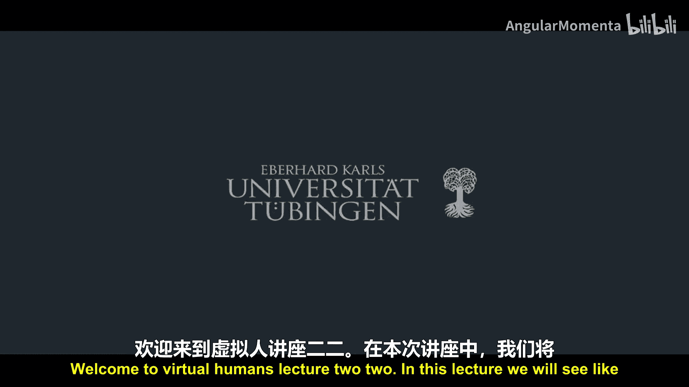
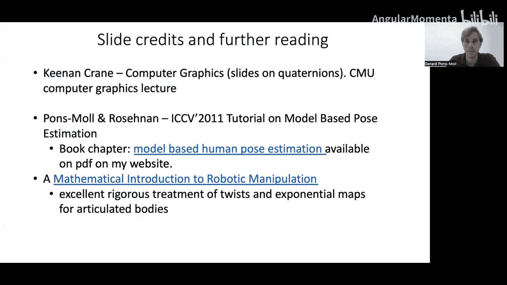
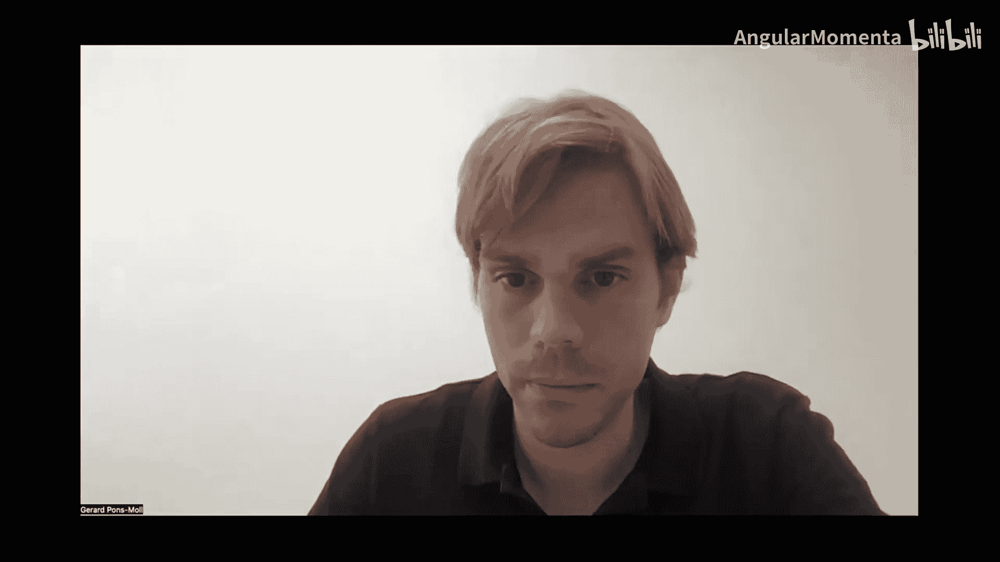

# 【精译】蒂宾根大学《虚拟人类》-p04-02.2-旋转与运动链--BV1TAbkzpEva_p4-

Welcome to Viual Human lecturec 22 in this lecture we will see like different options for parameterizing rotations and kinematic chains。

 which are a core ingredient to parameterize human motion。So in the first lecture。

 we were seeing that。If we're interested in modeling humans we at least have to worry about how to parameterize their motion。

 this means how how the surface can move in a way that that looks like like a real human and the second stage is like worrying about。

Building a statistical model of how people actually look， how their shape looks like。

 and how it changes。The focus of this lecture will be on how to parameterize the human motion。

 and this means dealing with rotation matrices or quaernions or twists and exponential maps。

 we will see different parameterizations and we will hopefully at the end of the lecture have an understanding of what are the advantages and disadvantages of each of these parameterizations。

Then we will also see。Kineinematic change， which is basically a way to model the articulated nature of our skeleton。

So the use of kinematic changes in human body modeling for computer vision dates back to。

Almost the 80s， one paper that brought this concept into community was the paper by B CBPR 98。

 where they used for the first time like the parameterization of the human body as a kinematic chain and in particular using twists and exponential maps。

 which are very convenient for optimization。And they used how they showed how to infer such motion parameters from optic flow computed in the image。

And we will see that the way to parameterize human motion has not changed that much over the years and in fact。

The de facto model that is widely used in industry and academia， which is the simple model。

 which hopefully you've been playing with already。uses a kinematic chain and uses twists and exponential maps that we will see later。

So we will deal with the question of how to model rigid body motion。

 this means a rotation and a translation。So。When looking at parameterizations。

 we have to think about different aspects and at least here I'm listing different aspects that I think are important。

So both configurations should be represented with a minimum number of parameters。This makes。

Controlling the character easier and inference， easier storage， more lightweight， and so on。

So singularities。Should be avoided during optimization。

So singularities are degene cases where for example。

 you lose one degree of freedom or there's multiple combinations of parameters that produce the same result。

 these are typically things that are not desirable for learning and for optimization。

Then you should think also about how easy it is to compute derivatives。

 how efficient it is with respect to positions and orientations。

So how do the positions and orientations of the body change with small changes in parameter space？

This is crucial for learning and for optimization as well。

Then what is important and it's becoming perhaps less important than a few years back is the ability to place human constraints。

 so for example， we might be interested in having the constraint that the elbow can move only along a single axis of rotation。

We would like parameterization that allows to place these constraints。Naturally。Nowadays。

 this is less of an issue because you basically over parameterameterize the model a little bit and feed a distribution over the parameters and then you always。

 when you're optimizing you're optimizing a data likelihood and also prior term that accounts for like most likely。

嗯。Rangage of motion for particular body parts。And then like it should be easy to concatenate motions to accumulate motion。

 for example， like if we are doing tracking and we want to accumulate。

How much the person has rotated or how much an arm has rotated。

 like it's important to be able to accumulate this motion over time。

So let's start with rotation matrices and after that we will see oiluler angles。

 quadronions and twists and exponential maps， and finally we will see kinematic change。So informally。

 what is the rotation？It's a transformation and it's useful to characterize transformation by its invariances。

So essentially a rotation is a linear transformation which preserves angles and distances and does not mirror the object。

So that's essentially a rotation so if you have a transformation that preserves。

Seegment lengths and angles and does not mirror the object。This is a rotation。

Like the image that you're getting at a mirror is not a rotation because you have a mirroring effect。

 one of the coordinates flipped。So。The first thing that we might be interested to understand is whether rotations commute。

So rotations into D。Do you think they commute？Well。

 it's easy to see that they do because if you rotate， for example。

 this character by 40 degrees and then 20 degrees， it's exactly the same as。

Rotating the character first by 20 degrees and finally by 40 degrees。 we land on exactly the same。

Location， so this product of rotation satisfies commutivity。

 which is like the same as a regular product。What happens in 3D？Do you think that rotations commute？

Well， they do not and this is a very it's a source of confusion oftentimes you have to be very careful how rotations are applied and in which order。

 because if you don't do it in the right order， you might get a completely wrong result and this is often。

Good。A source of problems。So if you want to understand this like intuitively。

 you can just think about it yourself。I think of this bottle and try to mentally first rotate along the y axis。

 I mean this case the bottle would not would rotate along its vertical axis would not change then around that it would basically align with the X axis and then finally。

Around X。Right， so it would basically rotate along。The vertical axis again。

 now try to do the same thing。Swaapping the order， you first wrote it around that。

Then around y and then around X。And tomorrow we can discuss like the difference。So essentially。

 rotations in 3D do not commute， and that's the first thing that you have to be careful with。So。

To come to the question of how to parameterize or how to represent rotations。

 it's useful to first thing about rotations in2D because they are very simple。And。😊，If I ask you。

 how do I get the rotation matrix in 2D？You would probably think of the typical formula that involves signs and cosine。

 but I don't want you to think about this formula for now。I want you to think。Of a rotation for now。

 as a function。That or let's think of a function s of theta that given an angle theta gives me a point x Y on the circle on the unit circle。

 okay， that's a function S of theta。嗯。So I might ask you， okay， given this function。What is E1。

 this basis vector rotated by theta？What do you think this will be。

 how do I get Et tilde as a function of s theta？Well， that's the definition of s theta itself。

 therefore e1 t this just as of theta， okay？That's how we define the function。So what's E2？

Rotated by Theta。This is slightly more interesting。Well， it's going to be almost the same。

 the only thing is that E2 is at 90 degrees with respect to e1。

 so therefore we have to get s of theta plus P hals。Okay。Now。What about。Rotating。

Like a vector U by theta。Well。Because we have linearity。

 I can write the rotate version as a times s of theta because this is E1 rotated。

Plus B S of theta plus bs， which is e2 tilde。Right。And we can do this because。It's a linear mapping。

Right。So because it's a linear mapping， all I need to worry about is how the basis vectors in this case。

 E1 and E2。Like get transformed with the mapping。So now question is， okay。

 so how if it's a linear mapping I can represent it with a matrix another question is what would the matrix look like？

Well， very easy， the matrix will look like the columns will be e1 transform。

 which is s of theta and E2 transform， which is s of theta plus bs。Now。

S of data was taking a point on the circle， which。We can get the x component by taking the cosine of theta。

And the y component taking the sine of theta。And the same thing can be said for the S of theta plus b hals。

 so we have this is this thing here and now using trigonometry， we can arrive at this formula。

 which is basically what you know as the rotation matrix for a 2D rotation。

And why am'm showing you this is because when we look at complex numbers to represent rotations。

 this will be。Useful to understand。How complex numbers can be used and also how quadernians are just the generalization of this。

But let's start with the most basic representation of a rotation， which is by its matrix。

 it's a linear mapping。How do we represent a 3D rotation， not a 2D rotation in 3D？Like。

 imagine I have a point。B比。expressed in B coordinates in this body frame coordinates。

 this is takes coordinates Lada x lambda y Lada Z。And I want to express this point in spatial frame coordinates。

Here spatial frame， I use it。In exchange for wall frame。

 you could call it wall frame or spatial frame doesn't matter。So here I have the PS。

G this same point but expressed in this coordinate system is nothing else than lambmbda X。X， B， S， X。

 B， S is like the X axis of the B frame。Expressed in。Sppatial coordinates。

ThenY BS is the y axis of the B frame expressed in spatial coordinates， and finally Lada Z Z BS。

So basically I have this expression， which I can write in matrix form。As follows R SB。

 this means mapping from。Body frame to spatial frame。Times Pb equals P。

And R SB is nothing else than its columns will be just what we just saw in the last lecture。

 It's just the axis of。One coordinate frame。Expressed in the other according frame in this case。

The axis of the source coordinate frame， which is B expressed in the spatial coordinate frame。Okay。

 so these are nine numbers。Which express the rotation。

What is important is how to interpret rotations。And there's two ways of interpreting rotations。

Although the math is completely the same， the interpretation can be quite different。

So one interpretation is I have the body frame here。And the spatial frame。

And they are both in some location and space。They don't move。

And I use the rotation or the transformation GSB。To map points from one coordinate frame to another。

 we're just changing coordinates， but nothing moves， that's what we saw before。However。

 by playing a mental trick， you could think of it this way， I could think that essentially the point。

PS is0， the coordinates frames B and S are originally aligned light， okay？And I have this point PS0。

Which in terms of numbers takes exactly the same value as this point PB in body frame because they are aligned。

They will take numbers， lambda x， Lada y， Lada Z that we saw before。

And now when we apply the rotation， this point moves to a new location。In space。So in this case。

 although the mathematics are completely the same， the interpretation is completely different because now we are moving a point with a rotation。

So you can think of rotations as coordinate transformation。Or as a relative motion in time。

And don't be fooled by thinking that if you understand something algebrabically， you understand it。

Because that's typically not the case。You have to understand also how you interpret the mathematics of something will lead you to different results and new discoveries。

 so that's why these interpretations are also very important。Okay。

 so what are the drawbacks of this rotation matrix Well first of all， we need nine numbers。

And to represent a 3D rotation， how many numbers do we need？We need just three numbers， okay？

Because like we think of the imvaris we have we impose this orthogonality and is the dominant。

Equals to one， these are six constraints。RightSo if we have nine numbers， minus six constraints。

 the intrinsic dimensionality is three。So essentially。

 we have to ensure that this matrix belongs to SL3 special orthogonal group。

So Sl3 are the three by three matrices that are orthogonal， are our transpose equals identity。

 and in addition。They determinant equals to one。This constraint。

Satisfiies that the transformation will be。Distance preserving and angle preserving。This constraint。

Satifiies that the transformation will not have mirroring。Well。

 these constraints are not optimal for numerical optimization。

Because you have to impose them during optimization。

 so if you're optimizing the nine numbers subject to these constraints。

It's not ideal if you have a neural network that predicts these nine numbers。

You will have to ensure that these numbers belong to SO3 somehow。

 so you'll have to project to this space。Which is also not ideal。However。

 I should say that there is one good thing。The rotation matrix is a function of signs and cosines。

 and this makes them suitable for machine learning tasks， for example， deep learning。

So it's not fully understood why， but oftentimes predicting these nine numbers。

Leads to better results than compared to parameterizations that are。More。

Optimal in the classical sense， as we will see。Okay。

 so how can we parameterize rotations with less numbers with just three numbers， for example？

One popular choice still widely used in animation， for example， is oiluler angles。

So Oer angles basically parameterized the rotation as three consecutive planner rotations。

G idea as well， we know how to do rotations intoD that's easy so we're going to rotate along three different axes consecutively such that I can reach the target location right so if I have an object and I want to reach a particular rotation I first can rotate along one axis then another axis and another axisx and so on。

The derivatives are quite easy to compute and accumulating motion is also quite straightforward。

So how does this look mathematically， it looks like this。

 you have like a planner rotation along the x axis along the y axis and along the z axis。

 notice how this cosine minus signine signine cosine pattern appears just in different locations and the axis about which we are rotating appears here。

Alone， like 10，0010，001。Then the rotation， which is a function now of three parameters。

 alpha betta gamma， this is the parameterization of the rotation。Takes the following form， R X， R y。

 R Z。Now you might ask， why did we choose this order？Why did we start with Rz then Ry and then Rx？

Remember， always we start rotating from the right。We could have started from our X， for example。

So indeed， when using Oer angles， two things have to be specified。 so if somebody gives you。Some。

Motion with Oer angles， you should always ask， okay， which convention did you use？

The convention specifies that along which axis I rotate， x， Y， Z， y， z， Y， x， Z， Y， Z， x， Y， Z。

 you know， these things。There's many different combinations。And also， you should specify。

Whether rotations happen along a static spatial frame。Or happen along the body。

So I can take an object and rotate it along fixed axis， for example my fingers here， along this axis。

 this axis， then this other axis， or I can rotate along。Like some axis that move with the object。

 right？So this is what you can see here， for example， here， this is showing。

An intrinsic rotation is rotating along the axis of the sphere。

 these are the red axis that you see here， and it's rotating first along Z。

 then along X and finally along Z again。So these two things need to be specified。Okay。

 so seems like this is。Fairly intuitive and good parameterization。However。We have a very annoying。

Artefact of this parameterization， which is just。A product of。

The mathematical parameterization of rotations， it has nothing to do with with。嗯。

With the actual rotation， let's say。And this is the gimbal lock， the gimbal lock is。

A configuration for which one of the degrees of freedom is lost。

And once you reach this configuration， you just lose one degree for you and you cannot no matter how you combine the parameters for this configuration。

 you just。Are locked into only。Two dimensional rotation。So mathematically。

 if we concatenate these exnsic rotations， we get Rx R y， R Z， and we get this mess over here。

But what is important here is that essentially， if we set theta y to P halves， this special case。

 for example。We get the coine cosine equals to zero and the sine of theta i equals to1。

 so essentially these terms here cancel out。And notice that this rotation matrix now only depends on theta x and theta Z。

Which means that we lost one degree of freedom。We can no longer rotate along theta y。So basically。

 tiber log is when two axes align。Then one degree of freedom is lost and the parameterization is not unique。

So I mean， this you can see like if you have a gimbal like this that basically these are allowing the plane to rotate along three directions。

 if two gimbals align then this is where the name comes from， they basically you。

You lose one degree of freedom。Okay， so can we get rid of a parameterization that suffers from giallo and for this？

We will see， we will see now like quadernions to understand quadernions first， we need to understand。

Complex numbers and how they can be used to represent rotations。

So we're going to think of complex numbers in a geometrical sense rather than an algebraic。Sense。

So basically complex numbers are a very natural way of encoding geometric transformations into the。

 and they simplify also code and notation and they make thinking about them easier。And。

There is a moderate reduction in computational cost。Pour three rotations。There's some reduction。

But that's not the main issue， I would say。Just understanding how this works can lead to。

Like deeper and novel solutions to problems So for example。

 complex numbers are not only used in in in distance in computer graphics for。

For representing rotations， but they are also used for example to unwwarp a surface into a UB map in a way that is minimal like you have a minimal distortion then this is like natural language for this complex numbers are natural language for these sort of problems。

Okay， but we're not going to see this。 We're just going to look at。

Complex numbers to represent rotations。 And we're going to see that it's。

 you can think of a complex number。As a 2D vector。Almost just with an additional。Operator。

 that is going to be very useful。So we typically think of complex numbers as this i equals square root of minus1。

And here we're not going to think in these terms， we're going to think in geometric terms because we're going to use complex numbers to represent rotations。

So every time we see I， we're just going to think as I being a quarter turn。

So if I apply I to vector， I'm basically doing a quarter term right going from。Here to here。

If I apply i2 times I squared。I land here minus1 right so this is one geometric way of looking at this。

So essentially we can think of complex numbers as two vectors， so instead of the basis E1 e2。

 we're using different names 1 and I， but it's essentially the same we just change the name of the basis。

Except that now we're also going to define a very useful product between two vectors。

 which does not exist for regular vectors。So we're going to have the usual operations vector addition Z1 plus Z2 or scalar multiplication to elong or shorten the vectors。

But in addition to that， we're going to have like complex multiplication。Which essentially。If。

If we think of complex numbers in polar form， what happens is that。

The baller form is like the radius and an angle， so basically if I have Z1 and Z2。When I multiply in。

 the resulting complex number will have。Like magnitude being the product of the magnitudes and the angles will add up。

给。😊，So essentially we have complex numbers that are like two vectors plus this additional product。

 which we will see that is going to be crucial to represent rotations。

We can also think of a complex product in algebra form。

 so where we multiply each component against each other component A against C and D and B against C and D。

 like associating the product， and then basically we have this and we have I squared which we've seen that this equals to two quarter terms。

 which is the same as minus1， so at the end we end up with AC minus Bd and Ad plus BCc。

So does this product agree with our geometric description of our last slide？

Can we justify what we just did？These rules that we use here to multiply。Complex numbers。

Can we justify this geometrically？So for this it's much easier to use the polar form。

So perhaps the most beautiful identity in math is the following like e to the I pi plus 1 equals0。

Why is this beautiful？Well， because it's very simple and it involves very important mathematical numbers。

Altogether in a single equation， those are the E number， the I。Pi1 and zero。Or in one formula。

So another form for this formula is like the specialization of Euler's formula。

 which is basically e to the I theta equals to cosine of theta plus I sine of theta。

So essentially this is exactly this s of theta that we have seen a few slides before。

 it's mapping e of I of theta mapping every angle theta into a point onto the circle。Right。😊。

So we can think of E of I of theta and not just as the typical exponent。

 but just as a function that takes an angle and it maps it to a point in the circle so in that sense we can use it to implement a complex product so we can take one complex number another complex number and when we multiply them。

Basically the exponents， like when we multiply expons， the exponentials。

 the exponentialonents add up， so we will end up with AB E to the I theta plus5hi。Okay。

So now suppose we want to rotate a vector u by an angle theta and then by an angle phi。

So if we do it like in matrix form。Essentially， we will have a matrix correspondinging to a rotation by theta。

 which is a。And a matrix corresponding to rotation by phi， which is B。

And then we have to first apply。Theta rotation by multipang by a and then。

Like the5 rotation by multiplying by B， and we end up with this expression and after simplifying a few terms。

 we end up with this。Okay， so notice that we get the cosine and here those angles add up here， right？

Much more intuitive and easy to see is like to do this in complex form where again。

 the exponent like the the。The magnitudes will multiply and the exponents will add up， right？

So essentially we have。We arrive at exactly the same result， but this formula is much easier。Now。

 the natural question is， how do we generalize these to 3D rotations？And it turns out that。

And this is a little bit of a weird fact， you need four numbers to generalize this。

Complex numbers to three rotations。And。William Rowan Hamilton spent many years trying to。

Generalize complex numbers for three rotations。And history says or he claimed himself that as he was walking with his wife over the bridge after having worked for many years on this problem。

 he wrote on a stone the following Sir William Rowan Hamilton in a flash of genius discovered the fundamental formula for quaernia multiplication。

 which equals to y squared equals j squared equals k squared equals IJK equals minus1。

And so he cut this on a stone of this bridge。So。Let's look at what this formula means。

 and we will see that there's a direct analogous with complex numbers。

 So a quadernion is essentially。Has four components。QW， Q X， Q I， and Q Z。

And they generalize complex numbers because you have like a real part and this sort of imaginary part。

 so you have now three components Ij and K。And remember that we said that。

Applying I is just one quarter turn。So with Quedernions。It will be the same。

 like two quarter turns will be -1， but now you have different ways of arriving at the minus-1。

 so that's why you have different combinations you have I squared J squared。

K squared then also this combination of I J&K， right？

So that's how intuitively you can see the connection。With regular complex numbers。So。Basically。

 this unit length quadernions。Can be used to carry out rotations。

 And the set of these numbers is called S3。So you can also think of a quadernion as a scalar。

 QW plus a vector V， okay？Where the scalar is， if we think of a rotation as an axis angle representation。

 basically every rotation can be represented by。Some axis of rotation and an angle of rotation。

You could think about this and you will see that any rotation at the end boils down to this。

And we will see this later。So basically， then Qw is nothing else than cosine of theta hals and v is basically sine of theta half times this axis。

So this is a vector and this is a scalar。And that's much easier to remember than and to manipulate in this like big matrix。

 right that we obtain with。From this axis angle。So basically。

 rotations can be carried out directing parameter space。We don't need to transform。

To rotation matrix to apply the transformation that's something that is different in oiler angles。

 You need to get the rotation matrix from the oiler angles and then apply the rotation to a vector and then。

Um， or if you want to accumulate two rotations， you have to multiply them and then extract the oil angles from it。

So basically to concatenate rotations， you just need to multiply to quadernions and the quadernion product follows this form。

 which is basically a combination of dot products and cross products。And as far as I know。

 I think Hamilton was one of the first that was introducing the notions of vector spaces and。

Dot products and cross products。And。Basically， if we want to rotate a vector a by a quaernion。

 we have to apply this operation Q。This dot represents the quaerion product， which is defined here。

A times a because you have to pen one because you have to make it a four number times the quadronion conjugate。

So the quadronion conjugate is nothing else than just taking the quadernion and inverting the signine of the vector part。

Now， what is important is。Do you think the Quaternian product commutes？Oh。

It doesn't because otherwise。嗯。We would not be able to represent rotations because we've seen that rotations do not commute。

And this was one of the。Most novel parts when Hamilton discovered this that he dropped the commutativity of products and at that time this was quite revolutionary。

And it was necessary because otherwise you would not be able to represent rotations。Okay， so。

One very like very good use of quaerernnets is for interpolation every time you want to do interpolation in S3 space。

 use rotation use quaerions。So you can use something called sllub spherical linear interpolation。

 which basically is a method to interpolate in between two rotations。

 two orientations of a given object， for example。So you have this plane pointing towards the right and this plane pointing towards the left。

 and you want some orientation that is smoothly you know interpolating between these two configurations of the plane。

So essentially what you can do is to do slurbs， so basically you obtain the transformation in between as。

Q0， which is that the starting configuration of the plane times this matrix over here。

What is this matrix Q0 minus1 times Q1， What is this？

This is essentially the transformation that brings us from Q0 to Q1。

And then we have to exponentiate this to T and this t is a parameter that goes from zero to1。

There's exponentiation you can think of it as。Pretty much like regular exponentiation and then basically for t equals zero。

 we are at the starting point and t equals one， we are at the end point。So。

That's something useful and something that is needed if you have to interpolate， for example。

 two poses of a human， you need to apply this slurp。Okay。

 so what are the advantages and disadvantages of quaernions。 So first of all。

 they have no singularities。 That's a big plus。 The derivatives exist。 I didn't like show them。

 but they are easy to compute and they are linearly independent。 So they have no singularities。

 no problems during optimization。The quadronium products performs rotations erect in parameter space。

 which is very convenient， it's good for interpolation and。However。

 this comes at the expense of using four numbers instead of three。

So you need to enforce a constraint that the quaernum norm should be equal to one。

 otherwise this will not represent a rotation。This can be。

A little bit annoying when you're doing optimization because you have to deal with this constraint。

During optimization or during learning。However， for many of our projects。

 we realized that using a Quaernian representation is actually quite good for learning。

Like it leads to quite stable results when we're trying to predict quoations， given some input。

All right， but now let's think。Let's present one more parameterization， which is the axis angle。

So the question is， can we represent a rotation with only three numbers without suffering from gimbal lock。

 and the answer is yes， you can use X angles。So one really good thing of axis angle is that it has a very clear direct interpretation。

 so there's an axis and an angle of rotation。And if I want to specify， for example。

 that the elbow should rotate along these axis， I can just define this axis as being perpendicular to my forearm and lower sorry forearm and lower arm and then I can with theate I can rotate the arm yeah so it's very intuitive to。

ととです。So basically any rotation about the origin can be expressed in terms of an axis of rotation and an angle of rotation with exponential map。

So。This goes into the lead groups and Le algorithms， but don't be intimidated by this。

 but I'm just going to give the definition so that you know。

 but you will see that this is very intuitive and very easy to understand。

So a group is an antial lead group。If the set of its elements can be represented as a continuously differentiable manifold of dimension and on which the group product and inverse are continuously differentiable functions as well right。

 so by in a way， like you could think of like this the the space of rotations by representing a manifold and by taking。

The derivative looking at the tangent space， we get the L algebra where we will get our parametermetization。

 and then we have an exponential map to go from this L algebra back to the manifold of rotations。

That's how you can think about it。So。Essentially。An axis angle。Like， given a vector。

We can define the ssymmetric matrix， which is basically the matrix representing the cross product and equals to this matrix so given vector w with components W1 w2 W3。

 we obtain this ssymmetric matrix。Notice that it's symmetric as its name indicates。

 and it has this particular form。So。You will also find in the literature as like W cross as to represent this matrix。

So。The。Interpretation of this matrix is just the matrix form of expressing a cross product so when we have the cross product of w times p which P might be a point。

 this equals to this matrix W times p okay。Yes。So we cant recover the rotation matrix。

With the exponential map， so we can go from these three numbers， which is a scaled axis angle。

 basically this is a vector and theta is a scalar that scales this axis angle theta tells us like whether we rotate P or P hals or P and so on。

So we can with the exponential map， we can get the nine numbers of a rotation matrix。So。

Where does this exponential map come from， why do we have like here an exponent seems strange。

 where does it come from？It comes from a differential equation。

So you remember from high school probably that if you rotate a point PS。Along an axis， right。

 the tangent。Direction from if you remember from physics when you were looking at this。

Turning and like looking at centrifugal forces and all that。Like if you remember。

 if a point is rotating along an axis， the derivative or the tangent of the point PS。Dot。

Is obtained this。How is it obtained question？How do you obtain P dot of t。

 which is the tangent direction？For a point that is rotating。A long W。Well。

 the tangent direction is obtained with a cross product。You do W crosspar P。

 and then this will be perpendicular to this segment here。

Connecting the point and the center of the axis。And this can be expressed in matrix form。

 so we have that the derivative of the point equals some matrix times the point。Okay。

So I will ask what function satisfies that the derivative is the function itself。Times。Something。

Well that's the exponent so the same way like like that the solution of this differential equation without matrices like for scrs would be the exponential here is the same like you have that the function that satisfies this。

Equation is the exponent， the exponent of WD。And then basically the point P， right at a given time T。

 I can obtain the point by multiplying the exponent， which is a rotation and p0。

 which is the point at time  zero。So now if we rotate， in this case。

 we're thinking of theta as theta units of time， we are obtaining the exponential map。

we obtained the rotation which is parameterized with just three numbers here I separate into theta and W and omega but essentially it's just three numbers because we only need the scaled omega in order to obtain the rotation。

Okay， so this is a very intuitive parameterization， which in fact we will use。

To parameterize the simple body model， for example。Okay。

 so the exponential map well this is an exponent， so I should be able to do tailored expansion the same way as I do it with the scalear I can do it with this thing here。

 The only thing is I have a matrix， but everything generalizes this is one of the beautiful things in mathematics like some。

Some things like generalize like no matter if you have scalrs or complex numbers or matrices。

 there's。Like analogous or equivals。So here we have the Taylor expansion where omega hat here is the sccisymmetric matrix。

And notice that here gets the power of two and the power of three and so on。Okay。

 imagine we would need to compute this Tayloror expansion every time we want to figure out the rotation matrix。

 given the parameter stateta omega， this would be a pain。

 this would make this parameterization not very useful。However。

 exploiting the properties of the scsi matrix matrix。

 there is something that is the Rodriguez formula which is able to recover this exponential this rotation matrix x theta omega so these are nine numbers you can recover with the following formula over here right which is identity three by3 identity plus s sci matrix matrix times sinus plus the scsi matrix matrix squared1 minus scsine and it's close four you give me an x is and an angle and I just apply I implement this in code and I get my rotation matrix。

What about translation well that's。Not much more difficult you have to think of not access angle。

 but twist coordinates， so you need to add a component which accounts for the translation。

And instead of having translation as a translation vector， you have V1， v2， v3。

 which is essentially like the translation along the axis。Bear。And essentially now。

 instead of having a scchissymmetric matrix， we're going to have this twist and this twist will be like this six coordinates。

Six numbers to represent the rotation and the translation。诶。

Notice that you might you see seven numbers here， but theta is a scalar that multiplies each of these numbers so I can only store the six numbers right for any。

Practical purposes and essentially now we have something that is called the twist associated with twist coordinates。

The twist is basically the matrix itself， the twist coordinates are the six numbers and the twist is just rearranging these numbers into a matrix。

Now what does this matrix though， like it gives us the tangent。Of the point。

 when we multiply this twist。With a point， it gives us the derivative of the point。

It gives us the tangent Yeah， So if I have a rotating and translating point。If I multiply by this。

Like she here had， it gives us the derivative。So the same way as we can take the exponent to recover the rotation matrix。

 we can take the exponential map to recover the full rigid body motion。And。This， yeah， exactly。

 So we can recover the。Ridid body motion matrix， which is a four by four matrix including translation using the Rodriguez formula and some additional term for the translation。

But what is important to note is that this is all closed for。

So we're going to use this like to parameter the simple model and during optimization。

 like what you do is you optimize this。Either three parameters or six parameters。

 depending on what if you're optimizing translation and rotation or just rotation。

 you optimize these parameters in order to。Fit to data or yeah， depending on the application。

So which representation should I use？Well， there's not a clear winner。

 it really depends on what you want to do。I think in general for machine learning problems and optimization。

 I would definitely go with twists or quadernions。And not oiler angles because they have these annoying kmal lock。

嗯。But here I have like some sort of ranking according to the number of parameters。

 well the twists are the winner， like in terms of singularities， quaternions are better in terms of。

 I didn't mention， but the twists have one problem， which is like for when the angle is zero。

Then any access is valid。And this is a problem like this can be a problem sometimes。

You have multiple parameter values that lead to the same rotation。

 and this is typically not desirable。In terms of defining user constraints， for example。

 like I want the angle join to move along these axisx and so on， I think the twists are better。

 but we've seen that the quaderians are also quite convenient because there's a direct relationship between Quaernians and。

Access angle。In order to concatenate motion， I think quads are very convenient because you can accumulate motion in parameter space。

 which is something you cannot do。With twists， you cannot just take you know one rotation another rotation and add them up their parameters and hope that this will be the combination of rotations。

Why do you think this is not possible？Think about it。I do think I can just add up the numbers。

Tomorrow， like I will ask you。Like whether you figured out why。是。Okay。

 then we have to think about optimization， so for optimization。U。I think yeah。

 polices are better suited because it's less numbers and we don't have to place additional constraints。

So here wrote Ouler angles better than quaurs， I'm not sure I still have this opinion that probably quadurs are better。

 but you have to quaerns are better than oiler angles but you still have to place this constraint of that it has to be unit length。

Okay， so up to here， we've seen rotations。And now we will see how to。

Not parameterize a single rotation， but parameterize an articulated skeleton。

So we're going to see what are kinematic chains。And you will see that the concept is very simple。

 but it's very useful to model human body motion。So imagine I want to model an articulated arm like the one here shown here。

And some of the concepts that I will explain。Generalized to also quadronions and euler angles。

 but I'm going to use the twist and exponential maps because that's the de facto parameterization that we use in simple。

So essentially if I want to keep track of the yellow ball with respect to the spatial frame。

Where the yellow ball is attached to this。End of the arm of the robot or of this robotic arm。嗯。

We have that at the rest position， nothing has moved， we have that we have GSBP。

So GSB is the mapping from the body frame to the spatial frame in this rest configuration。

This is a change of coordinates， nothing has moved so far。Now， when we start to have movement。

 we have， for example， like rotation about theta 2 and rotation about theta 1。Now。

 how do I get the position of the point？With respect to spatial frame。Well。

 we can obtain a transformation matrix， which is a function of theta 1 and theta 2。

By using the product of exponential formula。And the product of exponential is just multiplying rotations we've seen that these exponents。

It。Equal a rigid body motion matrix， rotation plus translation， so we can multiply them。

Always starting from the first。Transformation first and then。The later transformations。After this。

So okay， so first we have the spatial transformation GSB and then。

I think here this should be swapped actually you no this is correct。

 you first apply theta 2 and then you apply theta 1 yeah， so the order is correct。So essentially。

 if you have like a robotic arm with many articulation。

 then you have this product of exponential formulas， which basically is。

Multiply the different rotations together yeah， so why do we want to carry this exponential sting Well。

 first of all because we are dealing with this parameterization and second of all。

 because we're going to see that the derivatives of these are very intuitive and very useful。

So now GSB of big theta is the mapping from the coordinate B to coordinate S。

 so given some parameters okay of。Theta 1， theta 2， the and the twist as well， phi 1， Phi 2， phi n。

This。Basically is giving us the mapping from the B frame to the spatial frame for any configuration of parameters。

 which is exactly what we need to parameterize human body motion I want to know what the orientation of the hand is。

Depending on what sort of parameters I have。But the。

Exponential here is not the mapping from segment I plus1 to segment I。It could be。

 but it's not for now。Okay， you should think rather as this exponent as applying some rotation。

 some motion， remember that I talked about interpreting rotation as movement or coordinate transformation here we're thinking about movement right for these exponents。

And this GSB， were thinking about coordinate transformation。

So if you're not used to thinking these terms， it can be a bit confusing and it takes time to basically digest these concepts。

 like the mathematics are not very complicated， but to reallydigest and understand what's going on can take some。

So you can think of the exponential of theta I。PI Shi， I don't know how to pronounce this letter。

 basically it's the relative motion of that joint。So how do we use this to solve an actual practical problem。

 so suppose we want to find the angles that make the human reach a specific goal。

I had discussed classical inverse kinematics problem。Well。

 we have to first rotate along theta 1 and then along theta 2。But this problem is。Non nonlinear。

 I cannot first solve for theta 1 and then think2 I have to solve for theta 1 and theta 2 at the same time。

 and also it's a nonlinear problem。We have here an argumentine over theta 1， theta n。

So here we're assuming that these twists are already fixed。

 so they are already determined like for this robotic arm。

 like I fixed the twist to be like in a particular direction。In practice and simple， for example。

 these twists are also parameters of optimization， can also optimize for this。

 the twist can move anywhere。But here these are the Shi until CN R fixed and we are only optimizing for the angles of rotation。

 theta 1 until theta n。So。What should be theta 1 until theta n such that when I apply this concatenated rotation to Xa。

 I reach the point Xb so this is a nonlinear problem and one way to solve this is to linearize this objective here with the articulated Jacobcoia。

This is essentially。Making this。Linear。Yeah， by linearizing。

It turns out that the expression for the articulated Jacobian is very。

 very simple because it just consists of the twists， right？诶。

That it just consists of the twist like put altogether into a matrix。Yeahep。

So we have the Jacobian here， which is a function of the parameters。

 it's going to be just this twist and notice that this primes here means that the twists have to be transformed to the current configuration。

What does this mean， it means that if I have an arm and the twist is looking like this and now in a given configuration of the parameters that the arm moves here。

 I need to rotate this axis along with the arm yeah。

I have to rotate the axis along with the R that's why this prime is here and this is what makes the Jacobian be a function of the parameters itself otherwise this matrix would give me the same derivatives no matter what the parameters are would be nonsense。

All right， so every column corresponds to the contribution of the E joint to the anti effect motion。

So what we have is that we have a linear combination。Or let's wait， I will get to this later。

So basically the Jacobian we need to understand what the Jacobia matrix is doing is mapping an increment in parameter space。

 delta theta to an increment in an defect configuration space in this case， like this increment。

Of theta multiied by the Jacobin gives you a twist itself， and the twist is giving us like the。

The time space of this end effect configuration。Okay， so now I multiply Jacobian by an increment in。

Theta and it gives me a twist， which is the twist of the end effector。

So it's exactly what I need because I need to know if I change the thetas a little bit。

 how does the you derivative of the motion of the end defect vector。Change and the derivative。

 the tangent space of this rigid body motion is the twist。Yeah， the same way as a yeah。

This is the definition of a twist。So essentially， what we have is that。

We have basically that to obtain an increment， for example， in of a point。

In the end effect as a function of an increment of parameters， delta theta。

We have this linear combination of twists， as you can see here， twist1， delta theta 1 and so on。

 yeah and this hat is like this operator that makes transforms from twist coordinates to this cuciisymmetric matrix and vice versa。

嗯。It's not that important what is important that you understand is that you have now a linear combination of twists so the first。

诶。Basically， the first twist here right is making this contribution， this delta P2。

Whereas the first one is making this other contribution Delta P1。 So this is telling us linearly。

 you know in a。Locally， how， like if I wiggle the theta， how the end effect will move。

 which is exactly what you need when you're optimizing， when you're finding the theta that。

Satisfy some anti effect constraints， yeah。So basically to parameterize like a human body。

 you and we will see this in more detail， but just to give you the gist here， you basically have。

 for example， you could specify like the twist for every body part and you could parameterize it as a。

A set of angles。That tell you how much you rotate along this particular twist。Or you could have。

 which is the case of the simple model， you could have a bunch of twist coordinates like a triple plate for every joint and this is like。

It has more degrees of freedom because I'm not specifying how the axis of rotation should be。

 but I leave it as a free parameter of optimization。This is what is called like the ball joints。

Al right， so basically what is called the post Jacobovian is mapping increments in parameter space。

 delta x to increments in end defect space。 and that's typically what the derivatives that you're interested in。

 like derivatives of。Mesh vertices with respect to parameters。Okay。

 so this concludes everything I wanted to discuss about rotation parameterizations。

I know that it takes some time to digest these concepts。

 and that's why we will use the Q&A session to answer any questions you might have about rotations and parameterizations。

嗯。Yeah， but it's good that you are familiar with these different parameterizations and the pros and cons and also that you can use them for solving actual problems。

One thing I should mention。In the simple model， actually。

The we like we use twists and exponential maps， but the transformations are indeed。

They don't have this。So direct geometrical meaning of emotion around the joint。

 they express the transformation between the child。To the parent， child to the parent。And basically。

 the twist for each one of these transformations can be obtained from this transformation matrix。

 which is a rotation， but maps from C to B and from B to A。And to obtain these three axis angles。

 three parameters for this rotation， you can take something that is the lock。Of the rotation matrix。

And。Which I didn't explain here， but it's basically the inverse function of the exponent is going from rotation matrices。

 so the nine numbers going to the three numbers。And that parameters the rotation。Yeah。

 we will see the simple model in more detail， but just。It's something that you should be aware of。

 like when we deal with rotations， you have to understand。

In which coordinatenet frame they are defined。Do interpret them as a transformation of frames or do interpret them as a emotion。

 and this is important because in the simple model for example，It's not so direct to think about。

The axis of rotation， you cannot think of all the axis of rotation in the same coordinate frame。

 right it just doesn't work this way。Every axis or rotation you should think is in the coordinate frame of the parent。

Okay， good， so if you want to know more about。Rotations and parameterizations。

I would point to either like the tutorial we gave at ICCB 2011 on model based post estimation and there's a book chapter that you can find in my website。

There you can find more information about this， and if you really want to get deep into this。

There's this excellent book， which is called mathematicalthematic Introduction to robotic manipulationulation。

Which is just really great and it does a very good combination of theoretical explanations and practical explanations of twists and exponential maps for robotics problems。

Yeah， and some of these slides are also based on the computer graphics course by K and Crane。

 in particular the slides on Qua earningsions。Okay， thank you very much。

 that was all I wanted to say about rotations and kinematic change。And yeah。

 I hope you enjoyed the lecture and have fun with these concept， bye bye。

