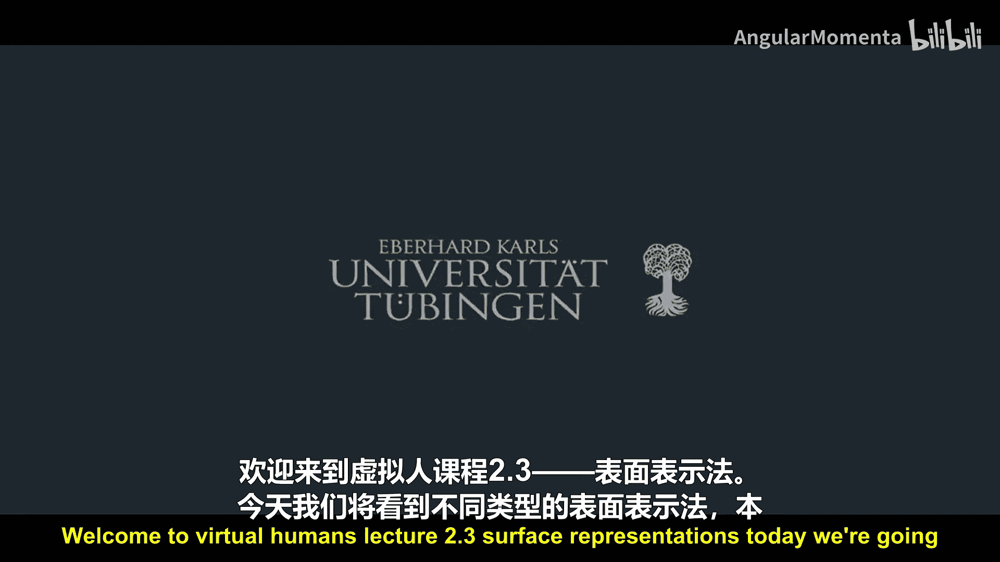
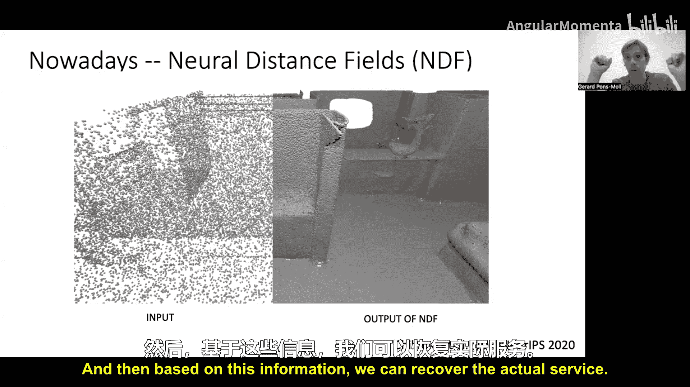
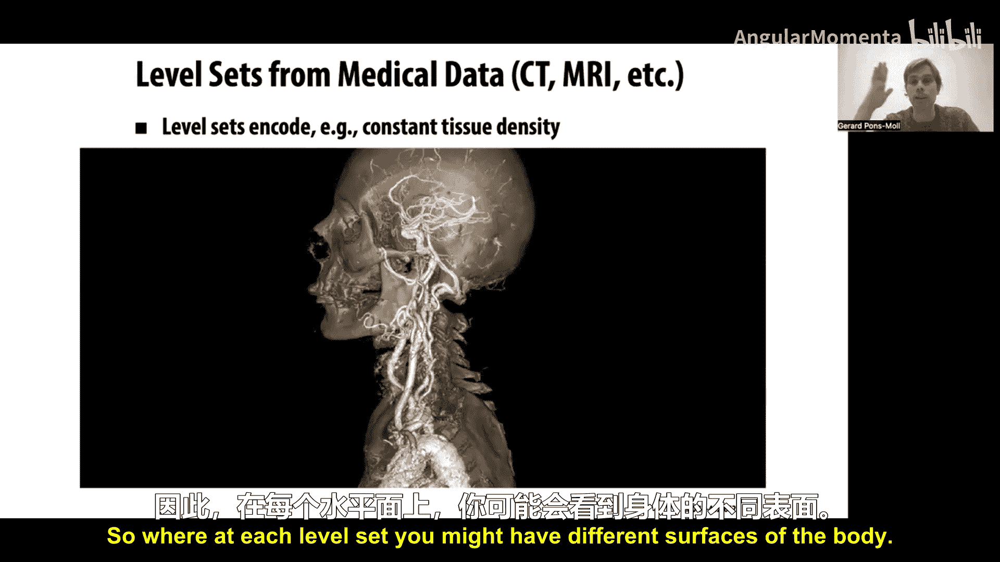
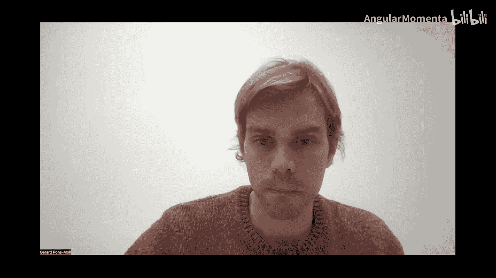

# 【精译】蒂宾根大学《虚拟人类》-p05-03.1-表面表征--BV1TAbkzpEva_p5-

Welcome to Virtual Humans Lec 2。3 Surface Res。Today we're going to see different types of surface representations and the goal of these lectures that you understand a little bit。

 what are the advantages and disadvantages of each representation。

So as we've briefly described in the previous lectures in order to model a virtual human。

 you have to think about。How to parameterize the motion and here you have to think about kinematic change rotations。

 transformations in order to parameterize the motion of humans。

The topic of this lecture will be on the geometry， how to model the shape of people。

 and we will see that this is a very interesting and very complex topic。Of course。

 if you want to generate humans that look realistic， you have to think about materials， lighting。

 texture， and so on。However， the focus of this lecture will be on how to model the actual shape。

 the geometry of humans and objects in general。So how do we describe geometry？

How do you describe the curve that you're seeing？Well。

 you could use a linguistic representation but say this is a unit circle。Or。

You could use maybe a mathematical equation。Yeah， for example， you could say， well。

 those are the Xy points such that the x component is cosine of theta and the y component is sine of theta。

Or you could use an equation。To represent this curve。Like x squared plus y squared equals to1。

This would be an implicit representation of the curve， or you could say。

 well it's a curve that has curvature equals to one， that's a circle， or you could say， well。

 it's a curve that is symmetric along any axis。And you could use like。Infinitely many edges。

 in order to approximate the circle as like a polygon。

Or you could like use more fancy representations， for example， you could say， well。

 that's a solution of a differential equation。So。There's many possible ways of representing geometry。

And the choice。Of representation will really depend on what you're trying to model。

So let's look at some examples of geometry。These are examples of geometry。

You have to the face of the human， for example， is very important because it expresses emotion and it's a fundamental part of communication。

 also the body。And。It's very important to get every detail right， because if you don't， then。

Things don't like something is missing or the communication becomes awkward if we're thinking about telepresence。

 for example， and the metaverse。So。Look at the face。 It has all these wrinkles。

 and there's the mouth and the teeth， and then this hair。So it seems like。Different parts。

 even of just the face， probably need different representations to model the face maybe a mesh is sufficient。

 but to model here， you probably need another representation。

 maybe you need some volumetric representation or some volumetric or some strains。To model clothing。

 maybe you can get away with meshes， but if you want to deal with topology changes and complex clothing。

 maybe you need to use an implicit representation。We will see all that during the lecture。

 not only today， but also future lectures。If you're modeling clothing and dynamics。

 you have to think of a representation that allows you to。

Change the shape and make the shape reactive to external forces， for example。

 perhaps the mesh is good for this because you have like vertices connected by edges and that sort of resembles like。

How an actual surface is composed。You can have shapes that basically split and merge like fluids。

For these probably meshes are not a good representation。

You might have shapes that are very complex and very like that are complex at different scales。

 for example， you have a full city and you want to have detail so you have to think about scalability here right probably a single mesh is not a good idea here。

Or you might have to model。Complex hair， like what you're seeing here， right， There。

 perhaps avol representation might be better suited than。Surface itself only。

So given all these options， it's a natural question to think what's the best way to encode geometry。

 right？And。It really depends on what you're trying to model。

This is a recurrent theme in graphics and in virtual humans。

 it really depends on what you're trying to model。So there is no one best choice and because geometry is hard so there is an interesting quote by David Barav who's an expert in geometry processing so he's a senior research scientist in Pix animation studios and his quote is like I hate meshes I cannot believe how hard this is geometry is hard so everyone that has played with meshes。

Knows that it can be a pain。嗯。😊，But。There is no replacement that doesn't bring also other problems。

So essentially there's many ways to digitally encode geometry we have。

Two main types of representations， those are explicit。And implicit。So for explicit we have。

 for example point clouds， polygon meshes subdivision surfaces， nerves。

 bisor curves and so on explicit means that we can have access to the points in the surface directly right in a very direct manner。

Implicit means that the。Surface is defined implicitly with an equation or function。

That specifies a constraint on the points or something the points need to satisfy and here we have also many choices。

 for example， level sets that need to be stored， algebraic surfaces， we have blobs and so on。

So each choice is best suited depending on the task。

So if we look at implicit representations of geometry， points are not known directly。

 but they satisfy some relationship， for example， an implicit surface or a surface is defined implicitly by the equation x squared plus y squared plus z squared equals to1。

That's the unit sphere。But we don't necessarily need a mathematical equation we can have。Function。

Could be stored in our computer says that for every X Y Z。

It gives us a number that defines whether the point is inside or outside the service。And。For example。

 you could have like this function that takes the value0 if the point is outside。

 this blue dots here and takes the value one if the point is inside。

And now the surface will be all the points that satisfy that F of P is at the boundary。

Decision boundary between the inside and the outside。对。So there's many implicit representations。

 as I was saying， like this algebraic surfaces， constructive solid geometry， level sets， blobs。

 fractals。And so we will see some of these representations。But first of all。

Let's play a little game to understand。What are the good things about implicit servicess and what are the not so good things about implicit services？

So I'm thinking of an implicit surface like F of x， Y z equals to zero， like for example。

The surface that I showed you before， this one， and I ask you， okay， give me a point on the surface。

You can use F。To evaluate。You can use， so the game is you can use F in any way you want。

And the task is to find points in the surface， how do you do it？It's not straightforward。

 right because you can query a point and the function will tell you if it's inside or outside。

But you have to query many points until you find a point that is actually at the boundary。

So we will show there's ways of finding the boundary in an efficient way。

 but it's never as efficient as with an explicit method。

So let's look at another thing that you might be interested in looking at， for example。

 knowing if the point is inside or outside the service。This is， for example。

 important if you're looking about you're worrying about intersections， you want to know if。

 for example， a vertical human is intersecting with a3D world。And you want to avoid penetration。

 for example， of clothing and bodies， it's important to be able to know whether a point is inside or outside the surface。

In an efficient way。So。For example， if I would ask you， is the 0。3 fourths， one half。

 one fourth inside or outside the unit sphere？Well。That's easy to check。

 I can just plug the equation x squared plus y squared plus z squared equals to1。

 and so I can plug this point over there and I see that。

The x squared plus y squared plus Z squared is 9，16th，4，16th，116th。 This is 7/8s。

 which is less than one， which means the point is inside the unit sphere。 Okay。

 so this was very quick and very easy to do。So implicit surface make。

Tasks like inside outside tests very very easy。And this is good for intersections and interpenets and so on。

So explicit representations of geometry。Are those in which the points are given directly， right。

 you have some parameters。So that you can have that they parameterize the surface and then basically you can have access to the points。

 for example。Points on the sphere。can be defined with the following explicit parameterization。

 which is cosine of u time sine of u， sine of u time sine of v and cosine of v right and any values of u and v within this interval interval 0 and2 pi and 0 pi will give me a point at30 point on the surface。

So generally， like an explicit。Representation is a mapping from R2 because the intrinsic dimensionality of a surface is two right it's a mapping from two dimensions to three dimensions。

For a surface that is two dimensional and is embedded in 3D。Now。

 you might not have an expression for the whole surface。

 but you might have expressions for local parts of the surface。

 And we will see that's one way of encoding surfaces by having many local patches。So there's， again。

 many explicit representations in graphics。Like triangle meshes fallinging on meshes。

 subdivision surfaces， nerves， point clouds。 And you will see many of those。And you will play with。

Some of those。So now let's play another game with explicit surfaces。

So I give an explicit surface and you have to find points in it， okay。

 so the surface is f of Uv equals 1。23 UB。How do you find points on the surface？Well。

 you just choose any UVv values and you're done right the explicit representation will give you ready points on the service。

Any point that is 1。23 and any pair of values UVv will give me a 3 d point on the plane。Okay。

 so this plane is represented explicitly， so explicit surfaces make some tasks like sampling points on the surface very easy。

Now I have a new surface F of UVV， and I want to see if a point is inside， for example。

 like this is my surface， it has this expression here and it's basically this dull node over here and I want to check if this point is actually inside or outside。

Well， that's not。As trivial to do as before right because like this function here。

 it only tells me how to sample points on the surface。

 but it doesn't tell me whether the point is inside or outside。

 So this is something you cannot easily do with explicit surfaces。So in conclusion。

 some representations work better than others， depending on the task and what you want to do。

So going back to implicit surfaces。Perhaps the most。

Basic and historical use of implicit surfaces in computer graphics is basically algebraic surfaces。

 This is basically composing。Shapes with。With with mathematical equations。

 so basically like the surface is the zero is。The zero set of a polynomial in X Y Z。So。

Essentially you have this for example， this implicit equation x squared plus y squared plus z squared if you want to have a donor you have this equation over here。

 but if you want to have more complicated shapes like a heart you have like something like x squared plus9 times y squared divided by4 plus z squared minus1 to the cube and so this equals to x squared plus z well you see that this is not so easy to define right and this is just a simple heart if you want to model things like a cow or a car using a mathematical equation it's going to be really difficult。

However。It's hard， however， like。You can。Perhaps construct complex shapes by composing simpler shapes and this is a theme that is actually quite often used in computer graphics we have with implicits。

 you can do operations and shapes very easily， you can do， for example。

 union and intersection and difference。It allows you to do all these operations very easily。

 something that you can do with explicit right if you would have two meshes。

And you have to find the union shape， it's not trivial how to do， right？

So the idea is that you could basically chain different operations like union intersection and difference and so on in order to produce more complex shapes。

So you could basically extend this and not combine shapes with Boolean operations but basically blend them in a smooth manner。

 so for this you could use， for example， like distance functions which give you for every point in space the the distance to the closest point on the surface。

And then like this， you can blend any two distance functions right as we can observe over here。

So essentially like。Like one question， oh this is chopped。 Yes。

 so one question I wanted to ask you is like， how do you implement。

Like a Boolean union of two distance functions。Well essentially you just have to take the minimum of the two distance functions and this will create the union。

 so you see that this is fairly straightforward to do like do to combine shapes using implicit representations。

Have you're using like this。This basically。These basic shapes。

 you could compose them to generate very complex scenes like what you can see here so I suggest you go to the following website there's a guy that actually like has many videos of scenes that are purely constructed out of distance functions so essentially you can see the code next to it and it's basically every column here。

 every single tile that you see here is a mathematical equation that represents that object。

So although this is very artistically， very interesting and it is really beautiful。

 it's very difficult to do， it's very difficult to obtain what we want because like it's very difficult to represent every single geometry in the world with a mathematical equation。

😊，Even if we combine them。Even if we generate scenes composed of simple， simpler objects。

So one way of addressing this is like to use level sets， so basically。

We've seen that implicit surfaces have some nice features like merging and splitting。

 but of course it's very difficult to describe complex shapes。In closed form。

 so an alternative level is level sets because you can store a grid of values approximating the function so essentially you would just have a 3D cube。

And you would store for every point。Every voxel is called like it's a little cube。

Representing a point in space， you store whether this point is inside or outside or you store the distance to the surface。

So this is basically you basically store。The full function in memory so this is like more flexible you can have more。

 you don't need a mathematical equation because it's all stored there， however。

It provides more control right over shape， but like you need storage and。Essentially。

 you will need like a lot of voxes in order to have like a sufficiently detailed shape。

 which might be a problem。So that might be a problem nowadays and we will see this。

A common trend is to store like replace these level sets by neural networks so essentially you have instead of storing the shape into these grids right you use a neural network that you can query for every 3D point in space and it will give you the distance to the surface。

And you can store in a neural network many objects right and depending on what you condition the network on like you will get one object or another。

 so for example， this is an example of one paper that we published a couple of years ago， which。

Essentially with a neural network that represents surfaces implicitly。

 we can recover from a sparse point cloud， we can recover the dense point cloud of the scene and here you can see that this is a single neural network that has been trained in order to complete the scene。

 so the network here takes a point in space and it outputs a distance to the surface。

And then based on this information， we can recover the actual service。

We will explain later in lectures like why this is a good idea and why it turned out that this representation is so beneficial for deep learning。

So。Implicit surfaces are very widely used in medical imaging because you have like different layers and this is very like this calls for a level set encoding of these volumes。

So where at each level' head， you might have different surfaces of the body。

So of course， the dropback of level set is that you have now O of N3 right because you have three dimensions and so if you want more and more resolution。

 this scales cubically is not good news for storage。

 but also for processing if you're doing like learning。

 so you can reduce the cost by storing only a narrow band around the surface。But still。

 this is one of the main limitations of using these level sets。

Another thing that you might be interested in。A。Or another thing you have to think about when you're choosing a representation is how easy it is to compute normals and close this point。

This is typically very important for rendering， for example。

 we need to know the normals or for example， like to register one point load to another。

 we need to be able to find the closest points from points in space to the surface。In an easy way。

So if you use an implicit representation and use the distance field。

Like the distance to the surface is e is very easy because it's given by the distance field itself。

 so the distance field f of P。Gives us the distance from P to Q。

 where Q is the closest point on the surface， so。F of P already gives us the distance。

 so that's good news。Now， how do we get the normals of the surface？

So I'm going to tell you the normal at a given point。

 p on the surface equals to the gradient of this function f of b。Now。

 why do you think that's the case？Pause the video and take some time to think why。

This equation is true。Well， think about it。FOp gives us the distance。To the surface。

And the gradient will tell us the direction in which the distance increases the fastest。Okay。

 so we know that if we move along the surface。How should the distance change？

It should not change right it should be distance equal to zero right so along the surface。

 the level set we have no change。no gradient。Therefore， like perpendicular to this surface。

 there should be the gradient， which is the direction in which you have the maximal change。

The normal cannot be。And cannot differ from this gradient because otherwise it means that it has some component along the tangent plane and that cannot happen for a normal okay？

So that's why this gradient of F of P equals to the normal at that point。

 so that's also easy to compute。And the closest points， if you have a distance field。

 it turns out this very easy formula that that actually we use in some of our research。

 which is basically。How to project a point。To the surface。

And find the closest surface point for a given point。So if I have a point， for example， here， right？

The gradient tells me the direction。In which I will find the closest point。

Because of this equation over here， if I take the gradient， it will point towards Q。Yeah。

 it will point towards p minusq。And now。Or in the opposite direction。

And now I have to know how many units of distance I should move。In order to land on the surface。

 well， imagine that like the query point P is over here， well， how far I am from the surface。

I am F of P units of distance away from the surface， so all I need to do is to take the gradient。

 which tells me the direction and multiply by F of P， which is the distance to the surface。

One thing I didn't mention， which is important is that in a distance field。

 the gradient will have unit norm。Because like the distance in the maximum direction of change。

 it will change only one unit at a time。Okay， so the pros of implicit surfaces are that the description can be very compact if you use these algebraic representations and like these blobs。

 it's easy to determine if a point is inside the shape。

 you just query the function and it tells you that。Other queries might be easy， for example。

 like the distance to the surface。Or。Yeah， so for simple same shapes， the exact description。

There is no sampling error and it's easy to handle changes in topology。

The problems are that it's expensive to find points in the shape right it's difficult to know which points are on the shape。

 that's something that is not so trivial to do。And。Also。

 like it's not so trivial to model very complex shapes unless you store these level sets or you encode the shapes with a neural network。

 as we will see。Okay， so what about explicit representations？So perhaps the most simple one is。

Points。Like you can represent the surface as a list of points， x， Y， Z。And why is this？

Particularly important is because that's the output of any 3D scanning device or any computer vision reconstruction algorithm。

 you have points。Points are typically or oftentimes augmented with normals and they can easily represent any kind of geometry。

 they can deal with topology changes because actually we are ignoring the connectivity so that's kind of like cheating and。

If you have a dense point cloud， then you can it's easy to render it。诶。However。

 in practice you typically have a sparse point out that that's not easy to render you have to do something。

 you have to place a disc there or a sphere， make some approximations。

 it's more difficult to know about occlusions， to reason about occlusions。

So this makes point clouds like。Sometimes not so well suited for computer vision tasks。And yeah。

 it's hard to interpolate under sampled regions and it's hard to do processing because you don't know what is connected to what。

 so for example， like if you have to think about dynamics，You don't know the connectivity。

 you don't know what is connected to what that that's difficult to do if you're doing， for example。

 clothing dynamics and you don't know the connectivity。

How do you know which points influence which other points？For example。

So a representation that is more powerful， but much more tricky to deal with is a polygamish。

Where you store vertices and polygons， so basically you store the points and polygons that tell you how these points should be connected。

This might be。Triangles or quads if you connect three vertices or four vertices at a time。

So it's easier to do processing and simulation and you can do adaptive sampling so you can have like lots of faces。

Faces I mean triangles， so I will use the word faces sometimes to indicate triangles。

 they are also called faces。Um so you might use lots of triangles for some parts of the shape and less triangles for the other part of the shape and so on。

However， like the data structures might get more complex and yeah in general dealing with topology changes is really a problem。

 so imagine like I'm dealing with this shape over here what we had before and this shape splits。

If I'm using an implicit representation。That's no problem because I just changed the F of P。

I could basically imagine might that this is like parameterized with a neural network or I store it in memory。

With this grid， right， and I could just change the F of P and then this will handle the topology change。

If I'm now doing like。Representing the surface with a mesh。

Going from here to here is a real pain because I have to know how the new vertices after the split。

 for example， tools like a cell splitting into two。

 I have to know which vertices connect to each other vertices now and keeping track of these changes is very complicated。

And more importantly， this process is not differentiable。If you use an implicit function。

 like you can have this split and everything is still differentiable because all we care about is F of P and the derivatives of F of P。

So you can already see where an implicit function might be more suited than an explicit one。So。

Exactly， so to model like meshes， you basically store vertices as triplelets of coordinates and then you have triangles or faces that indicate how to connect those vertices。

 so they have indices that indicate which vertex connects to each other vertex。

Or you could have like for volumes， you might have datahrons that basically。Oh sorry。

 no this example is like， so for example， we could have a shape， very simple shape。

 which is a thedron， which basically is defined with the different triangles connecting the vertices。

So。What do you do with the points inside the triangle， right， how do you know？Where the point is。

 for example， well you can use verycentric interpolation that's easy to do you have three points。

 for example， PK， Pj P， and if you want to know points in the middle。

 they are going to be a convex combination of these points on the edges on the vergees right so you might obtain a point B in the middle of the triangle as P P Pj Pj plus pk Pk。

So how easy it is to compute normals well one option is that you can compute the normal per phase and that's easy to do because you can consider the vector going from P2 to P1 and from P3 to P1 and you could take the cross product and this is going to give you the normal to the plane。

And you can have a normal bird triangle。That might not look very smooth。

 so this is the fun lighting and might look a little bit triangulated。

Another option to get the smoother normals。Is to interpolate the face normals。

Like at a vertex by looking at the neighboring triangles and then you can interpolate like the normals along the triangle using barcentric interpolation four points inside the triangle right so the normal。

For a point inside the triangle it's parameterized with this phiia phi1， Phi2， phi3。

 these are the convex coefficients， then they basically is a convex combination of the normals at the verticses P1。

 P2 and P3。Yeah， so computing normals in meshes is not no big deal。

s it's easy to do it's not so easy to do with point clouds with point clouds you have to do something you typically have to do some sort of local PCA in order to approximate normals right because you don't know the connectivity。

So what about distances？If we have like。Prametric surface， for example。

 like these mathematical expressions that give me for every UB pair， like the X， Y Z point。

 the mapping from R 2 to R 3， then I can get normals。Taking like。

Getting like the cross product of two vectors on the tangent plane。

 so the derivative along U and the derivative along V and I can take the cross product of these two vectors on the tangent plane and I get the normal。

 right？How do I compute the distance well I have to find for a given point I have to find a point on the surface such that the segment or the line connecting the point and the point on the surface is perpendicular to the tangent planee right or it's parallel to the normal so I need to find the point F UB such that  Q minus f of UB cross product of normal equals to0 yeah。

How would you do this with a mesh with a mesh you don't have like this explicit。

Or this I shouldn't say it is explicit you have you don't have this mathematical equation mapping from UB to R3。

There you have to typically find the closest triangle and then find the closest point in the triangle that satisfies this equation over here。

So for this， you need to use some acceleration like some data structure to accelerate the search to find the closest triangles for a given point。

 and that's something you have to do very often， for example， when you do registration。

 which you will do， you have to find the closest triangle on the surface quickly。All right。

We said that four points in the middle。We can use verycentric interpolation and this is basically。

A linear interpolation method where like F of Ts is basically like this convex combination of the function values at the extremes。

 right or at the vertices。嗯。The question is， of course， why should we limit ourselves to？

To linear basis functions， right， this is this complexvex mu。 you could think of it as a as a。

Basically linear combination of two functions， right？

So can we get more interesting geometry with other bases？And。So。The answer is yes， for example。

 we could use polynomials， right linear mill interpolation or first order polynomials。

But we could have more flexibility using higher order polynomials。So。

The first basis that comes to mind is basically1 x x squared x3 for polynomials。

 right but instead of using this basis。One typically uses the Bernstein bases。

 which are following this equation， so essentially is B of。K over n。

 so k indexes the basis and n is the degree of the polynomial and x is a value between0 and1 and you have like this n choose k and you have this expression over here xk1 minus x。

To the power of n minus okay。 So why would you like to use such polynomial Well the thing is that it's more flexible。

 it allows you to adjust the height like more easily So for example。

 like notice that only one basis takes value one at the extreme and only another basis takes value one at the other extreme。

So if I want to， for example， like match a given endpoint， right。

 I only have to deal with these spaces。If I want to match the other endpoint。

 I only have to deal with this basis that's not true with this usual basis for polynomials， right。

And essentially points in the middle are also you know， like sort of every basis。

Has like dominates a region of the interval between zero and1， you can think of it this way。

So essentially， a bior curve is a curve expressed in the Bernchstein basis and essentially like to。

Pramemeterterize the curve， you have like this curve parameterized with S as this controlling like going along the curve and basically you have this linear combination of these basis functions modulated by the control point。

 so the control points are modulating the different basis。So for。N equals one。

 we get just one line segment。For n equals 3， we get this cubic visor curve。So for example。

 like if we have these control points， p0， P1， P2 P3。

The curve we would obtain would be a smooth curve that interpolates the endpoint， p0 and P3。

And smoothly goes close to these other control points。

Another important property is that the curve will be tangent at the end segments and。

Also will always be in the complex hour。Which is， for example， useful if we want to do restization。

Okay， but what if we want to model a more complicated curve like？Given by these control points。Well。

 what's going to happen is that。You're not going to have enough degrees of freedom。

 And if you start like increasing the degrees of freedom。

 it won't interpolate very well right It's very hard to control and it it just would not。

Work well if you have too many control points。So how can we address this problem if we have like many control points？

Well， what you can do is like basically piece together many pies or curves and impose some constraints at the connection。

Okay， and。Essentially， what you're going to require is that the。

Biser curves match at the point and that their tangents also match。

And so this very simple technique is widely used in。Essentially， any。Programm like， PowerPoint。

 illustrator， keynote， every font you see on the screen is composed of Visor curves。

So every time you look at text， you're looking at this visor curve polynomials， actually。Right。

Also for five formats and so on。So mathematically， what you do is like use。

You patch together all these visor curves and then basically in a single visor curve。

 like the interval like goes from zero to one。Effectively。

 so in order to make it to go from zero to 1， we have to do u minus Ui divided by Ui plus1 minus Ui。

So you just have to see that you know， when you take the value Ui， we're at zero。

 when u takes the value Ui plus one， this takes value1 so this。Little bisor curve goes from。

Like the art length， right it goes from zero to one。Okay， so to get seamless curves we need。

The points and the tangents to line up。So for example。

 this is not what we want because these points do not connect。Here they do connect。

 but the tangents do not match， so this is the tangent and you see that they do not match。

What we want is curves that actually match in the point and also in the first derivative。

To make it even smoother， you could also impose that the secondary even if also matches。

 right to get them even smoother。Curve。So it's curved。So first， the natural question is like， okay。

 how do we。Achieve that。So each curve is cubic so you have here。

Like the following polynomial right and so of course it's here cubic and the natural question is like。

How many degrees of freedom do we have and how many constraints？Do we have？

So let's think for a given curve。We have。These four control points。

RightSo we have like thinking in vectors， we have four vector degrees of freedom。

But then we have that the points need too much and the tangents need too much。 So we have two vector。

Constraints。So we are good because we have。For every curve。

 if we're looking only at one intersection at the connection of one， right。

 we have four degrees of freedom and we have two constraints。So we're good。Now。

What would happen if I want to create a close loop， would it still work？Well， yes。

 because for each curve， I have four degrees of freedom and I have four constraints， two at each end。

 right， So two constraints for each point on the curve。

 So it's still the number of degrees of freedom match the number of。Constraints。

So and that's perhaps one reason to use these cubic visor curves。

So would it work with a quadratic biser curve or a linear biser curve？Well， no。

 because you wouldn't have enough degrees of freedom。Okay， but these are curves and the question is。

How do you do this for surfaces？So what you can do is you can leverage the curves and obtain a surface patch by doing a tensor product between the curves。

And this is just a fancy name， but what you're basically doing is like obtaining every point in the middle by just multiplying F of u times f of V right and that's how you obtain。

This function of U and B。So now like instead of biser curves， we have biser patches。

And so the basis will look like this， okay， and again。

 you're going to have control points that modulate each of these bases。

And so with the control points， you will just get different surface patches。

 so you have a linear combination。With weights given by the control points of this basis polynomials。

And you can play the same game， you can basically ask that the patch is much。

At theWhen you connect them and you can ask that their tangents match。And like this。

 we can obtain smooth surfaces。So now we can ask the same question as before。

Can we always get continuity and tangent continuity， so C1。

You have to think this is not so easy to answer， you have to think about the degrees of freedom for every patch and how many constraints I have。

So it turns out that if I have an easy connectivity like this thing over here where every vertex is。

Essentially shared。Across four patches， right you have this four connectivity。

 then everything works out and you have enough degrees of freedom。

To satisfy the constraints and so on。However。This connectivity is this works for this connectivity。

 but it would not work for other more complicated connectivityivities and it turns out that many surfaces cannot be represented with this simple connectivity。

 In fact， any surface that is not looking like a donut you cannot represent with this。

With this connectivity， you need other connectivityiv at some point of the surface。

 you need some other connectivity。Another problem of bisor curves are that。Essentially。

 they cannot represent cons， they cannot even represent the circle。But there's a solution to this。

And again， the solution is to use homogeneous coordinates。And he's kind of like an interesting idea。

 so basically you're going to model the curve in a continuous genius coordinates and then you're going to do project linear projection onto the plane in order to obtain the con。

So it's sort of like you're modeling the curv there。Using one extra dimension。

 and then you're going to project it back。Yeah， so we've seen this idea like already in the image formation。

 in a way Quaterns are also like adding one dimension in order to be able to do new things。

 so here this appears again。So the result of doing this is called rational beastbl。

So this motivates the use of nerves， which are non uniformed rational bees sps。

 so where does the name come from？So first of all， the knots are。At arbitrary locations and this。

 that's why it's called non uniform and it's based on。

On rational beast liness that's why it's like expressed in homoogeneous coordinates and that's why it's called rational because you have this quotient。

 you divide by the homoogeneous coordinate， as we saw in the image formation class。嗯。

And you have a piecewise polynomial curve， so that brings the name of beast blind， right？

And one interesting property of nerves is that the homogeneous coordinate controls the strength of a vertex。

So for example， like here， we're showing like for these control points。

 different homogeneous coordinate， which makes the curve go closer to the control point。

Or basically like for lower weights， it ignores the control point more。

So this might be interesting if you want to have parts of the surface that are smooth and like has to have like some sharp。

Curbs in other parts of the surface。So how do we get， how do we go from curves to surfaces？

Well you guessed it again， we use the tensor product and we have the same story again that we can have like patches and we can connect them to produce surfaces and it's nice because they are easy to evaluate they can produce exact connects。

And they have a high degree of continuity， and they are still widely used for medical applications and for graphics。

 however。They are still hard to。Peace together like it's hard to piece together patches and it's hard to edit。

A much simpler。Or easier to control like with less degrees of freedom representation。

 explicit representation is the subdivision surface。So。Essentially。There is an interesting property。

 which is like if you start with some control points。Which is called the control curve。

 and you repeatedly split the edges and take a carefully designed average。

Of the existing of the vertices， an averaging rule。

And you obtain like a curve that is smoother than the previous curve。And if you iterate this process。

 you split the edges again and then。Do some sort of average and there's many schemes for averaging that will produce different limit surfaces。

Or limit curves。Like what is interesting is to the limit。

 you get a nice limit smooth curve with provable smoothness。

And this is often the exact same curve as some well known sp skims that we've seen before。

So of course here you might ask yourself， is subdivision an explicit or implicit representation。

 what do you think？So it's。It doesn't provide a way to get points on the surface immediately you need to do some operations。

 however， you do not have like a function that represents some constraint on the points and therefore it's not really an implicit surface right it's rather an explicit representation。

So subdivision surfaces have been used in computer vision， for example。

 like to represent the shape of dolphins， this is a really cool paper。

That basically reconstructed and built a statistical model of the shapes of dolphins from images。

 directly from images。Which is it was very inspiring for many of the works on human body modeling nowadays。

🤧And so of course， like how do you。Like generalize this is this scheme of like subdivision curves to subdivision surfaces。

 you basically have the same process， but you start with not with a control curve but with a control cage and then you subdivide each element that the vertices with some local averaging and there's many possible rules like two famous ones are the Kam Clark。

For quad structures and loop for triangle meshes， loop subdivision， for triangle meshes。

 and then you get like the smooth subdivision service。

So common problems with subdivision surfaces or common issues are that。

There's a trade off between like it's not clear whether they are interpolating the control points or they are approximating them and then。

And then yeah you have to think about the continuity the vertices and so on however they are like very easy to use because you only you control the shape fully with the control points right and so they are easier than splines and these other polynomials because you have less parameters to deal with so it's much easier to control。

They might be a little bit tricky to implement in some cases， you have to have this。

Averaging schemes and so on， and compute derivatives。嗯。Of for example。

 like point distances to the surface might be a little bit intriated， but it can be done。

And it's actually widely used in practice it has been recognized with an Academy award and it's still very much used for。

 for example， like producing animation movies， like for example， like this。

This is a snapshot of the movie Gary's Game， which was one of the first uses of subdivision services in computer animation。

Okay， that's all I wanted to。Describe about surface representations。 we will see much more when。

When we like see more advanced techniques， but these are the basics。

So these slide are almost fully based on the computer graphics lecture of Kin and Cane。

You can check that lecture， very， very cool lecture。

 which covers many more topics and computer graphics than we will be able to cover。

 we'll focus more on the virtual humans。And yeah， maybe like to summarize。

Like there's no best representation for surfaces。Implicit surfaces are very good for topology changes。

They are very good for inside outside tests， explicit surfaces are giving us the points much more directly。

 sometimes deforming the surfaces is easier this polynomial based explicit representations are used and they were very popular in graphics in computer vision and machine learning they are not so popular because essentially。

These basis functions of polynomials are。Basically giving us like some smoothness properties which are present in like these shapes that we're interested。

 but those can be also learned using a neural network and that's typically the reason why those are not as useful or not so necessary if you can learn those properties directly from training data for example。

Okay， that's all， thank you。

