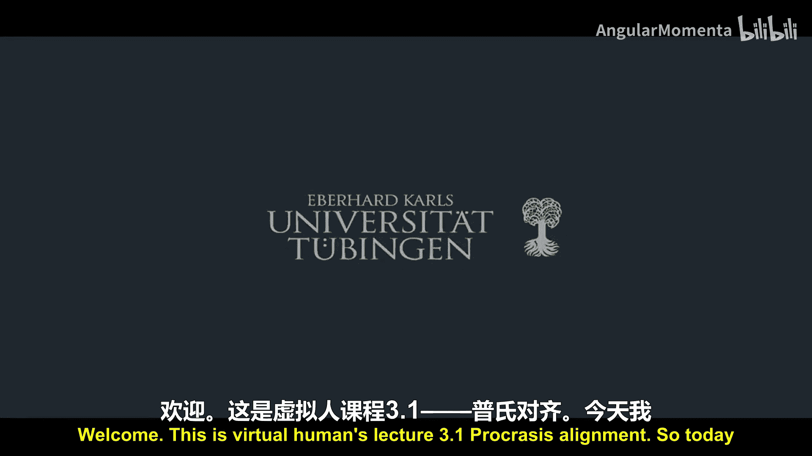
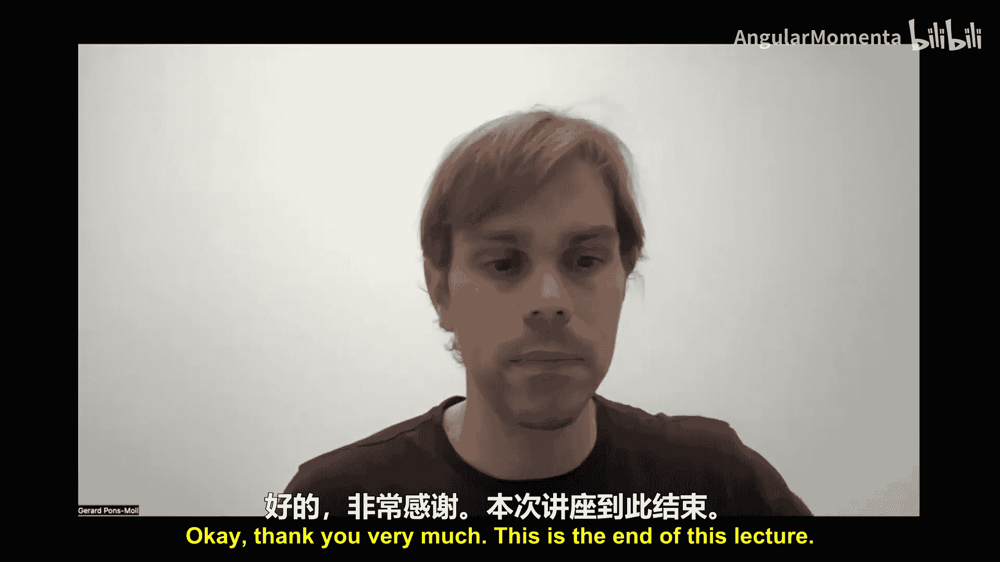

# 【精译】蒂宾根大学《虚拟人类》-p06-03.2-普洛克路斯忒斯对齐--BV1TAbkzpEva_p6-

Welcome， this is Vit Human lecturecture 3。1 Procras alignment。

So today we're going to see the most basic form of shape alignment。

 which is called procrastous alignment。So previously。

 we said that we want to build a body model that gives us control over the pose and shape of people。

So here I'm showing this model that has been trained already where we can control， for example。

 the shape of the body while keeping the pose fixed that's why you have a zero here so you can see that the shape changes while the pose is static and you can also see how the model produces different poses for a fixed subject identity and at the same time if you vary the pose and the shape you have this animation of a person changing the shape and the pose at the same time。

So the question is， how do you build such a model and we said， well。

 one idea is you just collect lots of scans。a lot in a population of people of different shapes and you collect then lots of poses and in the most classical form。

 what you would do is you would take these scans which are just sets of points that are not ordered。

And then you would have to bring them into correspondence such that you can then factorize the shapes and do statistical shape analysis。

So the question is， how do I align a single template to each of these shapes？And we said， well。

 there's a technique which is non rigid articulated registration or non rigid shape alignment that would bring this template。

From a canonical configuration to fit each of the scans and if we can do this for each of the scans。

 then we obtain what are called registrations。Where you have good correspondence。

 every vertex corresponds to one part of the body， the shoulder or the hands or the face。

The question is， how do we do this registration？So today we're going to see the most basic form of registration。

 which is procrastous alignment， which is rigid alignment。Regit alignment means。Finding。

The rigid transformation that optimally aligns the shape source V to the shape target V prime。

So what is rigid alignment is basically a scale。Wwhich is scalar。

 a rotation which belongs to S3 and a translation， so you have to find these parameters in order to minimize this objective function。

 what is this objective function。It's basically like the matrix of vertices。

Minus after transformation， minus the matrix of vertices in the target。

And you take like some distance， for example， in this case， like this norm。So。

As surface representation in the next lectures， we're going to use a match representation。

 which we saw in the previous lecture。Basically， a mesh consists of a pair of vertices。Which can be。

Stored in a matrix， so V， which has n rows times three columns， three columns for the X， Y。

 and Z components。And then you have like the faces or triangles that determine how the vertices connect。

So in every row of the phase matrix， you have the indices of the vertices for a particular triangle。

So this is basically a piecewise linear approximation of the surface and the surface is basically forever every triangle like a mapping from R2 to R3。

 so we have a surface that is embedded in R3。So how can we rigidly transform a set of points。

 well hopefully this is not new to you， can basically take you can translate the points by adding a translation vector to each of the points。

Where here we have overloaded the notation a little bit。

 what you should understand by this is that you take the matrix V and you add a translation to each of the rows of this matrix。

Or you can rotate it， you can basically take the rotation matrix and multiply it by V transpose。

And the matrix multiplication will do the operation that we want for us。

 the rotation will multiply each of the entries of the matrix， which are the points。

And we will obtain a matrix of rotated points。We can scale it， basically。

 we can just multiply the matrix each entry of the matrix by scalar。Okay， so geometrically。

 this means that a vertex， when we apply a rotation， it rotates about the origin。

 about some axis of rotation， as you can see here。If we apply a scale scaling。

 it means that we are pushing the vertex further away from the origin in the direction that connects the origin and the point or we are bringing the point closer and then finally a translation is just moving the vertex in the。

T X， T， Y T Z components of the translation vector。We can express this in a matrix。In which。

The first three by three block of the matrix contains the scalar times of rotation。

And the fourth row contains translation。So like this， we can obtain the transform vertic Sv prime。

So okay， we know how to transform。A shape that's trivial， but the problem we are。

we're interested in is finding the scale， rotation and translation that optimally brings one source shape B into a target shape B prime。

And this is known as the procrastous alignment problem。

And you might wonder where this name comes from， and so Procrasts refers to a bandit from the Greek mythology。

So Procraus means he who stretches and Procraus offered hospitality to people who passed his home and he gave them a room and a nice bed to sleep in and he explained to his guests。

That。And the bed had a unique quality in which it would fit whoever laid on it perfectly。

What he didn't tell his guest though is that that the reason people feed the bed was due to the fact that he stretched the people who were too short for the bed and he cut off the limbs of people who were too tall for it so we're going to see how we can optimally compute this stretching of people to make people fit in bed。

 but we're not going to cut any feet。All right， so this is the optimization problem that we are interested in solving we have here this a mean over these parameters of the rigid transformation。

So here we have the constraint that the rotation matrix has to belong to SO3。

Notice that we did a little bit of change of variable names a a little bit of change of notation。

 so now what is v is called x and what we were calling the transform shape B prime is called Y。

So okay， we can write the prior equation point wise， this means like we can have this summation here。

Over the points of the source shape or target shape and we have like here the point wise difference between the transform point。

 this is X I multiplied by Rs and at。And adding the translation。

 this is transform point and the target point。So we want to minimize this sum of square distances。

So okay， so any ideas on how to solve this problem？What kind of problem is this？Is it linear？这是。😊。

Qudratic。So we have like this squared here， right， so it's a quadratic problem and but we have here the。

Rotation， right that needs to belong to SO3 and。Right it's not clear how to solve this。

 we could use gradient in descent， but there's something better we can do actually there's a closed form solution。

 which is given by the procrastous algorithm。To understand how the proous algorithm works。

 we first need to see a recap of SVD， which I assume that you're familiar with。

So SVD theorem tells us that any linear mapping a， any matrix A can be decomposed as the composition of three transformations or three matrices。

 one is an orthogonal transformation followed by scaling along each of the axis。

 that's why you have this diagonal matrix sigma。And followed by another orthogonal transformation。

And so this is an interesting， very general theorem because it tells us that any linear mapping is just a composition of rotation stretching and rotation again。

So we're going to。The SVDS， it's going to be at the core of。Progress this alignment。So all right。

 so just to。Fix some ideas basically a matrix can be decomposed into the product of these three matrices。

This is。This SVD can be applied to any matrix， it doesn't need to be a squared matrix。

 it can be m times n， we're going to deal mostly with real matrices for geometric problems and basically U is an M by M orthogonal matrix and B is another M by n orthogonal matrix and sigma is an M by N diagonal matrix with just diagonal elements。

Note that V here is not the vertex matrix， it's just this orthogonal matrix coming from this decomposition of a general matrix A。

So why am I showing you this？If we have like these two matrices of points， x and y。

 sore shape and target shape。The optimal rotation。Is given by the following equation。We compute。

First of all， we center the shapes， that's why we have this bar here and then we compute the what is called the cross covariance matrix x transpose I。

 and then we decompose this。Mattrix this matrix product into this SVD decomposition。

 so well obtain U sigma V transpose。And now the rotation is going to be just the rotation part of this decomposition。

 so we throw away the sigma which is basically making the stretch and so basically the rotation is going to be UVV transpose。

You should check yourself that this leads to a three by three matrix。And。Also。

 because I multipied two orthogonal matrices。I should expect that I will get。An orthogonal matrix。

Right， we're going to we're going to see like where this comes from。

 but you can already intuitively see that essentially like。

the rotation cannot include any scaling because otherwise it not wouldn't be a rotation and that's where like this sigma gets dropped。

Now the translation is simply given that I know the scale and the rotation is simply like basically the difference between the transformed centroid x bar and the target centroid of the shape that's giving us the optimal alignment。

 so if I have I have two shapes basically it's sufficient to align the transform centroid of the。

Of the source shape with the target shape。And now the scale is going to be this expression here。

 which is the trace of x transpose y this covariance matrix divided by the norm。

 here' is the Frrobinus norm of x。Of the shape， so this is sort of like comparing like some sort of sum of eigenvalues for the covariance and and this x transpose x。

Okay， so this is giving us a measure of how different these two shapes are in size。

We're not going to give like a full blown proof， but I'm going to show you how we derive the translation part and the rotation part。

 and I'm going to leave the scale part for you to check for yourself。Um。

I don't expect that you are able to derive progress alignment。

 but I think it's interesting to go through the derivation to understand better where this algorithm comes from and what this result comes from。

Yes。So okay， we have a minimization problem。And。So let's go step by step。

 So let's look at the translation part， So we have like this objective function E and we can write this sum of。

Of point square L2 distances between points， which we can write in vector form as follows。

 like we have this vector here difference transpose times the vector that's exactly the same as the norm squared。

And so basically we developed this term here by just multiplying each element with each element。

 and we obtain this expression over here。Now， like if we remove every element that does not depend on the translation and so for the translation。

Basically we can ignore these terms because they they do not depend on the translation。

 so basically I have the aine over t and I have this expression here。Which， again。

What kind of expression is this？With respect to tea is again， quadratic。Um。

Because we have this t transpose t and then we have like this these other terms so so here like we have this summation over I and notice that this summation I could plug it inside here right and the rotation and translation can come out of the summation because they they are constant for every term in the summation right so they don't change with I they are constant so basically I could just plug in this summation inside。

And I could also plug in this summation inside here。So what we're going to obtain is like， you know。

 if I plug it inside here， it would have2 s summation， X transpose。

 and then this multiplication here。So the summation of excise transpose or summation ofYi is nothing else than。

The centroids， but to obtain the centroid we need to divide by n okay。

 so we can change variables here in order to obtain an expression that does not depend on and the summation。

So we can change， we can compute the centroid and do a change of variables to go from here to here。

And we obtained the following minimization over here。And now。How do we obtain。

 how do we know like how do we optimize this， what would you do？

Well you can take the derivative and set to zero right and it's a quadratic form。

 so we arrive at this expression here， which is basically the centroid。

Of the target minus the centroid after the transformation is all we need to compute the translation。

 Okay， so it's what we saw at the beginning。 so we've already proved that。To compute the translation。

 I only need。The centroids， but of course I first need to know the scale and the rotation。Okay。

 so how do we compute the rotation， this is a little bit more involved。

 but it's quite interesting this optimization problem。So we have here like this energy。

 this is basically the its a scalar and we have this summation and like this。

Basically this sum of squares notice that this rotation is subject to the fact that the rotation has to belong to the So3 right it has to be a proper orthogonal and determine an equal one a matrix so the first thing to do here in order to derive something。

Easier is to turn this summation into this， this objective function to turn it into matrix form。

 Okay， so instead of having this summation of。Point point squared errors。

 we're going to write the same thing in matrix 4， so we're going to write now r times the matrix of points x minus y okay forrobinus norm squared。

And you should convince yourself that this thing with the summation here。

 per point and this thing in matrix form is exactly the same。Okay。

Now I did a little cheat here in notation， so I didn't want to carry the x transpose everywhere。

 so basically I took the liberty to now define X Y as matrices that are now three times n。

And this will allow us to not have to carry like these transpos everywhere。Okay。

 so now the matrix is three times n。Okay， so this norm here。

 I can write as this inner product right forvinus's inner product。Which is r times x minus y。

Inner product or R x minus y。For a video store， okay， so I just。

Follow the properties of an inner product you can associate and then basically obtain the following terms。

You have Rx。Norm squared plus y for norm squared minus2 times Rx y for norm。So this term over here。

 the norm of x。😡，Multiplied by a rotation。What can we say about this term over here。

 how can we simplify this term？Think of a vector， maybe that's easier。

What happens with the norm of a vector if I rotate it？Does it change？

It does not change the same thing applies to matrices if you have an orthogonal matrix multiplying another matrix and you take the norm。

The orthogonal matrix does nothing。To the norm。Because it's just rotating， okay。

 so essentially we can just drop the rotation term here because it does not affect us。

And now we have like something that does not depend on R， we're going to drop it in a second。

 something else that also does not depend on R， so x and Y that don't depend on R。

 so we're not interested。In those terms， for the purposes of the optimization。

And now we have minus two terms， two times this inner product of Rx and y。Which is interesting。

 right， because it's sort of like。We can see here because we have an artine here and we have a minus here。

This thing is going to be minimized when the inner product of Rx and y is maximal。

Which sort of starts to make sense right because the shape after rotation。

 like x after rotation should overlap with y and therefore like the inner product should be maximum。

Okay， so this is equivalent to artrc maxs over R and here we can write the following like I can move the X。

To the other side， but I need to transpose and revert the order。

 so these are basically just using properties of an inner product。And。Now I can what do we have here。

 we have exactly this cross covariance matrix， but notice that because I did this little trick here now we have the whole thing transpose so we change the order relative to slides before we have the order swapped and we have the transpose on the X and no transpose on the I and the Y。

Okay， so now we can do SvD decomposition and we have arc marks of r times this decomposed matrix here。

O。So doing the same trick as we did before， we use the properties of the inner product to move things around so we this is completely equivalent。

 I can move。These matrices from the right side of the inner to the left side。

 but they have to transpose and take care of the order。And now I have the following arcms。

 I have arcms over a matrix S。And sigma。Okay， where S equals u transpose r times v。All right。

So I have these artrcms， artrc maxs over r of s times sigma right of this inner product。Now。

 the question here is what kind of matrix is S if U transpose are times v？So we said that U。

 by definition， is an orthogonal matrix， R the matrix we are looking for is also an orthogonal matrix。

Even more it's a matrix that belongs to SO3 and V is another orthogonal matrix and what happens with a product of orthogonal matrices。

We obtain another orthogonal matrix， so S is an orthogonal matrix。And。😊，Now。

How can I set these orthogonal matrix such that is as close as possible？To sigma。

 which is a diagonal matrix。Well。The best thing you can do is to make it the identity。

Because you have the constraint that every column has a unique norm and so on。

 so the best thing you can do is to set it to the identity。So essentially。

 we have here that the solution to this problem is when this s matrix equals to the identity and for s to equal the identity R needs to be equal to U v transpose okay。

 and this is how you prove that the optimal rotation between two shapes is given by Uv transpose。

 right？Now something similar can be done for the scale and then you obtain this quotient。

 which is the trace of the sigma divided by this norm squared and as I was saying this is giving you some notion of the proportion of one shape over the other okay。

So that's the full algorithm， but this implementations you will have to implement these or parts of these for the assignments。

 or you will have to use this to solve problems like this。

And yeah I don't want you to be too scared about this。

 I will not expect you to be able to derive the procrastous algorithm in the exam。

 but it's good to look and understand the derivation because like this you will gain a deeper understanding of the method and of the properties and for example。

 like。You know what is the optimal rotation from one shape to another， does it depend on the scale。

 does it not depend on the scale？To align the shapes。

Do I care about something more than the centroids or do I not care about anything else in the centroids and so on？

Okay， so this is all I wanted to say about progress alignment and in the next lecture we will see something more interesting which is non rigid shape alignment。

Okay， thank you very much， this is the end of this lecture。

