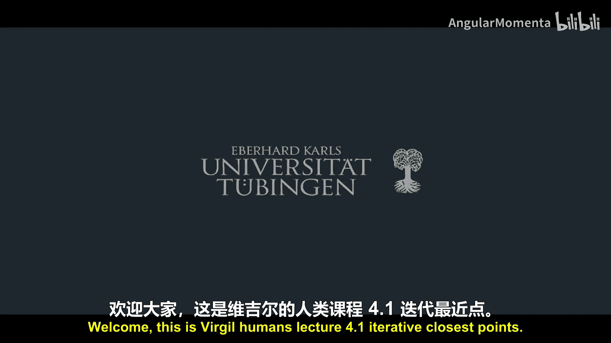
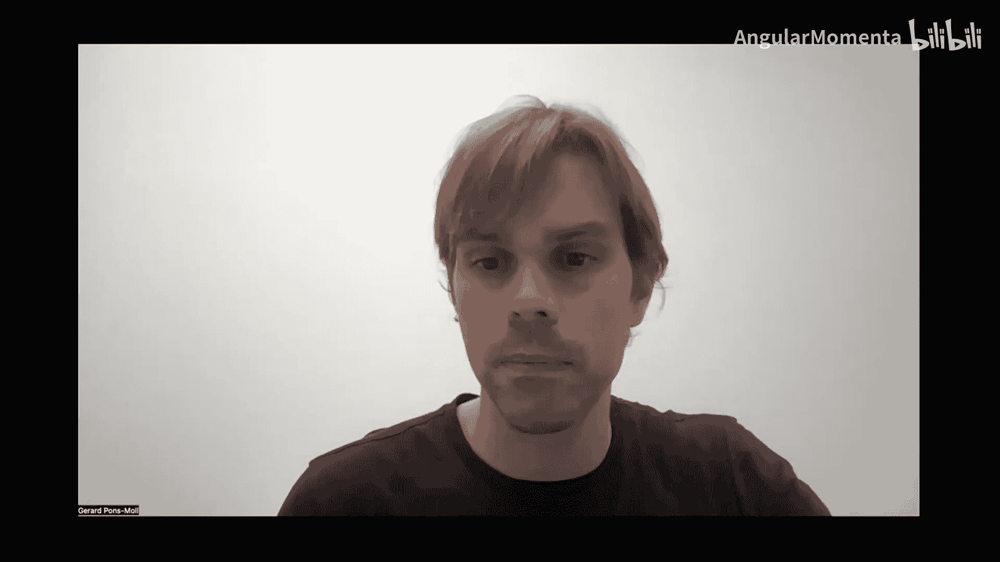

# 【精译】蒂宾根大学《虚拟人类》-p07-04.1-迭代最近点（ICP）算法--BV1TAbkzpEva_p7-

Welcome， this is virtual Human lecture 4。1 Iterative closes points。

 so in this lecture we're going to see shape alignment with transformations that are more interesting than rigidt。

嗯。In particular， we will see how to non rigidly align shapes， like what you can see here。Where。

In contrast to what we saw in the previous lecture。

Now we're not going to assume that the correspondences between the sore shape and the target shape are known。

 and we're going to use。A generic type of transformation from the source to the shape。

So what we saw before is the pro algorithm， which gave us the optimal rigidt alignment between shapes。

But the problem is。How do we find the correspondences between the shapes。

 we assumed that we know the correspondences we didn't talk about this。

 but this is typically not known。And even if we know the correspondences。

 how do we align shapes non rigidly？Okay。So。What we're going to see is a very famous algorithm that is called the At closest point algorithm。

 which is widely used in computer vision and in computer graphics to align shapes in order to do。

 for example， statistical shape analysis。And this is essentially the workhorse of building the simple body model to have a good registration。

From the template and each of the scams。So what we're going to see is that we're going to。

In one of the steps of theerative close point， we're going to do alignment through continuous optimization。

So let's start with the correspondences。Do you have any ideas of how we could find correspondences between two shapes？

So one idea might be to extract some sort of shape descriptor that describes a shape locally and then try to find this local shape in the target shape right we're assuming that the shape should look somewhat similar they should share something we're aligning shapes of the same category。

So for example， like you could just block， extract a shape the scriptor and then try to match it against the target。

But the problem that we will encounter is that。You might have multiple matches and the problem might be very ambiguous。

 you might have regions where you have basically no distinctive features。

 and so the alignment will be very difficult。So it's clear we need the more holistic approach to this。

 right to find the correspondences we should take into account somewhat initialization。

And we will see how to do this。So okay， so we have the following objective function and。

Here we cheated because we were assuming that for every point Yi on the target shape。

 we know the corresponding point Xi， but in practice this is typically not known。

And so now we're going to change the notation a little bit。

Instead of having this rigid transformation， we're going to use more a broader class of transformations。

 which will be denoted as F。Okay， F is a function right that takes x and maps it to。Some x prime。

 right， and the goal here is to find F。And the correspondence。

X I says that it says that this distance is minimal for all the points。

so XI here denotes the closest point to the target point Yi right that's the notation we're using in order to make this notation lightweight。

 this is not indexing the matrix， it's basically saying XI is the closest point to the target shape point Y。

So truly， the optimization is not only over the transformation F。

 but is also over the correspondences， right this set of correspondences， X I， X Yi。

So for every point in the target， we need to find a correspondent X I in the source。

So the optimization problem truly is over these two sets of。These two quantities， right。

 one is a transformation F and the other one is the set of correspondences C。

So we have the summation over target points I and we have this mean here。

 this mean means that for every target point I， I want to minimize this distance。

For the point x that makes this as small as possible。

 that's why we have this mean here on the outside。This mean here is a point in this source shape。

If x is a list of points， this would be choosing the point in the list that makes this as small as possible for the optimal transformation。

You can already see this is not so trivial because finding the right X。Depends on which F I have。

So how are we going to solve this sort of chicken and egg problem？Well， what we could do is， okay。

 let's。First， find given fix F。And find the optimal correspondences for this fixed F。

 So I have here an amin over x， right in order to find the optimal x that makes this as small as possible。

Where F is assumed to be fixed。Now， given those correspondences， one for every target point。

I can find a new F， right the same way we。Compututer the Pro algorithm。

We can now optimize F in order to minimize the distance。From the transform points。

 X to the target points Yi。And here this J indicates the iteration。We are doing iteration。

 so J is indicating the iterations during the algorithm。Okay。

 so we could alternate this and essentially given the current best transformation。

 what are the closest correspondences？And in the second step， given the current best corresponds。

 which is the best transformation。So this is basically the essence of the iterative closest point algorithm。

So here。To show you like an illustration of how this would work， you would start。Finding。

You started some transformation right， for example。

 like the identity and you basically start with t equals0 and scale equals to1。

Here the F is essentially like a rigid transformation for this example。And basically。

 like then you would find。For every target。For every target point right here you find the closest point in the source and then essentially like you find the correspondences you find the optimal transform。

 in this case you could use progress alignment because the transformation we've chosen is rigid and then you can find correspondences again and you can iterate the process until the shape。

 the source shape hopefully converges to the target shape。

And we are iterating this process of finding the optimal transformation and finding the correspondences。

So how does this work， you initialize typically not at zero。

 but you initialize by centering the shapes first， you basically align like compute the centroid and you align them based on the centroids。

This is always a good idea and then basically you compute correspondences given the current。

Transformation that we have the current estimate of f of J， right that iteration J。

 and we have this correspondence X I at iteration J plus one。

And in the second step or the third step， if we count initialization。

 we have to find the SRT with proors。so basically we have this argument Min and we know how to solve this because we've seen this in the previous lecture。

All right， but now the correspondences are not optimal， so once I solve procrast this。

 perhaps I'm not done。I can look at an error and if the error is below a threshold and I say， okay。

 I'm happy， then I could stop the iterations。Or if we're not happy with the error。

 we could find correspondences again and then compute progresses again。

 and we could iterate this until we converge。This will converge to some local minimumma。

 at some point it will sort of stop or it will move very little。

But this local minima might not be very good， right。

 we should be aware that the iterative closest point algorithm is a very local method and if we don't have a good initialization。

 it will not produce the expected results。So。Is this approach the best we can do so when we compute closest points。

Think of the complexity。What do you think is the complexity of finding closest points？Well。

 in the most naive implementation， I need to find for every target。Point。

Like the closest point on the source shape。So and we need to do this for every target point。

 so this is of course an n squared operation right because every time I have n every time I move to one point。

 I have to compare against the n other point。Okay， but we can do better。

 we can basically use some acceleration structure because the target shape does not move， I could。

 for example， like like you know compute a kd tree right in order to more quickly find the correspondences and basically reduce the complexity to log in。

 right？Or for example， I could not use all the points to find the transformation。

 but maybe I'm happy with 10 points already， right I could find it。10 correspondences。

 computer transformation and iterate， maybe that's just sufficient。

And this will also reduce the training， the computational cost。So there's many。

 many different tricks and people have proposed many， many different ways of making ICP more robust。

So a few tips are always finding correspondences from the target to the source。Because that's。

That's a proper data term， you're trying to explain the target shape， right？

If we are thinking in probabilistic terms we are we want to explain， explain the likelihood of。

The data， this is the target， given our。Parameterters that bring the source。

To the target right and not vice versa because vice versa。

 I could make the source like collapse to a single point and I will have zero error and then。

Basically， this is a degeneracy， this cannot happen if you sum over target points。

Then if you have like outliers， which is typical， for example。

 if you have wrong correspondences or you have noise in the target scan you can use robust cost functions unfortunately I think we don't have time to cover those in this course。

 but essentially，You can apply like some。Function that basically could look like an L2 close to zero。

 but then like it flattens out sets that points that are too far away are basically ignored by the algorithm。

Or we could use an L1 and so on so basically we could also use normals that might make the correspondence finding better and we could for example。

 like also to deal with ource we could use ranzac so Rzac is essentially like you could just basically choose many pairs of。

Of correspondences in order to find multiple hypotheses and then pick the best one。Okay。

 so also something that improves the result significantly is not compute the closest points from the target shape to the source shape。

But to find， to minimize the point to surface distance directly。Right。

So if you minimize the point of surface。Your。Optimization like it will be like the convergence will be much smoother because as you make a gradient step。

In parameter space， the points are allowed to shift along this surface。

So essentially we're not finding the closest vertex。

 but we're finding the closest point on the surface and by minimizing this distance to this plane here。

We're making the optimization better because before we are locking like Xi to be paired with Yi。

 right？And this is limiting because when I make a step in terms of the transformation。

 like I'm locking X to be paired with Yi， but maybe you know， as I'm optimizing the transformation。

 it turns out that XI would be better paired with some points along the triangle and move along the triangle。

对。All right。So。How do we find the best transformation so progresses gives us the optimal rigidt transformation。

 but what if the deformation model is non rigidt， what if I have articulation and non rigid deformation effects？

Can we generalize this algorithm that we've seen to non resist the formation？Well， we can。

 we can basically compute closest points， these are the correspondences。

 which are going to tell us like in which direction we should move。

And then instead of computing the transformation with proors， we're going to。Plf like a general。

Transformation right indicated by this function F and because F might be non nonlinear there is no closed form solution right so what we can do is like linearize the energy。

By computing the Jacobian of the distance based energy， right？

With respect to the parameters of this F transformation。Yeah。

 and then basically we can take a gradient step。And over several gradient steps and then basically。

Find correspondences again and iterate the process as we did before。So essentially。

 this is what I call here the gradient based ICP but。

Yeah this is just the name I came up with I'm not sure so basically you have here the minimization of E over this transformation F and so we have this arc mean right and you have this sum over the target points Yi and you have here the the transformation point minus the target point right so if f is a rigid transformation that's pro is no problem but if it's not if it's a non nonlinear function you can do gradient descent so fixing the correspondences we can obtain the new transformation by taking f and taking a gradient with respect to f of this E okay。

So E recall， this is a scalar。And actually this is an asive notation。

 what we do in practice is not take the gradient with respect to a function。

 what we do is we take the gradient with respect to the parameters。

That parameterized this transformation。So F might be like whatever transformation right could be like non- rigidgit and typically you have some parameters。

 the same parameters as what you saw， like scale rotation and so on， you might have the same。

 but with more parameters that allow you to have more flexible transformations。Basically。

 you would take the gradient with respect to those parameters。

And then basically you take a green step， you obtain a new transformation。

 you transform the points according to this estimate， and essentially youerate this process。Now。

 is there a better way of updating the transformation than gradient descent？嗯。Typically yes。

 for example， you could use a gaus New method because this is essentially a least course problem so when you have a least course problem there's。

There's an efficient way of computing approximations to the second order derivatives of this。

 so the hessian， you can approximate the Hesian matrix with a Jacobia matrix only。

 and then you use something that is called the Gaus Newton method。

If this sounds like very new to you， don't worry， like we will see this in more detail。

 I think in the next or in the next two lectures， right like we will see more detail like optimization methods。

But for now， like you just need to understand that we have the ICP algorithm where we find correspondences and in the other step we have like we have to find the optimal transformation and because this is nonlinear。

 we need to take， we need to linearize。And find a step direction right in which we will move to obtain an updated transformation。

 okay？So this is how the algorithm works， you start with this energy。

 which you have this minimization over correspondences and also transformation F。

And so you find the optimal correspondences given the current estimate of the transformation。

 and then you find you take gradient steps to improve your transformation estimate。

And then you find correspondences and so on， you typically would take。

 you would fix the correspondences for a few steps， and then you would basically update。

 take a few gradient steps before finding correspondences again。

 in order to make the whole thing more efficient because finding correspondences is like one of the slow steps。

And then like the gradient Descent Act has alternatives like Le but Mark or BfGS and DocL and so on。

 like there's many nowadays this like in the libraries you have many options for doing non near optimization。

And then you basically terminate if you converged。And to determine if you convert is like when you don't move much in parameter space or when the error does not decrease that much。

Okay， so let's look at this algorithm， how it works。

 so this is what what I'm referring to as the gradient based ICP。

Which you will play with during the exercises， you will be able to do this。

So here's the template and the transformation that we're considering here is given by the simple model。

So the simple model parameterizes the types of motion that I can apply to the source shape in this case the source shape is the red mesh。

Okay。So you see like these class of transformations could be quite generic in this case we're using the simple model。

 but you could use any F could be represent anything so what we're doing here is we find correspondences then we take a few gradient steps。

Of these sum of squared  errorss with respect to the simple parameters。

 and then we find correspondence again and reiterate this process， right？

So notice something it's a little bit like the person like sort of wiggles a little bit， right？

And now I want you to think about。Why does this wiggle so much？

Compared to this example I showed at the beginning。

It seems this is like the pose is much more complicated。

 so it seems like a harder registration problem。But this。

Registration here seems to converge much smoother， right there less。Like jumping back and forth。

Why do you think this is the case here I'm using a point to point objective and here I'm using a point to surface objective。

The main reason is that here like is what I was saying before。

 we are locking the correspondences and during the update of the parameters of the transformation。

 the correspondences are locked。And so every time I find new correspondences。

 like I make significant jump， I can find significantly different correspondences。

Whereas here I'm finding the I'm optimizing the point to surface distance and。Essentially。

 like this allows， as I take gradientding steps in simple parameter space。

 the corresponds can slide along the triangles。And therefore like the whole team magician like converges smoother。

 so this leads to if you really want good registration， you have to deal about these details。

These are like。Quite specialized details that are beyond perhaps the scope of this lecture。

 but it's something that you should know to get really good registrations to really build a really nice body model。

 you have to worry about these details。Okay。So。So the gradient here is a vector because e is a scalar。

 and I'm taking derivatives with respect to each of the parameters of F。Okay。So the question is like。

 okay， its derivative seems easy， we know how to take derivatives now if I have something very。

Fairly complicated， like the simple model or something even more complicated like to a model like non rigid deformation。

Who takes a chalk and writes it down？Well， the good news is that we don't have to do this anymore because we have or we don't have to do this that often because we have chain rule and automatic differentiation。

 so it turns out that you know these automatic differentiation tools have already implemented most of the derivatives that we're interested in and then by just applying the chain rule in the program。

 the computer program。It gives us like access to the gradients， right？That's also like。

A core to training neural networks， we don't have to figure out like the derivatives ourselves。嗯。

It's nonetheless like useful to know what type of gradients， what type of Jacobs。

 what type of hessians you have for your problem in order to understand how your algorithm should behave。

 how long it should take and so on。But in general， like this automatic differentiation。

 you have a chain of operations and it basically uses the chain rule to produce the derivatives that we are interested in。

 right？Okay， and as I was saying， like gradient descent is the most basic one， but perhaps for this。

Sort of nonlinear list squares， there's better solutions like。Like for example。

11 when Mar Courtt is a popular one。All right。Why do we use this gradient Why did we introduce this gradient based IP？

Essentially， the formulation is much more generic。The energy can incorporate。Other terms。

 more parameters and essentially there's a lot of available software for solving list square problems。

 this is the shape alignment is one instance of this in the basic form that we've seen at least。

However， you should bear in mind that the resulting energy is non convex for general deformation models and optimization can get trapped into locom meal。

It's even if you would know the correspondences， it might be that the model does not。

Converge like you cannot find the optimal transformation to bring one shape into another and if you now include the fact that you don't have the correspondences。

 then the problem becomes even more susceptible to converge to a wrong solution So you need like good regulars in a good priors in order to register shapes in a reliable manner。

Okay， so the take home messages are that procrasts is optimal for rigid alignment problems。

With known correspondences， but when we have other types of problems， for example。

 like we don't know the correspondences。And we want to consider a more broader class of transformations。

We have to do some variant of this iterative closest point algorithm。

Where we trade over finding correspondences and finding the optimal transformation。Okay。

 I realized that I forgot to add slide credits this many of these slides are based on a course that Javier Romero and I gave。

A few years back， so the slide grades go to Javier Romero for these slides。Okay， thank you。

 this is everything I wanted to discuss about ICP and in the next lecture we will already see the basics of the simple model and we will see。

The mathematical model of the simple model underlying the simple model and how to train it from training data。

Thank you very much。

