# 【精译】蒂宾根大学《虚拟人类》-p08-04.2-基于顶点的模型与SMPL--BV1TAbkzpEva_p8-

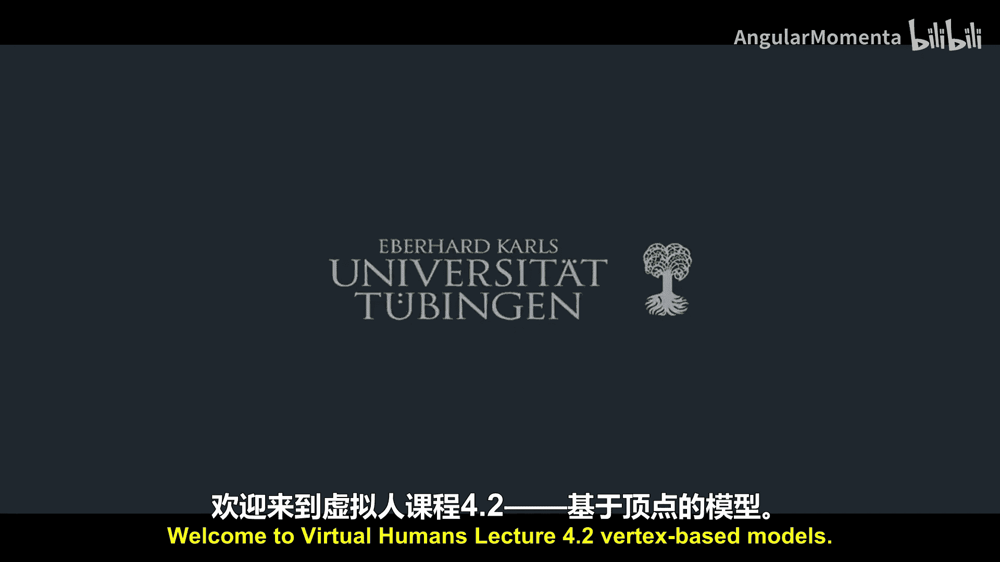

Welcome to Vit Humans Lecture 4。2 vertex based models。So in this lecture。

 we will see how to build a body model， and in particular we will focus on the popular simple body model。

The goal of this lecture is not only to understand how simple works， but rather to understand。

What are the important ingredients to build a good body model？So first of all， let's。Refresh。

Our memories by a body model， we mean a function that takes some input parameters。 In this case。

 I told you that we chose the input parameters to be the shape and the pose of a person。

 So we want a function that allows us to control。Both the bows in the shape。In a way that you know。

 you can fix the pose like you can see here and you can vary the shape or you can fix the shape and change the pose of a subject。

 or basically you can once you've learned the model you can generate anybody in any shape。

In a way that looks realistic。And now here， the input parameters are the bows and the shape。

 and some of you might。Question why should the input be shaped in both？

Why can I not choose some other input？Like height or。H。Well， you can but。

The shape and pose are some input parameters that are very intuitive and that allow you to generate a wide variety of shapes and you often want to control。

 for example， like the pose of a person without changing the shape and so that's why it's an intuitive model。

 however， you could choose other input parameters and there's models that for example like allow you to vary the weight of a person or the age of a person so this is something that you can build on top once you've learned a model of shape and pose。

So in this lecture， we will use the notation of theta with an arrow to denote that it's a vector and to denote the post parameters and beta with an arrow toote that it's a vector to denote the shape parameters。

And you will see many papers that thetas use for bowse and betas used for shape。This is because of。

I think it comes from from。As early as the S model used this notation and then following papers have followed on that。

Okay， so now that we believe that pose and shape are a good set of parameters to control。

Like the space of body shapes。The question is。Alright， what kind of function should I learn。

 How do I design my body model， We said we're going to train the body model using training data of people of 3D scans。

Okay， fine。 But what is our model for。Is it going to be a linear function of bows and shape that maps to bloody virtuetices？

Or a polynomial function。So given that we have chosen a function。Let's say polynomials。

How do we fit these hyperparameter， this ws， right？Using training data。

So these are the input parameters and these values are the ones。

 the hyperparameters that need to be learned from data in order to minimize the model to data error。

So what do you think， do you think that linear is a good choice to map？

Shape and pose linearly to vertices。Do you think that polynomials would be better？Well。

 neither would work very well and the reason is that the articulation part of the deformation is very nonlinear and this part is very well modeled with rotations。

 which is what we saw in the second and third lectures。Okay。

 so we could do the following like we could split the body into parts。

And we could say that every body part is parameterized with a rotation and a translation。

And this way， the pose would be a collection of rotations and translations for every part。

Anyone can see problems with these。What do you think would happen。

 What could happen if these are my parameters？And I， for example。

 I optimize these parameters to fit my model to images or scans or Im used or whatever observations I have。

 What could happen。Well。These parameters are independent。Of each other。

 these rotations and translations do not communicate to each other。

So either I impose some constraints or what could happen is the following like the parts would be flying all over the place right so I need additional constraints one very effective way of imposing constraints is what we saw in the second lecture or the third lecture where we saw kinematic change。

So what is a kinematic chain essentially is parameterizing the human body motion with a skeleton？

Where every body part。Rotate relative to the parent part。And to obtain the total transformation。

 for example， for the lower arm， you have to accumulate the transformations of each body part until you reach the root joint。

Of the body， right， this is the origin。So。And in particular， in the simple body model and。

Quite often in body modeling， like you parameterize rotations with exponential maps。

You could also use quadronions here， but this is the choice made in the simple model and recall that to represent a rotation。

 you can use this axis angle representation where this omega here。

 this is an scaled axis of rotation where the magnitude of the vector。

Is the angle of rotation how much you rotate and the unit vector of omega corresponds to the axis of rotation here right and remember that the rotation matrix。

 which is three by3 matrix that belongs to S3 can be obtained in close form using the Rodriguez formula as you can see here where recall that this。

Marices with a hat here， this is nothing else than this axis angle mapped into a matrix。

 this is the scrusymmetric matrix okay， this is a  three by three matrix。And this here。

 the square means the matrix squared， okay？All right。

 and notice this sine and cosine take the angle of omega， which is a scalar。

So this is a rotation about the origin， but in a skeleton， you have rotations about body joints。

And so if you want to rotate a point， let's say this point about a body joint。

 you need to do something else， but it's not much more complicated。So in particular。

 in the simple body model。All the。So what are called that the coordinate frames of every part are aligned at the beginning at the zero votes。

Okay， so you might choose like the Z X Y axis for the coordinate frames and those are aligned right you have the same coordinate frame for the lower arm for the upper arm for the root joint and so on at the beginning。

And now what you need to do is to track the changes。What is not aligned is the center。

 so each bone coordinate frame is centered at the joint for that particular。Joint， right？

So this means that in order to rotate a joint， a point about a joint。

 you need to apply the following transformation matrix where。

The rotational part is the same like you have like this three by three rotation matrix obtained by the axis angle。

Transformation， but now the translational part is essentially like this translation vector。

 which is which is the。The joint itself。Mineus the par joint。And so basically。

 this is the translation vector that。Basically moves us to the joint location and so everything makes sense here because imagine that I'm transforming a body point。

Into。World coordinates if if I would just have the identity。

 I would end up like applying this translation of the。Joint minus the joint parent。

 which basically would be rewriting the coordinates of this point in the world coordinates Okay。

 so it's just the transformation。And， and this transformation is local， and it's mapping the。Um。

It's basically it's writing the point in body coordinates， it's writing it relative to the parent。

Now if you want to like accumulate rotations， you can do this with a kinematic chain and we saw this in the previous lecture and so essentially now a point in body coordinates PB would be transformed into spatial coordinates or world coordinates PS accumulating the transformations first about joint two and then about joint one and so what might be a bit confusing is that in the simple model you should always think as like the transformations as a mapping between segments。

Where is？In a lot of literature of twists and exponential map。

 you think of transformations as emotion。But I told you that you can think of rotations as a transformation between coordinate frames or as a emotion。

 you just have to be careful like what it really means to to think in one way or another okay so here like when you work with a simple model is always better to think in terms of transformation between parts right from child to parent and so on。

Okay， so essentially now。To define the four bows， we first need to define a set of joint positions。

 which are the bow like the the joints of skeleton of a body。So in particular you will have k joints。

 each joint is like the coordinates of a particular joint like three dimensional。

 and basically this matrix J is the concatenated coordinates for these joints。

Now for every joint you have。One possible rotation。

 right if you don't want to constrain motion more and therefore like you have that the theta here is a collection of axis angles right this omega 1 until omega K。

Are the axis angles corresponding to each of the rotations about the joints 12 k？

So omega 1 here is a three vector。Which is scaled by the rotation angle， right so every。

Every triple plate of parameters here is basically a scaled axis of rotation and so that's it that's what defines the pose of a character right。

Now the question is， what do you think will happen if I apply a bunch of rotations using a kinematic chain？

To a template like this， which is divided into parts like this。

Such that that part rotate according to J1 and so on。

Do you think that the parts will now fly all over the place？

They want because just of how we constructed the clmatic chain。

 like we're constraining the motion to be purely rotational about each of the joints。

 except for the root joint where you have translation。Okay。

 so the the parts will not fly all over the place， that's good news， but。

What do you think could be a problem with such parametertization？

I'm rotating every part with a rotation matrix。嗯。And they will be connected。

 but what do you think would happen？Well， what could happen or what will happen is that。

Like the mapping is very non-smooth at the transitions between body parts。

 so you will have a discontinuity whenever you jump from one body part to another。

 so you will obtain like some sort of Pocchio kind of character where like the transformations like the full transformation is not very smooth right because here you transform according to one join and here according to another join and so you have like a lot of art。

So it has been known in animation that you can。Deal with these effects to some degree using linear plain scanninging。

For many years， so essentially now instead of transforming every body part independent with a kinematic chain right with this heart segmentation。

What we're going to do now is now smoothly deform the vertices according to a linear combination of transformation matrices。

So whereas before a point was assigned either to one part or the other。

 now the points will be softly assigned to several parts at the same time， so for example。

 like this elbow point might be assigned with a weight of 0。8 to the upper arm and a weight of 0。

2 to the lower arm in a way that this will turn this heart segmentation into a smooth segmentation you can see this weights that associate vertices to body parts are like not a heart assignment。

 but is soft。Assignment， which is regulated by these so called blend weights。

So how do we transform a vertex now， well， like now we have a summation from K equals 1 until bigk。

 these are like the amount of body parts that influence a particular vertex。And basically。

 then you multiply by these weights， which they should sum up to one and they should be positive。

You linearly combine these transformation matrices for each of the joints。

And you multiply by the vertex， Okay， so if you isolate this vertex in the canonical post。

 this bar here means in the canonical post， this zero post here。Essentially。

 we're having like a summation of k transformation matrices that we are linearly combining them。

 okay？You could think whether this makes sense or not。

 it leads to some interesting results like its it solves some of the problems。

 but you can already argue you're linearly combining transformation matrices。

So it's not clear what the output will be yeah。Um because these matrices leave in some manifold right。

 for example， rotations leave in some manifold， so if you linearly combine rotations。Yeah。

 you obtain something that might not be a rotation。So。However， like the this。Oh。

 before we get to this， like let me explain what our binding matrixes because you might find these in the literature and this might be confusing。

 So the binding matrix is just one additional transformation that is needed because。

Many times animators want to scpt the characters on a pose that is not the zero pose。

 it's not the pose for which all the joint angles are zero。

 but it's just something that is called the skinning space where it might be a different pose and there the animators like make edits。

 manual edits， they actually change。The shape of a character， right to obtain the desired effect。

And now if you have your。Inar blend skinning equations， then of course。

 if the vertices are edited in another pose， like it's not clear how to transfer this to a new pose。

But it's not too difficult to do。What you can do is like you essentially have to do two transformations。

 you want to take this point PS， right in this skinning space。

And then first transform it into the zero pose。Okay。

Which will be obtained with this inverse transformation matrix， GK of Theta star。

 which is the skinning space pose。And minus1， so you have the first transform here to obtain TI。

 and then you can apply the GK as we saw exactly as we saw before。

So we have here this inverse transformation that goes to the zero pose and then another transformation to bring it to the pose that we're interested in。

 obtaining this TI。Prime， which is the transformed vertex yeah。So yeah。

 this is what these binding matrices mean and this is something you have to deal with if your character is edited in a pose that is not the same as the zero pose。

All right， so now that we know how to apply being ill linear blind skinning。嗯。

Can you guess what problems we might encounter when we apply linear blend skining to a given character？

To pose it。We're going to obtain something like this。

 which is an improvement relative to what we had before。 Yeah， we had this and now we have this。

 so notice how the creases here all this unsmoothed。And smooth。Mesh。

 all these like discontinuities disappear and now you have a smoother mesh。However。

 we are linearly combining these transformation matrices and we are applying them to vertices。

 so you're creating some artifacts as you can see here right like this elbow like it doesn't look very natural and so on so and also we didn't say how we have to how we choose this。

嗯。This blend weight it's not clear how to do， like in animation people do it manually。

 we will see that it's much better if you want to obtain realistic human bodies。

 it's much better to learn it from data。All right， so let's recap a little bit what standard scanning is。

So you start with。Essentially with rest post vertices。

 you have to define what the joint locations are， you have to define what the blend weights are。

 which is the soft segmentation of vertices into body parts。And notice this matrix is n。

 which is the number of vertices times k， which is the number of。

Joints that can influence a vertex is a design choice。

The maximum might be k equals to all the joints， all the joints influence your vertex。

You might wonder whether this makes sense， for example， for an upper arm vertex。

 you might want to constrain that the only joints that affect is are the neighboring joints。

 right the shoulder and maybe torso and maybe lower arm， but not the feet。

And then you have the basically the post parameters that control the pose of the character right and the post parameters are tied to the joint to the type of skeleton that you chose right those two are together and that's why you cannot apply a pose from one skeleton to another that's not something you can do。

Al right， so the skiating function essentially like takes this set of parameters， the template。

 the joint locations， the plain weights， and the pose， and it maps it to vertices。Okay。

 so that's good enough but。Again， we still have problems like as I was mentioning before。

 we have like this what are called in animation， candy wrapper artifacts。

Which are making the joints collapse。And you can like there's tons and tons of papers on how to like linearly like how to combine transformations or how to transform meshes according to poses such that these artifacts are minimized。

And one famous one is dualquaronion skinning， which reduces some of the artifacts。

 but it brings some other artifacts。And all these methods are what you would call them like classical methods。

 they do not rely on learning， but rather they rely on a mathematical formulation that would reduce。

The amount of artifacts。Another solution is to essentially like apply blend shapes。

 so blend shapes are just a set of vertex displacements that are applied in a rest pose right so for example post blank shapes would be like a matrix of displacements where you have here three components one for the displacement on the x direction displacement on the Y direction displacement on the Z direction。

And you have as many rows here as vertices in the model， Okay， that's why this matrix is。

N times three， sorry， this is like a little bit oh， because this is vectorized so this is。

A matrix that is vectorized into。A vector of three times n， okay。So。What do we mean by this。

 like you apply some vertices such that vertex displacement。

 such that when I apply the articulated motion。The things will look fine again， so this is the trick。

This is what you obtain with linear blend skinning。Not very good。

 Look that this doesn't look very natural， but with the proper vertex displacements on these canonical pose。

which might look unnatural in this canonical post， but after applying transformations。

The thing looks like a real human。And people have used this in animation。

And essentially like animators。Actually sculpt manually these blankships。

 this which is a really tedious process right and it does not scale to many poses and many shapes。

So the question， of course， is how we can leverage training data。And in animation。

 this has been exploited to some degree， so one approach is basically scattered data interpolation。

 so you want a query post and you want to obtain like the blankships for this query post such's that you obtain like a realistic post affirmation。

And you have a data set， right of。Previously sculpted and blend shapes for different poses。

 for every pose you have a different blend shape as you can see here。

 which has been manually defined。And then for the quarios。The question is like。

 how do you use this training data in order to obtain your target planhe？

What do you think you would do here？Well， you could use your favorite machine learning algorithm。

 the easiest that you could do here is do some sort of nearest neighbor。

 you find the closest poses and then using a kernel that says that basically。If my target query pose。

 which is datata prime here is close to my training data pose。

 this weight should be high and otherwise it should be small。

 that's why we have this exponential and this minus here so it will decay quickly and so in the end you obtained that the blend shape for the target is a linear combination with this lambda eyes of blend shapes in the training dataset set。

Okay， so this is using some learning， but again， like all this training data has to be previously sculpted。

So what the problems are that this is computationally very expensive because you need to find the closest poses。

 you need to manually scale these things and it doesn't extrapolate very well to novel poses， right？

Because you're using this scattereded。Interpolation。So if we don't use scatter data interpolation。

 like how do we define the post plane shapes？And。Again， how do we set all these parameters。

 How do we find the template in the rest pose。That represents like some sort of average of the humans in a population。

 how do we set the joints in which location should they be？And how do we set the blend weights？

How do we find these soft segmentation of vertices into body parts。

 seems like a lot of tedious work to do a lot of things to define manually。Yeah。Also。

 how do we model shape identity variations， we didn't explain how to do this。

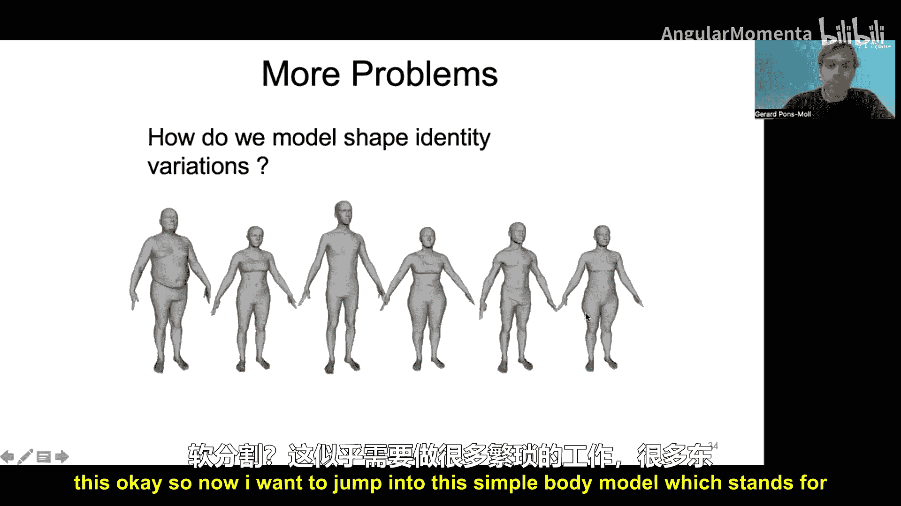

Okay， so now I want to。Jump into this simple body model。

Which stands for skin multipersonal linear model， which essentially it builds on top of skinning。

 but you will see that all the components are learned from training data okay。

So simple is a function that they expose and shape and it produces like a mesh。

Of a person in that particular pose and shape， and what you can see here are not real people。

 but they are synthesis of the model。

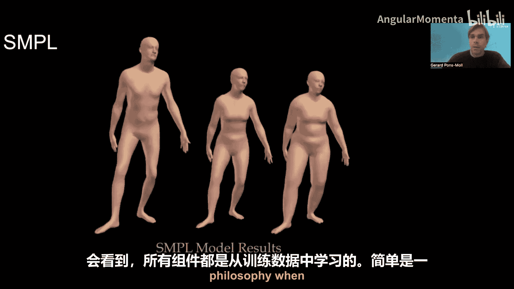

So the philosophy when simple was designed was to aim for the simplest model while having state of the art performance。

And I think that's a very good principle to pursue。

And basically like this will make the training easier and it will be also like because the model is based on standard skin。

It will be compatible with a lot of software packages that rely on standard skin to animate characters。

Okay。The trick will be to learn all the parameters of standard scanning from training data and how to do this efficiently。

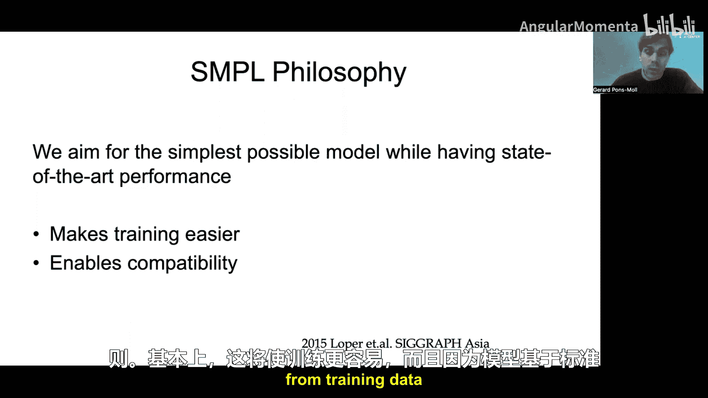

So essentially the simple pipeline is not very different from standard scanning。

 it adds a component in order to model the identity。which basically are the shape line shapes。

 so essentially like we will learn like a set of vector displacements that model how people change in a population and notice how the joints here are a function of the mesh such that when the shape of the person changes the joints of the body also change。

Then there's the post blind shapes， which are these funky displacements applied on this canonical post such that when I apply a given pose like this one。

 for example。Like the mesh， the resulting mesh after applying the articulation looks realistic。Okay。

 so you can see here the post blank shapes moving， notice here how there's subtle deformations happening here such that the target pose。

Looks like a real person right and what simple is doing is learning。Like essentially。

 all the components， how this。Shape identity should be modeled。

 how the joint should be predicted as a function of the shape and how this both。

Blind shape should be learned as a function of both。

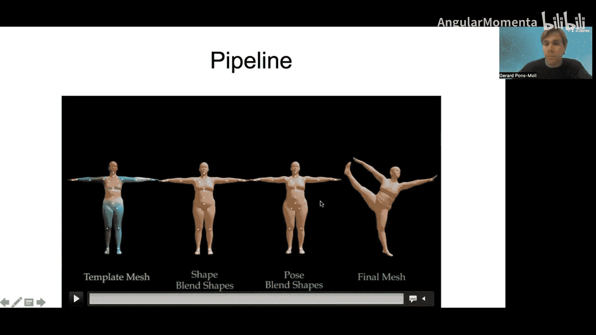

In order to obtain realistically looking mehes。So essentially。

 like we have that standard skin is this function W， which maps。The template。

 the joins and the blend weights and the post to vertices now simple is parameterizing skinning by shape and pose。

 so it's going to parameterize each of components of standard skinning with beta and theta Okay so now the template will be a function of pole in shape。

The joints will be a function of shape。Make it' intuitive like our skeleton does not change with our pose。

Or let's say the， I mean， it does change， but it they the aim。It changes only according to the pops。

 right it doesn't change。Beyond that， then you have plain weights and then you have like the post parameters。

 And then this will be mapping to。Vertices。So notice this is exactly the same。

 the only thing is that now we've basically parameterized these components。

So essentially simple is skinning， parameterized by poses and shape。So how does this work？

So essentially the template， we want to make it a function of pose and to do this。

 we add like what are called the post plane shapes， what are post blank shapes。

These spellen shapes are these matrices which are vectorized。

 which are a set of displacements for the full body right so every PI which is here a vector will have dimensions 3 n right so that it represents a full displacement field for the full mesh。

Now， like these postmans。Like any blend shape like it's a linear function。

 so like it's a choice it's this BP is a linear function of this blend shape。

 so it's going to be a linear combination of these different blend shapes PI。

How do we linearly combine well you could have some function of theta right that maps to like it's multidimensional and basically every dimension I will multiply one of the blank shapes。

That's a design choice。What should f of theta be Well， the simplest possible choice is to say well。

 I'm going to choose f of theta to be theta itself， the axis angle representation， right。

 which remember it's like these triplets where every triplet is an axis angle for a given body part。

What's going to happen if I choose this， well， it's not going to work very well like look。

 this is what happens the at the neck。And notice like let me play this again。

 like this is after training the model using training data。

 I'm going to explain later how to do this， but after learning the model you obtain like a model that produces like such transformations on the neck。

Which is not great。😊，And it's been learned from data。

 but just because we made a not very good choice of design， right and our mathematical formulation。

 we cannot learn a very good model。So why does this happen Well， first of all。

 the axis angle is tricky to work with if we are having like axis angles modulating post blank shapes。

 the first problem that we see is that。First of all。

 it's very difficult to make these blank shapes symmetric right so it's very difficult to have like the same transformation applied when I like turn to the left or the right。

Um。With this axis angle representation， right？So if the neck rotates clockwise or anticlockwise it's because the axis angle will take a positive or its negative sign like this blend shapes will be positive or negative and the effect will be opposite to each other right on each side of the neck but also the axis angle are not bounded right so this doesn't make it a very good choice so you might have axis angles that make a lot of。

诶。Like basically like if you don't constrain them to be between zero and two pi。

 you might have like more than two pi during optimization and then basically like this is making the learning not very well behaved you can deal with these things。

 but it's it's an additional thing to worry about。嗯。

So the idea is to consider f of theta as the vectorized joint rotation matrices。So now。

 like the blend shapes are linear in rotation matrix elements。So what does this mean？

So we take Fi of theta， so every triplet。Okay， remember。

 theta is this concatenation of axis angle representation。Now for every axis angle。

 we've recovered the rotation matrix exponential of omega 1， exponential of omega k。

And we substructed entity。Can you imagine why？We want to sub the identity。

By looking at this equation。We want now that this BPP is a linear function of rotation matrix elements。

 so every rotation matrix element will multiply one of the PIs。

Why do we want to subtract the identity matrix here？Well。

 think what effect do you want to have when the theta is the zero pose？You have zeros。

You will have all rotation matrices will be all identity。And for this configuration。

 you would like to have a zero post blank shape effect。

 because otherwise you would be starting with some。嗯。You would be compensating。嗯。

Basically something when there's no books。So again。

 this is another design choice that is important to make things work。

 you want that at the identity rotation， the contribution of postline is zero。

 therefore you have to subtract the identity here。And so basically you can vectorize these rotation matrix elements。

 which are going to be nine elements per rotation which is denoted here as this exponential and essentially you will have nine elements for one joint and the second join and so on。

 so in total you will have nine times k equals 207 entries in this。

In this vector and therefore you have 207。Planin shapes， 207 pis， right？

This is of course an overpermettization， you have lots of parameters here。

 but if youre careful how you learn it， like you will end up with a good model。

That's what I will show next。Allright， so now notice difference between just choosing this axis angle representation or choosing this。

Making these blend shapes a function of rotation matrix elements。

YeahSo this is something that I have not observed only with a simple model。

 but also training models that map。Like rotation matrix elements to something else usually behaves better than using the axis angle representation and I think also it's because。

The rotations are functions of signss and cosines， and this also makes it bounded between minus1 and1 and this is also also good for learning right so this normalization。

嗯。For us。So now how do we estimate the locations of the skeleton。

 how should I send J for a given new shape？Should I just scale？Just scaling will not work right？

 What's the simplest thing that I could do Well， you could basically regress the joints from the rest vertices Okay。

 so you can consider a matrix J， which is going to be like the mapping that you want to learn basically that maps from。

The vertices in the rest pose， it maps to the joint locations。

 so you need to find the joint regressor matrix math called J here。

 so this math called J multiplied because this is going to be linear like this matrix will take will multiply the rest vertices and it will output this joint locations。

In practice， you need to regular things。 So what is useful is to make。

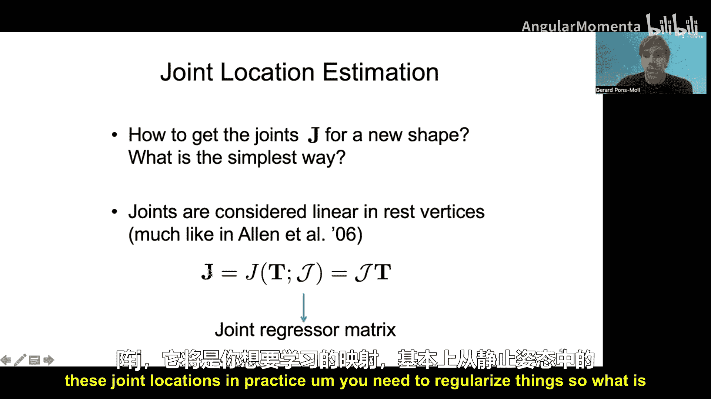

This this rotation matrix v sparse， this means that every joint location is predicted only as a few entries。

Of the full vertex。Mesh yeah。How do you make the matrix sparse Well you can include sparse regularizers like L1 on the matrix elements this will push a lot of numbers to go to zero which is desired so what you can see here are these lines that indicate which vertices are most active to predict a given joint location okay。

So also another regularization that is used in the simple model is to force the this sparse rotation matrix this sparse。

Joint Regress for matrixtri。To resemble a regression matrix that considers only the vertices。

At the intersection between two body parts right so basically you take two body parts。

 you consider the vertices at the interface and then you predict the center from this interface vertices and then you regular this matrix to use the only those vertices to predict the joint。

This is important to guarantee that the joints are not being pushed out of the body or。

Other weird things happen so this kind of regularizations。

Are very useful to make the model converge faster and to require less training data。Again。

 the more constraints or manually imposed constraints like this one you impose。

 the more you're biasing your model right and the more data you have， the less you need to do this。

 but in practice it's useful to set up a little bit of constraints in order to make the learning well behaved。

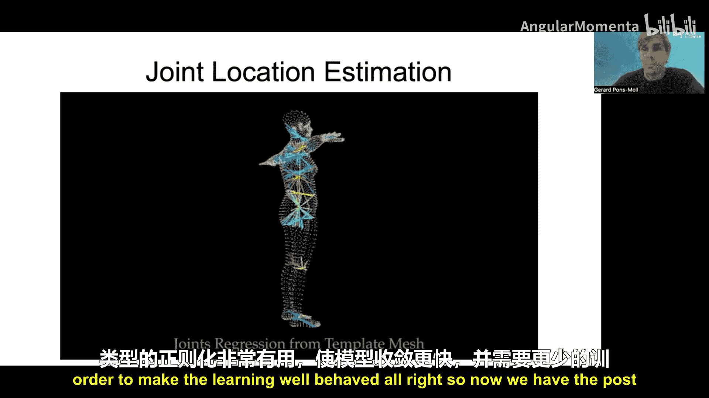

嗯。All right， so now we have the post contribution， we've seen how to model post blank shapes as a linear function of rotation matrix elements。

 now how do we add the shape space？So the shape space will be essentially like again。

 a linear combination of shape plane shapes， which will be obtained by doing PCA on a bunch of shapes in a rest box。

So basically you have like these SJs are going to be eigenvectors right which are going to tell us the directions of most variation in the shape space right once we factored out the post that's really important you have to factor out the pose and then you can do PCA on these veres on this meshes right in the same pose to obtain this shapeline shapes Sj right and now the betas are going to be the PCA components right that regulate these eigenvectors right that's what the betas are。

Okay， so it's useful to look at how a particular vertex in the simple model is transformed to understand。

That it's truly a almost linear model， and I say almost you understand why。

So essentially you start with some vertices in the restB theI bar， this bar means in the rest post。

 then you apply like a set of post blank shapes， this is like this displacement that you apply to account for post dependent effects。

Wwhich are I didn't mention this， but those effects are due to artifacts of linear blend skinning。

 but also for example， like effects like for example， my muscle bulging when I flex my arm。

And then we have the shape blank shapes， which model different identities， right。

 different body shapes。So all this is applied on this canonical space， all right？

And finally I apply the articulation， which is standard skinning。

 which is this linear combination of joint transformation matrices so this part is fully linear this part is not linear imposed because you have this exponential map here and this linear combination of transformation matrices。

And the kinematic chain and so on， but other than that， other than the articulation。

 this is a linear model。All right， so and this requires specifying these joint locations and we will see in the next lecture that this alternative formulations that do not require to specify the skeleton of the body right this is based on deforming triangles directly。

So it's essentially an additive model。Okay， so now we've seen how we parameterize skinning with bows and shape。

And。Now we've defined what is the mathematical model。

 but we haven't really like I haven't really told you how we're going to learn all those parameters from data。

So it's important to distinguish what I call parameters and what are hyperpara。

Parameterters are what controls the model。And hypoparmeters are。

All these parameters that also control the model， But you're at test time， right。

 you were not going to deal with these parameters。 mostly， we're not going to。Change them。

 they are going to be fixed。The input parameters are our design choice parameters。

 which are the pose in the shape， and these hyperparameter or model parameters are the template。

 which is the average shape。The shape line shape matrix， which is a matrix of eigenvectors。

The post blank shape matrix， which is this。Like matrix where every column corresponds to one displacement field that will be multiplied by each entry of the rotation matrices。

Then we have the blend weight matrix， which determines the soft segmentation of the body into partss。

 and then we have the joint regressor matrix， which regresses the joints as a function of the vertices of the mesh。

Okay， so。How do we perceive， What are we going to？Do with this。

 how do we set all these parameters well。Of course we need data and so essentially you need data of multiple poses and for this to train simple a multiple database was used of 20 males。

 24 females。With containing 1，800 registrations。And to model the shape space you need lots of people。

 again， very important all in the same exact pose。It's not that people were scannedt in the exact same post。

 that's not possible， people move right， people will have different ways of striking an apo。

 for example。You have to factorize out。Within your training model。

 you need to factorize out the posts you need to do with the so called and posing。All right， so。

The formulation will look some a little bit like this is a cross simplification of what the formulation for training simple is。

 but grossly you need to find the hyperparameters W。

 these are all these hyperparameters that define the model such that my model right for every training registration J。

You need to register the data， I didn't mention that。

 you need to register data because before you register the data it's very difficult to factorize vertices into pose and shape and to learn all these regressors。

 templates and vectors and so on this all requires registration because this is all based on linear algebra and if you don't have registration you don't have ordering if you don't have ordering you don't have vectors you don't have anything right you cannot use the tools of linear algebra。

So the first thing you need to do is to register the data。

And now let's assume that we registered the data， which is a very nontri problem by itself。

 especially if you don't have a model， but let's assume that you have these registrations。Now。

 the optimization requires to find the hyperparmeter W such that the model M。Right？

Oh here I missing theta J and beta J， the model for this pose and shape for this registration matches my data right and this summation goes over all the registrations that I have in my train right。

So essentially， what you need to actually do is the following you need to。

Minimize over all these hyperparameters， which are the parameters of interest。But to do this。

 I need to find what is the pose and what is the shape for every single registration。

 so we need to find the minimum here over pose and shape that basically minimizes the distance between the model which outputs vertics and the registrations。

 which are the VJs okay。So that's ideally what you want to solve。So when you have like。

A training problem or an optimization problem。 I always like to。

Write the objective you want to minimize。And then see if you can minimize that objective and if you cannot then start like you know。

 breaking it into parts， maybe you can optimize some blocks， some other blocks。

 but it's always good to have in mind。What is the target， right， what's the goal。

 what's the ideal objective function you would like to optimize？嗯。All right。

 so we could just do creating based optimization and try to find all these parameters。

 but that's going to be very tricky。 We have a mean here。

Which is going to make things tricky and there's a lot of interdependencies so this can easily go wrong。

But if you're careful you can train the model so being careful means like for example。

 like you want to train the post blank ships， the blend weights and the joint regressiongressor matrix from the multi post data set。

 the data set that exhibits different poses。You want to regular the post blank shapes。

 this is the post blank shape matrix， you want to regular them towards zero with rich regression。诶。

The reason for this that you don't want like very large contributions on the template mass because this might create some artifacts and might produce。

Some weird artifacts for new poses， not syndrome training。

You might regularize the blank weights towards some initialization which might be provided by an animator this is the case of simple like simple was not built completely from scratch but basically。

There was a template that had some blend weights sculpted by an animator and essentially like simple regularizers towards this initial animator set blend weights。

And you want the。Joint regressiongressor matrix to be regularized towards spae boundary centers and is forced to be sparse this is what I was describing before and the mean shape and the eigenvectors matrix as the plane shapes for the shape are learned from the multi shape data set and you need to be a bit careful you have to train first some parameters。

For the pose and then you have to find the shape space and then maybe you want to iterate this process a couple of times so in total you have like about if you do the numbers you have about six million parameters which is for a body model I mean this is a lot。

 I mean it's nothing compared to large deep learning models but still it's a lot of parameters。

Of course you would never set those parameters manually。

 but basically you learn those parameters and then they are fixed right and sure they take some memory but apart from this they are fixed and then you can use the model with the pose and the shape。

So， okay， so。Basically， once the blankships and the blank weights and the joint regressor have been optimized。

 the template and the shape blendships are obtained as follows。

 You accept all the registrations into。Canonical post， like what you can see here。

And then basically every shape is a vector in this matrix entry。Okay， and now you just do PCA。

 you basically write this matrix as the average T where every entry。

 every column is the average for that particular sorry。

 this is just the average over the data set and then we add this matrix where every column is an eigenvector okay。

And this multiplies this matrix of coefficients to obtain the original subject okay so we're compressing the information because this is going to be fixed and then we're going to just fiddle with these beta parameters to represent different identities right so t is the average of shapes these are the eigenvectors。

And。And。Exactly， so we're going to like。Discard like these like higher like the higher eigenvectors because we're going to see that a few eigenvectors are sufficient。

To represent the space of body shapes， because they will cover invariance in my distribution。嗯。

All right， so let's look at these eigenvectors。 So here we look at the bottom。

 we're indicating which principal component we're varying and notice how。Let's play this again。

 notice how the first component mostly changes the scale of the person。

 the second component changes a little bit the weight。

 and then other components change other subtle details。

And there is one model that is trained for the male part and one model that is learned for the female part。

There's also models that are learning the female and male model together。

 but that's essentially not a good idea because if you plot the distribution of。

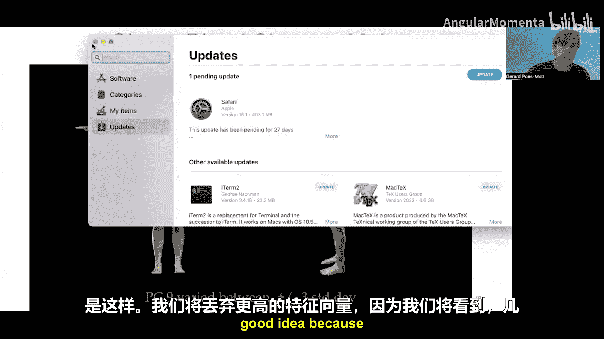

Of components， you clearly see two modes for the male and the female。

 so it's always a good idea to learn a model for males and a model for females。

This is the female model and you can see here on this canonical post。

 the effect of the post blank shapes， notice how they are a set of displacements that are applied to these canonical shape such that when the pose is applied。

 then the mesh looks realistic。

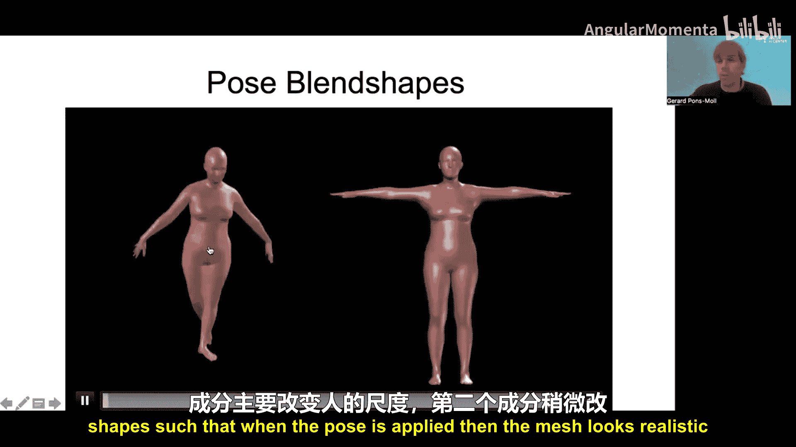

Okay， so this is a vertex based model and basically the key ingredients are that you apply 3D displacements plus an articulated kinematic chain。

And it's applied to vertices directly， there's explicit centers of rotation。

 and this is like what the simple model is based on。Is that the only way of building a body model No。

 there's other ways， for example， like a very popular model before simple escape。

 which worked actually very well and it was based on what I called theformation gradient so this means like you deform。

Not rotating vertices along joints， but uniform de every vertex of the mesh。

independently and then you stitch the pieces together and that's the basic idea if we have time we will cover a little bit of this deform gradients and howscape works。

 I think it's very instructive to know what was there before。

So the interesting thing is because you basically transform every triangle in the mesh。Independently。

 you have no center of rotation。which perhaps might be an advantage。

 but it's definitely less intuitive and less compatible with a lot of standard packages。

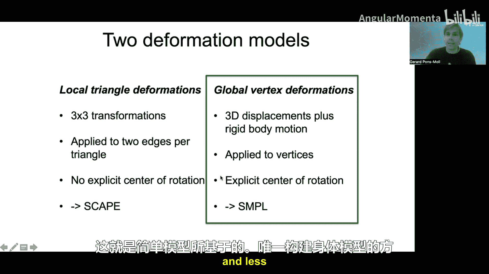

So you might wonder like how this compares to previous models and essentially in terms of realism it looks similar。

 but now the model is much simpler and more importantly you。

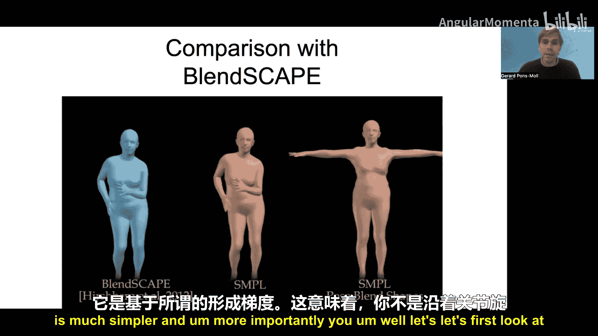

Well， let's first look at how we generalize this over。No。

 how no let's look first at how expressive the shape space is。 So what you can see here is like。

Like the post generalralization residual so basically you hold out some data for poses you have not seen during training and you compare models for a different number of shape coefficients allowed right the more shape coefficients。

 the better you will be able to explain the the left out data and so you can look at the mean absolute error and you can see here this is the simple model and you can see like here the blue line right which is like fitting the registrations better than the landscape model which is slightly above the improvement is not。

This is not huge。But it's significant right and one reason is that like the blankscape model has this teaching step which might you know modify the pose。

 it's more difficult to really nail a particular pose。But the big advantage is not this。

 the big advantage is how expressive the shape space is and this is seen by a cumulative variance so you can plot how much variance given number of components explain and you can see that if you。

Use this what I was calling like deformation gradients or deformations on triangles and then you PCA on that。

 you're going to need a lot of components in order to explain the variance and this is seen with this dotted lines here。

 notice that this curve goes。Very slowly up as you can see here。

 So you need like sometimes like as much as 300 components in order to cover like about 90% of the variance and with simple like with interesting parts that with a few components。

 you already capture a lot of the variance。And this is because it's a basically UA on vertices on vertex displacements。

 and this matches better like this。啊。Yeah， it much is better like this variant that you want to capture。

 right， this doing PCA in the right space。Okay， so in conclusion， we have that。

Simple has become since its publication very popular in both academia and industry and the reason is that it's fast。

 it's easy to use right and it's compatible with a lot of packages and the truth is that most people use a simple model but they don't really know how it works internally。

AndBut that's fine， right， because then once you have this module， you know it works。

 it produces meshes given pose and shape， and then you can do more advanced things on top。

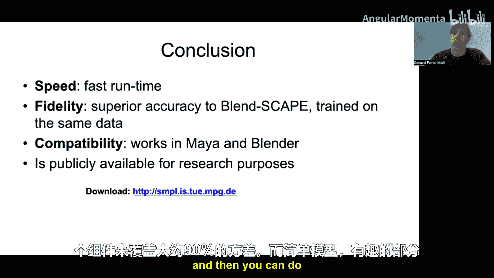

YeahU。All right now what do we do if we want to model other things like soft tissue for example。

 well using these vertex based models you can do this easily， you can add like dynamics。

 you can learn a set of vertex displacements which are a function of some parameters that's called it phi here。

 which is determine the soft tissue affirmations， for example。

 like and the original simple model extended a prior model which was called Dna which modeled soft tissue dynamics。

With this vertex formulation and yeah， the it's basically easy to add into the formulation you just need to add in this template。

Mesh like a set of displacements for the soft tissue。 So here I'm showing you the post blind shapes。

 which model this post dependent deformations in the middle I show the soft tissue deformations。

And on the right， I'm showing you these。Animated mesh where you can see that you have the soft tissue。

 which is also important for realism。Here I'm showing you a comparison of。

The actual registration of like a person like jumping around and here are the generalization results of what we call the the dimpo model。

 which is。A stands for dynamic multiperson new model。All right。

 this is as far as I wanted to talk about vertex based models。

 hopefully most of you have already been playing with a simple model。

 now you have hopefully a better understanding of the internals， how it works。And more importantly。

 I want you to like。Sort of start thinking what are the important ingredients in designing a body model and like to realize how some design choices are important and how some design choices make our lives easier it's not only about just gathering data sometimes just。

Having like the proper mathematical model will allow us to learn more effectively。

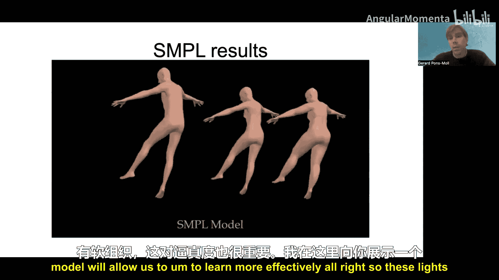

是。Al right， so these lights are based on the Siggraph 16 tutorial learning human body emotion。

 You might check this。 I think this tutorial is really good to understand the difference between。

Between theform gradient models likescape and。And vertex based models like simple。

And then you might want to read a couple of papers like the original simple paper。

 which is listed here， you might want to read a paper which extends simple to hands and you can see that the formulation is very similar。

 which shows that。The formulation is generic which is a good thing there's also like this two examples of these other kinds of body models which are based on the formation gradients。

 one is Dna which which is a S graph 15 paper and then this is the escape paper shape completion animation of people I forgot the year here。

 I think this is Sgra。2007 or something like that theM which also works very well but you need a lot of components for for describing identities of people all right that's all I wanted to discuss and I hope you enjoyed it and thank you bye bye。

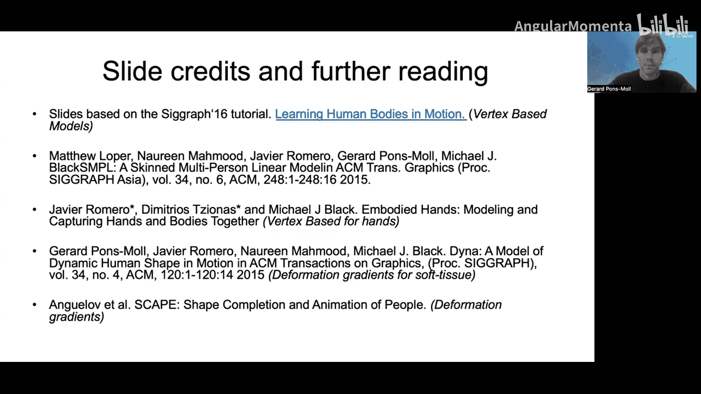