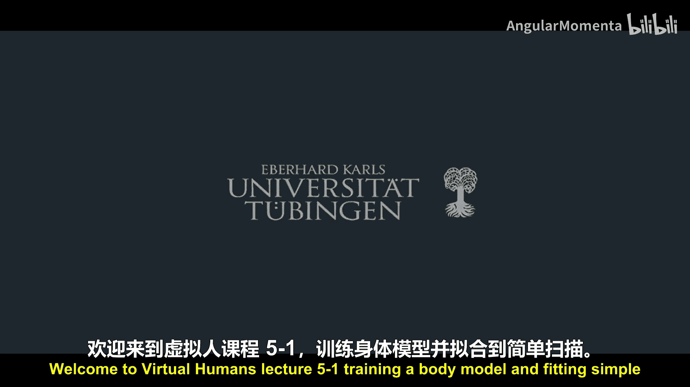
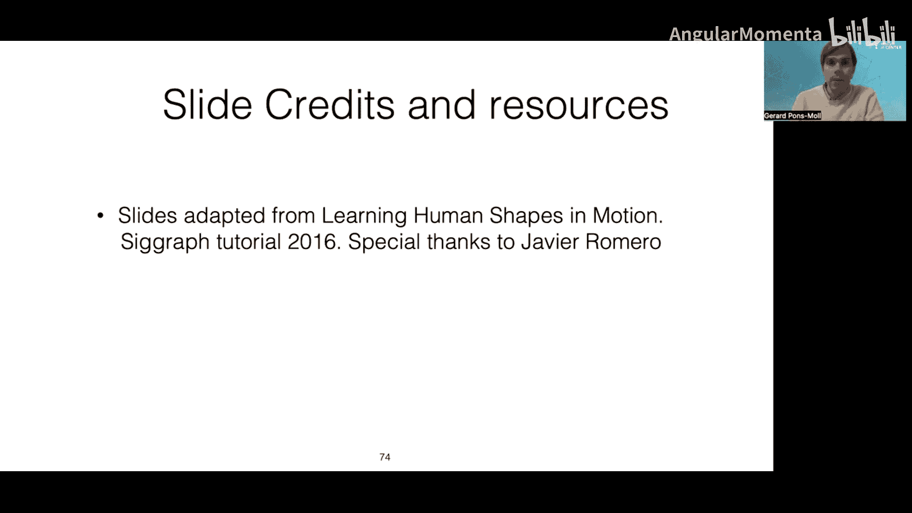

# 【精译】蒂宾根大学《虚拟人类》-p09-05.1-模型训练及将SMPL适配到扫描数据--BV1TAbkzpEva_p9-

Welcome to Vitual Humans Lec 51， training a body model and fitting simple to scans。

So the agenda for today is to first very briefly see another type of body models that are not based on vertex displacements。

 but are based on triangle deformations those are models likescape and landscapescape。

Then we will see how to train a body model。Either based on triangle deformations or based on vertex deformations。

We're going to see how to train these models from registrations。

And we're going to see how to obtain these registrations in the first place。

And we're going to see that this creates a sort of chicken and egg problem。

 and we're going to see how we can solve for the registrations and the model training at the same time or in an alternate fashion。

So in the previous lecture， vertex based models， we saw models that are based on applying a series of learned displacements on top of a base mesh in order to obtain the desired effects。

 changes due to pose， changes due to shape。We saw that these models are based on defining a skeleton and rotating body parts along joint locations。

There's another type of body models that are based on local triangle deformations。

The idea is to apply a series of three by three transformation matrices。

 which are parameterized with bows and shape to each of the triangles or edges of the mesh。

Those are models likescape or its extension Bscape。嗯。

The it is the same or the target is the same you want to。Be able to model pose and shape。

 But you're going to do this starting。As the base primitive with the triangles and not with a vertices。

So defining a triangle as。Like this vertices， t0， t2 t1。

 essentially like what what these models do is they first center the triangle at the origin。

And then they consider the edges， the two edges of the triangle。Is zero？In this case。

 this zero index， the first edge of the triangle， which is T2 minus t0。

Right one vertex minus another vertex and then e01。

 which would be t1 minus t0 this would give give us this h over here。And essentially。

 then you apply a transformation matrix， for example， like in this case， x0。

 which is3 by3 do the edges of the triangle。So this transformation matrix is specific to the triangle so that if now we consider two triangles like the green one and the red one。

 we would apply two different transformation matrices to each of the triangles。

X0 for the green triangle and x1 for the right triangle。And notice that the vertices。Like the edges。

 well they were colon before the transformations， after the transformations。

 they are not colon anymore。Which means that if we apply these independent transformations to each of the triangles。

We would obtain a mesh that looks like this。It's not connected。Because essentially。

 we didn't impose the constraint that the edges need to remain colonar and that the vertices should basically be shared across triangles。

So essentially in order to obtain a coherent mesh， one has to solve for the vertices of the mesh M here。

And you have to solve this least squares problem， such that。The edges。Of the mesh M， much。

 those edges that we've computed before with these triangle deformation matrices， x0， x1 and so on。

So here the matrix a is just a matrix， which is mostly zeros。

 and it will contain a one and a minus one in order to compute the edges from the vertices。All right。

 so。The problem of doing this list course step is that you're going to pay some cost and the cost is that you're not going to match exactly those edges the formations that these transformation matrixes are outputting。

But the basic idea is very similar to simple， you basically factorize the motion or deformations into a pose factor and a shape factor in order to control pose and shape。

And very analogously to the simple model， those models also have like something that are called like post dependent affirmations。

Which are encoded in a Q matrix 3 by 3， which is a function now of the pose theta。

And then shape the formations， which model shape identity the formations。

Which are now a function of data。And S， again， is a  three by3 transformation matrix。

And we have now the articipulation， which is modeled by this matrix B。

 which blends global transformation matrices。For every triangle and it's also a function of theta。

What is a bit counterintuitive perhaps is that there is no skeleton。

 there is no rotation about the joint， everything is our rotations in global coordinates and then like because all the triangles are then stitched together。

 then one can obtain coherent mesh。So it's instructive to look at the。

Models of the simple model and the landscape and compare them。 So if you remember。

 the simple model is purely additive。 It keeps adding components over the base mesh the bar。

Such that。Those vertices get transformed if we look at the blendscape model。

 it operates on edges instead of vertices。In addition， then the。

Po affirmations are in simple are basically a vertex displacement， which is learned。

 whereas here is a transformation matrix which is multiplying the edges。

And the same happens with the shape component and essentially to model the articulation we have here like this B matrix b theta and in the simple model we have like this linear blend skinning where it's clear that the joints are necessary to rotate along the kinematic chain of the body。

 whereas here there is no such。Skeleton。So these are the main differences。

 no joints in the landscapescape model， and this is a multiplicative model， whereas this is。

An additive model。Okay， so we've seen another kind of models we went。

Like we've covered this rather superficially， I just wanted you to know that there's other ways of modeling and factorizing bows and shape and modeling shape deformation beyond the simple model and verex based models。

What is important to note is that one of the reasons that simple is now so widely spread。Well。

 one is that it's very compatible with software packages。That's clear。

 but also like with very few components of the shape space。

 you can explain a lot of variant of what you observe， which are the vertices。

So when you look at the explained variance as a function of the number of coefficients and you comparescape like models。

 it's this curve over here dashed。With。SMPR models。

You see that very quickly SL can explain much more variance than the scale model。

 and the reason is that simple does PCA on the vertex displacements directly。Whereas inscape。

 you do PCA on the three by three transformation matrices， which is a。An own space in itself。

 So you're wasting a lot of。Capacity in modeling things that are not very observable in the final mesh。

Okay， so now comes the question of。I pick my body model。

 simple or escape or maybe you design a new one， but the question is how do we train this body model from data？

We said， well， we have scans of different people in different shapes in different poses and scans bring a lot of problems like they have missing data。

 theirre self contacts， they have varying topology， varying resolutions。

So learning from scans is difficult。So let's assume for a second that we have the registrations。

 we have somehow managed to register like a template mesh switch of the scans if we've managed to solve this problem first。

Then training the model becomes much easier。So assuming registrations， VJ。

These are the registrations which have the same number of vertices as the vertices that the simple model outputs m。

Then we can minimize the following objective function。

 which I briefly showed in the previous lecture， we want to find the hyperparameters of the model M。

 those hyperparameters in the case of simple would be the blend weights， the joint regressor matrix。

 the shape， eigenvectors and so on。The pose， the post blank shapes and so on。

So those are the hyperpar that we want to find and notice that maybe I will animate this so we want to learn those parameters from data。

And what we want is that the model is as close as possible to each of the registrations， J。

 so this summation notice that sums over the training registrations in the data。

But in order to minimize this， we need to find the optimal pose and。

Shape for this particular registration。So in order to minimize this loss function。

 we have to find the pose and shape for every registration。Okay。

 so that's not a particularly easy to solve problem because we have like an art mean and a mean inside and。

It's not trivial。But。We made a very strong assumption。

 which made the thing actually quite much easier than it really is。

And the assumption is that we assume a set of registrations， but in reality。

 we do not have these registrations。So how do we solve this problem？So essentially。

 we need to be able to go from scans or data to registrations。Because once I solve this problem。

 I can minimize the objective function or the loss function I've shown before and obtain a model which can output meshes as a function of pose and shape。

So we will see that this creates a chicken and egg problem because if I have registrations。

 I can obtain a model。And if I have a model， I can regularize this registration process and obtain decent registrations。

The problem is that you typically have to start somewhere and at the beginning you do not have registrations and you do not have a model。

 and so this creates a chicken and egg problem。But。Let's look at what we want。

 what do we mean by registration， and I think at this point you should already have a pretty clear idea of what we want。

So we want something like this， we want to take a template。

 the pink mesh in this case and we want to deform it such that it matches the scan as close as possible。

 such that now like we obtain a mesh that is coherent because it has a fixed number of vertices。

And we know that vertices will be in correspondence across a data set。

So essentially want to minimize something like this arc mean over the vertices of the registration。

 the pinking mesh。To minimize the distance between the scan， the green mesh and the pink mesh VJ。

So I will often use this notation of Ma V to denote the mesh。

 which includes the vertices and the faces。And math b B to indicate the matrix of vertices， okay？

So all right， so if we could just optimize this。Like optimize the vertices directly。

 that would be great， but things are not as such so ideal。So we need to basically。

Do non rigid ICP so as a refresher remember that for ICP we were initializing some initial estimate and then we were computing correspondences from the target scan to the source scan obtaining this corresponds X of J+1。

And then we were obtaining the optimal transformation。Pmet tries with us SRT with pro alignment。

 and basically here we were solving for the optimal transformation F。

 which in this case was a rigid transformation。And we would have to alternate between two and three until we obtain convergence。

So F， we saw that already in the previous lecture does not need to be a rigid transformation。

 could be anything， could be any deformation model for the verticesv。So the question is。Okay。

 we want to feed body models to scans of people。The question is， what should be F。So F could be。

 for example， all the degrees of freedom in the vertices V。Or if it could be the simple function。

 parameterized with bows and shape。So what do you think？Should we？

Attempt to optimize all the purchases V。Or should we use the simple model to。Reularizedp processosis。

Well， let's look at this and let's look at。In detail， what makes sense and what does not make sense。

So if we optimize the vertics directly， we have an objective function of this form。😊。

Minimization and here we're summing over scan points。

And we are minimizing the distance between the scan points and the mesh of the registration。

 in this case， the registration is this green surface and the scan is the pink surface。

Optimizing the vertices directly， just think for a second what would happen if if you let the vertices move。

To match the corresponding points。What's going to happen is going to be a complete disaster because at the beginning。

You're got to find some correspondences and basically the vertices will move like in an unconstrained manner and the solution will not be very。

 it will just basically break。You can use some priors like to， for example。

 like maintain smoothness over the mesh， but even with this。

 it will be very difficult to register the green mesh to the pink mesh。Instead， we could use。

 for example， like this simple model。And let's assume that we have some estimate of a simple model and we could basically minimize this distance。

 not with respect to the registration itself， but with respect to the model M。

 and then we would not optimize the vertices， but we would optimize the shape and post parameters directly。

Well， the problem with you do this is that the model does not capture the detail that you have in the scan。

Doess not capture， for example， like these fine details in the face in the hair and some parts of the body that are more detailed than what the model can express。

So in essence， it's a bit absurd to do this because if we're trying to learn the model from registrations and we're just constraining ourselves to remain in the space of the model。

 we're basically not learning anything new from the new scan that we're looking at。

So that doesn't make a lot of sense， especially for training a model。

So what you can do is something in between， you can optimize the pose and shape。

Of the simple model and。In addition， optimize these vertices， such that。

You want that the registration， V math V is as close as possible to the scan。While at the same time。

 this registration should remain close to the model。

And you basically optimize all the vertices V together with the pose and shape parameters。

 And what's going to happen during optimization is that the vertices will start slowly moving towards the scan。

 And the model is going to like， keep following this vertices， regularizing them。

 making sure that they look like a body model。But this ver is V。

We be able to deviate from the Model M。The question is， how much？

Strength you put in this prior versus。This dataator。

So let's look at this objective a little bit more in depth。😊，Okay。

So we have here arcmin over the vertices Vj and a mean over the poses and shape for this particular registration。

And so this objective function to or loss function to fit a model to a scan has a scan too me distance。

Has which we've seen that minimizes the distance between the scan and the surface of the registration。

We have a coupling term， which is coupling the registration to stay close to the model space。

We have a prior on the post parameters to make sure that you don't have very crazy articulations。

And we have a shape prior on the shape space to make sure that the。Mash looks like a human being。

So these weights here are relative weights that need to be set in order to obtain a good behavior。

In the optimization。And in fact， this setting these weights correctly is very important。

 so it's important to understand what each of these term terms is doing and we will see this next。

First， let's look at the scan to mesh distance。So we want to minimize the distance from。

Pointing the scan。To the surface of the registration。

And in order to be more robust to outliers and be robust to bad initialization when we're far from the scan。

 we can use what is called like a robustifier robust cost function in this case。

 this is a German McClure， which is quite popular in computer vision。

So here this row of x looks like this， it looks like this bali over here。

 so what this is saying is like this is x is the distance。

So what this is doing is that if you're close to zero。This。

Basically looks like like this shape okay so basically if as you get close to zero you're going to have a strong pool towards zero。

 but if you're further away you're an outlier and the distance is larger than some value。

 then at some point you start to pay like a constant penalty of one。

And this is very effective so that the outliers do not dominate the optimization。Okay。

So notice again， as mentioned in the previous lecture， we're not。

Finding point to point distances where minimizing a point to surface distance。So remember。

 we're not doing this。But we are rather doing this， finding for every point in the scan。

 the closest point in the mesh。Because this allows you to。

Implicitly shift correspondence during optimization。Allright。

 so I was saying that you need to couple the registration VJ to the model M and there's different ways of doing it。

 but two popular ones are， for example， you take the registration vertices VJ and you ask them to be as close as possible to the mesh to the model vertices M of theta beta。

And so here you minimize the L2， for example， like you have Frbinnus norm。

 so you minimize the L2 between those two matrices。Or if you care more about local surface structure。

 you could apply a matrix A， which is the same matrix we saw at the beginning。

So this matrix essentially extracts。Edges from vertices。

And so what this objective is saying is that you want that the edges of the registration look similar in orientation and length。

To the edges of the model。So they will have similar effects these two objectives。

 but they are a bit different。The first one cares about the exact location of vertices。

And the second one cares more about the local surface geometry。

So you don't care so much about where exactly things are in space。

 but you want that they look on the me and the intrinsic geometry that they look similar to each other。

So depending on what you want， you might use one objective or the other。All right。

 you need some priors as well for the poses and shape so that things don't go wrong and you can use many different priors。

 there's different priors in the literature and we will see some of them。

 the easiest thing that you can do is assume a Gaussian distribution and use a Mahallano distance。

So remember that you can turn。A likelihood maximization into a minimization by minimizing the minus log likelihood。

Which basically would。Get the term like the exponent would put it down and you will remove the sign。

 so you will obtain something like this。 So theta minus the mean times the covariance matrix inverse theta minus the mean。

So what this means is that if the Gaussian looks like this， it's stretched。

 you have more variances along one component。What this is saying is that basically。This distance。

 right along this axis。It's。It's basically as if this would be closer to the origin than it really is。

And this is to account for the fact that like you have more variance。

 it's more likely that you're a bit further away along the first principle component than it is along the second component。

 So this is like why you have this sigma minus one here， which is scaling and it's。

Taking care of also this。This， this， this angle。That you have in the distribution of poses or shapes。

All right， so now that we've seen this and we've seen that the weights are actually quite important what you can do it's completely legal to do this is like you can optimize the same objective function several times with different。

With different weights。And so basically at every stage。

You set different weights and you initialize the next stage with the solution of the previous stage。

So what you could do， for example， is start with。Very strong priors for the poses in shape to keep things safe and have a coupling weight that is really。

 really large。What is this doing， this is making the registration look almost like the model。

 it's like doing simple fitting to scans。And then in the other stages。

 you basically start relaxing the p， so basically you crank down the weight of the post prioror and the shape priorryor and you make the coupling weight a little bit smaller。

 still large to keep things safe and at the last stage you just deactivate the ps。

Assum that you're sufficiently close to the scan and you set the coupling weight to one just to make sure that things don't go completely crazy。

 but basically at the end you can obtain a mesh that goes beyond。What the current model can do。

 right that's the point of doing this registration。IfIf you do not go beyond the model。

 it means that this registration is not giving us any information。

In addition to what we already know。All right， so I've shown you that。Given registrations。

 I can train a model we've seen this a few slides before。And we've seen that given a decent model。

 we can transform scans into registrations。But the question is。

 how can I solve both problems at once？So。Essentially。

 this chicken and egg problem can be solved using techniques like block coordinate descent or expectation maximization。

The key idea is to minimize the registration objective， what you can see here。

 not for a single registration， but over a training data set of scans。So essentially。

 we have now a minimization of registration objectives across the data set of scans。

So notice this summation here sums over the different scans in the data set and we're solving for this registration objective。

And notice that now we still have this dependency on the post parameters。

 but we have also dependency on the full model parameters。 These are like the blend weights， the。

The post blank shapes and the joint regressor matrix， everything is in there。

And so now you have to solve for this。嗯。All these parameters in order to make the model。

Fit to the data and the registrations be close to the model。So this is indeed very involved。

 it's a very difficult optimization problem because there's many interdependencies。

But what you can do is you can basically。Optimize the model parameters phi。

 keeping the registration's VJ fixed。And in another step， you can do the reverse。

 so you keep the model fixed， model parameters 5 fixed and you optimize for the registrations VJ。

And reiterateerate this process until the registrations get better and better because you have a better and better model and vice versa。

Okay， so in summary， we've seen that。There's other models than the vertex based models like S based models are based on triangle deformations。

 and they require this teaching step that puts triangles together。

We've seen that training a model requires solving for hyperparameters and the shape and post for each registration。

We've seen that obtaining registrations requires a model and obtaining a model requires registrations。

And we've seen that this chicken and egg problem can be addressed with what is called core registration。

 which is this iteration of。Holding registrations fixed。Fitting the model parameters。

And then doing the rivers。Keepeping the model hyperpar fixed and finding the registration。Okay。

 thank you。 That's all I wanted to say about。Model training and registrations。

And these slides are based on the learning human shapes in motion。

 which is a secret tutorial we gave in 2016 and special thanks for the slides go to Javier Romero。

Thank you very much， thanks for listening。

