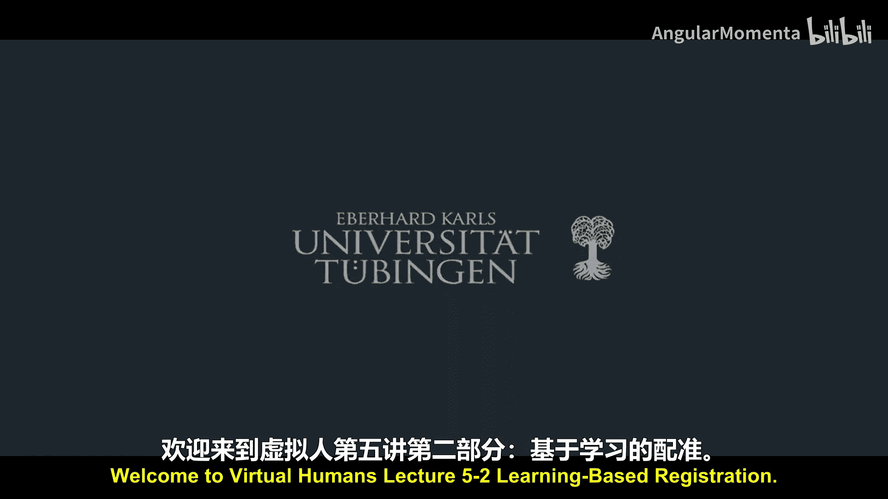
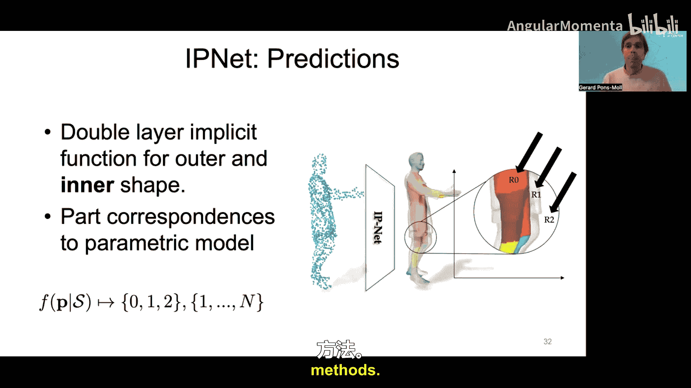

# 【精译】蒂宾根大学《虚拟人类》-p10-05.2.1-基于学习的配准-第1部分--BV1TAbkzpEva_p10-

Welcome to Vitual Humans Lecture 52， Learning based Reg。

So in this lecture we will continue with the exact same problem as before。

 this is given a point cloud we want to fit simple and deform simple beyond the space of the model to explain a given scan。

 this is what is called a 3D alignment or 3D registration。

And we've seen how to do this like in a classical sense by means of ICP and optimization。

And in this lecture， we'll see how we can use learning to make this fitting process more robust and more reliable。

So for this lecture， let me introduce a concept which is simple plus D。Which extends simple to model。

Details of clothing and hair。So remember the simple was adding a set of both blank shapes to model。

I'm sorry， shape B shapes tomorrow， shape identity。And both blank shapes to model。

 post dependent defects。And at the end， we were applying this kinematic chain。

Protations in order to articulate the body。Now， the problem of simple is that it does not。

Model clothing answer the question is how we can extend simple in a simple way to model clothing。

Well， the easiest thing we can do is to add a set of displacements D that are going to model personal details and clothing。

So essentially， you would go from an undressed body in the canonical pose。Two are cloth body。

 including hair and facial details。In the canonical post。

So notice that D here is not parameterized by any latent parameters like some parameters that encode the clothing。

 these are the full。Matrix of displacement， so this has a lot of degrees of freedom。

And essentially you need to be close to the data because this is very under constraint it's not fully a model of clothing。

 we will see how to do this in future lectures， This is just over parameterizing the model so that it has more expressive power。

By the way， this idea of adding a set of displacements here on the base mesh of simple。

 it's almost equivalent to this idea of letting the vertices of a registration be as close to the data while being close to the model because this allows this vertices to deviate from the model and that essentially has the same effect as adding a displacement field on top of the。

Simple model with D， so these two models are these two formulations are very much equivalent。Okay。

So we motivated finding registrations as a key ingredient to train a body model。

And we saw that in the previous lecture。However， there's other applications beyond training a body model that require fitting simple and in particular computing registrations from scans。

So for example， if you want to find the correspondences between two scans so that you can identify different corresponding parts of of different。

Bod parts what you can do is you can feed a single template to each scan such that you're implicitly creating a correspondence map between the two scans because you can always go from one scan to the simple template and from the simple template to the other scan creating。

Correspondence loop between the two scans。So that's one way of obtaining correspondences by fitting simple to scans。

You might have a stream of depth data coming from Connect and you might be interested in tracking the body and shape motion from this depth stream。

 this is basically a frame by frame registration problem。Or for example。

 you might be interested in taking a scan and animating it with a skeleton。

 and in order to do this you need to fit the simple model to this point cloud。

So all these applications require fitting simple to scans， and that's why it's an important problem。

And we will see in this lecture how to do this effectively and how to learn some bits of this registration process from training data。

Yeah。So。We've seen that fitting。Simple or in this lecture we refer to simple plus D2 scans using ICP requires solving an objective function that looks a little bit like this。

So essentially this was。Having different terms and what is important is to notice that this term。

 which is called the scanto me distance。Essentially， computes。The distance between。

Every point in the scan airs。To every the closest point in the registration。

And this essentially requires finding closest points。In order to minimize this objective。

 you need to do some sort of ICPA alternation between finding correspondences， step number two。

 and finding the optimal transformation。We saw that in two lectures ago。

 like that this is called the ICP algorithm and by now we should not be surprised。

If I tell you that ICP。And。Can get stuck into local minima。So basically ICP computes closest points。

 which can be wrong， for example here， notice that this is the result of running ICP to fit this simple mesh to this registration and notice that the legs in the point cloud are crossed and in the registration they are not crossed。

Or for example， here， the hand is not really matching the hand of the point cloud。

 And the reason is that the hand points of the point cloud are most likely matched against the hip points of the。

Of the the mesh， and therefore you have wrong correspondences and you have some parts of the model that are explaining the wrong parts of the data。

So by now we should not be surprised and we know that finding nearest points and using those correspondences gets stuck into local minima。

So we're going to see like how。We can use learning to improve this registration process。

So in particular， we're going to see two types of models。

 very briefly nonparmetric models that don't use a simple parameterization and parametric models that use a parametric model like simple。

 but they use training data and deep learning to learn the correspondences from the point cloud to the template of the simple model。

There's a third approach that are what I call hybrid， this is a very recent work。

 which we call like learn vertex descent。hich is neither， and we will see these in future lectures。

 but not in this lecture。So let's start with this。Nonparmetric model。

 So what's the simplest thing you could do， You want to find correspondences or you want to fit like a template。

To an input shape。And so what you could do is to encode the point cloud into a。Vectctor features。

In this case， is this epsilon of S。And then now， given a template and a vector of features。

 you can train a decoder that will predict the vertices。In their location。

 such that they match the input shape。So this is a very direct approach where the network needs to directly predict the vertex positions。

Now。If you want， you could think that the network is essentially。

Playing the role of the formation model for the vertices。

 this F that we've been talking about that deform the vertices to get closer to the data is now encoded by a neural network。

Now， this produces results that are。Better than ICP for humans because it's learned from data。

However， this gets stuck into local minima and you need like at least100 global rotation initializations in order to make this learned model converge。

This model cannot get details from the data and the resist template is not controllable because it's not the simple model。

 you cannot pose it and shape it。 You could compute a simple model from it relatively easily。

 but it's not directly controllable。So one obvious。Thing is like， well， let's try to。

Still keep this learning paradigm， but bring the prametric model more into the equation。

So by the way， one of the reasons that this like model here does not converge so so nicely is because the network。

Here has is using global features。For this input shape， and it predicts all the vertices at once。

 and this is a very hard learning problem。It's very difficult for the network to know。

How to predict all the vertices at ones。Um， without making more local reasoning because you need a lot of training data of many different poses in many different shapes in order to generalize well。

We will understand these concepts a bit better when we see the difference between implicit surface reconstruction methods and explicit ones。

So one question we pose here is， can we learn to fit the simple model to the data and？

Can we preserve high frequency details if they are present in the data？Because if we can do this。

 we can make scans controllable and also very realistic。

So in that work that we presented I think one year or two years ago。

 it's called combining impmplicit function learning and Parametric models for three human reconstructionstruct。

So the goal is clear we want to get an input point cloud and we want to be able to control the input point cloud with bows and shape。

 and for this we of course need to register like a parametric model to this point cloud。

So at that time， like the implicit surface reconstruction methods based on deep learning were starting and it was。

Understood that they were much better at preserving detail than the explicit drug methods。And again。

 we will understand this better， but just the intuition now is that these implicit drug construction methods。

They basically。Make predictions of where the surface is inside and outside based on very local evidence。

And this allows you to drain。With data and the network needs to only look at local patterns in order to make decisions。

And this allows you to capture better， like fine details because you don't need as muchs data because essentially you're making very local decisions。

So the high level of idea of this model that we call eyeNe is to combine like implicit reconstruction。

 which allows to capture details and。Simple model fitting。So。Obviously， you might ask， well。

 why is this a good idea？Well。😊，嗯。As I said， like implicit through construction methods are learning based methods are better at capturing details and they can handle arbitrary poses。

Whereas parametric models are not very good at capturing details because as soon as you go outside of the parametric space。

 yeah， you cannot represent this。And generalization to complex poses is also difficult because you need a good initialization。

So essentially， the main problem of implicit reconstruction methods is that they are geo static meshes。

And you cannot do much with static meshes because you cannot change the pose and you cannot change the shape。

And barmetric models like they can be reshaped and they can be reos。And so it just makes sense to。

See if we can combine the best of both worlds here。And this is the basic idea of eyeping it。

 like can we get an implicit reconstruction and from the implicit reconstruction somehow turn it into an explicit one by fitting the model to it。

So of course， the challenge here is that。This problem at that time， was relatively。嗯。Well understood。

 basically there were good models to predict。Implicit surfaces from point clouds。And for example。

 like methods that from my group and also other groups like like IF nets or NDFs。

 neural distance fields or implicit feature networks。We turn a point cloud。

Complete or incomplete or sparse or denser into a continuous implicit surface。

But the question is how do you then fit a simple model to it。

 it seems like you're turning a point cloud into a surface and then what's the game I still have to solve the registration problem。

So the main problem is that ICP gets stuck due to bad correspondences and due to the fact that the simple model cannot represent cloth and hair and so on。

 so its the objective is not well minimized because the model cannot explain the data。So in IpiNe。

 there's two key ideas， one is to predict simple as an implicit surface to make fitting easy。

So it's sort of going the other way， like you go from a cloth niche。Into an undresss mesh。

 what we call the inner surface， such that this surface looks much more similar to the simple model than before。

 So essentially， now the fitting process will be easier because implicit surface doesn't have clothing doesn't have hair。

 doesn't have these difficulties。And then fitting will be easier。

And the second idea is to predict correspondences rather than using nearest points。

So how do we do this？We train a network that consumes point clouds and there's different networks to do that。

 but one popular one is based on iss called pointNe。And essentially， at the high level。

 what it does is it processes。The points the same way as a convolutionional neural network processes pixels。

 and then you extract features from this and from these features。

 then you can decode them into predictions。So here what we do is like we train an implicit surface network that will predict three layers。

One here is the inside of the body， this is the undresssed body。

And another layer that corresponds to the or not layers，'s let's call them regions。

 There's one region， which is the inside of the body。

Another region that is in between the body and the clothing and the second region。

 which is basically outside of the clothing。And you can train the network to predict for every point in space B。

Like whether it's inside the body， whether it's in between the clothing and the body or whether it's outside。

And in addition， you can predict for this point to which of the n parts。This point belongs。

And you can make these predictions for all points in space。

This is what is called like now goes under the name of neural fields networks and the reason they are called like this is because they make a prediction for every point in space and we will see that this simple idea actually turn out to be quite powerful。

We will see this in a future lecture。Where we see neural fields and implicit surface reconstruction methods。

