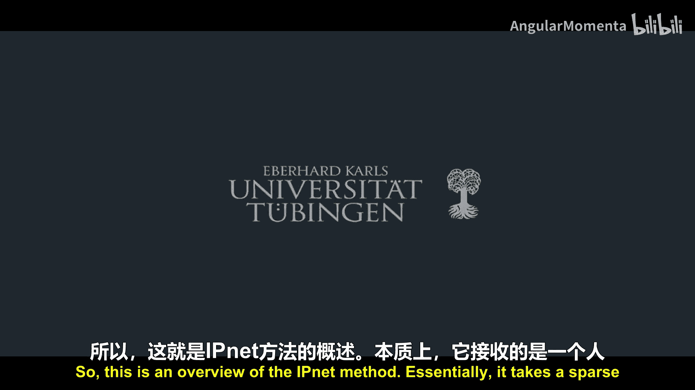
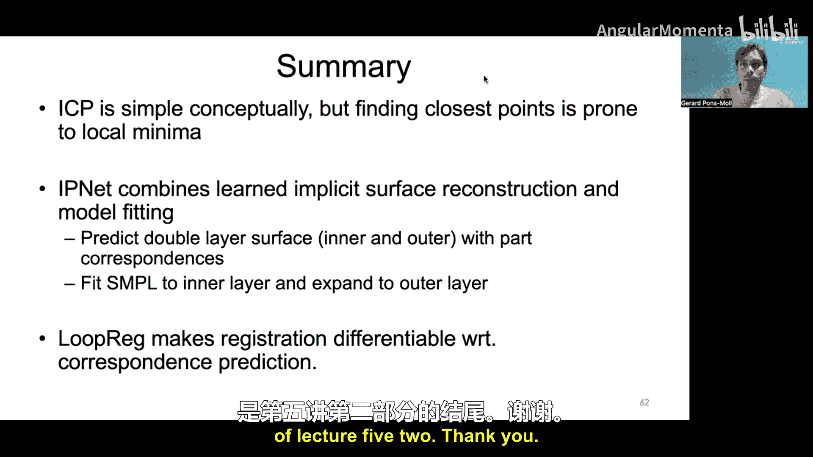

# 【精译】蒂宾根大学《虚拟人类》-p11-05.2.2-基于学习的配准-第2部分--BV1TAbkzpEva_p11-

So this is an overview of the IPNe method， essentially takes a sparse point cloud of a person which might be wearing clothing and it might have hair and facial details。

And it predicts two surfaces represented implicitly， one is the surface of the inner body。

 which essentially it's a surface that does not contain clothing and it should resemble like the surface of the simple model and it also essentially predicts per part body part labels so that the fitting process is easier。

Then on the bottom we have like the full surface including clothing and hair and so the idea behind these two predictions is that now because the upper surface looks like like more like the simple model the fitting process will be easier so it will be easy to fit like a simple model to the surface because it has no clothing。

 no hair and also we have the parts labels to make the fitting process easier。

And then basically once you're on the ballpark， you can easily deform the simple model to explain the rest of the details obtaining a surface that represents the outer part。

And now because we have registered the simple model to the other surface。

 we can change the shape and change the bow， which was one of the main goals of。Of this work。

So let's look a little bit more in detail at how the optimization and the predictions work。

So essentially at test time we leverage the neural predictions in order to make registration like better behaved so essentially we have like an energy or loss function that depends on the pose on the。

Bows on the shape and also on like some free form displacement。Vectctorors。

 which represent like clothing and so on。 and essentially we have to。

Minimize the data term which matches the simple model against the body surface predicted by IPNe。

And we have another like objective that matches parts on the simple me mesh to parts predicted by epiet and finally we have a applaian regularizer this is ensuring。

That the reconstructed surface is locally smooth。So looking at the data term， we have。

It's a bidirectional matching objective where we have like the classical。Objective based on ICP。

 which is basically minimizing the distance between vertices from the target surface in this case。

 is the body surface predicted by eyeet。And the model that we're fitting。

 and we also have like a reverse matching objective matching from the model。

Like to the I net prediction。Alright， so this is more or less standard。

 The only thing is that this will be。Easier to fit compared to the original point cloud because first of all。

 this predicted surface as in is dense and also it doesn't contain like clothing and other details。

All right， so let's look at this part objective， so it's very useful to have parts because then essentially you can make ICP easier。

 you can basically match part by part and this is basically what this summation is doing it's summing over the simple parts。

And then for every part， you sum over the predicted body vertices and you minimize distance between those vertices and the model。

 but we only consider correspondences on the model。For that particular part。

And this is what this delta is indicating it's indicating which part of the model we are matching。

 so for example， if you're matching the upper arm like you're only considering like a matching between the upper arm of the E eyeine net prediction and the body model。

And yeah， so basically this is the result that you can obtain。

 you can like obtain like a partial point cloud where， you know， for example。

 like the back part of the person is not visible， but using a rural reconstruction method。

 you can basically， as you can see here， recover the full surface。

If you would try to attempt directly， if you would attempt to fit the simple model directly to this point cloud。

 which is partial because it's oluded。It would probably not work very well。

 you see that there's a lot of missing data， but if you first have the rural reconstruction and and then you predict the also the otherer surface。

 then you can do this process of fitting the simple model first to the inner part and then to the other part to obtain a registration like what you can see here which。

I'm prettyty sure it would not be possible by just fitting directly in a classical manner to this point cloud here in the input。

All right， and essentially this allows you to like fit the simple model and deform it and then basically you can you know change the pose and change the shape of this registration。

So essentially like you can also apply this method to other shapes beyond humans like for example。

 hands， so this is the neural reconstruction of the hand and this is the fitting of the monomod which is an equivalent of simple for hands like the fit to this reconstruction and like this you can recover a full complete hand from a partial point cloud。

So this is one example of。A combination of a neural reconstruction based on implicit surfaces and more classical model fitting。

All right， so。What does learning bring over ICP well like the learn correspondences are more reliable and just nearest points。

 it can complete and dennoys the input shape and it can remove detail that makes fitting harder like closing and hair and essentially like fitting to a partial point cloud is very hard with ICP right？

So these are the advantages。The problems are that basically like to obtain these surfaces that I was showing these intermediate results。

 you need to run marching cubes to transform an implicit representation into an explicit one。

And this is computational expensive and it's a process that is non differentiable。And essentially。

 the correspondences are not differentiable with respect to。The fitting process， right。

 so every time we need to when we're fitting the simple model to these noodle reconstructions。

 we need to。Update the correspondences during the fitting process with the ICP algorithm。

So essentially， we need to do like this sort of two and three steps， finding correspondences and。

Finding the optimal simple transformation。So one question that one might ask is， well。

 can you make the correspondences differentiable so that you don't need to keep updating the correspondences。

 but somehow you have some。Optimization variables that are switching the correspondences for us。

And in a way that we can just do like gradient descent or some other gradient based algorithm to minimize the objective。

And also can we remove the expensive marching cubes computation as an intermediate step？

So we addressed some of these challenges in a paper that we published at Nu Ris。

 which is called Luubreck self supervised learning of implicit surface correspondences。

 both and shape for 3D human mesh registration。So here the goal is， again。

 the same exact goal as before， like we want to obtain a registration from a point cloud。But。

We acknowledge that the problem with classical fitting is that you minimize an objective of this form where you're minimizing over the correspondences themselves and x。

 which are the model parameters。So truly like we didn't write it this way before。

 but truly you really are optimizing over these correspondences right between the scan and the model。

 this case， the model is M。And the model parameters。So to get the correspondences， well。

 you have to find key points or find closest points or use a pretrain network。And。

And this is step number one， and in the step number two。

 you have to optimize the model parameters in order to minimize this objective and you have to iterate one and two。

 which is basically the essence of classical ICP algorithm。

But we've seen that this is prone to local minima， it's not N to end differentiable。

 and so this is suboptimal。So we've seen how like using neural reconstructions。

 you can make this process a bit more reliable， but still like the question is whether you can push this further and have a formulation that is more integrated。

So this is what we propose in this work， which essentially。

We are optimizing over model and correspondences without supervision or with self supervision。

So essentially we consider a network F of phi that maps from every scan point to the corresponding model point in the surface。

And to represent the correspondence on the surface of the body。

 we consider this human mass in a template tippot such that we want a mapping that will take every scan point。

And predict the corresponding surface point。On this canonical shape and by service point M。

 this is a 33 dimensional point in this canonical space。And now the idea is that， well。

 can we if we have such a mapping， we could using the simple model。

 bring this point M forward with the model and like empty takes here a point and the model parameters x。

 so x would be encodes the shape and pose， it's a more compact notation。

And then basically this point deforms to explain the original scan point。诶。Where we started。

 so this creates a loop because it just goes backwards and forwards。

And loops are interesting because if you have a loop， you can self supervise it。

 you you know that it should be a close loop， so one constraint you have for the learning process is that。

If you compose the mappings， you go from S to M and from M back to S through the simple model。

 this thing should basically close。So this is not as easy as it might look because you have a number of challenges。

First can we jointly train the network and optimize the model parameters without any supervision that's one question and how to do it is not so clear。

How do you ensure and this is a tricky one， how do you ensure that the correspondence predictions lie on the model surface if I train a network？

To predict from every scan point， a three dimensional point。I mean。

 how can I guarantee that this three dimensional point actually lies on the surface that's really difficult to do for a network to make predictions that lie on a manifold because the network will spit out three numbers and to guarantee that these three numbers are on a manifold is difficult。

And three， how do you actually integrate this correspondence prediction with model fitting in a joint training process？

So let's look， so the self supervised loss that we have here。

Basically like optimizes over the network parameters file。these network parameters。

 these network processes like point clouds and then like basically based on the process point cloud。

 like it predicts for every point in the point cloud like a correspondence on the model M。

So you want to optimize over network parameters and also all the model parameters for every single scan that you have。

 this is very similar to when we were fitting， we're optimizing training the simple model we have to optimize for the bows in shape for every registration。

So we have that。We have a summation。Over the training data points。

 registrations in this case or scans from J until N and then for everyone for every scan we have like this。

Minimization， which is basically minimizing the distance between scan points and corresponding model points。

 which corresponding model point， well， that's Mk。 So now this Mk will be predicted by the network。

 So we have this F of phi of S I is predicting the correspondence for us。

 the network predicts the correspondence。All right， so the question is。

 why not learning this directly？Well。One problem is that again。

 the network can predict outside the manifold， so this will be a problem because like I don't even know how to plug this point into the simple model because the simple model is not defined for points outside the surface。

So this is basically what we define here， the simple model。

 it's a function that takes points in the rest pose m and some pose and shape parameters and maps them to a transform space m prime。

 but the points need to be on the manifold so what do we do if f of phi of s actually does not lie on the manifold。

The benefitfold them in the surface。So here we have a problem because we are plugging into this function M。

Which is expecting points on the surface， points that might be out of the surface。So one idea。

 this is actually what we do is we can diffuse the simple function。To the full space around it。Okay。

 and you can do this with a distance transform， so the simple model at the end like tells you for every point in the surface how it will differ。

And so what you can do is do a distance transform such that， you know， for this point。

 this will beform according to the function which is defined on the surface。

 which is closest to that point。So you could think of this distance transform as diffusing the function that is defined on the manifold。

 is diffusing it towards the full 3D space。So essentially that's the idea you diffuse the simple model beyond the surface。

 obtaining a new mapping that maps points in 3D space and 2 deform points in the post space。

So this is a mapping from surface to surface。And this is a mapping from 3 d points in space to deform 3D points。

Okay， so we also don't want that the network keeps predicting points further and further from the surface。

 we we actually want the network to be accurate and predict actually on the surface。

 So we also impose like a lagrangian constraint to force predictions to lie on the manifold so you can easily。

Require this by imposing a penalty， saying that you want the distance。

To the manifold to the surface for that predicted point of the network to be as small as possible。

So essentially now we have like this。Modified equation where we have the scan point and this G function。

And we additionally want that the prediction F phi of S。Is as close to the manifold as possible。

 or in other words， we want that f of phi of S is on the zero level set。Of this distance transform。

 so that's why when this guy is zero， this energy here。

 this L self will be minimized for this penalty。All right， so now we have an interesting。

Objective function， which is very。It's very clean and elegant because I can take gradients of this function with respect to the network parameters and with respect to the model parameters。

X， and so I can。Optimize over a network that predicts correspondences and over the particular poses and shape parameters of every training registration。

And what is interesting is that here， like minimizing this energy does not require labels in other words。

I don't need to pair data off point clouds with their corresponding locations。

I can train this by just closing this loop。Now in practice， things are not as beautiful as in theory。

 so you have to bootstrap the process by using a bit of supervised data and then using this objective you can add more scans in the training process such that this correspondence predictor gets more and more accurate。

And this is what you can see here， like in this plot， like you have two error metrics。

 the vertex to vertex。And this can to surface to surface metric。Obviously。

 the vertex to vertex matrix is a more demanding one because you need to predict not only like the surface correctly。

 you need to predict exactly where the point should lie right when you're fitting the registration to the scan。

And so what is interesting here is that we're plotting the amount of supervised data。

The amount of unsupervised data that we're adding into the training process。

 so we start with a number of scans， I think it's like about 2000 or something like this。诶。Sorry。

 1000 scans， a supervised training set， and then we complement this supervised training set with unsupervised data and we keep increasing from0% this would be only supervised data to 10% until 100% of the data and so you can see that the error decreases significantly。

 which means that know by adding more and more data， the error keeps decreasing significantly。

 although we're not using any additional labels， we're just using the raw scans to make this whole fitting process more and more accurate。

Yeah， and basically we compare this luric methodology to previous state of the art methods and particular it's interesting to see the improvement with respect to this 3 decod。

 which is a supervised method and。Yeah， and so this produces quite accurate results。

And so one reason is that were leveraging this self supervised loop。

 and also we are combining like the best of neural correspondence predictors and then classical model fitting。

Okay， so basically in summary。Again， like by now， it should be clear that ICP is simple conceptually and it's useful。

 but finding closest points leads very often to local minima。

I presented two methods to or two methods in depth to combine learn implicit surface。

 reconstruction and model fitting， and we see that this it's a powerful combination and we're still using it for different problems and to model for example interactions。

Just to recap like IPNe is based on predicting a double layer surface for the inside and the other part of the surface。

 and it also predicts correspondences as discrete part labels。And then basically。

 you can feed the simple to the inner layer and expand it to the autoer layer to obtain good results。

And then we've shown that an even more elegant formulation is luuprec。

 which basically differentiates with respect to the correspondences and the model parameters jointly。

 and we've seen how adding more and more unsupervised data like leads to benefits and more accuracy。

Thank you very much， this is the end of lecture 52， thank you。

