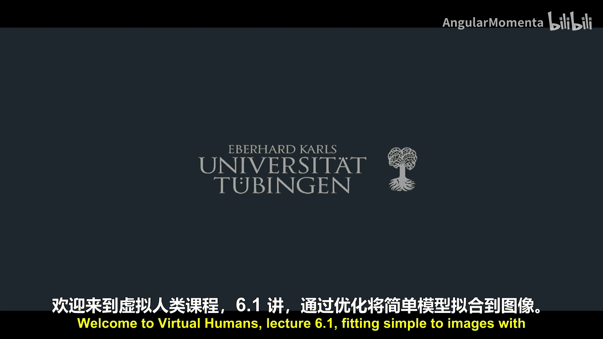
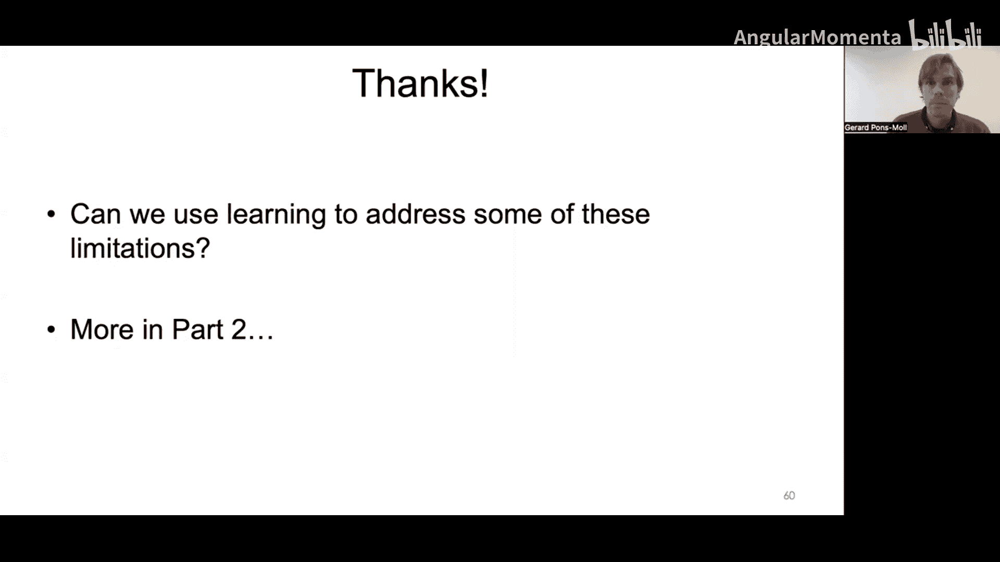

# 【精译】蒂宾根大学《虚拟人类》-p12-06.1-通过优化将SMPL适配到图像--BV1TAbkzpEva_p12-

Welcome to Vitual Human Lec 61， fittingtting Sim to images with optimization。

In the previous lecture we've seen how to feed models into point clouds in order to obtain correspondences or track humans from point clouds。

 for example， like this would enable like tracking people from input coming from a depth camera。

Or for example， like this would allow us to animate scans by fitting the model to the scans and then controlling their shape and pose using the underlying body model。

 So all of this is very useful and it's true that point clouds are a very common。

Input that we might find because it's the output of many computer vision algorithms。

 it's typically an intermediate output。Um。But if we want to be more general。

 we should be able to estimate the body shape and pose from single images。

Most content in the web is still to the images we take。Lots of pictures。

 there's lots of pictures in the internet and many times intelligent systems and robots are equipped only with single cameras。

 so it's also important that we are able to solve this problem how do we infer human bows and shape from a single image We will see this is a much harder problem。

So the goal here is given an image of a person where we do not know anything about the scene。

 we do not know the camera， we need to estimate the body shape and the pose of the human in 3D。Yeah。

So this in some way allows us to see people in 3D， it allows us to understand the scene because if we know the pose and shape of people。

 we are somewhat understanding what people are doing in the scene， at least at some level。

So classically like there's been two approaches， so historically there's been two approaches to this problem the first is。

ussing discriminative models， so essentially you' train a model that given pixels that the input is capable of producing like a 3D surface of the human or the parameters of the human。

Like this is a direct learned mapping。that you could learn using training data。

 we will see some of that in the next lecture， the other approach is like the generative approach where you're you have a body model and you attempt to explain the image evidence by fitting or optimizing the monopars in order to explain the image evidence。

And this is going to be the focus of this lecture on this generative approach to estimating human poses and shape from images。

So first of all， let's convince ourselves that this is a really hard problem。So first of all。

 like the human has many degrees of freedom， the pose is a very complex space。

 you have high dimensional space， but the manifold of valid poses basically。

 it's just a subset of these combinations of parameters。

The types of variations are huge because you had you can have different skin color， different。

Clothing， different backgrounds， different。Scears， different poses， different interactions。

And so this makes the estimation very hard。So。Also another problem is that now we do not have a point cloud of the person。

 we have like just pixels and pixels we saw that is basically a linear projection in linear perspective of the 3D world into into an image。

 so we are losing depth。And because we're losing depth。

 we have basically one third of the degrees of freedom， at least are not directly observable。

So this is very well illustrated by this video， which illustrates that essentially you can have many configurations of 3D poses in 3D that project to the almost exact same 2D projection。

So let me play this， so on the left you see the projection of the model and on the right you see the different three deposits。

And notice that the projection barely changes while the 3D drastically changes。

 and this is because you have this depth ambiguity that there's multiple poses that project to the same exact image and this makes the problem really。

 really hard。So。You know， when we have a hard problem。

 we need to leverage priors because there's not enough image observations。

 there's not enough evidence in order to。Etimate the pose in shape。

 but we know that humans have a fixed kkeletal structure。

 we know that there's only certain types of poses that are plausible。

 we know that the motion is mostly articulated， we know that the human shape is roughly symmetric and lives in a subspace。

So what can we do too？Leverage this information。Well， we need a body model， I hope by this。

 like all of you immediately thought about this。So。

I showed in the very first lecture that people used those sorts of body models and it's interesting to see the progression of body models over the years。

 and so we had body models that were based on a collection of parts which were based on like some geometric primitives。

People like extended these body models to 3D using eipoids or super quadrics or Gaussian blobs。

And then basically attach a kinematic chain to these models and then they would track。

People in images using these models。Many times this required building one body model per subject。

 so for example like these are some of the works including some works that I did during my PT thesis。

Wwhichch required scanning the person inserting a skeleton typically manually and then basically using an algorithm to rig the measure that you could articulate it and this was a very lengthy process and not very scalable because every time you had a different model for a different subject so you could not even like very easily leverage you know and transfer poses from one subject to another you could to some extent but it was not a uniform model。

And nowadays， all this has been replaced by the simple model， which is。

 you could say is a de facto model for human pose and shape estimation from images。

All right so let's look at the problem formulation， we have an input RGB image。

 that's the input and we want to estimate the model parameters and if you're using simple this means the pose。

 the shape and optionally the camera parameters， the camera means like the pose of the camera relative to the human body。

别害。So a few years back。Let's say about 10 years back when I started my PhD people were formulating this like probabilistically。

 so they pose a problem as a problem of map inference or estimating the maximum a posteriory。

Of the model parameters right in this case theta and beta like given the image evidence。

 this is like the input observation， for example， like an RGB image and you turn this problem into a likelihood times the prior so the likelihood is basically this explaining like the image so essentially you want to measure how likely the image observations are given some model parameters x and then you have some prior for example on on the shape of the person or the plausible poses and this is something that you can learn or construct before you have seen the image evidence。

So how do you model this likelihood in these generative models？

I should have mentioned the discriminative models， they basically learn a mapping directly from image to X。

And the generative models like essentially try to maximize this likelihood times the prior。

In this lecture， we're going to focus on generative models and the question is how to model this likelihood。

 how do you model the probability of or this posterior。

 how do you model the probability of model parameters given image。So there's two main approaches。

 so one is using optimization and essentially you this is equivalent to finding the map estimate of the posterior right。

 the maximum posterior estimate。And the other approach is to not use optimization， but use like。

Like basically you could say like by easyian optimization where you approximate the posterior with weighted samples。

 so you have a bunch of hypothesises for the parameters x and every hypothesis is like weighted by a number that determines how likely this pose is。

Nowadays， almost nobody uses this approach because for high dimensional spaces。

 you need a lot of samples and this is not very efficient。

Although maybe these models could be revisited now with the power of with GPUs and so on。

 but nowadays most approaches for this generative approach， they typically rely on optimization。

So let's look at how this is done and you will see that they decompose the posterior as a likelihood times the prior。

So the general framework typically involves these three steps。

 so one is extracting features from the image。Then is predicting these features with the model so here。

The feature is a silhouette of the image。And here in yellow， I'm showing this silhouette。

Predicted by the model， which can be obtained by projecting the model into the image and rendering the silhouette。

And then basically you would find correspondences or matches between the image observation in this case。

 this black silhouette and the silhouette of the model， in this case these yellow silhouette。

 and then basically you would optimize the model parameters in order to make these residual errors。

 these individual contributions here as small as possible。So you have extract features。

 predict and match， which is finding correspondences and finally optimize。

So there's some key questions like what are good features for fitting， so let's look at this first。

So people have used all sorts of features like silhouettes。Distance transforms， edges， saved。

 appearance， rendering losses。In the end， what you should consider is that any feature that can be predicted from the model efficiently and is fast to compute。

And。Potentially like is differentiable， then this is a good feature for optimization。So for example。

 let's look at the distance transform， so one thing you can do is to compute a distance transform of the silhouette of the person that you're seeing in the image and then basically you maximize the overlap between the distance transform of the image and the distance transform of produced by the model and so here for example like like this is a bidirectional。

Matching of distance transforms which in one case it's pushing the model inside the silhouette and the other is forcing the model to explain the image yeah so the number two is like this more like what we've said many times that it's better to optimize this data to model terms rather than model to data but we've also seen that combinations of both typically lead to better results。

Okay， so that's。That's the process， you extract features and then you predict these features with the model and then you try to align those features。

Now to align those features， you need to match， you need to know which features correspond to what right we have a ICP problem like similar to this registration of 3D shapes。

So how do you do this well like you could generalize this ICP algorithm for matching to images。

 you basically extract features， you project the model to extract。

To predict those features with a model and then find matches。

 you optimize and you iterate this process right once you have better model estimate。

 you can project again and so on。If you want to learn more about like model pose estimation beyond this lecture。

 you can check this book chapter like which is called model based post estimation。

 which I wrote in 2011， but the key ingredients and concepts haven't changed so much over the years。

So。Right， so there's a question here for you is like how to match。

Like the 3 simple model with a two image， so check your understanding， how should we match。

Should we match the model to the image or the image to the model？And think about this question。

Think about questions like， for example， what if the images contain a partial body？

What would happen if I would？Minimize a model to image there。Yeah。

 so think about this and we will discuss these questions in the Q&A session and also think about what would happen if features contain outliers。

So we saw in the assignments that optimization can be quite susceptible to outliers。

 especially if we're using like a loss that is based on L2。

So we have seen that outliers can dominate the optimization。So okay， so。

What objective do we actually optimize， we want to match the predicted features with the features in the image。

 but what does the objective look like？So it turns out that a lot of problems can be formulated as a linear nonlinear least squares problem。

So we have here a total error， this is a scalar， okay which depends on the model parameters。

 and we want this scalar to be as small as possible， right ideally zero。

So this will be a sum of individual contributions EI for each of the features， for example。

 a feature could be edges or it could be like point to point matches or point to blind distances。

know these are these individual contributions at this point。

 these Es are these individual contributions， which are also scalrs。Okay。

And so this can be written as a sum of squares errors， so you have here from i01 to n。

 like the difference。Between the predicted to the image feature。

Given by the model right that's why it depends on Xt minus the observed 2 d features in the image right this could be like。

 for example， like 2 d key points or it could be edges or it could be silhouette or whatever right and you have like this norm here because this is like this is measured in in the image planes so this are typically like 2 d dimensional but it could be like other dimensions if you're measuring different things yeah and you have like these norm here squared。

And that's why it's called a nonlinear least squares because you have a sum of squares error。

 but this R of Xt can be a nonlinear function， and it is a nonlinear function because it depends on the body model。

 it depends on the projection operation， which we've already seen that is nonlinear and so on。

Just to remind you like this formulation。It's good to give it like a probabilistic interpretation to know where things come from。

 so if you assume that the errors are independent and Gaussian distributed。

 this list course problem is equivalent to a map estimate。

Or to an ML maximum likelihood estimate if you don't have the prior。

So here like if you have the posterior probability of parameters Xt conditioned on the image Yt。

 this can be turned into like the likelihood times the prior and if you write the likelihood as this exponential of the sum of。

Individual errors， right？We notice that when we take the minus log of this。

 like this term here will be equivalent to this term over there， right？And why can we？

Ped all this summation inside the exponential because we are assuming independence because we assume independence we're going to have like a product product of exponentials which will turn into an exponential of the sum right so because we made this assumption we can。

Bg everything together into a single。Into single estimate， into single exponent。

This is an assumption in practice。The errors are not independent because like if。Basically。

 they are driven by。They might not be independent so one thing to notice here is that they are。

Essentially they are condition dependent on the pose， so given that I know the pose。

 then the errors are conditionally independent。Anyways。

 maybe that's not so relevant for this lecture， but it's important to know where these things come from。

Allright so so here we have like a little bit more in detail like what is the what is actually being optimized and how do we optimized so you can write this sum of square errors as the dot product of two vector error vectors which are of dimension2 n if the features are two dimensional for example we're measuring like the distance of 2D key points or we're measuring the distance between two silhouettes we would have like this vector this error of residuals。

 this vector of residuals E。And basically， this scalar error would be obtained as a dot product of E。

So as a do product of E transpoy， and this would give us a scalar。And essentially， what does this。

This this error。Look like essentially this is like a collection of residual so for example like here you have the residual for the first match and then like you would have the residual for the end match between the model and the image feature right and then you do this dot product and then essentially you see that you know this term multiplies with this term and so on so this is equal to the sum of squares。

Alright， so let's look at how do we optimize this。 So we have here this dot product of this vector of residuals E。

 So when we use mathbol phase E means vector of residuals when。It has no math bold phase。

 notice here， no math bold phase， it meanss that it's a scalar。Alright。

 so we have here these vector residuals and what we can do is to linearize we can see what happens if I had a small perturbation and。

On model parameters and basically given the small perturbation， we can see。Yeah。

 what the pertuation should be in order to make this total error smaller okay。

 so that's a trick you don't linearize directly the scalar error， you linearize the vector error。

Okay， so you have here this vector error and you consider this vector error evaluated not at xt。

 but at xt plus delta x， We know that this vector error。Can be linearized as E plus。

The Jacobbian times the delta x， the Jacobian is the derivatives of E with respect to the parameters。

 which is a matrix， it's a matrix because this is a vector， right。Okay。

 so we have e plus Jacobian evaluated at xt times delta x transpose e plus Jacobian evaluated at xt times delta x。

So what should we do or let's develop this further to see the terms。

 So essentially we will get one half of e transpose E plus deelta X， T。

 J T transpose E plus one half of。Delta X T J TJ delta x， so let's look at the terms。

 the first thing to notice is that e transpose E is the current error。

 it does not depend on deelta x。 so for the purposes of finding。A good gradient step or a good。

Or a step delta x that minimizes this expression， it's completely irrelevant right so this term we can ignore。

Then we should observe here， this is like a term that has delta x T multiplying this JTE。

 and what we should notice is that JT times the error is the gradient。Of the scalar error。Okay。

 don't get confused here。 Take some time to digest this。 So one thing is。The vector error。

 ebot math Bface， and the other thing is what we had before， which is this scalar error。

 which comes from the dot product。you take the derivative of this。

You will see that I mean that's the gradient and this will be equal to Jt times e yeah that's exactly Jt times E yeah。

嗯。All right， and then basically this is the first term and the second term。

 which is a quadratic term， will have like delta x transpose times this matrix JTG times delta x。

And by observation， we can see that this JTG is an approximation of the Hassian。Right， again。

 of these。Error here， right？So what should the dimension of the Hessian be for this scalar error？

Well， we'll take ingredients gradients with respect to xt。

 so it should be of dimension xt times xt because it contains the second derivatives right so we have to consider all the cross terms。

Allright， so what we can see now is that we have this term here and what we can do is take derivatives and equal to0 in order to obtain the following step direction minus JTj ignore this mu I for second inver it times JTE to go from here to here you will just taking derivatives with spec to delta x and equaling into zero。

This equation， I mean， this is basically finding this is a parabola。This is a problem。

Right because it has like this。This linear term and this quadratic term and what we're finding here is。

This。Like the minima of this parameter of this parabola。Now。

 why do we add here like this mu times identity， this is essentially to make the。

This inversion better behaved。So this is what is called like without this mu I。

 this is what is called the Gaus Newton step， JTJ inverse times JTE。

 this is what is called the Gaus Newton step。And if you had the mu eye。What you should think is。

 okay， first of all， what happens if JTJ。Eals to0 or when JTJ is very small relative to mu I right so when mu is very high what happens is that this term is almost negligible and what really matters is JTE so we're finding were we're taking a step which is equal to mu times JTE。

And we said that JTE is the gradient。So essentially， when mu is very large。

 we're taking a gradient step。Just gradient descent。When mu is not very large。

We're taking the Gaussimpton step。And so this is what you typically do and this is called Lenber market。

 you adjust dynamically during optimization this mu parameter to make。

Depending on whether you're close to the minima or far from the minima。

 you use different mu parameters to control the optimization when you're far away from the minima。

 you typically want to use a large mu in order to have gradient and de sandwich which is safer when you're getting closer to the minima you want to use Gaus Newton because it's quicker right the parabola will be better approximation of the neighborhood。

Okay， so then we take a step in this direction， xt plus 1 equals xt plus delta x and we can basically iterate this thing。

And the nice thing of this algorithm is that it does not require to compute this hesian。

Involving all of all these second derivatives， it only requires us to compute the Jacob matrix。

 which is a matrix of first order derivatives。All right。

 so just to emphasize on the same thing so JTJ is an approximation of the hessian mui times JTE is the gradient of the scalar。

Error that we're minimizing and Jt is the Jacobian of the vector error function right is derivative of this。

Errror residuals with respect to the parameters of the model。So let's look at one example， I mean。

 there's many papers that follow this principle， I mean， really many。

 many papers follow this principle and not only for human poses and shape estimation。

 but also for 3D shape estimation and bundle adjustment and whatnot。

I picked here one example which is covariance scale sampling for monopocular or 3D body tracking。

 which I think is really seminal work， which was following this principle。

 and it showed one of the first trackers that could differentiate through the model parameters。

So here they were using features that were based on motion boundaries， edges， and optic flow。

And then basically they had this probabilistic formulation， as I showed before。

 you have this exponential and this integral， this is equal to the like same as the summation of individual feature contributions。

And times the prior。 and， you know， you take the minus log and you turn this into a sum of。

Squared errors and you have these terms here these are like delta r times delta r transpose these are these square terms this matrix here should not scare you it's just waiting the individual components to add robustness so this was fairly sophisticated and it could achieve。

Already quite impressive results， I mean think that this was 2001 and so for that time this was quite quite remarkable。

So however， although this was really remarkable and it inspired many works and I recommend you also read some of these earlier papers。

 this was very constrained to lab settings， it was not very robust to difficult poses and backgrounds。

So the natural question is like。Okay， so you're saying that the concepts haven't changed that much。

 but what has changed in the last 20 years？And I would say that。

There's two key changes or two breakthroughs and one was that basically。

Now we have like very reliable two de pose detection methods。

 these are methods that can automatically detect the joints of people in images quite reliably and those are based on convolutional neural networks that detect you know knees and feet and heads and hands and images and they've been trained with a lot of data because data into is easy to annotate it's easy to collect。

Training samples of images and 2D joints。And so this works quite reliably， for example。

 like there's methods like open posts which are widely used。

And then there's the availability of 3D body models like S that are flexible and easy to use。

 and they don't require scanning the person and fitting the skeleton and all the studioeds。嗯。

This tedious process， this is now fully automatized with a 3D body model。

 which is widely used in academia and industry。And leveraging these two advancements。

 so people have been able to achieve remarkable accuracy for three human poses and shape。

 this is for example， the method of simplifying by some colleagues。

And so the basic idea is following on the principles that we've shown before。

 but now we have much better features than people had like 15 years ago。So it's again。

 extracting features， but now the features are 2D joints， which are quite reliable。

And then you have like the predicted match so you basically can。Project。

The 3D joints of simple into the image。And now going back to this。嗯。

This characteristic of features of whether they are differentiable and whether they are easy to predict and easy to compute well clearly 2D joints are the easiest feature to compute from a body model it just 2D points you can just project them with a single like matrix multiplying if they are very they are naturally differentiable with respect to the model and so this makes makes them very easy to use features for optimization right and then so basically you minimize an L distance between the detections and the predictions of the model that's the basic idea of simplify which is a method that。

Is the baseline still for many human pose and shape estimation methods。So the basic idea is， again。

 like extracting features using a bottom up approach and basically matching these features using a top down approach。

 making the simple model match those 2 d key points。

So that's the idea to bottom up and top down should much。

 so you have an energy which is basically taking parameters shape。

 pose and also the camera camera orientation relative to the body and basically like it depends on the。

Estimated  to the joint。And so basically， the idea is to minimize this distance and。

With an objective function that measures this， for example。

 like the L2 between the predictions and the detections。Now， the question is， is this enough？Well。

I was already emphasizing that we have a lot of ambiguities， a lot of difficulties in single image。

Estimation and this is similar to this video I showed before you might have a good fit from the viewpoint of the camera。

 but if you change the viewpoint of the 3D model you will see that there's weird things happening for example like this leg is moving forward in order to fit this image So what is actually happening here is that this model is too tall for this image and this is compensated by moving the leg forward and making the leg appear shorter from the front of you。

So okay， so we can ameliorate some of these ambiguities by using priors on the pose and shape as what we did for three registration。

So we can build a post prior from a data set of human poses and we can build the shape prior。

Basically from the shape training data set that was built to。That was used to build a simple model。

And this will lead to this。Errors that。Consist of a data term。This is like in probabilistic terms。

 this would be the likelihood term and the prior terms prior terms and the parameters。

 so basically you have。A prior on the pose and like some prevention of joint angle bending and a prior on the shape。

These terms are very very similar to terms that people had been using before。

 the only thing is that now the data term is much stronger because of the detections。

 now because of the simple model like one can optimize for the shape and this will adapt。

Better to the observations in the image than these models that were based on， for example。

 like quadrics or cylinders， right？Okay， so there's also further problems like you can have interpenetrations。

There's nothing in a simple model that prevents that so what what you can do is to build like。

An internal。You could prevent penetrations by using the mesh directly。

 but this would be computationally very expensive because you would need to find。

Triangle to triangle intersections and when you have like 13。

000 triangles this is like basically too expensive to compute so what the simplifyimplified authors did is like to approximate the simple model with some basic what are called capsules which approximate the shape of the simple model and then you can compute intersections between capsules very quickly and those capsules can also be differentiable。

So essentially this allows you to resolve errors like， for example。

 like this intersection that can be resolved after imposing an interpenetration loss。So。

So that's how the objective function looks like you have the data term and you have like pose priors for the pose in shape and you have an interpretration prior as well。

Okay。And they showed like for the first time really cool results on very challenging images from the L sports data set and so basically this showed that you can leveraging these two breakthroughs。

 right this better detection and better body models。

 you can address like longstanding problem in computer vision。

 which is that of estimating poses and shape from images。Of course。

 when you're working on human pose and shape estimation it's very important to evaluate your methods not only qualitatively but also quantitatively。

 and in terms of data sets things have also changed so in the past people were only evaluating their methods based on indoor scenarios based on data sets like the human Eva or human 3。

6M。Nowadays we have other data sets like 30PW that include outdoor scenes of people interacting actually this was is a project where I was that I was leading and this is if you check the data you will recognize many parts of tubingen where we collected this data。

 so this allows you to evaluate this methods on this more challenging。There are scenarios。

And notice that we also provide like reference poses for these challenging images。

 and this allows to evaluate methods on that。And even more challenging are data sets like Coco and Lport and so on。

 where you do not have like the 3D postsnotations because those are basically almost impossible to obtain。

So the community is moving towards。Like addressing more and more challenging scenarios。

 more and more challenging backgrounds， interactions with multiple people and so on。Okay。

 so one thing that Simplified did not address is like being able to capture the full exclusivity of humans and for this you need to capture also the hands。

 the face and the body， and this is what the Simplified X method addresses。

So in Simplify X is an extension on Simplify and it upgrades the simple model to have detailed hands and face and it updates the priors from using a mixture of Gausians for the post to a variation auto encoder。

 and it also trains a classifier to predict the gender from the image and select a model accordingly。

As I was saying in one of the previous lectures iss a very good idea to build a model for females and another model for males because the statistics of shape are quite different。

 and so it makes a lot of sense to predict first。Which gender the person is and then fit the corresponding model to it。

But the key ideas of like model fitting remained essentially the same。

So essentially the idea is to add this mono model， which was already trained and a face model like and basically。

Integrate everything into a join model which is called a simple X。by the way。

 I think that this angry face that you see here is myself。

 this is for one of the captures and these are the things that they make you do in order to capture the full range of expressions。

All right， so basically for the post prior， instead of having a penalty on the poses using a mixture of Gausss prior。

 you can train a variational autoender， obtain a latent space z。

 so for those of you who do not know what a variational auto encodeder is。

 you basically will encode like like the poses into a latent space。

 typically of lower dimension and then you will have a decoder and you will train this model to minimize the auto reconstruction error。

And then you obtain a latent space set that represents the pose and hopefully this latent space behaves more like the manifold of visually plausible poses。

 and then what you can do is you can optimize directly these latent space parameters instead of the original joint angles of the simple model。

So let's see some of these results so you can see that。This can capture better like the expression。

 for example， like these signs of victory or like of signs of surprise or tension。

 And so you can see that by capturing the hands and the face， all these。

Human emotion is much better captured。All right， but there's still lots of limitations of optimization based methods。

So essentially， when the detector fails， of course。

 these methods also fail because they are based on fitting the model to the detections。嗯。

Of course like depth ambiguity can be resolved to some extent with the body model。

 but it's still for for certain images it's still very ambiguous so for example like here we have like these two fits that are basically incorrect that you notice that the body has been flipped with a spectral image。

Or for example， here the link is like you know further away from the camera and after fitting like we obtain a leg that is closer to the camera and still like this when you look at the joints。

Like this leg is essentially fitting the image well。

And here do you have like a legs swap because of like like ambiguity in the detections。

 so these are typical failure modes that still happen in optimization based methods。sorryrry。Okay。

 so the pros and cons of local optimization are that if well implemented。

 they can be fast and they are typically accurate provided with reasonable initialization。

And but they are prone to local minima， they require some initialization to work well and the matching cost is ambiguous knowing how to associate。

Image observations to body model predictions is still ambiguous， the same way as ICP was ambiguous。

So like in the next lecture， we will see whether we can use learning to solve or to solve or address some of these issues。

So we will see this in the next lecture， that's all I wanted to say about。

Fitting models to images and optimizing pose and shape。And thank you very much， bye bye。

