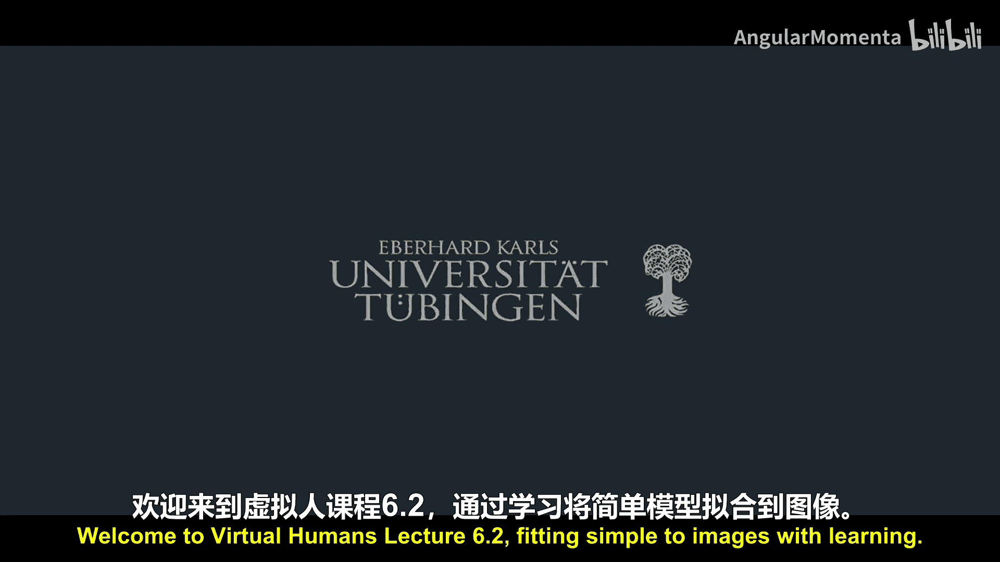
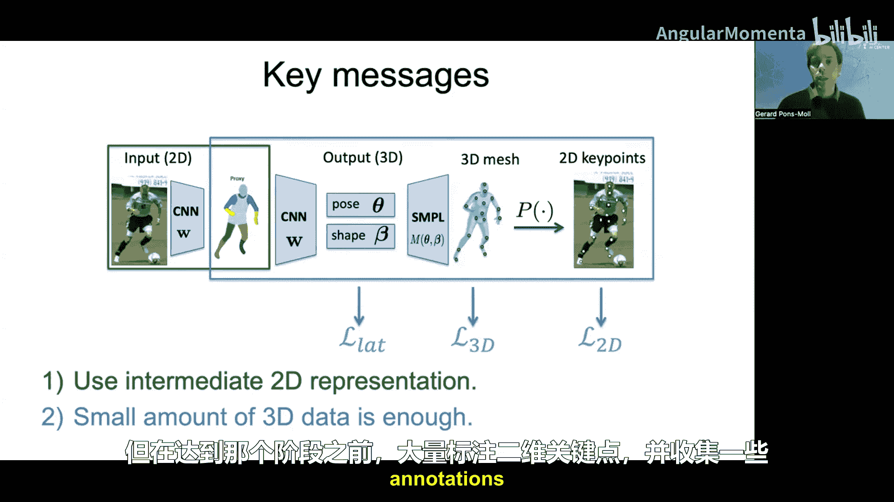
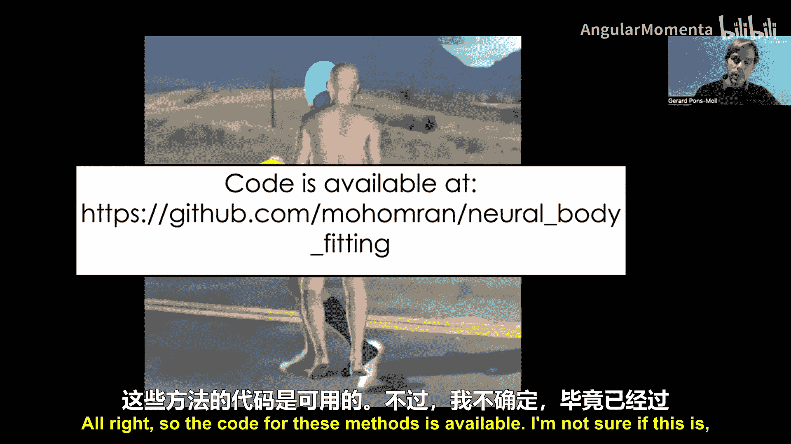
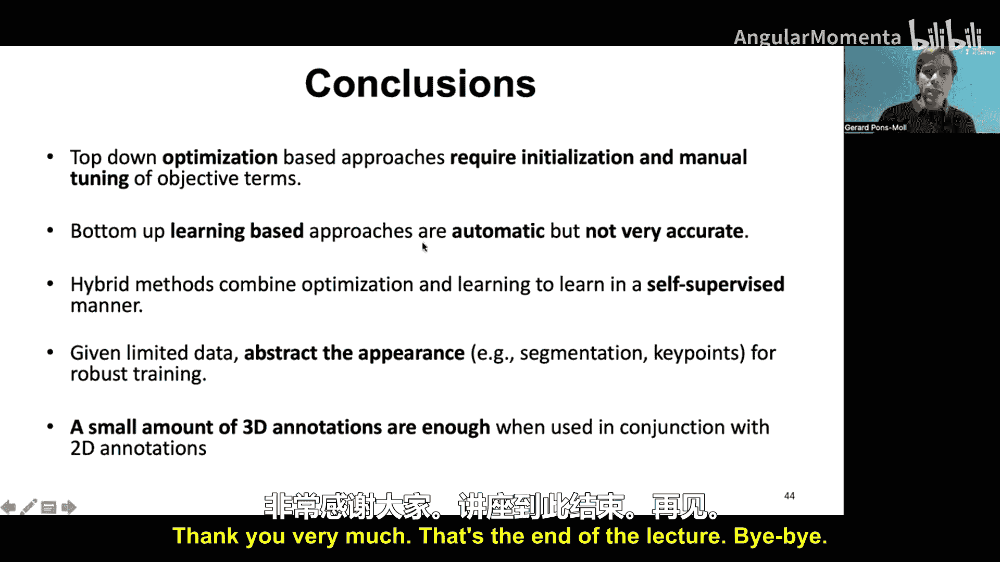

# 【精译】蒂宾根大学《虚拟人类》-p13-06.2-通过学习将SMPL适配至图像--BV1TAbkzpEva_p13-

Welcome to Vitual Humans Lecture 6。2， Fitting simple to imagesm with learning。

So the goal is to estimate the simple model from a single image of a person。

We saw in the previous lecture that this challenge could be solved by fitting the simple model to images using optimization。

We saw that fitting the model to images requires prefin features being like key points or silhouettes or edges。

 which are in the first place not always easy to obtain and optimization can be slow and。

To that point， I should say it can be slow if you have a bad implementation。

 but typically you can also make it fast and so usually like optimization is slow because it's difficult to have a very good implementation。

嗯。😊，Just as a note， if you see like that optimization is low。

 it really depends on the implementation you're using。

It gets stuck into local minima and this is very difficult to avoid you need very good initialization in order to obtain good results。

So the question that we will address in this lecture is whether we can learn a mapping directly using deep learning。

 like from pixels to the simple model parameters。So the first challenge is that there is a lack of 3D data。

 we do have data sets where we have pair data of images and 3D poses。

 but these data sets look like this like they typically look like indoor in a lab setup and not very natural。

When you go to the real images that you would find on the web。

 those images they are not annotated with 3D， and if you even look at more complex images with complex interactions and like objects and so on。

 it's even harder。And the reason is that the problem is really hard， it's really difficult。

 even with manual annotations， it's really difficult to lift this pose and shape from single images。

And by now， this should not surprise you， we have this depth ambiguity。

 like the different 3D explanations can project well to the image。

And that's what makes it particularly hard。So。Okay， so we have some data which is spared。

 and then we have lots of images。 And the question is like， can we learn a prior using unpaired。2D。

 3D data。And so it's interesting because in the community， like there were。

At least four papers that came up with very similar ideas at the same time and this is not uncommon。

 it's something that happens like you go to conferences。

 you talk to the same people like the state of technology arrives at the given point and different groups start working on similar problems and then some ideas come up at the same time。

So the basic idea here is to leverage like 3D data which is unpaired and leverage lots of 2D data。

 which contains， for example， notations of key points but in 2D but not in 3D and another question is like how can you leverage these data sources in order to lift from pixels to images and I'm going to explain to of these papers because I think with these two papers you will understand the key concepts behind this idea of self-supervised learning of postss and shape。

So let's start with the first paper， which is called end to end Recovery of Human Sha and Bo。

 which is abbreviated as HMR。So here the author's pause pose the question directly like how can we learn a deep neuralural network to directly regress simple parameters without any paired 3D supervision？

So we have here like an encoder and basically or a regressor that predicts the pulse。

 shape and camera parameters of the given image， and if we have no training data that mapping cannot be learned。

So how can we do this？Well， we do have。Tworuly key points in the images， and this was。

Provided by an algorithm that is called open pose that worked really reliably at that time and this gave like this feature which is very strong but it's in 2D right so now you could train this network to go from pixels to the parameters of the simple model what you have here and then like you could project the simple model back into the image and minimize this reproion loss between the predicted joints of simple in 2D and the joints that are detected in the image。

Now what happens if you just train this network naively is the following like you the network produces monsters。

And that's fine。 these monsters do project to the2 key points。

 this is what the network has been trained on， but they do not look like real humans。

Now it shouldn't come as a surprise because the network has not been trained for this purpose。

 it has been trained to repro。To the two leak points。But we can be smarter about this， right。

 and we can leverage。Large。2D data sets that contain key points and like also data sets that contain 3D poses。

They do not， these  three depos are not or 3 de posts in shape are not paired with images。

 but still we can learn useful prior from this。And we have seen already a couple of the examples on how to build priors。

So basically， the idea is to explain the 2D data。玩。Remaining in this distribution of bows and shape。

 which is given by the scans。So how can we recognize the predicted simple model Well。

 we have seen that。Pos and shape priors when we saw the registration lecture and this is not different。

 you can build the post prior， you can build the shape prior from the data set， for example。

 like Aus mixtureer model or a prior based on variation auto encoders。In this case。

 the authors decided to go with guns。嗯。😊，It has never been compared HR with like a simpler prior。

 that's the choice of that paper， but in any case that's perhaps not the most important part of the approach。

Um， so I should say here， I'm not sure if the G is really necessary here。

 maybe some simpler priors could have done the job as well。

We will see that there's other architectures that。Other priors that also do the job in the next paper we will see。

So basically here the idea is that the encoder or the regressor will predict like the pose。

 shape and camera parameters and these parameters will have to pass the check of a discriminator right that's the idea of a gun if you don't know guns I suggest that you check what's the principle behind this。

So basically you' will have here the generator which is given by this encoder that will produce the pose in shape and the discriminator will decide whether this is a real human or not right so you will feed the discriminator sometimes with a real data distribution sometimes with encoder distribution and this is going to be like a game play plate between the generator and the discriminator such that at the end of the game right once the thing has converged like the generator produces。

Poses and shapes from the distribution and then basically like at test time。

 you just throw away this discriminator and you only retain the generator。

So the adversary right during training learns about body pose and shape right and it makes it harder for the generator right it's basically like it makes it harder and harder for the generator to fool the discriminator。

So using this approach of like trying to explain the image while staying within the distribution。

 the results were at that time quite remarkable， like we hadn't seen anything like that for these images in the wild so these were quite interesting and remarkable results in the wild images。

Now， one remaining problem is that this approach uses the pixels full image with all the pixels as input。

 and we've seen that there's a huge variability in terms of like types of colors， textures， colors。

 lighting。And different appearances， and so you will need a lot of data for this approach to generalize well。

So with this， I will now come to the other paper I want to present， which is neuralodle body fitting。

So this is unifying deep learning and model based human pose and shape estimation。

And you will see that this has a lot of similarities with the other paper。

 but there's a couple of key concepts that are also important that are not present in the other paper。

So。Basically this paper is it presents a very similar idea of this idea of selfupervised learning and it comes from a different angle。

 so basically like it's motivated from looking at model based approaches versus learning based approaches。

So if you have to fit a 3D model to images， for example。

 you could match key points and you could minimize this objective function。

Which measures the predicted key points from the simple models that had。

And the key points detected in the image， right， and so you minimize over pose and shape。

And similarly as with registration or even more so here， because you don't have the depth dimension。

 the optimization can be slow and complicated at times， and more importantly。

 it requires initialization。And learning based approaches， basically if you have the training data。

 you can train a regressor， but we've seen that obtaining this training data of images in the wild natural images with bows and shape andnotations is not easy to obtain or almost impossible。

And also one thing that is also very important， and this is true for most deep learning models。

They make a prediction， and they will never verify against the input whether this prediction is consistent。

 right is still the output is never verified against the image。

 And this is a problem because oftentimes the regressors are not very。Well aligned with the image。

We will see how to address this problem later on， but in principle。

 those regressors are not aligned with image。So here what it was proposed is basically like the authors realized。

 okay， this training data is hard to obtain， key points are easy to obtain and similar as HMR。

 they basically use the simple model as an intermediate representation of the three world and then they basically project the three key points into the image and compare the 2 the key points。

And what is interesting about this。Hybrid architecture is that you can place the loss whatever you want。

 You can place a loss over the poses in shape if you have a little bit of 3D data。

Or you could place it here， right， you could place a loss on the mesh vertices of the simple model。

 or you could place it on the two the key points when you do not have 3D annotations you when you only have like these key point detections。

So this is very similar to these other papers， this paper goes beyond into two dimensions。

 so basically they pose a question。Well， is it useful to use an intermediate representation。

 so is it useful to simplify the image， sorry here there should be an image。

 is it useful to simplify the image into a semantic segmentation of the person for example。

And then regress from there。It seems intuitive， right。

 because we're removing a lot of the appearance that will make it hard for the network to generalize。

And this basically retains the essence of the pose and shape。

 so all the information about pose and shape seems to be present in this segmentation。

 but is that true right and then this is the question that you have to empirically validate。

And then like the other question is like， okay， we do have a little bit of images paired with 3D data and we have lots of images of key points and the question is like how much 2D versus 3D supervision you need to train these networks right so like can we empirically validate how much of these 3D data is necessary？

So again， this idea of simplifying the image into semantic segmentation comes from this fact that basically RGB images contain lots of variability and so basically it makes sense to abstract the appearance away。

And the other problem that is addressed is that the 3D data is scarces。So let's look at the first。

Problem， which is this input representation， which like trying to find an input representation that will make it easier for the network to generalize。

So if that's true， I think the question that naturally arises is which representation is good。

 is it a silhouette sufficient， is it like a semantic segmentation into body parts sufficient or key points are sufficient。

That's a question， right？So let's look at this and in this paper this is。Very carefully evaluated。

 so basically here these error error bars， they plot the error in millimeters through the error in millimeters。

That is。Produced by regressing directly from pixels。 So we have 98。5， which is quite high。

 And we if we simplify the image into a silhouette， we have 95。5。

And if we now use like a three part segmentation， the error is reduced already to 36。5。

 So this error reduction is very significant， which is telling us that， you know。

 if you abstract away。Like a lot of information then。

Like you can gain some accuracy because you will generalize better because then the test set and the training set will look more similar。

 but you went too far right you remove too much information in the silhouette and therefore like the regressor does not work as well as it could。

If you don't abstract away so much and you have only three parts。

 then you can do quite well and this can be further reduced if you six parts and 12 parts。

 so the reduction is quite significant from 98 to 27。8 millimeters。And if you use joints， actually。

 you do quite well， but not as well as if you have the full shape。

And so on and this is more or less the same story for another data set so these are two different data sets the united people is more images in the wild。

 the human 3。6 m data set is more it's an easier data set and perhaps that's why the RGB。

Image for this data set is already fine48。9 is is not it's not great。

 but it's definitely like much better than this 98。5。

 So this is illustrating that when you do not have a lot of data like it's very important to abstract。

The information that you think is not relevant for your task。

And it is very common that you will not have sufficient data for your task。

 so it's good to think about what the input representation should be。

Not only to make the regression easy， but also to make it generalized， right to the test case。

All right， so now we will work with part segmentation and of course this is an experiment that was done using ground root segmentation。

And now let's look at how important it is to use to have like a good segmentation。

So one message here， when you're doing research it's very good to isolate the confounding factors basically so if you have you want to analyze how important segmentation is versus another feature。

 it's good that you start like with ground truth and then you evaluate how important it is to have a good prediction and like this like you're not mixing。

The factors right， you could otherwise you're looking at two things at the same time。

 like how useful the semantic segmentation is versus how easy it is to obtain a good semantic segmentation right both things are important。

 but it's good to separate。So okay， so just as't note on how to do good research is like it's good to。

Issoolate the effect。So okay， given that we know that semantic segmentation is promising now the question is like how accurate does it need to be right I means that's a question semantic segmentation in principles are key points。

 it should be easier to obtain because it's easier to obtain to the annotations right it's easier to annotate images in 2D therefore it's a feature that is relatively easy to obtain。

Okay， so here， like in this paper， they compared different。

Types of segmentations different models based on different deep learning models like BGG， ReNe。

 refineNe and so on， refineNe was the more accurate segmentation， semantic segmentation。

 and as you can see that the more accurate the semantic segmentation， the better the error。

It's's perhaps concerning that of course， like if you go from a prediction。

 the difference in error in comparing a prediction。

Versus ground to segmentation is quite significant， right， we're going from 82 to 27。8。I mean 27。

8 is a really， really low error for three bows in shape estimation。

And here we have the result for an image and we see that this error is still very high。

 so it still pays off to get a semantic segmentation。

But it needs to be at least relatively accurate right if we have like a not very accurate semantic segmentation will do even worse than using the original image right which it's very intuitive but it's important to validate this empirically。

So let's look at how like more quantitatively how this affects so basically on the Y axis here it's plotted like the accuracy in segmentation。

 so higher is better is the F1 score one is the best you can get and0 is the worst and here's the joint error and so basically we expect that the better the segmentation。

 the more up in the plot we are， the lower the error and this is what we observe here right it's going in this corner and the worse the segmentation。

 the higher the error so we have an almost perfect linear correlation between the error in segmentation and error in 3Dpo estimation。

So。So well， the message is that。You need a good semantic segmentation method in order to do well on three boss estimation。

 especially on this low。Low data regimes for 3D bows in shape。Okay。

 so these are the messages that use part segmentation as an intermediate representation if you do not have a lot of data。

 that's always a good idea。And good segmentation is crucial。

In order to obtain good 3 bows and shape estimation， but in principle。

 obtaining a good semantic segmentation should be easier because this requires only 2 d annotations and not 3D annotations。

Alright， so now let's we've addressed the first question， how do we use 2D。

 which 2D representation is useful here at the input？Or it' beneficial for both。

Accuracy and generalization。And now we will see at how much， you know。

 where do I place these losses and how much。3D data versus 2 d data do I need？

Can I just get away by just using 2D data or do I need a bit of 3D data？All right。

 so here are the errors and so basically like these。

These errors are typical errors that you have in the 3 d pose and shape estimation。

 you have the 3D error in millimeters you have like。

Error in terms of PCK metric and the error in terms of so the PCK measures like。

How often like all the like all the joints are within some percentage of the ground truth。

 right within some distance from the ground truth。And then here you have also the joint rotation error in measured in quadernion distance。

So。What is interesting here is that if you use only like a 2D loss and no prior nogan like the HR。

 like the error is terrible like 198， it means basically you have some good localization of the human but not much beyond that right you're not doing anything meaningful here。

If you have like a loss in the 3D joint space in the Ouclidean space。Like the 3D error。

Goes down drastically， like you have83。7 that's。That significant。

 And then basically like like the problem with this loss here is that you're not measuring the orientation of the body。

 So therefore， this error in quadronion space 1。962 is quite still quite high right。

 It's almost as high as this。Only using a 2D loss。Now this L lot is placing the loss on the latent space on the pose and shape parameters directly right we have a loss directly on those parameters。

 so we have here that in terms of 3D joints we are doing as well as with the L3D loss。

 but what is important here is that the joint quadernions like the joint error measured in quadternion space is measures the angular error。

 it decreases significantly from 1。9 to 0。2。And basically at the end。

 like combining the three losses is what gives the best results。

 but but the important message here is that first using three losses， of course， improves。

Like 3 d accuracy and second， like if you place the loss in the latent space。

 you will measure both the position and the orientation error， right？Alright。

 so now like the perhaps more interesting experiment。

 how much because this is key right is like how much 3D supervision do I need。

 how much can I get away with just 2D data and what is shown in this plot in the Y axis we have a 3D error in millimeters。

And on the X axis， we have the percentage of。Training data that has ground truth right so essentially when you start here 100 means that all the data has ground truth and notation。

 so this is a controlled experiment for a data set where we have 3D ground truth which was obtained it was not easy but it's a data set that's called the Uniteded People dataset set and and there are like there's 3D ground truth。

And basically， so here， like we start with 100%。And then 50% means that 50% of the data is is has only 2 d joints as annotation。

 but no 3D and if we take， for example， 5% it means that only。I think I said the thing the other way。

 sorry。Let me repeat， 100% means that is all data has 3D annotations。

 50% means that 50% of the data has only 2 the annotations。

 5% means that 95% of the data has only 2D annotations and 5% has 3D annotation。

So this X axis tells you the amount of data that has 3Dnotation and what is interesting here is that the error is not going up quickly。

On the contrary， staying more or less the same until you have like about less than 2% of 3D data。

As soon as you have less than 2% of three data， the error goes up quite quite high so the reading of this is that if you have a bit of 3D data。

In your training set， the network is like implicitly learning some sort of prior overpos and shape and and so that's sufficient。

To regularize the network and then the rest is learned from the 2D joints。

So this is quite interesting because we are not using any prior here and it's learning this exactly like from from the data。

 this prior overpos and shape is learned from a few samples of。Of three annotations。

Right so the key messages after investigating these research questions are that using an intermediate 2D representation is indeed useful and using a small amount of 3D data is enough in conjunction with 2D annotations given by key points。

In of these methods， the bad news is that things saturate at some point。

 like you would imagine that you would keep adding more and more data and things get better and better。

 but the truth is that at some point things don't improve any longer。诶。

But until you get to that point， I'm definitely having lots of2 D key point annots and a bit of three data is useful。

Al right， so let me show you some results， so here's the semantic segmentation predicted from the image。

 and this is the reconstruction。Okay。So notice how the pose is quite sensitive， sensible。However。

 the shape always looks a little bit average， and this is a problem with all these methods。

That are called human poses in shape， but they are actually almost only poles。

 the shape is like not very accurately reconstructed。Especially the regression based methods。

All right， so the code for this method is available I'm not sure if the this this is it's been some years already so I'm not sure if the packages are still。

嗯。Up and running。 But yeah， so these are some qualitative results。

 So we have like the on the top row， like the best performing results and then like the this the second best and third best。

 And lastly， the failure mode。 So basically these errors， these rows are。嗯。

Are sorted according to the error。 So in the top， you have top 25% best results。

 Then you have like second。Second base， so like from 25 to 50 and from 50 to 75。

 and then finally the worst's 25%。All right。嗯。So after these methods。

 there were there was one method that basically it leverages the same idea。

 but it's maybe a little bit more direct。 So essentially it's。

Noting that the regressiongress shapes do not fit the image so well many times。

So what they say is like， okay， this data is difficult to obtain these threeD poses。

 but what we could do is like start with a deep network and then do optimization。

 which we know how to do。And obtain better fits because we know that optimization works if it's well initialized and now use these fits。

To supervise the deep network。 and I will iterate this， right。

And so that's the basic idea you have like here， a prediction， then you do optimization。

 and then you supervise the network with these predictions。

So yeah these ideas are similar to things we've seen for registration where you optimize over one set of parameters like holding the other ones fixed and so on right I mean you should draw connections here between what we've seen and this so yeah this is maybe a more direct way of combining learning and optimization。

Allright， so these are some results， so these are results on a data set that is called the 3pW data。

 which we recorded in Tuubingen and now it's one of the main data sets for evaluating like methods in the wild and it's in Tubingen so you can have a look and you will recognize many of the yeah you will recognize the background。

Al right， so in in summary， I think the take home messages。

For you are that optimization is providing very good accuracy if it's initialized well。

And it has a feedback loop， this means that the estimates are always continuously verified against the image。

 So this is， in my opinion， is a very good thing。But they require initialization and this is something that is very annoying and for learning based methods。

 the key problems are the lack of data。But once they are trained。

 they automatic and they leverage the data prior in the prediction so this is this is this makes them like。

Like it allows them to be automatic and not require imization。However。

 they tend to be a little bit less accurate， we've seen that they often do not align with the image so well。

 it its because they do not have this feedback loop。All right， so we're almost finished。

 I just want to show you a little bit more mathematically what's the connection between model based optimization and regression。

And because actually they are not that different right so in all these methods that we've seen these subsvised methods。

 what we're doing is we're training a neural network to predict bow shape。

 but you could extend it to predict clothing and texture， in fact， people have done this。诶。

So then you can have your modeltto of the 3D world， or in this case of the 3D humans。

So you could predict the geometry and the texture and basically combine things and have a differentiable render in order to explain the image back。

And。Right， so。So that's that's the idea right and you have like this different components here and essentially like this block here right。

 but what people have been doing classically is to optimize this latetnt parameters。

 both shape and whatever latent parameters you have parameters for clothing will'll see how to get those。

Then you could optimize those lithium parameters in order to explain the image evidence。

And essentially you had to here this optimization problem， arc mean over the latent parameters， data。

 beta and clothing， which minimizes the rendering loss or a pixel wise difference between the rendered model or is a rendering function that takes the simple model and it projects it into the image and it renders it。

And then like this distance compares it against the image， right？

But of course this is a very local thing like to compare pixels directly so people have essentially like extracted features from the image。

 this is what we saw in the optimization lecture so the Z here at had could be。Silhouettes， edges。

 semantic segmentation， key points and so on so that this objective is better。Regularized。

 but still the optimization can be slow， it still requires inization。

And and basically assumes that that well， I mean this is a different topic so let's skip that and so what we're essentially doing here right when with these selfupvised methods is to now we are parameterizing this latent parameters theta shape and clothing。

As a function of the image itself and the neural network parameters， right。

 that's what we essentially we are doing here because we are going from the image。

 getting the late parameters and then projecting them back， closing the loop。

So essentially we have an optimization problem like before。

 the only thing is that now the Arcmin goes over the network parameters。And potentially。

 we could also optimize the parameters of our。Body model， right。

 we've seen how to do this during a registration， but maybe we could also do it using lots of images。

Something that nobody has achieved so far， but conceptually it could be possible。

 something that I would be very interested to do。And。Yeah。

 you could optimize the network parameters and the model parameters in order to minimize this discrepancy between my model of the world and the world right so we have this this optimization the only thing is that this optimization now is a learning problem so we don't have a single instance。

Optimization， but we have here a loss function over a training set。

 so you have like for every image in the training set we want that our prediction of the world。

 all this block here matches the images right the image， the specific instance。诶。Yeah。

 so this is a really challenging problem， but the cool thing is that now we can leverage like with this formulation。

 we could potentially leverage like loads of images and video in the internet in order to train like better regressors from image to this 3D world parameters and potentially better 3D models。

Sos that's a conceptual formulation in practice， there's many。

Pieces that are that make this very hard。 And what makes this very hard is that sometimes the signal to noise ratio is not very good。

 So you have like more noise in every new image that you add。

Then you have signal in order to learn a model of bodies。For faces。

 people have trained like very good face models using in the wild data or improved existing face models。

In practice， you always need a bit of 3D data and like then the question is how to use the 2D data in order to make these models。

Better but conceptually this is quite interesting and there's still many things to do using these concepts。

All right， so this comes to the conclusion。 So we've seen that top down。

Top down and optimization is basically used in this context like equivalently。

 so top down optimization approaches require initialization and manual tuning object of objective parameters。

And objective terms。And so bottom up learning approaches are automatic。

 but they are not very accurate。Or they do not align with image so well。

 and we have hybrid approaches that combine optimization and learning in order to learn in a self supervised manner without so many 3D labels which are difficult to obtain。

And we've seen that once， if you have limited data， it's very good to abstract appearance。

 to remove all the information， all the details that are not so relevant for your task。

And we've seen that a small amount of three annotations are sufficient when used in conjunction with2 the annotations Thank you very much that's the end of the lecture。

拜e拜e。