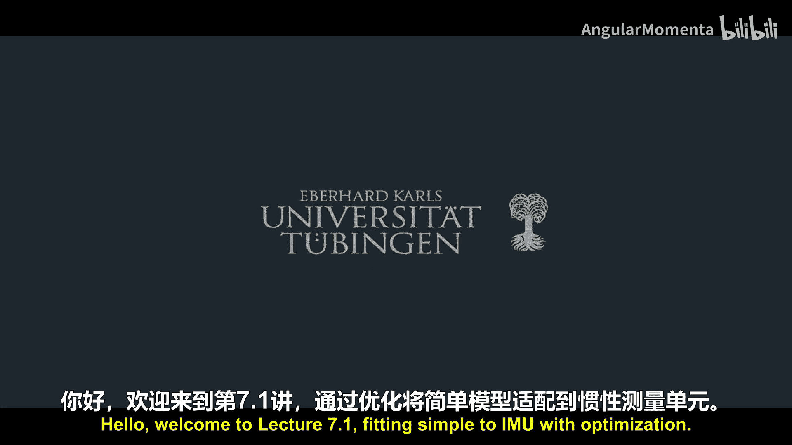
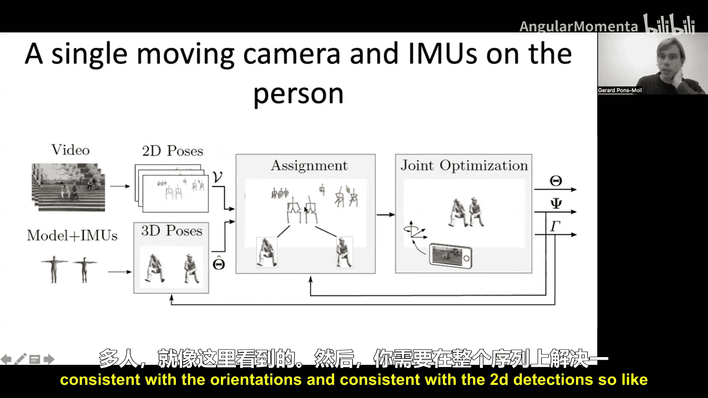
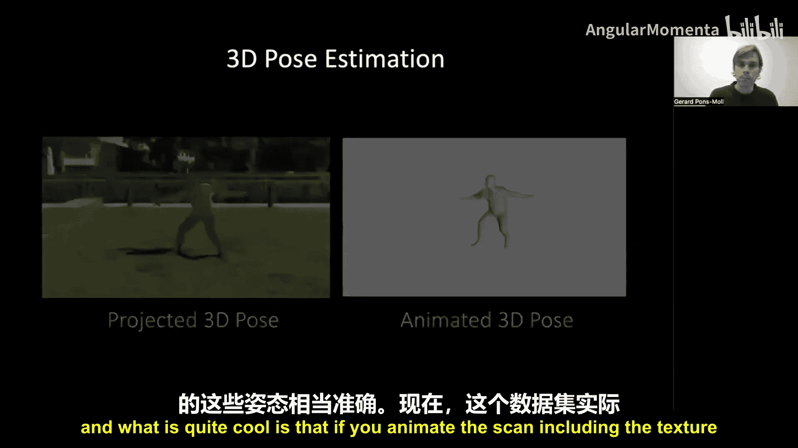
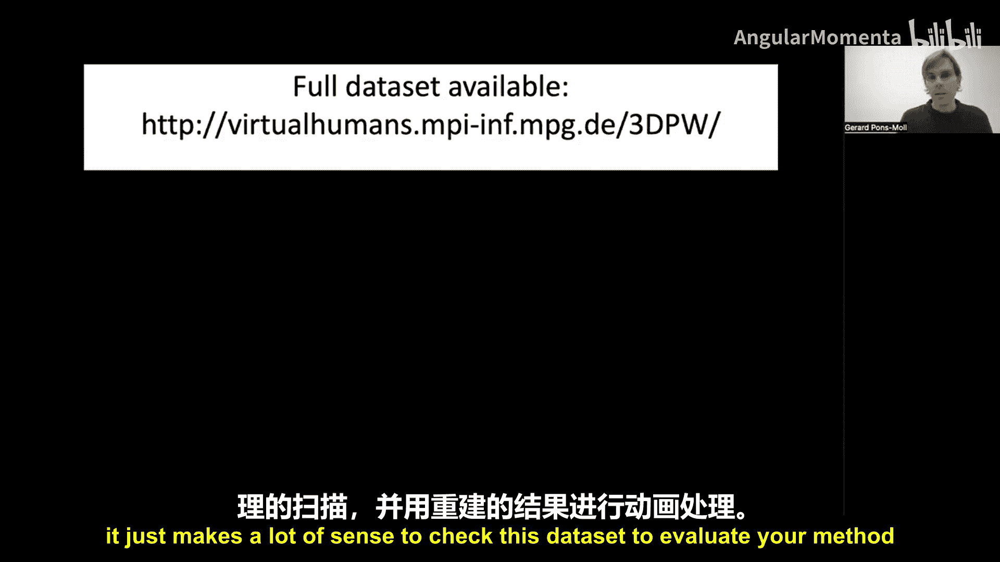
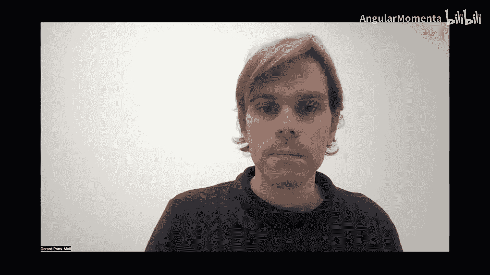

# 【精译】蒂宾根大学《虚拟人类》-p14-07.1-将SMPL适配到IMU的优化--BV1TAbkzpEva_p14-

Hello， welcome to Lecture 71， Fitting Simple to IMU with optimization。

So this lecture is going to be based mostly on this paper， which is called Sprse inertial Poser。

 Automatic 3D human posese estimationation from Sprse IMU， which was published at Eographics 2017。

 and it actually won the best science paper Award at the conference。

So the goal is to be able to estimate the human pose of people based on wearable sensors。

 little devices that you can place on the body of a person in order to reconstruct motion so we want an a accuracy that looks similar to the one shown in this video where here the image is shown for reference but it's not used to produce this result right so that's what we want we want to reconstruct a few human pose based only on this wearable sensors。

So why do we want this because we already showed in the previous lecture how to estimate the three human poses and shape from images we saw。

 for example， the simplifyplified method， we saw neural bodyfitting human mesh recovery from images so these methods are very useful to analyze people from images in the internet。

 they are very useful to for example， to equip robots with a perception module that understands what people are doing in scenes。

However， like they require an external camera， of course， because they are an image based method。

And this basically makes them limited in the recording volume。

 you can only record within the volume that is seen from the camera and some activities cannot be recorded。

 for example， like。Bking or skiing or you know， daily activities that require changing rooms。

 things like that are very difficult to record with a vision based system。For this， some people have。

Worked on wearable systems， so for example， like here this method that was shown by Rodddy Atal where you could estimate the human pose based on cameras that were hanging from a helmet and so this setup was a little bit like bulky but it showed a proof concept and more recently the paper by Dens Tome essentially showed how to reconstruct the human pose based on a camera that is placed on a VR headset that looks at the body from the top。

So you get images like this， which are really challenging because you have lots of self occlusion and then the challenge is to estimate the human pose so this allows you to。

Capture human motion outside the fixed recording volume so this is like very useful for that purpose。

 However these methods are not very accurate because they rely on these cameras that look at the body from the top and you have lots of occlusions and it's still very challenging it's an interesting problem to work on an important one but these methods are still not at the level of。

Our visionion based systems。So an alternative is methods based on IMUs， inertial trackers， basically。

 so an IMU。Is device like this little box here that you can place on the limbs of a human person。

 and then you can capture the motion。As you can see like the standard setups。

 the commercial setups require lots of IMUs placed on the body。

 lots of cables and they are not very practical because they are very intrusive。

 it takes a long time to set up and you need a lot of IMUs。

But they are not restricted to a recording volume， so this is good they open new possibilities。but。

 you know， we would like to make this more like more usable and more practical。

So first we need to understand what is a inertial sensor。

 so essentially it's a little box that contains a magnetometer and it contains a groscope and from this basically it's able to recover like the global orientation of this box or sorry I should say the local orientation of this box relative to some global coordinate frame。

 okay so what what theertial sensor will give you is a quaternion that maps from the local coordinate frame of the box to the coordinate frame which is defining the global coordinate frame。

Now there's some questions here first。First of all what I said is not completely true。

 but we will rectify this in a second so first of all how do we define the global coordinate frame so what for example。

 like a popular system which is called X do is like they use the magnetic north detected by a compass。

And in this direction of the magnetic north is the X axis。And then the negative direction of gravity。

 which is measured by the groscope， so the groscope， sorry。Scr that that， that。

An inertial sensor contains a groscope and an accelerometer and a compass okay and from the groscope you can track the rate of turn and from this you can derive orientation from the acceleration accelerometer you can derive acceleration okay so essentially the inertial sensor gives you a rotation right defined by a quaternion that maps from the local coordinate frame of the inertial sensor to the global coordinate frame。

How do you define the global coordinate frame， access the direction of the magnetic north measured by the compass integrated in the sensor？

Y is the negative direction of gravity which is measured by the accelerometer。

 so the accelerometer actually measures gravity when the sensor is static and that defines the negative direction of y and then by the cross product you can figure out what Z should be so that defines the global inertial coordinate frame。

And so the reason I said that what I said is not exactly true is because the inertial sensors do not measure directly the orientation。

 but they measure the rate of turn， how much you change and then like there's algorithms that turn these rate of turn and integrating the acceleration and using。

Other like sophisticated algorithms they can recover like the orientation of the little box and in addition you also have the acceleration which is local to the coordinate frame of this box。

 it tells you the acceleration measured in the coordinate frame of the box。

So essentially when you're working with neuros sensors。

 you always have a lot of coordinate frames that you have to deal with。

 typically one is like you have two global coordinate frames。

One is the global coordinate frame of the sensor， which is typically denoted as inertial coordinate frame and this is the one that is defined by this negative gravity and magnetic north。

 and then you usually have like a global coordinate frame， for example。

 if you have a vision system with cameras， that's the global coordinate frame of the cameras or if you have like the simple model this might be the coordinate frame of the simple mesh。

And so on， so you typically have to figure out what is the transformation between these global coordinate frames。

But in addition， you typically want to compare what are the orientations of your model in this case。

 for example， simple right which are the bone orientations。

 you want to compare them with the sensor orientations and so you have two coordinate frames for every limb one is the bone coordinate frame and the other one is the actual orientation of the box right and the box can be placed。

In different ways right and so youll typically have to figure out what this offset is right so you will see in this type of papers that there's always like this offset。

 which is if things are attached rigidly to the body is constant over time。All right。

 so people had basically combined IMU and vision， so for example like like one of my first papers during myD thesis was combining like multiple cameras and inertial sensors placed at the body。

 in this case we were using only five to make the system more practical。

And then we were integrating the information together in an optimization framework in order to estimate the pose and shape of people。

 and so this is the key idea is to combine this vision based system where localization of joins is more accurate with an inertial tracking that provides good orientation of the joints。

And this video illustrates the problems of video based tracking and how they are solved by combining them with IU based tracking so on the left you have the video based tracker and notice how the arm gets completely twisted。

And that's because like if you're using image based losses that depend on， for example。

 silhouette overlap。Like any rotation along the actual。And direction of the limb。

 like will produce the same rendering and will produce the same overlap and therefore it will be very difficult with these image based losses to recover this actual orientation。

But this orientation is very easy to recover from the IMU because this is exactly what is measuring。

So this was a little bit of the idea， this was the first paper that combined IU and vision for full body captureture。

And yeah， so basically that's where we describe the limitations and advantages of each type of approach。

So some people also try to go directly from sparse IU data with some。

Basic machine learning tools directly go to the motion of the full body， for example。

 like using database lookups using nurse nearest neighbors。

The problem of this method is that they didn't generalize very well。

 not only because the algorithm was relatively simple。

 but also because the amount the databases were also limited。So here we， like in this partial。

 we took a different approach， so here we take like this analysis by synthesis approach。

So we use six IM use placed at the extremities of the body and also the back and the head。

And remember that the im uses provide acceleration。

 the 3D dimensional vector measured in the current frame of the sensor。

 and then the orientation for every one of these sensors。

So in order to relate body motions to IMU observations。

 we need an articulated body model of the person to be tracked。

And we also need to know the IU positions of the body， that's requirement。So for the body model。

 we ended up using SMR。which had been recently released at that time and yeah I don't need to go over what the simple body model is。

 it takes po and shape parameters and it produces like a mesh of a person。Importantly here。

Within the equations of simple， of course， the simple model can also go from。

Bothowose and shape to the actual orientation of the body part。

 and this is going to be crucial to compare I orientations with the body model orientations。

Right so here we follow an optimization approach which is consisting of three objective terms。

One is the orientation consistency。Then we have an acceleration consistency。

 and finally we have a prior which measures how likely the post is based on some prior that is built from training data。

So here we follow this typical analysis by synthesis， you have observations， in this case。

 orientation and acceleration， we try to synthesize this orientation and acceleration。

 and then we compare， and then we minimize a distance between these measurements and these predictions in order to fit the model to the observations。

So the anth like this prior on the pose is basically based on this Mahalanno distance that we described in。

Two lectures ago on image based fitting and essentially is like this Mahalano distance and remember this is the covariance matrix which needs to be inverted and this is a quadratic term and so on right so remember that this is taking into account。

The distribution of the data， it makes the assumption that the data is unmodal。

And follows the Gaussian distribution， and then basically you can penalize this distance in Mahaano's distance。

We also use like joint limits to prevent that， for example。

 like the elbow completely bends backwards and these things are crucial because we're using only five IMUs and basically if you do the math。

 you will realize that you have less。Constraints and degrees of freedom and so we have an under constrained problem that we need to constrain。

Like by placing prior knowledge。So okay， so now we need to measure like how consistent is our body model with the orientations provided by the IM use。

And the first question that here arises is to measure the sensor to bone orientation consistency。

 bone orientation is the orientation of the model。We need to be able to compute a distance between orientations。

And unless you have worked with robotics or Bureau Viion before。

 you probably are not familiar with distances on SO3。So let me revise a couple of distances。

 distance metrics in SO3， and let's see what how they relate to each other and how we should be careful using them。

So the angular distance is perhaps the most natural one。

 it's the angular distance of two rotations RNs is the angle of the transformation SR transpose。

What does this mean so if I have a rotation。S。This represents coordinate frame mapping。

To some global coordinate frame， whatever that coordinate frame might be， right， the canonical one。

And if we have another rotation R， this also represents some mapping from this coordinate frame to this。

So if I now do SR transpose， what I'm getting is the relative rotation between the two coordinate frames。

Which is what I want to measure， want to measure how far this frame is from this other frame。

So now what you can do is like to consider this axis angle that will bring one coordinate frame or one rotation into another。

And that angle about which I rotate along this direction is the result of this angular distance。

And it's defined。 This is theta， right。And so it's defined as the。😊，the angle between S and R。

 that's the same as the angle between SR transpose and the identity。

That should be of no surprise because if it has to be a metric on us S3 needs to be be variantant。

 this means that if I have to apply a rotation in both sides like the metric should not change this makes sense right because if I have two coordinate frames。

If I rotate both of them at the same time。The distance between them should not change。

It doesn't change right as long as I rotate and by the same amount。

 so I can apply here to go from here to here， I can apply R transpose in order to get R transpose R。

 which is the identity and on the left I can get SR transpose。And this is equal。😊，2 the lockm。

 which the norm of the lockm， and remember that the lock map we didn't show the formula。

 but we set in lecture two that is or in lecture three。

 maybe which is essentially giving us the axis angle representation of this rotation matrix。

The axis angle representation of SR transpose and when we take the norm。

 remember that this scaled axis angle， like the norm of the s scaled axis angle corresponds to the angle。

废了。You need to like。There is some ambiguity because different axis angles can produce the same rotation。

 so you have to choose the sign of the omega such that the theta is between some specified values。

 for example， zero and pi okay。And this is also called a Jurassic， not distance， but distance in S3。

 sorry for the typo。All right， so this is a natural metric for S3 another commonly used one is the coral distance and the coral distance is the Frrobinous norm。

The Frbius norm of the rotation matrix difference between s and R so the cor distance squared equals to the Frrobinus norm squared of S minus r R again this should be be variant I can apply a rotation in both and so I can transform this into SR transpose minus identity same three as before。

And now。So that's what it is right it's the Frvinnus norm of this distance it's telling you this is measuring how how different from the identity this as SR transpose is right if you're at the identity it means that this s and S and R represent the same frame same coordinate right so it makes sense that it takes zero value when those two equal。

And。Now it's interesting to see that this metric， which is for example。

 used to train the simple model。Because there we。We use full rotation matrixes。

 the nine numbers of the rotation matrix to。To modulate the post blank shapes if you remember that。

So you implicitly use this distance metric， right？In in several papers。

 like people also use directly， they regress directly。

Full nine numbers of a rotation matrix and they use this metric。

What is interesting is that there's a direct relationship between this metric and the angular distance metric that I've shown before。

So by using the following properties。Like the first property is that this is the Rodrigueus formula that we saw that the exponential which takes maps an axis angle to a rotation can be written as the following formula identity plus omega sine theta plus omega hat squared1 minus cosine of theta remember that this omega hat is this vector three dimensional vector placed in a matrix that is ssisymmetric remember that this is like zeros of the diagonal and then it like the matrix equals minus the matrix transpose okay that's a sssymmetric matrix。

Now， if theta omega hat is the axis angled representation of SR transpose， all right then。

And also using the following properties。So that the property that omega hat and omega hat squared are orthogon under the Frrovinus norm。

Okay， and also using the fact that。I mean， if you don't believe number two。

 just do the math and you will convince yourself， actually we will do it in class。

 that there's an intuitive way of looking at this。And then like property three is basically that the Frrobius norm squared of omega hat squared or omega hat squared。

Sorry of omega hat or omega hat squared equals to two there's a type of here they shouldn't be like the squared both equal to two Why is that because I mean we placed like a unit vector right omega is a unit vector we placed it in a matrix and we duplicated it one time on the lower diagonal one part on the lower upper diagonal so when we take the squares of everything we're counting two times the norm of the vector that's why you have these two。

Okay， so now let's use these properties one to three in order to move from this line to this line。

 the first thing that we should notice is that。We plug this equation here。

 we replace SR transpose by the exponential map， it's the same， right？So we will have like here。

 Sr transpose will be equal to I plus omega sineus of theta plus omega squared to 1 minussine。

The identities cancel out， they cancel out， okay， and now I have like this thing here in the equation。

Right forbinus norm squared， we said that omega hat this is a scalar sine and cosines are scalrs。

 so now we have omega hat which is a matrix which is orthogonal to omega hat squared they are orthogonal okay so if they are orthogonal。

 what happens to the norm of the sum。Well， it's pyors， it's going to be one term squared。

 this term squared plus the other term squared， okay， this is a scalar， so sine squared of theta。

Gets out right so of the norm， So I have sine of squared theta。

 Now the norm squared of omega hat equals to 2。 That's where why we have this two。

For the L term is the same the norm squared of omega hat 2 is also equal to2。

 that's why this is in this parentesis and now we have one minus cosine of theta squared because were squaring one thing and the other all right and then using some basic pregonometry we arrive at eight times sinus of squared of theta hs。

Which can be reduced to the following expression， which is basically two times square root of sine of theta hals。

And。It's interesting because， you know， this is the angle theta， that's a distance。

 and this is another distance， which is two times some constant time sinus of theta hals。

So there's a direct relationship of these two metrics。Now。

 another commonly used metric is the quadernion distance。

 so you could take quaderion  one S quadernion2 R and sub them and take the。

The two norm right of these four dimensional vectors。Well， the problem is that。

A quaernion Q and a quaernion minus Q represent exactly the same rotation。

And so this ambiguity needs to be resolved because here depending on whether I'm having r minus R I would get different distances。

 this is not what we want， so you need to take a mean over these two possibilities S minus R and S plus R so you consider the two signs and then you take the minimum distance of these two possibilities and then you're fine。

But you have to do this because otherwise youll run into problems if you have like a loss。

In Quaternion space that doesn't take into account the sign of quadernions。

 you'll run into problems during the learning process。And interestingly。

 there's also a relationship to the angular distance。

 and this can be seen by considering the following quadernions。

One is the quadernion of the identity again what we're going to do now is to write something like this SR transpose minus I but in quadernneions right。

So I is going to be this E which is like the identity， it's the canonical vector。

 and then we're going to have like here s times r minus1。

 right which is this Sr transpose in Queernion space quaernion product。

This is equal to cosine of theta hs and this sorry here this the V。

 this is the axis of rotation v hat instead of omega and sine of theta hals。Okay。Good。

 so this basically is the Quaernian representation right of this。This product。

And this relative rotation。And now let's look at what happens to the dot product as four vectors。

 the dot product， the inner product between these two， well only the first part is nonze。

 so I'm going to have that this equals to cosine of theta hs。

But also we know that the inner product of two4 vectors equals to cosine of alpha。

 right it's a projection of one vector into to the other， and that's equals to cosine of alpha。

 the angle between the two quadroions。From this， it's evident that alpha。

 this alpha this angle between the quaternions is theta hals。Now。

 why is this useful because now let's consider this？This metric， which is。

SR minus1 quadernion minus the canonical quadernion。

 this is the same as SR transpose minus the identity。

This is exactly the same as S minus R again because of this pvariant property。

And now we have that these。Yes， so now using the fact that this alpha equals to theta hals。

 we can derive that this quantity here， this distance equals to two signs of alpha hals and therefore equals to two sides of theta fourths。

How did we know that because we know that the distance of two unit vectors which are separated by an angle alpha is equal to two times the sine of alpha hals it's just basic trigonometry but we just used here the fact that alpha equals to theta hals and remember theta is this angular distance so again we have like an expression that depends on the sine。

Of the angular distance。 So the quadronion distance。And。The angular distance and the cordal distance。

 they are all related。And they all depend only on the angle right。

 and surprisingly things do not depend on the orientation。

 they only depend on the actual on the angle， right？嗯。

Okay so it's important to know what you're optimizing for。

 so if you're using the angular distance or the cordal distance。

 the quaernion distance you're optimizing for different metrics and they behave differently。

So here like there's a plot of how these metrics behave as a function of the angle。

 so on the y axis you have each of the metrics， the anglengular distance， the cordal distance。

 and the quadronnion distance。And so in the y axis you have on the left column you have D the distance as it is。

 and so this is the angular distance。Of course， I guess it's a linear mapping because the distance equals to theta。

And here we have like the coral distance， which it goes to this expression here。

 which depends on the sign of theta hs， so decays like this according to the angle。

 and here we have the quadernion distance which notice that decays less quickly。Well。

 this is telling you a little bit like how the optimization will behave or the learning will behave。

Depending on how close you are to the solution versus how far away you are， right？

So this is the distance squared that notice this creates a quadratic， this creates this sort of。

Curve like here and so on。All right so。Another。Distance metric is the。

The direct L2 distance in angleng axis space so whenever we're supervising， for example。

 like the parameters of the simple model。On on the post parameters， right。

 remember this like for example， like neural body fitting where we had this latent loss。

That's exactly what what they were doing， they were placing an L2 loss on angle axis space every time we fit a distribution to。

The bow space of symbol， we are assuming。We are adopting this distance metric， right。

So let's look at the most naive version， so the Olidean distance between the corresponding scaled axis angles of lock of r and lock of s right so we take a rotation。

 we extract the X' angle， we take another rotation S。

 we extract the X angle and we compute the L2 between those two。

The problem is that this will be not continuous。Why is that because？

If you take lock of hour to be the smallest length vector。

What can happen is that rotation angles rotations about angles near pi about opposite axis are not close to each other under this metric。

 for example， like you have this vector and like the positive angle and you land here and the negative axis and again the positive angle and you land almost there。

 so they are pretty close。But when I would compute the distance because they have different signs。

 the distance would be pretty large， but in the angular distance metric， they would not be far away。

So this is a problem and a problem that。It's mostly ignored at least in the literature in virtual humans。

 but it's something that might explain why sometimes do not work as well when we work directly in access angleal space during learning。

And that's why some papers have proposed to use other representations based on rotation matrices and so on。

Allright， so there is a solution which is annoying because you have to take the mean over all possible choice of vectors such that you know these two vectors。

 VR and VS satisfied of the exponential map of this equals to the rotation matrices。So again。

 awarding that many regressors to human pose do use this metric。

 but do not take the mean which can be a problem for the learning。

 you can completely confuse the learning system。Alright。

 so now we know a little bit more about how to measure orientation。

 so in that paper we chose the anglengular distance。

 which is again the log of the relative transformation our bone times our sense。

 our bone is our prediction which depends on the parameters of the body model。In this case， the pose。

And。Times the rotation of the sensor transposed， which is the inverse。Now。

 if we only optimize for orientation consistency， because we have sparse sensors。

 we only have sensors at the body extremities。This is not sufficient。Because look at what happens。

I have here many different poses。Okay， but notice that。

Here we have exactly the same orientation of the lower limb。Id lower leg。

But the pose is completely different。that is telling you that the orientation is not constraining the position of limbs and it's very ambiguous because you have many solutions that produce the same orientation。

 there's a manifold of poses that satisfy the orientation constraints。 both different。But。

Ororoliationial measurement， nearly identical。So what happens when you optimize for an like this post prioror plus the orientation constraint？

The following happens like you get a motion that looks。

Okay but not quite realistic like the blackstone bend properly and things don't really work so well and that's because of this ambiguity。

In the orientation space。So how can we solve this？Well， we have acceleration coming from this sensor。

At that time， it was no， but every attempt to use acceleration data。Before had been a failure。

 and the reason is that。Acceration data is very noisy if we want to compute position。

Because we need to integrate two times the acceleration to obtain position， right？

And if we attempt to do this， what happens is that the noise multiplies during this integration and things blow up and essentially if you try to just use acceleration。

Alone， this is what happens， it blows up， right？So this alone is not sufficient， but anyways。

 let's look at。How the term for measuring acceleration consistency would look like again。

Like you have the model that predicts the accelerations as seen by the model and you have the acceleration as measured by the sensor。

The first thing to notice is that the acceleration of well the acceleration of the model can be predicted from the positions of a given vertex where the sensor is placed。

 let's say that vertex is PT。Using numerical differences。

 we can obtain acceleration by applying the following filter PT minus1 minus2 times p plus p plus1 right that's one way of obtaining divided by the DT。

 which is the delta unit of time。That's one way of。

It's computing two times finite differences in order to obtain the second derivative of position。

 which is acceleration。And this acceleration。Predicted by the model depends on the post parameters because PT and P minus1 and p plus1 depend on the post parameters。

Now， the acceleration given by the IMU also depends。On the orientation。

 this acceleration is measured in the local box， so we need to first transform it into the global coordinate frame by applying this rotation matrix。

To the acceleration。And then we need to subtract the gravity direction。9。

8 here because the the accelerometer is going to measure all the time the acceleration of gravity。

 right we are。Like that's what the acceleration accelerometer measures like this。

 and that's why it's called like the earth is like it's like an acceleratecc like。诶。

It's like the gravity is like a system under acceleration。

 so if you would just drop the accelerometer。From a plane， then it would measure zero。Gravvity。

 right that it would not measure that acceleration。Ignoring the friction effects。Anyways。

 that's a bit confusing， but think about it and you'll realize why。

All right so what happens here if we use only orientations we see that there's a manifold of poses that satisfy the orientation constraints so these multiple legs that are plotted here illustrate multiple pose solutions that satisfy the orientation constraints of the lower limb so notice there's some like a lot of ambiguity because we don't know which one too big。

Now， the idea of this paper and what was the breakthrough that allowed to really leverage I am used as far as I'm used to compute human motion was to。

Optimize for the posts over a batch of frames。Besides that。

 you can resolve and also integrate acceleration within these batch of frames。Besides that。

 you achieve the two things， first of all you disambiguate these multiple possible solutions。

By optimizing overall poses at once。And also by optimizing over a bunch of frames。

 you can make the use of acceleration you're numerically integrating but using the body model to regularize this numerical integration。

Which results in much more stable results。So that is one key observation and the second key observation is that。

You really want to use a strong body model to constrain this fitting process because if you don't。

 we tried， things do not work as well， I mean they don't work at all actually。

I'm going to show this in the results。So。We said that we need to optimize over multiple frames and this creates an optimization problem that is more complex than the optimization problems that we've seen until now。

But we can still solve it， we have here like this optimization， which is a summation over T frames。

 a summation over the six sensors placed on the body of。

 and we have this orientation constraint for one for each sensor。

 which is the anglengular distance between our orientation prediction and the sensor orientation。

We have the acceleration consistency， again the same summations here and we have the prior over the pose。

 so that's the optimization over a batch of frames st。So how do we solve such optimization problem。

 So we've seen this several times we consider the vector of residual E， which basically。

If you have end residuals， you have like this as a vector of n entries。

And to minimize the scalar e transpose E， we linearize the vector of residuals with the Jacobbian matrix。

So basically， E。Plus Delta x equals E of x plus the Jacobian times Delta x。

 And this is approximating how。The error looks in the neighborhood of X。

And now what we can do is use these Lenburg marker equations or solve this linear system here。

 e of x plus Ll x minus Ex， and then solve for this delta x。

That makes the error as small as possible。嗯。All right。The acceleration residuals， yeah。

 so let's look at the form of this Jacobian matrix， right for example。

 for the acceleration residuals。So remember that the acceleration is predicted is approximated from the model using this。

P T -1 minus-2 times P T。Plus PT plus one。And this will show up in the Jacobian computation of the acceleration term。

 so you will have like G。Jacoian minus the time Jacobian。

 Jacobian that multiplies the delta post parameters of time t minus1。

 delta post parameters of time t and delta post parameters of time t plus 1。

And the Jacobia matrix here is the deposital Jacobia matrix that maps increments in parameter space to increments increments in the vertex position where the sensor is placed。

Right。😊，So。When we multiply these Jacobian times these deltas。

 we are obtaining how the error in acceleration consistency increases or decreases。

As a function of deltax。Okay， good， so now we need to optimize over patch of frames。

So I pose a question if the error residual for one frame is n。

And the number of post parameters is speed。How large is the Jacobcoian of the residuals for all frames？

Right so for one frame， we have and residuals。Now， for。T frames， we will have n times the residuals。

 so I'll have many more rows in the Jacob matrix。How many parameters do I have now before I had P for one frame。

 but now I have T frame， so I'll have p times t， so I have like a much bigger t squared bigger matrix right because I multiply this dimension by T。

So that's expensive in general， and you need to exploit the diagonal structure of your problem。

So if you look at the Jacob matrix， like you basically realize that。The orientation term。

Is essentially only。Basically it only depends on the current frame right so here we have a Jacob matrix which has zeros on the diagonal and has like these block diagonal terms。

These Jacobians are the Jacobian at time t minus1， Jacobian at time T， Jacobian at time t plus1。

 which multiply the corresponding delta x of T。Delta x of t minus1 and delta x of t plus1 so the orientation terms there is no coupling across time we're not measuring you know how the orientation in t minus1 matches the orientation in t plus1。

And that's why you have this block diagonal think which makes this this system completely diagonal so the timeframes are completely independent。

 that's why you have this system， which is。Also like independent of each other。

Now the acceleration residual terms a bit different because the acceleration residual terms do link different poses right because to compute the acceleration I need to know the pose at t minus1 and I need to know the pose at t plus1 and that's what is reflected by this other block tag I dont think which links t minus1 t and t plus1 but still it's very sparse I'm not linking t plus1 to the first frame of the sequence。

And this allows you to solve this much more efficiently and in fact。

The slow part of the algorithm is not solving these linear systems。It's rather updating the model。😊。

So yeah， so when you have an optimization problem， it's good to think about the structure of your Jacob matrices if you're using like a quasi second order method like Leenberg Marker or Gaus Newton。

All right， so exploiting this properties and using this optimization。

 the cool thing is that for the first time it was possible to recover like this nice result of。

Human motion from just the sparse set of sensors， right？

So so I remember looking at these results and like thinking， okay。

 like there must be something wrong in the code because like I cannot believe that we can get this accuracy with just six ion placed on the body。

 but this is like by using this batch optimization and using a strong body model and priors。

 then you can recover and deal with a lot of ambiguities right？

And this is cool because now you can only like you know。

 you can place like just the sensors of the body parts and then you can obtain this results。

Yeah that's the cherry and the cake like basically we had like the first author of the paper write Egraphs。

 which was the conference where this work was submitted。

 we made him write urographics in the whiteboard and then using the new measurement we could recover the handwriting。

So it's not perfect， but it's remarkable that we can get this this accuracy。😊，All right。

 so now the evaluation， like on the left you have this model that is based only on orientation consistency and on the right you have like the full sparsRS inertial pose。

 which optimizes over all the frames and uses also the acceleration。Again， if we had。

If we had integrated acceleration by。Going from acceleration to position and integrated this into optimization。

 things would have worked much worse， right the key is to。

Predict acceleration and have the objective terms in the measurement space。

With as little processing to the measurements as possible。All right。

 so we also evaluatedd on a data set where we had。Like like four actors， five activities。

 eight synchronized RGB cameras and 10 IMU， and we use six IM use for tracking and four IM use for validation。

And we see here the angular errors and we see that the orientation only measurement。

Has like 19 degrees。 by the way， this19 degrees is not that bad， actually， like this metric is。

Pretty pretty hard right I mean very soon because it's it's not it's not a planner rotation what you're measuring is like rotation between two coordinate frames and so。

An error of like around 10 is pretty， pretty good。Okay， so we have the。

Angular error this is an interesting comparison of SI minus M SI minus M is using the SI what I described。

 but instead of using the simple model we used like one of these manually riged models that we were using in the past。

And the error is significantly worse， we have 18。24， whereas with SI we have 13。32。

And I think one reason is that the actual skeleton of the simple model is predicted from the surface and then。

The acceleration measurements can be better predicted with a simple model and the orientation also can be better predicted so that makes the whole thing。

better。So simple not only makes the process of creating the body model automatic but also it turned out to lead to better performance and here's the performance in joint position error and again like the trend is similar even like the improvement is more drastic so here 3。

9 centimeters that's pretty accurate I think。All right。

 so so limitations are that the hand and the feet were not tracked。

It's a problem that we still haven't solved how to track the hand and feet if we don't see them。

 but it would be interesting to， for example， reason about interactions with environment in order to solve this problem。

We also do not deal with drift in global translation， so the optimization does help。

 but still when you numerically integrate over long periods of time， like things tend to drift。

And it requires a motto of the person and it's an offline approach。

 so you need to see all the measurements and then optimize all at onces。

So these are some of the limitations and so notice here that the hands are not。Accurately tracked。

All right， so the conclusions are that this was the first war to demonstrate that with six Is。

 you can reconstruct the human motion quite accurately。

 it can reconstruct arbitrary motions and it enables motion tracking in the wild。

These are the computation times and the actual time is not that important because this was an implementation in MatLp and this can be made much faster。

 but the relative times are important so here like the model update is like given given once you figure out what the incremented post parameters should be like to update the mesh to produce the new mesh or the new joints。

That takes actually 14 seconds， which is significant because look。

 setting up the Jacobians this were like。Basically they were implemented by ourselves like the Jacob matrices。

 this takes 3。3 seconds proration and solving the system actually takes the least time like 1。

5 so this large sparse linear systems can be solved pretty quickly。So here。

 this is showing that the model update is actually the bottleneck here。All right。

How else we can use IM use？Well， one problem which we mentioned in the previous lecture is that the data sets in the wild images and 3D poses。

 there are no data sets， there were no data sets in the wild with accurate 3D reference poses。

So we decided to use this setup of a sparse set of IMUs on the body and a handheld camera from a phone。

In order to obtain pairs， obtain a data set of humans with inbiious right in challenging scenes。

Paired with good reference poses so we are solving this another combination of video and IMUs like some of prior works that had been shown like including the work in my busy thesis but here we want to use only a single IMU camera sorry a single camera and this makes the problem much more challenging so。

The first thing that we realized is that if you have a video。

 the first thing is that if you're tracking， for example， like two people。

 you have many people right detected in the video and the first thing is you need to associate what are your models with the correct detections in the image and this assignment problem is actually quite tricky if you have a lot of people as you can see here。

Then you have to solve a joint optimization problem over the full sequence to make the models consistent with the orientations and consistent with the 2D detections。

So。Like we have an algorithm that measures like overtime using like a multiple assignment problem algorithm。

We assign the 3D models to the correct2 the detections。

And so you can see here all the detections and here have we can see the associated to the poses and then we can optimize the model over。

The poses over all the frames to mightter detections and the orientations and accelerations。

And I'm not going to explain all the details this would take too long。

 but the cool thing is that you know using this we could record sequences in tububing in。

 for example， like this is a collaborator of mine or a participant that was。

By doing the groceries and we were capturing this。The sequences like in natural environments and these poses on the right you can see are quite accurate that now this data set is actually widely used to evaluate human pose image methods in the wild images。

And what is quite cool is like that if you animate the scan， including the texture。

 so you can obtain pretty。Realistic results actually yeah so here's just taking a scan with the texture and animating it with the preconed results。

So this data is available on our website and so if you're working on a project that has to do with 30 human pose estimation。

It just makes a lot of sense to check this data set to evaluate your method。

So this data set contains 60 video sequences， two de pose annotations， three reference poses。

 camera poses for every framing the sequences。And 3D body scans and 3 model。

 3 models for these subjects that were captured。And 3D models in different closing variations。

All right， so this is all for this lecture。We have like the video you can check of this sparsse initialertial pose if you're interested and if you're interested in checking more IU based tracking methods。

 you can follow this link here on the section， research section， human Mo from wearables。

Yeah thanks for the slides like for the insights I based some of the slides on the paper by Richard Haddley ITCB。

 I think it was 13， not 14， sorry about this and the slides based on SI and 3PW papers so for this I thank Timmo and Marart。

All right， thank you， that's all， bye bye。

