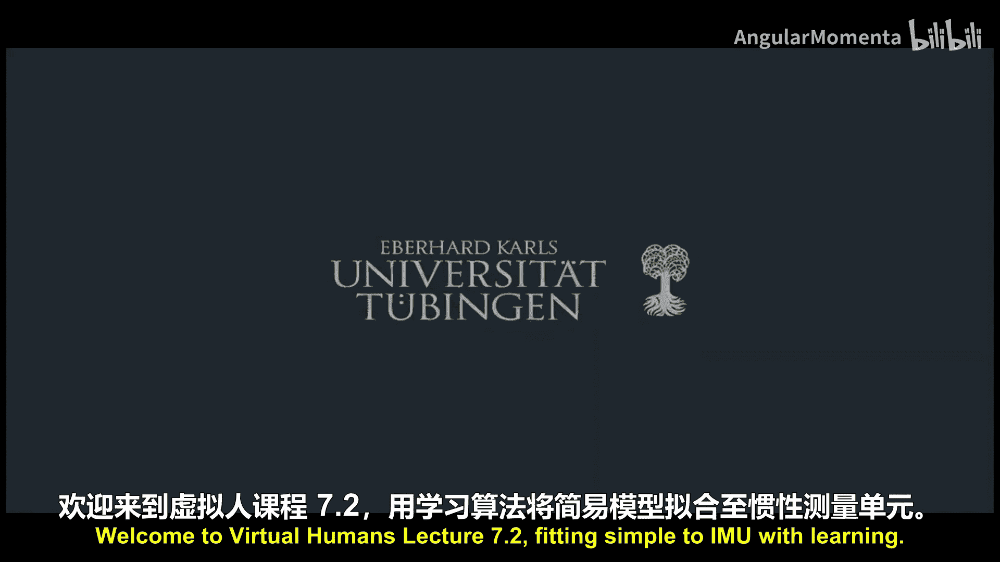
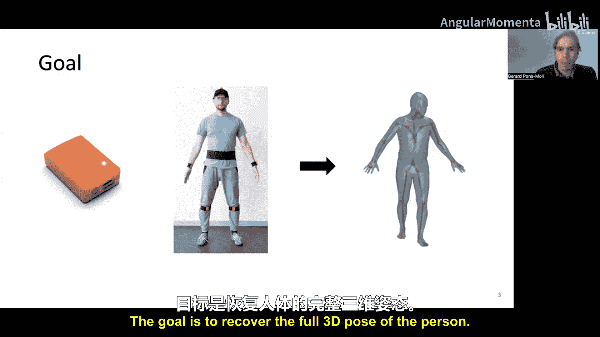
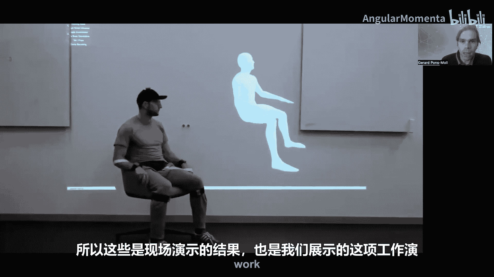
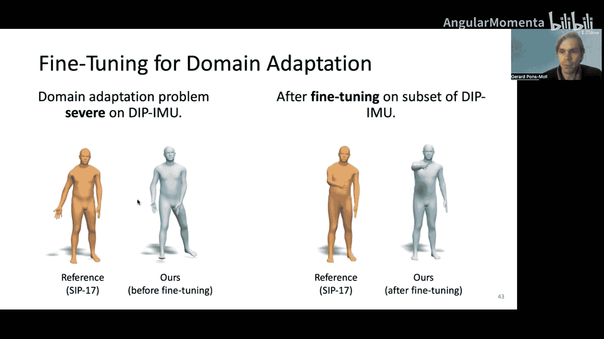
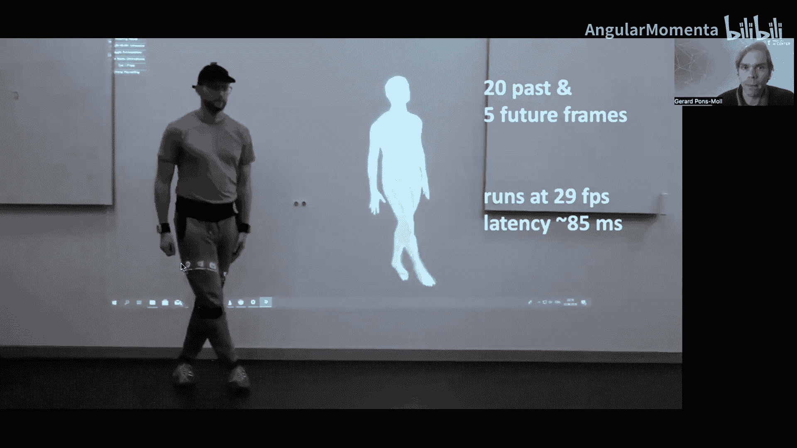
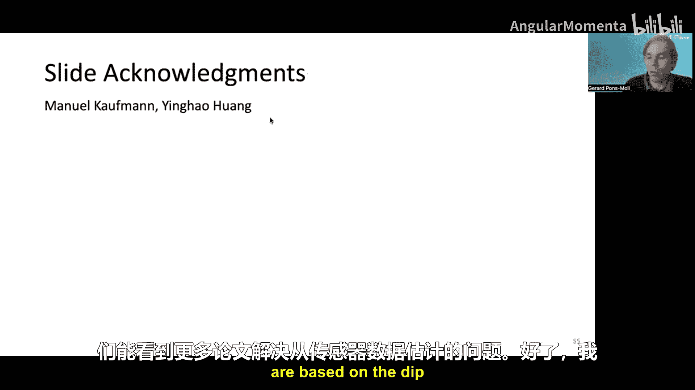
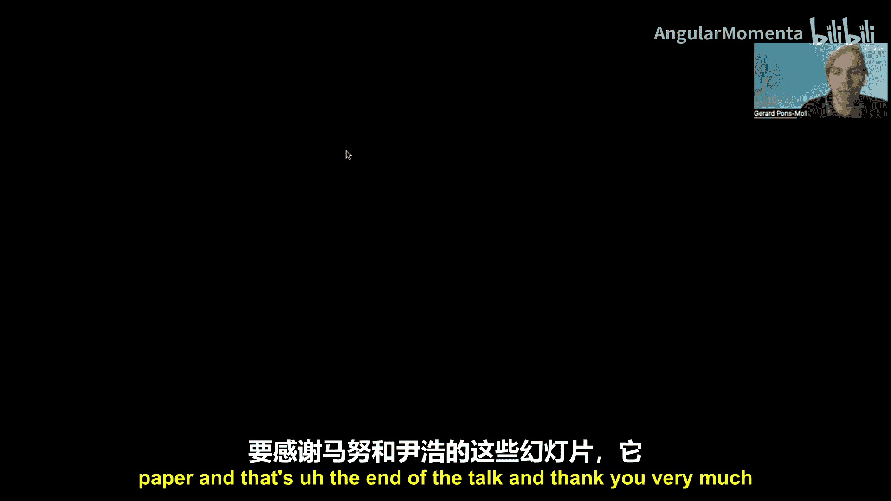
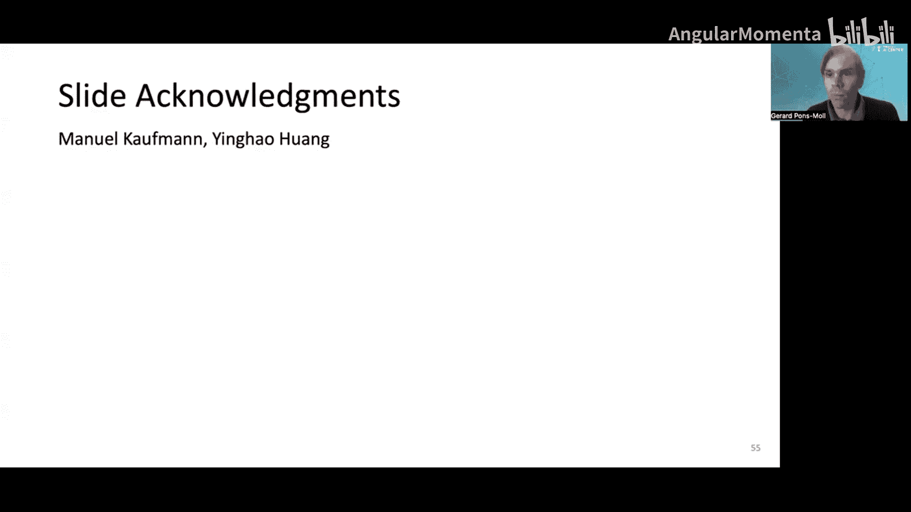

# 【精译】蒂宾根大学《虚拟人类》-p15-07.2-将SMPL适配至IMU学习--BV1TAbkzpEva_p15-

Welcome to Vitual Humans Lecture 72， Fiing Simple to IMU with Learning。

So in the previous lecture in lecture 71， we saw how to fit simple to IMU data using optimization and in this lecture we'll see how to do it with a more learning based approach。

 which allow us to do this in real time。So this lecture is based on this paper Deep Iertial Poser。

 which we published at Siggraraff 2018， but I'm not going to describe the paper per se。

 but I'm going to focus on the main concepts， which I think apply to also more recent works。

So first of all， here's some repetition from last lecture。

 an IMU is a device that can capture the orientation of this little box here with respect to a global coordinate frame。

😊，And it also captures the acceleration of this box relative to this static global coordinate frame。

So in this work， we considered six inertial sensors， which we placed at the body extremities。

 in particular， at the shins， at the wrists and the head and one at the back。

And essentially the goal here is to given these sensor data， which again。

 remember that this does not provide position only orientation and acceleration。

The goal is to recover the full 3D pose of the person。

So this is a demo of the results that we obtain here and you can see that although we only have six sensors。

 so it's not enough constraints to cover the full body pose。

 we can recover a reasonable pose from this par sensor， so is these are results of a life demo。

Which was part of the demonstration of this work that we presented。

So the first question you might ask is， okay， like why do we need to capture from intial sensors？

We have capture systems which are based on retroactiveactive markers， smarter based systems。

 which are used for movie production， these systems are great because they are highly accurate but the problem is that you need a lot of cameras and they are expensive。

 it's a long setup time and most importantly they can only capture in a confined recording volume。

So long setup times and expensive equipment， then we have markless capture systems which allow us to recover from a single image or a video the pose of the person。

Again， it requires， this is like much more convenient because it's only one camera what you need。

 however， you require the camera to be in perfect line of sight with a person。

And that's not possible， for example， if I'm interacting with objects like tables or larger objects that include part of the body。

 or if for example， like I'm changing rooms in a large building。

 then it would be very difficult to capture this with cameras because it's difficult to deploy cameras at every corner of a building。

 let alone in outdoor scenarios。In such situations like the IUs are very convenient。

 you just place them on the body， they record orientation and acceleration and from this you can recover the pose there's methods out there like this。

Work from Xs and which is basically a commercial system which provides the bow。

 but here you need like 17 sensors placed at the body and so here you have enough constraints to track the motion but of course it's more intrusive and you need a lot of sensors and the setup time is quite long。

There's hybrid approaches that combine sensors with cameras。

Like the approach of Malison or fundon Marer etal and this provides the best of both worlds。

 you get positional constraints from the videos and you get the orientation and acceleration constraints from。

The inertial sensors。 let me check one thing。And then we have like a system like the Srs inertial poser from Marcard etal。

 which。Wwhich can capture without the need of a camera which is very convenient。

 however it's an offline method which is based on optimization of multiple frames at once。

 so therefore it's not possible to have a real time result。

 which is necessary for applications like virtual reality or interaction in virtual spaces or any application that you need instant feedback from the motion。

So here are our requirements， we want a small number of inertial sensors such that it's not intrusive to the user。

 we want a small setup time， and we do not want to use cameras for the reasons that I just mentioned and we want to reconstruct the full post in real time。

Similarly as before， what we saw in the previous lecture。

 the main challenge here is that orientation is not constraining the pose。In many situations。 So。

 for example， here， I'm going to show a sequence where the orientation。

Of the lower limb barely changes， but the post does change。 So notice how。

The orientation here is barely changing in particular for these two poses。

 the orientation is exactly the same， it's identical in fact。And the pose is completely different。

 so you can see that many poses satisfy the orientation constraints and therefore we need to do something。

 we need to learn what are plausible poses that satisfy this orientation。

So what people did in the past was。And this is what we saw in the previous lecture is to leverage the temporal information。

If you leverage the temporal information you get like something like the result in the middle。

 which was called the SOB， which was the sparse orientation poser。

 which optimizes all the poses to satisfy the orientation constraints。

We saw that this is still not sufficient and that integrating acceleration gives us much more cues about how the body is moving and so basically the idea here was to optimize the simple parameters。

To fit the six AMU measurements。including orientation and acceleration and we've seen already that using the simple model we can synthesize。

 we can predict these observations which will be acceleration and orientation from the model itself so this is the convenient thing of a generative model that no matter what the observations are if they stem human from human motion。

 you can always synthesize them and compare。So this results in we saw that this spa inertial poser can recover quite compelling reconstructions from just the IUs。

 but it requires minutes of computation and it's therefore not suitable for real time。

 it's basically based on offline optimization。So we want a real time performance。

 we want to get these orientations and these accelerations depicted here and we don't want to use optimization。

 but we want to replace this with a learning based system in particular。A neural network。Now。

Like with any learning based system， you typically face。Similar challenges。

 one is like where do you get the data， how do you get sufficient data for these data H methods？

Then how do we design the architecture such that it？Explits the temporal correlations of this。

O the poses， right？And then finally， what kind of losses reflect what we want to see at the output right and so these are three components that will basically influence like the performance of your algorithm very much。

First， let's look at the data， which is perhaps the most important beat many times in this learning based systems。

So how to get data。There are not a lot of IMU databases paired with motion data because this is still like hard to capture。

And you need dispose poses in a unified format。And so these are challenges。However。

Thanks to like models like the simple model like。Like this uniformity of a data format that is common for multiple data sets had been solved in a data set that was called As which gathered a lot of motion capture data sets and put it together in the simple format so basically we directly use this data which is all in this simple format and then we can synthesize accelerations I mean here we depict acceleration this point but basically。

😊，Would we actually render or would we synthesize our accelerations？

And orientations which can be derived directly from the simple model right I think at this point of the lecture。

 it should be。Pretty straightforward for you guys to take code to render accelerations orientations from the simple model。

So this is basically the forward kinematics and this is the forward kinematics for specific points in the body。

 you have to know where the sensors are， but once you know that you can synthesize this easily。😊。

All right， so this was the Amazons data which gathered many data sets now it keeps growing and it has a lot of data sets and they are all like in the same format。

 which is the simple model format。All right。Now。In processing the data， you have to be very careful。

Depending on how the data is expressed， you will be able to learn something or you will not be able to learn anything at all。

And the first thing you have to understand is the coordinate systems that are involved when we use inertial sensors。

So one coordinate system， which is the one that you're probably already familiar with is the coordinate system of the simple body model。

 which is essentially the coordinate system of the vertices of the model。

 and it looks like this like the y axis is aligned with this vertical gravity direction。

 the x axises like this and the Z penetrates the body。From the back to the front。And。

Tracking system or the static， what is called the inertial system of the IMU sensors is derived。

Differently， this system here is such that Z is the negative direction of acceleration。😊。

Sorry of gravity。So the sensors measure gravity and then this determines like one of the axises。

And then it also detects the magnetic north over several frames， and then this determines the x axis。

And now once I have two axises using the right hand rule。

 I can derive the third axis because it has to be orthogonal to the first two。

 so that's what is is the inertial frame。And。The sensors measure the orientation of this little box relative to this inertial frame。

Now， if we're doing tracking using the simple model， what we would like to have is rather。

The orientation of the box relative to the coordinate frame of the body， which is the one here。

 so we will need to go this path in order to find the orientation that we're interested and in fact。

The rotation or the orientation that we're most interested in is not the little box is the orientation of the bone because if we know the orientation of the bone。

 we can integrate these constraints directly into the estimation， right？😊。

m so basically what we want is the orientation of the limb relative to the body frame。

 that's what we want， and we will derive this given this orientation of the little box relative to the inertial frame。

😊，And。嗯。😊，Basically， how can we derive this RTB， which is what we're interested in this is this quantity here。

 RTB RTV because like it maps from body from the body coordinates to this TFT。

 which is the tracking frame， which is aligned with the body of the person， all right？

So first of all， the IU ratings need to be transformed to the body coordinate frame。

 so we need to go this path over here。So we need to apply RIS， right。

 which tells me the coordinate frame FS relative to FI。

 and then we need to map from this static coordinate frame to this body coordinate frame。

 which is RTI。Now RTI is in general not known known but and different papers will do different ways of aligning these two coordinate frames。

 what is done here is basically placing the sensor at the head such that in the initial pose the sensor。

Local Cornet frame aligns with FT。Right in frame zero。And so because it aligns at frame zero。

 we know that the sensor here。Relative to the body should be measuring the identity。

 and from this equation， we can easily derive that the R hat。

 the orientation of the sensor and the head at frame zero。嗯。😊。

Is exactly like the inverse of this rotation is exactly this transformation RtiI， right？

And so basically using these transformations between。F I and FT。

We can basically normalize the data so to say to express everything relative to the body coordinate frame。

So our head inverse is exactly this RDI， okay， so this is that transformation from the inertial to the tracking frame。

And for this， again， you have to place the head sensor and it has to be aligned with the body frame zero。

 otherwise this will not work here。Then you need to compensate for the fact that the box that you place on the bone is not aligned with the cor frame of the bone。

 it might differ。because depending on how you place it。

 you can place it a aligned like these or you or horizontally and so on。

 there's a constant offset if this would be perfectly rigidly attached。

 there's a constant offset between these two。At this constant offset， you also have to calculate。

 which is the sensor to bone offset calculation。And this is also typically done in frame  zero。

 So in frame 0， you say， okay， like。Right you calculate this RBS。

 which is this offset from the sensor to the bone， so this is this direction here and in order to calculate this you need to go this triangle like this right。

You need to go from the sensor to the tracking frame。

 which we already know how to do because we already know RTI and then we need to invert RtV and that's exactly what this is doing right it's doing RtS going directly here。

And then inverting RTV to go here。 and like this we get this straight path。

 I hope that you can see my cursor here， right？Now， once we've obtained this constant offset。

 this does not depend on time this thing over here。

 then we can apply it to every single sensor measurement RtS in order to measure the orientation。

Relative to the bone。So again， this is basically。Like this transformation here is allowing us to go from the bone to the tracking frame。

 this would be RTB。So we're going RBS and then R。DS。Okay。Now， question。

 what problem do you foresee if we train a network directly to predict the pose from bone transformations as described below？

Or above， sorry， this is a typo。Well， here's a hint。

Think of a motion performed facing north versus of motion performed facing south。

If we just train with the orientations that I just described。

These orientations are completely different， but the motion might be exactly the same， right。

 I might be， for example， grabbing an object or I might be sitting on a chair。

And the orientations would be completely different， depending on where。Where I'm facing in the world。

 right？That's typically not something you want， you don't want to be dependent on this。

What is it called I always forget this aszi mood or no the other。Well， this axis of rotation。

 which is like rotating along an axis that is parallel to the gravity。

Typically you want to be invariant to this and for this you need to apply another transformation。

 you need to normalize relative to the root and this is something that you will see in a lot of algorithms so essentially you take these transformations and you apply the inverse of the root transformation and what this is doing is express every orientation of the bones relative to this。

Rude coordinate frame。such that you know， if I'm now doing an activity that is like facing this way or facing this way。

 I will get exactly the same data and therefore like it's essentially it's like multiplying your data you have effectively much more data。

 you don't need to see all these variations that could be a little bit nonsense ago， all right。😊。

And you need to do this per frame right， this normalization is done per frame notice this T indexes T。

So this allows us to spend less capacity in learning things。

That basically we know that should not be， or we don't need to learn these invariances with a neural network。

 right we can normalize the data。So that's important and here we use five to six sensors。

And now that we've seen the data processing， which is very important。

 now let's look at the architecture that's also important what architecture we use because we have temporal data。

And so it's important how we choose like the model。So。

Basically like the first when you're doing like when you're trying a model。

 the first thing you should try is like easy things first， for example。

 like here this is a fit forward neural network and。

It uses a window of past and future frames and clearly can solve the task。

 there's no temporal information， jitters， and there is some signal there。

 but it's not a network that is suited for temporal data。Then we also tried WaveNe。

 which is like frequently used for speech modeling。

 but it produces visible jitter that is quite displeasing to the human eye， as you can see here。

 and especially for the hands and feet。So waveveNe is a convolutional architecture which only implicitly models temporal dependencies。

So we hypothesize that this is one of the reasons for this poor performance on this task。So。

What was used in DIP is basically a recurrent architecture with LSTM cells。And in particular。

 like in order to propagate the information forward and backward we use here bidirectional recursive neural network。

So essentially here the blue cells are the forward cells and the green cells are the backward cells and the information gets propagated forward and also backward in time。

And here these gray dots represent the input data， which in this case are the per frame orientation and acceleration。

So we have like two layers here， like first layer in the second layer and both have forward and backward cells。

And the output that we want is actually these human poses that you see here in the top。

So this is what is called stack bidirectional recursive neural networks。

Right so these are the forward cells， these are the backward cells and and the information is propagated in this both directions。

 which turn out turned out to be quite。Quite powerful。All right， so now what kind of loss functions？

Can we use here？The easiest would be an L2 laws on the poses which would already produce something reasonable。

 but here we have a lot of uncertainty so sometimes we really don't know what the pose should be and so it makes sense to have。

A bit of reasoning about uncertainty and the easiest way you can do that is。

Assuming a Gaussian at the outputs right and have a network predict the mean and the variance of or this basically identity covariance of this multivariate Gaussian So why here is essentially the pose and what we're doing here is maximizing this log likelihood and so the network will predict the mean and the。

A vector of variances， which will be placed at the covariance。Diaagonal， all right。

 so now let's look at what the network can do in terms of prediction like the network will predict mu and sigma。

So like， of course， like network will try to make mu to be as close to the training data as possible whenever it can。

But now what happens to the likelihood if the predicted variance is high？For the same mean。Well。

The distribution needs to like the PDF needs to sum up to one。

 so if you add a lot of variances necessarily like at the mean prediction where you're you have where you have the peak。

 like it will have to lower， all right。And why would the network choose to do that well。

 when the network is not so confident about the mean like it makes sense to spread the variance such that you know you have more wiggle more margin of error whereas when the network is very confident like it can make the variance very small and like you know to the limit this would be like this deterministic prediction right if the variance would be zero it would be one delta and then then you would end up with a model that is not probabilistic right it would just predict one estimate so this is what the network can do it can predict mean and variance and when the network will be not so confident it will basically increase the variance。

All right， so one thing that you will encounter， often like in neural networks。

 is that when one input is much more。When is stronger than other input， for example， in this case。

 the orientation is a stronger signal there's more direct。

Depenency between the orientation and the pose。 What happens is that often the network chooses to ignore part of the input and this is bad because then you're not exploding all the information So what you could do or what we we did here。

 I mean， this is one way of making the network absorb this information is asking the network to predict this input at the output and essentially this is like。

It makes sure that this information is propagated through the layers instead of like just seaing them out very quickly。

Again this loss we could have chosen an L2， but here we chose this like this Gaussian likelihood maximization and this is done for the acceleration as well。

 so now the means and covariances are for accelerations of each of the joints。

And this network is quite flexible， like a test time。

 you can choose to the number of frames that you will like use right。

 like forward and backward in the future。 so you could have like a purely causal model in which like。

There's no。That's basically like you only predict until the current frame until the current time T using measurements up to frame T and you don't use future measurements or you could say。

 okay， I can afford like you know a few milliseconds latency。

 I can look a little bit into the future measurements in order to predict my current measurements you in which case you don't have like a batch。

Offline model， but you have like something in between and you can choose right depending on your needs。

 how much into the future you will look， the more you look in the future。

 the more it will behave like an offline model and the better it will behave。

 but then paying the cost off latency。And so this is essentially what。😊。

What what what we illustrate here that， for example， like we can produce results using。The full。

 like long。Offline like processing， but the results are still orders of magnitude faster than。

 for example， SI， which uses optimization。But you know in the online mode。

 we can have a sliding window and have the network take this like information within the window to predict up to frame T and if we want to have a little bit of information about the future。

 we can also do that。At the cost of a bit of latency。And oh， sorry。Lets see this should be a video。

Oh， it's no video。And this is the comparison of。诶。Like DIP compared to。To the this SP。

 which is the sparse orientation poser and notice that the。

Their results are significantly more accurate and above all， like much， much faster。

These are results on the total capture data set and he is comparing to the optimization method and here I would say the results are comparable to SAP。

 although DIP is like real time。Is a comparison with SOP， which does not use acceleration， SIP。

 which is optimization based and DIP， which is learning based。

So in terms of qualitative results and in terms of numbers。The conclusion is that。

TheI behaved similar to SIP， but it could run in real time because。

These neural networks are much faster than these optimization techniques。

 and we evaluated this in standard data sets。And essentially。

There's different things you can measure， you can measure the orientation error in degrees。

 or you can measure the position error of the joints。

And we see that the results are for some metrics like we're slightly better， for some metrics。

 SAP slightly better or only yeah， it's basically almost the same what we observe here。

So this is the mean joint angle error， and this is the mean positional error。

 which do measure different things。Right， so it's important to mention here that the the。

The evaluation is on the limbs where we do not have sensor。

 so this makes the metric harder for all the methods actually。

 but it's better because like this this is like actually the joints that are not observable and therefore are joints that are quite interesting for these results。

Right。So these are more results just to give an intuition of what it means like an error of 46 degrees。

 it looks like this。An error of 40 degrees looks like that。 an error of 50。

 it means that the pose is like。Do look significantly different。I mean。

 this is to illustrate that an average error of 16 might sound like a lot。

 but it's not so much because it's like if you compute the rotation like it's in all dimensions right so you can have twist and swing and so an error of 16 is actually pretty good。

😊，All right， so this works in real time， the code is online so if you're interested in this。

 you can just download it and try the data set is also available。Yeah。

So this data set consisted of 10 subjects， roughly 90 minutes of data。

 and it can be downloaded at this website。All right， something that I didn't mention。

 but it's really important is like。We trained using the synthetic ams data set and we synthesize data and then we are testing on real data real IMU data and so there's a domain gap which is a real problem and so one thing that we needed to do is like to do domain adaptation and this typically means like taking a large model and fine tuning the model on a subset of smaller data which is real data in order to capture the statistics of real IMU measurements。

So this is like before fine tuning， you still don't have like problems because the network is not used to the sensor noise。

And after fine tuning， these problems are resolved。

So this is the real time demo， which is。U。Yeah， fantasy in real time， like the motion。

All right， so in summary， we have that it's possible to capture motions in real time with parrs I use。

Training on a large synthetic data is something that was very useful and is' becoming nowadays more more and more important because it's easy to control the data and to generate large amounts of data。

 which is difficult to do using real data sets。Domain adaptation is still a challenge and it was a challenge and it's still a challenge。

 also in all the domains。And yeah， so if you want to have a look at this code and data you can check。

 here have like more references and now I would like to spend like just five minutes explaining a couple of papers that are improving on deep inertial poser proposing interesting ideas。

Which， if you're interested， I encourage you to read these papers。

So one is transpose and here what they say is like what they found out is that it's better to predict the joints like in a leaf to root manner in a hierarchical manner。

 so basically they first predict the lift joints of the extremities。

And then they complete the full position of the joints based on these leaf nodes。

 and then basically in the paper they show that this is actually leading to better results。

Another thing that they use is like this foot to ground contact in order to regularize the estimation and in particular if you're estimating positions or global position of the person relative to the world。

 this is。This is a strong queue。Then another paper， which is called Transformer inertial poseer。

 proposes an idea that I think it's quite interesting， you from the I use。

 you don't capture the environment， but what they do here is like based on the pose。

 they have a prediction of what would be plausible hype map。

For those motions so so along with the with the motion， they predict which is。

Wwhichch is this representativeQT VT and CT， which is like contact velocity and joints。

 which are predicted with a transformer model， actually I didn't mention。

 but these recursive neural networks are nowadays。Rather replaced by transformer based architectures and diffusion models which predict in batch form like basically they take a batch of x frames and they predict x frames at the output but that's not maybe the most interesting part of this paper the most interesting part of this paper is that they predict this stationary points points where like there's one join in contact with with the world and they predict the height map based on this joint estimation and this is quite interesting if you want to place constraints on for example like。

Food and ground constraint or like friction and so on， this is quite interesting。嗯。😊。

Another paper that is interesting is like physics inertial poster。

 which basically they combine a kinematics predictor。

 the green part here with a physics module and basically a physics module means like optimizing the torques and external forces。

in order to produce a desired motion that satisfies the measurements。Now。

 this optimization is typically like quite tricky because like if you get like some of the external forces wrong。

 then the demomotion will also be wrong。But yeah， these are papers that are extending and hopefully we'll see more papers addressing this problem of like estimating from sensor data。

All right， so I acknowledge Mano and Yinghao for these slides。

 which are based on the DIP paper and that's the end of the talk。

And thank you very much。

