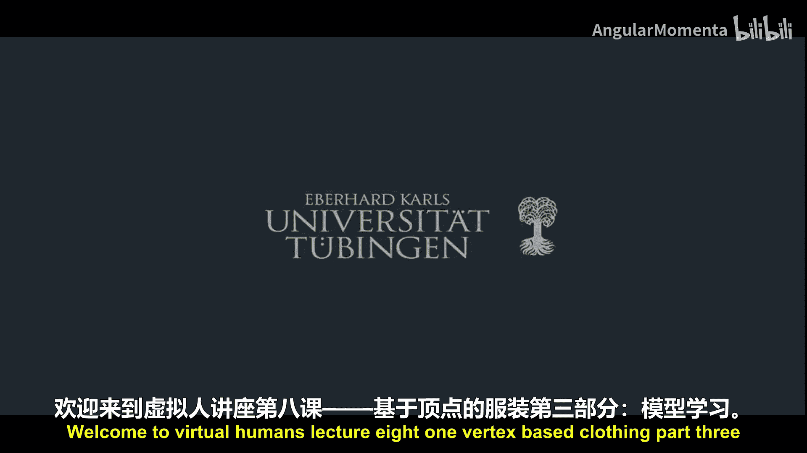
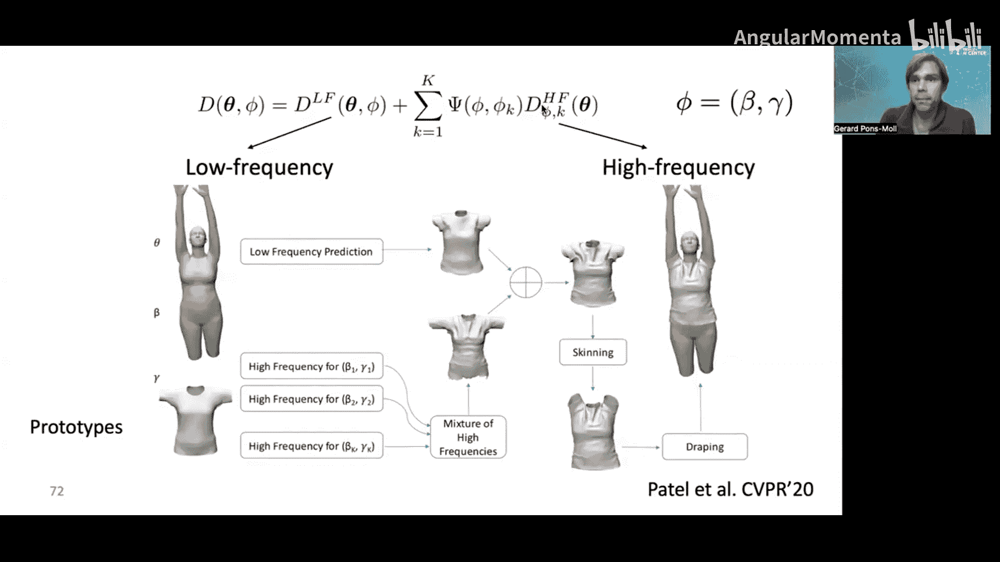
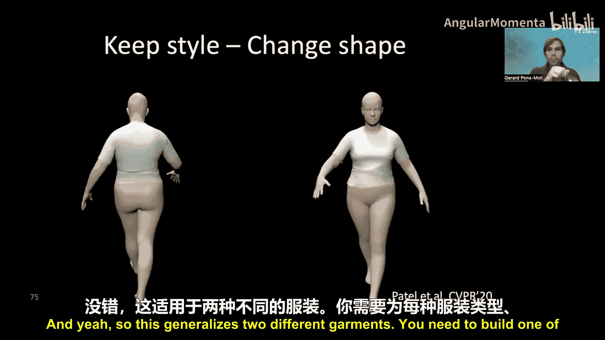
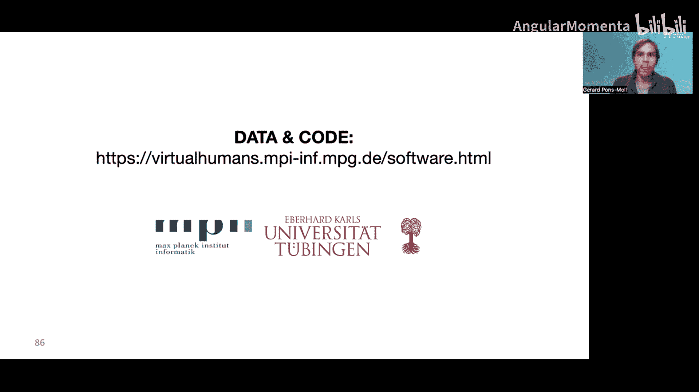

# 【精译】蒂宾根大学《虚拟人类》-p16-08.1-第3部分-基于顶点的服装学习模型--BV1TAbkzpEva_p16-

Welcome to Vitual Humans Lecture 81， vertex based Clo， Part three， Learn a Model。

So we've seen how to use this vertex based representation of clothing in order to perform registration in order to do thread reconstruction from images。

Now we will see how to learn a model of clothing， this means like a model that allows us to generalize to new poses。

 see how the clothing deforms according to pose until now we assume that clothing does not change。

 but this is not really true。And also how to have a model that can allow us to control the geometry of Ch。

So this is what we mean by a model。So the first model of clothing。That generalizes to new shapes。

 new poses and new styles was the paper called Taylornet and this paper is。

Learning these clothing deformations using physics based simulation so the basic idea is to run physics based simulation。

To obtain training data and then learn a model。So why would you do that？

Physics based simulation requires specialized software， a lot of expertise。

 and it often breaks if the parameters are not well tuned or if there's like some。

In unexpected intersections。And also more importantly。

 perhaps is that it's not trivial to differentiate these models and that's because like。

The physics simulation depends on the previous frame and if you want to。Obtain。

The dependency of like you know what happened in the first frame like to see how these effects in the1 hundredth frame have to propagate this over time and this is not trivial。

Um。😊，So if you learn a deep learning model like you obtain a model that is easy to use that is differentiable and allows to produce control and as long as it's generalizing。

 it's not going to break。So that's the idea so first of all let's look at which representation we use here so we saw that we can apply these displacements or we can cut the mesh into pieces in order to separate the different garments and this is the representation we use here。

 which is based on this clo cup。Representation。So here we want to learn a function。

That produces clothing geometry。As a function of the post， shape and the style。Right。

So this is what we show here that the basic idea is that for one shape， you have one style。

And if you change the style like for example the tshirt gets larger here right now the exact same t-shirt on a bigger shape should look smaller right it should be tighter and this is what this model is capable of doing notice this is the same t-shirt as as here and now here's much tighter and you can also change the style like and allowing you to for example like change the length of the T-shirt and you of course want to generalize to different poses of people。

So how do you do this Well， first of all you need to generate the data and and to obtain like a diversity in terms of the geometry of clothing you need a different。

3D geometries of clothing and for this we use these garments of the multi garment net which we covered in the previous work。

 which were obtained from 3D scans of people in clothing by segmenting them and imposing that。

So you have to first get a 3D scans of people。Segment them out and un postse them。

 bring them into alignment。The same way as we did for the simple model。

Then you need to run physics simulation on the garments。

By varying the shape of the person underneath so you can apply this garment to different people。

 change the shape and run physics simulation in order to drape the model like the garments onto the body to simulate how this garment would actually look on a person。

Then you want to build that variation and for this you can do PCA on these garments in order to have a space of possible garmin geometries。

And you need to do this for every single garment that you're going to model。

 so you have to divide the space into you know t-shirs with jar short sleeve t shirts that are long sleeve or sleeveless and so on so this is a categorical model you don't have a single model for all possible garments in the world you have one model for every type of garment topology top and garmin cut as well。

So then the style parameters are controlled with PC coefficients， gamma。

 which control like this like the sleeve length and how white a T shirt is， for example。

 or like some pens are。So now you want to build like a model that also generalizes to new poses and for this you need。

To see how the garment deforms according to different poses。

 so what you can do is to apply this garment into into a canonical pose and then do physics based simulation by changing creatingd a a motion sequence。

 synthetic motion sequence by interpolating poses from the post data set of the simple model。

So you will consider these poses and interpolate the poses over time。

And then the physics based simulation in order to obtain like the garment， de' forming over time。

And this will allow us to produce like different。Ps of 3D poses and the garment on that pose with the correct deformation。

You can also vary the shape smoothly along the path such that you know the physics simulation needs to adapt both to the pose and to the shape at the same time to obtain more variation。

 this is one way of making the network generalized better。

And you need to do this for multiple styles like T shirts， pants， short pantss， long pants。

 and so on。So this and also for different variation of the PCA parameters for each of these categories。

So this creates a variation over post， shape and style。

 and then once you've obtained all these simulations。

 you need to unpost the data and learn the model in this unpost space for the same reasons as we did before。

So how do we learn this model well the first thing that you should try is the easiest thing first right and okay the easiest thing might be a linear model but this is not going to work very well because the clothing deformations are not linear in the pose there's like non rigiddge effectss。

So you might try like a two layer neural network with a multilayer perceptron， for example。

 or a three layer neural network， so you give the parameters of the post。

 the shape and the style encoding the particular geometry of the garment。

And you have to learn one of these models， one of these neural networks for every type of garment。

 so for every like for t shirts， for long sleeve， for pants and for skirts and so on， right？

And so you learn a mapping that goes from the post shape gamma to this m times three vertices of the garment。

Now， will this work？Well， the empirical observation is that MLP generalizes well to new poses。

 so that's good news and this worked better than what we expected。

 but it produces like overly smooth results when it's traineded over multiple shapes and styles。

So the hypothesis here is that this is happening because like high frequency wrinkle patternss vary a lot depending on the shape and style of the same for the same pose。

 so you might have the same pose， but if you change the style or you change the shape。

The wrinkleo patterns will change a lot and it's going to be very difficult for the network to basically combine like how different styles。

And like the garment definition for different styles for a given pose。

 it's going to very be difficult for the network to figure out what's the pattern there。

 maybe there is no pattern because like if you change the style。

 the wrinkle patterns for a given pose will be completely different。So if this is the case。

 it makes sense to only combine， like to know how it will generalize for a new post。

 to only combine style shapes。That are similar。And this is the basic idea of this work。

 which is called tailornet。So essentially now， like the deformation is going to be。

Predicted using a mixture model。So let me define a new variable to make the notation a bit easier。

 so this is this five over here， which is a pair of a tuple of shape parameters and style parameters。

Again， style parameters are for a given garment category， for example， like for tshirs。

 it would determine how white the t-shir is or how long the sleeves are， but it would not go from。

 for example like short sleeve to long sleeve， right？

So now like what we're going to do is we're going to predict for a given pose and shape style。

 right we're going to predict like with a single MLP。

 this low frequency version right which is going to look something like this right which does not have like the high frequency patterns。

 but it has like the overall deformation。Of the clothing。

And now what in order to model like these high frequency patterns。

 what we're going to do is a mixture model。So a mixture model is like linearly combining the predictions of different。

Of different shapest models， so we're going to have like a series of prototypes。

 one for every shapet prototype。So one prototype is a pair of。Shape and。Garment style parameters。

 and we're going to have K prototypes。And now to predict the output。

 we're going to have these kernels that measure how close my particular shape style。

And queryrry is to each of the shape style prototypes。

And this is going to be this kernel that weights higher if the distance is smaller and weights lower if the distance is higher。

And so this is going to be a weight that multiplies this prediction for this shapet prototype。

 and this is going to linearly combine。And we're going to have a very narrow kernel。

Sa that we only add up the contributions of very similar looking shape style patterns。

 and this will allow us to only combine。Similar shape style patterns and not smooth out all the wrinkle patterns break by different models that's the basic idea。

So basically here you have this mixture of high frequencies with very narrow band kernels and this low frequency and you can add these two things in order to obtain this unpost wrinkle Thir。

 which you can then skin using the simple model。And this allows you to obtain this post。

A character including the wrinkleo patterns。Yeah。So yeah， so here we use this idea of using this。

 this is called a mixture model， right because you have a mixture of。Of models。

So let me show you some results， so this is some generalization to new poses and。

What is quite nice is that this is trained with static poses。These poses that I showed you before。

But the model like is capable of predicting a temporal coherent。Prediction。

So there's no temporal dynamics here， it's just for every pose。

Shape and style it predicts an output and of course it would make sense to what the temporal dynamics。

 but it's also。Useful to have like this quasi static effect so for a given pose。

 what are the wrinkle patterns？Because for example。

 if you're estimating human shape and clothing from a single image， you might have only one frame。

And you might not have the video sequence， so that's why this is useful。All right。

Now let's look at how we generalize this two different styles。

 so here we're going to keep the shape fixed and change the style， so notice how。

The style changed right so that the length of the T shirt I hope you noticed changed。嗯。

As a function of the gamma parameter and notice how the fit on the body also changes so the network is predicting different poses based deformations based on these different shape styles。

And you can also。Change， keep the style fixed and change the shape， as you can see here。

 So as the body gets bigger than the。T shirt gets tighter on the body， as one should expect。

And yeah， so this generalizes two different garments。

 you need to build one of these models for every garment type， so for every garmin category。

So we had one for skirts， one for long sleeves。One for T shirts。

 one for short pants and one for long pants。And so this is perhaps a disadvantage that this is not a compact model。

 but on the other hand， it makes sense to。To separate。

This models for every garment because the deformation patterns might be completely different depending on the garment category。

And what is nice is that it produces this layering on top of the body， which as we。

Noted before is advantages for a number of applications and you can like see that you can obtain quite realistic clothing deformation results。

Using this relatively straightforward model based on MLP。Or a mixture of families。

So here's a demonstration of how the model changes when we change this shape。

And we keep the style fixed。And。Notice that the wrinkle patterns change。

Smoothly and all the suny switch and it's because of the mixture model and this might happen when the mixture modes change over time。

All right， so this is。Taylornet is a fairly simple model that is available。

 like the code is available and if you want to play with it。

 I suggest that you would just download the code and play with it with the data。

So this was a paper from CPR 2020 and I think it's still useful。

 but there's other papers that are more sophisticated， for example， like SnCC。

 which is a self-svised version of TaylororNe， so in TaylororNe and other models。

Like the idea is to generate data with physics based simulation and entry。

And s snackug the idea is to use physics simulation within the training。

 so essentially that's what other people do right including tailornet like they have like this physics simulation reconstruction and then basically you have like an input。

Parameters and the neural network that breaks the output， right？And。😊。

Producing this data is time consuming and in SNG， like what they realize is that you can have the physics simulation within the training group。

Such that you have this self supervised loss such that the neural network is consistent with the。

With loss of physics。So this allows like self supervised training and like faster training。

It's probably more tricky to implement this pipeline because you need to have the physics simulation in the loop of the training and I can imagine that this is not so easy to do。

 but it allows you to reduce the training time from 17 hours to about two hours。

And the inference is about the same。是。All right， so then we have， for example。

 like from metata and Facebook we have a model that is also based on vertex displacements and a representation that is similar to cloth cap。

 so here they basically obtained multilateed registrations using a loop using a pipeline that is similar to cloth cap。

Where。Yeah， they estimate these these different garments layered on top of the body and then using these multi layered registrations。

 they train a neuralle network。That essentially。It predicts the geometry and as well as the view dependent texture。

From。From this input。 so essentially they have a Ve that。Well on give me one second。Exactly。

 so they have two networks one to predict the body under clothing so this is as a function of the skeletal pose and the facial key points and then they have another network that predicts the clothing on top of the body and this is based on a VE and the VE encodes both jointly these。

This texture view dependent texture and the geometry。

 so with this latent code like they push this to the decoder and obtain a view dependent texture and this un post geometry which then can be posed using the simple model or an LBS model。

So the thing with the BA is that you train the encoder and decoder jointly and then basically。

Test time， you just drop the encoder， and then you just can sample。

From the latent code in order to produce samples from the distribution。Okay。

 so these are like two examples of other works that are based on vertex based displacements and in this like idea of layering the clothing using displacements。

 I just wanted to show you this more recent results and notice that these are subject specific models。

 but still like the quality can be quite compelling， as you can see here。So。This is。

Vertex based displacements and。The good thing is that it allows you to have control。

 they are compatible with graphics pipelines， we have things into perfect correspondence so we can do easy things like transferring clothing from one body to another。

 changing the texture， things like this。However， the main problem is that for complex topologies。

 we're going to have a problem because like。As we've seen。

 these models are based on a single topology， these models are not capable of producing different topologies。

At once。Um if we want to model like really wide clothing like skirts。

 this is going to be also a problem with vertex displacements。

And if we want to model like general objects， like。

Laptops or tables and so on with a single vertex based model。

 it's not going to be possible because you cannot obtain every possible object in the world by just applying vertex displacements to a main shape。

So these are the main limitations of these vertex displacement models。So basically。

 the conclusions are that。Clothing is much harder than modeling and dress bodies。

You have to think of the representation。How to do registration， image fitting。

 how to build the model like we have to think whether you build the model。

For each garment category or you build a joint model， you have to do with topology issues， texture。

 cuts， geometries， and so on。So vertex based models require registration of the training data。

 which we've seen is difficult， but it does bring advantages。

And basespace parametric models like S are powerful and they are easy to use and control and they are compatible with graphics pipelines。

But they are limited to one topology per model， and this is hard to produce。

And they are hard to train to produce detail。So the next lecture we're going to see。

How to address some of these issues with implicit surface models of clothing。

And it's not going to be a win all technique because we're going to gain in terms of detail and in terms of flexibility to produce different toppologies。

We're going to lose a little bit in terms of control and in terms of memory consumption。

 and it's nowadays。Implicit surface models are more popular， but I'm not。

Hred percent sure that they will completely。Thisplays the vertex based models like because I think there's some advantages to them like for example。

 like this ability to control。To change to map clothing from from one body to another or change the texture or plug them into computer graphics pipelines。

That to me， is not clear。That these implicit surface models like that it's not clear they have these advantages。

All right， so this is all I wanted to talk about perfect based。Clothing models。

 these are the main papers in this lecture， there's many more papers these are mostly based on the works coming from my group and collaborators。

Um but you can check the references of those those papers as many more papers on that topic all right。

 so yes， if you want to play with some of these models they are。

Indeed you can find them under the following link and this is all I wanted to discuss about Vertex based。

Clothing models in the next lecture will see neural implicits to represent surfaces。

Implicitly with a neural network。

All right， thank you， bye bye。