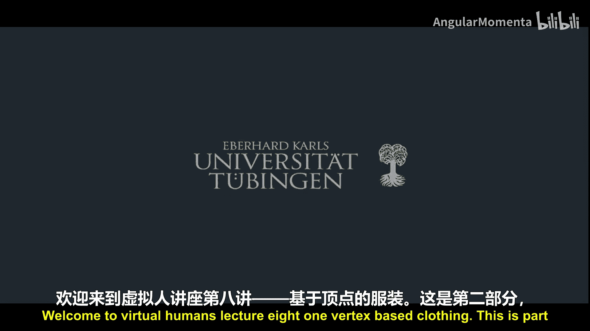
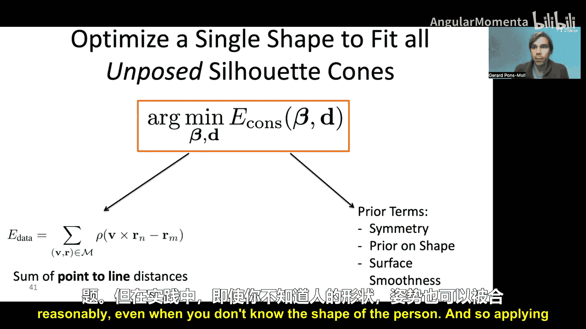
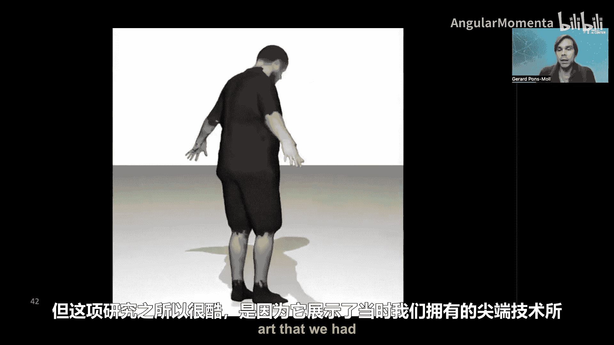
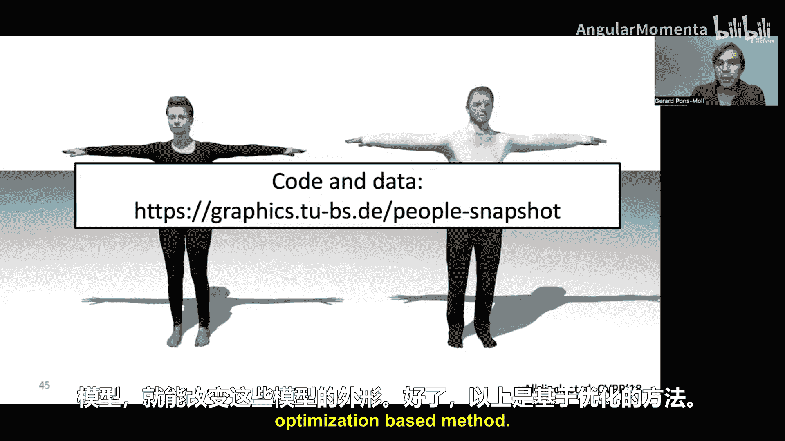
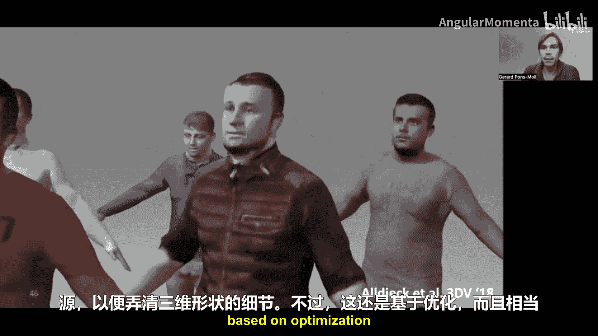
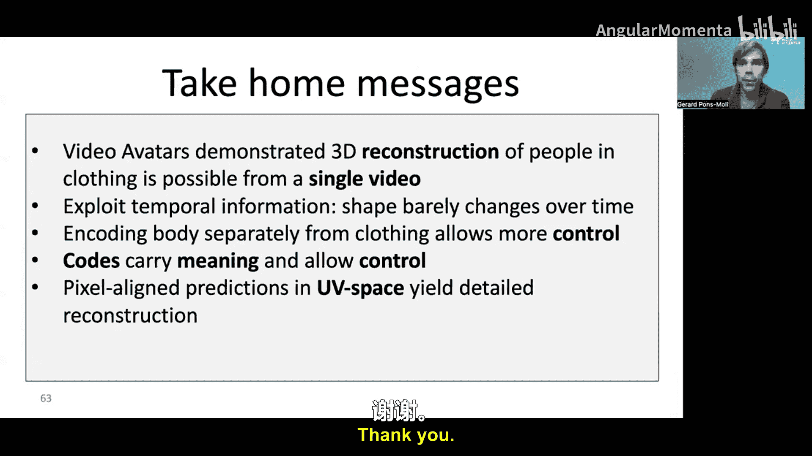

# 【精译】蒂宾根大学《虚拟人类》-p17-08.1-第二部分-基于顶点的图像服装--BV1TAbkzpEva_p17-

Welcome to Vit Human Le 81， vertex based C， this is part two， people in clothing from images。

So in the last lecture， we saw how to represent clothing using vertex displacements。

 and then we saw how to use this representation to obtain registrations of scans。

 including people in clothing， and we saw how to change the representation to separate the clothing into separate garments and estimate the body shape under clothing。

Um。In this part， we will see how to estimate 3D human models of people in clothing from images。

So back in 2018 it was not possible to reconstruct automatically 3D models of people in clothing and this is perhaps the first paper that demonstrated that this was possible。

 so in this case this paper was assuming a single video of a person。Roating in front of the camera。

And the goal here is to reconstruct like an avatar， like what you can see here。

 which can be edited in terms of bows and shape。So the basic idea is based on optimization right so the first thing you might think is well I have a video。

And the clothing and the shape of the person barely changes when we rotate or when we move。

Because the only thing that changes is the pose。So one idea might be， okay。

 I can set up an optimization framework in which I optimize the pose。

 the shape and the clothing displacements。Overall， the sequence。

Now I'm going to have one post theta I for every frame I right and for every frame I'll have like a measure of how wellm model fits the data。

 this is similar to this paper that we saw in the previous lecture in sparse inertial P where we were using I use here were using images so the fitness measure。

Is basically some distance of the rendering are of the model M that depends on the parameters that we're optimizing over。

 theta I， beta and D and the image itself right and this distance measure might be a silhouette overlap。

Or the overlap of joins or like comparing edges。Things like that。

 right comparing predicted features with detected features in the image。

Now one problem with this formulation is that you have to optimize all the poses at once。

So this is like in principle， it's low and it's memory intensive because you have to load。

Like all the simple models for every frame right you need one model for every frame and you need to update all these models simultaneously and this is typically memory intensive。

It can be done efficiently， but it typically requires writing specialized code for this optimization。

 which is perhaps not very convenient。So there's another way of looking at this problem and this is what it was shown in this paper from CBPR 18 which was called it goes under the name of video avaars。

 so there is a classical computer graphics technique to reconstruct 3D shapes from multiple views。

 which is called visual hall。Reconstruction， so basically like a standard visual how assumes a static object and multiple views looking at the object as you can see here。

And then like what you can do is like you can shoot race from each of the camera centers。

 these are the camera centers。And and you can shoot a ray that goes from the camera center to the silhouette。

 right one of the silhouette points， and this creates what is called like a silhouette comb。

 right it's the cone that goes through the silhouette。And now by intersecting this。😊，Cones。

 you can obtain the 3D shape。Another way of looking at it is you can like voxalize the 3D space and then basically you project the voxtos into each of the camera views and if it's overlapping with the foreground。

 it means that it's part of the surface interior if it' not it means that it's part of the surface it's part of the background and like this you can reconstruct。

The surface， right， this is visual hole reconstruction， very simple algorithm。The problem， however。

 is that the person is moving here right so the poses are changing so we cannot assume a static object so we need to compensate for this。

And notice that we know how to estimate a 3 human model using the simple model at every frame。

 but we do not capture these clothing details so notice that the simple model does not explain the clothing。

So what can we do about this， what can we do to estimate the clothing and without having to optimize for all the poses at once？

So the idea is basically based on the visual hall and。In plain terms what？

What is been done here is to generalize the visual how to articulated objects。

 so the visual how assumes the static object here we're not going to make this assumption。

 we're going to relax this assumption and allow the object to move according to articulation。

So here the silhouette rays right are shown that go through the camera center and the silhouette。

 and then basically you can obtain a correspondence to the surface of the model。

Right these are these arrows indicated here so every ray is associated with a single body model point and what we're going to do now is to unpost this rays that go from the camera and the silhouette。

In order to optimize a single shape regardless of the pose right so you remember this imposing trick that we did to learn the simple model。

 this is like perhaps you could think of it as a generalization of this when you have like not the full3D scan post。

 but you have just a silhouette of a purse。So here's the idea。

 you should this race associate the race with the 3D model point。

And every three model point deforms according to the kinematic chain corresponding to this point according to the simple model。

 so basically like now the rays are going to deform。Jointly with the simple model。

 so we are impossing the race。So why would we do such a crazy thing？

The cool thing now is that this race。Are setting up constraints on where the body can lie in space right but they do not depend depend on the pose because now we havet postd the race right so the key idea is to transform the silhouette cones according to the inverse of non rigid motion。

How does this look mathematically Well， we have like a array in economical frame。

 this is what we want to obtain R and we have the array in the post frame， which is R prime。

So what we need to do is to apply the inverse transformation。

That is applied to the vertices of the model， so this ray will be associated with a vertex。

This vertex will have like its transformation matrices， JK and its blank weights WKI。

And so basically， this linear combination。Of transformation mates that come from linear plane scanningning needs to be inverted。

 that's why you have this minus one and then after inverting the articulation you need to invert。

Subtract the contribution of the post blank shape， okay？So essentially， this is like。

Moving a vertex forward， but moving it backwards and not applying it to a vertex。

 but applying it to a array， right the line。And once you've done this， right。

 you have transformed the array in the post space to the canonical space。

And this is an idea that like hopefully starting to become familiar to you because it appears over and over。

 this is the idea of impossing in order to estimate the properties of the shape。

 regardless of the pose， which is the same trick as what we did for learning the simple model。

And we will see this trick happening more often here。

 perhaps like it's slightly more interesting because we have like this race and these constraints that come from silhouettes。

So now here's the basic optimization now we have like an arc mean over the shape parameters。

 only set of shape parameters because we assume that the shape is constant over time。

That's in practice not exactly true， but you know it's a reasonable assumption and we have like the optimization over the displacements for the clothing。

So which is also consumed constant over the sequence。So what is the data term， well。

 this is going to be like the distance from the race to the corresponding vertices in the model and this is given by this equation over here。

 this is a point to line distance of the ray expressed in plur coordinates。嗯m。

You don't need to get into these details， but just believe me that if you do V cross product Rn minus Rm where the race expressing Plur coordinates。

 you have like a sum of point2 line distances。And then the prior terms are basically enforcing symmetry in the shape。

 and we have a prior in the shape which is based on this PCA space of the simple model。

 and then we have surface smoothness over the shape， which if I recall correctly。

 this is also based on some blacklashian regularizers as what we saw for cloth gap。And。

Maybe I should mention let's go back here so notice that once we have imposed the array this objective function does not depend on the pose and this is great because now the optimization is much quicker and it will produce the desired results without having to optimize overpo now the trick here is that of course。

If you have wrong poses， then this shape optimization will not be correct。

 so you have to make sure that the poses are accurate in the first place。

But that might be difficult if you don't have a good shape model in the first place。

 so you' have a chicken and egg problem， which you might solve by fitting the poses once optimizing the shape and then reffitting the poses。

But in practice， like the poses be can be obtained reasonably even when you don't know the shape of the person。

And so applying this method like one leverages the temporal information and we can recover the 3D shape of the person。

And along with op poses。And。So these results were we were when we obtained these results。

 we were quite happy and we were quite impressed by the quality of the results nowadays。

 you can get much more detailed reconstructions and even from a single frame。

 but this was cool because it was a demonstration of what was even possible using the state of the art that we had at that time。

And yeah， so basically like one can use this method to reconstruct a wide variety of people in clothing。

 not very wide clothing， but notice that， you know。

 there's some like large hair variation and like white clothing。

 but like things like skirts and so on because we are based on displacements。

It's not it wouldn't like the quality wouldn't be very good。

And because this stems from the simple model， like then you can apply posess to these avatars and you can make them change the bowse and you can also change the shape of these avatars。

U it's shown here， right？Because the displacements are applied on top of the simple model。

 so you only need to change the simple model in order to change the shape of these models。All right。

 so this was an optimization based method and even better details can be obtained using a method that is based on shape from shading if you're interested in this you can check the literature on shape from shading it's basically looking。

I'm trying to estimate jointly the normals of the surface and the light。

Sources in order to figure out like the details of the 3D shape。嗯。😊，But again。

 this is like based on optimization and it's fairly involved。

So basically the limitations are that the optimization can be stuck into local minimas we've seen for other methods。

And。Perhaps the biggest limitation is that clothing as a single offset is limiting because you cannot separate the body from the clothing so you can for example。

 not retarget clothing from one body to another that' some limitation and the other limitation is that of course it might get stuck into local minimum。

So there's no like real learning here other than just detecting the key points of the body in 2D in the images right and segmenting the human body from images。

So then later， one year later， what people started looking into。

 including our group is basically like。Like。Departing from the purely optimization methods and like including learning。

And essentially this， you can think of this as adding a front end right that given the image will predict like the parameters of the model。

 and then you're going to train this， if you do not have 3D data。

 you're going to train this using a selfservised loop where you start from images。

 you predict these parameters of your 3D model。With a convolutional neural network。

 and then you push this through a 3D differentiable model like simple plus displacements。

 and then like you have the 3D model of the world and then you render back into the image and then you basically ask that this consistency loss is minimized。

So it's not so different than the optimization problems that we had before。

 but notice that now like the parameters data， beta and clothing are parameterized。

A a function of the image and the neural network parameters is Lada。

And this allows us to train over multiple images and videos of people， principal。

So these are some examples of papers following this paradigm and you might check them out。

So this paper is basically like the extension of the video avatars paper。

 but using the self supervised loop。This paper， MGN， we would to cover with the next slide。

 separates the clothing from the body。And this paper called Deepcap。Like it's it's subject specific。

 but it allows to track people in clothing also including like nonreitive formations quite robustly from a single video so if you're interested in these topics I recommend that you read at least these papers and perhaps related papers so now there's there's several works。

So。And。For the purposes of this lecture， I'm going to cover these multigarment net because it's the one paper that separates the clothing from the body and I want to focus on the advantages and disadvantages of the different clothing representations。

So here the goal was to obtain a 3D avatar of a person from single images of a person post。

The setup is like the same as before like a person rotates in front of the camera and then you want to reconstruct the body shape and the clothing from those images。

 but now you want the ability to like。Display the clothing from one subject to another。

 so you want to reconstruct this subject from the images。

Get this closing piece and map it into the target subject as you can see here。

 so notice that this jacket is the same and this jacket is also the same。

In order to obtain this level of control， you need a model that separates the garments from the body as what we saw in the cloth cap paper。

 right？And now we're going to do this from images， which is going to be more challenging。

So in terms of representation， again， similarly as before。

 you need to cut these garments into pieces and estimate the body shape under clo。Now。

 doing so requires doing registration and this is a very difficult problem because if it was already difficult。

With people without clothing， imagine how difficult it is if you have different kinds of clothing。

 different topologies。Different garments， different shapes， different non rigid deformations。

 it's going to be even more difficult， not impossible to solve but really difficult。

So imagine you want to build a model of a T shirt。You need to segment。

The scans into garments estimated shape under clothing similar to cloth cap and now non rigid register each garmin template to each scan right of course you're not going to register the template in isolation you're going to use the body because that's going to make the problem much better behaved。

But still like this problem is quite difficult， you will need to unpose scans and do these things that we've seen several times。

And using a sophisticated optimization pipeline， which was。Like quite like labors。

 we were able to register a data set of three people in scans。あ。

33 people data set of scans of people in clothing and this allowed you to， for example。

 like take one garment and map it to different like scans of people right notice that you have this level of control you can just change the pants and the Tshir or jackets and this is done using like cloth cap basically like you estimate the body shape you estimate the garment on top and then you transfer the displacements from one mesh to another right now the question is how do you do it with images right？

So the setup is that you have source， you have eight images of a person turning in front of the camera and you have a target scan and you want this 3D cloth mesh and how this is done is using this selfsvisible。

You first get the images and you parse them into 20 key points and semantic segmentations of the person。

The reason this is done here is because there's not enough data to generalize to all possible variations of texture and clothing right so if you send these semantic segmentations to the network as images like the network will generalize much better to other clothing types for for example。

 it will not require。The network will not need to generalize to different colors and textures because those are abstracted away on this semantic segmentation right same idea as this no body fitting。

 this is applied here。So basically now you have like different heads for each of the garments and a head for the shape and the pose of the person and then basically you combine these predictions and essentially like you have like。

For the garments like you have a PCA model as well like where these are the eigenvectors and these are the cons and like this you can obtain the garment plus some additional displacements that are predicted by the network in order to be able to。

Represent things beyond the PCA space， right？And you combine those like predictions and then you basically close the loop using a self supervised loss where you have like an overlap of the。

Sevantic segmentation in terms of the prediction and the ground truth。

 and if you have a little bit of 3D data， then you can also apply supervision on the 3D。

The 3D scans directly or 3D vertices and if you have like registrations right you can apply a loss on the pole shape and translation garment parameters。

So this is like like a setup which is very similar to this neural body fitting where we had these different types of losses and here again the observation was that if you have。

A little bit of three data and then。Additional 2D data。

 then you can train this using this combination of these two modalities。Perhaps for clothing。

 you do need more 3D data than。For estimating just the bow and the。Okay。

 so now you have eight input images of a person rotating in front of the camera。

Similar setup as before， you can estimate body shape， the clothing。

 and then you can apply it to any body shape as you can see here， these are 3D。

Shapes from the scessar data set and those are clothed by just applying the displacements。

So perhaps which which is what is surprising here is that this very。

Simple and perhaps naive model of just applying displacements leads to。

Quite visually compelling results。 So for applications， like， for example， like I don't know。

 like gaming or sports events where you have to apply like。

A specific type of clothing to different body shapes， perhaps。That's this displacement idea is just。

It's perfectly fine。Right。So one thing that we did observe is that predicting these displacements directly as a function of the image is a hard learning task。

 and the reason is that these pixels here are in a space that is very disconnected from the space of like vertices there is no direct connection for the network to figure out what corresponds to what。

And this makes the problem difficult。So one way to make the prediction。

Like the learning problem better better behaved is to。

Is what we did here in this work that is called textex to shapepe。

So it is called detailed full human body geometry from a single image。Fromm a single image。

 exploiting UB mapps。The idea here is to turn the3 construction problem into an image translation problem。

So there were a series of papers that。We're leveraging these image translation networks。

 which would take an image as input， for example， like a semantic segmentation and the network would produce like for example。

 like a full image including texture and like a realistic image right and or for example you could give an image of an edge map。

 an input and then the network would reconstruct。Like a full realistic image and those were like based on this architecture。

 which just goes under the name of picks to picks。And basically this was very effective and it turned out that convolutional networks were very good at finding these mappings from image to image because you have a perfect pixel alignment。

 like every pixel and input has a corresponding pixel at the output。

So here the idea is to turn this three reconstruction problem into an image translation problem。

And the question is how you do that？Well here we leverage UB mapps。

 so for those of you who are still not familiar with UB mapps。

 basically this is an unwrapping of the three shape of the person into a 2D image so the same way you can unwrap like a world map into an Atlas right？

This is exactly let same， if you take the 3D surface or the 2D surface embedded in 3D， you cut it。

And basically， then you unfold it and you flatten it into the image。And how to do this automatically。

 this is a research topic in itself here， we used an artist's design UB map so there's an artist that knows where to cut the surface and how to map it onto the2D image。

Now every pixel in this2D image。Has a corresponding 3 d point on the surface。

 which means that you can store here whatever relates to the 3 shape。You can store， for example。

 like displacements or you can store normals。And the cool thing is that you can have a very high resolution image。

And then when you want to render this， for example， like with very high resolution normals。

 you can just look up the normals in this image， which is much more efficient in terms of data structure than storing the normals on the mesh because you would need a very high resolution mesh to store all the normals。

嗯m。So yeah， I mean， essentially you can think of a UB map as a convenient data structure， right？Okay。

 so we know how to represent shapes。As an image because I can store here the displacement from an average smooth shape。

 for example， like the simple model。I can store at every UB coordinate。

Like the displacement from the smooth simple model to the target shape that I want to represent like for example。

 like this shape with details。All right， that's the output and now。

How do we get from an image to a UB map for presenting the image that is aligned with this UB map storing the displacements and normals of the shape？

Well， there were papers。That were called dense rack and dense pose and so there were a family of papers that were learning a correspondence map so they were learning for every pixel in the image they were learning what is the corresponding。

Like coordinate right in the UB space right so essentially this allowed you to unwp directly the image into a UB map of the visible pixels。

So notice that this UB map。Is incomplete， it has some missing parts。

 and that's because like the back of the person is not seen。

So now we can leverage this UV transform to go from image pixels into a UB prediction right from a neural network。

 and we have this output which is are the normals and the three displacements and we can using this pixel to pixel translation network we can directly learn the mapping from these pixels to these normals and three displacements。

Now why are we doing all this instead of just going from the input to the output well because now we have like one to one alignment。

 the eyes in the input are aligned with the eyes， the output。

 the nose and the chest clothing is aligned with the 3D geometry of the chest clothing and so on and this turns out to be very very convenient for a neural network because it can look much more at different levels of locality it can look at local structures and global structures and neural network is ideal for doing this。

So these are some results， so these are 3D renderings of scan and this is the ground truth in gray and this is the reconstruction from the neural network in green。

So notice that for the front part， the results look quite detailed for the back part。It's。Yeah。

 it's also quite detailed actually。So to train this， this is based on。

Perceptual losses and also gun losses in order to obtain details in order to deal with the multimodality of the problem for these details。

 I do recommend that you check out the paper。And although this was traineded with only threeD scans of people。

 this generalizes to images of people in the wild。And what is quite remarkable is that it also generalizes to any or to a wide variety of casual poses。

So notice that the post can be anything， but because these UB maps are these displacements and normals on this canononic pose。

 then this。This is basically invariant， I mean， somewhat invariant to both。

 right though it's learned to be invariant to both。嗯。

All right so in order to generalize from synthetic data to real data。

 I don't have time to go into all these details， but of course you need to play with augmentation a lot。

 you have to apply a lot of different lightings to the three renderings， a lot of viewpoints。

 a lot of shading and so on， otherwise it will just overfi to whatever the lighting conditions of the rendering where for the training process。

All right， so this is about reconstructing in one shot using a neural network like 3D avatars of people。

 and this is much faster than these optimization methods because like the neural network just takes a few milliseconds to produce the output。

All right， so we also used a similar idea and here we learned to map。

 So one problem was that it's very difficult to obtain textures a wide variety of textures of people from。

From 3D scans of people in different textures， it's hard to capture。

And we realized that there's a lot of clothing images from like clothing stores。

 and so we want to learn a model of like。Possible textures of people without thought it might make sense to learn to map directly these textures of clothing images directly to 3D models of people。

And one additional advantage is that this allows you to do some sort of virtual try on and this is what we did we learned with a neural network。

 we learned to map these pixels and the clothing images directly to the UB map。

of the simple model for different garments， and these allowed you to just take clothing images in the store and then just map them onto the simple model to obtain these textured avatars。

Yeah， so if you're interested in this， I also suggest you check out this CBPR 20 paper。Okay。

All right， this comes to the end of。estsimating 3 d people including from images。

 so the take home messages using vertex displacements。

 the take home messages are like video avas demonstrated that three reconstruction of people including is possible from a single video。

And。If you want to exploit the temporal information。

 you have to use the fact that the shape barely changes over time。

 so this is something that you can exploit always。And encoding the body separately from the clothing allows more control。

 as we've seen like it allows you to apply for example， like one garment from one body to another。

And。It's good to have codes that carry meaning and low control like this， for example。

 dis separated bodies and garments。And we've seen that predicting directly vertices is not so easy。

 especially if you want to predict detail， and pixels and aligned predictions in UB space yield more detailed reconstructions while allowing you to then apply different poses to the model。

 different shapes。We will see another class of techniques which are based on implicit surfaces。

 which allow， I would say even better detail than these UB space methods and this we willll cover in the next lecture where we will cover neural implicits。

But this concludes part two of this vertex based clothing and estimating people in images now let's take a break and let's continue later with learning a model of。

Clothing。Thank you。

