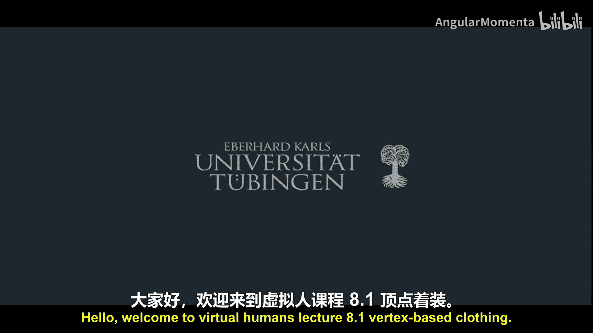
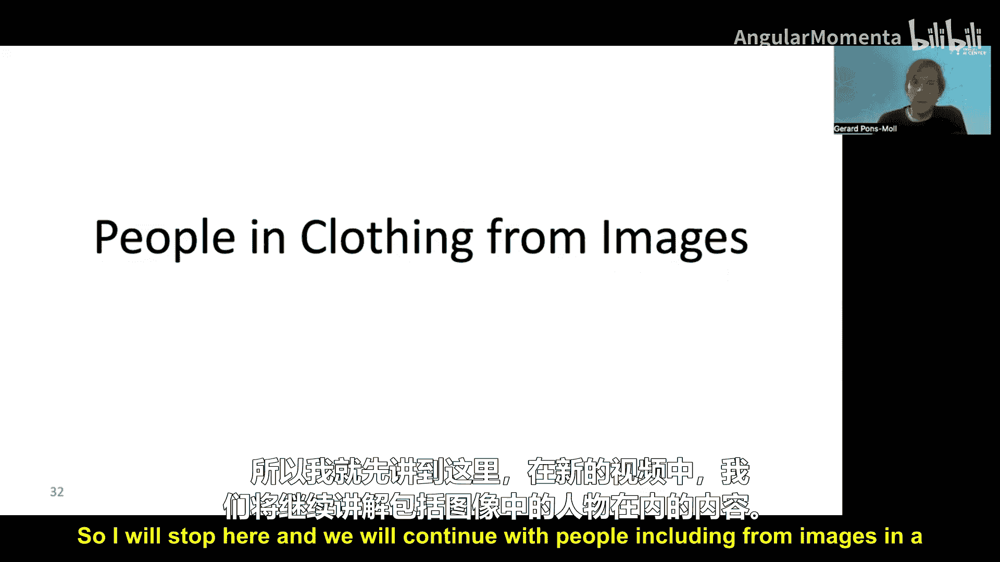

# 【精译】蒂宾根大学《虚拟人类》-p18-08.1-第一部分-基于顶点的服装---注册--BV1TAbkzpEva_p18-

Hello， welcome to Vit Humans Lecture 8。1 vertex based clothing。Yeah。In this lecture。

 we will see first how to represent clothing using vertex displacements and how to use this representation to do registration。

Then we're going to see how to predict people in clothing in 3D from single images。And later。

 we will see how to learn a model of clothing as a function of pose， shape and clothing style。

So let's look at the closing representation。We will see throughout the lecture different clothing representations based on vertex displacements。

 which we'll see in this lecture， based on implicit surfaces。

 which we'll see in the next lecture and also based on points and neural feature points and so on。

So let's look at vertex displacements， which is perhaps the most。

Basic version of the easiest representation。So if you remember like simple is based on blank shapes。

 this means that you add a set of vector displacements on top of a base shape in order to model like the shape deformations and postdependent deformations and everything happens in these canonical depo。

So now if we want to model clothing， we need to do something and the easiest thing we can do is to add a set of vertex displacements which will model the clothing。

So these vertex displacements will be on top of this base average。Shape on this canonical pose。

So essentially， if we know the displacements， basically you can go from a shape that is undressed to a shape that is dressed like you can see here。

 right notice a change。And we will see what are the advantages and disadvantage advantages of this representation。

 I'm pretty sure many of you are already thinking what could be potential limitations of this and we will see this throughout this lecture。

So first of all， like using this representation， let's try to solve some actual problems like。

 for example， register scans of people in clothing。

So the registration process for clothing is not very different from registering people without clothing because recall that the model could not explain all the details even when the people were not。

We're in clothing so the trick is to optimize for the model together with a set of free form displacements or free form vertices in order to gradually adapt to the scan so starting from a scan you the registration process works as follows。

We start the registration process by optimizing the model parameters， starting with some model。

 and once the model is close enough to the data， then the free form vertex displacements。

 this the matrix that I showed before kicks in and like this you obtain a registration。

So this registration has the same number of vertices as the simple template。

But now can represent like clothing on top。So。As you guessed。

 probably like the main problem of this registration is that it ignores completely the layering of clothing on top of the body。

So this means that， for example， if somebody's raising their arms and the clothing is like shifting along with the body。

 then this representation is not tracking these changes， but rather explaining these changes。

By shifting vertices like in the normal direction， but not really tracking in the tangential direction to the surface。

And this is of course， for many applications a problem， for some other applications。

 this might not be a problem and this might be a perfectly fine representation。

But if you want to play with texture or mapping clothing from one body to another。

 then there's something else you need to do， there's clearly a problem here。So。

One way to address this is the work we did with cloth cap where we segment clothing into garment pieces into separate meshes and we estimate the body shape under clothing such that we can track。

The body shape under clothing and each of the garment pieces separately and like this we are obtaining a multi layered registration which captures what like it captures better the。

The physics of this motion。So the first thing that you need to do is to estimate the shape under clothing and of course this is a challenging problem because the clothing is olu the shape。

However， one observation we made in 2017 is that。As the person moves。

Like the clothing will drape on different parts of the body and will be tied on different parts of the body。

 So notice as this person is moving。What I'm showing here on the left is the registration of the person moving and on the right I'm showing you this unpost registration。

 this is the motion of the clothing once we have factored out the effects of articulation out。

So notice how in the end post template， it's quite interesting to see that the clothing is draping on different parts of the body。

So you might think， well， for a single frame it's pretty ambiguous what the shape is。

 but if I see enough frames of a person moving with clothing。

 then these multiple constraints are giving me a lot of information about what the actual shape is。

And this is what we exploited in this work， which we called。嗯。Buff。And essentially。

 like what we do is we accumulate all these temporal。Frames of and post registrations。

 and we consider the union of all these frames， which we call like a fusion scan。

This fusion scan you can imagine it's like an onion with a lot of layers and essentially what you can do is you can set up an optimization and you can ask the model to be inside。

Of inside the convexhu of this union of registrations。

 because you know that the clothing cannot intersect with the body so you can optimize for the shape such that it's inside this onion。

 which we call like this fusion scan。And this is what we do。

 and this is actually quite accurate to obtain the body shape under clothing。

And it leverages this idea of exploiting the temporal information。All right。

 but this is only estimating the body shape under clothinging and we are interested in estimating also the gar geometry over time。

So this is the overview of this work that we called G G。

So the input is basically a sequence of 3D scans in motion which were captured with a 4D scanner we also manually define some。

Some labels on what we expect to like which body parts we expect to overlap with， for example。

 the Thir and which body parts we expect to overlap with the pen。

 so notice that this is a very weak prior in order to obtain better segmentation of the scans。So。

Then like given this input， we。We first segment the scans into。Pieces。

And then we basically register like a multi layered model of multi layered version of simple if you want to these scanned registrations。

So this is what clothC does， I'm not going to explain exactly how we do this scan segmentation because I think there's better techniques nowadays than what we did back then which was based on Markco random fields and using these body priors but basically the idea is to leverage the body information together with the appearance information of clothing in order to obtain a segmentation but I'm not going to explain this part I'm going to focus on these multipart registration in this lecture。

So this process is fully automatic and it allows you to obtain a registration。

 including the body shape under clothing and each of the garments tracked over time。So。

How do do we obtain these multipart me registrations Well I mentioned several times in the lecture that in order to obtain good registration you need a good model。

And simple is not a good model for explaining people in clothing because it does not have clothing。

So what we do here is we obtain like a simple model that is specialized for the subject that we are tracking so the first thing we do is we。

Segment the simple into parts。which correspond to the scan。

 so essentially you transfer this segmentation of the scan to the simple template from the registration。

 then you cut the simple into pieces and then you deform the simple model in order to explain the scan。

Okay，And so once you've done this， you have like a mesh that has been you， segmented into pieces。

But these vertices of this mesh， they stem from the simple model。

 and this means that we can use the simple function in order to change the pose or change the shape of this like segmented version of the simple model and this is going to be very useful to do registration afterwards。

So essentially what we do is we use this cloth template as our model。

 and then we deform this cloth template non rigidly to each of the scans in order to obtain this multilayed registration。

 that's the basic idea。So we perform this registration。In a way says that。

 you we capture also the non rigid dynamics of clothing。

 right like these wrinkled deformations that happen when we are moving。嗯。

So let's look a little bit more in depth at how this is done， so same as with uned bodies。

 we have like a data term and a coupling term。The date term is a scantomesh。Distance。😊。

This is similarly similar as what we saw for undress bodies。

 but now we have like matching of each garment with each garment and we also have terms to make sure that the post underneath is correct。

Then we have a coupling term which is coupling the registration which is this part here right to be close to our model and remember that the model is not the simple model。

 but it this specialized simple model which has been the form to explain like the first frame of the sequence and so it has clothing。

 but it does not have the nonre deformations over time so notice how for example。

 this wrinkle over here is missing in this average template right so the model can change over pose。

 but the pose only changes according to like this。Simple model。

 which does not know about wrinkled des and so on。So notice how you know theform in the registration is present but not present in the model which is why you have a difference and however you want this to regularize the process you want this registration to be close to the model。

 but you also want this registration to be close to the data right so we have the same tradeoff as what we had for registration of undresssed people。

Okay， but segmenting people en clothing is much harder and we need additional terms。

 so one term is a boundary term that at the high level means that we want to match the boundaries of this multi layered registration with the boundaries detected。

In the segmented scan， and we also want these boundaries to be smooth。

And then we have a laplashian term， which is making the whole surface of the registration smooth。

So let's look a little bit more in detail at the data term。

So the data term is minimizing the scan to match distance。

 but now we are not considering the whole scan as a piece， but we're considering the parts。

So essentially this objective minimizes a scantoome distance， right， a per garmin scantoome distance。

 EG。嗯。Whi measures the discrepancy between the garment from the model。

 VJ or from the registration to be accurate and the garment of the segmentation SG right so this is a scanto me distance between this can garment part and the corresponding garment in the model。

And the summation goes from Garmin one until N garmin so like。

Like this n is the number of garments that the person is wearing。All right。

 so this is the objective term and notice that we're solving a more difficult problem but the registrations will be much more accurate because now we have information about the segmentation and therefore this term will be much better behaved than if we would not consider the registration in separate parts。

Now。To make the garments in this in the model match with the scan。

 we also force the boundaries this marked here in black to match。 And for this。

 we have like a scan to curve distances。 So essentially for every。

Point in the scan Sr sorry for every point in the scan boundary， this boundary over here。

 for example， or this boundary over here， we want that this every point in the scan has a small distance to the curve。

Which is the rings， right， the curves， which correspond to the rings of the boundaries of the model。

So we have like this sum over the rings starting from ring equals  one until n。

 so these rings are ordered and we can know which ring corresponds to what。

And essentially we minimize these per garments canto curve distances okay so this is going to make these vertices of the registration like match and it's going to like allow us to you know deform the registration to track the boundary better otherwise you would not be tracking the changes very well。

Al right， so when you optimize these data terms， what happens is that the boundaries of clothing get really noisy and spiky and this is not very visually appealing and essentially you need to enforce smoothness。

 especially in the boundaries because this is very important for the perceptual quality。

So how can we enforce boundary smoothness well， if we consider a curve parameterized by the arc length S right。

 this curve is gamma of s such that for every s S is the parameter that parameters the curve which goes from 0 to1。

Like we have a different point on the curve。X of S， Y of S and z ofs。

If I have such a parameterized curve。I can calculate the squared curvature as the square terms of the secondary derivatives。

 so I can calculate the secondary derivative on the x dimension， y dimensions that dimension。

 I square them and I sum them up and this gives me the curvature。Right。

The curvature tells me the inverse of the curvature relates to the radius that fits the curve at that particular point。

All right， so we want the curvature to be small in order to have a smooth curve。

So to make boundaries smooth， we can minimize the curvature for each ring。

 so it's basically this equation over here， which in the in like。For a discrete curve。

Equals to the following。We have here like a summation over the number of rings， okay from 1 to Rl。

 but then for every ring right n iterates over the vertices in the curve， which is the ring。

 which might be， for example， I take this ring， for example。

And then basically you can calculate the second derivative using a filter1 minus21。

 so essentially this is calculating the second derivatives right it's the laplace operator in one dimension so you have like the vertex before me minus two times the current vertex plus the vertex after me right in the curve and this is giving me the second derivative。

So these vertices have x Y， z components， so it gives me the second derivative for x， Y and z。

 and when I take the norm squared it is exactly the same as the squared curvature here。

So essentially this term here， what it's doing is like minimizing the curvature of the ring。

 it would just optimize this like what would happen is probably that the rings would ring to a single point to minimize this term。

 but because we have other data terms， this is not happening。Okay， so that's the boundary smoothness。

 so if you want to have a smash with smooth boundaries， that's what you can do。Um。

 if you want to have an overall smooth mesh， which is important if you have like clothing with wrinkles。

You need to enforce this smoothness and this is done in a very similar way using a laplaian term。

 which is pretty much equivalent to the boundary term， but for the full me。

So for those of you who do not know what a graph application is。

 let me introduce some terms and definitions。So given a mesh。

 the adjacency matrix set is defined as the matrix such that its elements set Ij equal to one if the vertex VI and the vertex Vj are connected。

 and it's zero otherwise。So it's essentially a matrix a binary matrix which has once indicating which vertices are connected。

 okay it's one way of representing the connectivity of the mesh seen as a graph。

So now let H be a D matrix which where Hi equals to the number of neighbors of vertex I。Okay。

 so if vertex I has six neighbors， then h of Ii would be equal to6，So now we have。嗯。

That the graphal application is defined as follows。

It's the identity minus this diagonal matrix inverse。

 which is nothing else than inverting this number of neighbors at each entry。

Times this adjacents you matrix set， that's the graphal application。

And this is a pretty useful operator for meshes。😊，And it's a discrete version of。

The La Pla operator that you have seen perhaps in some mathematics lectures。

So what we do to make the mesh smooth is to minimize the laplaian term and the lapplian terms looks like this and we'll understand in depth later but bear with me。

 so we have some over garmin equal1 until the number of garments so for every garmin we minimize these lapplian。

 which is basically the lapplaceia matrix G which multiplies the matrix of vertices Vj。

 matrix of vertices of each of the garments Vj。And we minimize the norm squared the fribidous norm of this resulting matrix。

Okay， so this is the graphlaplia matrix for garmin J and these are the vertices of garment J。

So what are we actually doing， what does this mean exactly， let's look at this in a bit more detail。

So when we multiply the graphlalationian with the matrix vertices。

This is like a differential operator and what we are actually obtaining is like this differential coordinates。

So we obtain differential coordinates such that they basically look in the direction of the normal。

Because essentially this operation， what is doing is calculating the difference between the vertex。

I and the average of the neighboring vertices right this is this this orange dot here and it's calculating this difference between the vertex and this average。

And this turns out to approximate the normal， and it also approximates the mean curvature around this vertex。

So。So that's the loblian term so now let's look at what we're actually doing so when we are minimizing this term。

 if we look at every vertex， what is actually happening。

 if we look at the energy that this is incurring in every vertex， so for example。

 like for a vertex V what this is minimizing is like like V。Right， V I minus1 over H AI。

Which is the number of neighbors。S over Vj。 so this term over here is nothing else than the average。

Vertex location。Of the neighbors of V。And we're taking the difference。

So this average is this orange dot here。 This is this term over here。Okay。

And the VI is this red dot over here， so when we take the difference。

 we obtain these differential coordinates， which is a vector three dimensional vector。And basically。

 what we're doing is taking the square norm of this vector。 right， So we are making the surface look。

Essentially as flat as possible。Okay， which is when the laplaian will be zero of course you will have data terms such that this is not completely enforced such that you can express wrinkles。

 for example， you have a trade off between explaining the data and satisfying the prior。Al right。

 so this is the graph laplaian and this is a laplaian term which you will see in several papers and it's a way of ensuring smoothness over a mesh。

It's a pretty， pretty useful operator。And it works very well in practice in my experience。All right。

 so once we've solved this objective function that I was showing you before。

 you obtained these multi layered registrations and the reason this is cool is because now you can have the garments perfectly registered with the underlying simple model and you can essentially do linear algebra with clothing and bodies。

So you can essentially take the displacements of the garment， you can calculate them as。

The garment itself， G right minus the part of the body here。That corresponds to this garment。

 and remember G and T， which is the template of the body are in perfect registration for some of the vertices。

So I can just take an indicator matrix indicating which vertices of the body correspond to this garment。

Multiply it here to obtain the corresponding vertices of the body and take G and subtract this quantity in order to obtain this TG and now if I have a new body shape。

 for example， this person over here， I can take the body vertices of these new person and add these displacements on top of it such that you know I can dress the person by just adding these displacements。

So notice that we've solved a pretty complex problem which is registering a multilayed model onto a scan。

 but once you've solved this problem you can do things like， for example。

 register a person and then transfer this clothing to a second person so here this clothing that this person is wearing is essentially not real。

Its it's basically transferred from the first subject and this is all based on optimization and geometry and there's no learning over here yet。

 but you can see how you know this is powerful because it allows you to do linear algebra with clothing and bodies。

Here's another example where a person is track。And this tract。

Garments can be mapped to a second person。So notice how once we play the texture like this produces a result that is。

It's quite compelling， it's not so easy to see what is the original data and what is the。诶。

They retargeted data， so you might recognize this image from our website， by the way。

 this is taken from this video clip。And yeah， you can take clothing of a single person and you can dress any person by just adding these displacements。

Well， I should mention that these displacements here， they are added on top of the person。

 so this is not modeling how an actual garment would look on a person。Because we're not。Satisfying。

Like the size of the T shirt， where by adding these displacements on top of a bigger person。

 for example， we are making the T shirt bigger as well。

How to consider these effects we will see later in the lecture。

 you you have to basically have a model of clothing。

 which is not what cloth cup is doing cloth cup is like。And in between。

 like it's a very simple model in order to obtain registration。

And this concept of multi layer registration is not restricted to to bodies and tight clothing。

 but it can also be used for tracking skirts all you need to do is to。

to have a template for the skirt， and then you can have the skirt move along with a root joint of the body and then you can track the skirt changes and you can apply them to a target person。

Okay， this concludes the first part， which is。Clothing representation is vertex displacements。

So I will stop here and we will continue with people enclo from images in a new video。

