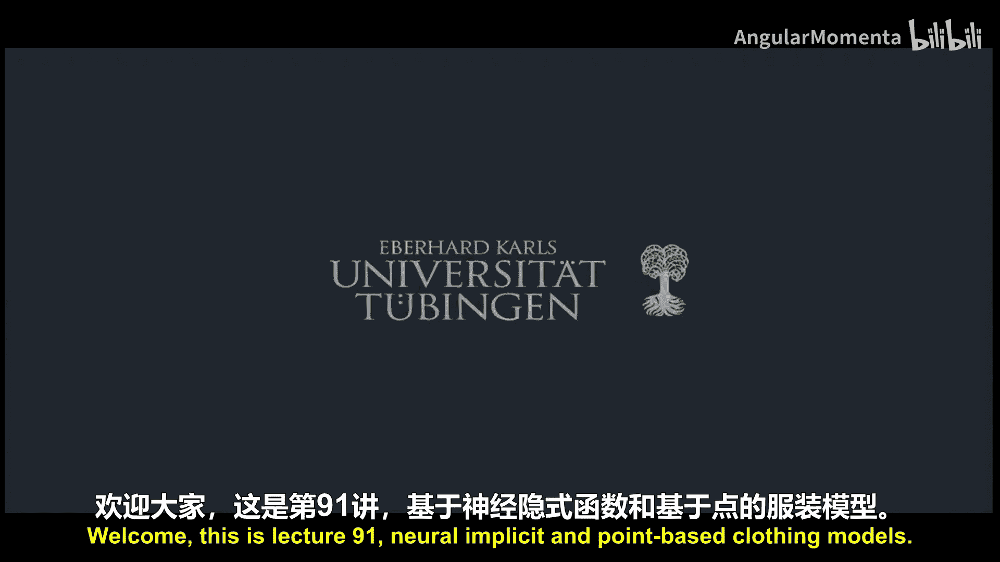
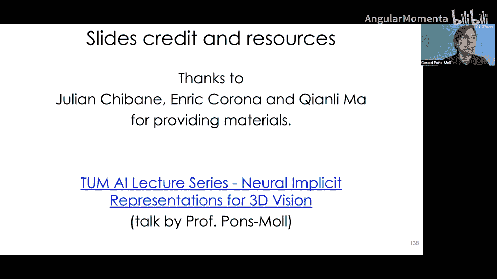

# 【精译】蒂宾根大学《虚拟人类》-p19-09.1-神经隐式与点基服装模型-第三部分和第四部分--BV1TAbkzpEva_p19-

Welcome， this is lecture 91， neuralural impmplicits and point based C models。

This is going to be part three in the previous。Video we saw part two。

 which was based on neuroimplicit models for humans now we will see how to make these models generative。

So the previous models were also generative in some sense because they could generalize to new poses。

But by generative here， I mean that given some control parameters， latent codes， for example。

 we can generate shapes。Of humans represented implicitly。So these works that we saw like NASA。

 Cobe and Noodle GifNarf are not generative models in that sense。

 and so this is what we will cover now。So there's been a number of works in generative neural implicit models I'm going to base this talk on this work by Chinaal。

to generate detailed shapes。Directly from a latent code set。This approach is called GDN and。

The title is towardss generative detailed noodled avatars。

So the ideas are almost the same as what we've seen before。

 the only thing is that now were going to train a model to produce those shapes from latent codes。

So at the high level， the model will work like this。

 you start with some late encode that encodes the shape of the person， this encodes the overall。

Size of the person and the type of clothing。And then you have like a latent code for the detail。

 this might encode things like， for example， like wrinkles。

In the clothing and then basically this model， which is the canonical implicit model。

 produces in this canonical space like an implicit surface for the shape and a neural field for the normals。

 so basically a normal vector for every point in space。Let me just this for a second。All right。

 so this model is not subject specific， it could also generate these neural shapes for a wide variety of shapes。

 and so that's why there is this module which is a multi subject forward skinning。

 which is basically extending or adapting this skinning model of simple to this neural implicit fields。

嗯。So basically there's different modules like one for the shape。

 which is M and one for the skinning weights， which is W and we'll describe them in more detail next and this produces disposed。

Occcupancy or like this implicit surface representation as well as the post normals。

And this network is going to be trained using a three reconstruction loss using an auto decoding framework。

And then。In order to obtain the details like these。Normals will be rendered。

Producing it to the normal map and then like to the adversarial laws will be applied here also in order to learn this more stochastic component。

So what does it mean like auto decoding framework for training。

 it means that you initialize a set of latent codes that detail and that shape for every instance in your training data set and you optimize those along with the model parameters。

 the model parameters are parameterizing the canonical implicit model。

 then multi subjectject forward scanning model as well。And for this part， to the adversarial laws。

 this is not trained using an auto decoding framework， it's trained using like a G training。

So this mini Max game， which I think you will see in other lectures。All right。

 so let's look at the first component which is the canonical implicit model。

 there's almost no new concepts here， but you can see here how those concepts that we've seen can be applied to build this system。

So basically like you have like the latent code Z shape， which will produce like these features。

If you remember like this， IFnet features， which were like this。Voxel grid of features。

 this is the same it produces like a vuxel grid of neuralodle features。

 then for a given point you basically do linear tri linear interpolation of this nuodle features that will be fed into this occupancy block that together with the position。

 the absolute position of the point will decode into the occupancy。In this。

In this un post canonic space。In addition， like based on the features and based on the absolute positions of the points in this canonic space。

 then the normals are also predicted。This normal module is also a function of this latent code。

 which is responsible for modeling the detail。So altogether we have that the shape is represented as an implicit surface because it's basically all the points x that satisfy that the occupancy is at the threshold tau。

 which would be 0。5 and the occupancy field here is basically mapping between 0100 being inside typically and one being outside。

And。Right， we have this mapping， which is this occupancy map， which takes the input。

Point and the latent code that and produces the occupancy as well as a feature。

 and basically this latent code is of dimension L shape。

 which is controlling the overall rough shape of the human and Z detail would be another code that models。

嗯。This details that are baked in into the normals right so we have these two mappings here。

One for the core shape， O and one for the detailed shape with normals。Right， but this is。Right。

 this is modeling things in the can space and now we have to model the post dependency and we also need to。

Be able to train these and to model multiple subjects so we need another module and this module is very much based on SNAf which we just saw before it's based on this idea of forward scanning however here we have to be a bit more careful because this model is multi subjectject is not subject specific。

So。We need to model two things。 One is the。嗯。Body the formations like the overall body the formations without clothing and the formations with clothing。

And to learn this forward scanning， we're going to consider the simple template without。

Without this like body the formations and this will allow the network to learn easier Okay so let me explain this in more detail so here we have this skin module W that takes these latent code that shape as input。

And it also takes。UmX star。So X star would be this size independent。Position of the point。

Whi is basically canonicalized， both ind and both in shape as well。

 and then the skinning weights are predicted。And basically。

 they are post using LBS how this actually works is using this。Trick fromNarf。

 which was basically you start from x prime and you need to figure out what the canonic point x star is in canononic space and for this you need to do this iterative root finding and differentiating through this process so the process will be like okay。

 I start with x prime and I have to satisfy this equation here。

 which is basically saying that x star should should I should find the canononic point x star such that。

嗯。That the post X star given the shape and the post and the latent code of the shape matches the post point right so we have this implicit equation that we need to satisfy。

So。Just a note on the notation because it's easy to get a bit confused here so here notice that this X star and also this like little triangle on the top little hat this means that it's a canonic point but。

This point is in size dependent。😡，Space， this would mean the canonical space。

 including the shape of the person and the clothing。Which we need to now。

Make size independent with this module M in order to predict the skin weights。

 That's why this X star and。Hat here has to go through M in order to like canonicalize it in shape as well and then predict the skinning weights right so the new concept perhaps here is that this there's this additional module which canonicalizes the shape of the person such that we can predict skinning weights on this shape independent space right and this is important to make the model generalize easier。

All right， and the module M， which I just described is basically this body shape dependent warping field and。

Right， as I said， like the process is based on。Unforward skinny。Right。

 so this forward scaling again is satisfying that the post point by our modelto。

 which is denoted here as the matches the ground truth post point x prime or the point that we're occurring okay？

嗯。And we have these tool。Like canonic points if you want。

 like the size independent X star and the size dependent X star bar on the top。

And so that's the model basically。It has to be trained using this auto decoding setup。

 so basically you will for every scan you have in your data， it requires data set of scans。

Like you will initialize these Z shapes like these codes。

 one of these codes vectors for every instance， and then you will optimize these codes along with these module parameters here and then once you have trained this course shape model then you can start training the normal module afterwards this is important like in and it's quite common in many algorithms that you first have to learn the course model and then you have to add the details on top later。

Right， so these are some of the results that can be obtained with such a model and as you can see it looks。

Quite detailed it generated from scratch that the formation doesn't look particularly。嗯。Like dynamic。

 I would say， it looks similar to what you would obtain with a with a with with a skin model。

 And that's because like， I mean， actually， it is a skin model like it predicts the。

The weights and there's no post dependent the formations here。

 as far as I can tell in this diagram here。The skiing weights， for example。

 do not depend on the pose。What could make it post dependent is this normals predicted。

 so we see a little bit of post dependent information， but not much。All right。

 but what is cool is that yeah， these results are actually generated from latent codes。

 so this is nice because you can generate then like arbitrary humans from this latent code。Here。

 like one can show like the variation in clothing styles。And so on。

 So one problem that this model has or one。Feature or limitation is that it's basically a single layer。

 it does not separate what is clothing from what is the body and we've seen in other lectures like in the vertex based models that separating the clothing from the body has some advantages like it gives you more control。

 for example。And so there's also like implicit surface models that are。

Able to separate the body from what is clothing。 So this is， for example， simplicityimit。

 which is topology aware generative model for cloth people。 And here encoing the。嗯。

The clothinglo surface is a neural surface， is a neural implicit surface。

 then one can interpolate across different garments， including。Including different topologies。

 as you can see here in this picture。So just to recap。

 vertex based clothing models were based on displacement fields。

 which require predicting three dimensional displacements。

As a function of pose and shape right so this was the case of Taylorornet so we had this function here M that based on。

The pose and the shape Okay， this notation is a bit'm not exactly what we want to do like actually based on the pose and the shape you would be predicting here a displacement at the output right and then these models they need to specify the number of。

Vertic is the number of displacements that you will predict， so they are not continuous。

Now in a neural implicit model， what you would have like is a function C that takes a point arbitrarily in space and pose and some codes again to model the clothing。

 and it would produce a an unsigned distance to model。

The surface right and so the surface would be at the zero level set of this signine distance。

Now here's that cut encodes like how the clothing overlaps with the body。

 so things like sleeve length or pants。The trousers length and so on。

And the clothing style controls the size and fits like how tight it is to the body。

 so this was a design choice to have a little bit more control on the generated results。Right。

 so the representation is based on an unsigned distance field similar to neural distance fields that we saw before and。

Basically， given an input point， you will have an MLP that predicts this。This distance field。

And this MLP， of course， needs to be conditioned on these clothing parameters。

 which is basically like this Z gauge that I just described before。

And once you train the model like you have。Basically like this。Different attributes that can be。Like。

ConlThat can control the output clothing right so basically。

Like by moving along the principal directions in the latent space that the model has learned。

 you can interpolate different。Like clothing styles and。And cards and and shape basically。

And this is what is being illustrated in this picture。

So notice that like in contrast to methods like TaylororNe that are based on templates。

 this allows you to interpolate across different types of cards and templates which would not be possible using a meshspace representation。

 you need this neural surface representation in order to model this quite varied surface topologies。

Right so here like actually I should have described this a bit better like these attributes were controlling different things like one was the cat。

 the other one was this like sleeve length and now that is controlling more like the。I'm the shape。

All right， just as comparison like the Taylorornet was producing results that were compelling。

 but notice that the interpolation was always within the same garment。

 it could not interpolate across different completely different garments as simply it can do。Right。

 so overall like this simplicityimlicit model can represent multiple toppologies in one network and there is no need to predeeffinine cloth and train independently per template。

 which is quite convenient， what is also convenient is like fitting these models to images because we can directly optimize the latent codes of this model。

So starting with an image， you can extract the cloth segmentation using a neural network nowadays there's a lot of good methods for doing this quite reliably。

This method was relying on some initialization based on some work that estimates the body parameters and the post parameters from the image。

 and then basically you can obtain a three reconstruction by optimizing the latent codes of the model such that it overlaps well with the semantic segmentation mask。

And I'm going to explain now in more detail how this is done because I think it's interesting and the fitting objective。

 the optimization is quite different compared to when you use like a vertex based model。

So this is the objective function， so you want to minimize this loss。

 you want to make this loss small。And the optimization variables are the closing parameters。

 you could also have like shape and post parameters here， but just to make it simple。

 let's assume that we know already what the shape and the pose should be and we only optimize the closing parameters set。

😊，So now we have two scenarios， one， where we first have to sample points around the canonical space。

 we need to pose them， and then we need to compare them against the image。

And this points P beta are basically body relative representation of a sampled point in cantic space What does this mean it means I sample a point。

And I'm going to encode this point relative to a set of vertices on the mesh。

 so I'm going to pre fine like this set of vertices like let's say you take 100 key points and then every point will be expressed relative to these key points and so relative it means that we just store a matrix of displacements from the key point to the point。

And the reason is that this like encodes how the point relates to the body。

 otherwise then you would not have this relationship and then this would be harder to learn。

So we have two scenarios for sample points after posing them one is that SP equals0 sp is a variable that indicates whether the point overlaps with its corresponding segmentation label here。

 the T shirt or the pens or the hair depends on where the point。

Yeah yeah depending on what the point represents and then basically we have two scenarios one like the point does not overlap with this segmentation label in which case this variable S takes value0。

And the other case is when the point does overlap with the semantic segmentation label in which case this variable takes value one。

Now， in case the point lies outside the surface， what do we need to enforce。

 we need to enforce that this point belongs to the outside of the surface。

 so we need to enforce that C here。Produces a distance。That is bigger than zero。And in particular。

 it needs to produce here what is defined predefined as D max， which is like the maximum。

Distance allowed by this model。 So we kept the distances so to make the model more。

YeahI mean easier to train so this is forcing the point to be outside the surface if it's。嗯。

If it's basically not overlapping and if the point is overlapping with the semantic segmentation mask。

 we need to make this point belong to the surface。How do we make the point belong to surface well。

 we have to ask that C， which is this distance field equals to0。So this is what we're doing here。

 we're minimizing this absolute norm of C， which basically would mean that we have to make this C。

Equal to zero。嗯。This I here， all right， this is taking the minimum over the points along the array because there might be multiple points that project the same pixel basically you consider the minimum along points sampled along the array so actually points are not sampled randomly they are sampled along the rays that go from the camera center through the pixels。

And。Basically。After doing this， you will sample lots of points and then you can recover like these surfaces that are you know aligned with the semantic segmentations in the images and they are on top of the body。

And yeah， combining this flexibility of implicit representations with the explicit control of parametric models like simple。

 we can recover this layered。Models from images。Now the quality here is not great。

 but that's not the deficiency of the model， it's rather a deficiency of the data that was used this data was。

Based on。On simulations and the quality of the data was not great another problem was that we are using here a threshold on the distance field and that creates like a bit thicker clothing。

Maybe a trick like what we did for neural distance fields would have produced a little bit more detailed results。

All right， so。Overall， like I just to remind you like this is more or less like my take on this and I mentioned before that implicit surfaces are。

嗯。Are more compatible with learning， but they are not allowing so so much control。

 but you can see that you know these models already allow some degree of control and。Yeah。

 so this is basically improving over time。All right there's a lot of papers and this is only going until 2022。

 I think more recently there's probably even more papers coming so yeah you're encouraged to if you're interested in this topic like to check these other papers as well。

All right， now let's move to part four， which is point based clothing models This is going to be。

A bit briefer than the other parts。But it's a representation that it's worth knowing and being aware of。

So this is the table that I was showing before and so we see here like in terms of control。

 topology details， speed and。😊，Whether the representation is continuous now the question is like how how do point clouds compare to other models right so let's look at this。

So。There's a number of papers that actually are based on points and in general they are high fidelity and they have flexible tops because they points can move to different locations。

And。They are they are basically also learnable directly from scans and they allow for fast rendering and actually nowadays like。

With the rise of Gaussian splating， which is like essentially a point based representation as well。

 I think this representation is becoming more and more popular in the community。All right。So。嗯。Yeah。

 so previous methods that。Basically are exploiting some sort of point base or patch base representation。

 they were like attaching features to patches of the surface， however。

 like this is the work of my title 2021 which basically results in patchy artifacts because when you put things together so basically you have like artifacts at the boundaries。

And like。This work， which is called Pop， is basically attaching features directly to the points。

 and so this allows to get a more fine grain。Representation， which results in sharp local details。

Al right， so how does this work， So this work in particular relies on a UB map。 Remember。

 the UB map is like this image that encodes at every UB location like。

Yeah there's a correspondence for every UB location on the image there's a corresponding 3 d point on the surface and so basically what this is。

How this works is you have。You have like a po encoder that will produce like this features for every Uv location and then basically this garment tensor variable that。

That includes the clothing。And basically then based on this point based features and the garment features like there's this shape decoder that predicts a displacement essentially our I for every point in the surface so every。

Point here that stems from the UB map is displaced along our eye。

In order to model things like skirts or complicated clothing。

 so the mapping that you learn is a displacement field and this is defined on the surface。

 so you have like a mapping from UI which is a UB coordinate and RZ which is the latent codes and this maps to this displacement vector are that belongs to R3 which is RI。

And then a point in the post space means that you need to transform this displacement。

 which is predicted in。Canonic space and the point。

 the original point needs to be also transformed to PI， which is in the post space。So。

So this model might look very reminiscent of Taylorornet because essentially TaylororNe is。

Almost the same， the only thing is that Taylornet specifies。Or let me think， what's the difference？😊。

This also specifies the number of points。あ。Okay， now I don't know if this model spits out a fixed number of points or the models continues over U coordinates could be so but one difference is that in TaylorNe you assume a given like connectivity of points here the points are disconnected and just the network just spits them out and then they are rendered without making use of faces that connect them。

Right， so these are some of the results that can be obtained and like in general。

 like in the paper it's demonstrated that this produces higher quality results than LBS。

Due to these simple UB maps that are used， there's some discontinuity which can be seen in this like seams like this is where the UB map cuts the surface into two and。

Yeah， so this is more significant for skirts you have you might have this type of artifact。

 so for example like。One problem is that if you have two points and they are attached to。

 for example， like the left leg and the right leg when you're doing skinning。

 when the legs get separated and these points get separated and therefore like the points here get a bit sparser and then the results look also。

Not so great， see this is a problem of displacement fields like if you have a displacement field from the body。

You will have this sort of artifacts， right？Okay， so。So in comparison。

 I would say that points are also not so complicated to control and you can model different apologies。

 they can achieve like a good level of detail and they are fast but they are not a continuous representation。

 they are discrete deal， so in that sense they are suffering from the same problems as meshes that you need to pre specifyify the number of。

Points that you will produce。嗯。Yeah， we will see later later in the lecture this we will discuss like point based models which are based on Gaussian plots and the main difference is that now。

Like in every point you will attach a Gausian with a given covariance。

 which can be very quickly rendered and which。Which can produce like high quality results without。

Without having this like。Connected。You know， set of vertices。All right。

 this concludes the talk thanks to Julianne andrique and Chenli who have contributed to these slides and also if you're interested in this topic you can check this lecture。

 maybe this lecture is now a little bit date， but it was like neural implicit representations for three vision which basically describes。

Like the pros and cons of these representations。Thank you， and I'll see you in the next lecture。

 let's stop here。

