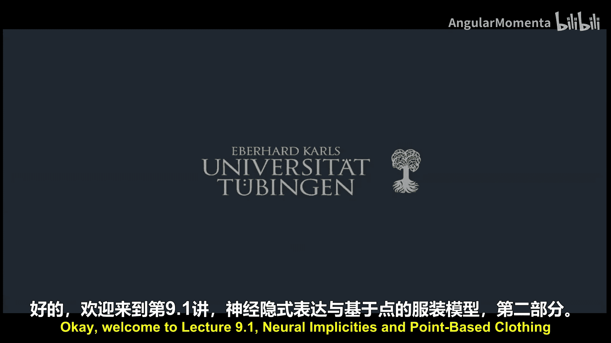
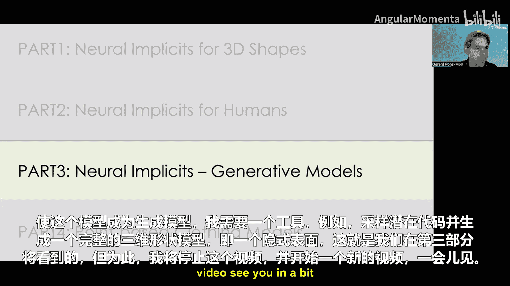

# 【精译】蒂宾根大学《虚拟人类》-p20-09.1-神经隐式与基于点的服装模型-第二部分--BV1TAbkzpEva_p20-

Okay， welcome to lecture 91 Nood impmplicits and point based clothing models part two。

 so we covered part one already this is going to be part two。Okay， so in part one。

 we've seen like how to use neural implicit models for general objects and now we're going to see how to make these models specific to work specifically well for humans。

So Brian works in like modern people， in particular， modeling people in clothing as we've seen。

They are mostly based on meshes， which are convenient for some aspects， but as we saw。

 they have problems with modeling topology and very complex clothing。

So the topology needs to be manually defined and they are limited in resolution as well right and we were seeing if you recall this comparison of parametric meshes versus implicit functions and we saw that implicit functions or implicit surfaces they seem to be convenient for topology changes and they are also more amenable for learning because they allow you to predict to make predictions per point。

Okay， so。Basically models， neural implicit models for。For people in clothing and for articulation。

 they are high fidelity and they are flexible in topropology， and they allow some degree of control。

 although this is more difficult and very importantly they can be learned directly from scans without registration。

This means that the output also does not produce meshes that are registered。

 however it's sometimes convenient to not worry about registering the data beforehand。嗯。All right。

 so basically like the vertex based human models were a function that was mapping from pose and shape parameters to the three n vertices of a model this should be 3 n or I mean depends on how you define it like so here V represents a vertex so that's why this is three dimensional。

And this you would have for every vertex in the model。

And in neural implicit models you have instead that given a latent code which is dimension D and a point P which is three dimensional。

 it predicts a distance or an occupancy which is a scalar right so that's kind of the mathematical difference between these two models。

And now if we want to make these neural implicit models。More human like like a human model。

 we have to make them dependent not on a random lant code。

 but on latent codes that are meaningful and in this case would be the shape。

The pose and the shape of the human and again， we want to predict this distance。Or occupancy。

So the first model， really that。😊，That attempted to predict。

Like the human surface or an articulated surface with a neural implicit model was NASA。

And so basically here。basicallyically the argument in this paper was that you need to reason or repeat about this articulated structures。

 otherwise it's going to be very difficult for the network to learn for every possible post。

What is the occupancy of the surface？And to illustrate this， basically they show here in this work。

 basically it's shown here like the naive solution。

 which would be some representation of posts in this NASA paper the representation of posts is a little bit strange it's basically。

😊，taaking the rigid parts of the body and taking the root location and then basically applying the reverse transformation。

 it doesn't really matter at this point， it's just a way of getting numbers that encode the pose and it was decided at that point that this is like more convenient for the network to understand the pose than the joint angles。

U but that's not the important part part， the important part is that if you go from pose directly to this implicit surface。

 it's going to be very difficult because you have you need to learn for every possible pose what actually the configuration is and that's very difficult for a network to learn。

😊，However， we know that the human body is articulated and so the question is like how can we incorporate a little bit more of prior knowledge here so that the network has like an easier job to learn this task。

So remember。😊，That。This is the simple model which was deforming in the canonical space。

Basically after deforming canonical space it applies the articulation to get this vertex now the question is that can we extend these concepts to the neural implicit models and the answer will be yes and you will see how。

All right。The first thing that we can do to improve this unstructured model。

 which is the na solution， which does not generalize to new Bs。えスと。

Incorporate what is called like a piecewise rigid model。

So what this model is going to do is like for every point in the post space， it's going to unpose it。

According to each of the parts。So we don't know for a point in space to which part this point belongs。

 we don't know， but what the model will do is like assume that it belongs to each of the parts。

Un pause。The point according to each of the parts and then。Take the occupancy as the maximum。

 so predict the occupancy for every rigid part。And then the occupancy of the point will be the maximum。

Occupancy what does the maximum mean here， it means that a point is occupied if it's occupied by any of the parts right so if any of the parts outputs one which is one occupancy or close to or bigger than the threshold then the network here that the total。

Result of the max will be that the point is occupied。

So basically this makes a lot of sense right and this is how we saw before how to combine。😊。

Like implicit surfaces， we saw that it's easy to compose them by these max operations in order to obtain the union of multiple parts。

😊，So this is what we will do， I repeat， you start with a point in the post base， you transform it。

To the canonical space with these inverse matrices， B0 until BB。

 these are the absolute transformation matrices for every part。

And then like you have a network that predicts in this canonic space， the occupancy。

 again this is a recurrent theme that you will see that predicting things in canonic space make things easier because it's more repeatable。

 it's always in the same places， the points always land in similar places and you don't need to learn for every possible pose what the occupancy is。

So this improves the results significantly and you can see here this is the rigid part model which can already reconstruct like the poses much better。

😊，However， like similarly as with simple， when we model this rigid de mesh with rigid parts。

 like you have problems at the intersections because the human body is not a collection of rigid parts。

 but it has non rigid deformations as well。嗯。So basically like in order to model these pose dependent deformations similar to the post plane shapes here。

 what it's done is like you have like a function these occupancy networks are a function also of the pose so this way the network in canonic space can learn occupancies which are dependent also on the pose so the pose here theta is you know condition conditioning this function。

Which is the occupancy for each of the parts。Right。

 and this is completely analogous to these post plane shapes。

 The only thing that the post blind ships were。This vertex displacements here， this is like theta。

 which conditions a full network。And you can see that the formable model。

 in particular at the elbows， if you can see here， it produces much smoother results as one can expect。

All right。One problem of NASA was that it needs to invert。

 it needs to map the points back to the canonic space。

 and basically it had part based artifacts and it had a limited ability to generalize the new poses。

So this low dimensional pose encoding does not fully remove this long range spurious correlations。

 and so when the poses are very far away from this draining distribution， then this model will fail。

So this is addressed in this work， which is called Cope and the idea is quite straightforward but it makes a lot of sense。

 so basically。You want to obtain the implicit surface of the simple model and essentially here what you will do is like。

Pot the simple mesh， consider the parts。Separately and then like。Canonize these parts independently。

And then run pointNe here to predict。Like lateden codes and from this latent codes。

 we're going to predict these occupancies。So similarly as before。

 but the main difference is that now the networks can see， you know， the local structures of。

These unpost parts in the economic space。 And so this latent codes here that 1 to set K are much more powerful。

 But this idea of unossing the pole the posing the points， according to the。Rgit parts。In this case。

 they are denoted as G1 to GK still remains， so this is the same as NASA and the max is still the same as before the main difference is these latent codes that now have information about how the local posts looks like in the canononic space。

And。Yeah， so you have per part body。Body part plus few points from neighboring parts and then you have like this shared occupancy。

So as a result， like Co has much better generalization than。Thenhan a modelt like NASA。Right。

 however， like。These part based models， they always have like these problems at the intersection。

 So the code is no exception。嗯。And basically also。Cope cannot model clothing or fine grain details is more like an articulated model now you might ask why do you need to learn like a model that is implicit well。

For example， like having the implicit surface representation is useful to， for example。

 test whether a point is inside or outside， which is useful for intersections to know， for example。

 if clothing is inside or outside the body in simulation or to know， for example。

 like whether the person is intersecting a 3D scene or not。Right， so part based models。Yeah。

 in general， like you need the skinning weights for the part composition and part artifacts are prominent in particular for out of distribution poses and cannot model clothing in particular loose clothing。

Okay。All right， so how would do we model these fine grain deformations and this is the next topic so basically。

I'm going to describe now a paper that is called neuralural GIF， which we published at ICCV21。

 which is basically learning pose and shape conditioned neural implicits using learned LBS and economical shape。

And so you will see that it's interesting because it's completely analog to the simple model。

 but while the simple model starts with can space and applies the series of deforms to get to the post space。

😊，This works in backward mode， so basically it starts from the post base and it will apply a series of transformations in order to evaluate the occupancy in the canonic space。

So these works， you start with a point in D。Post space and then you unpose it。

We will see how to do this like the network needs to predict the skin weights to do that。

And then we're going to predict like this displacement fields。

 which is the same as the postline shapes， but now they are going to be a continuous function of every point in space。

And the pose and the shape。And these displacements。You will see that。There are。Inverse。

 if you want to make the surface grow， like these displacements will go in the opposite direction and you will understand in a second why that's the case。

Right， so the question is like， how do we map a query point from the post space to the canonical space？

Right so this is the work which is called neuralural GF。

 and its the name stands for neural generalized implicit functions for animating people in clothing。

So first at the higher level， like the main goal here was to train directly from scans and to obtain like a neural implicit surface which could be posed with a skeleton pose so the input would be a skeleton pose and the output would be。

The nooddle surface。Including all the clothing details。

So this model is not generalizing across subjects， it's a subject specific model。

 but it can produce this level of fine grain details。So to solve this problem， like we build on like。

Ideas that were known or presented in computer graphics as back as the in 91。So basically like。

The key challenge we have here is like how do we pose how do apply the formations to an implicit function and so this can be easily done because like if you want to apply a rotation and a translation to an implicit surface。

 what you can do is like。Basically， what you need to know is like the occupancy or the distance field in this post new locations。

 P prime。So in order to know the occupancy of this point， for example。

 what I can do is invert the transformation consider。R minus1 and subtracting T from p prime。

In order to go back to the canononic space and check what the occ is。 I can always do that。

 I can invert。And I can have here like this space as being my lookup table right so I basically like always invert and look up and this is what mathematically is written here。

 the surface S prime after the transformation is nothing else in the points P prime such that。

F of r minus1。Of p prime minus D。 So the inverse of p prime。

Bringing it to the canonic space equals this threshold function。

And this is not only for rigid transformations， but it's for more generic the formation fields like the of X。

 Y Z。You can have a deformation field that deforms every point p in this canonic space into the。

Post base P prime and you basically would just， oh， this formula is missing here。

 you would just apply the minus D of X Y， Z in order to apply this inverse transformation。Alright。

 so how do we model like now more complex transformations like the simple model。

 So if you remember like what we were doing with a simple model is like consider vertices in a Tpo and applying a series of transformations。

 which were。These vertex displacements which were learned from data， and finally we apply this。

Like blend skining， as you can see here in the top， which is a linear blend of matrices B。

So this is forward because you start from unpost points and you obtain the foreign points at the end。

 this is a forward mode。However， in implicit surfaces。

 what we want in reality is like the occupancy of this post space surface。

 so we cannot start with canonic space， or at least it's not trivial to do。

So what we need to do here is start with the query points in the post space。

 I want to know the occupancy and for this I'm going to have a neural network that predicts these WI's。

 these are the skinning weights for this point p prime。Now using the inverse skinning。

 which is nothing else in taking this linear blend and inverting it。I can obtain P。

 which is basically these red points， which are un post。To bring them here。

And these Ws are with the network Fc。B， I are known from the simple model。

 And now this is like one of the key tricks of this paper。

 like we want to model this fine grain details。 these changes。For example， like wrinkle。

Wrinkle the formations or muscle bulging that happen as I articulate the body。

which are non rigid and instead of having a network that predicts directly the different canonical spaces。

 which would be hard to learn， what we do is we learn a displacement field in canonic space。

So Delta B here is basically a function of P in economic space and the theta， which is the post。

So Delta P is actually a three dimensional displacement field。

 and now all these red dots have moved to the green dots and now I can evaluate this SDF。

ItCould be an occ as well on this like。Canonic space after the formation。

And this plus delta P is essentially what you could think of it as a continuous post plane shapes。

But they because it's an implicit surface， if you think about it， they work the other way。

 so basically if I want to make it。If Delta P points inward it， you're making the surface。

Larger actually， so it's a little bit counterintuitive。All right， and using this model like。

We could reconstruct surfaces that look like quite detailed and that have like。Even complex clothing。

 it even looks like it's layered， although that's a simple single surface model。

 and it can be applied to。Whatever scans you have could also be like just single garments。Um。

Or or garments with。The aology does not follow the body， for example， as shown here。Okay。嗯。Yeah。

 you can check the paper this model was also trained with a simple data set in order to produce like a simple model that is basically。

Producing implicit surfaces， which would be useful for。For intersection testing and things like that。

So in comparison to another work， which is scannyimate which basically is conditioning the。

The canononic SDF F of theta on the post directly， basically this can get better details because it's modeling this the nonre deformations inside。

This function right so it's basically deforming the points first before evaluating the SDF and typically doing this you get better detailed you will see this also when we see the nerve models like the same trick is applied。

Okay。I don't want to spend too much time on this， but basically the conclusions is like comparing to different models。

 the conclusion was that the model was significantly superior to NASA and it was very very much comparable to Scnyimate。

😊，In terms of numbers， perhaps like neural gift like can produce better details because of this trick of modeling inside the。

Canronomic function。And。Yeah， you have the numbers here。All right。There are still problems and。

You will see。I will explain now what the main problem is。

The main problem is that you need to predict for every point in space the skinning weights。

 and that's a hard learning problem。Like this is illustrated here and this is like what。😊。

Is illustrated as backward skin， backward skinning because for every point in space， in post space。

 you need to know what the skin weights are。嗯。When the pose is complicated。

 the skinning field like this blue and green area represents the skinning weight's learned， okay？

When the pose is hard， then you see that， you know， the canononic pose。

Point which should be here at the edge is like not predicted correctly and it's predicted in the middle of the space that's when the network is not generalizing。

And that's because it's hard right to learn for all possible poses what the skinning weights are。

Instead， in the simple model， when we have forward scanningning， that's not a problem。

 we start with a point and we deform it。And basically， the skinning weights in forward skinning are。

there would be constant for all these， I guess， provided that I know the corresponding。

Canonic point x prime yeah same forward scanningning like this is not varying with bows crazily like here。

This is basically more static and it it。From this， you can already。嗯。

Predict that the learning will be easier if we somehow integrate this forward mode of skinning of of the simple model in this learning process the question is how to do this and this is non trivial。

So this model， like which is called SNarf， which is called differentiable forward scanningning for animating on rigid neural implicit shapes。

 it basically learns canonical shape。With is network sigma F。

 and it learns the skinning weights in the canonic space， not in the post space。

 it learns the skinning weights， and this is the key。With another network Sigma omega， Sigma W。

And the goal is to。诶。The goal is to learn this network， Sigma， W and Sigma F。

In order to produce these implicit surfaces for an symosis。Right， so what's the key idea here。

 like the key idea is that in forward scanning you have from canonic space x to post space x prime for the all x's。

And learning canonical shape from scans requires to know the inverse for every X prime I need to know what the canonical point is。

 this is what we were solving with inverse kid。So now in this paper star， what they will do is like。

Given the relationship x maps to x prime， determine the x prime that maps to x， right？

And so it's an implicit relationship， but there's no close form solution。

 it's a non projective mapping because multiple solutions。😊，May exist， or given post per point。

 you might have multiple solutions on the body。All right， so this is the network architecture。😊。

And it looks not so complicated， but actually it's more intriated than you might expect So here we start with this canonic space star。

And I need to have a network that predicts the skinning weights for this canononic space。

 this is very similar to how simple works over the surface。

 but this is defined over the full canononic 3D space。

So W is a vector of weights for that point star。And now when I post this point。

I need to satisfy that sum of Wi， which are the skinning weights。

Times the matrixes B here an index missing X star should match with the canononic pose。

Point X prime that I'm evaluating。And so there might be multiple x stars like 0 until x andb that satisfy this post point x prime here。

 for example， in this example， like it shows that the blue dot or the purple dot and the green dot。

Would both pose to X prime。There would both be valid solutions。

So you consider all these valid solutions and。You obtain the occupancy with Sigma F。

models the occupancy in this canonic space and now similar to NASA。

 we obtain the occupancy as the max， right， which is saying like a point is occupied is if it's occupied by any of the parts。

 this is again。But if you inspect this carefully， x star is not known， you don't know。

 you only know x prime， you start with x prime， but you don't know x prime x star。

 so this requires differentiating solution of a nonlinear system and this is the linear system that you need to solve。

And so the question is， how do you do this？So mathematically， you have the following relationship。

 find x star such that x prime minus disposed point。

 which is sum over the parts and the skinning weight which are predicted by the neural network sigma。

W？And Ies indexes the。The skinning weight of that part。

Find x star says that this equation is true x prime minus the skin point equals 0。Okay。

And so the goal here is to find the neural network omega， like sorry， W。Weights。

 the weights of the neural network。Such that。This。Equation is satisfied and such that this。

Los that I'm going to define in a second is minimized。All right。

 so first of all we have to understand this equation well， this is nothing else in skinning。

 but now the skinning weights are parameterized with the neural network and the main difference with backward skinning is that now the skinning weights are predicted in the can space。

 not in the post space， which will be useful for generalization。😊。

Now we have a loss here and loss is the laws。Of these neural network parameters。

 actually also of the parameters of Sigma F， but I omitted this here。

Sigma have being this occupancy network and economic economic space。U。

And so here you have a cross entropy between what between our predicted occupancy。😊。

Which is the max over all these possible canonic points。Okay。😊。

And the ground through the occupancyency at X prime。Right？So go back to this。

You take the max of all these predicted oupancies one for each。Hypothsesis of x0 until tx and b。

 hypothesis of what could be like the canononic point corresponding to this。

 and then you get the max。Al right， so we need to minimize this cross entropy loss and the challenge here will be to take the derivative of this loss here this cross entropy with respect to these neural network parameters and notice that X star is the solution of this system here。

 which is a nonlinear equation。And this is what is solved in the paper if you want to get to the details。

 you can see how they back propagate through root finding。A root finding algorithm。And by doing this。

Forward scanning similar to simple right， you might get a little bit less nice nice details like the surface might look a little bit smoother。

 but you can generalize much better to different pose。

Epeially poses that are significantly different from the data set。

So you can see here forward versus backward LBS and backward LBS， as soon as the poses are crazy。

 it completely breaks down because it doesn't predict the right skinning weights for those poses。

All right， so this is a comparison of different methods and you can see that this forward scanning models they work。

Much better for difficult poses now in terms of detail。

 like the you lose a little bit like backward skim there still。bettertter。

 so basically forward ski models， they have better generalization to un symposes。

 but backward skin models have higher fidelity。And are more flexible to model things like loose clothing。

 for example。All right， this brings me to this final part of this。

Part two and all these models that we've seen until now they are not generative models and now in part three we will see how to make these models generative。

I need the ability to， for example， like sample latent code and generate like a full 3D shape model as an implicit surface。

This is what we'll see in part three， but for this， I will stop this video。And。

I will start a new video。See you in a bit。

