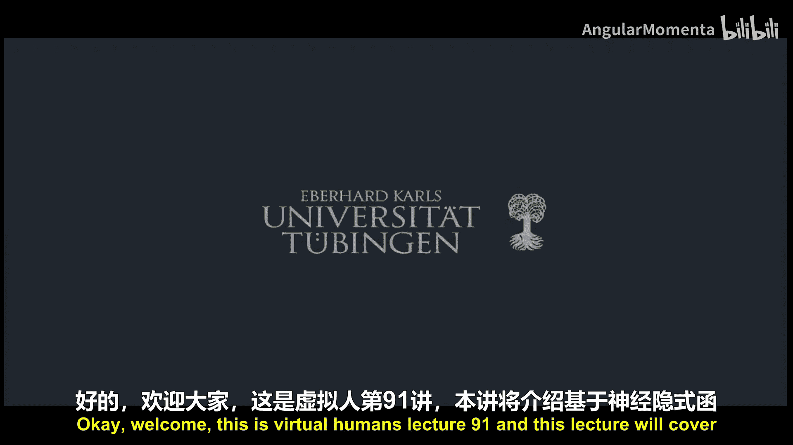
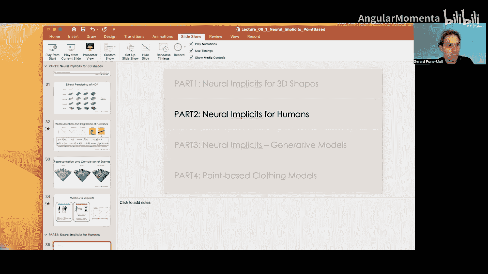

# 【精译】蒂宾根大学《虚拟人类》-p21-09.1-神经隐式与基于点的服装模型-第一部分--BV1TAbkzpEva_p21-

Okay， welcome， this is Spiritual Humans lecture 91。

 and in this lecture we'll cover neural implicits and point based clothing models。

Let me do one little check。Okay， everything is good， all right。嗯。

Right so this lecture is divided into four parts and in the first part we will see like neural implicit in general for 3D shapes in the second part we'll see how to make them specific to human body models。

Then we will see like how to make these models generative。And finally。

 we will see like a very simple but effective representation， which is based on points。

So let's start with。The rule implicit models for 3D shapes。So the obvious question is here， well。

 what is a good representation of three data or the obvious question not。

 but the crucial question or the important question。

So things to consider are that the representation has to be compatible with neural networks。

 it needs to be flexible and it needs to produce high fidelity。😊。

Now one representation that is very amenable for neural networks is a boxoxal based representation because if you're using a convolutional neural network。

 well you can apply filters directly to the data， so that's convenient。😊，However。

 you're discretizing the 3D space into a grid and this consumes memory that is cubic with the resolution that you want。

 also when you want to make a prediction or train a model。

 you need to make a decision on the resolution that you will output because you need to define the architecture beforehand。

 you need to define like what is the number of voxels that you will produce or that the network will produce。

You could choose to predict point clouds and so point clouds are basically discretereized into 3D space into 3D points。

But this does not model the connectivity or the topology。

 what things are connected to each other things。And also you need to choose typically the number of points that the network will produce beforehand。

 so basically it means that you're limited in terms of the resolution。Yeah。

 I should also mention that points are in general more difficult to render。

 although this is being changed nowadays when you consider Gausians on the points。

 this is a new technique that is called Gaussian spting， which allows you to render very fast。

 but in principle like a representation that is based in points。

 it's not trivial to render because you need to know how the points are connected。

Then you have meshes， which we've seen extensively in this lecture。

 which is a discretization in terms of vertices and faces。And。

It's basically limited also in the terms of resolution you need to choose how many vertices you will predict。

 and it requires a class specific template， which for humans is possible。

 but imagine like now categories like chairs or even more complex object。

 it's very difficult to define a specific template that will deform to every instance。

And so this leads also like to self intersections and all sorts of problems associated with meshes。

Right， so one very interesting representation， which has been known in computer graphics for many years。

 but it was not used in the context of deep learning was is an implicit surface representation。

 which we've seen in the third lecture。So it has the advantage that it's not discretizing the space。

 it can represent any arbitrary topology and resolution and it has a very low memory footprint and it's not restricted to specific plus。

😊，So it seems that there's a number of。Like conveniences and advantages of this representation。

 and we will see now how this representation can be leveraged within the context of a learning 3D shape。

It's interesting that three papers came at the same time in 2019 proposing almost the same idea at the same time。

Right so some of this will be a little bit of repetition of what we've seen already。

 you can define a function that tells us whether a point is inside or outside or it tells us the distance to the surface and now the surface which is this boundary here in blue is basically determined by this function F because you can define that the surface is are all the points p such that the function f of p takes a value which is at the boundary between inside and outside if you would have an occupancy being 0 and1 then this threshold would typically be 0。

5。So this determines like the surface， like the set of points that satisfy an equation。

 which is the level set of this function。And we saw already that one very。

Convenient thing of this representation is that if I have a topology change， for example。

 like the surface splits into2， now I can differentiate through this topology change because I can take derivatives of F with respect to the parameters that parameterize F。

 and I don't need to worry about which points get connected to which other points which I would need to do if I would be using a mesh representation。

Differentiating meshed topology change。Would be quite difficult， quite challenging。

 I don't know how one would approach that。All right， so for common objects。

 this was a bit of a breakthrough because it could。

Represent like different apologies at a resolution that was unprecedented and in particular you could choose the resolution or you can choose the resolution at test time。

So how do these networks work？Actually， the model is pretty simple， but。Yeah。

 one should not underestimate the。The potential of simple ideas。So basically here。

 what this model does is it takes like a point。Literally the xY is coordinates of a point。

 and it turns a neuralodle network that predicts like whether the point is inside or outside。😊。

Now typically we're not interested in memorizing a single shape with a neural network。

 so you want some sort of conditioning and for example。

 or you want to predict based on some input data， for example like x could be some shape observation including sparse point clouds or partial point cloud or low resolution voxel or even an image。

 which you can pass through one encodeder obtain a latent vector Z which is of n dimensions and then condition that on the decoder。

 and then based on this Z and the point， then the network will predict whether it's inside and outside now to recover the surface。

 the process will consist in like querying many points。

As you can see here in the grid or outside the grid that's the beauty of this model because it's continuous and then basically querying many points you can。

😊，Decoded it into being inside or outside， and then using a computer graphics algorithm which is called marching cubes。

 you can recover the surface and you can even mesh the surface。嗯。So this was all good news， however。

 when when we tried to model like articulated shapes like humans we encountered a lot of problems。

 so given an input which would be a low resolution voxel like what you can see here。

 we wanted to reconstruct a high fidelity mesh based on this occupancy networks over this。

How they are called now neural field models。Um， and we encountered a bunch of problems like the articulated structures were often missing and tended to produce shapes that would look pretty much average。

嗯。😊，Now。In this work we presented at CBPR 20 2020， basically we addressed these limitations in modeling more detailed。

Articulated structures and more complex object shapes。So first of all。

 we needed to identify what were the problems with these previous models。

So when we look at the architecture or the model design， we see that two potential problems。

 one is that。The original shape space lives in a three dimensional space and when we're encoding it and mapping it into a latent variable that we're losing these dimensions。

 we're losing this structure， so it's going to be harder for the decoder to know that the output shape should leave also this 3D space so for processing 3D data this is probably not a good idea to map it to a one latent。

Vectctor， which is disconnected from the original space。The second problem。

So this is the loss structure problem， the second problem is that the point coordinates that we are feeding to the network。

 they carry no information about the local shape。Basically。

 I can rotate the full shape and the coordinates will completely change and the network now needs to learn to produce a shape depending on all these rotations and and also like basically like。

Coordates they do not contain any information about what shape。Is in there。

 the information is in like the local structures， like how points relate to each other。

 this is the local geometry。So it doesn't make a lot of sense to predict。

The occupancy based on these absolute coordinates， unless you want to memorize actually a single shape。

So basically， what we do here is like。Motivated by the success of convolutional neural networks。

 we employ a neural convolutional neural network in 3D here。

 so we convolve the input data in this case like a 3D grid that we want to super resolve or obtain better quality。

 maybe we want to complete some holes or like you know refine structures。

We obtain like this multi scale。Greed of deep features， these are feature volumes。And now。

 we're not going。Decode based on the point coordinates。

 but rather we're going to extract a feature at a continuous location on the grid。

 we're going to do triline interpolation and based on this feature we're going to decode the ocuy。

or the distance field whatever you prefer， so basically you have like this multi scale structure where you have like a deeper levels。

 you have like more global structure of the shape and at like shallower levels you have more local structure。

And essentially we do the convolutions and we decode based on these multi scale features。

Obtaining a reconstruction that is retaining also the limbs that were missing in the prior models。

So mathematically previously we had like F of a latent code and point decos into an occupancy。

 whereas now we are replacing this latent code by this multi scaled feature。

 so F1 to fN are these feature volumes。And basically at multiple scales。

 and then we decode based on the function。That takes these deep features at continuous point location speed。

And essentially that's the main change and this main change has significant impact in the results and as you can see here we can。

 oh this should be a video let me see。Okay， the video is not playing okay， well。

 you can check the website of the paper to see the results。

So what we observed is that we can superre when we have low resolution voxels。

 we can get details and we can retain the details that are already in the input data which is something crucial。

 we can also complete point clouds that are missing on one side maybe this is a better example here like the pointlets can be。

Like basically with missing parts and this model can predict。

And complete the surfaces because it has been trained on a data set of shapes so it can learn how typical 3D shapes look like。

And the model has been also extended to predict also texture and also it works quite nice so this basically these are results from a challenge so sometimes in conferences they organize organize challenges and then basically this challenge was consisting in recovering the 3D shape based on partial data and。

Yeah， so this method IF nets and its extension like one the challenge two times and so because it's also a simple method like it's been quite effective and we still use it nowadays for a bunch of problems。

All right， so we still have a remaining problem。Like we assume that the output is zero or1 inside or outside the surface。

 however， like this only can model watertight surfaces。

 but in reality you have open surfaces and manifolds and you have functions。

And you have complex shapes with interiors， how do you define what is inside and outside for those structures it's not clear it's not possible actually。

 for these kind of surfaces， there is no inside and outside。We could use a signine distance。

 but the signine distance also seems to be inside and outside。

We need to change the output representation。And that's clear we need a different output representation and。

😊，Before we get to the results， let me let me get to the actual solution， so basically。

Instead of predicting now the occupancy01， we're going to predict an unsigned distance to the surface。

So this seems like a very simple change， but it brings a set of challenges that need to be resolved。

😊，So now the unsign distance will mean that based on these input features that we had before for the previous model。

 we need to predict the distance from every point Q sorry from every point P in space to its nearest neighbor queue on the surface and notice that this。

We take the norm of this， so this is unsigned， there's no sign here。

 and this is what we want to predict。To simplify notation， I will write like here p minus Q， however。

 bear in mind that。Like sorry， like I'm going to write F of P， however。

 bear in mind that the F takes actually input features and not the point coordinates themselves。

Similarly just before。So now the question is， okay。

 imagine I have like some point cloud as this one shown here and I want to recover the full 3D shape。

And again， this like shape， like for example， like a bus is not defining a clear inside outside。

I want to recover the shape， which is this wide lines here。So how can I do this Well。

 it's the zero level set of the unsci distance field。Andm。So now the question is。

 how do I recover given an unsciign distance field， all the points that are at the zero level set？

Any ideas？Well。The most na solution would be to sample points on a grid and then threshold based on some threshold saying like every point that is like a distance below 0。

01 or something that you find suitable this you consider see this a point in the level set however this is not very accurate and it takes a lot of computation time and it's also not very elegant。

We can do better， we have a sign distance field so we can compute the gradient field and what is the best next idea we could do。

Well， we could follow the inverse， the negative gradients in order to converge to the surface。

 notice that this gradients。Point towards the direction of maximum change in distance。

 which is of course， going in direction of the normal and getting away from the surface Now。

 if I get the negative direction， I would land on the surface。However。

 there's even better things that we can do because this is a distance field。

 so the gradient points us towards the closest point and if you don't believe me just do the math。

 differentiate this equation here and you will see that the gradient will be p minus q which is pointing towardsq。

😊，嗯。All right。So the gradient point， the negative gradient points towards Q。

 which is the closest point great， now the question is like how far do I need to go in this unit gradient direction？

😊，Well， this is given by the distance， F of p is the distance。

 f of p is telling me how far p is from Q， so I know that I need to move F of p units of distance times the gradient because this gradient is unit。

😊，Norm towards the surface。Now why is this gradient unit norm well because it's a distance field and in the direction of maximum change I will change at most one unit distance if I if I move one step away I'm getting one step away in terms of distance as well right so that's why the gradient is always one everywhere。

The norm， sorry， the norm of the gradient is one。All right。

Right let me go to the here which is the result for so this the good thing is that you can have a sparse point cloud and for example like computing these neural distance fields we can reconstruct like a dense point cloud from these sparse point cloud as input and here like this would be impossible to do with this occupancy models because this complex spaces they don't define like what is inside and outside。

😊，And this way， we just circumvent this problem。So next I'm going to show like a few results that we can obtain with these like we can model mathematical functions and manifolds。

 we can model garments， which are open surfaces or we can model scenes， as I've previously shown。😊。

So in terms of modeling complex shapes like a car with interior。

 we can see that in comparison to this IFNe model that I showed before。

 like this new NDF neural distance fields can recover the inside of the object。

So you can see we can get these inner structures because we don't make any assumption about oh we don't require the surface to be watertight and so we can recover surfaces which are more complex。

In terms of garments， which are also open surfaces。

 we can also recover them so given the input sparse point cloud。

 we can recover the dense point cloud and we obtain an open surfaces output。Now。

 what is interesting of this？Nural distance field is that we can also。

Using usings the properties of the distance fields we can we can recover we can render the surfaces using something called sphere marching and the idea is like to basically。

When you do volume rendering you make use of the distance field to know where like the surface will be right I'm not going to get into the details。

 but if you're interested you can check the techniques called sphere marching。

And so basically given the input， which is again like an incomplete point cloud。

 we can recover depth， which is directly rendered using sphere marching， the distance field。

 or we can obtain the normals， or we can basically like get a shaded depth from this。

So this is useful to recover 3D shapes， but the approach is more general than this。

Back then we realized that we could use this more generally to model general functions。

 linear quadratics， sinooids， and in particular we could model manifolds。

 nonfunction data like a spiral nonfunction because for a given x I can have multiple y solutions right so that's why it's not a function but is's a manifold。

So how would we do that well all we are doing is consider this regression problem I want to regress y given some function of the points x1 to xn。

 that's a typical regression problem。This age。Function can be implicitly defined with this function F。

 which basically it will be all the points X1 x and and Y such that they are at the zero level set of F I can always do that right This is what we've been doing for surfaces I can do it for functions here right。

So basically all these points that satisfy this equation， x1， including y。😊。

Are basically the points that those satisfied that y equals H。And him。And so basically。

 I can use this F to have an implicit representation of age。Now。

 how would I use these neural distance fields for regression， well。

 I can start at at given point x1 until xn。And04 y， and I can march along the ray of y。Okay。

Wwhichch is this vector， lambda 0001， which is basically like marching along y until I satisfy the constraint that f of p of lambda lambda parameters this ray。

Equals0。So I mean， this was like already a connection of。A classical computer graphics technique。

 which is basically brain marching with a classical machine learning problem or like the canonical machine learning problem。

 which is like regression。And so basically， why would you do this complicated thing， well。

 because if youre train a neural network， for example， to predict with a function age to predict。😊，Y。

 for example， if you have like a spiral data like this， so for a given x。

 you can have multiple y solutions。What do you think is going to happen？Well。

 the network will produce some average in the middle because it wants to do well for all training data points。

 so sometimes it will see this point， oh sorry， sometimes it will see this point。

 sometimes it will see this point and then it will try to average and produce something in the middle。

 which is not what you want。Instead， here you would be modeling directly like this manifold of joint X and Y。

All right， so we only scratched the surface here and we went a bit further later a couple of years later。

 like modeling the post space， like the post manifold using these neural distance fields。

Which we will see in feature lectures。All right， so what we see here is that basically we can recover these nice reconstructions based on sparse point clouds and basically we don't make this assumption of watertight meshes。

All right。Good so。Now， like we will move at the second part of the。Talk。And。Oh。

 let me summarize a little bit like a comparison of meshes versus implicit functions。

Basically in terms of controlling like being able to control the surface。

I would say that meshes are easier because it' like basically they are compact structures and you can do linear algebra to deform meshes。

You can also deform implicit surfaces， but it's a bit more difficult and in particular like these learning models still nowadays are not so easy to control。

 not so easy to， for example， articulate and so on。

But in terms of hand topology changes and getting in detail， like definitely the implicit。

Surface formulation are more convenient。Okay， now we move to the second part of the lecture。

 which is neural implicits for humans。And。I'm going to stop the video here and start a new video。

See you in a bit。

